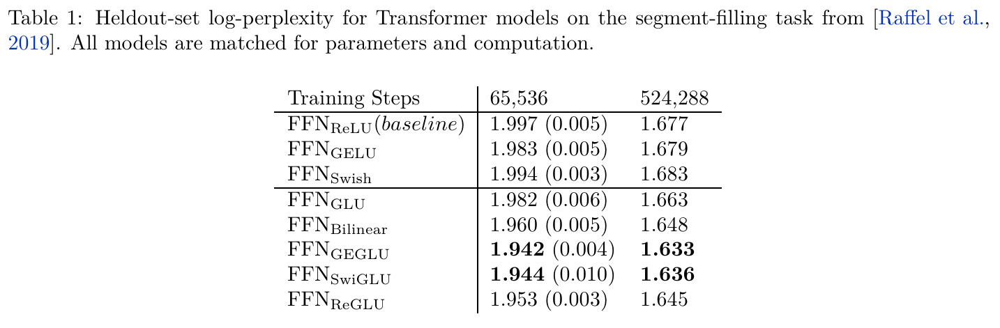
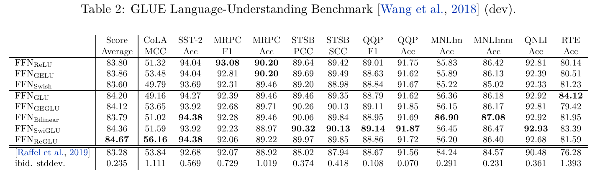
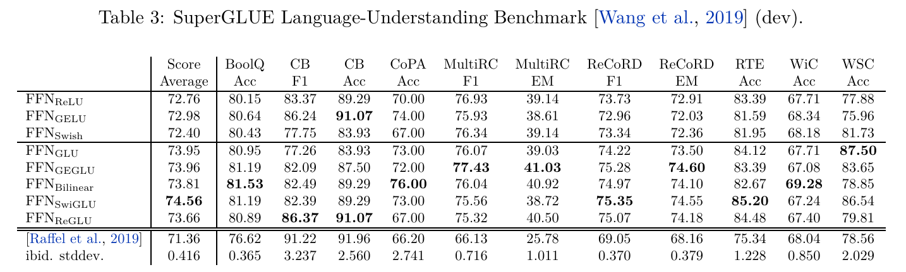
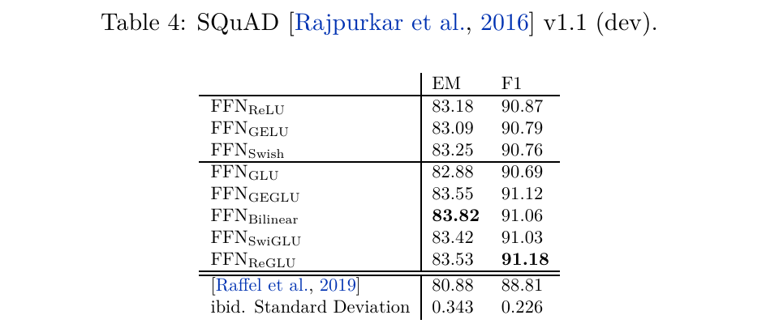

# GLU Variants：给 FFN 加一条相乘的支路

<p class="reading-meta">CLOSE READING · 2002.05202v1 · TRAINING / INFERENCE / SYSTEMS</p>

**GLU Variants Improve Transformer** · Noam Shazeer · Google · 2020

在近似相同的参数和矩阵乘计算预算下，把 Transformer FFN 的单路激活改为两路投影相乘，能否提高模型质量？

[原论文 PDF](https://arxiv.org/pdf/2002.05202v1) · [arXiv](https://arxiv.org/abs/2002.05202v1) · [本地原始 PDF](assets/original/2002.05202v1.pdf) · [相关 T5 官方实现](https://github.com/google-research/text-to-text-transfer-transformer) · [Paper Readings](../)

| 元信息 | 核验结果 |
|---|---|
| 标题 / 作者 / 机构 | GLU Variants Improve Transformer / Noam Shazeer / Google |
| 版本与日期 | arXiv v1，2020-02-12 提交；PDF 标题页日期为 2020-02-14 |
| Venue / DOI | 未核验到正式会议或期刊；[10.48550/arXiv.2002.05202](https://doi.org/10.48550/arXiv.2002.05202) 为 arXiv 仓储 DOI |
| Code / Project | 论文沿用 T5 codebase；未找到专属于八种 FFN 对照实验的完整 checkpoint 集或独立 Project Page |
| 正文资产 | 5 页；0 张原始 Figure；4 张原始 Table；6 组编号公式；无 Appendix |
| Reading / Last updated | 2026-10-27 / 2026-10-27；扩展资料检索截至该日 |

本文按原论文 **§1 → §2 → §3.1 → §3.2 → §3.3 → §4** 展开，再补充实现、批判与技术演进。**Paper** 表示原文事实，**External Source** 表示外部一手资料，**Interpretation** 表示本文推导或判断。读者若已了解 Transformer 和矩阵乘，可直接从门控机制与实验表进入。

## TL;DR：一分钟建立整体模型

**一句话。** 用 `f(XW) ⊙ XV` 替代单路 FFN 隐层，并把隐层宽度缩到原来的 2/3；GEGLU、SwiGLU 在 T5 去噪预训练上改善 log-perplexity，但下游最佳变体因任务而异。

**一段话。** 这篇五页论文研究 FFN 的结构，而不是 Attention。普通 FFN 先投影、激活，再投影回模型维度；门控 FFN 则从同一个输入产生两个不同投影，对一路应用 sigmoid、ReLU、GELU 或 Swish，再与另一路逐元素相乘。多出一张权重矩阵后，作者以 2048 对照普通 FFN 的 3072，使主要参数和 GEMM 计算量匹配。在 12 层 encoder + 12 层 decoder、D=768 的 T5 实验中，GEGLU 的长训练 log-perplexity 为 1.633，SwiGLU 为 1.636，ReLU 为 1.677；GLUE、SuperGLUE、SQuAD 的最优并不由同一种变体包揽。论文的价值是简洁且有后续影响的结构对照，机制解释和实际延迟仍需另行研究。

**五个关键点。**

1. **问题：** 单纯替换 ReLU 为 GELU / Swish，并没有在长训练列中改善基线；改变两路相乘的结构更值得研究。
2. **方法：** 三张矩阵 `W, V, W₂`，两路隐层同形状，相乘后输出；β 固定为 1。
3. **公平性：** `2DH₀ = 3DH`，所以 `H = 2H₀/3`。这是主要权重与 GEMM 的预算匹配。
4. **证据：** GEGLU 最佳预训练，ReGLU 最佳 GLUE 平均分，SwiGLU 最佳 SuperGLUE 平均分；SQuAD EM / F1 又各有不同最佳。
5. **工程：** 相同 FLOPs 不保证相同 TTFT、TPOT、峰值内存或量化误差。融合、张量落地和门控异常值都是独立问题。

## 1. Introduction：为什么从 FFN 开始？

**What / Why — Paper §1。** Transformer 的 Attention 在位置之间传递信息；position-wise FFN 则对每个位置独立地变换通道。作者把注意力放在后者：是否可以用很小的结构改动，让每个 token 的通道变换更有效？“position-wise”表示各位置共享权重，并不表示每个位置拥有独立的一套参数。

### Eq. (1)–(2)：带 bias 的 FFN 与本实验的无 bias 版本

<div class="formula original-equation"><math alttext="\textrm{FFN}(x,W_{1},W_{2},b_{1},b_{2})=\textrm{max}(0,xW_{1}+b_{1})W_{2}+b_{2}" class="ltx_Math" display="block" intent=":literal"><semantics><mrow><mrow><mtext>FFN</mtext><mo lspace="0em" rspace="0em">​</mo><mrow><mo stretchy="false">(</mo><mi>x</mi><mo>,</mo><msub><mi>W</mi><mn>1</mn></msub><mo>,</mo><msub><mi>W</mi><mn>2</mn></msub><mo>,</mo><msub><mi>b</mi><mn>1</mn></msub><mo>,</mo><msub><mi>b</mi><mn>2</mn></msub><mo stretchy="false">)</mo></mrow></mrow><mo>=</mo><mrow><mrow><mtext>max</mtext><mo lspace="0em" rspace="0em">​</mo><mrow><mo stretchy="false">(</mo><mn>0</mn><mo>,</mo><mrow><mrow><mi>x</mi><mo lspace="0em" rspace="0em">​</mo><msub><mi>W</mi><mn>1</mn></msub></mrow><mo>+</mo><msub><mi>b</mi><mn>1</mn></msub></mrow><mo stretchy="false">)</mo></mrow><mo lspace="0em" rspace="0em">​</mo><msub><mi>W</mi><mn>2</mn></msub></mrow><mo>+</mo><msub><mi>b</mi><mn>2</mn></msub></mrow></mrow><annotation encoding="application/x-tex">\textrm{FFN}(x,W_{1},W_{2},b_{1},b_{2})=\textrm{max}(0,xW_{1}+b_{1})W_{2}+b_{2}</annotation></semantics></math><span class="equation-number">Original Paper · Eq. (1)</span><details><summary>可复制 LaTeX</summary><pre><code>\textrm{FFN}(x,W_{1},W_{2},b_{1},b_{2})=\textrm{max}(0,xW_{1}+b_{1})W_{2}+b_{2}</code></pre></details></div>

<div class="formula original-equation"><math alttext="\textrm{FFN}_{\textrm{ReLU}}(x,W_{1},W_{2})=\textrm{max}(xW_{1},0)W_{2}" class="ltx_Math" display="block" intent=":literal"><semantics><mrow><mrow><msub><mtext>FFN</mtext><mtext>ReLU</mtext></msub><mo lspace="0em" rspace="0em">​</mo><mrow><mo stretchy="false">(</mo><mi>x</mi><mo>,</mo><msub><mi>W</mi><mn>1</mn></msub><mo>,</mo><msub><mi>W</mi><mn>2</mn></msub><mo stretchy="false">)</mo></mrow></mrow><mo>=</mo><mrow><mtext>max</mtext><mo lspace="0em" rspace="0em">​</mo><mrow><mo stretchy="false">(</mo><mrow><mi>x</mi><mo lspace="0em" rspace="0em">​</mo><msub><mi>W</mi><mn>1</mn></msub></mrow><mo>,</mo><mn>0</mn><mo stretchy="false">)</mo></mrow><mo lspace="0em" rspace="0em">​</mo><msub><mi>W</mi><mn>2</mn></msub></mrow></mrow><annotation encoding="application/x-tex">\textrm{FFN}_{\textrm{ReLU}}(x,W_{1},W_{2})=\textrm{max}(xW_{1},0)W_{2}</annotation></semantics></math><span class="equation-number">Original Paper · Eq. (2)</span><details><summary>可复制 LaTeX</summary><pre><code>\textrm{FFN}_{\textrm{ReLU}}(x,W_{1},W_{2})=\textrm{max}(xW_{1},0)W_{2}</code></pre></details></div>

**符号与 shape。** 原文 `x` 是单个位置的行向量，`x ∈ Rᴰ`；批量形式记为 `X ∈ Rᴮˣˢˣᴰ`。令 `M=BS` 展平 token 维度，则 `X ∈ Rᴹˣᴰ`。普通 FFN 的 `W₁ ∈ Rᴰˣᴴ⁰`，`W₂ ∈ Rᴴ⁰ˣᴰ`，`b₁ ∈ Rᴴ⁰`，`b₂ ∈ Rᴰ`。bias 广播到每个 token。运算顺序为 `M×D → M×H₀ → ReLU → M×D`。

**How / 工程含义。** Eq. (1) 是常见定义；Eq. (2) 才是本文对照的 T5 实现：删除两个 bias。ReLU 将负的预激活置零，正的部分保留。之后 `W₂` 把隐层特征写回模型通道。FFN 的输出还要经过外部 Transformer 子层的残差连接；原式并没有写出整个 block。

**Interpretation。** 可以把 `W₁` 的列理解为读取输入的方向，`W₂` 的行理解为输出贡献方向。这个读写视角便于后面理解门控，但不是原论文对优越性的证明。删 bias 是实验选择，不能推导成“bias 总是无效”。

### Eq. (3)：只换激活，仍然是一条支路

<div class="formula original-equation"><math alttext="\begin{split}\textrm{FFN}_{\textrm{GELU}}(x,W_{1},W_{2})&amp;=\textrm{GELU}(xW_{1})W_{2}\\
\textrm{FFN}_{\textrm{Swish}}(x,W_{1},W_{2})&amp;=\textrm{Swish}_{1}(xW_{1})W_{2}\end{split}" class="ltx_Math" display="block" intent=":literal"><semantics><mtable columnspacing="0pt" displaystyle="true" rowspacing="0pt"><mtr><mtd class="ltx_align_right" columnalign="right"><mrow><msub><mtext>FFN</mtext><mtext>GELU</mtext></msub><mo lspace="0em" rspace="0em">​</mo><mrow><mo stretchy="false">(</mo><mi>x</mi><mo>,</mo><msub><mi>W</mi><mn>1</mn></msub><mo>,</mo><msub><mi>W</mi><mn>2</mn></msub><mo stretchy="false">)</mo></mrow></mrow></mtd><mtd class="ltx_align_left" columnalign="left"><mrow><mphantom></mphantom><mo>=</mo><mrow><mtext>GELU</mtext><mo lspace="0em" rspace="0em">​</mo><mrow><mo stretchy="false">(</mo><mrow><mi>x</mi><mo lspace="0em" rspace="0em">​</mo><msub><mi>W</mi><mn>1</mn></msub></mrow><mo stretchy="false">)</mo></mrow><mo lspace="0em" rspace="0em">​</mo><msub><mi>W</mi><mn>2</mn></msub></mrow></mrow></mtd></mtr><mtr><mtd class="ltx_align_right" columnalign="right"><mrow><msub><mtext>FFN</mtext><mtext>Swish</mtext></msub><mo lspace="0em" rspace="0em">​</mo><mrow><mo stretchy="false">(</mo><mi>x</mi><mo>,</mo><msub><mi>W</mi><mn>1</mn></msub><mo>,</mo><msub><mi>W</mi><mn>2</mn></msub><mo stretchy="false">)</mo></mrow></mrow></mtd><mtd class="ltx_align_left" columnalign="left"><mrow><mphantom></mphantom><mo>=</mo><mrow><msub><mtext>Swish</mtext><mn>1</mn></msub><mo lspace="0em" rspace="0em">​</mo><mrow><mo stretchy="false">(</mo><mrow><mi>x</mi><mo lspace="0em" rspace="0em">​</mo><msub><mi>W</mi><mn>1</mn></msub></mrow><mo stretchy="false">)</mo></mrow><mo lspace="0em" rspace="0em">​</mo><msub><mi>W</mi><mn>2</mn></msub></mrow></mrow></mtd></mtr></mtable><annotation encoding="application/x-tex">\begin{split}\textrm{FFN}_{\textrm{GELU}}(x,W_{1},W_{2})&amp;=\textrm{GELU}(xW_{1})W_{2}\\
\textrm{FFN}_{\textrm{Swish}}(x,W_{1},W_{2})&amp;=\textrm{Swish}_{1}(xW_{1})W_{2}\end{split}</annotation></semantics></math><span class="equation-number">Original Paper · Eq. (3)</span><details><summary>可复制 LaTeX</summary><pre><code>\begin{split}\textrm{FFN}_{\textrm{GELU}}(x,W_{1},W_{2})&amp;=\textrm{GELU}(xW_{1})W_{2}\\
\textrm{FFN}_{\textrm{Swish}}(x,W_{1},W_{2})&amp;=\textrm{Swish}_{1}(xW_{1})W_{2}\end{split}</code></pre></details></div>

`GELU(z)=zΦ(z)`，`Φ` 是标准正态分布 CDF；`Swishβ(z)=zσ(βz)`，`σ` 是 sigmoid。本实验用 `Swish₁`，后文 SwiGLU 也固定 β=1，即常见的 SiLU。这里的输入、隐层和输出 shape 与 Eq. (2) 相同，仍只有两张矩阵。

**Evidence / Caveat。** 原文没有先证明单路激活存在理论缺陷，再据此推导门控。它直接把 GELU、Swish 和门控族放进同一实验。短训练与长训练排名不完全一致，因此“更平滑”不能直接充当最终性能解释。GELU 的精确 CDF 与 tanh 近似也不应在实现核对时混为一谈。

## 2. GLU and Variants：相乘改变了什么？

**What / Why — Paper §2。** GLU 源于 gated convolutional language model 的路线。不同于仅替换一个激活，GLU 对输入做两次不同的线性投影，其中一路先激活，再逐元素相乘。作者同时对比 Bilinear、ReGLU、GEGLU、SwiGLU。

### Eq. (4)：GLU 与 Bilinear

<div class="formula original-equation"><math alttext="\begin{split}\textrm{GLU}(x,W,V,b,c)&amp;=\sigma(xW+b)\otimes(xV+c)\\
\textrm{Bilinear}(x,W,V,b,c)&amp;=(xW+b)\otimes(xV+c)\end{split}" class="ltx_Math" display="block" intent=":literal"><semantics><mtable columnspacing="0pt" displaystyle="true" rowspacing="0pt"><mtr><mtd class="ltx_align_right" columnalign="right"><mrow><mtext>GLU</mtext><mo lspace="0em" rspace="0em">​</mo><mrow><mo stretchy="false">(</mo><mi>x</mi><mo>,</mo><mi>W</mi><mo>,</mo><mi>V</mi><mo>,</mo><mi>b</mi><mo>,</mo><mi>c</mi><mo stretchy="false">)</mo></mrow></mrow></mtd><mtd class="ltx_align_left" columnalign="left"><mrow><mphantom></mphantom><mo>=</mo><mrow><mrow><mi>σ</mi><mo>⁡</mo><mrow><mo stretchy="false">(</mo><mrow><mrow><mi>x</mi><mo lspace="0em" rspace="0em">​</mo><mi>W</mi></mrow><mo>+</mo><mi>b</mi></mrow><mo rspace="0.055em" stretchy="false">)</mo></mrow></mrow><mo rspace="0.222em">⊗</mo><mrow><mo stretchy="false">(</mo><mrow><mrow><mi>x</mi><mo lspace="0em" rspace="0em">​</mo><mi>V</mi></mrow><mo>+</mo><mi>c</mi></mrow><mo stretchy="false">)</mo></mrow></mrow></mrow></mtd></mtr><mtr><mtd class="ltx_align_right" columnalign="right"><mrow><mtext>Bilinear</mtext><mo lspace="0em" rspace="0em">​</mo><mrow><mo stretchy="false">(</mo><mi>x</mi><mo>,</mo><mi>W</mi><mo>,</mo><mi>V</mi><mo>,</mo><mi>b</mi><mo>,</mo><mi>c</mi><mo stretchy="false">)</mo></mrow></mrow></mtd><mtd class="ltx_align_left" columnalign="left"><mrow><mphantom></mphantom><mo>=</mo><mrow><mrow><mo stretchy="false">(</mo><mrow><mrow><mi>x</mi><mo lspace="0em" rspace="0em">​</mo><mi>W</mi></mrow><mo>+</mo><mi>b</mi></mrow><mo rspace="0.055em" stretchy="false">)</mo></mrow><mo rspace="0.222em">⊗</mo><mrow><mo stretchy="false">(</mo><mrow><mrow><mi>x</mi><mo lspace="0em" rspace="0em">​</mo><mi>V</mi></mrow><mo>+</mo><mi>c</mi></mrow><mo stretchy="false">)</mo></mrow></mrow></mrow></mtd></mtr></mtable><annotation encoding="application/x-tex">\begin{split}\textrm{GLU}(x,W,V,b,c)&amp;=\sigma(xW+b)\otimes(xV+c)\\
\textrm{Bilinear}(x,W,V,b,c)&amp;=(xW+b)\otimes(xV+c)\end{split}</annotation></semantics></math><span class="equation-number">Original Paper · Eq. (4)</span><details><summary>可复制 LaTeX</summary><pre><code>\begin{split}\textrm{GLU}(x,W,V,b,c)&amp;=\sigma(xW+b)\otimes(xV+c)\\
\textrm{Bilinear}(x,W,V,b,c)&amp;=(xW+b)\otimes(xV+c)\end{split}</code></pre></details></div>

这里 `W,V ∈ Rᴰˣᴴ`，`b,c ∈ Rᴴ`。两次投影各产生 `M×H`，逐元素乘后的结果仍为 `M×H`。原文符号 `⊗` 的定义是 **component-wise product**，本文也写成 `⊙`；不是 Kronecker product，也不是 `M×M` 的 token 配对。

对某个通道，令 `a=xw+b`，`u=xv+c`，则 GLU 给出 `σ(a)u`。传统 sigmoid gate 处于 0–1，能缩放 `u`；Bilinear 直接给出 `au`。两路由同一个输入生成，但权重不同，`a` 与 `u` 通常不相等。因此 SwiGLU 不是对同一个张量简单做“SiLU 再乘它自己”。

### Eq. (5)：换掉 gate 的函数

<div class="formula original-equation"><math alttext="\begin{split}\textrm{ReGLU}(x,W,V,b,c)&amp;=\textrm{max}(0,xW+b)\otimes(xV+c)\\
\textrm{GEGLU}(x,W,V,b,c)&amp;=\textrm{GELU}(xW+b)\otimes(xV+c)\\
\textrm{SwiGLU}(x,W,V,b,c,\beta)&amp;=\textrm{Swish}_{\beta}(xW+b)\otimes(xV+c)\\
\end{split}" class="ltx_Math" display="block" intent=":literal"><semantics><mtable columnspacing="0pt" displaystyle="true" rowspacing="0pt"><mtr><mtd class="ltx_align_right" columnalign="right"><mrow><mtext>ReGLU</mtext><mo lspace="0em" rspace="0em">​</mo><mrow><mo stretchy="false">(</mo><mi>x</mi><mo>,</mo><mi>W</mi><mo>,</mo><mi>V</mi><mo>,</mo><mi>b</mi><mo>,</mo><mi>c</mi><mo stretchy="false">)</mo></mrow></mrow></mtd><mtd class="ltx_align_left" columnalign="left"><mrow><mphantom></mphantom><mo>=</mo><mrow><mrow><mtext>max</mtext><mo lspace="0em" rspace="0em">​</mo><mrow><mo stretchy="false">(</mo><mn>0</mn><mo>,</mo><mrow><mrow><mi>x</mi><mo lspace="0em" rspace="0em">​</mo><mi>W</mi></mrow><mo>+</mo><mi>b</mi></mrow><mo rspace="0.055em" stretchy="false">)</mo></mrow></mrow><mo rspace="0.222em">⊗</mo><mrow><mo stretchy="false">(</mo><mrow><mrow><mi>x</mi><mo lspace="0em" rspace="0em">​</mo><mi>V</mi></mrow><mo>+</mo><mi>c</mi></mrow><mo stretchy="false">)</mo></mrow></mrow></mrow></mtd></mtr><mtr><mtd class="ltx_align_right" columnalign="right"><mrow><mtext>GEGLU</mtext><mo lspace="0em" rspace="0em">​</mo><mrow><mo stretchy="false">(</mo><mi>x</mi><mo>,</mo><mi>W</mi><mo>,</mo><mi>V</mi><mo>,</mo><mi>b</mi><mo>,</mo><mi>c</mi><mo stretchy="false">)</mo></mrow></mrow></mtd><mtd class="ltx_align_left" columnalign="left"><mrow><mphantom></mphantom><mo>=</mo><mrow><mrow><mtext>GELU</mtext><mo lspace="0em" rspace="0em">​</mo><mrow><mo stretchy="false">(</mo><mrow><mrow><mi>x</mi><mo lspace="0em" rspace="0em">​</mo><mi>W</mi></mrow><mo>+</mo><mi>b</mi></mrow><mo rspace="0.055em" stretchy="false">)</mo></mrow></mrow><mo rspace="0.222em">⊗</mo><mrow><mo stretchy="false">(</mo><mrow><mrow><mi>x</mi><mo lspace="0em" rspace="0em">​</mo><mi>V</mi></mrow><mo>+</mo><mi>c</mi></mrow><mo stretchy="false">)</mo></mrow></mrow></mrow></mtd></mtr><mtr><mtd class="ltx_align_right" columnalign="right"><mrow><mtext>SwiGLU</mtext><mo lspace="0em" rspace="0em">​</mo><mrow><mo stretchy="false">(</mo><mi>x</mi><mo>,</mo><mi>W</mi><mo>,</mo><mi>V</mi><mo>,</mo><mi>b</mi><mo>,</mo><mi>c</mi><mo>,</mo><mi>β</mi><mo stretchy="false">)</mo></mrow></mrow></mtd><mtd class="ltx_align_left" columnalign="left"><mrow><mphantom></mphantom><mo>=</mo><mrow><mrow><msub><mtext>Swish</mtext><mi>β</mi></msub><mo lspace="0em" rspace="0em">​</mo><mrow><mo stretchy="false">(</mo><mrow><mrow><mi>x</mi><mo lspace="0em" rspace="0em">​</mo><mi>W</mi></mrow><mo>+</mo><mi>b</mi></mrow><mo rspace="0.055em" stretchy="false">)</mo></mrow></mrow><mo rspace="0.222em">⊗</mo><mrow><mo stretchy="false">(</mo><mrow><mrow><mi>x</mi><mo lspace="0em" rspace="0em">​</mo><mi>V</mi></mrow><mo>+</mo><mi>c</mi></mrow><mo stretchy="false">)</mo></mrow></mrow></mrow></mtd></mtr></mtable><annotation encoding="application/x-tex">\begin{split}\textrm{ReGLU}(x,W,V,b,c)&amp;=\textrm{max}(0,xW+b)\otimes(xV+c)\\
\textrm{GEGLU}(x,W,V,b,c)&amp;=\textrm{GELU}(xW+b)\otimes(xV+c)\\
\textrm{SwiGLU}(x,W,V,b,c,\beta)&amp;=\textrm{Swish}_{\beta}(xW+b)\otimes(xV+c)\\
\end{split}</annotation></semantics></math><span class="equation-number">Original Paper · Eq. (5)</span><details><summary>可复制 LaTeX</summary><pre><code>\begin{split}\textrm{ReGLU}(x,W,V,b,c)&amp;=\textrm{max}(0,xW+b)\otimes(xV+c)\\
\textrm{GEGLU}(x,W,V,b,c)&amp;=\textrm{GELU}(xW+b)\otimes(xV+c)\\
\textrm{SwiGLU}(x,W,V,b,c,\beta)&amp;=\textrm{Swish}_{\beta}(xW+b)\otimes(xV+c)\\
\end{split}</code></pre></details></div>

| 变体 | gate `f(a)` | 值域与局部行为 | 输出 `f(a)u` 的意义 |
|---|---|---|---|
| GLU | sigmoid | (0,1)，两端趋于饱和 | 只能对 carried branch 做正比例缩放 |
| Bilinear | identity | 正负无界 | 输入相关的二阶乘积，可改变符号 |
| ReGLU | ReLU | 非负，负半轴为零 | 有硬关断，可放大正 gate |
| GEGLU | GELU | 可略负，正端近似线性 | gate 不再是概率，也不是纯开关 |
| SwiGLU | Swish / SiLU | 可略负，正端近似线性 | 负 gate 可能反转 carried branch 的符号 |

**Interpretation。** “gate”是结构名称，不意味着所有变体都只能保留或删除信息。例如 `a=-1,u=2`：SiLU(-1)≈-0.26894，因此 SwiGLU 隐层值约为 -0.53788；若 `u=-2`，乘积反而为正。ReGLU 在相同 `a` 下给零。这个例子只说明函数行为，不证明其中一个训练得更好。

<section class="mechanism" id="gate-widget"><p class="reading-meta">AGENT-CREATED VISUALIZATION · FUNCTION VALUES</p><h3>改变 gate 与另一支路，观察乘积</h3><div class="controls"><label>Gate function<select id="gate-kind"><option>GLU</option><option>Bilinear</option><option>ReGLU</option><option>GEGLU</option><option selected>SwiGLU</option></select></label><label>Gate projection a<input id="gate-a" type="range" min="-4" max="4" step="0.05" value="-1"><output id="gate-a-out"></output></label><label>Carried projection u<input id="gate-u" type="range" min="-4" max="4" step="0.05" value="2"><output id="gate-u-out"></output></label></div><svg id="gate-svg" viewBox="0 0 580 335" role="img" aria-label="蓝线表示gate函数，金线表示乘上独立支路u后的函数；金点是当前输入"></svg><div class="readout" id="gate-readout" aria-live="polite"></div><div class="actions"><button id="gate-negative" type="button">重置负 gate 示例</button><button id="gate-flip" type="button">翻转 u 的符号</button></div><p class="hint">用途：区分两路投影与单路激活。拖动 a / u 或切换函数；纵轴随 u 调整。GEGLU 的 CDF 用误差约 10⁻⁷ 级的 erf 近似。蓝 / 金线是函数值，不是 Attention 或实验分数。</p><noscript><p>a=−1、u=2：SwiGLU≈−0.53788；u=−2 时≈+0.53788；ReGLU 均为0。蓝线 f(a)，金线 f(a)u。</p></noscript></section>

### Eq. (6)：把 gate 放入真正的 Transformer FFN

<div class="formula original-equation"><math alttext="\begin{split}\textrm{FFN}_{\textrm{GLU}}(x,W,V,W_{2})&amp;=(\sigma(xW)\otimes xV)W_{2}\\
\textrm{FFN}_{\textrm{Bilinear}}(x,W,V,W_{2})&amp;=(xW\otimes xV)W_{2}\\
\textrm{FFN}_{\textrm{ReGLU}}(x,W,V,W_{2})&amp;=(\textrm{max}(0,xW)\otimes xV)W_{2}\\
\textrm{FFN}_{\textrm{GEGLU}}(x,W,V,W_{2})&amp;=(\textrm{GELU}(xW)\otimes xV)W_{2}\\
\textrm{FFN}_{\textrm{SwiGLU}}(x,W,V,W_{2})&amp;=(\textrm{Swish}_{1}(xW)\otimes xV)W_{2}\\
\end{split}" class="ltx_Math" display="block" intent=":literal"><semantics><mtable columnspacing="0pt" displaystyle="true" rowspacing="0pt"><mtr><mtd class="ltx_align_right" columnalign="right"><mrow><msub><mtext>FFN</mtext><mtext>GLU</mtext></msub><mo lspace="0em" rspace="0em">​</mo><mrow><mo stretchy="false">(</mo><mi>x</mi><mo>,</mo><mi>W</mi><mo>,</mo><mi>V</mi><mo>,</mo><msub><mi>W</mi><mn>2</mn></msub><mo stretchy="false">)</mo></mrow></mrow></mtd><mtd class="ltx_align_left" columnalign="left"><mrow><mphantom></mphantom><mo>=</mo><mrow><mrow><mo stretchy="false">(</mo><mrow><mrow><mrow><mi>σ</mi><mo>⁡</mo><mrow><mo stretchy="false">(</mo><mrow><mi>x</mi><mo lspace="0em" rspace="0em">​</mo><mi>W</mi></mrow><mo rspace="0.055em" stretchy="false">)</mo></mrow></mrow><mo rspace="0.222em">⊗</mo><mi>x</mi></mrow><mo lspace="0em" rspace="0em">​</mo><mi>V</mi></mrow><mo stretchy="false">)</mo></mrow><mo lspace="0em" rspace="0em">​</mo><msub><mi>W</mi><mn>2</mn></msub></mrow></mrow></mtd></mtr><mtr><mtd class="ltx_align_right" columnalign="right"><mrow><msub><mtext>FFN</mtext><mtext>Bilinear</mtext></msub><mo lspace="0em" rspace="0em">​</mo><mrow><mo stretchy="false">(</mo><mi>x</mi><mo>,</mo><mi>W</mi><mo>,</mo><mi>V</mi><mo>,</mo><msub><mi>W</mi><mn>2</mn></msub><mo stretchy="false">)</mo></mrow></mrow></mtd><mtd class="ltx_align_left" columnalign="left"><mrow><mphantom></mphantom><mo>=</mo><mrow><mrow><mo stretchy="false">(</mo><mrow><mrow><mrow><mi>x</mi><mo lspace="0em" rspace="0em">​</mo><mi>W</mi></mrow><mo lspace="0.222em" rspace="0.222em">⊗</mo><mi>x</mi></mrow><mo lspace="0em" rspace="0em">​</mo><mi>V</mi></mrow><mo stretchy="false">)</mo></mrow><mo lspace="0em" rspace="0em">​</mo><msub><mi>W</mi><mn>2</mn></msub></mrow></mrow></mtd></mtr><mtr><mtd class="ltx_align_right" columnalign="right"><mrow><msub><mtext>FFN</mtext><mtext>ReGLU</mtext></msub><mo lspace="0em" rspace="0em">​</mo><mrow><mo stretchy="false">(</mo><mi>x</mi><mo>,</mo><mi>W</mi><mo>,</mo><mi>V</mi><mo>,</mo><msub><mi>W</mi><mn>2</mn></msub><mo stretchy="false">)</mo></mrow></mrow></mtd><mtd class="ltx_align_left" columnalign="left"><mrow><mphantom></mphantom><mo>=</mo><mrow><mrow><mo stretchy="false">(</mo><mrow><mrow><mrow><mtext>max</mtext><mo lspace="0em" rspace="0em">​</mo><mrow><mo stretchy="false">(</mo><mn>0</mn><mo mathsize="0.700em">,</mo><mrow><mi>x</mi><mo lspace="0em" rspace="0em">​</mo><mi>W</mi></mrow><mo rspace="0.055em" stretchy="false">)</mo></mrow></mrow><mo rspace="0.222em">⊗</mo><mi>x</mi></mrow><mo lspace="0em" rspace="0em">​</mo><mi>V</mi></mrow><mo stretchy="false">)</mo></mrow><mo lspace="0em" rspace="0em">​</mo><msub><mi>W</mi><mn>2</mn></msub></mrow></mrow></mtd></mtr><mtr><mtd class="ltx_align_right" columnalign="right"><mrow><msub><mtext>FFN</mtext><mtext>GEGLU</mtext></msub><mo lspace="0em" rspace="0em">​</mo><mrow><mo stretchy="false">(</mo><mi>x</mi><mo>,</mo><mi>W</mi><mo>,</mo><mi>V</mi><mo>,</mo><msub><mi>W</mi><mn>2</mn></msub><mo stretchy="false">)</mo></mrow></mrow></mtd><mtd class="ltx_align_left" columnalign="left"><mrow><mphantom></mphantom><mo>=</mo><mrow><mrow><mo stretchy="false">(</mo><mrow><mrow><mrow><mtext>GELU</mtext><mo lspace="0em" rspace="0em">​</mo><mrow><mo stretchy="false">(</mo><mrow><mi>x</mi><mo lspace="0em" rspace="0em">​</mo><mi>W</mi></mrow><mo rspace="0.055em" stretchy="false">)</mo></mrow></mrow><mo rspace="0.222em">⊗</mo><mi>x</mi></mrow><mo lspace="0em" rspace="0em">​</mo><mi>V</mi></mrow><mo stretchy="false">)</mo></mrow><mo lspace="0em" rspace="0em">​</mo><msub><mi>W</mi><mn>2</mn></msub></mrow></mrow></mtd></mtr><mtr><mtd class="ltx_align_right" columnalign="right"><mrow><msub><mtext>FFN</mtext><mtext>SwiGLU</mtext></msub><mo lspace="0em" rspace="0em">​</mo><mrow><mo stretchy="false">(</mo><mi>x</mi><mo>,</mo><mi>W</mi><mo>,</mo><mi>V</mi><mo>,</mo><msub><mi>W</mi><mn>2</mn></msub><mo stretchy="false">)</mo></mrow></mrow></mtd><mtd class="ltx_align_left" columnalign="left"><mrow><mphantom></mphantom><mo>=</mo><mrow><mrow><mo stretchy="false">(</mo><mrow><mrow><mrow><msub><mtext>Swish</mtext><mn>1</mn></msub><mo lspace="0em" rspace="0em">​</mo><mrow><mo stretchy="false">(</mo><mrow><mi>x</mi><mo lspace="0em" rspace="0em">​</mo><mi>W</mi></mrow><mo rspace="0.055em" stretchy="false">)</mo></mrow></mrow><mo rspace="0.222em">⊗</mo><mi>x</mi></mrow><mo lspace="0em" rspace="0em">​</mo><mi>V</mi></mrow><mo stretchy="false">)</mo></mrow><mo lspace="0em" rspace="0em">​</mo><msub><mi>W</mi><mn>2</mn></msub></mrow></mrow></mtd></mtr></mtable><annotation encoding="application/x-tex">\begin{split}\textrm{FFN}_{\textrm{GLU}}(x,W,V,W_{2})&amp;=(\sigma(xW)\otimes xV)W_{2}\\
\textrm{FFN}_{\textrm{Bilinear}}(x,W,V,W_{2})&amp;=(xW\otimes xV)W_{2}\\
\textrm{FFN}_{\textrm{ReGLU}}(x,W,V,W_{2})&amp;=(\textrm{max}(0,xW)\otimes xV)W_{2}\\
\textrm{FFN}_{\textrm{GEGLU}}(x,W,V,W_{2})&amp;=(\textrm{GELU}(xW)\otimes xV)W_{2}\\
\textrm{FFN}_{\textrm{SwiGLU}}(x,W,V,W_{2})&amp;=(\textrm{Swish}_{1}(xW)\otimes xV)W_{2}\\
\end{split}</annotation></semantics></math><span class="equation-number">Original Paper · Eq. (6)</span><details><summary>可复制 LaTeX</summary><pre><code>\begin{split}\textrm{FFN}_{\textrm{GLU}}(x,W,V,W_{2})&amp;=(\sigma(xW)\otimes xV)W_{2}\\
\textrm{FFN}_{\textrm{Bilinear}}(x,W,V,W_{2})&amp;=(xW\otimes xV)W_{2}\\
\textrm{FFN}_{\textrm{ReGLU}}(x,W,V,W_{2})&amp;=(\textrm{max}(0,xW)\otimes xV)W_{2}\\
\textrm{FFN}_{\textrm{GEGLU}}(x,W,V,W_{2})&amp;=(\textrm{GELU}(xW)\otimes xV)W_{2}\\
\textrm{FFN}_{\textrm{SwiGLU}}(x,W,V,W_{2})&amp;=(\textrm{Swish}_{1}(xW)\otimes xV)W_{2}\\
\end{split}</code></pre></details></div>

本实验再次删除 bias，补上第三张输出矩阵 `W₂ ∈ Rᴴˣᴰ`。统一记法为：

<div class="formula"><math xmlns="http://www.w3.org/1998/Math/MathML" display="block"><mrow><mi>A</mi><mo>&#x0003D;</mo><mi>X</mi><mi>W</mi><mo>&#x0002C;</mo><mspace width="1em" /><mi>U</mi><mo>&#x0003D;</mo><mi>X</mi><mi>V</mi><mo>&#x0002C;</mo><mspace width="1em" /><mi>Z</mi><mo>&#x0003D;</mo><mi>f</mi><mo stretchy="false">&#x00028;</mo><mi>A</mi><mo stretchy="false">&#x00029;</mo><mo>&#x02299;</mo><mi>U</mi><mo>&#x0002C;</mo><mspace width="1em" /><mi>Y</mi><mo>&#x0003D;</mo><mi>Z</mi><msub><mi>W</mi><mn>2</mn></msub></mrow></math><span class="equation-number">Interpretation · Derived</span><details><summary>可复制 LaTeX</summary><pre><code>A=XW,\quad U=XV,\quad Z=f(A)\odot U,\quad Y=ZW_2</code></pre></details></div>

**Input / Output。** 输入和输出都是 `B×S×D`，因此可以接入原来的残差流。gate、up 两路都是 `B×S×H`，乘积也为这个 shape；Attention 的 head 数、mask 与 KV cache 形状没有被这里的替换改变。

**Data flow。** 图中 gate 颜色代表经过 `f` 的一路；另一条 carried / up branch 代表被调制的特征。相乘必须在相同 token、相同 hidden channel 上进行。输出投影才把乘积写回 `D`。

<figure class="generated-figure"><svg xmlns="http://www.w3.org/2000/svg" viewBox="0 0 780 465" role="img" aria-label="门控 FFN 的两路投影、相乘和输出 shape"><style>text{font:14px sans-serif;fill:#d5e1f3}.small{font-size:12px;fill:#9fb1c9}.box{fill:#182335;stroke:#49617f}.gate{stroke:#90b8f4}.up{stroke:#d9b779}.line{fill:none;stroke:#8eafdf;stroke-width:1.5}</style><rect class="box " x="230" y="10" width="320" height="65" rx="6"/><text x="246" y="36">X: M × D</text><text class="small" x="246" y="59">M=BS; same input for both branches</text><path class="line" d="M390 75V95H195V115M390 95H585V115"/><rect class="box gate" x="45" y="115" width="300" height="65" rx="6"/><text x="61" y="141">Gate: A=XW → f(A)</text><text class="small" x="61" y="164">W: D × H; A/f(A): M × H</text><rect class="box up" x="435" y="115" width="300" height="65" rx="6"/><text x="451" y="141">Up: U=XV</text><text class="small" x="451" y="164">V: D × H; U: M × H</text><path class="line" d="M195 180V215H390V235M585 180V215H390"/><circle class="box" cx="390" cy="253" r="18"/><text x="384" y="258">×</text><path class="line" d="M390 271V290"/><rect class="box " x="230" y="290" width="320" height="65" rx="6"/><text x="246" y="316">Z=f(A) ⊙ U: M × H</text><text class="small" x="246" y="339">Elementwise; no token-to-token pairing</text><path class="line" d="M390 355V380"/><rect class="box " x="230" y="380" width="320" height="65" rx="6"/><text x="246" y="406">Y=ZW₂: M × D</text><text class="small" x="246" y="429">W₂: H × D; reconnect residual stream</text></svg><figcaption>门控 FFN 的两路投影、相乘和输出 shape · Agent-created / Simplified Diagram。[<a href="assets/generated/tensor-flow.mmd">Mermaid source</a>]</figcaption></figure>

### 从乘法重建梯度：两条路径都影响学习

**Interpretation / Derived。** 设上游梯度为 `G=∂L/∂Y ∈ Rᴹˣᴰ`，`T=GW₂ᵀ ∈ Rᴹˣᴴ`，则：

<div class="formula"><math xmlns="http://www.w3.org/1998/Math/MathML" display="block"><mrow><mfrac><mrow><mo>&#x02202;</mo><mi>L</mi></mrow><mrow><mo>&#x02202;</mo><mi>W</mi></mrow></mfrac><mo>&#x0003D;</mo><msup><mi>X</mi><mi>T</mi></msup><mo stretchy="false">&#x00028;</mo><mi>T</mi><mo>&#x02299;</mo><mi>U</mi><mo>&#x02299;</mo><msup><mi>f</mi><mi>&#x02032;</mi></msup><mo stretchy="false">&#x00028;</mo><mi>A</mi><mo stretchy="false">&#x00029;</mo><mo stretchy="false">&#x00029;</mo><mo>&#x0002C;</mo><mspace width="1em" /><mfrac><mrow><mo>&#x02202;</mo><mi>L</mi></mrow><mrow><mo>&#x02202;</mo><mi>V</mi></mrow></mfrac><mo>&#x0003D;</mo><msup><mi>X</mi><mi>T</mi></msup><mo stretchy="false">&#x00028;</mo><mi>T</mi><mo>&#x02299;</mo><mi>f</mi><mo stretchy="false">&#x00028;</mo><mi>A</mi><mo stretchy="false">&#x00029;</mo><mo stretchy="false">&#x00029;</mo><mo>&#x0002C;</mo><mspace width="1em" /><mfrac><mrow><mo>&#x02202;</mo><mi>L</mi></mrow><mrow><mo>&#x02202;</mo><msub><mi>W</mi><mn>2</mn></msub></mrow></mfrac><mo>&#x0003D;</mo><msup><mi>Z</mi><mi>T</mi></msup><mi>G</mi></mrow></math><math xmlns="http://www.w3.org/1998/Math/MathML" display="block"><mrow><mfrac><mrow><mo>&#x02202;</mo><mi>L</mi></mrow><mrow><mo>&#x02202;</mo><mi>X</mi></mrow></mfrac><mo>&#x0003D;</mo><mo stretchy="false">&#x00028;</mo><mi>T</mi><mo>&#x02299;</mo><mi>U</mi><mo>&#x02299;</mo><msup><mi>f</mi><mi>&#x02032;</mi></msup><mo stretchy="false">&#x00028;</mo><mi>A</mi><mo stretchy="false">&#x00029;</mo><mo stretchy="false">&#x00029;</mo><msup><mi>W</mi><mi>T</mi></msup><mo>&#x0002B;</mo><mo stretchy="false">&#x00028;</mo><mi>T</mi><mo>&#x02299;</mo><mi>f</mi><mo stretchy="false">&#x00028;</mo><mi>A</mi><mo stretchy="false">&#x00029;</mo><mo stretchy="false">&#x00029;</mo><msup><mi>V</mi><mi>T</mi></msup></mrow></math><span class="equation-number">Interpretation · Derived</span><details><summary>可复制 LaTeX</summary><pre><code>\frac{\partial L}{\partial W}=X^T(T\odot U\odot f&#x27;(A)),\quad\frac{\partial L}{\partial V}=X^T(T\odot f(A)),\quad\frac{\partial L}{\partial W_2}=Z^TG
\frac{\partial L}{\partial X}=(T\odot U\odot f&#x27;(A))W^T+(T\odot f(A))V^T</code></pre></details></div>

对单个标量 `z=f(a)u`，`∂z/∂a=f′(a)u`，`∂z/∂u=f(a)`。SwiGLU 中 `f′(a)=σ(a)+aσ(a)(1−σ(a))`。所以 gate 的梯度受 carried branch 大小调制，而 carried branch 的梯度受 gate 值调制。ReGLU 的负 gate 会使这两个局部方向为零；sigmoid gate 的导数在极端输入下变小；SiLU 负区间不完全关断，但某些位置仍有很小或为负的导数。

**数学直觉与边界。** Bilinear 通道 `zⱼ=(xwⱼ)(xvⱼ)` 是输入分量的二阶交互，输出再把多个这类项组合。GEGLU / SwiGLU 增加输入相关的非线性调制。相同参数数目下更换表达结构，是一种合理的性能来源假说；它并不能推出“更强表达力必然有更低测试 loss”，也不能排除优化、初始化和噪声的作用。

<details>
<summary>梯度与实现核验的范围</summary>

数值核验用小尺寸 float64 张量、固定随机种子和中心差分，对 `X,W,V,W₂` 四组梯度与上式逐项比较；另外验证拼接输入投影与两次独立投影的输出相等。这是公式和计算图验证，没有训练新模型，也没有测量 GPU / HTP 延迟。结果记录在 [数值 QA](notes/numerical-qa.json)。

</details>

### 2/3 从何而来：匹配的是哪本账？

普通 FFN 的权重数量为 `DH₀+H₀D=2DH₀`；门控 FFN 为 `DH+DH+HD=3DH`。忽略 bias，匹配参数得到 `H=2H₀/3`。若一次 multiply-add 计为 2 FLOPs，普通 FFN 两个 GEMM 约为 `4MDH₀`，门控三个 GEMM 约为 `6MDH`，代入后相同。

**不要把三种成本合在一起。** 参数存储取决于权重数及 dtype；主要矩阵乘计算取决于 `M,D,H`；激活内存与 kernel 延迟还取决于融合、缓存、workspace 和执行次序。激活函数、逐元素乘、launch 和读写不是上面的主要 GEMM FLOPs。

<section class="mechanism" id="budget-widget"><p class="reading-meta">AGENT-CREATED CALCULATOR · NO LATENCY PREDICTION</p><h3>两矩阵与三矩阵的预算</h3><div class="controls"><label>Model dimension D<select id="budget-d"><option value="768" selected>768 · paper</option><option value="1024" >1024</option><option value="4096" >4096</option></select></label><label>Ordinary hidden H₀<select id="budget-h0"><option value="3072" selected>3072 · paper</option><option value="4096" >4096</option><option value="11008" >11008</option></select></label><label>Flattened tokens M=BS<select id="budget-m"><option value="1" selected>1 · batch1 decode</option><option value="128" >128</option><option value="512" >512 · illustrative prefill</option><option value="4096" >4096</option></select></label><label>Bytes per scalar<select id="budget-bytes"><option value="1" >1 · capacity only</option><option value="2" selected>2 · FP16/BF16 capacity</option><option value="4" >4 · FP32 capacity</option></select></label><label>Width rule<select id="budget-mode"><option value="matched" selected>H=2H₀/3 · matched budget</option><option value="fixed" >H=H₀ · fixed width</option></select></label><label>Hidden alignment<select id="budget-align"><option value="0" selected>Nearest integer</option><option value="256" >Round up to 256</option><option value="1024" >Round up to 1024</option></select></label></div><svg id="budget-bars" viewBox="0 0 550 130" role="img" aria-label="普通和门控FFN权重容量对比"></svg><div class="readout" id="budget-readout" aria-live="polite"></div><div class="actions"><button id="budget-reset" type="button">恢复论文参数 / M=1</button></div><p class="hint">用途：区分参数、主要 GEMM 与张量读写。M=1 是推理示意，不是论文测速；bytes 仅改变容量。H₀ 非3的倍数或对齐 rounding 会破坏严格相等；这里不计算真实带宽或毫秒。</p><noscript><p>D=768、H₀=3072、H=2048、M=1：两者4,718,592权重、9,437,184主要GEMM FLOPs；2bytes权重都是9MiB，ordinary隐层6KiB，gate+up8KiB。</p></noscript></section>

## 3.1 Model Architecture：真实实验是哪一种 T5？

**Paper §3.1。** 这是 encoder-decoder Transformer：encoder **12 层**，decoder **12 层**；`D=768`，Attention 12 heads，`dₖ=dᵥ=64`。普通 FFN `H₀=3072`；全部五种门控 FFN `H=2048`。encoder、decoder 的 FFN 都替换，Attention 架构不变。

**External Source 核对。** 原始 T5 的 `bi_bert_base.gin → bi_base.gin` 配置链明确设 `num_layers=12`，与论文一致。不能拿今天某个 Hugging Face `t5-base` 的 6+6 配置，把本论文“纠正”为 6+6。这里的名字和现代 checkpoint 名称不足以替代具体配置。

**Derived 参数账。** 单个普通 FFN 是 `2×768×3072 = 4,718,592` 权重；单个门控 FFN 是 `3×768×2048 = 4,718,592` 权重。每 token、每个 FFN 的主要 GEMM 为 **9,437,184 FLOPs**。24 个 FFN 合计 **113,246,208 权重**，不含 Attention、embedding、norm 等，不能称作模型总参数。

**Interpretation / Caveat。** 这里控制了 hidden-width 对主要预算的影响，但门控 FFN 的 hidden channel 数少了 1/3。实验比较的是“更窄的两路结构”与“更宽的单路结构”这一完整方案，不能从中单独分离 gate 函数、宽度和优化路径的因果贡献。

## 3.2 Pre-Training：低 log-perplexity 是最直接的证据

**What / How — Paper §3.2。** 使用 C4 的 span-filling 去噪目标：输入删除若干文本片段，并以 sentinel 标记；decoder 预测这些缺失片段及相应分隔标记。FFN 变体不改变目标文本构造。

### 训练与推理链路重建

<figure class="generated-figure"><svg xmlns="http://www.w3.org/2000/svg" viewBox="0 0 780 400" role="img" aria-label="去噪训练与逐 token 推理的链路重建"><style>text{font:14px sans-serif;fill:#d5e1f3}.small{font-size:12px;fill:#9fb1c9}.box{fill:#182335;stroke:#49617f}.gate{stroke:#90b8f4}.up{stroke:#d9b779}.line{fill:none;stroke:#8eafdf;stroke-width:1.5}</style><rect class="box " x="40" y="15" width="700" height="65" rx="6"/><text x="56" y="41">Corrupt C4 spans → encoder</text><text class="small" x="56" y="64">Input [B,512] → encoder states [B,512,D]</text><path class="line" d="M390 80v30m-5 -6l5 6 5 -6"/><rect class="box " x="40" y="110" width="700" height="65" rx="6"/><text x="56" y="136">Teacher forcing → causal decoder</text><text class="small" x="56" y="159">Target [B,114] + cross-attention → FFN gated projections</text><path class="line" d="M390 175v30m-5 -6l5 6 5 -6"/><rect class="box " x="40" y="205" width="700" height="65" rx="6"/><text x="56" y="231">Vocabulary logits → cross-entropy</text><text class="small" x="56" y="254">Predict missing spans; backpropagate through both branches</text><path class="line" d="M390 270v30m-5 -6l5 6 5 -6"/><rect class="box " x="40" y="300" width="700" height="65" rx="6"/><text x="56" y="326">Inference: encoder once, decoder per token</text><text class="small" x="56" y="349">FFN recomputes current token; attention KV reused</text></svg><figcaption>去噪训练与逐 token 推理的链路重建 · Agent-created / Simplified Diagram。[<a href="assets/generated/training-inference.mmd">Mermaid source</a>]</figcaption></figure>

**Derived loss。** 按有效 target token 的自回归交叉熵，可写为 `L=−(1/N_valid) Σ log pθ(tᵢ|t<ᵢ, corrupted input)`。原文没有给新的 loss 公式；此式是 T5 去噪训练目标的计算形式。FFN 输出经后续 block 与词表头影响 logits，gate 本身不是独立预测头。

训练时 decoder 用 teacher forcing，并通过两路乘法共同反传。推理时 encoder 对输入运行一次，decoder 逐 token 生成；FFN 对当前位置运行，Attention 可以复用 KV。**SwiGLU 不缩短 KV cache**，也不直接改变生成规则。

| 设置 | 原文值与审计 |
|---|---|
| 数据 / 评估 | C4 去噪预训练；heldout C4 shard 上的 log-perplexity，越低越好 |
| 长训练 / 短训练 | 每变体长训练 524,288 steps；另有 4 次 65,536-step 短训练 |
| Batch / 长度 | 128 examples；input 512 tokens，target 114 tokens |
| Optimizer / LR | Adafactor；inverse-square-root schedule；最后 10% steps 线性衰减 |
| Dropout | 预训练阶段不使用 dropout；与 Raffel et al. 的原始协议有区别 |
| Hardware | 32-core TPUv2；脚注约 0.15 秒 / step |
| Precision | 原文未报告，不能补写为 BF16 或 FP32 |
| 重复与方差 | 四次短训练用于 inter-run variability；长训练没有重复结果或置信区间 |

**Derived 训练量。** 若按固定 batch shape 算 token slots，长训练 input 为 `524,288×128×512 = 34,359,738,368`，target 为 `7,650,410,496`；短训练分别是 `4,294,967,296` 与 `956,301,312`。这些是序列槽位累计数，不是去重语料 token 数；也不能把 encoder 与 target 简单合成另一论文的“训练 tokens”口径。`0.15 s/step` 是原文脚注，未提供逐变体 latency 表。

### Table 1：GEGLU 最低，SwiGLU 紧随其后

<div class="table-scroll original-table" role="region" tabindex="0" aria-label="Table 1 完整原表重排"><table class="ltx_tabular ltx_guessed_headers ltx_align_middle">
<thead class="ltx_thead">
<tr class="ltx_tr">
<th class="ltx_td ltx_align_left ltx_th ltx_th_column ltx_th_row ltx_border_r" scope="col">Training Steps</th>
<th class="ltx_td ltx_align_left ltx_th ltx_th_column" scope="col">65,536</th>
<th class="ltx_td ltx_align_left ltx_th ltx_th_column" scope="col">524,288</th></tr>
</thead>
<tbody class="ltx_tbody">
<tr class="ltx_tr">
<th class="ltx_td ltx_align_left ltx_th ltx_th_row ltx_border_r ltx_border_t" scope="row">FFN_ReLU (baseline)</th>
<td class="ltx_td ltx_align_left ltx_border_t">1.997 (0.005)</td>
<td class="ltx_td ltx_align_left ltx_border_t">1.677</td></tr>
<tr class="ltx_tr">
<th class="ltx_td ltx_align_left ltx_th ltx_th_row ltx_border_r" scope="row">FFN_GELU</th>
<td class="ltx_td ltx_align_left">1.983 (0.005)</td>
<td class="ltx_td ltx_align_left">1.679</td></tr>
<tr class="ltx_tr">
<th class="ltx_td ltx_align_left ltx_th ltx_th_row ltx_border_r" scope="row">FFN_Swish</th>
<td class="ltx_td ltx_align_left">1.994 (0.003)</td>
<td class="ltx_td ltx_align_left">1.683</td></tr>
<tr class="ltx_tr">
<th class="ltx_td ltx_align_left ltx_th ltx_th_row ltx_border_r ltx_border_t" scope="row">FFN_GLU</th>
<td class="ltx_td ltx_align_left ltx_border_t">1.982 (0.006)</td>
<td class="ltx_td ltx_align_left ltx_border_t">1.663</td></tr>
<tr class="ltx_tr">
<th class="ltx_td ltx_align_left ltx_th ltx_th_row ltx_border_r" scope="row">FFN_Bilinear</th>
<td class="ltx_td ltx_align_left">1.960 (0.005)</td>
<td class="ltx_td ltx_align_left">1.648</td></tr>
<tr class="ltx_tr">
<th class="ltx_td ltx_align_left ltx_th ltx_th_row ltx_border_r" scope="row">FFN_GEGLU</th>
<td class="ltx_td ltx_align_left"><span class="ltx_text ltx_font_bold">1.942</span> (0.004)</td>
<td class="ltx_td ltx_align_left"><span class="ltx_text ltx_font_bold">1.633</span></td></tr>
<tr class="ltx_tr">
<th class="ltx_td ltx_align_left ltx_th ltx_th_row ltx_border_r" scope="row">FFN_SwiGLU</th>
<td class="ltx_td ltx_align_left"><span class="ltx_text ltx_font_bold">1.944</span> (0.010)</td>
<td class="ltx_td ltx_align_left"><span class="ltx_text ltx_font_bold">1.636</span></td></tr>
<tr class="ltx_tr">
<th class="ltx_td ltx_align_left ltx_th ltx_th_row ltx_border_r" scope="row">FFN_ReGLU</th>
<td class="ltx_td ltx_align_left">1.953 (0.003)</td>
<td class="ltx_td ltx_align_left">1.645</td></tr>
</tbody>
</table></div><details><summary>Table 1 原始截图与完整 caption · PDF p.2</summary><figure class="original-figure"><button type="button" data-zoom="assets/original/table-01-pretraining.png" aria-label="放大 Table 1"></button><figcaption>Table 1: Heldout-set log-perplexity for Transformer models on the segment-filling task from [ Raffel et al., 2019 ] . All models are matched for parameters and computation. · Original Paper v1, p.2。点击放大。</figcaption></figure></details>

**如何阅读。** 两列分别是短训练和长训练。表中指标是 heldout log-perplexity，**↓**；作者同时把 GEGLU、SwiGLU 两行结果加粗，不能把所有加粗都理解为该列唯一最优。短训练括号数字对应运行间变动的报告，但原文没有明确说明它究竟是标准差、标准误或其他统计量。

**比较对象。** 两矩阵基线有 ReLU、GELU、Swish；三矩阵方案有 GLU、Bilinear、GEGLU、SwiGLU、ReGLU。长训练的最强单路基线是 ReLU=1.677，GELU=1.679、Swish=1.683 都略高。

**关键结果与重算。** GEGLU=1.633，比 ReLU 低 **0.044 log units**；SwiGLU=1.636，低 **0.041**；ReGLU=1.645，低 0.032；Bilinear=1.648，低 0.029；GLU=1.663，低 0.014。若 log 为自然对数，perplexity 比例为 `exp(ΔlogPPL)`，GEGLU 约降 **4.30%**，SwiGLU 约降 **4.02%**。原文未明示 log 底，因此比例换算带这一前提；不能把 `0.044/1.677` 当作 perplexity 降幅。

**公平性与 trade-off。** 同篇八种变体的主数据、步数与模型外围配置受控，支持“这组门控方案改善该去噪目标”。相同主要 GEMM 预算，不等于实测训练墙钟相等。短训练 GEGLU=1.942、SwiGLU=1.944 的差距很小；SwiGLU 括号为 0.010。缺少长训练多 seed，不能据此宣称 GEGLU 显著优于 SwiGLU。

## 3.3 Fine-Tuning：迁移收益并非每列一致

**Paper §3.3。** 每个预训练模型只做一次联合微调，将 SQuAD、GLUE、SuperGLUE 按 examples-proportional 混合。总共 131,072 steps，LR=`10⁻³`，每步 input 合计约 65,536 tokens；layer output、FFN hidden、Attention weights 的 dropout 为 0.1，embedding 冻结。

**评估口径。** 报告 dev 集结果，每个 task 选已记录 checkpoint 中的最好分数。因此表内多个任务不保证来自一个共同最佳 checkpoint，也不是 leaderboard test 结果。Raffel 的旧结果来自分别微调的协议，且预训练 dropout 不同。原文作者把旧结果较差归因于 dropout，这是作者判断；本实验没有完整控制这些变化来证明唯一因果。

### 先读懂指标，避免平均分掩盖任务差异

GLUE / SuperGLUE / SQuAD 的这些表均为 **↑**。`Acc=(TP+TN)/(TP+TN+FP+FN)`；分类 `Precision=TP/(TP+FP)`，`Recall=TP/(TP+FN)`，`F1=2PR/(P+R)`。CoLA 用 MCC，STSB 用 Pearson / Spearman 相关系数。SQuAD 的 EM 衡量规范化答案精确匹配，F1 衡量答案 token 重叠，与分类的混淆矩阵语义不同；MultiRC、ReCoRD 也有各自评估对象与聚合方式。

表中只有聚合指标，没有预测逐项结果，无法还原 TP / FP / TN / FN，也无法补出 Precision / Recall。本文保留全部列，不把 F1、Acc、EM 当作同一种分数相加。

### Table 2：GLUE 平均分由 ReGLU 领先

<div class="table-scroll original-table" role="region" tabindex="0" aria-label="Table 2 完整原表重排"><table class="ltx_tabular ltx_guessed_headers ltx_align_middle">
<tbody class="ltx_tbody">
<tr class="ltx_tr">
<th class="ltx_td ltx_th ltx_th_row ltx_border_r" scope="col"></th>
<th class="ltx_td ltx_align_center ltx_th ltx_th_row ltx_border_r" scope="col">Score</th>
<th class="ltx_td ltx_align_center" scope="col">CoLA</th>
<th class="ltx_td ltx_align_center" scope="col">SST-2</th>
<th class="ltx_td ltx_align_center" scope="col">MRPC</th>
<th class="ltx_td ltx_align_center" scope="col">MRPC</th>
<th class="ltx_td ltx_align_center" scope="col">STSB</th>
<th class="ltx_td ltx_align_center" scope="col">STSB</th>
<th class="ltx_td ltx_align_center" scope="col">QQP</th>
<th class="ltx_td ltx_align_center" scope="col">QQP</th>
<th class="ltx_td ltx_align_center" scope="col">MNLIm</th>
<th class="ltx_td ltx_align_center" scope="col">MNLImm</th>
<th class="ltx_td ltx_align_center" scope="col">QNLI</th>
<th class="ltx_td ltx_align_center" scope="col">RTE</th></tr>
<tr class="ltx_tr">
<th class="ltx_td ltx_th ltx_th_row ltx_border_r" scope="col"></th>
<th class="ltx_td ltx_align_center ltx_th ltx_th_row ltx_border_r" scope="col">Average</th>
<th class="ltx_td ltx_align_center" scope="col">MCC</th>
<th class="ltx_td ltx_align_center" scope="col">Acc</th>
<th class="ltx_td ltx_align_center" scope="col">F1</th>
<th class="ltx_td ltx_align_center" scope="col">Acc</th>
<th class="ltx_td ltx_align_center" scope="col">PCC</th>
<th class="ltx_td ltx_align_center" scope="col">SCC</th>
<th class="ltx_td ltx_align_center" scope="col">F1</th>
<th class="ltx_td ltx_align_center" scope="col">Acc</th>
<th class="ltx_td ltx_align_center" scope="col">Acc</th>
<th class="ltx_td ltx_align_center" scope="col">Acc</th>
<th class="ltx_td ltx_align_center" scope="col">Acc</th>
<th class="ltx_td ltx_align_center" scope="col">Acc</th></tr>
<tr class="ltx_tr">
<th class="ltx_td ltx_align_left ltx_th ltx_th_row ltx_border_r ltx_border_t" scope="row">FFN_ReLU</th>
<td class="ltx_td ltx_align_center ltx_th ltx_th_row ltx_border_r ltx_border_t">83.80</td>
<td class="ltx_td ltx_align_center ltx_border_t">51.32</td>
<td class="ltx_td ltx_align_center ltx_border_t">94.04</td>
<td class="ltx_td ltx_align_center ltx_border_t"><span class="ltx_text ltx_font_bold">93.08</span></td>
<td class="ltx_td ltx_align_center ltx_border_t"><span class="ltx_text ltx_font_bold">90.20</span></td>
<td class="ltx_td ltx_align_center ltx_border_t">89.64</td>
<td class="ltx_td ltx_align_center ltx_border_t">89.42</td>
<td class="ltx_td ltx_align_center ltx_border_t">89.01</td>
<td class="ltx_td ltx_align_center ltx_border_t">91.75</td>
<td class="ltx_td ltx_align_center ltx_border_t">85.83</td>
<td class="ltx_td ltx_align_center ltx_border_t">86.42</td>
<td class="ltx_td ltx_align_center ltx_border_t">92.81</td>
<td class="ltx_td ltx_align_center ltx_border_t">80.14</td></tr>
<tr class="ltx_tr">
<th class="ltx_td ltx_align_left ltx_th ltx_th_row ltx_border_r" scope="row">FFN_GELU</th>
<td class="ltx_td ltx_align_center ltx_th ltx_th_row ltx_border_r">83.86</td>
<td class="ltx_td ltx_align_center">53.48</td>
<td class="ltx_td ltx_align_center">94.04</td>
<td class="ltx_td ltx_align_center">92.81</td>
<td class="ltx_td ltx_align_center"><span class="ltx_text ltx_font_bold">90.20</span></td>
<td class="ltx_td ltx_align_center">89.69</td>
<td class="ltx_td ltx_align_center">89.49</td>
<td class="ltx_td ltx_align_center">88.63</td>
<td class="ltx_td ltx_align_center">91.62</td>
<td class="ltx_td ltx_align_center">85.89</td>
<td class="ltx_td ltx_align_center">86.13</td>
<td class="ltx_td ltx_align_center">92.39</td>
<td class="ltx_td ltx_align_center">80.51</td></tr>
<tr class="ltx_tr">
<th class="ltx_td ltx_align_left ltx_th ltx_th_row ltx_border_r" scope="row">FFN_Swish</th>
<td class="ltx_td ltx_align_center ltx_th ltx_th_row ltx_border_r">83.60</td>
<td class="ltx_td ltx_align_center">49.79</td>
<td class="ltx_td ltx_align_center">93.69</td>
<td class="ltx_td ltx_align_center">92.31</td>
<td class="ltx_td ltx_align_center">89.46</td>
<td class="ltx_td ltx_align_center">89.20</td>
<td class="ltx_td ltx_align_center">88.98</td>
<td class="ltx_td ltx_align_center">88.84</td>
<td class="ltx_td ltx_align_center">91.67</td>
<td class="ltx_td ltx_align_center">85.22</td>
<td class="ltx_td ltx_align_center">85.02</td>
<td class="ltx_td ltx_align_center">92.33</td>
<td class="ltx_td ltx_align_center">81.23</td></tr>
<tr class="ltx_tr">
<th class="ltx_td ltx_align_left ltx_th ltx_th_row ltx_border_r ltx_border_t" scope="row">FFN_GLU</th>
<td class="ltx_td ltx_align_center ltx_th ltx_th_row ltx_border_r ltx_border_t">84.20</td>
<td class="ltx_td ltx_align_center ltx_border_t">49.16</td>
<td class="ltx_td ltx_align_center ltx_border_t">94.27</td>
<td class="ltx_td ltx_align_center ltx_border_t">92.39</td>
<td class="ltx_td ltx_align_center ltx_border_t">89.46</td>
<td class="ltx_td ltx_align_center ltx_border_t">89.46</td>
<td class="ltx_td ltx_align_center ltx_border_t">89.35</td>
<td class="ltx_td ltx_align_center ltx_border_t">88.79</td>
<td class="ltx_td ltx_align_center ltx_border_t">91.62</td>
<td class="ltx_td ltx_align_center ltx_border_t">86.36</td>
<td class="ltx_td ltx_align_center ltx_border_t">86.18</td>
<td class="ltx_td ltx_align_center ltx_border_t">92.92</td>
<td class="ltx_td ltx_align_center ltx_border_t"><span class="ltx_text ltx_font_bold">84.12</span></td></tr>
<tr class="ltx_tr">
<th class="ltx_td ltx_align_left ltx_th ltx_th_row ltx_border_r" scope="row">FFN_GEGLU</th>
<td class="ltx_td ltx_align_center ltx_th ltx_th_row ltx_border_r">84.12</td>
<td class="ltx_td ltx_align_center">53.65</td>
<td class="ltx_td ltx_align_center">93.92</td>
<td class="ltx_td ltx_align_center">92.68</td>
<td class="ltx_td ltx_align_center">89.71</td>
<td class="ltx_td ltx_align_center">90.26</td>
<td class="ltx_td ltx_align_center">90.13</td>
<td class="ltx_td ltx_align_center">89.11</td>
<td class="ltx_td ltx_align_center">91.85</td>
<td class="ltx_td ltx_align_center">86.15</td>
<td class="ltx_td ltx_align_center">86.17</td>
<td class="ltx_td ltx_align_center">92.81</td>
<td class="ltx_td ltx_align_center">79.42</td></tr>
<tr class="ltx_tr">
<th class="ltx_td ltx_align_left ltx_th ltx_th_row ltx_border_r" scope="row">FFN_Bilinear</th>
<td class="ltx_td ltx_align_center ltx_th ltx_th_row ltx_border_r">83.79</td>
<td class="ltx_td ltx_align_center">51.02</td>
<td class="ltx_td ltx_align_center"><span class="ltx_text ltx_font_bold">94.38</span></td>
<td class="ltx_td ltx_align_center">92.28</td>
<td class="ltx_td ltx_align_center">89.46</td>
<td class="ltx_td ltx_align_center">90.06</td>
<td class="ltx_td ltx_align_center">89.84</td>
<td class="ltx_td ltx_align_center">88.95</td>
<td class="ltx_td ltx_align_center">91.69</td>
<td class="ltx_td ltx_align_center"><span class="ltx_text ltx_font_bold">86.90</span></td>
<td class="ltx_td ltx_align_center"><span class="ltx_text ltx_font_bold">87.08</span></td>
<td class="ltx_td ltx_align_center">92.92</td>
<td class="ltx_td ltx_align_center">81.95</td></tr>
<tr class="ltx_tr">
<th class="ltx_td ltx_align_left ltx_th ltx_th_row ltx_border_r" scope="row">FFN_SwiGLU</th>
<td class="ltx_td ltx_align_center ltx_th ltx_th_row ltx_border_r">84.36</td>
<td class="ltx_td ltx_align_center">51.59</td>
<td class="ltx_td ltx_align_center">93.92</td>
<td class="ltx_td ltx_align_center">92.23</td>
<td class="ltx_td ltx_align_center">88.97</td>
<td class="ltx_td ltx_align_center"><span class="ltx_text ltx_font_bold">90.32</span></td>
<td class="ltx_td ltx_align_center"><span class="ltx_text ltx_font_bold">90.13</span></td>
<td class="ltx_td ltx_align_center"><span class="ltx_text ltx_font_bold">89.14</span></td>
<td class="ltx_td ltx_align_center"><span class="ltx_text ltx_font_bold">91.87</span></td>
<td class="ltx_td ltx_align_center">86.45</td>
<td class="ltx_td ltx_align_center">86.47</td>
<td class="ltx_td ltx_align_center"><span class="ltx_text ltx_font_bold">92.93</span></td>
<td class="ltx_td ltx_align_center">83.39</td></tr>
<tr class="ltx_tr">
<th class="ltx_td ltx_align_left ltx_th ltx_th_row ltx_border_r" scope="row">FFN_ReGLU</th>
<td class="ltx_td ltx_align_center ltx_th ltx_th_row ltx_border_r"><span class="ltx_text ltx_font_bold">84.67</span></td>
<td class="ltx_td ltx_align_center"><span class="ltx_text ltx_font_bold">56.16</span></td>
<td class="ltx_td ltx_align_center"><span class="ltx_text ltx_font_bold">94.38</span></td>
<td class="ltx_td ltx_align_center">92.06</td>
<td class="ltx_td ltx_align_center">89.22</td>
<td class="ltx_td ltx_align_center">89.97</td>
<td class="ltx_td ltx_align_center">89.85</td>
<td class="ltx_td ltx_align_center">88.86</td>
<td class="ltx_td ltx_align_center">91.72</td>
<td class="ltx_td ltx_align_center">86.20</td>
<td class="ltx_td ltx_align_center">86.40</td>
<td class="ltx_td ltx_align_center">92.68</td>
<td class="ltx_td ltx_align_center">81.59</td></tr>
<tr class="ltx_tr">
<th class="ltx_td ltx_align_left ltx_th ltx_th_row ltx_border_r ltx_border_tt" scope="row"><cite class="ltx_cite ltx_citemacro_citep">[<a class="ltx_ref" href="https://arxiv.org/html/2002.05202v1#bib.bib5" title="">Raffel et al., 2019</a>]</cite></th>
<td class="ltx_td ltx_align_center ltx_th ltx_th_row ltx_border_r ltx_border_tt">83.28</td>
<td class="ltx_td ltx_align_center ltx_border_tt">53.84</td>
<td class="ltx_td ltx_align_center ltx_border_tt">92.68</td>
<td class="ltx_td ltx_align_center ltx_border_tt">92.07</td>
<td class="ltx_td ltx_align_center ltx_border_tt">88.92</td>
<td class="ltx_td ltx_align_center ltx_border_tt">88.02</td>
<td class="ltx_td ltx_align_center ltx_border_tt">87.94</td>
<td class="ltx_td ltx_align_center ltx_border_tt">88.67</td>
<td class="ltx_td ltx_align_center ltx_border_tt">91.56</td>
<td class="ltx_td ltx_align_center ltx_border_tt">84.24</td>
<td class="ltx_td ltx_align_center ltx_border_tt">84.57</td>
<td class="ltx_td ltx_align_center ltx_border_tt">90.48</td>
<td class="ltx_td ltx_align_center ltx_border_tt">76.28</td></tr>
<tr class="ltx_tr">
<th class="ltx_td ltx_align_left ltx_th ltx_th_row ltx_border_r" scope="row">ibid. stddev.</th>
<td class="ltx_td ltx_align_center ltx_th ltx_th_row ltx_border_r">0.235</td>
<td class="ltx_td ltx_align_center">1.111</td>
<td class="ltx_td ltx_align_center">0.569</td>
<td class="ltx_td ltx_align_center">0.729</td>
<td class="ltx_td ltx_align_center">1.019</td>
<td class="ltx_td ltx_align_center">0.374</td>
<td class="ltx_td ltx_align_center">0.418</td>
<td class="ltx_td ltx_align_center">0.108</td>
<td class="ltx_td ltx_align_center">0.070</td>
<td class="ltx_td ltx_align_center">0.291</td>
<td class="ltx_td ltx_align_center">0.231</td>
<td class="ltx_td ltx_align_center">0.361</td>
<td class="ltx_td ltx_align_center">1.393</td></tr>
</tbody>
</table></div><details><summary>Table 2 原始截图与完整 caption · PDF p.3</summary><figure class="original-figure"><button type="button" data-zoom="assets/original/table-02-glue.png" aria-label="放大 Table 2"></button><figcaption>Table 2: GLUE Language-Understanding Benchmark [ Wang et al., 2018 ] (dev). · Original Paper v1, p.3。点击放大。</figcaption></figure></details>

**比较与提升。** 当前实验八行中 ReGLU 的原表 `Score Average=84.67` 最高，对 ReLU=83.80 为 **+0.87 个百分点**，相对所报分数约 +1.04%；SwiGLU=84.36 为 +0.56，GEGLU=84.12 为 +0.32。单路最强 GELU=83.86，对它 ReGLU 的优势是 +0.81，SwiGLU +0.50。

**逐项看证据。** ReGLU CoLA=56.16，对 ReLU=51.32 提升 +4.84；SwiGLU STSB PCC=90.32、QQP F1=89.14、QNLI=92.93 较强。Bilinear 的 MNLI matched / mismatched 为 86.90 / 87.08，GLU 的 RTE=84.12。相反，MRPC F1 的 ReLU=93.08 高于所有门控变体；GEGLU 的 RTE=79.42 低于 ReLU=80.14。gate 家族并不逐列统治。

**重要口径缺口。** 用表中展示的最佳任务值，按常见 GLUE 任务分组平均，ReLU 可算出约 84.4981，而原表写 83.80。原文没有提供足够的 average / checkpoint 聚合细节来消除差异。本文保留作者数值；“不同 checkpoint 的聚合可能导致”只能是待核假说，不能写成已确认原因。上面的平均分提升均基于 **原表所报 aggregate**。

**公平性。** 八种新实验使用联合微调，但各只有一轮；旧 Raffel 行及 `stddev.` 仅作历史参照。它们的标准差不能用作本次 ReGLU 或 SwiGLU 的显著性检验。

### Table 3：SuperGLUE 的 aggregate 由 SwiGLU 领先

<div class="table-scroll original-table" role="region" tabindex="0" aria-label="Table 3 完整原表重排"><table class="ltx_tabular ltx_guessed_headers ltx_align_middle">
<thead class="ltx_thead">
<tr class="ltx_tr">
<th class="ltx_td ltx_th ltx_th_column ltx_th_row ltx_border_r" scope="col"></th>
<th class="ltx_td ltx_align_center ltx_th ltx_th_column ltx_th_row ltx_border_r" scope="col">Score</th>
<th class="ltx_td ltx_align_center ltx_th ltx_th_column" scope="col">BoolQ</th>
<th class="ltx_td ltx_align_center ltx_th ltx_th_column" scope="col">CB</th>
<th class="ltx_td ltx_align_center ltx_th ltx_th_column" scope="col">CB</th>
<th class="ltx_td ltx_align_center ltx_th ltx_th_column" scope="col">CoPA</th>
<th class="ltx_td ltx_align_center ltx_th ltx_th_column" scope="col">MultiRC</th>
<th class="ltx_td ltx_align_center ltx_th ltx_th_column" scope="col">MultiRC</th>
<th class="ltx_td ltx_align_center ltx_th ltx_th_column" scope="col">ReCoRD</th>
<th class="ltx_td ltx_align_center ltx_th ltx_th_column" scope="col">ReCoRD</th>
<th class="ltx_td ltx_align_center ltx_th ltx_th_column" scope="col">RTE</th>
<th class="ltx_td ltx_align_center ltx_th ltx_th_column" scope="col">WiC</th>
<th class="ltx_td ltx_align_center ltx_th ltx_th_column" scope="col">WSC</th></tr>
<tr class="ltx_tr">
<th class="ltx_td ltx_th ltx_th_column ltx_th_row ltx_border_r" scope="col"></th>
<th class="ltx_td ltx_align_center ltx_th ltx_th_column ltx_th_row ltx_border_r" scope="col">Average</th>
<th class="ltx_td ltx_align_center ltx_th ltx_th_column" scope="col">Acc</th>
<th class="ltx_td ltx_align_center ltx_th ltx_th_column" scope="col">F1</th>
<th class="ltx_td ltx_align_center ltx_th ltx_th_column" scope="col">Acc</th>
<th class="ltx_td ltx_align_center ltx_th ltx_th_column" scope="col">Acc</th>
<th class="ltx_td ltx_align_center ltx_th ltx_th_column" scope="col">F1</th>
<th class="ltx_td ltx_align_center ltx_th ltx_th_column" scope="col">EM</th>
<th class="ltx_td ltx_align_center ltx_th ltx_th_column" scope="col">F1</th>
<th class="ltx_td ltx_align_center ltx_th ltx_th_column" scope="col">EM</th>
<th class="ltx_td ltx_align_center ltx_th ltx_th_column" scope="col">Acc</th>
<th class="ltx_td ltx_align_center ltx_th ltx_th_column" scope="col">Acc</th>
<th class="ltx_td ltx_align_center ltx_th ltx_th_column" scope="col">Acc</th></tr>
</thead>
<tbody class="ltx_tbody">
<tr class="ltx_tr">
<th class="ltx_td ltx_align_left ltx_th ltx_th_row ltx_border_r ltx_border_t" scope="row">FFN_ReLU</th>
<td class="ltx_td ltx_align_center ltx_th ltx_th_row ltx_border_r ltx_border_t">72.76</td>
<td class="ltx_td ltx_align_center ltx_border_t">80.15</td>
<td class="ltx_td ltx_align_center ltx_border_t">83.37</td>
<td class="ltx_td ltx_align_center ltx_border_t">89.29</td>
<td class="ltx_td ltx_align_center ltx_border_t">70.00</td>
<td class="ltx_td ltx_align_center ltx_border_t">76.93</td>
<td class="ltx_td ltx_align_center ltx_border_t">39.14</td>
<td class="ltx_td ltx_align_center ltx_border_t">73.73</td>
<td class="ltx_td ltx_align_center ltx_border_t">72.91</td>
<td class="ltx_td ltx_align_center ltx_border_t">83.39</td>
<td class="ltx_td ltx_align_center ltx_border_t">67.71</td>
<td class="ltx_td ltx_align_center ltx_border_t">77.88</td></tr>
<tr class="ltx_tr">
<th class="ltx_td ltx_align_left ltx_th ltx_th_row ltx_border_r" scope="row">FFN_GELU</th>
<td class="ltx_td ltx_align_center ltx_th ltx_th_row ltx_border_r">72.98</td>
<td class="ltx_td ltx_align_center">80.64</td>
<td class="ltx_td ltx_align_center">86.24</td>
<td class="ltx_td ltx_align_center"><span class="ltx_text ltx_font_bold">91.07</span></td>
<td class="ltx_td ltx_align_center">74.00</td>
<td class="ltx_td ltx_align_center">75.93</td>
<td class="ltx_td ltx_align_center">38.61</td>
<td class="ltx_td ltx_align_center">72.96</td>
<td class="ltx_td ltx_align_center">72.03</td>
<td class="ltx_td ltx_align_center">81.59</td>
<td class="ltx_td ltx_align_center">68.34</td>
<td class="ltx_td ltx_align_center">75.96</td></tr>
<tr class="ltx_tr">
<th class="ltx_td ltx_align_left ltx_th ltx_th_row ltx_border_r" scope="row">FFN_Swish</th>
<td class="ltx_td ltx_align_center ltx_th ltx_th_row ltx_border_r">72.40</td>
<td class="ltx_td ltx_align_center">80.43</td>
<td class="ltx_td ltx_align_center">77.75</td>
<td class="ltx_td ltx_align_center">83.93</td>
<td class="ltx_td ltx_align_center">67.00</td>
<td class="ltx_td ltx_align_center">76.34</td>
<td class="ltx_td ltx_align_center">39.14</td>
<td class="ltx_td ltx_align_center">73.34</td>
<td class="ltx_td ltx_align_center">72.36</td>
<td class="ltx_td ltx_align_center">81.95</td>
<td class="ltx_td ltx_align_center">68.18</td>
<td class="ltx_td ltx_align_center">81.73</td></tr>
<tr class="ltx_tr">
<th class="ltx_td ltx_align_left ltx_th ltx_th_row ltx_border_r ltx_border_t" scope="row">FFN_GLU</th>
<td class="ltx_td ltx_align_center ltx_th ltx_th_row ltx_border_r ltx_border_t">73.95</td>
<td class="ltx_td ltx_align_center ltx_border_t">80.95</td>
<td class="ltx_td ltx_align_center ltx_border_t">77.26</td>
<td class="ltx_td ltx_align_center ltx_border_t">83.93</td>
<td class="ltx_td ltx_align_center ltx_border_t">73.00</td>
<td class="ltx_td ltx_align_center ltx_border_t">76.07</td>
<td class="ltx_td ltx_align_center ltx_border_t">39.03</td>
<td class="ltx_td ltx_align_center ltx_border_t">74.22</td>
<td class="ltx_td ltx_align_center ltx_border_t">73.50</td>
<td class="ltx_td ltx_align_center ltx_border_t">84.12</td>
<td class="ltx_td ltx_align_center ltx_border_t">67.71</td>
<td class="ltx_td ltx_align_center ltx_border_t"><span class="ltx_text ltx_font_bold">87.50</span></td></tr>
<tr class="ltx_tr">
<th class="ltx_td ltx_align_left ltx_th ltx_th_row ltx_border_r" scope="row">FFN_GEGLU</th>
<td class="ltx_td ltx_align_center ltx_th ltx_th_row ltx_border_r">73.96</td>
<td class="ltx_td ltx_align_center">81.19</td>
<td class="ltx_td ltx_align_center">82.09</td>
<td class="ltx_td ltx_align_center">87.50</td>
<td class="ltx_td ltx_align_center">72.00</td>
<td class="ltx_td ltx_align_center"><span class="ltx_text ltx_font_bold">77.43</span></td>
<td class="ltx_td ltx_align_center"><span class="ltx_text ltx_font_bold">41.03</span></td>
<td class="ltx_td ltx_align_center">75.28</td>
<td class="ltx_td ltx_align_center"><span class="ltx_text ltx_font_bold">74.60</span></td>
<td class="ltx_td ltx_align_center">83.39</td>
<td class="ltx_td ltx_align_center">67.08</td>
<td class="ltx_td ltx_align_center">83.65</td></tr>
<tr class="ltx_tr">
<th class="ltx_td ltx_align_left ltx_th ltx_th_row ltx_border_r" scope="row">FFN_Bilinear</th>
<td class="ltx_td ltx_align_center ltx_th ltx_th_row ltx_border_r">73.81</td>
<td class="ltx_td ltx_align_center"><span class="ltx_text ltx_font_bold">81.53</span></td>
<td class="ltx_td ltx_align_center">82.49</td>
<td class="ltx_td ltx_align_center">89.29</td>
<td class="ltx_td ltx_align_center"><span class="ltx_text ltx_font_bold">76.00</span></td>
<td class="ltx_td ltx_align_center">76.04</td>
<td class="ltx_td ltx_align_center">40.92</td>
<td class="ltx_td ltx_align_center">74.97</td>
<td class="ltx_td ltx_align_center">74.10</td>
<td class="ltx_td ltx_align_center">82.67</td>
<td class="ltx_td ltx_align_center"><span class="ltx_text ltx_font_bold">69.28</span></td>
<td class="ltx_td ltx_align_center">78.85</td></tr>
<tr class="ltx_tr">
<th class="ltx_td ltx_align_left ltx_th ltx_th_row ltx_border_r" scope="row">FFN_SwiGLU</th>
<td class="ltx_td ltx_align_center ltx_th ltx_th_row ltx_border_r"><span class="ltx_text ltx_font_bold">74.56</span></td>
<td class="ltx_td ltx_align_center">81.19</td>
<td class="ltx_td ltx_align_center">82.39</td>
<td class="ltx_td ltx_align_center">89.29</td>
<td class="ltx_td ltx_align_center">73.00</td>
<td class="ltx_td ltx_align_center">75.56</td>
<td class="ltx_td ltx_align_center">38.72</td>
<td class="ltx_td ltx_align_center"><span class="ltx_text ltx_font_bold">75.35</span></td>
<td class="ltx_td ltx_align_center">74.55</td>
<td class="ltx_td ltx_align_center"><span class="ltx_text ltx_font_bold">85.20</span></td>
<td class="ltx_td ltx_align_center">67.24</td>
<td class="ltx_td ltx_align_center">86.54</td></tr>
<tr class="ltx_tr">
<th class="ltx_td ltx_align_left ltx_th ltx_th_row ltx_border_r" scope="row">FFN_ReGLU</th>
<td class="ltx_td ltx_align_center ltx_th ltx_th_row ltx_border_r">73.66</td>
<td class="ltx_td ltx_align_center">80.89</td>
<td class="ltx_td ltx_align_center"><span class="ltx_text ltx_font_bold">86.37</span></td>
<td class="ltx_td ltx_align_center"><span class="ltx_text ltx_font_bold">91.07</span></td>
<td class="ltx_td ltx_align_center">67.00</td>
<td class="ltx_td ltx_align_center">75.32</td>
<td class="ltx_td ltx_align_center">40.50</td>
<td class="ltx_td ltx_align_center">75.07</td>
<td class="ltx_td ltx_align_center">74.18</td>
<td class="ltx_td ltx_align_center">84.48</td>
<td class="ltx_td ltx_align_center">67.40</td>
<td class="ltx_td ltx_align_center">79.81</td></tr>
<tr class="ltx_tr">
<th class="ltx_td ltx_align_left ltx_th ltx_th_row ltx_border_r ltx_border_tt" scope="row"><cite class="ltx_cite ltx_citemacro_citep">[<a class="ltx_ref" href="https://arxiv.org/html/2002.05202v1#bib.bib5" title="">Raffel et al., 2019</a>]</cite></th>
<td class="ltx_td ltx_align_center ltx_th ltx_th_row ltx_border_r ltx_border_tt">71.36</td>
<td class="ltx_td ltx_align_center ltx_border_tt">76.62</td>
<td class="ltx_td ltx_align_center ltx_border_tt">91.22</td>
<td class="ltx_td ltx_align_center ltx_border_tt">91.96</td>
<td class="ltx_td ltx_align_center ltx_border_tt">66.20</td>
<td class="ltx_td ltx_align_center ltx_border_tt">66.13</td>
<td class="ltx_td ltx_align_center ltx_border_tt">25.78</td>
<td class="ltx_td ltx_align_center ltx_border_tt">69.05</td>
<td class="ltx_td ltx_align_center ltx_border_tt">68.16</td>
<td class="ltx_td ltx_align_center ltx_border_tt">75.34</td>
<td class="ltx_td ltx_align_center ltx_border_tt">68.04</td>
<td class="ltx_td ltx_align_center ltx_border_tt">78.56</td></tr>
<tr class="ltx_tr">
<th class="ltx_td ltx_align_left ltx_th ltx_th_row ltx_border_r" scope="row">ibid. stddev.</th>
<td class="ltx_td ltx_align_center ltx_th ltx_th_row ltx_border_r">0.416</td>
<td class="ltx_td ltx_align_center">0.365</td>
<td class="ltx_td ltx_align_center">3.237</td>
<td class="ltx_td ltx_align_center">2.560</td>
<td class="ltx_td ltx_align_center">2.741</td>
<td class="ltx_td ltx_align_center">0.716</td>
<td class="ltx_td ltx_align_center">1.011</td>
<td class="ltx_td ltx_align_center">0.370</td>
<td class="ltx_td ltx_align_center">0.379</td>
<td class="ltx_td ltx_align_center">1.228</td>
<td class="ltx_td ltx_align_center">0.850</td>
<td class="ltx_td ltx_align_center">2.029</td></tr>
</tbody>
</table></div><details><summary>Table 3 原始截图与完整 caption · PDF p.4</summary><figure class="original-figure"><button type="button" data-zoom="assets/original/table-03-superglue.png" aria-label="放大 Table 3"></button><figcaption>Table 3: SuperGLUE Language-Understanding Benchmark [ Wang et al., 2019 ] (dev). · Original Paper v1, p.4。点击放大。</figcaption></figure></details>

**关键结果。** SwiGLU=74.56 对 ReLU=72.76 为 **+1.80 个百分点**，相对所报分数约 +2.47%；对最强单路 GELU=72.98 为 +1.58。GEGLU=73.96 比 ReLU +1.20。SwiGLU 的 RTE=85.20、ReCoRD F1=75.35 较强，GLU 的 WSC=87.50 最佳；Bilinear 的 BoolQ=81.53、CoPA=76.00、WiC=69.28 最佳。

**反例与 trade-off。** SwiGLU MultiRC F1=75.56、EM=38.72，分别低于 ReLU 的 76.93、39.14；WiC=67.24 也低于 67.71。GEGLU 的 MultiRC=77.43 / 41.03 最佳。这说明较好的去噪 loss 可以与部分下游退步并存。

**Caveat。** 对展示的任务列做常见分组平均，ReLU 约 74.6019，也无法重建原报 72.76。沿用上节的保留与标注策略，不自行覆盖 aggregate。旧 Raffel CB F1 / Acc 甚至高于本次多行，提醒读者不要把协议变化概括成所有任务都更好。没有本轮重复微调方差，+1.80 是观察值而非显著性结论。

### Table 4：SQuAD EM 与 F1 分别有不同赢家

<div class="table-scroll original-table" role="region" tabindex="0" aria-label="Table 4 完整原表重排"><table class="ltx_tabular ltx_guessed_headers ltx_align_middle">
<tbody class="ltx_tbody">
<tr class="ltx_tr">
<th class="ltx_td ltx_th ltx_th_row ltx_border_r" scope="col"></th>
<th class="ltx_td ltx_align_left" scope="col">EM</th>
<th class="ltx_td ltx_align_left" scope="col">F1</th></tr>
<tr class="ltx_tr">
<th class="ltx_td ltx_align_left ltx_th ltx_th_row ltx_border_r ltx_border_t" scope="row">FFN_ReLU</th>
<td class="ltx_td ltx_align_left ltx_border_t">83.18</td>
<td class="ltx_td ltx_align_left ltx_border_t">90.87</td></tr>
<tr class="ltx_tr">
<th class="ltx_td ltx_align_left ltx_th ltx_th_row ltx_border_r" scope="row">FFN_GELU</th>
<td class="ltx_td ltx_align_left">83.09</td>
<td class="ltx_td ltx_align_left">90.79</td></tr>
<tr class="ltx_tr">
<th class="ltx_td ltx_align_left ltx_th ltx_th_row ltx_border_r" scope="row">FFN_Swish</th>
<td class="ltx_td ltx_align_left">83.25</td>
<td class="ltx_td ltx_align_left">90.76</td></tr>
<tr class="ltx_tr">
<th class="ltx_td ltx_align_left ltx_th ltx_th_row ltx_border_r ltx_border_t" scope="row">FFN_GLU</th>
<td class="ltx_td ltx_align_left ltx_border_t">82.88</td>
<td class="ltx_td ltx_align_left ltx_border_t">90.69</td></tr>
<tr class="ltx_tr">
<th class="ltx_td ltx_align_left ltx_th ltx_th_row ltx_border_r" scope="row">FFN_GEGLU</th>
<td class="ltx_td ltx_align_left">83.55</td>
<td class="ltx_td ltx_align_left">91.12</td></tr>
<tr class="ltx_tr">
<th class="ltx_td ltx_align_left ltx_th ltx_th_row ltx_border_r" scope="row">FFN_Bilinear</th>
<td class="ltx_td ltx_align_left"><span class="ltx_text ltx_font_bold">83.82</span></td>
<td class="ltx_td ltx_align_left">91.06</td></tr>
<tr class="ltx_tr">
<th class="ltx_td ltx_align_left ltx_th ltx_th_row ltx_border_r" scope="row">FFN_SwiGLU</th>
<td class="ltx_td ltx_align_left">83.42</td>
<td class="ltx_td ltx_align_left">91.03</td></tr>
<tr class="ltx_tr">
<th class="ltx_td ltx_align_left ltx_th ltx_th_row ltx_border_r" scope="row">FFN_ReGLU</th>
<td class="ltx_td ltx_align_left">83.53</td>
<td class="ltx_td ltx_align_left"><span class="ltx_text ltx_font_bold">91.18</span></td></tr>
<tr class="ltx_tr">
<th class="ltx_td ltx_align_left ltx_th ltx_th_row ltx_border_r ltx_border_tt" scope="row"><cite class="ltx_cite ltx_citemacro_citep">[<a class="ltx_ref" href="https://arxiv.org/html/2002.05202v1#bib.bib5" title="">Raffel et al., 2019</a>]</cite></th>
<td class="ltx_td ltx_align_left ltx_border_tt">80.88</td>
<td class="ltx_td ltx_align_left ltx_border_tt">88.81</td></tr>
<tr class="ltx_tr">
<th class="ltx_td ltx_align_left ltx_th ltx_th_row ltx_border_r" scope="row">ibid. Standard Deviation</th>
<td class="ltx_td ltx_align_left">0.343</td>
<td class="ltx_td ltx_align_left">0.226</td></tr>
</tbody>
</table></div><details><summary>Table 4 原始截图与完整 caption · PDF p.4</summary><figure class="original-figure"><button type="button" data-zoom="assets/original/table-04-squad.png" aria-label="放大 Table 4"></button><figcaption>Table 4: SQuAD [ Rajpurkar et al., 2016 ] v1.1 (dev). · Original Paper v1, p.4。点击放大。</figcaption></figure></details>

**如何阅读。** EM / F1 都越高越好，SQuAD v1.1 dev。八行同篇实验之后保留旧 Raffel 行和其 Standard Deviation；原始加粗保留，没有增添原文不存在的下划线或箭头。

**重算。** Bilinear EM=83.82 最高，对 ReLU=83.18 为 **+0.64 个百分点**，相对约 +0.77%；ReGLU F1=91.18 最高，对 ReLU=90.87 为 **+0.31 个百分点**，相对约 +0.34%。GEGLU=83.55 / 91.12，SwiGLU=83.42 / 91.03；GLU=82.88 / 90.69 两项都低于 ReLU。

**最强普通基线。** 若按两矩阵变体逐指标找，EM 最佳是 Swish=83.25，F1 最佳是 ReLU=90.87。因此 Bilinear 对最强普通 EM 是 +0.57；ReGLU 对最强普通 F1 是 +0.31。把两种 metric 的最佳硬归于一行会损失真实信息。

**Claim 边界。** 这张表支持某些门控变体的小幅增益；不支持“sigmoid gate 必然有利”，也没有跨 seed 的显著性证据。论文说“许多下游任务更好”，比“所有任务更好”更贴近完整表。

## 4. Conclusions：经验发现，机制仍然开放

**Paper §4。** 作者扩展 GLU 家族，提出将其用在 Transformer FFN；在 T5 迁移学习设置中观察到更好的去噪 perplexity，以及许多语言理解任务上的提升。结构容易实现，作者写“no apparent computational drawbacks”。

**原文明确的未知。** 结尾直接说没有解释这些结构为何有效，并以 “divine benevolence” 作幽默收尾。因此本精读中的梯度调制、特征交互、读取与写回方向，均属于 Interpretation 或后续研究，不能倒填成作者已给出的机制证明。

**本文理解。** 最值得保留的贡献是一个容易复用的预算匹配实验：不改 Attention、loss 或大部分训练设定，比较 FFN 的结构。它为后来广泛采用 GEGLU / SwiGLU 提供了简洁证据，但论文自身不足以给出统一的最优激活、真实硬件性能或端侧精度结论。

## 工程重建：从三个 GEMM 到真实执行成本

### 最小伪代码与权重映射

```python
# X: [B, S, D]; W_gate/W_up: [D, H]; W_down: [H, D]
gate = X @ W_gate
up = X @ W_up
hidden = silu(gate) * up       # SwiGLU, beta=1, elementwise
Y = hidden @ W_down           # [B, S, D], no bias

# Packed input projection: same real-arithmetic computation.
packed = X @ concat([W_gate, W_up], axis=-1)  # [B, S, 2H]
gate, up = split(packed, 2, axis=-1)
Y = (silu(gate) * up) @ W_down
```

**External Source。** Meta Llama 的对应写法是 `w2(silu(w1(x)) * w3(x))`；PyTorch `Linear` 存储权重通常是 `[out,in]`，与原论文 row-vector 记法转置。Hugging Face T5 gated dense 使用 `wi_0,wi_1,wo`。`nn.GLU` 默认对拆分后的两半执行 sigmoid gate，**不是 SwiGLU**，照搬会改变模型函数。weight packing 必须核对 gate/up 顺序、split 轴和 checkpoint layout。

**Packed 的作用。** 把两个输入投影合成 `D→2H` 可以减少一次 GEMM launch，提供更大的调度单元；它没有自动消除激活/乘法 kernel，也不保证避免 `M×2H` 落地。PyTorch 官方 tutorial 的示例 A100 对照约 1.08×，只对该示例设置成立。

### 参数相同，中间张量不一定相同

**Derived / 简化的逻辑流量模型。** 以下只数隐层张量的 producer / consumer 读写，标量占 `b` bytes；不含 input、output、weight、cache 命中、反向、workspace：

| 路径 | 逻辑隐层读写 | 在 `H=2H₀/3` 时 |
|---|---:|---:|
| 普通 ReLU，激活独立落地 | `4MH₀b` | 基线 |
| 普通 ReLU，激活融合入第一 GEMM | `2MH₀b` | 基线的一半 |
| 两次 gate/up GEMM + 融合 SiLU-product + down GEMM | `6MHb` | 等于 `4MH₀b` |
| 上行再拆开 SiLU 与 multiply | `8MHb` | 为 `16MH₀b/3` |

为什么第三行是 6？两个投影写出 `2MH`；融合逐元素运算读取 `2MH`、写出 `MH`；down GEMM 再读取 `MH`。额外独立 SiLU 增加一次 `MH` 读和一次写。它们是明确假设下的逻辑字节，不是实测 DRAM 流量。

**内存峰值。** 普通隐层是 `MH₀b`；门控两个投影若同时驻留，合计 `2MHb=4MH₀b/3`，再同时保留乘积可达 `3MHb=2MH₀b`。能否原位、提前释放或做重计算决定峰值；训练 autograd 留存也改变账本。不能用“隐层从 3072 缩到 2048”直接断言 activation 内存下降。

### Prefill / Decode 与量化：应当分别测什么？

**Interpretation / 建议实验。** Prefill 的 `M=BS` 较大，GEMM 吞吐、tile fusion 和中间 IO 更重要；batch=1 decode 的 `M=1` 更可能受权重带宽、launch、调度和小矩阵效率影响。相同理论 FLOPs 无法替代 TTFT / TPOT 测量。应分解 gate/up GEMM、activation、multiply、down GEMM 与整层耗时，统一首 token logits 生成路径，避免把路径差异当成激活漂移。

端侧 GPU / HTP 应同时记录整模型 TTFT、TPOT、每 op 分配、融合落点、CPU `VmHWM` 和 dma-buf 峰值；这些是后续验证方向，本次未运行端侧 benchmark。原始 Attention KV 容量不变，FFN 权重和临时缓冲应单列。

**量化敏感点。** gate 和 up 的误差会相乘：若 `g,u` 各含 `δg,δu`，输出误差为 `uδg+gδu+δgδu`，之后再经 down 投影。大 gate、up 异常值和低精度乘法可能放大损耗。应使用真实多样标定数据，逐层比较投影、SiLU、product、down 的误差及饱和率，优先回溯量化/导出链路。以“模型小”解释门控转换后的精度损失没有足够诊断力。

## 实验审计与批判：哪些结论稳，哪些仍待验证？

| 维度 | 判断 | 下一项有价值的验证 |
|---|---|---|
| Novelty | GLU / Bilinear 非全新；贡献在变体家族与 Transformer FFN 的预算匹配验证 | 控宽度、控参数、控实际训练时间分别对照 |
| Correctness | 前向定义清晰；2/3 对主要矩阵预算成立 | 避免忽略 elementwise、bias、rounding 和融合差异 |
| Experiment quality | 同篇八变体对照有价值，短训练四次重复 | 长训练与微调多 seed、报告 CI 和 paired difference |
| Ablation | 包含线性、硬 gate、平滑 gate，但未分离交互结构与宽度作用 | 固定 H 与 matched H 两组；gate/up 共享或独立权重 |
| Generalization | 只覆盖该 encoder-decoder、C4 去噪和 dev 任务 | decoder-only、多规模、多数据、相同训练预算 |
| Engineering / hardware | 几行可实现；硬件 latency 并未对照 | 大 M、小 M、多 dtype；fusion 与 unfused 的 per-op profile |
| Memory / scalability | 权重匹配；激活驻留和异常值是隐藏成本 | 峰值内存、训练留存、MoE dispatch 和乘法分布 |
| Reproducibility | 原公式和相关代码公开，实验配置可部分追踪 | 八变体 checkpoint、seeds、precision、aggregate 明细 |
| Causal claims | dropout 解释和机制解释没有完整因果隔离 | 预训练 dropout × 微调 mixture 的二维控制实验 |

**Strengths。** 修改小、定义明确、预算逻辑透明；同时报告预训练与多组下游结果。Bilinear、GLU、ReGLU 的加入让读者看到“相乘”和“平滑激活”不是一回事。

**Weaknesses。** 一个模型设置，长训练和微调的重复不足；没有逐变体吞吐、精度和 memory；average 的复算细节缺失。报告 task-best dev checkpoint 也限制了同一部署 checkpoint 的解释。

**Hidden trade-offs。** 少一些 hidden channel 换来多一路乘法；乘积保留负值并产生更复杂的分布；训练质量收益可能与激活 IO、量化 outlier 或硬件映射冲突。强硬件融合可以改善执行效率，但不替代模型质量对照。

**Unanswered questions。** 哪些数据分布更受益？优势来自交互、优化还是正则化？GEGLU 与 SwiGLU 的差异是否跨规模稳定？在相同端侧延迟而非相同 GEMM FLOPs 下最佳方案是否变化？

## 技术演进与相关工作：2016–2026 的几条路线

**Before this paper。** 2016 年 GELU 与 GLU 的预印本分别探索平滑激活和门控卷积；2017 年 Swish 提供 `xσ(βx)`，Transformer 的普通 FFN 则通常用 ReLU。它们分别改变非线性形状与结构。

**This paper，2020。** 把 GLU 变体放入 Transformer FFN，以 2/3 hidden width 对齐主要预算，显示 GEGLU / SwiGLU 的去噪收益。

**After this paper。** T5.1.1 官方配置采用 GEGLU，mT5 把相关架构带到多语言；PaLM 与 Llama 的 decoder-only 系列采用 SwiGLU。后来的 kernel 融合、FP8 稳定训练和稀疏门控是在这一结构上处理不同的工程或精度问题，不能合成一条“后者全面替代前者”的单线。

<figure class="generated-figure"><svg xmlns="http://www.w3.org/2000/svg" viewBox="0 0 780 400" role="img" aria-label="从激活和 GLU 来源到采用与工程分支，2016–2026"><style>text{font:14px sans-serif;fill:#d5e1f3}.small{font-size:12px;fill:#9fb1c9}.box{fill:#182335;stroke:#49617f}.gate{stroke:#90b8f4}.up{stroke:#d9b779}.line{fill:none;stroke:#8eafdf;stroke-width:1.5}</style><text x="30" y="45">2016–17</text><rect class="box " x="155" y="15" width="585" height="65" rx="6"/><text x="171" y="41">GELU / GLU / Swish</text><text class="small" x="171" y="64">Smooth activation and multiplicative gating, separate routes</text><path class="line" d="M70 58v47"/><text x="30" y="140">2020</text><rect class="box " x="155" y="110" width="585" height="65" rx="6"/><text x="171" y="136">GLU Variants → T5.1.1 / mT5</text><text class="small" x="171" y="159">Budget-matched FFN comparison; GEGLU adoption</text><path class="line" d="M70 153v47"/><text x="30" y="235">2022–23</text><rect class="box " x="155" y="205" width="585" height="65" rx="6"/><text x="171" y="231">PaLM / Llama</text><text class="small" x="171" y="254">SwiGLU adoption in decoder-only language models</text><path class="line" d="M70 248v47"/><text x="30" y="330">2024–26</text><rect class="box " x="155" y="300" width="585" height="65" rx="6"/><text x="171" y="326">FP8 / tile fusion / sparse gates / alternatives</text><text class="small" x="171" y="349">Numerical stability, IO, approximation and new functions</text></svg><figcaption>从激活和 GLU 来源到采用与工程分支，2016–2026 · Agent-created / Simplified Diagram。[<a href="assets/generated/timeline.mmd">Mermaid source</a>]</figcaption></figure>

| 一手来源 | 年份 | 核心想法 / 优势 | 限制 | 与本文关系 |
|---|---:|---|---|---|
| [GELU](https://arxiv.org/abs/1606.08415) | 2016 | `xΦ(x)`，平滑保留小负值 | 单路激活不直接构成两路交互 | GEGLU 的 gate 函数 |
| [Gated Conv LM](https://arxiv.org/abs/1612.08083) | 2016 / ICML 2017 | sigmoid 门控卷积特征 | 当时不是本文的 T5 对照 | GLU 的直接来源 |
| [Swish](https://arxiv.org/abs/1710.05941) | 2017 | `xσ(βx)`，可设置 β | 不是独立的两路 gate 架构 | SwiGLU 的函数来源 |
| [T5](https://arxiv.org/abs/1910.10683) / [T5.1.1 config](https://github.com/google-research/text-to-text-transfer-transformer/blob/main/t5/models/gin/models/t5.1.1.base.gin) | 2019 / 2020 | 统一 text-to-text；后续实际采用 GEGLU / H=2048 | 配置不等于八变体完整重现 | 实验底座与落地 |
| [mT5](https://arxiv.org/abs/2010.11934) | 2020 / NAACL 2021 | 多语言 text-to-text | 不提供同协议的八 gate 比较 | 多语言延伸 |
| [PaLM](https://arxiv.org/abs/2204.02311) | 2022 | 大规模 decoder-only 明确采用 SwiGLU | 与 T5 的数据、规模和目标不同 | 后续采用，非同条件复现 |
| [Llama](https://arxiv.org/abs/2302.13971) / [Meta implementation](https://github.com/meta-llama/llama/blob/main/llama/model.py) | 2023 | SwiGLU，hidden 缩小并做硬件倍数 rounding | 现代模型 H 可能有 multiplier | 广泛部署路线 |
| [Scaling FP8 Training](https://arxiv.org/abs/2409.12517) | 2024 | Smooth-SwiGLU 等处理 FP8 稳定性 | 总吞吐提升不能全归于 gate | 低精度的隐藏 trade-off |
| [Fully FP8 GEMM Training](https://arxiv.org/abs/2505.20524) | 2025 | 进一步研究全 FP8 GEMM 的稳定方案 | 训练设置与算子/硬件特定 | 乘法 outlier 与数值工程 |
| [PowLU](https://arxiv.org/abs/2605.25704) | 2026 | 新 gate 路线，在 MoE 中比较 | 各任务混合胜负，非统一最佳 | 当代替代函数研究 |
| [Tile-level overlap](https://arxiv.org/abs/2607.02521) | 2026 | 重叠 GEMM tile 与 SwiGLU activation | 主测大 M、NVIDIA H100 | 融合与 IO 路线 |
| [Prox](https://arxiv.org/abs/2607.27591) | 2026 | 代理选择 channel 后仅算部分精确投影 | 稀疏率越大质量越可能下降 | 近似稀疏加速路线 |
| [Weakening Neurons](https://arxiv.org/abs/2609.18612) | 2026 | 分析 GLU 读取/写入向量及负 gate | 研究观察非普适机制定理 | 机制解释的后续证据 |

## Current State：截至 2026-10-27，怎样读“最好”？

**External Source / 可比性优先。** 未找到统一公开基准，能在相同数据、训练 tokens、参数、实现、精度和硬件下，证明某种 gate 是所有 Transformer 的绝对 SOTA。下表分开列质量、算子效率、低精度稳定性与近似稀疏速度；每项都有独立比较对象。

| 方向 / 来源 | Benchmark、scale 与条件 | 报告结果 | 开放性 / 可比边界 |
|---|---|---|---|
| 结构采用：T5.1.1 / PaLM / Llama | encoder-decoder 与 decoder-only 各自训练体系 | GEGLU / SwiGLU 是有公开采用证据的常见选择 | T5 / Llama 实现公开；采用不等于同条件证明最优 |
| FP8：[Scaling FP8](https://arxiv.org/html/2409.12517v2) | 7B，最多 2T tokens，训练集群 256 Gaudi2；Table 3 吞吐测 8 Gaudi2 | BF16 12.65 → FP8 16.89 samples/s，约 +33.52%；基本 FP8 的不稳定被缓解 | 方案包括 Smooth-SwiGLU 与 FP8 optimizer，34% 不能只归于 gate；不是端侧 INT4 证据 |
| 算子融合：[Tile-level overlap](https://arxiv.org/html/2607.02521v1) | H100 80GB，BF16，Qwen2.5 0.5 / 1.5 / 14 / 72B 的 FFN 上游 GEMM+SwiGLU；M=256–4096 | 对 eager 最多 2.47×，出现在 0.5B / M=256；72B / M=4096 为 0.99× | 论文披露 CUDA13 / CUTLASS3 / PyTorch2.11；未将可复现完整仓库作为本次证据；非整模型、非 M=1 decode |
| 稀疏：[Prox](https://arxiv.org/html/2607.27591v1) | 10 models / 6 families；A6000 单 batch，60–70% channel sparsity | 主要整模型示例 1.51–1.99×；Qwen3-8B aggregate 76.1 dense → 68.6 at 70% | 以论文表为依据，完整 checkpoint 复现未核验；近似删通道有质量损失，不是 exact SwiGLU 更快 |
| 替代 gate：[PowLU](https://arxiv.org/html/2605.25704) | Ling MoE 7.9B total / 600B tokens 与 124B total / 800B tokens | 7.9B MMLU 53.95 → 54.92，AGIEval 31.75 → 31.13；124B MMLU 69.10 → 69.14，GSM8K 70.81 → 69.90 | 不以 total 参数替代 active 参数；完整训练 checkpoint 开放性未核验；混合胜负 |

**为什么不能直接排行。** Tile-level overlap 优化保持函数的执行路径，Prox 则改变实际计算的 channel 集；PowLU 改变 gate 函数；FP8 训练改变数值表示和稳定策略。这些方法回答不同问题，速度数字的分母也不同。Tile 论文的 “zero mismatches” 只表示与其参考路径的对照，不等于对 FP32 真值更准确，也不是模型 accuracy 指标。

**补充细节。** PowLU 论文还报告 47M active、29.8B tokens 的小规模 loss：SwiGLU 1.910，对比 PowLU 配置 1.912–1.914。因此“新 gate 在某表有分数提升”不能扩写成“训练 loss 全面胜出”。Prox 对 TEAL 的 throughput 也不是所有条件都更快。对于端侧 HTP、INT4 和 batch=1 decode，本次这些来源都不足以给出迁移后的收益数字。

## 我的见解与下一步：用什么实验把解释变成证据？

**Interpretation。** 这篇论文让我更重视“相同预算怎样分配”的问题：普通 FFN 把预算放在较宽单路，门控 FFN 把预算放在较窄的两个读取方向及其乘积。它提供的是一个有收益的结构选择，而不是低成本激活替换的万能规则。

**方向一：分离函数、结构与预算。** 同时训练两套比较：固定 H 测多加投影的收益，固定参数 / GEMM 测预算重分配的收益。保持 seed、token 顺序、dropout 和 checkpoint 选择一致，报告长训练和下游 paired CI。加上共享 `W=V`、独立 `W,V` 和 Bilinear，才更接近“交互是否关键”的检验。

**方向二：把 loss 与硬件成本放到同一曲线。** 先做 exact 实现对照：unpacked、packed、SiLU-product 融合、producer-consumer tile fusion；分别测 prefill / decode，再比较相同 TTFT / TPOT 约束下的质量。若基础计算图仍未映射稳定，不应先用稀疏近似遮盖问题。

**方向三：沿乘法追踪精度损耗。** 在真实标定语料上记录 gate、up、product、down 的分位数、饱和和误差传播。比较 per-tensor / per-channel、敏感层保高精度及实数等价 rescaling。只有逐 op 证据才能区分 checkpoint 能力与转换链路损失。

**方向四：把机制解释做成可证伪实验。** 梯度调制和负 gate 的写回作用是可检验的假说：统计负 gate 的频率与贡献，做受控 clamp / channel intervention，再观察 loss 与任务变化。2026 的 Weakening Neurons 提供了这一视角的研究素材；不能把“观察到某些抑制方向”直接等同于全部 SwiGLU 收益的原因。

**站内连接。** [Transformer 精读](../transformer/) 解释 FFN 与 Attention 在残差流中的位置；[FlashAttention](../flashattention/) 说明相同 FLOPs 为什么可能有不同 IO；[MQA](../mqa/) 与 [GQA](../gqa/) 则处理 KV 共享，与本文的 FFN 结构相互独立。

## 复核记录、来源与维护

**内容准确性复核。** 对照全部五页 PDF 与 LaTeX 源码，检查六组公式、四表全部行列与作者加粗、12+12 层配置、训练 / 微调协议、各项提升重算；明确标注括号统计量、aggregate、dropout 因果、无精度报告和无机制解释。扩展来源逐项限定硬件、模型规模、比较对象与日期。

**格式与可读性复核。** 保持原文核心章节顺序；公式为可复制 MathML，四张原表同时保留完整重排和带 caption 高分辨率截图；生成图标明 Agent-created，交互与静态回退相邻。桌面 / 移动端、资源和控件的实际检查见 [发布与 QA 记录](notes/publishing-report.md)。

**Original Paper。** [PDF v1](https://arxiv.org/pdf/2002.05202v1)、[arXiv v1](https://arxiv.org/abs/2002.05202v1)、[官方 HTML 转换](https://arxiv.org/html/2002.05202v1)、[原始 LaTeX](sources/main.tex)、[bibliography](sources/main.bbl)、[原始图表清单](sources/visual-manifest.json)。v1 没有 Figure 或 Appendix；所有讲解图均为新增示意图。

**Official code。** [T5](https://github.com/google-research/text-to-text-transfer-transformer)、[Meta Llama](https://github.com/meta-llama/llama/blob/main/llama/model.py)、[HF T5](https://github.com/huggingface/transformers/blob/main/src/transformers/models/t5/modeling_t5.py)、[PyTorch activation definitions](https://github.com/pytorch/pytorch/blob/main/torch/nn/modules/activation.py)、[PyTorch packed FFN tutorial](https://github.com/pytorch/tutorials/blob/main/intermediate_source/transformer_building_blocks.py)。本次读取的源码版本与摘录见 [source provenance](sources/provenance.json)。

**Related papers。** 每项历史 / 2026 工作在上面的 matrix 和 Current State 内直接链接到原始论文；更完整的研究核验记录见 [Research ledger](notes/research.md)。没有用博客或聚合摘要替代实验数字的一手来源。

**Changelog。** 2026-10-27：初次发布，精读 v1、完整四表、两组交互、梯度与预算核验、截至当日的技术更新。后续更新应刷新 Current State 日期，同时保持原文历史事实不变。
