# GPTQ：把二阶误差补偿做成可扩展的 LLM 量化

**GPTQ: Accurate Post-Training Quantization for Generative Pre-trained Transformers**

Elias Frantar · Saleh Ashkboos · Torsten Hoefler · Dan Alistarh  
IST Austria · ETH Zurich · NeuralMagic · **ICLR 2023**  
首次提交 2022-10-31 · 本次精读 **arXiv:2210.17323v2，2023-03-22，16 页**  
阅读与扩展资料核验：**2026-10-27**

[原始 PDF](assets/original/2210.17323v2.pdf) · [arXiv v2](https://arxiv.org/abs/2210.17323v2) · [DOI](https://doi.org/10.48550/arXiv.2210.17323) · [官方代码](https://github.com/IST-DASLab/gptq)

用输入相关性补偿舍入误差，用共享曲率与块更新降低二阶方法的执行成本。

<details><summary>阅读范围、读者起点与来源规则</summary>
<p>这篇精读面向熟悉 Transformer 线性层、矩阵乘法与基本量化的读者。读完应能从最小二乘目标推导补偿式，区分逆 Hessian 与 Cholesky 因子，并判断低比特模型的精度、显存和推理性能证据是否成立。</p>
<p>正文遵循原论文 §1–§8，再读 Appendix A.1–A.4；后续工作与工程判断放在文末。<strong>Paper</strong> 表示论文事实，<strong>External Source</strong> 表示外部一手资料，<strong>Interpretation / Derivation</strong> 表示本文解释或推导。全部 4 张原图、22 张原表与 Algorithm 1 均保留；表格可横向滚动，原始截图可放大核对。交互数值来自解析计算，不是模型精度或 GPU benchmark。</p>
</details>

## TL;DR — 先建立全局模型

**一句话。** GPTQ 在量化每列权重后，利用校准输入的相关性补偿尚未量化的权重，再通过共享列顺序、延迟块更新和 Cholesky 把二阶重建扩展到 175B 模型。

**一段话。** 逐个权重四舍五入只最小化权重误差，不关心这些误差在真实输入上如何叠加。GPTQ 用少量输入构造线性层的输出重建目标；固定一个权重到量化格点时，其余权重仍可连续移动以抵消输出误差。它继承 OBQ 的补偿几何，但放弃每行独立的贪心顺序，使所有输出行共享一份曲率信息，再把大量低效的小更新改成块矩阵乘法。论文用单张 80GB A100 在约 4 小时量化 OPT-175B / BLOOM-176B，4-bit WikiText2 perplexity 接近 FP16；3-bit 的专用 kernel 在特定 batch-1 生成配置下达到约 3.24× / 4.53× 加速。

**五个关键点。**

1. **目标是局部输出。** 精确二阶结构来自固定输入的平方误差，不是全模型交叉熵的精确 Hessian。
2. **算法价值在可扩展。** 相比 OBQ，共享顺序使复杂度从 `O(d_out d_in³)` 降至 `O(d_out d_in² + d_in³)`，另计校准成本。
3. **误差不是独立的。** 激活通道相关性使一个坐标的量化误差可以被其余坐标补偿。
4. **存储与算术分开。** 论文主要量化权重；activation 和 KV cache 不随之变成 3/4-bit，推理仍包含浮点计算。
5. **保留准确度有边界。** 175B、4-bit 的表现很好；小模型、OPT-66B 的 3-bit 和不同任务并不都接近 FP16。分组更细也增加 metadata 与 kernel 成本。

## 1. Introduction — 为什么逐权重舍入会失败？

**Paper。** 175B 参数的 FP16 权重约占 350GB，单张 GPU 放不下。多卡能解决容量，但仍要搬运大量权重。生成时的小 batch 线性层通常受 memory bandwidth 限制，因而压缩权重有机会同时降低显存和读取时间。

已有方案分为训练时量化、训练后量化和粗粒度混合精度。训练时方法需回到昂贵训练流程；直接 round-to-nearest（RTN）在 3/4-bit，尤其是某些 OPT 模型上会严重损伤 perplexity。GPTQ 想解决的是：**不重训整个模型，能否用几小时完成数千亿参数量化，保留可用的语言建模质量？**

核心观察是误差应按输入分布加权。对于 `y = w₁x₁ + w₂x₂`，若 `x₁≈x₂`，把 `w₁` 下调造成的输出误差可由上调 `w₂` 抵消。独立舍入忽略这种结构。作者的贡献不只是引用二阶信息，而是让它能以共享矩阵、批量 GPU 运算和稳定数值实现处理大模型。

### Figure 1 — 模型规模与低比特损伤

<figure class="original-figure"><button type="button" data-zoom="assets/original/fig-01a-opt.svg" aria-label="放大 Figure 1 · OPT 4-bit">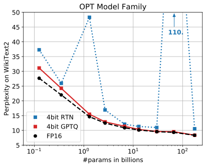</button><figcaption>Figure 1 · OPT 4-bit · Original Paper 2210.17323v2 · Figure 1: Quantizing OPT models to 4 and BLOOM models to 3 bit precision, comparing GPTQ with the FP16 baseline and round-to-nearest (RTN) (Yao et al., 2022; Dettmers et al., 2022). <span>点击放大；保留全部坐标 / 图例。</span></figcaption></figure><figure class="original-figure"><button type="button" data-zoom="assets/original/fig-01b-bloom.svg" aria-label="放大 Figure 1 · BLOOM 3-bit">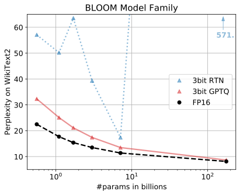</button><figcaption>Figure 1 · BLOOM 3-bit · Original Paper 2210.17323v2 · Figure 1: Quantizing OPT models to 4 and BLOOM models to 3 bit precision, comparing GPTQ with the FP16 baseline and round-to-nearest (RTN) (Yao et al., 2022; Dettmers et al., 2022). <span>点击放大；保留全部坐标 / 图例。</span></figcaption></figure>

**这张图解决什么问题？** 它先展示 RTN 的退化，再说明 GPTQ 在大规模模型上的优势。左面板比较 OPT 的 **4-bit**，右面板比较 BLOOM 的 **3-bit**；两者比特配置不同，不能把面板之间的高度直接理解成模型家族胜负。

**如何阅读。** 先看横轴模型规模，再看 WikiText2 perplexity（越低越好），沿 FP16、RTN、GPTQ 三条曲线读。它不是架构数据流图，没有代表计算顺序的箭头；每个点都是一个独立 checkpoint 的评测。原始坐标、图例和曲线已保留。

**关键观察。** OPT-66B 的 4-bit RTN 异常恶化，GPTQ 接近 FP16；BLOOM-176B 的 3-bit RTN 同样失效，GPTQ 仍可用。**Interpretation。** 这支持“输入加权补偿能修复直接舍入的大损伤”，不能推出“参数越大必然越容易量化”。后面的完整表会显示非单调情况。

## 2. Related Work — GPTQ 在历史上接续了什么？

**Paper。** 作者把工作放在 post-training quantization 与 second-order compression 的交点。OBQ（Optimal Brain Quantization）来自 OBC / Optimal Brain Surgeon 路线：在固定线性层输入下，用二阶信息决定量化哪个权重，并修正剩余权重。其精度竞争力不错，但每行独立的逐元素策略很难扩展到极宽层。

AdaRound、BRECQ 等依靠舍入优化或块重建；LLM.int8 等针对 activation outlier 引入高精度路径。它们在目标、位宽、优化预算和推理算术上不同。**GPTQ 的 RTN 基线是同量化格点下的直接舍入，不等同于整个 LLM.int8 系统。**

**Interpretation。** GPTQ 的新颖性主要在“将已有局部二阶思想重构成大规模可执行算法”。若把它描述成首次发现 Hessian 量化，会抹去 OBQ / OBS 的直接贡献；若只说是 RTN 的小改动，又会忽略共享顺序与 IO 调度带来的规模突破。

## 3. Background — 从重建目标到单坐标补偿

### 3.1 Equation (1)：定义目标与 Tensor Shape

<div class="formula"><div class="math-row"><math alttext="\text{argmin}_{\mathbf{\widehat{W}}}\,||\mathbf{W}\mathbf{X}-\mathbf{\widehat{W}}\mathbf{X}||_{2}^{2}." class="ltx_Math" display="block" intent=":literal"><semantics><mrow><mrow><msub><mtext>argmin</mtext><mover accent="true"><mi>𝐖</mi><mo>^</mo></mover></msub><mo lspace="0.170em" rspace="0em">​</mo><msubsup><mrow><mo stretchy="false">‖</mo><mrow><mi>𝐖𝐗</mi><mo>−</mo><mrow><mover accent="true"><mi>𝐖</mi><mo>^</mo></mover><mo lspace="0em" rspace="0em">​</mo><mi>𝐗</mi></mrow></mrow><mo stretchy="false">‖</mo></mrow><mn>2</mn><mn>2</mn></msubsup></mrow><mo lspace="0em">.</mo></mrow><annotation encoding="application/x-tex">\text{argmin}_{\mathbf{\widehat{W}}}\,||\mathbf{W}\mathbf{X}-\mathbf{\widehat{W}}\mathbf{X}||_{2}^{2}.</annotation></semantics></math></div><span class="equation-number">Original Paper · Eq. (1)</span><details><summary>可复制 LaTeX 原式</summary><code>\text{argmin}_{\mathbf{\widehat{W}}}\,||\mathbf{W}\mathbf{X}-\mathbf{\widehat{W}}\mathbf{X}||_{2}^{2}.</code></details></div>

原式的 `||·||₂²` 对矩阵按所有输出误差的平方和理解，即 Frobenius norm。下文用 `Q` 表示原式的量化矩阵 `Ŵ`，用 `q` 表示坐标索引；两者不要混淆。

| 符号 | Shape | 含义 |
|---|---|---|
| `W` / `Q` | `d_out × d_in` | 原始 / 量化线性层权重 |
| `X` | `d_in × m` | 校准输入，token 维展平到 m |
| `Y=WX` | `d_out × m` | 原层输出 |
| `WX−QX` | `d_out × m` | 待最小化的重建残差 |
| `H=2XXᵀ` | `d_in × d_in` | 每个输出行共享的局部 Hessian |
| `F` | 坐标集合 | 尚未固定到量化格点的输入坐标 |

先计算两组层输出，再逐元素平方、对输出行与样本求和。每一行独立：`L_i=(w_i−q_i)XXᵀ(w_i−q_i)ᵀ`。所有行的输入相同，所以 Hessian 相同。这里固定 `X`，不是对 Transformer 的全部参数求导，也不包含后续 nonlinear layer 的任务损失。

**工程意义。** 不需要 label、optimizer、learning rate 或反向传播。需要原始权重、真实代表性输入和足够稳定的 Gram 矩阵。构造 `XXᵀ` 成本约 `O(m d_in²)`，保存曲率矩阵需 `O(d_in²)`；小校准集并不意味着完全没有计算与内存成本。

### 3.2 Equation (2)：选谁量化，如何补偿？

<div class="formula"><div class="math-row"><math alttext="w_{q}=\text{argmin}_{w_{q}}\,\frac{(\text{quant}(w_{q})-w_{q})^{2}}{[\mathbf{H}_{F}^{-1}]_{qq}},\quad\bm{\delta}_{F}=-\frac{w_{q}-\text{quant}(w_{q})}{[\mathbf{H}_{F}^{-1}]_{qq}}\cdot(\mathbf{H}_{F}^{-1})_{:,q}." class="ltx_math_unparsed" display="block" intent=":literal"><semantics><mrow><msub><mi>w</mi><mi>q</mi></msub><mo>=</mo><msub><mtext>argmin</mtext><msub><mi>w</mi><mi>q</mi></msub></msub><mfrac><msup><mrow><mo stretchy="false">(</mo><mrow><mrow><mtext>quant</mtext><mo lspace="0em" rspace="0em">​</mo><mrow><mo stretchy="false">(</mo><msub><mi>w</mi><mi>q</mi></msub><mo stretchy="false">)</mo></mrow></mrow><mo>−</mo><msub><mi>w</mi><mi>q</mi></msub></mrow><mo stretchy="false">)</mo></mrow><mn>2</mn></msup><msub><mrow><mo stretchy="false">[</mo><msubsup><mi>𝐇</mi><mi>F</mi><mrow><mo>−</mo><mn>1</mn></mrow></msubsup><mo stretchy="false">]</mo></mrow><mrow><mi>q</mi><mo lspace="0em" rspace="0em">​</mo><mi>q</mi></mrow></msub></mfrac><mo rspace="1.167em">,</mo><msub><mi>𝜹</mi><mi>F</mi></msub><mo rspace="0em">=</mo><mo lspace="0em">−</mo><mfrac><mrow><msub><mi>w</mi><mi>q</mi></msub><mo>−</mo><mrow><mtext>quant</mtext><mo lspace="0em" rspace="0em">​</mo><mrow><mo stretchy="false">(</mo><msub><mi>w</mi><mi>q</mi></msub><mo stretchy="false">)</mo></mrow></mrow></mrow><msub><mrow><mo stretchy="false">[</mo><msubsup><mi>𝐇</mi><mi>F</mi><mrow><mo>−</mo><mn>1</mn></mrow></msubsup><mo stretchy="false">]</mo></mrow><mrow><mi>q</mi><mo lspace="0em" rspace="0em">​</mo><mi>q</mi></mrow></msub></mfrac><mo lspace="0.222em" rspace="0.222em">⋅</mo><msub><mrow><mo stretchy="false">(</mo><msubsup><mi>𝐇</mi><mi>F</mi><mrow><mo>−</mo><mn>1</mn></mrow></msubsup><mo stretchy="false">)</mo></mrow><mrow><mo rspace="0em">:</mo><mo>,</mo><mi>q</mi></mrow></msub><mo lspace="0em">.</mo></mrow><annotation encoding="application/x-tex">w_{q}=\text{argmin}_{w_{q}}\,\frac{(\text{quant}(w_{q})-w_{q})^{2}}{[\mathbf{H}_{F}^{-1}]_{qq}},\quad\bm{\delta}_{F}=-\frac{w_{q}-\text{quant}(w_{q})}{[\mathbf{H}_{F}^{-1}]_{qq}}\cdot(\mathbf{H}_{F}^{-1})_{:,q}.</annotation></semantics></math></div><span class="equation-number">Original Paper · Eq. (2)</span><details><summary>可复制 LaTeX 原式</summary><code>w_{q}=\text{argmin}_{w_{q}}\,\frac{(\text{quant}(w_{q})-w_{q})^{2}}{[\mathbf{H}_{F}^{-1}]_{qq}},\quad\bm{\delta}_{F}=-\frac{w_{q}-\text{quant}(w_{q})}{[\mathbf{H}_{F}^{-1}]_{qq}}\cdot(\mathbf{H}_{F}^{-1})_{:,q}.</code></details></div>

这是 OBQ 的两件事：左边贪心选择量化损失最小的坐标；右边计算固定该坐标后，对仍可动坐标的最优连续修正。分母是当前自由集合 Hessian 逆矩阵的 `qq` 元素；`δ_F` 是长度 `|F|` 的向量，`(H_F⁻¹)_:,q` 是该逆矩阵的一列。

原式把“选择坐标”写成 `w_q=argmin_wq`。更清楚的理解是选择 **索引 q**，而不是让这个标量继续自由优化。`quant(w_q)` 使用已确定的均匀格点；更新中的 `w_q` 是此前误差补偿后的当前值。

**Derivation。** 对一行权重，令 `a=quant(w_q)−w_q`。解约束二次问题 `min_δ ½δᵀH_Fδ, δ_q=a`。Lagrangian 给出 `H_Fδ=μe_q`，所以 `δ=μH_F⁻¹e_q`；再代入 `δ_q=a` 得：

<div class="formula"><math xmlns="http://www.w3.org/1998/Math/MathML" display="block"><mrow><msub><mi>&#x003B4;</mi><mi>F</mi></msub><mo>&#x0003D;</mo><mfrac><mrow><mi>a</mi></mrow><mrow><mo stretchy="false">[</mo><msubsup><mi>H</mi><mi>F</mi><mrow><mo>&#x02212;</mo><mn>1</mn></mrow></msubsup><msub><mo stretchy="false">]</mo><mrow><mi>q</mi><mi>q</mi></mrow></msub></mrow></mfrac><msubsup><mi>H</mi><mi>F</mi><mrow><mo>&#x02212;</mo><mn>1</mn></mrow></msubsup><msub><mi>e</mi><mi>q</mi></msub><mo>&#x0002C;</mo><mspace width="1em" /><mi>&#x00394;</mi><mi>L</mi><mo>&#x0003D;</mo><mfrac><mrow><msup><mi>a</mi><mn>2</mn></msup></mrow><mrow><mn>2</mn><mo stretchy="false">[</mo><msubsup><mi>H</mi><mi>F</mi><mrow><mo>&#x02212;</mo><mn>1</mn></mrow></msubsup><msub><mo stretchy="false">]</mo><mrow><mi>q</mi><mi>q</mi></mrow></msub></mrow></mfrac></mrow></math><span class="equation-number">Derivation · single-coordinate constrained optimum</span><details><summary>可复制 LaTeX</summary><code>\delta_F=\frac{a}{[H_F^{-1}]_{qq}}H_F^{-1}e_q,\quad \Delta L=\frac{a^2}{2[H_F^{-1}]_{qq}}</code></details></div>

分母大说明该坐标能借助其他方向得到更多补偿。预测增量损失是 `a²/(2[H_F⁻¹]_qq)`；原选择式省略了不影响 argmin 的 `½`。这个连续约束问题有闭式最优解，**不意味着后续所有坐标离散化的联合问题已被全局最优求解**。

### 3.3 Equation (3)：固定之后为什么要删行删列？

<div class="formula"><div class="math-row"><math alttext="\mathbf{H}_{-q}^{-1}=\Big(\mathbf{H}^{-1}-\frac{1}{[\mathbf{H}^{-1}]_{qq}}\mathbf{H}^{-1}_{:,q}\mathbf{H}^{-1}_{q,:}\Big)_{-p}." class="ltx_math_unparsed" display="block" intent=":literal"><semantics><mrow><msubsup><mi>𝐇</mi><mrow><mo>−</mo><mi>q</mi></mrow><mrow><mo>−</mo><mn>1</mn></mrow></msubsup><mo>=</mo><msub><mrow><mo maxsize="1.600em" minsize="1.600em">(</mo><msup><mi>𝐇</mi><mrow><mo>−</mo><mn>1</mn></mrow></msup><mo>−</mo><mfrac><mn>1</mn><msub><mrow><mo stretchy="false">[</mo><msup><mi>𝐇</mi><mrow><mo>−</mo><mn>1</mn></mrow></msup><mo stretchy="false">]</mo></mrow><mrow><mi>q</mi><mo lspace="0em" rspace="0em">​</mo><mi>q</mi></mrow></msub></mfrac><msubsup><mi>𝐇</mi><mrow><mo rspace="0em">:</mo><mo>,</mo><mi>q</mi></mrow><mrow><mo>−</mo><mn>1</mn></mrow></msubsup><msubsup><mi>𝐇</mi><mrow><mi>q</mi><mo>,</mo><mo>:</mo></mrow><mrow><mo>−</mo><mn>1</mn></mrow></msubsup><mo maxsize="1.600em" minsize="1.600em">)</mo></mrow><mrow><mo>−</mo><mi>p</mi></mrow></msub><mo lspace="0em">.</mo></mrow><annotation encoding="application/x-tex">\mathbf{H}_{-q}^{-1}=\Big(\mathbf{H}^{-1}-\frac{1}{[\mathbf{H}^{-1}]_{qq}}\mathbf{H}^{-1}_{:,q}\mathbf{H}^{-1}_{q,:}\Big)_{-p}.</annotation></semantics></math></div><span class="equation-number">Original Paper · Eq. (3)</span><details><summary>可复制 LaTeX 原式</summary><code>\mathbf{H}_{-q}^{-1}=\Big(\mathbf{H}^{-1}-\frac{1}{[\mathbf{H}^{-1}]_{qq}}\mathbf{H}^{-1}_{:,q}\mathbf{H}^{-1}_{q,:}\Big)_{-p}.</code></details></div>

量化后的坐标不能再漂移，下一步只允许调整 `F\\{q}`。所以更新并删除逆矩阵对应行列，得到尺寸 `(|F|−1)×(|F|−1)` 的新逆 Hessian。rank-one correction 体现了“在 q 已固定的条件下”其余坐标的几何。

**原文记号勘误。** Eq. (3) 左边是 `−q`，括号最外下标却印成 `−p`；按上下文和算法，应删除 **q**。这里保留原式，再解释意图，不悄悄把原 PDF 改成看似无误的公式。

**成本。** 单次 rank-one 更新约 `O(|F|²)`；做 `d_in` 次就是一行 `O(d_in³)`。若每行采用不同贪心顺序，自由集合不同，难以让所有行共享后续逆矩阵。这正是 GPTQ 要拆掉的瓶颈。

### 用两个相关通道看补偿的含义

<section class="mechanism" id="toy-widget"><p class="reading-meta">AGENT-CREATED VISUALIZATION · ANALYTICAL TOY EXAMPLE</p><h3>逐步看相关输入怎样抵消量化误差</h3><div class="controls"><label>输入相关性 ρ<input id="toy-rho" type="range" min="0" max="0.99" step="0.01" value="0.95"><output id="toy-rho-out">0.95</output></label><label>算法阶段<input id="toy-step" type="range" min="0" max="2" step="1" value="0"><output id="toy-step-out">原始权重</output></label></div><svg id="toy-svg" viewBox="0 0 540 305" role="img" aria-label="RTN和误差补偿的两个权重坐标"><text x="20" y="40">ρ=0.95：RTN=[0,0]；补偿后 Q=[0,1]</text></svg><div class="readout" id="toy-readout" aria-live="polite">最终 RTN loss=0.93639；GPTQ loss=0.02539。</div><div class="actions"><button id="toy-next">Next step / 下一步</button><button id="toy-reset">Reset / 重播</button></div><p class="hint">调 ρ 观察第二项是否跨过舍入边界；按 Next step 观察当前权重变化。没有自动播放。固定格点、二维、无 damping；不是实测 PPL。</p><noscript><p>静态回退：先固定 0.49→0，再补偿第二项 +0.4655 得 0.9555，最终量化为 1。完整数值解释见下方正文。</p></noscript></section>

**Derivation。** 设 `W=[0.49,0.49]`，输入协方差 `C=XXᵀ=[[1,ρ],[ρ,1]]`，固定 2-bit 格点 `{-2,−1,0,1}`。RTN 得 `[0,0]`。先把第一项量化成 0，最优修正把第二项加 `0.49ρ`；ρ=0.95 时第二项从 0.49 变成 0.9555，再舍入成 1。

最终 GPTQ `[0,1]` 的 `ΔCΔᵀ=0.02539`，RTN 的值为 `0.93639`。在不相关的 ρ=0 情况，补偿为零，两者都得到 `[0,0]`。这是固定格点、固定顺序、两维无 damping 的教学例子；真实每行 min/max 会影响格点，不把这些误差值当成 WikiText2 或一般质量保证。

## 4. The GPTQ Algorithm — 三个改动必须一起理解

### 4.1 Arbitrary order：共享输入列，而非逐行选最优元素

**Paper。** GPTQ 固定一个所有输出行一致的列顺序。每次量化 `W_:,j`，同时处理所有输出通道；所有行都删除同一输入坐标，因而能共享同一曲率矩阵。

对典型方形层，OBQ 的逐行 `O(d_out d_in³)` 接近四次复杂度；GPTQ 的矩阵处理为 `O(d_out d_in²+d_in³)`，接近三次。这个表达未计入校准 Gram 积累、数据移动、分组 scale 搜索与模型 block replay。共享顺序是有意牺牲逐行贪心自由度，不是宣称所有顺序完全等价。后续 `act-order` 是对顺序的改进。

### 4.2 Lazy batch updates：保持块内因果，延迟块外搬运

每量化一列都更新整层，会发起大量小 outer-product kernel，反复读写大矩阵，GPU 利用率差。GPTQ 以 `B=128` 列为默认块，块内仍逐列量化并立即更新接下来块内权重，保证下一个 round 使用已补偿值。块外权重无需被下一次块内舍入读取，可以积累误差，在块末用一次 GEMM 更新。

### Figure 2 — 块内逐列、块外批量

<figure class="original-figure"><button type="button" data-zoom="assets/original/fig-02-procedure.svg" aria-label="放大 Figure 2">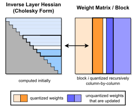</button><figcaption>Figure 2 · Original Paper 2210.17323v2 · Figure 2: GPTQ quantization procedure. Blocks of consecutive columns (bolded) are quantized at a given step, using the inverse Hessian information stored in the Cholesky decomposition, and the remaining weights (blue) are updated at the end of the step. The quantization procedure is applied recursively inside each block: the white middle column is currently being quantized. <span>点击放大；保留全部坐标 / 图例。</span></figcaption></figure>

**如何阅读。** 把矩阵横向理解成输入坐标列、纵向理解成输出行。粗边框表示当前连续列块，白色中间列是正在量化的列；已固定区域与未来区域不同，蓝色是块末仍需更新的剩余权重。图示配合下方 Algorithm 1 从当前列、块内余列、块外未来列依次阅读。

**Components / Data Flow。** `W_:,j → quant → Q_:,j`，残差经 Cholesky 对角归一化后进入误差缓冲 `E_:,j`，它先驱动块内更新；块处理完后，`E × U_block,future` 批量更新蓝色区域。当前列的量化决策依赖前面的补偿，因此“块量化”不等于 B 列全部独立 RTN。

**关键观察。** 延迟的是不影响眼下舍入的外部更新，不是丢掉它们。**Interpretation。** 这和许多 IO 优化有共同逻辑：保留计算依赖，把许多低效小写入合并为矩阵运算；它不改变 attention connectivity。

<figure class="generated-figure"><svg xmlns="http://www.w3.org/2000/svg" viewBox="0 0 740 309" role="img" aria-label="块内依赖保持，块外更新延迟"><rect x="20" y="15" width="700" height="60" rx="6" fill="#152235" stroke="#4a6485"/><text x="40" y="39">当前列 j：量化 W[:,j]</text><text x="40" y="61" style="font-size:12px;fill:#b2c1d6">Q[:,j]=quant(W[:,j])；所有输出行共享顺序</text><path d="M370 75v26m-5 -6l5 6 5 -6"/><rect x="20" y="103" width="700" height="60" rx="6" fill="#152235" stroke="#4a6485"/><text x="40" y="127">立即更新当前块内的未来列</text><text x="40" y="149" style="font-size:12px;fill:#b2c1d6">E[:,j-i]=(W[:,j]−Q[:,j])/U[j,j]；更新 W[:,j:end]</text><path d="M370 163v26m-5 -6l5 6 5 -6"/><rect x="20" y="191" width="700" height="60" rx="6" fill="#152235" stroke="#4a6485"/><text x="40" y="215">块末：一次 GEMM 更新块外权重</text><text x="40" y="237" style="font-size:12px;fill:#b2c1d6">W[:,end:] -= E @ U[i:end,end:]；然后进入下一块</text></svg><figcaption>块内依赖保持，块外更新延迟 · Agent-created Simplified Diagram · <a href="assets/generated/block-update.mmd">Mermaid source</a></figcaption></figure>

### 4.3 Equations (4)–(5)：块约束的矩阵形式

<div class="formula"><div class="math-row"><math alttext="\displaystyle\bm{\delta}_{F}" class="ltx_Math" display="inline" intent=":literal"><semantics><msub><mi>𝜹</mi><mi>F</mi></msub><annotation encoding="application/x-tex">\displaystyle\bm{\delta}_{F}</annotation></semantics></math><math alttext="\displaystyle=-(\mathbf{w}_{Q}-\text{quant}(\mathbf{w}_{Q}))([\mathbf{H}_{F}^{-1}]_{QQ})^{-1}(\mathbf{H}_{F}^{-1})_{:,Q}," class="ltx_math_unparsed" display="inline" intent=":literal"><semantics><mrow><mo rspace="0em">=</mo><mo lspace="0em">−</mo><mrow><mo stretchy="false">(</mo><msub><mi>𝐰</mi><mi>Q</mi></msub><mo>−</mo><mtext>quant</mtext><mrow><mo stretchy="false">(</mo><msub><mi>𝐰</mi><mi>Q</mi></msub><mo stretchy="false">)</mo></mrow><mo stretchy="false">)</mo></mrow><msup><mrow><mo stretchy="false">(</mo><msub><mrow><mo stretchy="false">[</mo><msubsup><mi>𝐇</mi><mi>F</mi><mrow><mo>−</mo><mn>1</mn></mrow></msubsup><mo stretchy="false">]</mo></mrow><mrow><mi>Q</mi><mo lspace="0em" rspace="0em">​</mo><mi>Q</mi></mrow></msub><mo stretchy="false">)</mo></mrow><mrow><mo>−</mo><mn>1</mn></mrow></msup><msub><mrow><mo stretchy="false">(</mo><msubsup><mi>𝐇</mi><mi>F</mi><mrow><mo>−</mo><mn>1</mn></mrow></msubsup><mo stretchy="false">)</mo></mrow><mrow><mo rspace="0em">:</mo><mo>,</mo><mi>Q</mi></mrow></msub><mo>,</mo></mrow><annotation encoding="application/x-tex">\displaystyle=-(\mathbf{w}_{Q}-\text{quant}(\mathbf{w}_{Q}))([\mathbf{H}_{F}^{-1}]_{QQ})^{-1}(\mathbf{H}_{F}^{-1})_{:,Q},</annotation></semantics></math></div><span class="equation-number">Original Paper · Eq. (4)</span><details><summary>可复制 LaTeX 原式</summary><code>\displaystyle\bm{\delta}_{F} \displaystyle=-(\mathbf{w}_{Q}-\text{quant}(\mathbf{w}_{Q}))([\mathbf{H}_{F}^{-1}]_{QQ})^{-1}(\mathbf{H}_{F}^{-1})_{:,Q},</code></details></div>

<div class="formula"><div class="math-row"><math alttext="\displaystyle\mathbf{H}_{-Q}^{-1}" class="ltx_Math" display="inline" intent=":literal"><semantics><msubsup><mi>𝐇</mi><mrow><mo>−</mo><mi>Q</mi></mrow><mrow><mo>−</mo><mn>1</mn></mrow></msubsup><annotation encoding="application/x-tex">\displaystyle\mathbf{H}_{-Q}^{-1}</annotation></semantics></math><math alttext="\displaystyle=\Big(\mathbf{H}^{-1}-\mathbf{H}^{-1}_{:,Q}([\mathbf{H}^{-1}]_{QQ})^{-1}\mathbf{H}^{-1}_{Q,:}\Big)_{-Q}." class="ltx_math_unparsed" display="inline" intent=":literal"><semantics><mrow><mo>=</mo><msub><mrow><mo maxsize="1.600em" minsize="1.600em">(</mo><msup><mi>𝐇</mi><mrow><mo>−</mo><mn>1</mn></mrow></msup><mo>−</mo><msubsup><mi>𝐇</mi><mrow><mo rspace="0em">:</mo><mo>,</mo><mi>Q</mi></mrow><mrow><mo>−</mo><mn>1</mn></mrow></msubsup><msup><mrow><mo stretchy="false">(</mo><msub><mrow><mo stretchy="false">[</mo><msup><mi>𝐇</mi><mrow><mo>−</mo><mn>1</mn></mrow></msup><mo stretchy="false">]</mo></mrow><mrow><mi>Q</mi><mo lspace="0em" rspace="0em">​</mo><mi>Q</mi></mrow></msub><mo stretchy="false">)</mo></mrow><mrow><mo>−</mo><mn>1</mn></mrow></msup><msubsup><mi>𝐇</mi><mrow><mi>Q</mi><mo>,</mo><mo>:</mo></mrow><mrow><mo>−</mo><mn>1</mn></mrow></msubsup><mo maxsize="1.600em" minsize="1.600em">)</mo></mrow><mrow><mo>−</mo><mi>Q</mi></mrow></msub><mo lspace="0em">.</mo></mrow><annotation encoding="application/x-tex">\displaystyle=\Big(\mathbf{H}^{-1}-\mathbf{H}^{-1}_{:,Q}([\mathbf{H}^{-1}]_{QQ})^{-1}\mathbf{H}^{-1}_{Q,:}\Big)_{-Q}.</annotation></semantics></math></div><span class="equation-number">Original Paper · Eq. (5)</span><details><summary>可复制 LaTeX 原式</summary><code>\displaystyle\mathbf{H}_{-Q}^{-1} \displaystyle=\Big(\mathbf{H}^{-1}-\mathbf{H}^{-1}_{:,Q}([\mathbf{H}^{-1}]_{QQ})^{-1}\mathbf{H}^{-1}_{Q,:}\Big)_{-Q}.</code></details></div>

这里 `Q` 在原式中指**被固定的一组坐标索引**，不是前面的量化权重矩阵。令其大小为 B，`[H_F⁻¹]_QQ` 为 `B×B`，`(H_F⁻¹)_:,Q` 为 `|F|×B`。原 Eq. (4) 的行向量排列易造成 shape 混淆：采用列向量 δ 时，明确写为：

<div class="formula"><math xmlns="http://www.w3.org/1998/Math/MathML" display="block"><mrow><msub><mi>&#x003B4;</mi><mi>F</mi></msub><mo>&#x0003D;</mo><mo>&#x02212;</mo><msubsup><mi>H</mi><mi>F</mi><mrow><mo>&#x02212;</mo><mn>1</mn></mrow></msubsup><msub><mrow /><mrow><mi>:</mi><mo>&#x0002C;</mo><mi>Q</mi></mrow></msub><mo stretchy="false">&#x00028;</mo><mo stretchy="false">[</mo><msubsup><mi>H</mi><mi>F</mi><mrow><mo>&#x02212;</mo><mn>1</mn></mrow></msubsup><msub><mo stretchy="false">]</mo><mrow><mi>Q</mi><mi>Q</mi></mrow></msub><msup><mo stretchy="false">&#x00029;</mo><mrow><mo>&#x02212;</mo><mn>1</mn></mrow></msup><msub><mi>r</mi><mi>Q</mi></msub><mo>&#x0002C;</mo><mspace width="1em" /><msub><mi>r</mi><mi>Q</mi></msub><mo>&#x0003D;</mo><msub><mi>w</mi><mi>Q</mi></msub><mo>&#x02212;</mo><mrow><mi mathvariant="normal">q</mi><mi mathvariant="normal">u</mi><mi mathvariant="normal">a</mi><mi mathvariant="normal">n</mi><mi mathvariant="normal">t</mi></mrow><mo stretchy="false">&#x00028;</mo><msub><mi>w</mi><mi>Q</mi></msub><mo stretchy="false">&#x00029;</mo></mrow></math><span class="equation-number">Derivation · shape-consistent column-vector form</span><details><summary>可复制 LaTeX</summary><code>\delta_F=-H_F^{-1}{}_{:,Q}([H_F^{-1}]_{QQ})^{-1}r_Q,\quad r_Q=w_Q-\mathrm{quant}(w_Q)</code></details></div>

`r_Q` 为 B 维固定残差，结果为 `|F|` 维；采用行向量时取相应 transpose。Eq. (5) 中 `|F|×B`、`B×B`、`B×|F|` 乘积得到 `|F|×|F|`，之后删除 Q 行列。它推广 rank-one elimination，但实现并不为每步重新求一个大矩阵逆。

**工程边界。** 单个块内仍是串行量化与补偿，不能把 Eq. (4) 理解成对全部 B 个离散格点进行最优穷举。lazy update 精确保留相同顺序下的更新代数，在浮点计算与分组格点选择中仍需关注数值差异。

### 4.4 Cholesky reformulation：Hinv 这个变量名容易误导

多次消元直接修改逆 Hessian，易累积数值误差。作者对 `H+λI` 做 damping，λ 取对角平均值的约 1%，再预先用 Cholesky 获得上三角因子。

<div class="formula"><math xmlns="http://www.w3.org/1998/Math/MathML" display="block"><mrow><msup><mi>U</mi><mo>&#x022A4;</mo></msup><mi>U</mi><mo>&#x0003D;</mo><mo stretchy="false">&#x00028;</mo><mn>2</mn><mi>X</mi><msup><mi>X</mi><mo>&#x022A4;</mo></msup><mo>&#x0002B;</mo><mi>&#x003BB;</mi><mi>I</mi><msup><mo stretchy="false">&#x00029;</mo><mrow><mo>&#x02212;</mo><mn>1</mn></mrow></msup><mo>&#x0002C;</mo><mspace width="1em" /><msub><mi>e</mi><mi>j</mi></msub><mo>&#x0003D;</mo><mfrac><mrow><msub><mi>w</mi><mi>j</mi></msub><mo>&#x02212;</mo><mrow><mi mathvariant="normal">q</mi><mi mathvariant="normal">u</mi><mi mathvariant="normal">a</mi><mi mathvariant="normal">n</mi><mi mathvariant="normal">t</mi></mrow><mo stretchy="false">&#x00028;</mo><msub><mi>w</mi><mi>j</mi></msub><mo stretchy="false">&#x00029;</mo></mrow><mrow><msub><mi>U</mi><mrow><mi>j</mi><mi>j</mi></mrow></msub></mrow></mfrac><mo>&#x0002C;</mo><mspace width="1em" /><msub><mi>w</mi><mi>k</mi></msub><mo>&#x02190;</mo><msub><mi>w</mi><mi>k</mi></msub><mo>&#x02212;</mo><msub><mi>e</mi><mi>j</mi></msub><msub><mi>U</mi><mrow><mi>j</mi><mi>k</mi></mrow></msub></mrow></math><span class="equation-number">Derivation · Cholesky compensation; k > j</span><details><summary>可复制 LaTeX</summary><code>U^\top U=(2XX^\top+\lambda I)^{-1},\quad e_j=\frac{w_j-\mathrm{quant}(w_j)}{U_{jj}},\quad w_k\leftarrow w_k-e_jU_{jk}</code></details></div>

**最重要的区分。** 原 Algorithm 1 中 `Hinv ← Cholesky(Hinv)ᵀ` 将下三角因子转为上三角；此后变量 `Hinv` 已经存放 **U**，不再是完整 `H⁻¹`。每步 `e=(w−quant(w))/U_jj`，权重更新 `w_future←w_future−e U_j,future`。关系到当前逆 Hessian 的是 `U_jj²`；把这里的 U 对角当成原 Eq. (2) 的逆矩阵对角，会多除或少除一次。

在顺序消元到 j 时，剩余上三角子块对应当前条件逆矩阵的因子，`[H_F⁻¹]_jj=U_jj²`、`[H_F⁻¹]_j,k=U_jjU_jk`。代回 Eq. (2)，正好得到上述补偿。这是预先因子化与逐步条件消元的连接，不是把全部未来相关性忽略为对角。

### Algorithm 1 — 原算法与可实现伪代码

<figure class="original-figure"><button type="button" data-zoom="assets/original/algorithm-01.png" aria-label="放大 Algorithm 1">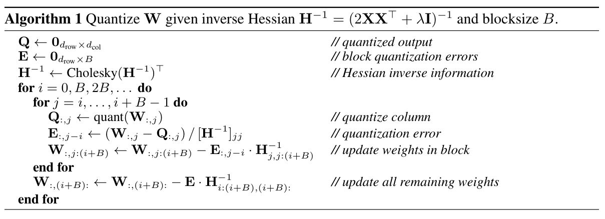</button><figcaption>Algorithm 1 · Original Paper 2210.17323v2 · 原算法，不属于22张编号表 <span>点击放大；保留全部坐标 / 图例。</span></figcaption></figure>

```python
# W: [d_out, d_in]; X: [d_in, m]
H = 2 * X @ X.T
H += damping * mean(diag(H)) * I
U = upper_cholesky(inverse(H))  # U.T @ U = inverse(H)
Q = zeros_like(W)
for i in range(0, d_in, B):
    end = min(i + B, d_in)
    E = zeros(d_out, end - i)
    for j in range(i, end):
        Q[:, j] = quantize_current(W[:, j])
        E[:, j-i] = (W[:, j] - Q[:, j]) / U[j, j]
        W[:, j:end] -= outer(E[:, j-i], U[j, j:end])
    W[:, end:] -= E @ U[i:end, end:]
```

输入是校准后的 `W,X`，输出是可打包的量化权重与 scale / zero。实际实现还需处理无激活的 dead channels、分组范围、末块、dtype、permutation，以及打包后的 runtime 格式。伪代码为讲解保留二阶几何，不能直接替代生产 kernel。

### 4.5 逐 Transformer block 的量化链路

<figure class="generated-figure"><svg xmlns="http://www.w3.org/2000/svg" viewBox="0 0 740 397" role="img" aria-label="校准、量化与推理是三个不同阶段"><rect x="20" y="15" width="700" height="60" rx="6" fill="#152235" stroke="#4a6485"/><text x="40" y="39">128 × 2048 C4 tokens → 当前 Transformer block</text><text x="40" y="61" style="font-size:12px;fill:#b2c1d6">校准输入 X 展平 token；收集各 Linear 的 XXᵀ</text><path d="M370 75v26m-5 -6l5 6 5 -6"/><rect x="20" y="103" width="700" height="60" rx="6" fill="#152235" stroke="#4a6485"/><text x="40" y="127">逐层 GPTQ：局部重建、damping、Cholesky</text><text x="40" y="149" style="font-size:12px;fill:#b2c1d6">W [d_out,d_in] → packed Q + scale/zero</text><path d="M370 163v26m-5 -6l5 6 5 -6"/><rect x="20" y="191" width="700" height="60" rx="6" fill="#152235" stroke="#4a6485"/><text x="40" y="215">重放已量化 block → 下一 block 输入</text><text x="40" y="237" style="font-size:12px;fill:#b2c1d6">沿部分量化模型传播；不同时驻留全部175B权重</text><path d="M370 251v26m-5 -6l5 6 5 -6"/><rect x="20" y="279" width="700" height="60" rx="6" fill="#152235" stroke="#4a6485"/><text x="40" y="303">部署：压缩权重 + 浮点 activation / KV</text><text x="40" y="325" style="font-size:12px;fill:#b2c1d6">加载layout匹配的kernel；校准是一次性作业</text></svg><figcaption>校准、量化与推理是三个不同阶段 · Agent-created Simplified Diagram · <a href="assets/generated/calibration-pipeline.mmd">Mermaid source</a></figcaption></figure>

**Paper / Official Code。** 校准为 C4 training 中 128 段、每段 2048 token，在单张 80GB A100 上一次加载一个 Transformer block。对于 Linear，将输入 token 展平，积累 Gram；量化本 block 的目标线性层后，重放已经量化的 block，所得输出成为下一 block 的输入。无需把全部 175B FP16 权重同时驻留 GPU。

原 pipeline 在一个未量化 block 中收集多个线性层 Hessian，随后量化；因此同 block 内后层使用的校准输入不一定已反映前层量化。这与“跨 block replay”是两个层次。官方后续 `true-sequential` 在同 block 内按依赖分组重放，修正后层输入分布；不要把这一后续选项当成论文原 Algorithm 1 的内容。

**Quantizer。** 默认逐输出行、非对称 min/max 的均匀格点，RTN 使用同格点便于比较。可选 grouping 为一行中连续 g 个输入权重共享 scale / zero。`B` 是延迟更新块宽，`g` 是量化 metadata 粒度，二者作用不同，即使都取 128 也不能混为一谈。

**内存与计算。** 一份 FP32 Hessian 大小约 `4d_in²` bytes；宽 `d_in=49152` 的示例约 9GiB，因子、临时矩阵还会增占。高峰随当前 block、多个线性层曲率缓存和实现生命周期变化。正式量化耗时与推理耗时应分开：前者一次性付出重建与因子化，后者反复读取压缩权重。

## 5. Validation — 完整实验与逐项证据审计

### 5.1 Setup：作者实际运行了什么？

| 项目 | 原论文设置 | 解释与边界 |
|---|---|---|
| 语言模型 | OPT 125M–175B；BLOOM 560M–176B | 已训练 checkpoint，未重新预训练 |
| 校准 | C4 train，128×2048 token | 无监督重建，不使用任务标签 |
| 量化硬件 | 1× A100 80GB | 一次加载一个 Transformer block |
| 权重格式 | 默认 per-row asymmetric，3/4-bit；另测 grouping 与 2-bit / ternary | 不是 W4A4 的完整推理系统 |
| 语言建模 | WikiText2、PTB、C4 perplexity ↓ | 不是分类 Accuracy |
| 零样本任务 | LAMBADA、PIQA、ARC-easy/challenge、StoryCloze Accuracy ↑ | 没有逐样本混淆矩阵 |
| 生成 latency | batch=1，生成长度 128，A100 / A6000 | 无完整 TTFT / TPOT 分离、并发 sweep |
| 视觉 sanity check | RN18 / RN50，ImageNet top-1 ↑ | 不直接等于 VLM / OCR 精度 |
| BERT 对照 | BERT-base / SQuAD，F1 ↑ | span/token overlap F1，不可伪造 TP/FP/TN/FN |

这里没有 optimizer 或 learning rate：GPTQ 在固定层输入下求局部重建；基础 checkpoint 的原始 training tokens 不是本实验新增训练预算。论文未给出可重算逐样本 TP、FP、TN、FN 的预测记录，因此也不能从平均 Accuracy 推出 Precision / Recall。

### 5.2 Table 1 — 小模型能否维持 OBQ 的精度？

<p class="reading-meta">Table 1: Comparison with state-of-the-art post-training methods for vision models. · Original Paper</p><div class="table-scroll original-table" role="region" tabindex="0" aria-label="Table 1 完整原始行列"><table class="ltx_tabular ltx_guessed_headers ltx_align_middle">
<thead class="ltx_thead">
<tr class="ltx_tr">
<th class="ltx_td ltx_align_left ltx_th ltx_th_column ltx_th_row ltx_border_l ltx_border_r ltx_border_tt" rowspan="2"><span class="ltx_text">Method</span></th>
<th class="ltx_td ltx_align_center ltx_th ltx_th_column ltx_border_r ltx_border_tt" colspan="2">RN18 – 69.76 %</th>
<th class="ltx_td ltx_align_center ltx_th ltx_th_column ltx_border_r ltx_border_tt" colspan="2">RN50 – 76.13%</th></tr>
<tr class="ltx_tr">
<th class="ltx_td ltx_align_center ltx_th ltx_th_column">4bit</th>
<th class="ltx_td ltx_align_center ltx_th ltx_th_column ltx_border_r">3bit</th>
<th class="ltx_td ltx_align_center ltx_th ltx_th_column">4bit</th>
<th class="ltx_td ltx_align_center ltx_th ltx_th_column ltx_border_r">3bit</th></tr>
</thead>
<tbody class="ltx_tbody">
<tr class="ltx_tr">
<th class="ltx_td ltx_align_left ltx_th ltx_th_row ltx_border_l ltx_border_r ltx_border_t">AdaRound</th>
<td class="ltx_td ltx_align_center ltx_border_t">69.34</td>
<td class="ltx_td ltx_align_center ltx_border_r ltx_border_t">68.37</td>
<td class="ltx_td ltx_align_center ltx_border_t">75.84</td>
<td class="ltx_td ltx_align_center ltx_border_r ltx_border_t">75.14</td></tr>
<tr class="ltx_tr">
<th class="ltx_td ltx_align_left ltx_th ltx_th_row ltx_border_l ltx_border_r">AdaQuant</th>
<td class="ltx_td ltx_align_center">68.12</td>
<td class="ltx_td ltx_align_center ltx_border_r">59.21</td>
<td class="ltx_td ltx_align_center">74.68</td>
<td class="ltx_td ltx_align_center ltx_border_r">64.98</td></tr>
<tr class="ltx_tr">
<th class="ltx_td ltx_align_left ltx_th ltx_th_row ltx_border_l ltx_border_r">BRECQ</th>
<td class="ltx_td ltx_align_center">69.37</td>
<td class="ltx_td ltx_align_center ltx_border_r">68.47</td>
<td class="ltx_td ltx_align_center">75.88</td>
<td class="ltx_td ltx_align_center ltx_border_r">75.32</td></tr>
<tr class="ltx_tr">
<th class="ltx_td ltx_align_left ltx_th ltx_th_row ltx_border_l ltx_border_r">OBQ</th>
<td class="ltx_td ltx_align_center">69.56</td>
<td class="ltx_td ltx_align_center ltx_border_r">68.69</td>
<td class="ltx_td ltx_align_center">75.72</td>
<td class="ltx_td ltx_align_center ltx_border_r">75.24</td></tr>
<tr class="ltx_tr">
<th class="ltx_td ltx_align_left ltx_th ltx_th_row ltx_border_bb ltx_border_l ltx_border_r ltx_border_t">GPTQ</th>
<td class="ltx_td ltx_align_center ltx_border_bb ltx_border_t">69.37</td>
<td class="ltx_td ltx_align_center ltx_border_bb ltx_border_r ltx_border_t">67.88</td>
<td class="ltx_td ltx_align_center ltx_border_bb ltx_border_t">75.71</td>
<td class="ltx_td ltx_align_center ltx_border_bb ltx_border_r ltx_border_t">74.87</td></tr>
</tbody>
</table></div><details class="source-evidence"><summary>Table 1 原始排版、加粗 / 下划线与 caption</summary><figure class="original-figure"><button type="button" data-zoom="assets/original/table-01.png" aria-label="放大 Table 1">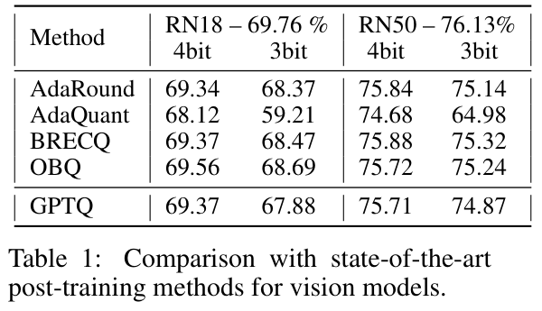</button><figcaption>Table 1 · Original Paper 2210.17323v2 · PDF crop; 原 caption 在截图中 <span>点击放大；保留全部坐标 / 图例。</span></figcaption></figure></details>

指标是 ImageNet top-1 Accuracy（%，越高越好）。GPTQ 的 RN18 4-bit 为 69.37，相比 FP16 69.76 降 0.39 个百分点；RN50 4-bit 75.71 相比 76.13 降 0.42。3-bit RN18 67.88 低于 OBQ 68.69 **0.81 个百分点**，RN50 74.87 低于 BRECQ 75.32 **0.45 个百分点**。

最佳 baseline 随列变化：RN18 两个位宽都是 OBQ，RN50 两个位宽都是 BRECQ。**结论。** GPTQ 保持竞争力，没有逐项夺冠。取舍是让规模与 GPU 更新效率成为主目标；这张表不能单独证明大语言模型速度。

### 5.3 Table 2 — 量化耗时，而非生成速度

<p class="reading-meta">Table 2: GPTQ runtime for full quantization of the 4 largest OPT and BLOOM models. · Original Paper</p><div class="table-scroll original-table" role="region" tabindex="0" aria-label="Table 2 完整原始行列"><table class="ltx_tabular ltx_guessed_headers ltx_align_middle">
<thead class="ltx_thead">
<tr class="ltx_tr">
<th class="ltx_td ltx_align_left ltx_th ltx_th_column ltx_th_row ltx_border_l ltx_border_r ltx_border_tt">OPT</th>
<th class="ltx_td ltx_align_center ltx_th ltx_th_column ltx_border_tt">13B</th>
<th class="ltx_td ltx_align_center ltx_th ltx_th_column ltx_border_tt">30B</th>
<th class="ltx_td ltx_align_center ltx_th ltx_th_column ltx_border_tt">66B</th>
<th class="ltx_td ltx_align_center ltx_th ltx_th_column ltx_border_r ltx_border_tt">175B</th></tr>
</thead>
<tbody class="ltx_tbody">
<tr class="ltx_tr">
<th class="ltx_td ltx_align_left ltx_th ltx_th_row ltx_border_l ltx_border_r ltx_border_t">Runtime</th>
<td class="ltx_td ltx_align_center ltx_border_t">20.9m</td>
<td class="ltx_td ltx_align_center ltx_border_t">44.9m</td>
<td class="ltx_td ltx_align_center ltx_border_t">1.6h</td>
<td class="ltx_td ltx_align_center ltx_border_r ltx_border_t">4.2h</td></tr>
<tr class="ltx_tr">
<th class="ltx_td ltx_align_left ltx_th ltx_th_row ltx_border_l ltx_border_r ltx_border_t">BLOOM</th>
<td class="ltx_td ltx_align_center ltx_border_t">1.7B</td>
<td class="ltx_td ltx_align_center ltx_border_t">3B</td>
<td class="ltx_td ltx_align_center ltx_border_t">7.1B</td>
<td class="ltx_td ltx_align_center ltx_border_r ltx_border_t">176B</td></tr>
<tr class="ltx_tr">
<th class="ltx_td ltx_align_left ltx_th ltx_th_row ltx_border_bb ltx_border_l ltx_border_r ltx_border_t">Runtime</th>
<td class="ltx_td ltx_align_center ltx_border_bb ltx_border_t">2.9m</td>
<td class="ltx_td ltx_align_center ltx_border_bb ltx_border_t">5.2m</td>
<td class="ltx_td ltx_align_center ltx_border_bb ltx_border_t">10.0m</td>
<td class="ltx_td ltx_align_center ltx_border_bb ltx_border_r ltx_border_t">3.8h</td></tr>
</tbody>
</table></div><details class="source-evidence"><summary>Table 2 原始排版、加粗 / 下划线与 caption</summary><figure class="original-figure"><button type="button" data-zoom="assets/original/table-02.png" aria-label="放大 Table 2">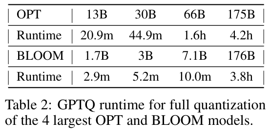</button><figcaption>Table 2 · Original Paper 2210.17323v2 · PDF crop; 原 caption 在截图中 <span>点击放大；保留全部坐标 / 图例。</span></figcaption></figure></details>

OPT 13B / 30B / 66B / 175B 分别为 20.9 分钟、44.9 分钟、1.6 小时、4.2 小时；BLOOM 1.7B / 3B / 7.1B / 176B 为 2.9 / 5.2 / 10.0 分钟 / 3.8 小时。不同模型的线性层 shape、层数和 block 搬运都影响时间，不能按参数量做精确线性外推。

作者将 ZeroQuant-LKD 小规模结果外推到 175B 得到更长耗时，这属于**作者预测**，不是同硬件实测的大模型 baseline。表本身证明 GPTQ 的量化作业可在数小时完成；没有给出每个算法改动在 175B 上的独立耗时消融。

### 5.4 Tables 3–4 — WikiText2 完整规模曲线

<p class="reading-meta">Table 3: OPT perplexity results on WikiText2. · Original Paper</p><div class="table-scroll original-table" role="region" tabindex="0" aria-label="Table 3 完整原始行列"><table class="ltx_tabular ltx_centering ltx_guessed_headers ltx_align_middle">
<thead class="ltx_thead">
<tr class="ltx_tr">
<th class="ltx_td ltx_align_left ltx_th ltx_th_column ltx_th_row ltx_border_l ltx_border_r ltx_border_tt">OPT</th>
<th class="ltx_td ltx_align_center ltx_th ltx_th_column ltx_th_row ltx_border_r ltx_border_tt">Bits</th>
<th class="ltx_td ltx_align_center ltx_th ltx_th_column ltx_border_r ltx_border_tt">125M</th>
<th class="ltx_td ltx_align_center ltx_th ltx_th_column ltx_border_r ltx_border_tt">350M</th>
<th class="ltx_td ltx_align_center ltx_th ltx_th_column ltx_border_r ltx_border_tt">1.3B</th>
<th class="ltx_td ltx_align_center ltx_th ltx_th_column ltx_border_r ltx_border_tt">2.7B</th>
<th class="ltx_td ltx_align_center ltx_th ltx_th_column ltx_border_r ltx_border_tt">6.7B</th>
<th class="ltx_td ltx_align_center ltx_th ltx_th_column ltx_border_r ltx_border_tt">13B</th>
<th class="ltx_td ltx_align_center ltx_th ltx_th_column ltx_border_r ltx_border_tt">30B</th>
<th class="ltx_td ltx_align_center ltx_th ltx_th_column ltx_border_r ltx_border_tt">66B</th>
<th class="ltx_td ltx_align_center ltx_th ltx_th_column ltx_border_r ltx_border_tt">175B</th></tr>
<tr class="ltx_tr">
<th class="ltx_td ltx_align_left ltx_th ltx_th_column ltx_th_row ltx_border_l ltx_border_r ltx_border_t">full</th>
<th class="ltx_td ltx_align_center ltx_th ltx_th_column ltx_th_row ltx_border_r ltx_border_t">16</th>
<th class="ltx_td ltx_align_center ltx_th ltx_th_column ltx_border_r ltx_border_t">27.65</th>
<th class="ltx_td ltx_align_center ltx_th ltx_th_column ltx_border_r ltx_border_t">22.00</th>
<th class="ltx_td ltx_align_center ltx_th ltx_th_column ltx_border_r ltx_border_t">14.63</th>
<th class="ltx_td ltx_align_center ltx_th ltx_th_column ltx_border_r ltx_border_t">12.47</th>
<th class="ltx_td ltx_align_center ltx_th ltx_th_column ltx_border_r ltx_border_t">10.86</th>
<th class="ltx_td ltx_align_center ltx_th ltx_th_column ltx_border_r ltx_border_t">10.13</th>
<th class="ltx_td ltx_align_center ltx_th ltx_th_column ltx_border_r ltx_border_t">9.56</th>
<th class="ltx_td ltx_align_center ltx_th ltx_th_column ltx_border_r ltx_border_t">9.34</th>
<th class="ltx_td ltx_align_center ltx_th ltx_th_column ltx_border_r ltx_border_t">8.34</th></tr>
</thead>
<tbody class="ltx_tbody">
<tr class="ltx_tr">
<th class="ltx_td ltx_align_left ltx_th ltx_th_row ltx_border_l ltx_border_r ltx_border_t">RTN</th>
<th class="ltx_td ltx_align_center ltx_th ltx_th_row ltx_border_r ltx_border_t">4</th>
<td class="ltx_td ltx_align_center ltx_border_r ltx_border_t">37.28</td>
<td class="ltx_td ltx_align_center ltx_border_r ltx_border_t">25.94</td>
<td class="ltx_td ltx_align_center ltx_border_r ltx_border_t">48.17</td>
<td class="ltx_td ltx_align_center ltx_border_r ltx_border_t">16.92</td>
<td class="ltx_td ltx_align_center ltx_border_r ltx_border_t">12.10</td>
<td class="ltx_td ltx_align_center ltx_border_r ltx_border_t">11.32</td>
<td class="ltx_td ltx_align_center ltx_border_r ltx_border_t">10.98</td>
<td class="ltx_td ltx_align_center ltx_border_r ltx_border_t">110</td>
<td class="ltx_td ltx_align_center ltx_border_r ltx_border_t">10.54</td></tr>
<tr class="ltx_tr">
<th class="ltx_td ltx_align_left ltx_th ltx_th_row ltx_border_l ltx_border_r">GPTQ</th>
<th class="ltx_td ltx_align_center ltx_th ltx_th_row ltx_border_r">4</th>
<td class="ltx_td ltx_align_center ltx_border_r"><span class="ltx_text ltx_font_bold">31.12</span></td>
<td class="ltx_td ltx_align_center ltx_border_r"><span class="ltx_text ltx_font_bold">24.24</span></td>
<td class="ltx_td ltx_align_center ltx_border_r"><span class="ltx_text ltx_font_bold">15.47</span></td>
<td class="ltx_td ltx_align_center ltx_border_r"><span class="ltx_text ltx_font_bold">12.87</span></td>
<td class="ltx_td ltx_align_center ltx_border_r"><span class="ltx_text ltx_font_bold">11.39</span></td>
<td class="ltx_td ltx_align_center ltx_border_r"><span class="ltx_text ltx_font_bold">10.31</span></td>
<td class="ltx_td ltx_align_center ltx_border_r"><span class="ltx_text ltx_font_bold">9.63</span></td>
<td class="ltx_td ltx_align_center ltx_border_r"><span class="ltx_text ltx_font_bold">9.55</span></td>
<td class="ltx_td ltx_align_center ltx_border_r"><span class="ltx_text ltx_font_bold">8.37</span></td></tr>
<tr class="ltx_tr">
<th class="ltx_td ltx_align_left ltx_th ltx_th_row ltx_border_l ltx_border_r ltx_border_t">RTN</th>
<th class="ltx_td ltx_align_center ltx_th ltx_th_row ltx_border_r ltx_border_t">3</th>
<td class="ltx_td ltx_align_center ltx_border_r ltx_border_t">1.3e3</td>
<td class="ltx_td ltx_align_center ltx_border_r ltx_border_t">64.57</td>
<td class="ltx_td ltx_align_center ltx_border_r ltx_border_t">1.3e4</td>
<td class="ltx_td ltx_align_center ltx_border_r ltx_border_t">1.6e4</td>
<td class="ltx_td ltx_align_center ltx_border_r ltx_border_t">5.8e3</td>
<td class="ltx_td ltx_align_center ltx_border_r ltx_border_t">3.4e3</td>
<td class="ltx_td ltx_align_center ltx_border_r ltx_border_t">1.6e3</td>
<td class="ltx_td ltx_align_center ltx_border_r ltx_border_t">6.1e3</td>
<td class="ltx_td ltx_align_center ltx_border_r ltx_border_t">7.3e3</td></tr>
<tr class="ltx_tr">
<th class="ltx_td ltx_align_left ltx_th ltx_th_row ltx_border_bb ltx_border_l ltx_border_r">GPTQ</th>
<th class="ltx_td ltx_align_center ltx_th ltx_th_row ltx_border_bb ltx_border_r">3</th>
<td class="ltx_td ltx_align_center ltx_border_bb ltx_border_r"><span class="ltx_text ltx_font_bold">53.85</span></td>
<td class="ltx_td ltx_align_center ltx_border_bb ltx_border_r"><span class="ltx_text ltx_font_bold">33.79</span></td>
<td class="ltx_td ltx_align_center ltx_border_bb ltx_border_r"><span class="ltx_text ltx_font_bold">20.97</span></td>
<td class="ltx_td ltx_align_center ltx_border_bb ltx_border_r"><span class="ltx_text ltx_font_bold">16.88</span></td>
<td class="ltx_td ltx_align_center ltx_border_bb ltx_border_r"><span class="ltx_text ltx_font_bold">14.86</span></td>
<td class="ltx_td ltx_align_center ltx_border_bb ltx_border_r"><span class="ltx_text ltx_font_bold">11.61</span></td>
<td class="ltx_td ltx_align_center ltx_border_bb ltx_border_r"><span class="ltx_text ltx_font_bold">10.27</span></td>
<td class="ltx_td ltx_align_center ltx_border_bb ltx_border_r"><span class="ltx_text ltx_font_bold">14.16</span></td>
<td class="ltx_td ltx_align_center ltx_border_bb ltx_border_r"><span class="ltx_text ltx_font_bold">8.68</span></td></tr>
</tbody>
</table></div><details class="source-evidence"><summary>Table 3 原始排版、加粗 / 下划线与 caption</summary><figure class="original-figure"><button type="button" data-zoom="assets/original/table-03.png" aria-label="放大 Table 3">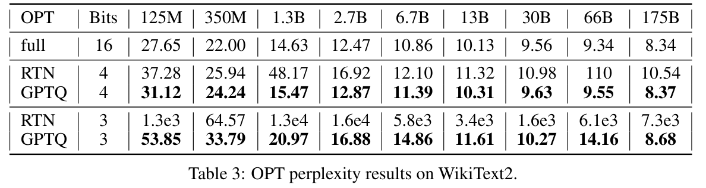</button><figcaption>Table 3 · Original Paper 2210.17323v2 · PDF crop; 原 caption 在截图中 <span>点击放大；保留全部坐标 / 图例。</span></figcaption></figure></details>

**OPT。** 对 175B，FP16 / RTN4 / GPTQ4 是 8.34 / 10.54 / 8.37。GPTQ4 对 FP16 增加 **0.03（0.36%）**，对 RTN4 降低 **2.17（20.59%）**。这是 perplexity 相对变化，不是 Accuracy 提升。3-bit 为 8.68，比 FP16 增 0.34（4.08%），RTN3 则是约 7300。

**看异常而非只看最大模型。** OPT-66B 的 GPTQ3 是 14.16，对 FP16 9.34 增约 51.61%；125M 的 53.85 也远离 27.65。因此“3-bit 几乎无损”只能在选定大模型条件下使用，不能覆盖全表。

<p class="reading-meta">Table 4: BLOOM perplexity results for WikiText2. · Original Paper</p><div class="table-scroll original-table" role="region" tabindex="0" aria-label="Table 4 完整原始行列"><table class="ltx_tabular ltx_centering ltx_guessed_headers ltx_align_middle">
<tbody class="ltx_tbody">
<tr class="ltx_tr">
<th class="ltx_td ltx_align_left ltx_th ltx_th_row ltx_border_l ltx_border_r ltx_border_tt">BLOOM</th>
<th class="ltx_td ltx_align_center ltx_th ltx_th_row ltx_border_r ltx_border_tt">Bits</th>
<td class="ltx_td ltx_align_center ltx_border_r ltx_border_tt">560M</td>
<td class="ltx_td ltx_align_center ltx_border_r ltx_border_tt">1.1B</td>
<td class="ltx_td ltx_align_center ltx_border_r ltx_border_tt">1.7B</td>
<td class="ltx_td ltx_align_center ltx_border_r ltx_border_tt">3B</td>
<td class="ltx_td ltx_align_center ltx_border_r ltx_border_tt">7.1B</td>
<td class="ltx_td ltx_align_center ltx_border_r ltx_border_tt">176B</td></tr>
<tr class="ltx_tr">
<th class="ltx_td ltx_align_left ltx_th ltx_th_row ltx_border_l ltx_border_r ltx_border_t">full</th>
<th class="ltx_td ltx_align_center ltx_th ltx_th_row ltx_border_r ltx_border_t">16</th>
<td class="ltx_td ltx_align_center ltx_border_r ltx_border_t">22.42</td>
<td class="ltx_td ltx_align_center ltx_border_r ltx_border_t">17.69</td>
<td class="ltx_td ltx_align_center ltx_border_r ltx_border_t">15.39</td>
<td class="ltx_td ltx_align_center ltx_border_r ltx_border_t">13.48</td>
<td class="ltx_td ltx_align_center ltx_border_r ltx_border_t">11.37</td>
<td class="ltx_td ltx_align_center ltx_border_r ltx_border_t">8.11</td></tr>
<tr class="ltx_tr">
<th class="ltx_td ltx_align_left ltx_th ltx_th_row ltx_border_l ltx_border_r ltx_border_t">RTN</th>
<th class="ltx_td ltx_align_center ltx_th ltx_th_row ltx_border_r ltx_border_t">4</th>
<td class="ltx_td ltx_align_center ltx_border_r ltx_border_t">25.90</td>
<td class="ltx_td ltx_align_center ltx_border_r ltx_border_t">22.00</td>
<td class="ltx_td ltx_align_center ltx_border_r ltx_border_t">16.97</td>
<td class="ltx_td ltx_align_center ltx_border_r ltx_border_t">14.76</td>
<td class="ltx_td ltx_align_center ltx_border_r ltx_border_t">12.10</td>
<td class="ltx_td ltx_align_center ltx_border_r ltx_border_t">8.37</td></tr>
<tr class="ltx_tr">
<th class="ltx_td ltx_align_left ltx_th ltx_th_row ltx_border_l ltx_border_r">GPTQ</th>
<th class="ltx_td ltx_align_center ltx_th ltx_th_row ltx_border_r">4</th>
<td class="ltx_td ltx_align_center ltx_border_r"><span class="ltx_text ltx_font_bold">24.03</span></td>
<td class="ltx_td ltx_align_center ltx_border_r"><span class="ltx_text ltx_font_bold">19.05</span></td>
<td class="ltx_td ltx_align_center ltx_border_r"><span class="ltx_text ltx_font_bold">16.48</span></td>
<td class="ltx_td ltx_align_center ltx_border_r"><span class="ltx_text ltx_font_bold">14.20</span></td>
<td class="ltx_td ltx_align_center ltx_border_r"><span class="ltx_text ltx_font_bold">11.73</span></td>
<td class="ltx_td ltx_align_center ltx_border_r"><span class="ltx_text ltx_font_bold">8.21</span></td></tr>
<tr class="ltx_tr">
<th class="ltx_td ltx_align_left ltx_th ltx_th_row ltx_border_l ltx_border_r ltx_border_t">RTN</th>
<th class="ltx_td ltx_align_center ltx_th ltx_th_row ltx_border_r ltx_border_t">3</th>
<td class="ltx_td ltx_align_center ltx_border_r ltx_border_t">57.08</td>
<td class="ltx_td ltx_align_center ltx_border_r ltx_border_t">50.19</td>
<td class="ltx_td ltx_align_center ltx_border_r ltx_border_t">63.59</td>
<td class="ltx_td ltx_align_center ltx_border_r ltx_border_t">39.36</td>
<td class="ltx_td ltx_align_center ltx_border_r ltx_border_t">17.38</td>
<td class="ltx_td ltx_align_center ltx_border_r ltx_border_t">571</td></tr>
<tr class="ltx_tr">
<th class="ltx_td ltx_align_left ltx_th ltx_th_row ltx_border_bb ltx_border_l ltx_border_r">GPTQ</th>
<th class="ltx_td ltx_align_center ltx_th ltx_th_row ltx_border_bb ltx_border_r">3</th>
<td class="ltx_td ltx_align_center ltx_border_bb ltx_border_r"><span class="ltx_text ltx_font_bold">32.31</span></td>
<td class="ltx_td ltx_align_center ltx_border_bb ltx_border_r"><span class="ltx_text ltx_font_bold">25.08</span></td>
<td class="ltx_td ltx_align_center ltx_border_bb ltx_border_r"><span class="ltx_text ltx_font_bold">21.11</span></td>
<td class="ltx_td ltx_align_center ltx_border_bb ltx_border_r"><span class="ltx_text ltx_font_bold">17.40</span></td>
<td class="ltx_td ltx_align_center ltx_border_bb ltx_border_r"><span class="ltx_text ltx_font_bold">13.47</span></td>
<td class="ltx_td ltx_align_center ltx_border_bb ltx_border_r"><span class="ltx_text ltx_font_bold">8.64</span></td></tr>
</tbody>
</table></div><details class="source-evidence"><summary>Table 4 原始排版、加粗 / 下划线与 caption</summary><figure class="original-figure"><button type="button" data-zoom="assets/original/table-04.png" aria-label="放大 Table 4">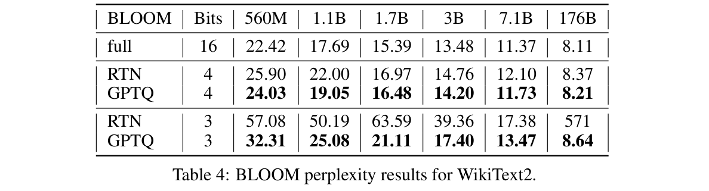</button><figcaption>Table 4 · Original Paper 2210.17323v2 · PDF crop; 原 caption 在截图中 <span>点击放大；保留全部坐标 / 图例。</span></figcaption></figure></details>

**BLOOM。** 176B GPTQ4 8.21 对 FP16 8.11 增 **0.10（1.23%）**，对 RTN4 8.37 降 0.16（1.91%）；GPTQ3 8.64 对 FP16 增 0.53（6.54%）。GPTQ 在低比特普遍比 RTN 稳健，但 560M GPTQ3 32.31 对 FP16 22.42 增约 44.11%，小规模仍有明显代价。

同 checkpoint、同位宽、同格点的 RTN 比较能较直接隔离补偿价值；不同工作若更换校准集、模型、evaluation tokenization 或推理精度，就不能只比一个 PPL 数字。

### Figure 3 — perplexity 之外的 LAMBADA

<figure class="original-figure"><button type="button" data-zoom="assets/original/fig-03-lambada.svg" aria-label="放大 Figure 3">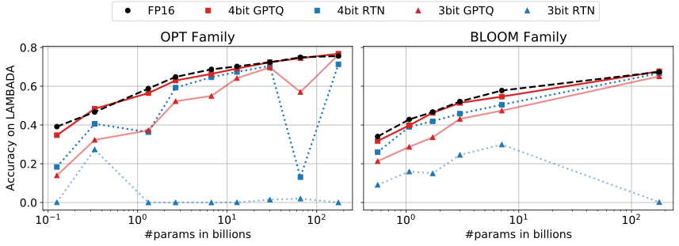</button><figcaption>Figure 3 · Original Paper 2210.17323v2 · Figure 3: The accuracy of OPT and BLOOM models post-GPTQ, measured on LAMBADA. <span>点击放大；保留全部坐标 / 图例。</span></figcaption></figure>

**问题与读法。** 横轴是模型规模，纵轴是 LAMBADA Accuracy（越高越好）；按 OPT / BLOOM 的 baseline 与 GPTQ 曲线分别追踪。LAMBADA 测试长语境下预测最后词的能力，回答“量化模型是否还保有下游任务能力”。

**关键观察。** 4-bit 与 baseline 接近；3-bit 小模型下降更大，大模型更稳，但 OPT-66B 是明显例外。图上看似超过 FP16 的点，完整 Table 13–14 可核对。没有 error bars、多 seed 或显著性检验，不能宣称量化带来稳定能力提升。它是聚合 accuracy 曲线，不展示模型的计算模块与数据流。

### 5.5 Table 5 — 175B 汇总与 grouping 的收益

<p class="reading-meta">Table 5: Results summary for OPT-175B and BLOOM-176B. “g1024” and “g128” denote results with groupings of size 1024 and 128, respectively. · Original Paper</p><div class="table-scroll original-table" role="region" tabindex="0" aria-label="Table 5 完整原始行列"><table class="ltx_tabular ltx_guessed_headers ltx_align_middle">
<tbody class="ltx_tbody">
<tr class="ltx_tr">
<th class="ltx_td ltx_align_center ltx_th ltx_th_row ltx_border_l ltx_border_r ltx_border_tt" rowspan="2"><span class="ltx_text">Method</span></th>
<th class="ltx_td ltx_align_center ltx_th ltx_th_row ltx_border_r ltx_border_tt" rowspan="2"><span class="ltx_text">Bits</span></th>
<td class="ltx_td ltx_align_center ltx_border_r ltx_border_tt" colspan="4">OPT-175B</td>
<td class="ltx_td ltx_align_center ltx_border_r ltx_border_tt" colspan="4">BLOOM-176B</td></tr>
<tr class="ltx_tr">
<td class="ltx_td ltx_align_center">Wiki2</td>
<td class="ltx_td ltx_align_center">PTB</td>
<td class="ltx_td ltx_align_center ltx_border_r">C4</td>
<td class="ltx_td ltx_align_center ltx_border_r">LAMB. <math alttext="\uparrow" class="ltx_Math" intent=":literal"><semantics><mo stretchy="false">↑</mo><annotation encoding="application/x-tex">\uparrow</annotation></semantics></math></td>
<td class="ltx_td ltx_align_center">Wiki2</td>
<td class="ltx_td ltx_align_center">PTB</td>
<td class="ltx_td ltx_align_center ltx_border_r">C4</td>
<td class="ltx_td ltx_align_center ltx_border_r">LAMB. <math alttext="\uparrow" class="ltx_Math" intent=":literal"><semantics><mo stretchy="false">↑</mo><annotation encoding="application/x-tex">\uparrow</annotation></semantics></math></td></tr>
<tr class="ltx_tr">
<th class="ltx_td ltx_align_center ltx_th ltx_th_row ltx_border_l ltx_border_r ltx_border_t">Baseline</th>
<th class="ltx_td ltx_align_center ltx_th ltx_th_row ltx_border_r ltx_border_t">16</th>
<td class="ltx_td ltx_align_center ltx_border_t">8.34</td>
<td class="ltx_td ltx_align_center ltx_border_t">12.01</td>
<td class="ltx_td ltx_align_center ltx_border_r ltx_border_t">10.13</td>
<td class="ltx_td ltx_align_center ltx_border_r ltx_border_t">75.59</td>
<td class="ltx_td ltx_align_center ltx_border_t">8.11</td>
<td class="ltx_td ltx_align_center ltx_border_t">14.59</td>
<td class="ltx_td ltx_align_center ltx_border_r ltx_border_t">11.71</td>
<td class="ltx_td ltx_align_center ltx_border_r ltx_border_t">67.40</td></tr>
<tr class="ltx_tr">
<th class="ltx_td ltx_align_center ltx_th ltx_th_row ltx_border_l ltx_border_r ltx_border_t">RTN</th>
<th class="ltx_td ltx_align_center ltx_th ltx_th_row ltx_border_r ltx_border_t">4</th>
<td class="ltx_td ltx_align_center ltx_border_t">10.54</td>
<td class="ltx_td ltx_align_center ltx_border_t">14.22</td>
<td class="ltx_td ltx_align_center ltx_border_r ltx_border_t">11.61</td>
<td class="ltx_td ltx_align_center ltx_border_r ltx_border_t">71.34</td>
<td class="ltx_td ltx_align_center ltx_border_t">8.37</td>
<td class="ltx_td ltx_align_center ltx_border_t">15.00</td>
<td class="ltx_td ltx_align_center ltx_border_r ltx_border_t">12.04</td>
<td class="ltx_td ltx_align_center ltx_border_r ltx_border_t">66.70</td></tr>
<tr class="ltx_tr">
<th class="ltx_td ltx_align_center ltx_th ltx_th_row ltx_border_l ltx_border_r">GPTQ</th>
<th class="ltx_td ltx_align_center ltx_th ltx_th_row ltx_border_r">4</th>
<td class="ltx_td ltx_align_center"><span class="ltx_text ltx_font_bold">8.37</span></td>
<td class="ltx_td ltx_align_center"><span class="ltx_text ltx_font_bold">12.26</span></td>
<td class="ltx_td ltx_align_center ltx_border_r"><span class="ltx_text ltx_font_bold">10.28</span></td>
<td class="ltx_td ltx_align_center ltx_border_r"><span class="ltx_text ltx_font_bold">76.80</span></td>
<td class="ltx_td ltx_align_center"><span class="ltx_text ltx_font_bold">8.21</span></td>
<td class="ltx_td ltx_align_center"><span class="ltx_text ltx_font_bold">14.75</span></td>
<td class="ltx_td ltx_align_center ltx_border_r"><span class="ltx_text ltx_font_bold">11.81</span></td>
<td class="ltx_td ltx_align_center ltx_border_r"><span class="ltx_text ltx_font_bold">67.71</span></td></tr>
<tr class="ltx_tr">
<th class="ltx_td ltx_align_center ltx_th ltx_th_row ltx_border_l ltx_border_r ltx_border_t">RTN</th>
<th class="ltx_td ltx_align_center ltx_th ltx_th_row ltx_border_r ltx_border_t">3</th>
<td class="ltx_td ltx_align_center ltx_border_t">7.3e3</td>
<td class="ltx_td ltx_align_center ltx_border_t">8.0e3</td>
<td class="ltx_td ltx_align_center ltx_border_r ltx_border_t">4.6e3</td>
<td class="ltx_td ltx_align_center ltx_border_r ltx_border_t">0</td>
<td class="ltx_td ltx_align_center ltx_border_t">571.</td>
<td class="ltx_td ltx_align_center ltx_border_t">107.</td>
<td class="ltx_td ltx_align_center ltx_border_r ltx_border_t">598.</td>
<td class="ltx_td ltx_align_center ltx_border_r ltx_border_t">0.17</td></tr>
<tr class="ltx_tr">
<th class="ltx_td ltx_align_center ltx_th ltx_th_row ltx_border_l ltx_border_r">GPTQ</th>
<th class="ltx_td ltx_align_center ltx_th ltx_th_row ltx_border_r">3</th>
<td class="ltx_td ltx_align_center"><span class="ltx_text ltx_font_bold">8.68</span></td>
<td class="ltx_td ltx_align_center"><span class="ltx_text ltx_font_bold">12.68</span></td>
<td class="ltx_td ltx_align_center ltx_border_r"><span class="ltx_text ltx_font_bold">10.67</span></td>
<td class="ltx_td ltx_align_center ltx_border_r"><span class="ltx_text ltx_font_bold">76.19</span></td>
<td class="ltx_td ltx_align_center"><span class="ltx_text ltx_font_bold">8.64</span></td>
<td class="ltx_td ltx_align_center"><span class="ltx_text ltx_font_bold">15.57</span></td>
<td class="ltx_td ltx_align_center ltx_border_r"><span class="ltx_text ltx_font_bold">12.27</span></td>
<td class="ltx_td ltx_align_center ltx_border_r"><span class="ltx_text ltx_font_bold">65.10</span></td></tr>
<tr class="ltx_tr">
<th class="ltx_td ltx_align_center ltx_th ltx_th_row ltx_border_l ltx_border_r ltx_border_t">GPTQ</th>
<th class="ltx_td ltx_align_center ltx_th ltx_th_row ltx_border_r ltx_border_t">3/g1024</th>
<td class="ltx_td ltx_align_center ltx_border_t">8.45</td>
<td class="ltx_td ltx_align_center ltx_border_t">12.48</td>
<td class="ltx_td ltx_align_center ltx_border_r ltx_border_t">10.47</td>
<td class="ltx_td ltx_align_center ltx_border_r ltx_border_t">77.39</td>
<td class="ltx_td ltx_align_center ltx_border_t">8.35</td>
<td class="ltx_td ltx_align_center ltx_border_t">15.01</td>
<td class="ltx_td ltx_align_center ltx_border_r ltx_border_t">11.98</td>
<td class="ltx_td ltx_align_center ltx_border_r ltx_border_t">67.47</td></tr>
<tr class="ltx_tr">
<th class="ltx_td ltx_align_center ltx_th ltx_th_row ltx_border_bb ltx_border_l ltx_border_r">GPTQ</th>
<th class="ltx_td ltx_align_center ltx_th ltx_th_row ltx_border_bb ltx_border_r">3/g128</th>
<td class="ltx_td ltx_align_center ltx_border_bb">8.45</td>
<td class="ltx_td ltx_align_center ltx_border_bb">12.37</td>
<td class="ltx_td ltx_align_center ltx_border_bb ltx_border_r">10.36</td>
<td class="ltx_td ltx_align_center ltx_border_bb ltx_border_r">76.42</td>
<td class="ltx_td ltx_align_center ltx_border_bb">8.26</td>
<td class="ltx_td ltx_align_center ltx_border_bb">14.89</td>
<td class="ltx_td ltx_align_center ltx_border_bb ltx_border_r">11.85</td>
<td class="ltx_td ltx_align_center ltx_border_bb ltx_border_r">67.86</td></tr>
</tbody>
</table></div><details class="source-evidence"><summary>Table 5 原始排版、加粗 / 下划线与 caption</summary><figure class="original-figure"><button type="button" data-zoom="assets/original/table-05.png" aria-label="放大 Table 5">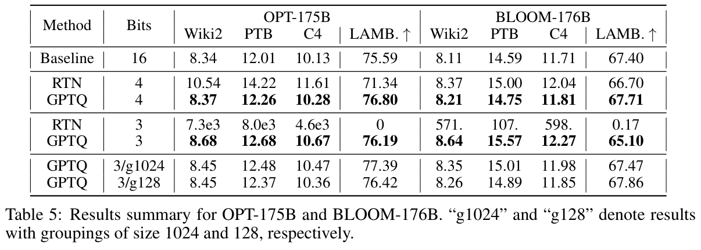</button><figcaption>Table 5 · Original Paper 2210.17323v2 · PDF crop; 原 caption 在截图中 <span>点击放大；保留全部坐标 / 图例。</span></figcaption></figure></details>

前三个指标 Wiki2 / PTB / C4 是 perplexity ↓，LAMBADA 是 Accuracy ↑。必须逐指标读，不能把四个数平均成“综合分”。OPT GPTQ3 从不分组到 g1024 / g128，Wiki2 8.68→8.45→8.45；BLOOM 为 8.64→8.35→8.26。较细 grouping 为输入子区间提供更贴合的量化范围，但要额外存 scale / zero，读取与解码也更复杂。

OPT-175B GPTQ4 LAMBADA 76.80 对 FP16 75.59 高 1.21 个百分点；这只是单次表中观测，不是因果提升证明。**跨表不一致。** 本表 OPT-175B GPTQ3 PTB 印为 **12.68**，Appendix Table 9 印为 **12.86**；两份原数据均保留，不任选一个冒充核验后真值。

### Figure 4 — 分组粒度是精度与存储的交换

<figure class="original-figure"><button type="button" data-zoom="assets/original/fig-04-grouping.svg" aria-label="放大 Figure 4">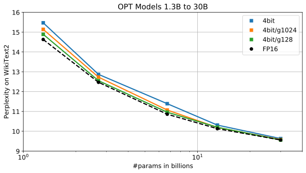</button><figcaption>Figure 4 · Original Paper 2210.17323v2 · Figure 4: GPTQ at 4-bit with different group-sizes on medium sized OPT models. <span>点击放大；保留全部坐标 / 图例。</span></figcaption></figure>

**问题与 Components。** 图中比较中等规模 OPT 的 4-bit，以及不同 group size 的 perplexity。沿横轴模型规模读同一组配置，再在同一规模对比 g 的曲线；图例表示 quantizer 共享范围的大小，不是 Algorithm 1 的 batch width。

**关键观察。** 较小 group size 常能缓解范围不匹配，减少重建损失。**为什么重要。** 这解释为什么“同为 INT4”的 checkpoint 可能拥有不同精度、有效位宽和 kernel 效率。该图没有测 metadata bandwidth 或 latency；也不能保证 g 越小、实际应用就越快。

### 5.6 Weight storage、KV 与 ideal traffic 的账本

<section class="mechanism" id="memory-widget"><p class="reading-meta">AGENT-CREATED CALCULATOR · CAPACITY, NOT SPEED</p><h3>压缩了权重，KV 仍会增长</h3><div class="controls"><label>参数量 P（其余结构固定，容量假设）<select id="mem-params"><option value="7" >7B</option><option value="70" >70B</option><option value="175" selected>175B · OPT default</option></select></label><label>量化 payload bits<select id="mem-bits"><option value="2" >2</option><option value="3" selected>3</option><option value="4" >4</option><option value="8" >8</option></select></label><label>Group size g<select id="mem-group"><option value="0" selected>payload only · 不计逐行metadata</option><option value="32" >32</option><option value="128" >128</option><option value="1024" >1024</option></select></label><label>保留 FP16 参数占比<select id="mem-fp"><option value="0" selected>0% · 理想payload</option><option value="1" >1%</option><option value="5" >5%</option></select></label><label>Context length S<select id="mem-length"><option value="128" >128</option><option value="2048" selected>2048 · OPT default</option><option value="8192" >8192 · 假设</option><option value="32768" >32768 · 假设</option></select></label><label>Batch B<select id="mem-batch"><option value="1" selected>1</option><option value="4" >4</option><option value="16" >16</option></select></label><label>KV heads（改变为 GQA/MQA 容量假设）<select id="mem-heads"><option value="96" selected>96 · OPT MHA</option><option value="8" >8 · GQA假设</option><option value="1" >1 · MQA假设</option></select></label></div><svg id="memory-svg" viewBox="0 0 540 215" role="img" aria-label="FP16权重、压缩权重与FP16KV的容量对比"><text x="20" y="40">175B 3-bit payload：61.12 GiB；FP16 KV：9 GiB。</text></svg><div id="memory-readout" class="readout" aria-live="polite">默认权重 65.625 GB = 61.12 GiB；KV=9GiB。</div><p class="hint">L=96，d_head=128，KV=FP16。改变 P 不自动改变层数；非175B配置是容量假设。其他context与head数不代表原OPT checkpoint支持。不计activation、workspace、allocator、packing alignment。GB=10⁹ bytes，GiB=2³⁰ bytes。</p><noscript><p>静态回退：175B×3/8=65.625GB；96层×96heads×128dim×2048tokens×K/V×2bytes=9GiB。更长上下文和batch会线性增加KV。</p></noscript></section>

**Derivation。** 对被量化部分，每个权重的有效位宽可粗记为 `b+(s+z)/g`，s / z 是每组 scale / zero 的存储 bit。`g=0` 在组件中表示只数理想 payload，未计 per-row metadata。实际 checkpoint 还可能对 zero 按更宽类型存储、对齐、padding 或 permutation，必须核对序列化格式。

FP16 KV 的 bytes 为 `2×L×B×S×H_kv×d_head×2`。OPT-175B 的 `L=96,H_kv=96,d_head=128`，batch1、2048 token 是 **9GiB**；batch 或 context 增长会线性放大。权重被 GPTQ 压缩，KV 的这些维度和 dtype 并没有因此改变。

把压缩权重加载量的比值解释成真实加速会漏掉 activation、KV、workspace、反量化、scale 访存、kernel occupancy、通信和多请求调度。**理想 16/3=5.33× 的 payload 比值不等于 Table 6 的 3.24×。**

### 5.7 Table 6 — latency 加速的成立条件

<p class="reading-meta">Table 6: Average per-token latency (batch size 1) when generating sequences of length 128. · Original Paper</p><div class="table-scroll original-table" role="region" tabindex="0" aria-label="Table 6 完整原始行列"><table class="ltx_tabular ltx_guessed_headers ltx_align_middle">
<thead class="ltx_thead">
<tr class="ltx_tr">
<th class="ltx_td ltx_align_left ltx_th ltx_th_column ltx_border_l ltx_border_r ltx_border_tt">GPU</th>
<th class="ltx_td ltx_align_center ltx_th ltx_th_column ltx_border_r ltx_border_tt">FP16</th>
<th class="ltx_td ltx_align_center ltx_th ltx_th_column ltx_border_r ltx_border_tt">3bit</th>
<th class="ltx_td ltx_align_center ltx_th ltx_th_column ltx_border_r ltx_border_tt">Speedup</th>
<th class="ltx_td ltx_align_center ltx_th ltx_th_column ltx_border_r ltx_border_tt">GPU reduction</th></tr>
</thead>
<tbody class="ltx_tbody">
<tr class="ltx_tr">
<td class="ltx_td ltx_align_left ltx_border_l ltx_border_r ltx_border_t">A6000 – 48GB</td>
<td class="ltx_td ltx_align_center ltx_border_r ltx_border_t">589ms</td>
<td class="ltx_td ltx_align_center ltx_border_r ltx_border_t">130ms</td>
<td class="ltx_td ltx_align_center ltx_border_r ltx_border_t"><math alttext="4.53\times" class="ltx_math_unparsed" intent=":literal"><semantics><mrow><mn>4.53</mn><mo lspace="0.222em">×</mo></mrow><annotation encoding="application/x-tex">4.53\times</annotation></semantics></math></td>
<td class="ltx_td ltx_align_center ltx_border_r ltx_border_t"><math alttext="8\rightarrow 2" class="ltx_Math" intent=":literal"><semantics><mrow><mn>8</mn><mo stretchy="false">→</mo><mn>2</mn></mrow><annotation encoding="application/x-tex">8\rightarrow 2</annotation></semantics></math></td></tr>
<tr class="ltx_tr">
<td class="ltx_td ltx_align_left ltx_border_bb ltx_border_l ltx_border_r">A100 – 80GB</td>
<td class="ltx_td ltx_align_center ltx_border_bb ltx_border_r">230ms</td>
<td class="ltx_td ltx_align_center ltx_border_bb ltx_border_r">71ms</td>
<td class="ltx_td ltx_align_center ltx_border_bb ltx_border_r"><math alttext="3.24\times" class="ltx_math_unparsed" intent=":literal"><semantics><mrow><mn>3.24</mn><mo lspace="0.222em">×</mo></mrow><annotation encoding="application/x-tex">3.24\times</annotation></semantics></math></td>
<td class="ltx_td ltx_align_center ltx_border_bb ltx_border_r"><math alttext="5\rightarrow 1" class="ltx_Math" intent=":literal"><semantics><mrow><mn>5</mn><mo stretchy="false">→</mo><mn>1</mn></mrow><annotation encoding="application/x-tex">5\rightarrow 1</annotation></semantics></math></td></tr>
</tbody>
</table></div><details class="source-evidence"><summary>Table 6 原始排版、加粗 / 下划线与 caption</summary><figure class="original-figure"><button type="button" data-zoom="assets/original/table-06.png" aria-label="放大 Table 6">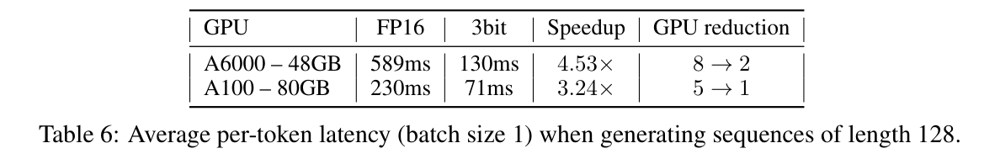</button><figcaption>Table 6 · Original Paper 2210.17323v2 · PDF crop; 原 caption 在截图中 <span>点击放大；保留全部坐标 / 图例。</span></figcaption></figure></details>

从原数值重新算：A100 `230/71=3.2394×`，latency 降 **69.13%**，GPU 数 5→1；A6000 `589/130=4.5308×`，latency 降 **77.93%**，GPU 数 8→2。摘要四舍五入写约 3.25× / 4.5×；本页保留表中的 3.24× / 4.53×。

**Paper。** 生成 batch1、128 输出 token，层按连续区间分布到 GPU；作者测该设置通信低于总时间 5%。embedding / output layer 保持 FP16。量化 kernel 从打包的 3-bit 权重加载并反量化，和 FP16 activation 做混合精度计算；当时硬件没有通用原生 FP16×INT3 matmul 指令。

<figure class="generated-figure"><svg xmlns="http://www.w3.org/2000/svg" viewBox="0 0 740 309" role="img" aria-label="原GPU权重量化kernel的数据路径"><rect x="20" y="15" width="700" height="60" rx="6" fill="#152235" stroke="#4a6485"/><text x="40" y="39">HBM：packed INT3 weights + scale / zero</text><text x="40" y="61" style="font-size:12px;fill:#b2c1d6">压缩读取量；layout决定访问与解码</text><path d="M370 75v26m-5 -6l5 6 5 -6"/><rect x="20" y="103" width="700" height="60" rx="6" fill="#152235" stroke="#4a6485"/><text x="40" y="127">Kernel 内部：unpack → dequantize → 浮点乘加</text><text x="40" y="149" style="font-size:12px;fill:#b2c1d6">读取 FP16 activation；INT3存储不等于原生INT3算术</text><path d="M370 163v26m-5 -6l5 6 5 -6"/><rect x="20" y="191" width="700" height="60" rx="6" fill="#152235" stroke="#4a6485"/><text x="40" y="215">输出 → residual / norm / attention / KV</text><text x="40" y="237" style="font-size:12px;fill:#b2c1d6">非量化算子和FP16 cache仍然付出IO与compute</text></svg><figcaption>原GPU权重量化kernel的数据路径 · Agent-created Simplified Diagram · <a href="assets/generated/runtime-io.mmd">Mermaid source</a></figcaption></figure>

**公平性。** 基础模型相同，硬件类型相同，但 GPU 数不同。容量缩减是重要系统结果，也意味着不能把 latency 比值全归因于一个 kernel。它没有和现代 tensor-parallel serving 的最佳 baseline 对照，没有 TTFT、逐 token TPOT 分布、长 prompt prefill、并发 batch sweep 或能耗。本文没有在这台 Mac 重跑 175B 或 CUDA kernel；所报告 GPU 数据来自原论文。

### 5.8 Table 7 — “2-bit”实际不只 2 bit / weight

<p class="reading-meta">Table 7: 2-bit GPTQ quantization results with varying group-sizes; perplexity on WikiText2. · Original Paper</p><div class="table-scroll original-table" role="region" tabindex="0" aria-label="Table 7 完整原始行列"><table class="ltx_tabular ltx_guessed_headers ltx_align_middle">
<thead class="ltx_thead">
<tr class="ltx_tr">
<th class="ltx_td ltx_align_left ltx_th ltx_th_column ltx_th_row ltx_border_l ltx_border_r ltx_border_tt">Model</th>
<th class="ltx_td ltx_align_center ltx_th ltx_th_column ltx_th_row ltx_border_r ltx_border_tt">FP16</th>
<th class="ltx_td ltx_align_center ltx_th ltx_th_column ltx_border_tt">g128</th>
<th class="ltx_td ltx_align_center ltx_th ltx_th_column ltx_border_tt">g64</th>
<th class="ltx_td ltx_align_center ltx_th ltx_th_column ltx_border_r ltx_border_tt">g32</th>
<th class="ltx_td ltx_align_center ltx_th ltx_th_column ltx_border_r ltx_border_tt">3-bit</th></tr>
</thead>
<tbody class="ltx_tbody">
<tr class="ltx_tr">
<th class="ltx_td ltx_align_left ltx_th ltx_th_row ltx_border_l ltx_border_r ltx_border_t">OPT-175B</th>
<th class="ltx_td ltx_align_center ltx_th ltx_th_row ltx_border_r ltx_border_t">8.34</th>
<td class="ltx_td ltx_align_center ltx_border_t">9.58</td>
<td class="ltx_td ltx_align_center ltx_border_t">9.18</td>
<td class="ltx_td ltx_align_center ltx_border_r ltx_border_t">8.94</td>
<td class="ltx_td ltx_align_center ltx_border_r ltx_border_t">8.68</td></tr>
<tr class="ltx_tr">
<th class="ltx_td ltx_align_left ltx_th ltx_th_row ltx_border_bb ltx_border_l ltx_border_r">BLOOM</th>
<th class="ltx_td ltx_align_center ltx_th ltx_th_row ltx_border_bb ltx_border_r">8.11</th>
<td class="ltx_td ltx_align_center ltx_border_bb">9.55</td>
<td class="ltx_td ltx_align_center ltx_border_bb">9.17</td>
<td class="ltx_td ltx_align_center ltx_border_bb ltx_border_r">8.83</td>
<td class="ltx_td ltx_align_center ltx_border_bb ltx_border_r">8.64</td></tr>
</tbody>
</table></div><details class="source-evidence"><summary>Table 7 原始排版、加粗 / 下划线与 caption</summary><figure class="original-figure"><button type="button" data-zoom="assets/original/table-07.png" aria-label="放大 Table 7">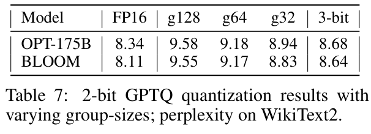</button><figcaption>Table 7 · Original Paper 2210.17323v2 · PDF crop; 原 caption 在截图中 <span>点击放大；保留全部坐标 / 图例。</span></figcaption></figure></details>

OPT-175B 的 2-bit g128 / g64 / g32 Wiki2 是 9.58 / 9.18 / 8.94；BLOOM-176B 是 9.55 / 9.17 / 8.83。对 FP16 分别增加 0.60 / 0.72（g32），仍比 3-bit 8.68 / 8.64 差。更细 grouping 带来更好的低比特误差，也付出 metadata。

按论文讨论的 FP16 scale 与 2-bit zero，g32 有效宽度 **2+(16+2)/32=2.5625 bit**，尚未计全部 packing 对齐。正文还报告 OPT-175B ternary、g8 的 Wiki2 9.20；三值的理论熵 `log₂3≈1.585` 不是实际完整 checkpoint bytes，不能据此宣称实际比 2-bit g32 更小。极低比特实验主要证明可行性，没有对应完整高效 kernel 的 latency 表。

## 6. Limitations — 论文自己的边界

**Paper。** GPTQ 的精度效果依赖模型、位宽和分组；小模型尤其可能损伤较大。算法是一次性 weight quantization，activation quantization 不属于核心方案。原 3-bit kernel 面向特定 GPU 与生成场景，性能依赖 memory-bound 条件；pretrained model 质量也没有因局部输出重建得到普遍提升保证。

**Interpretation。** 校准输入有限、局部连续补偿和离散格点约束之间仍有差距。damping 有利于数值稳定，同时把 `H` 的几何改为 `H+λI`，是目标偏置与稳定性的交换。共享顺序则减少优化自由度以换取计算与存储复用。

## 7. Ethics Statement — 压缩不消除模型风险

**Paper。** 作者讨论大语言模型已有偏见与误用风险。让大模型在更少硬件上运行改善可访问性，但不会自动消除训练数据偏差或有害输出。原论文没有将量化作为 alignment 或安全训练方法，也没有给出量化前后的安全 benchmark。

## 8. Reproducibility Statement — 代码版本也必须区分

**Paper。** 作者提供公开实现与实验说明。**External Source。** 本次核对官方仓库 revision `2d65066eeb06a5c9ff5184d8cebdf33662c67faf`（2023-07-11）中的 `gptq.py / quant.py / opt.py`。此版本比精读的 2023-03-22 PDF 晚，README 的 `new-eval`、`faster-kernel`、`act-order`、`true-sequential`、`static-groups` 等不能反写成原论文 v2 的实验设置。

**Code mapping。** `add_batch` 收集输入并构造 Hessian；`fasterquant` 完成 damping、因子化、块内补偿与块外更新；`Quantizer.find_params` 确定格点与分组参数；模型脚本控制逐 block 校准与 replay。参数 `blocksize` 与 `groupsize` 各自控制计算调度和量化粒度。

建议复现时锁定：checkpoint / tokenizer revision、校准 seed / 数据 split / 采样文本、eval chunking、quantizer 对称性、group size、damping、act-order、true-sequential、packing format、backend、GPU、batch 和 context。论文表格给的是特定实验结果，不是用任意现代 GPTQ loader 都能逐数重现的承诺。

## Appendix A.1 — 与 OBQ 的精度对照

<p class="reading-meta">Table 8: Comparison of GPTQ relative to OBQ on BERT-base/SQuAD and OPT-125M/WikiText2. · Original Paper</p><div class="table-scroll original-table" role="region" tabindex="0" aria-label="Table 8 完整原始行列"><table class="ltx_tabular ltx_centering ltx_guessed_headers ltx_align_middle">
<tbody class="ltx_tbody">
<tr class="ltx_tr">
<th class="ltx_td ltx_align_left ltx_th ltx_th_row ltx_border_l ltx_border_r ltx_border_tt" rowspan="2"><span class="ltx_text">Method</span></th>
<td class="ltx_td ltx_align_center ltx_border_r ltx_border_tt" colspan="2">BERT-base</td>
<td class="ltx_td ltx_align_center ltx_border_r ltx_border_tt" colspan="2">OPT-125M</td></tr>
<tr class="ltx_tr">
<td class="ltx_td ltx_align_center ltx_border_r" colspan="2">88.53 F1 <math alttext="\uparrow" class="ltx_Math" intent=":literal"><semantics><mo stretchy="false">↑</mo><annotation encoding="application/x-tex">\uparrow</annotation></semantics></math></td>
<td class="ltx_td ltx_align_center ltx_border_r" colspan="2">27.66 PPL <math alttext="\downarrow" class="ltx_Math" intent=":literal"><semantics><mo stretchy="false">↓</mo><annotation encoding="application/x-tex">\downarrow</annotation></semantics></math></td></tr>
<tr class="ltx_tr">
<th class="ltx_td ltx_th ltx_th_row ltx_border_l ltx_border_r"></th>
<td class="ltx_td ltx_align_center">4bit</td>
<td class="ltx_td ltx_align_center ltx_border_r">3bit</td>
<td class="ltx_td ltx_align_center">4bit</td>
<td class="ltx_td ltx_align_center ltx_border_r">3bit</td></tr>
<tr class="ltx_tr">
<th class="ltx_td ltx_align_left ltx_th ltx_th_row ltx_border_l ltx_border_r ltx_border_t">OBQ</th>
<td class="ltx_td ltx_align_center ltx_border_t">88.23</td>
<td class="ltx_td ltx_align_center ltx_border_r ltx_border_t">85.29</td>
<td class="ltx_td ltx_align_center ltx_border_t">32.52</td>
<td class="ltx_td ltx_align_center ltx_border_r ltx_border_t">69.32</td></tr>
<tr class="ltx_tr">
<th class="ltx_td ltx_align_left ltx_th ltx_th_row ltx_border_bb ltx_border_l ltx_border_r">GPTQ</th>
<td class="ltx_td ltx_align_center ltx_border_bb">88.18</td>
<td class="ltx_td ltx_align_center ltx_border_bb ltx_border_r">86.02</td>
<td class="ltx_td ltx_align_center ltx_border_bb">31.12</td>
<td class="ltx_td ltx_align_center ltx_border_bb ltx_border_r">53.85</td></tr>
</tbody>
</table></div><details class="source-evidence"><summary>Table 8 原始排版、加粗 / 下划线与 caption</summary><figure class="original-figure"><button type="button" data-zoom="assets/original/table-08.png" aria-label="放大 Table 8">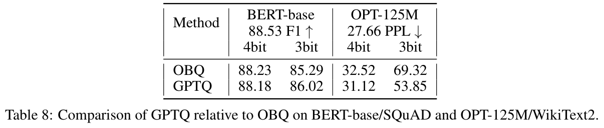</button><figcaption>Table 8 · Original Paper 2210.17323v2 · PDF crop; 原 caption 在截图中 <span>点击放大；保留全部坐标 / 图例。</span></figcaption></figure></details>

Table 8 比较 BERT-base / SQuAD F1 ↑ 和 OPT-125M / WikiText2 PPL ↓。3-bit BERT GPTQ 86.02 对 OBQ 85.29 高 **0.73 个百分点**；OPT125 GPTQ 53.85 对 OBQ 69.32 降 **15.47（22.32%）**。但 4-bit BERT GPTQ 88.18 比 OBQ 88.23 低 0.05。

这说明放弃逐行贪心并不必然损伤最终离散量化质量；也不证明任意顺序都是最优。F1 是 SQuAD 任务的答案 overlap 评分，无法由此构造分类混淆矩阵。原表 FP16 OPT 写 27.66，Table 3 写 27.65，两者按原文保留。

## Appendix A.2 — 评测与计时实现

**Paper。** validation 样本用两个换行连接，按模型默认 HuggingFace tokenizer 编码，再切成**非重叠 2048-token** 段。对 next-token 的平均负 log probability 取指数得到 PPL。zero-shot 按 EleutherAI evaluation harness 的 preprocessing 与 scoring，逐样本评估、不 padding。不同 tokenizer、空白 / 换行处理、sequence packing、每段首 token 的 loss mask 或 sliding evaluation 都可能改变 PPL，不能把后续 `new-eval` 数字并入原表。

计时部分应与校准作业分开看：Table 2 是完成全模型量化的 wall time，Table 6 是生成 average per-token latency。作者的连续层多卡划分，与 tensor-parallel 的每层 collective 成本并非同一种链路。论文没有逐 token timing trace，无法重构首 token 与稳态 decode 的分布。

**大 batch 的替代路径。** Appendix A.2.2 指出原 matrix-vector kernel 不直接适合 compute-bound 的非生成 / 大 batch。可先完整解压权重再做 matmul：作者对 OPT175 FC2 的 batch `16×1024` token 测得解压小于 1.5ms / 3ms（A100 / A6000），随后矩阵计算 76ms / 365ms。它支持“省容量且额外解压占比小”，并没有证明大 batch 也得到 Table 6 的加速倍数。

## Appendix A.3 — PTB / C4 能否支持跨数据集结论？

### Table 9 — OPT / PTB

<p class="reading-meta">Table 9: OPT perplexity results on PTB. · Original Paper</p><div class="table-scroll original-table" role="region" tabindex="0" aria-label="Table 9 完整原始行列"><table class="ltx_tabular ltx_centering ltx_guessed_headers ltx_align_middle">
<tbody class="ltx_tbody">
<tr class="ltx_tr">
<th class="ltx_td ltx_align_left ltx_th ltx_th_row ltx_border_l ltx_border_r ltx_border_tt">OPT</th>
<th class="ltx_td ltx_align_center ltx_th ltx_th_row ltx_border_r ltx_border_tt">Bits</th>
<td class="ltx_td ltx_align_center ltx_border_r ltx_border_tt">125M</td>
<td class="ltx_td ltx_align_center ltx_border_r ltx_border_tt">350M</td>
<td class="ltx_td ltx_align_center ltx_border_r ltx_border_tt">1.3B</td>
<td class="ltx_td ltx_align_center ltx_border_r ltx_border_tt">2.7B</td>
<td class="ltx_td ltx_align_center ltx_border_r ltx_border_tt">6.7B</td>
<td class="ltx_td ltx_align_center ltx_border_r ltx_border_tt">13B</td>
<td class="ltx_td ltx_align_center ltx_border_r ltx_border_tt">30B</td>
<td class="ltx_td ltx_align_center ltx_border_r ltx_border_tt">66B</td>
<td class="ltx_td ltx_align_center ltx_border_r ltx_border_tt">175B</td></tr>
<tr class="ltx_tr">
<th class="ltx_td ltx_align_left ltx_th ltx_th_row ltx_border_l ltx_border_r ltx_border_t">full</th>
<th class="ltx_td ltx_align_center ltx_th ltx_th_row ltx_border_r ltx_border_t">16</th>
<td class="ltx_td ltx_align_center ltx_border_r ltx_border_t">38.99</td>
<td class="ltx_td ltx_align_center ltx_border_r ltx_border_t">31.08</td>
<td class="ltx_td ltx_align_center ltx_border_r ltx_border_t">20.29</td>
<td class="ltx_td ltx_align_center ltx_border_r ltx_border_t">17.97</td>
<td class="ltx_td ltx_align_center ltx_border_r ltx_border_t">15.77</td>
<td class="ltx_td ltx_align_center ltx_border_r ltx_border_t">14.52</td>
<td class="ltx_td ltx_align_center ltx_border_r ltx_border_t">14.04</td>
<td class="ltx_td ltx_align_center ltx_border_r ltx_border_t">13.36</td>
<td class="ltx_td ltx_align_center ltx_border_r ltx_border_t">12.01</td></tr>
<tr class="ltx_tr">
<th class="ltx_td ltx_align_left ltx_th ltx_th_row ltx_border_l ltx_border_r ltx_border_t">RTN</th>
<th class="ltx_td ltx_align_center ltx_th ltx_th_row ltx_border_r ltx_border_t">4</th>
<td class="ltx_td ltx_align_center ltx_border_r ltx_border_t">53.89</td>
<td class="ltx_td ltx_align_center ltx_border_r ltx_border_t">36.79</td>
<td class="ltx_td ltx_align_center ltx_border_r ltx_border_t">57.30</td>
<td class="ltx_td ltx_align_center ltx_border_r ltx_border_t">31.05</td>
<td class="ltx_td ltx_align_center ltx_border_r ltx_border_t">18.84</td>
<td class="ltx_td ltx_align_center ltx_border_r ltx_border_t">16.51</td>
<td class="ltx_td ltx_align_center ltx_border_r ltx_border_t">15.40</td>
<td class="ltx_td ltx_align_center ltx_border_r ltx_border_t">225.66</td>
<td class="ltx_td ltx_align_center ltx_border_r ltx_border_t">14.22</td></tr>
<tr class="ltx_tr">
<th class="ltx_td ltx_align_left ltx_th ltx_th_row ltx_border_l ltx_border_r">GPTQ</th>
<th class="ltx_td ltx_align_center ltx_th ltx_th_row ltx_border_r">4</th>
<td class="ltx_td ltx_align_center ltx_border_r"><span class="ltx_text ltx_font_bold">45.17</span></td>
<td class="ltx_td ltx_align_center ltx_border_r"><span class="ltx_text ltx_font_bold">34.52</span></td>
<td class="ltx_td ltx_align_center ltx_border_r"><span class="ltx_text ltx_font_bold">21.85</span></td>
<td class="ltx_td ltx_align_center ltx_border_r"><span class="ltx_text ltx_font_bold">19.14</span></td>
<td class="ltx_td ltx_align_center ltx_border_r"><span class="ltx_text ltx_font_bold">16.56</span></td>
<td class="ltx_td ltx_align_center ltx_border_r"><span class="ltx_text ltx_font_bold">14.94</span></td>
<td class="ltx_td ltx_align_center ltx_border_r"><span class="ltx_text ltx_font_bold">14.26</span></td>
<td class="ltx_td ltx_align_center ltx_border_r"><span class="ltx_text ltx_font_bold">13.81</span></td>
<td class="ltx_td ltx_align_center ltx_border_r"><span class="ltx_text ltx_font_bold">12.26</span></td></tr>
<tr class="ltx_tr">
<th class="ltx_td ltx_align_left ltx_th ltx_th_row ltx_border_l ltx_border_r ltx_border_t">RTN</th>
<th class="ltx_td ltx_align_center ltx_th ltx_th_row ltx_border_r ltx_border_t">3</th>
<td class="ltx_td ltx_align_center ltx_border_r ltx_border_t">1.4e3</td>
<td class="ltx_td ltx_align_center ltx_border_r ltx_border_t">88.04</td>
<td class="ltx_td ltx_align_center ltx_border_r ltx_border_t">1.3e4</td>
<td class="ltx_td ltx_align_center ltx_border_r ltx_border_t">1.4e4</td>
<td class="ltx_td ltx_align_center ltx_border_r ltx_border_t">5.7e3</td>
<td class="ltx_td ltx_align_center ltx_border_r ltx_border_t">2.8e3</td>
<td class="ltx_td ltx_align_center ltx_border_r ltx_border_t">1.2e3</td>
<td class="ltx_td ltx_align_center ltx_border_r ltx_border_t">5.0e3</td>
<td class="ltx_td ltx_align_center ltx_border_r ltx_border_t">8.0e3</td></tr>
<tr class="ltx_tr">
<th class="ltx_td ltx_align_left ltx_th ltx_th_row ltx_border_bb ltx_border_l ltx_border_r">GPTQ</th>
<th class="ltx_td ltx_align_center ltx_th ltx_th_row ltx_border_bb ltx_border_r">3</th>
<td class="ltx_td ltx_align_center ltx_border_bb ltx_border_r"><span class="ltx_text ltx_font_bold">73.19</span></td>
<td class="ltx_td ltx_align_center ltx_border_bb ltx_border_r"><span class="ltx_text ltx_font_bold">47.08</span></td>
<td class="ltx_td ltx_align_center ltx_border_bb ltx_border_r"><span class="ltx_text ltx_font_bold">32.10</span></td>
<td class="ltx_td ltx_align_center ltx_border_bb ltx_border_r"><span class="ltx_text ltx_font_bold">24.81</span></td>
<td class="ltx_td ltx_align_center ltx_border_bb ltx_border_r"><span class="ltx_text ltx_font_bold">21.88</span></td>
<td class="ltx_td ltx_align_center ltx_border_bb ltx_border_r"><span class="ltx_text ltx_font_bold">16.68</span></td>
<td class="ltx_td ltx_align_center ltx_border_bb ltx_border_r"><span class="ltx_text ltx_font_bold">15.36</span></td>
<td class="ltx_td ltx_align_center ltx_border_bb ltx_border_r"><span class="ltx_text ltx_font_bold">28.12</span></td>
<td class="ltx_td ltx_align_center ltx_border_bb ltx_border_r"><span class="ltx_text ltx_font_bold">12.86</span></td></tr>
</tbody>
</table></div><details class="source-evidence"><summary>Table 9 原始排版、加粗 / 下划线与 caption</summary><figure class="original-figure"><button type="button" data-zoom="assets/original/table-09.png" aria-label="放大 Table 9">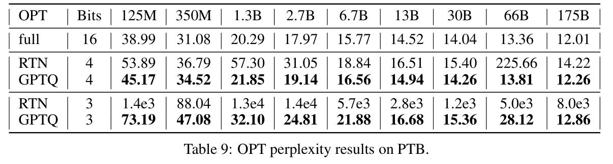</button><figcaption>Table 9 · Original Paper 2210.17323v2 · PDF crop; 原 caption 在截图中 <span>点击放大；保留全部坐标 / 图例。</span></figcaption></figure></details>

175B FP16 / GPTQ4 为 12.01 / 12.26，增加 0.25（2.08%）；GPTQ3 为 **12.86**，增加 0.85（7.08%），与主文 Table 5 的 12.68 不一致。OPT66 GPTQ3 28.12 对 FP16 13.36 仍严重下降。PTB 支持 GPTQ 大体保留低比特性能，但没有消除模型相关异常。

### Table 10 — BLOOM / PTB

<p class="reading-meta">Table 10: BLOOM perplexity results for PTB. · Original Paper</p><div class="table-scroll original-table" role="region" tabindex="0" aria-label="Table 10 完整原始行列"><table class="ltx_tabular ltx_centering ltx_guessed_headers ltx_align_middle">
<tbody class="ltx_tbody">
<tr class="ltx_tr">
<th class="ltx_td ltx_align_left ltx_th ltx_th_row ltx_border_l ltx_border_r ltx_border_tt">BLOOM</th>
<th class="ltx_td ltx_align_center ltx_th ltx_th_row ltx_border_r ltx_border_tt">Bits</th>
<td class="ltx_td ltx_align_center ltx_border_r ltx_border_tt">560M</td>
<td class="ltx_td ltx_align_center ltx_border_r ltx_border_tt">1.1B</td>
<td class="ltx_td ltx_align_center ltx_border_r ltx_border_tt">1.7B</td>
<td class="ltx_td ltx_align_center ltx_border_r ltx_border_tt">3B</td>
<td class="ltx_td ltx_align_center ltx_border_r ltx_border_tt">7.1B</td>
<td class="ltx_td ltx_align_center ltx_border_r ltx_border_tt">176B</td></tr>
<tr class="ltx_tr">
<th class="ltx_td ltx_align_left ltx_th ltx_th_row ltx_border_l ltx_border_r ltx_border_t">full</th>
<th class="ltx_td ltx_align_center ltx_th ltx_th_row ltx_border_r ltx_border_t">16</th>
<td class="ltx_td ltx_align_center ltx_border_r ltx_border_t">43.69</td>
<td class="ltx_td ltx_align_center ltx_border_r ltx_border_t">57.96</td>
<td class="ltx_td ltx_align_center ltx_border_r ltx_border_t">30.00</td>
<td class="ltx_td ltx_align_center ltx_border_r ltx_border_t">25.34</td>
<td class="ltx_td ltx_align_center ltx_border_r ltx_border_t">20.83</td>
<td class="ltx_td ltx_align_center ltx_border_r ltx_border_t">14.59</td></tr>
<tr class="ltx_tr">
<th class="ltx_td ltx_align_left ltx_th ltx_th_row ltx_border_l ltx_border_r ltx_border_t">RTN</th>
<th class="ltx_td ltx_align_center ltx_th ltx_th_row ltx_border_r ltx_border_t">4</th>
<td class="ltx_td ltx_align_center ltx_border_r ltx_border_t">51.10</td>
<td class="ltx_td ltx_align_center ltx_border_r ltx_border_t">66.85</td>
<td class="ltx_td ltx_align_center ltx_border_r ltx_border_t">33.58</td>
<td class="ltx_td ltx_align_center ltx_border_r ltx_border_t">27.68</td>
<td class="ltx_td ltx_align_center ltx_border_r ltx_border_t">22.42</td>
<td class="ltx_td ltx_align_center ltx_border_r ltx_border_t">15.00</td></tr>
<tr class="ltx_tr">
<th class="ltx_td ltx_align_left ltx_th ltx_th_row ltx_border_l ltx_border_r">GPTQ</th>
<th class="ltx_td ltx_align_center ltx_th ltx_th_row ltx_border_r">4</th>
<td class="ltx_td ltx_align_center ltx_border_r"><span class="ltx_text ltx_font_bold">46.97</span></td>
<td class="ltx_td ltx_align_center ltx_border_r"><span class="ltx_text ltx_font_bold">62.47</span></td>
<td class="ltx_td ltx_align_center ltx_border_r"><span class="ltx_text ltx_font_bold">31.84</span></td>
<td class="ltx_td ltx_align_center ltx_border_r"><span class="ltx_text ltx_font_bold">26.49</span></td>
<td class="ltx_td ltx_align_center ltx_border_r"><span class="ltx_text ltx_font_bold">21.67</span></td>
<td class="ltx_td ltx_align_center ltx_border_r"><span class="ltx_text ltx_font_bold">14.75</span></td></tr>
<tr class="ltx_tr">
<th class="ltx_td ltx_align_left ltx_th ltx_th_row ltx_border_l ltx_border_r ltx_border_t">RTN</th>
<th class="ltx_td ltx_align_center ltx_th ltx_th_row ltx_border_r ltx_border_t">3</th>
<td class="ltx_td ltx_align_center ltx_border_r ltx_border_t">126.</td>
<td class="ltx_td ltx_align_center ltx_border_r ltx_border_t">185.</td>
<td class="ltx_td ltx_align_center ltx_border_r ltx_border_t">106.</td>
<td class="ltx_td ltx_align_center ltx_border_r ltx_border_t">66.78</td>
<td class="ltx_td ltx_align_center ltx_border_r ltx_border_t">35.04</td>
<td class="ltx_td ltx_align_center ltx_border_r ltx_border_t">107.</td></tr>
<tr class="ltx_tr">
<th class="ltx_td ltx_align_left ltx_th ltx_th_row ltx_border_bb ltx_border_l ltx_border_r">GPTQ</th>
<th class="ltx_td ltx_align_center ltx_th ltx_th_row ltx_border_bb ltx_border_r">3</th>
<td class="ltx_td ltx_align_center ltx_border_bb ltx_border_r"><span class="ltx_text ltx_font_bold">70.35</span></td>
<td class="ltx_td ltx_align_center ltx_border_bb ltx_border_r"><span class="ltx_text ltx_font_bold">87.04</span></td>
<td class="ltx_td ltx_align_center ltx_border_bb ltx_border_r"><span class="ltx_text ltx_font_bold">46.11</span></td>
<td class="ltx_td ltx_align_center ltx_border_bb ltx_border_r"><span class="ltx_text ltx_font_bold">34.02</span></td>
<td class="ltx_td ltx_align_center ltx_border_bb ltx_border_r"><span class="ltx_text ltx_font_bold">26.14</span></td>
<td class="ltx_td ltx_align_center ltx_border_bb ltx_border_r"><span class="ltx_text ltx_font_bold">15.57</span></td></tr>
</tbody>
</table></div><details class="source-evidence"><summary>Table 10 原始排版、加粗 / 下划线与 caption</summary><figure class="original-figure"><button type="button" data-zoom="assets/original/table-10.png" aria-label="放大 Table 10">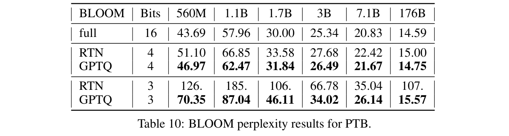</button><figcaption>Table 10 · Original Paper 2210.17323v2 · PDF crop; 原 caption 在截图中 <span>点击放大；保留全部坐标 / 图例。</span></figcaption></figure></details>

176B GPTQ4 14.75 对 FP16 14.59 增 0.16（1.10%），GPTQ3 15.57 增 0.98（6.72%）；RTN3 为 107。另一方面 FP16 的 1.1B 是 57.96，比 560M 的 43.69 更差：数据集性能本身就不随参数规模严格单调，量化解释必须相对各自 checkpoint。

### Table 11 — OPT / C4

<p class="reading-meta">Table 11: OPT perplexity results on C4. We note that the calibration data used by GPTQ is sampled from the C4 training set, this task is thus not fully zero-shot. · Original Paper</p><div class="table-scroll original-table" role="region" tabindex="0" aria-label="Table 11 完整原始行列"><table class="ltx_tabular ltx_centering ltx_guessed_headers ltx_align_middle">
<tbody class="ltx_tbody">
<tr class="ltx_tr">
<th class="ltx_td ltx_align_left ltx_th ltx_th_row ltx_border_l ltx_border_r ltx_border_tt">OPT</th>
<th class="ltx_td ltx_align_center ltx_th ltx_th_row ltx_border_r ltx_border_tt">Bits</th>
<td class="ltx_td ltx_align_center ltx_border_r ltx_border_tt">125M</td>
<td class="ltx_td ltx_align_center ltx_border_r ltx_border_tt">350M</td>
<td class="ltx_td ltx_align_center ltx_border_r ltx_border_tt">1.3B</td>
<td class="ltx_td ltx_align_center ltx_border_r ltx_border_tt">2.7B</td>
<td class="ltx_td ltx_align_center ltx_border_r ltx_border_tt">6.7B</td>
<td class="ltx_td ltx_align_center ltx_border_r ltx_border_tt">13B</td>
<td class="ltx_td ltx_align_center ltx_border_r ltx_border_tt">30B</td>
<td class="ltx_td ltx_align_center ltx_border_r ltx_border_tt">66B</td>
<td class="ltx_td ltx_align_center ltx_border_r ltx_border_tt">175B</td></tr>
<tr class="ltx_tr">
<th class="ltx_td ltx_align_left ltx_th ltx_th_row ltx_border_l ltx_border_r ltx_border_t">full</th>
<th class="ltx_td ltx_align_center ltx_th ltx_th_row ltx_border_r ltx_border_t">16</th>
<td class="ltx_td ltx_align_center ltx_border_r ltx_border_t">26.56</td>
<td class="ltx_td ltx_align_center ltx_border_r ltx_border_t">22.59</td>
<td class="ltx_td ltx_align_center ltx_border_r ltx_border_t">16.07</td>
<td class="ltx_td ltx_align_center ltx_border_r ltx_border_t">14.34</td>
<td class="ltx_td ltx_align_center ltx_border_r ltx_border_t">12.71</td>
<td class="ltx_td ltx_align_center ltx_border_r ltx_border_t">12.06</td>
<td class="ltx_td ltx_align_center ltx_border_r ltx_border_t">11.44</td>
<td class="ltx_td ltx_align_center ltx_border_r ltx_border_t">10.99</td>
<td class="ltx_td ltx_align_center ltx_border_r ltx_border_t">10.13</td></tr>
<tr class="ltx_tr">
<th class="ltx_td ltx_align_left ltx_th ltx_th_row ltx_border_l ltx_border_r ltx_border_t">RTN</th>
<th class="ltx_td ltx_align_center ltx_th ltx_th_row ltx_border_r ltx_border_t">4</th>
<td class="ltx_td ltx_align_center ltx_border_r ltx_border_t">33.91</td>
<td class="ltx_td ltx_align_center ltx_border_r ltx_border_t">26.21</td>
<td class="ltx_td ltx_align_center ltx_border_r ltx_border_t">24.51</td>
<td class="ltx_td ltx_align_center ltx_border_r ltx_border_t">18.43</td>
<td class="ltx_td ltx_align_center ltx_border_r ltx_border_t">14.36</td>
<td class="ltx_td ltx_align_center ltx_border_r ltx_border_t">13.36</td>
<td class="ltx_td ltx_align_center ltx_border_r ltx_border_t">13.46</td>
<td class="ltx_td ltx_align_center ltx_border_r ltx_border_t">309.</td>
<td class="ltx_td ltx_align_center ltx_border_r ltx_border_t">11.61</td></tr>
<tr class="ltx_tr">
<th class="ltx_td ltx_align_left ltx_th ltx_th_row ltx_border_l ltx_border_r">GPTQ</th>
<th class="ltx_td ltx_align_center ltx_th ltx_th_row ltx_border_r">4</th>
<td class="ltx_td ltx_align_center ltx_border_r"><span class="ltx_text ltx_font_bold">29.22</span></td>
<td class="ltx_td ltx_align_center ltx_border_r"><span class="ltx_text ltx_font_bold">24.63</span></td>
<td class="ltx_td ltx_align_center ltx_border_r"><span class="ltx_text ltx_font_bold">16.97</span></td>
<td class="ltx_td ltx_align_center ltx_border_r"><span class="ltx_text ltx_font_bold">15.00</span></td>
<td class="ltx_td ltx_align_center ltx_border_r"><span class="ltx_text ltx_font_bold">13.18</span></td>
<td class="ltx_td ltx_align_center ltx_border_r"><span class="ltx_text ltx_font_bold">12.26</span></td>
<td class="ltx_td ltx_align_center ltx_border_r"><span class="ltx_text ltx_font_bold">11.57</span></td>
<td class="ltx_td ltx_align_center ltx_border_r"><span class="ltx_text ltx_font_bold">11.23</span></td>
<td class="ltx_td ltx_align_center ltx_border_r"><span class="ltx_text ltx_font_bold">10.28</span></td></tr>
<tr class="ltx_tr">
<th class="ltx_td ltx_align_left ltx_th ltx_th_row ltx_border_l ltx_border_r ltx_border_t">RTN</th>
<th class="ltx_td ltx_align_center ltx_th ltx_th_row ltx_border_r ltx_border_t">3</th>
<td class="ltx_td ltx_align_center ltx_border_r ltx_border_t">834</td>
<td class="ltx_td ltx_align_center ltx_border_r ltx_border_t">55.49</td>
<td class="ltx_td ltx_align_center ltx_border_r ltx_border_t">5.2e3</td>
<td class="ltx_td ltx_align_center ltx_border_r ltx_border_t">1.1e4</td>
<td class="ltx_td ltx_align_center ltx_border_r ltx_border_t">5.3e3</td>
<td class="ltx_td ltx_align_center ltx_border_r ltx_border_t">3.1e3</td>
<td class="ltx_td ltx_align_center ltx_border_r ltx_border_t">1.4e3</td>
<td class="ltx_td ltx_align_center ltx_border_r ltx_border_t">3.5e3</td>
<td class="ltx_td ltx_align_center ltx_border_r ltx_border_t">4.6e3</td></tr>
<tr class="ltx_tr">
<th class="ltx_td ltx_align_left ltx_th ltx_th_row ltx_border_bb ltx_border_l ltx_border_r">GPTQ</th>
<th class="ltx_td ltx_align_center ltx_th ltx_th_row ltx_border_bb ltx_border_r">3</th>
<td class="ltx_td ltx_align_center ltx_border_bb ltx_border_r"><span class="ltx_text ltx_font_bold">42.41</span></td>
<td class="ltx_td ltx_align_center ltx_border_bb ltx_border_r"><span class="ltx_text ltx_font_bold">31.33</span></td>
<td class="ltx_td ltx_align_center ltx_border_bb ltx_border_r"><span class="ltx_text ltx_font_bold">21.63</span></td>
<td class="ltx_td ltx_align_center ltx_border_bb ltx_border_r"><span class="ltx_text ltx_font_bold">18.17</span></td>
<td class="ltx_td ltx_align_center ltx_border_bb ltx_border_r"><span class="ltx_text ltx_font_bold">17.14</span></td>
<td class="ltx_td ltx_align_center ltx_border_bb ltx_border_r"><span class="ltx_text ltx_font_bold">13.34</span></td>
<td class="ltx_td ltx_align_center ltx_border_bb ltx_border_r"><span class="ltx_text ltx_font_bold">12.23</span></td>
<td class="ltx_td ltx_align_center ltx_border_bb ltx_border_r"><span class="ltx_text ltx_font_bold">14.59</span></td>
<td class="ltx_td ltx_align_center ltx_border_bb ltx_border_r"><span class="ltx_text ltx_font_bold">10.67</span></td></tr>
</tbody>
</table></div><details class="source-evidence"><summary>Table 11 原始排版、加粗 / 下划线与 caption</summary><figure class="original-figure"><button type="button" data-zoom="assets/original/table-11.png" aria-label="放大 Table 11">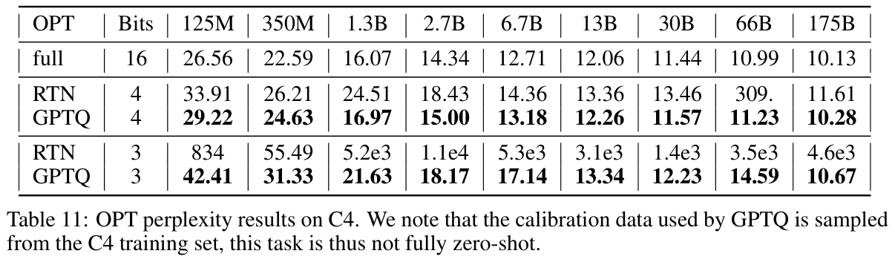</button><figcaption>Table 11 · Original Paper 2210.17323v2 · PDF crop; 原 caption 在截图中 <span>点击放大；保留全部坐标 / 图例。</span></figcaption></figure></details>

175B FP16 / GPTQ4 / GPTQ3 为 10.13 / 10.28 / 10.67，分别增加 1.48% / 5.33%；RTN4 为 11.61。OPT66 RTN4 309、GPTQ4 11.23，再次验证误差补偿能避免直接舍入的灾难性失效。

**设置警示。** 校准是 C4 training，评测是 C4 validation；作者明确在 caption 写此任务 **not fully zero-shot**。这不是直接复用评测样本，却也不能作为完全不同校准域的泛化证据。

### Table 12 — BLOOM / C4

<p class="reading-meta">Table 12: BLOOM perplexity results for C4. We note that the calibration data used by GPTQ is sampled from the C4 training set, this task is thus not fully zero-shot. · Original Paper</p><div class="table-scroll original-table" role="region" tabindex="0" aria-label="Table 12 完整原始行列"><table class="ltx_tabular ltx_centering ltx_guessed_headers ltx_align_middle">
<tbody class="ltx_tbody">
<tr class="ltx_tr">
<th class="ltx_td ltx_align_left ltx_th ltx_th_row ltx_border_l ltx_border_r ltx_border_tt">BLOOM</th>
<th class="ltx_td ltx_align_center ltx_th ltx_th_row ltx_border_r ltx_border_tt">Bits</th>
<td class="ltx_td ltx_align_center ltx_border_r ltx_border_tt">560M</td>
<td class="ltx_td ltx_align_center ltx_border_r ltx_border_tt">1.1B</td>
<td class="ltx_td ltx_align_center ltx_border_r ltx_border_tt">1.7B</td>
<td class="ltx_td ltx_align_center ltx_border_r ltx_border_tt">3B</td>
<td class="ltx_td ltx_align_center ltx_border_r ltx_border_tt">7.1B</td>
<td class="ltx_td ltx_align_center ltx_border_r ltx_border_tt">176B</td></tr>
<tr class="ltx_tr">
<th class="ltx_td ltx_align_left ltx_th ltx_th_row ltx_border_l ltx_border_r ltx_border_t">full</th>
<th class="ltx_td ltx_align_center ltx_th ltx_th_row ltx_border_r ltx_border_t">16</th>
<td class="ltx_td ltx_align_center ltx_border_r ltx_border_t">26.60</td>
<td class="ltx_td ltx_align_center ltx_border_r ltx_border_t">22.05</td>
<td class="ltx_td ltx_align_center ltx_border_r ltx_border_t">19.49</td>
<td class="ltx_td ltx_align_center ltx_border_r ltx_border_t">17.49</td>
<td class="ltx_td ltx_align_center ltx_border_r ltx_border_t">15.20</td>
<td class="ltx_td ltx_align_center ltx_border_r ltx_border_t">11.71</td></tr>
<tr class="ltx_tr">
<th class="ltx_td ltx_align_left ltx_th ltx_th_row ltx_border_l ltx_border_r ltx_border_t">RTN</th>
<th class="ltx_td ltx_align_center ltx_th ltx_th_row ltx_border_r ltx_border_t">4</th>
<td class="ltx_td ltx_align_center ltx_border_r ltx_border_t">29.89</td>
<td class="ltx_td ltx_align_center ltx_border_r ltx_border_t">24.44</td>
<td class="ltx_td ltx_align_center ltx_border_r ltx_border_t">21.26</td>
<td class="ltx_td ltx_align_center ltx_border_r ltx_border_t">18.76</td>
<td class="ltx_td ltx_align_center ltx_border_r ltx_border_t">16.06</td>
<td class="ltx_td ltx_align_center ltx_border_r ltx_border_t">12.04</td></tr>
<tr class="ltx_tr">
<th class="ltx_td ltx_align_left ltx_th ltx_th_row ltx_border_l ltx_border_r">GPTQ</th>
<th class="ltx_td ltx_align_center ltx_th ltx_th_row ltx_border_r">4</th>
<td class="ltx_td ltx_align_center ltx_border_r"><span class="ltx_text ltx_font_bold">28.00</span></td>
<td class="ltx_td ltx_align_center ltx_border_r"><span class="ltx_text ltx_font_bold">23.25</span></td>
<td class="ltx_td ltx_align_center ltx_border_r"><span class="ltx_text ltx_font_bold">20.55</span></td>
<td class="ltx_td ltx_align_center ltx_border_r"><span class="ltx_text ltx_font_bold">18.10</span></td>
<td class="ltx_td ltx_align_center ltx_border_r"><span class="ltx_text ltx_font_bold">15.60</span></td>
<td class="ltx_td ltx_align_center ltx_border_r"><span class="ltx_text ltx_font_bold">11.81</span></td></tr>
<tr class="ltx_tr">
<th class="ltx_td ltx_align_left ltx_th ltx_th_row ltx_border_l ltx_border_r ltx_border_t">RTN</th>
<th class="ltx_td ltx_align_center ltx_th ltx_th_row ltx_border_r ltx_border_t">3</th>
<td class="ltx_td ltx_align_center ltx_border_r ltx_border_t">67.49</td>
<td class="ltx_td ltx_align_center ltx_border_r ltx_border_t">60.71</td>
<td class="ltx_td ltx_align_center ltx_border_r ltx_border_t">113.</td>
<td class="ltx_td ltx_align_center ltx_border_r ltx_border_t">80.49</td>
<td class="ltx_td ltx_align_center ltx_border_r ltx_border_t">22.59</td>
<td class="ltx_td ltx_align_center ltx_border_r ltx_border_t">598.</td></tr>
<tr class="ltx_tr">
<th class="ltx_td ltx_align_left ltx_th ltx_th_row ltx_border_bb ltx_border_l ltx_border_r">GPTQ</th>
<th class="ltx_td ltx_align_center ltx_th ltx_th_row ltx_border_bb ltx_border_r">3</th>
<td class="ltx_td ltx_align_center ltx_border_bb ltx_border_r"><span class="ltx_text ltx_font_bold">35.78</span></td>
<td class="ltx_td ltx_align_center ltx_border_bb ltx_border_r"><span class="ltx_text ltx_font_bold">28.83</span></td>
<td class="ltx_td ltx_align_center ltx_border_bb ltx_border_r"><span class="ltx_text ltx_font_bold">25.34</span></td>
<td class="ltx_td ltx_align_center ltx_border_bb ltx_border_r"><span class="ltx_text ltx_font_bold">21.25</span></td>
<td class="ltx_td ltx_align_center ltx_border_bb ltx_border_r"><span class="ltx_text ltx_font_bold">17.67</span></td>
<td class="ltx_td ltx_align_center ltx_border_bb ltx_border_r"><span class="ltx_text ltx_font_bold">12.27</span></td></tr>
</tbody>
</table></div><details class="source-evidence"><summary>Table 12 原始排版、加粗 / 下划线与 caption</summary><figure class="original-figure"><button type="button" data-zoom="assets/original/table-12.png" aria-label="放大 Table 12">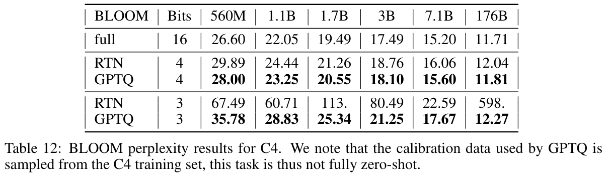</button><figcaption>Table 12 · Original Paper 2210.17323v2 · PDF crop; 原 caption 在截图中 <span>点击放大；保留全部坐标 / 图例。</span></figcaption></figure></details>

176B FP16 / GPTQ4 为 11.71 / 11.81，增加 0.10（0.85%）；GPTQ3 为 12.27，增加 0.56（4.78%），RTN3 为 598。跨 WikiText2、PTB、C4 的一致趋势支持大模型低位宽稳健性，但 C4 同域校准与缺少多 seed 仍限制外推。

## Appendix A.4 — 五类零样本任务逐表读

下列全部为 Accuracy（%，越高越好）。比较同模型、同位宽的 RTN 能检验补偿优势；和 FP16 的小差异没有置信区间，不能一律判断为模型能力增益。多选题 accuracy 接近随机水平时，与语言建模 PPL 爆炸的数值现象也不同。

### Tables 13–14 — LAMBADA：最后词预测

<p class="reading-meta">Table 13: OPT accuracy on LAMBADA. · Original Paper</p><div class="table-scroll original-table" role="region" tabindex="0" aria-label="Table 13 完整原始行列"><table class="ltx_tabular ltx_centering ltx_guessed_headers ltx_align_middle">
<tbody class="ltx_tbody">
<tr class="ltx_tr">
<th class="ltx_td ltx_align_left ltx_th ltx_th_row ltx_border_l ltx_border_r ltx_border_tt">OPT</th>
<th class="ltx_td ltx_align_center ltx_th ltx_th_row ltx_border_r ltx_border_tt">Bits</th>
<td class="ltx_td ltx_align_center ltx_border_r ltx_border_tt">125M</td>
<td class="ltx_td ltx_align_center ltx_border_r ltx_border_tt">350M</td>
<td class="ltx_td ltx_align_center ltx_border_r ltx_border_tt">1.3B</td>
<td class="ltx_td ltx_align_center ltx_border_r ltx_border_tt">2.7B</td>
<td class="ltx_td ltx_align_center ltx_border_r ltx_border_tt">6.7B</td>
<td class="ltx_td ltx_align_center ltx_border_r ltx_border_tt">13B</td>
<td class="ltx_td ltx_align_center ltx_border_r ltx_border_tt">30B</td>
<td class="ltx_td ltx_align_center ltx_border_r ltx_border_tt">66B</td>
<td class="ltx_td ltx_align_center ltx_border_r ltx_border_tt">175B</td></tr>
<tr class="ltx_tr">
<th class="ltx_td ltx_align_left ltx_th ltx_th_row ltx_border_l ltx_border_r ltx_border_t">full</th>
<th class="ltx_td ltx_align_center ltx_th ltx_th_row ltx_border_r ltx_border_t">16</th>
<td class="ltx_td ltx_align_center ltx_border_r ltx_border_t">39.16</td>
<td class="ltx_td ltx_align_center ltx_border_r ltx_border_t">46.67</td>
<td class="ltx_td ltx_align_center ltx_border_r ltx_border_t">58.80</td>
<td class="ltx_td ltx_align_center ltx_border_r ltx_border_t">64.82</td>
<td class="ltx_td ltx_align_center ltx_border_r ltx_border_t">68.72</td>
<td class="ltx_td ltx_align_center ltx_border_r ltx_border_t">70.23</td>
<td class="ltx_td ltx_align_center ltx_border_r ltx_border_t">72.39</td>
<td class="ltx_td ltx_align_center ltx_border_r ltx_border_t">74.93</td>
<td class="ltx_td ltx_align_center ltx_border_r ltx_border_t">75.59</td></tr>
<tr class="ltx_tr">
<th class="ltx_td ltx_align_left ltx_th ltx_th_row ltx_border_l ltx_border_r ltx_border_t">RTN</th>
<th class="ltx_td ltx_align_center ltx_th ltx_th_row ltx_border_r ltx_border_t">4</th>
<td class="ltx_td ltx_align_center ltx_border_r ltx_border_t">18.34</td>
<td class="ltx_td ltx_align_center ltx_border_r ltx_border_t">40.62</td>
<td class="ltx_td ltx_align_center ltx_border_r ltx_border_t">36.31</td>
<td class="ltx_td ltx_align_center ltx_border_r ltx_border_t">59.27</td>
<td class="ltx_td ltx_align_center ltx_border_r ltx_border_t">64.66</td>
<td class="ltx_td ltx_align_center ltx_border_r ltx_border_t">67.38</td>
<td class="ltx_td ltx_align_center ltx_border_r ltx_border_t">70.48</td>
<td class="ltx_td ltx_align_center ltx_border_r ltx_border_t">13.08</td>
<td class="ltx_td ltx_align_center ltx_border_r ltx_border_t">71.34</td></tr>
<tr class="ltx_tr">
<th class="ltx_td ltx_align_left ltx_th ltx_th_row ltx_border_l ltx_border_r">GPTQ</th>
<th class="ltx_td ltx_align_center ltx_th ltx_th_row ltx_border_r">4</th>
<td class="ltx_td ltx_align_center ltx_border_r"><span class="ltx_text ltx_font_bold">34.74</span></td>
<td class="ltx_td ltx_align_center ltx_border_r"><span class="ltx_text ltx_font_bold">48.38</span></td>
<td class="ltx_td ltx_align_center ltx_border_r"><span class="ltx_text ltx_font_bold">56.45</span></td>
<td class="ltx_td ltx_align_center ltx_border_r"><span class="ltx_text ltx_font_bold">62.97</span></td>
<td class="ltx_td ltx_align_center ltx_border_r"><span class="ltx_text ltx_font_bold">66.37</span></td>
<td class="ltx_td ltx_align_center ltx_border_r"><span class="ltx_text ltx_font_bold">69.12</span></td>
<td class="ltx_td ltx_align_center ltx_border_r"><span class="ltx_text ltx_font_bold">72.40</span></td>
<td class="ltx_td ltx_align_center ltx_border_r"><span class="ltx_text ltx_font_bold">74.50</span></td>
<td class="ltx_td ltx_align_center ltx_border_r"><span class="ltx_text ltx_font_bold">76.80</span></td></tr>
<tr class="ltx_tr">
<th class="ltx_td ltx_align_left ltx_th ltx_th_row ltx_border_l ltx_border_r ltx_border_t">RTN</th>
<th class="ltx_td ltx_align_center ltx_th ltx_th_row ltx_border_r ltx_border_t">3</th>
<td class="ltx_td ltx_align_center ltx_border_r ltx_border_t">0.10</td>
<td class="ltx_td ltx_align_center ltx_border_r ltx_border_t">27.36</td>
<td class="ltx_td ltx_align_center ltx_border_r ltx_border_t">0.00</td>
<td class="ltx_td ltx_align_center ltx_border_r ltx_border_t">0.00</td>
<td class="ltx_td ltx_align_center ltx_border_r ltx_border_t">0.00</td>
<td class="ltx_td ltx_align_center ltx_border_r ltx_border_t">0.06</td>
<td class="ltx_td ltx_align_center ltx_border_r ltx_border_t">1.46</td>
<td class="ltx_td ltx_align_center ltx_border_r ltx_border_t">2.00</td>
<td class="ltx_td ltx_align_center ltx_border_r ltx_border_t">0.00</td></tr>
<tr class="ltx_tr">
<th class="ltx_td ltx_align_left ltx_th ltx_th_row ltx_border_bb ltx_border_l ltx_border_r">GPTQ</th>
<th class="ltx_td ltx_align_center ltx_th ltx_th_row ltx_border_bb ltx_border_r">3</th>
<td class="ltx_td ltx_align_center ltx_border_bb ltx_border_r"><span class="ltx_text ltx_font_bold">13.93</span></td>
<td class="ltx_td ltx_align_center ltx_border_bb ltx_border_r"><span class="ltx_text ltx_font_bold">32.31</span></td>
<td class="ltx_td ltx_align_center ltx_border_bb ltx_border_r"><span class="ltx_text ltx_font_bold">37.26</span></td>
<td class="ltx_td ltx_align_center ltx_border_bb ltx_border_r"><span class="ltx_text ltx_font_bold">52.26</span></td>
<td class="ltx_td ltx_align_center ltx_border_bb ltx_border_r"><span class="ltx_text ltx_font_bold">54.98</span></td>
<td class="ltx_td ltx_align_center ltx_border_bb ltx_border_r"><span class="ltx_text ltx_font_bold">64.18</span></td>
<td class="ltx_td ltx_align_center ltx_border_bb ltx_border_r"><span class="ltx_text ltx_font_bold">69.69</span></td>
<td class="ltx_td ltx_align_center ltx_border_bb ltx_border_r"><span class="ltx_text ltx_font_bold">57.02</span></td>
<td class="ltx_td ltx_align_center ltx_border_bb ltx_border_r"><span class="ltx_text ltx_font_bold">76.19</span></td></tr>
</tbody>
</table></div><details class="source-evidence"><summary>Table 13 原始排版、加粗 / 下划线与 caption</summary><figure class="original-figure"><button type="button" data-zoom="assets/original/table-13.png" aria-label="放大 Table 13">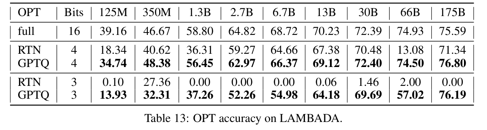</button><figcaption>Table 13 · Original Paper 2210.17323v2 · PDF crop; 原 caption 在截图中 <span>点击放大；保留全部坐标 / 图例。</span></figcaption></figure></details>

OPT175 GPTQ4 76.80 对 FP16 75.59 高 1.21 点、对 RTN4 71.34 高 5.46 点；GPTQ3 76.19 而 RTN3 为 0。OPT66 GPTQ3 57.02 对 FP16 74.93 下降 17.91 点，是“大模型低比特稳健”叙述必须保留的例外。

<p class="reading-meta">Table 14: BLOOM accuracy on LAMBADA. · Original Paper</p><div class="table-scroll original-table" role="region" tabindex="0" aria-label="Table 14 完整原始行列"><table class="ltx_tabular ltx_centering ltx_guessed_headers ltx_align_middle">
<tbody class="ltx_tbody">
<tr class="ltx_tr">
<th class="ltx_td ltx_align_left ltx_th ltx_th_row ltx_border_l ltx_border_r ltx_border_tt">BLOOM</th>
<th class="ltx_td ltx_align_center ltx_th ltx_th_row ltx_border_r ltx_border_tt">Bits</th>
<td class="ltx_td ltx_align_center ltx_border_r ltx_border_tt">560M</td>
<td class="ltx_td ltx_align_center ltx_border_r ltx_border_tt">1.1B</td>
<td class="ltx_td ltx_align_center ltx_border_r ltx_border_tt">1.7B</td>
<td class="ltx_td ltx_align_center ltx_border_r ltx_border_tt">3B</td>
<td class="ltx_td ltx_align_center ltx_border_r ltx_border_tt">7.1B</td>
<td class="ltx_td ltx_align_center ltx_border_r ltx_border_tt">176B</td></tr>
<tr class="ltx_tr">
<th class="ltx_td ltx_align_left ltx_th ltx_th_row ltx_border_l ltx_border_r ltx_border_t">full</th>
<th class="ltx_td ltx_align_center ltx_th ltx_th_row ltx_border_r ltx_border_t">16</th>
<td class="ltx_td ltx_align_center ltx_border_r ltx_border_t">34.06</td>
<td class="ltx_td ltx_align_center ltx_border_r ltx_border_t">42.85</td>
<td class="ltx_td ltx_align_center ltx_border_r ltx_border_t">46.71</td>
<td class="ltx_td ltx_align_center ltx_border_r ltx_border_t">52.12</td>
<td class="ltx_td ltx_align_center ltx_border_r ltx_border_t">57.79</td>
<td class="ltx_td ltx_align_center ltx_border_r ltx_border_t">67.40</td></tr>
<tr class="ltx_tr">
<th class="ltx_td ltx_align_left ltx_th ltx_th_row ltx_border_l ltx_border_r ltx_border_t">RTN</th>
<th class="ltx_td ltx_align_center ltx_th ltx_th_row ltx_border_r ltx_border_t">4</th>
<td class="ltx_td ltx_align_center ltx_border_r ltx_border_t">26.00</td>
<td class="ltx_td ltx_align_center ltx_border_r ltx_border_t">39.06</td>
<td class="ltx_td ltx_align_center ltx_border_r ltx_border_t">41.92</td>
<td class="ltx_td ltx_align_center ltx_border_r ltx_border_t">45.84</td>
<td class="ltx_td ltx_align_center ltx_border_r ltx_border_t">50.48</td>
<td class="ltx_td ltx_align_center ltx_border_r ltx_border_t">66.70</td></tr>
<tr class="ltx_tr">
<th class="ltx_td ltx_align_left ltx_th ltx_th_row ltx_border_l ltx_border_r">GPTQ</th>
<th class="ltx_td ltx_align_center ltx_th ltx_th_row ltx_border_r">4</th>
<td class="ltx_td ltx_align_center ltx_border_r"><span class="ltx_text ltx_font_bold">31.75</span></td>
<td class="ltx_td ltx_align_center ltx_border_r"><span class="ltx_text ltx_font_bold">39.80</span></td>
<td class="ltx_td ltx_align_center ltx_border_r"><span class="ltx_text ltx_font_bold">46.28</span></td>
<td class="ltx_td ltx_align_center ltx_border_r"><span class="ltx_text ltx_font_bold">51.41</span></td>
<td class="ltx_td ltx_align_center ltx_border_r"><span class="ltx_text ltx_font_bold">54.65</span></td>
<td class="ltx_td ltx_align_center ltx_border_r"><span class="ltx_text ltx_font_bold">67.71</span></td></tr>
<tr class="ltx_tr">
<th class="ltx_td ltx_align_left ltx_th ltx_th_row ltx_border_l ltx_border_r ltx_border_t">RTN</th>
<th class="ltx_td ltx_align_center ltx_th ltx_th_row ltx_border_r ltx_border_t">3</th>
<td class="ltx_td ltx_align_center ltx_border_r ltx_border_t">9.10</td>
<td class="ltx_td ltx_align_center ltx_border_r ltx_border_t">15.95</td>
<td class="ltx_td ltx_align_center ltx_border_r ltx_border_t">15.02</td>
<td class="ltx_td ltx_align_center ltx_border_r ltx_border_t">24.55</td>
<td class="ltx_td ltx_align_center ltx_border_r ltx_border_t">29.90</td>
<td class="ltx_td ltx_align_center ltx_border_r ltx_border_t">0.17</td></tr>
<tr class="ltx_tr">
<th class="ltx_td ltx_align_left ltx_th ltx_th_row ltx_border_bb ltx_border_l ltx_border_r">GPTQ</th>
<th class="ltx_td ltx_align_center ltx_th ltx_th_row ltx_border_bb ltx_border_r">3</th>
<td class="ltx_td ltx_align_center ltx_border_bb ltx_border_r"><span class="ltx_text ltx_font_bold">21.31</span></td>
<td class="ltx_td ltx_align_center ltx_border_bb ltx_border_r"><span class="ltx_text ltx_font_bold">28.70</span></td>
<td class="ltx_td ltx_align_center ltx_border_bb ltx_border_r"><span class="ltx_text ltx_font_bold">33.65</span></td>
<td class="ltx_td ltx_align_center ltx_border_bb ltx_border_r"><span class="ltx_text ltx_font_bold">43.12</span></td>
<td class="ltx_td ltx_align_center ltx_border_bb ltx_border_r"><span class="ltx_text ltx_font_bold">47.41</span></td>
<td class="ltx_td ltx_align_center ltx_border_bb ltx_border_r"><span class="ltx_text ltx_font_bold">65.10</span></td></tr>
</tbody>
</table></div><details class="source-evidence"><summary>Table 14 原始排版、加粗 / 下划线与 caption</summary><figure class="original-figure"><button type="button" data-zoom="assets/original/table-14.png" aria-label="放大 Table 14">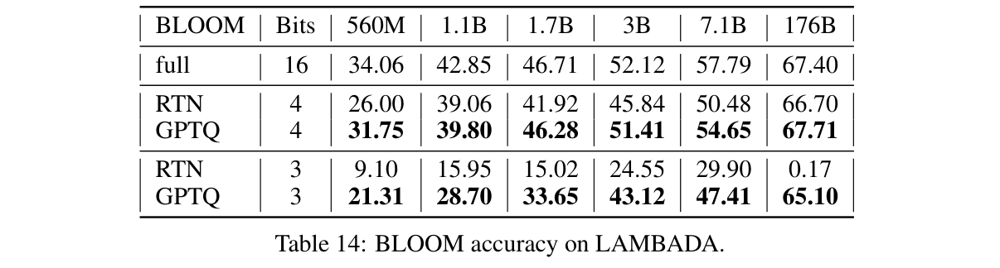</button><figcaption>Table 14 · Original Paper 2210.17323v2 · PDF crop; 原 caption 在截图中 <span>点击放大；保留全部坐标 / 图例。</span></figcaption></figure></details>

BLOOM176 GPTQ4 67.71 对 FP16 67.40 高 0.31 点；GPTQ3 65.10 下降 2.30 点，而 RTN3 是 0.17。560M GPTQ3 21.31 对 FP16 34.06 下降 12.75 点。Figure 3 的曲线在这里有完整数值证据。

### Tables 15–16 — PIQA：物理常识选择

<p class="reading-meta">Table 15: OPT accuracy on PIQA. · Original Paper</p><div class="table-scroll original-table" role="region" tabindex="0" aria-label="Table 15 完整原始行列"><table class="ltx_tabular ltx_centering ltx_guessed_headers ltx_align_middle">
<tbody class="ltx_tbody">
<tr class="ltx_tr">
<th class="ltx_td ltx_align_left ltx_th ltx_th_row ltx_border_l ltx_border_r ltx_border_tt">OPT</th>
<th class="ltx_td ltx_align_center ltx_th ltx_th_row ltx_border_r ltx_border_tt">Bits</th>
<td class="ltx_td ltx_align_center ltx_border_r ltx_border_tt">125M</td>
<td class="ltx_td ltx_align_center ltx_border_r ltx_border_tt">350M</td>
<td class="ltx_td ltx_align_center ltx_border_r ltx_border_tt">1.3B</td>
<td class="ltx_td ltx_align_center ltx_border_r ltx_border_tt">2.7B</td>
<td class="ltx_td ltx_align_center ltx_border_r ltx_border_tt">6.7B</td>
<td class="ltx_td ltx_align_center ltx_border_r ltx_border_tt">13B</td>
<td class="ltx_td ltx_align_center ltx_border_r ltx_border_tt">30B</td>
<td class="ltx_td ltx_align_center ltx_border_r ltx_border_tt">66B</td>
<td class="ltx_td ltx_align_center ltx_border_r ltx_border_tt">175B</td></tr>
<tr class="ltx_tr">
<th class="ltx_td ltx_align_left ltx_th ltx_th_row ltx_border_l ltx_border_r ltx_border_t">full</th>
<th class="ltx_td ltx_align_center ltx_th ltx_th_row ltx_border_r ltx_border_t">16</th>
<td class="ltx_td ltx_align_center ltx_border_r ltx_border_t">62.02</td>
<td class="ltx_td ltx_align_center ltx_border_r ltx_border_t">64.74</td>
<td class="ltx_td ltx_align_center ltx_border_r ltx_border_t">72.36</td>
<td class="ltx_td ltx_align_center ltx_border_r ltx_border_t">74.81</td>
<td class="ltx_td ltx_align_center ltx_border_r ltx_border_t">76.39</td>
<td class="ltx_td ltx_align_center ltx_border_r ltx_border_t">76.88</td>
<td class="ltx_td ltx_align_center ltx_border_r ltx_border_t">78.18</td>
<td class="ltx_td ltx_align_center ltx_border_r ltx_border_t">79.76</td>
<td class="ltx_td ltx_align_center ltx_border_r ltx_border_t">81.07</td></tr>
<tr class="ltx_tr">
<th class="ltx_td ltx_align_left ltx_th ltx_th_row ltx_border_l ltx_border_r ltx_border_t">RTN</th>
<th class="ltx_td ltx_align_center ltx_th ltx_th_row ltx_border_r ltx_border_t">4</th>
<td class="ltx_td ltx_align_center ltx_border_r ltx_border_t"><span class="ltx_text ltx_font_bold">61.43</span></td>
<td class="ltx_td ltx_align_center ltx_border_r ltx_border_t">63.44</td>
<td class="ltx_td ltx_align_center ltx_border_r ltx_border_t">67.63</td>
<td class="ltx_td ltx_align_center ltx_border_r ltx_border_t">73.72</td>
<td class="ltx_td ltx_align_center ltx_border_r ltx_border_t"><span class="ltx_text ltx_font_bold">76.44</span></td>
<td class="ltx_td ltx_align_center ltx_border_r ltx_border_t">76.01</td>
<td class="ltx_td ltx_align_center ltx_border_r ltx_border_t">77.26</td>
<td class="ltx_td ltx_align_center ltx_border_r ltx_border_t">60.07</td>
<td class="ltx_td ltx_align_center ltx_border_r ltx_border_t">78.23</td></tr>
<tr class="ltx_tr">
<th class="ltx_td ltx_align_left ltx_th ltx_th_row ltx_border_l ltx_border_r">GPTQ</th>
<th class="ltx_td ltx_align_center ltx_th ltx_th_row ltx_border_r">4</th>
<td class="ltx_td ltx_align_center ltx_border_r">61.26</td>
<td class="ltx_td ltx_align_center ltx_border_r"><span class="ltx_text ltx_font_bold">63.71</span></td>
<td class="ltx_td ltx_align_center ltx_border_r"><span class="ltx_text ltx_font_bold">70.73</span></td>
<td class="ltx_td ltx_align_center ltx_border_r"><span class="ltx_text ltx_font_bold">73.99</span></td>
<td class="ltx_td ltx_align_center ltx_border_r">76.28</td>
<td class="ltx_td ltx_align_center ltx_border_r"><span class="ltx_text ltx_font_bold">76.61</span></td>
<td class="ltx_td ltx_align_center ltx_border_r"><span class="ltx_text ltx_font_bold">79.00</span></td>
<td class="ltx_td ltx_align_center ltx_border_r"><span class="ltx_text ltx_font_bold">79.33</span></td>
<td class="ltx_td ltx_align_center ltx_border_r"><span class="ltx_text ltx_font_bold">81.00</span></td></tr>
<tr class="ltx_tr">
<th class="ltx_td ltx_align_left ltx_th ltx_th_row ltx_border_l ltx_border_r ltx_border_t">RTN</th>
<th class="ltx_td ltx_align_center ltx_th ltx_th_row ltx_border_r ltx_border_t">3</th>
<td class="ltx_td ltx_align_center ltx_border_r ltx_border_t">56.09</td>
<td class="ltx_td ltx_align_center ltx_border_r ltx_border_t">60.61</td>
<td class="ltx_td ltx_align_center ltx_border_r ltx_border_t">52.77</td>
<td class="ltx_td ltx_align_center ltx_border_r ltx_border_t">51.90</td>
<td class="ltx_td ltx_align_center ltx_border_r ltx_border_t">50.49</td>
<td class="ltx_td ltx_align_center ltx_border_r ltx_border_t">52.99</td>
<td class="ltx_td ltx_align_center ltx_border_r ltx_border_t">56.37</td>
<td class="ltx_td ltx_align_center ltx_border_r ltx_border_t">50.87</td>
<td class="ltx_td ltx_align_center ltx_border_r ltx_border_t">51.25</td></tr>
<tr class="ltx_tr">
<th class="ltx_td ltx_align_left ltx_th ltx_th_row ltx_border_bb ltx_border_l ltx_border_r">GPTQ</th>
<th class="ltx_td ltx_align_center ltx_th ltx_th_row ltx_border_bb ltx_border_r">3</th>
<td class="ltx_td ltx_align_center ltx_border_bb ltx_border_r"><span class="ltx_text ltx_font_bold">59.25</span></td>
<td class="ltx_td ltx_align_center ltx_border_bb ltx_border_r"><span class="ltx_text ltx_font_bold">61.32</span></td>
<td class="ltx_td ltx_align_center ltx_border_bb ltx_border_r"><span class="ltx_text ltx_font_bold">68.34</span></td>
<td class="ltx_td ltx_align_center ltx_border_bb ltx_border_r"><span class="ltx_text ltx_font_bold">71.38</span></td>
<td class="ltx_td ltx_align_center ltx_border_bb ltx_border_r"><span class="ltx_text ltx_font_bold">73.29</span></td>
<td class="ltx_td ltx_align_center ltx_border_bb ltx_border_r"><span class="ltx_text ltx_font_bold">75.24</span></td>
<td class="ltx_td ltx_align_center ltx_border_bb ltx_border_r"><span class="ltx_text ltx_font_bold">77.58</span></td>
<td class="ltx_td ltx_align_center ltx_border_bb ltx_border_r"><span class="ltx_text ltx_font_bold">71.27</span></td>
<td class="ltx_td ltx_align_center ltx_border_bb ltx_border_r"><span class="ltx_text ltx_font_bold">80.03</span></td></tr>
</tbody>
</table></div><details class="source-evidence"><summary>Table 15 原始排版、加粗 / 下划线与 caption</summary><figure class="original-figure"><button type="button" data-zoom="assets/original/table-15.png" aria-label="放大 Table 15">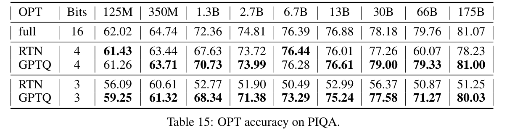</button><figcaption>Table 15 · Original Paper 2210.17323v2 · PDF crop; 原 caption 在截图中 <span>点击放大；保留全部坐标 / 图例。</span></figcaption></figure></details>

OPT175 GPTQ4 81.00 对 FP16 81.07 低 0.07 点，比 RTN4 78.23 高 2.77 点；GPTQ3 80.03，比 RTN3 51.25 高 28.78 点。OPT125 GPTQ4 61.26 反而略低于 RTN4 61.43，不能说每个 cell 都胜过 RTN。

<p class="reading-meta">Table 16: BLOOM accuracy on PIQA. · Original Paper</p><div class="table-scroll original-table" role="region" tabindex="0" aria-label="Table 16 完整原始行列"><table class="ltx_tabular ltx_centering ltx_guessed_headers ltx_align_middle">
<tbody class="ltx_tbody">
<tr class="ltx_tr">
<th class="ltx_td ltx_align_left ltx_th ltx_th_row ltx_border_l ltx_border_r ltx_border_tt">BLOOM</th>
<th class="ltx_td ltx_align_center ltx_th ltx_th_row ltx_border_r ltx_border_tt">Bits</th>
<td class="ltx_td ltx_align_center ltx_border_r ltx_border_tt">560M</td>
<td class="ltx_td ltx_align_center ltx_border_r ltx_border_tt">1.1B</td>
<td class="ltx_td ltx_align_center ltx_border_r ltx_border_tt">1.7B</td>
<td class="ltx_td ltx_align_center ltx_border_r ltx_border_tt">3B</td>
<td class="ltx_td ltx_align_center ltx_border_r ltx_border_tt">7.1B</td>
<td class="ltx_td ltx_align_center ltx_border_r ltx_border_tt">176B</td></tr>
<tr class="ltx_tr">
<th class="ltx_td ltx_align_left ltx_th ltx_th_row ltx_border_l ltx_border_r ltx_border_t">full</th>
<th class="ltx_td ltx_align_center ltx_th ltx_th_row ltx_border_r ltx_border_t">16</th>
<td class="ltx_td ltx_align_center ltx_border_r ltx_border_t">65.07</td>
<td class="ltx_td ltx_align_center ltx_border_r ltx_border_t">67.14</td>
<td class="ltx_td ltx_align_center ltx_border_r ltx_border_t">69.97</td>
<td class="ltx_td ltx_align_center ltx_border_r ltx_border_t">70.51</td>
<td class="ltx_td ltx_align_center ltx_border_r ltx_border_t">73.72</td>
<td class="ltx_td ltx_align_center ltx_border_r ltx_border_t">79.16</td></tr>
<tr class="ltx_tr">
<th class="ltx_td ltx_align_left ltx_th ltx_th_row ltx_border_l ltx_border_r ltx_border_t">RTN</th>
<th class="ltx_td ltx_align_center ltx_th ltx_th_row ltx_border_r ltx_border_t">4</th>
<td class="ltx_td ltx_align_center ltx_border_r ltx_border_t">63.11</td>
<td class="ltx_td ltx_align_center ltx_border_r ltx_border_t">65.29</td>
<td class="ltx_td ltx_align_center ltx_border_r ltx_border_t">67.74</td>
<td class="ltx_td ltx_align_center ltx_border_r ltx_border_t"><span class="ltx_text ltx_font_bold">69.86</span></td>
<td class="ltx_td ltx_align_center ltx_border_r ltx_border_t">72.69</td>
<td class="ltx_td ltx_align_center ltx_border_r ltx_border_t"><span class="ltx_text ltx_font_bold">79.00</span></td></tr>
<tr class="ltx_tr">
<th class="ltx_td ltx_align_left ltx_th ltx_th_row ltx_border_l ltx_border_r">GPTQ</th>
<th class="ltx_td ltx_align_center ltx_th ltx_th_row ltx_border_r">4</th>
<td class="ltx_td ltx_align_center ltx_border_r"><span class="ltx_text ltx_font_bold">64.31</span></td>
<td class="ltx_td ltx_align_center ltx_border_r"><span class="ltx_text ltx_font_bold">66.05</span></td>
<td class="ltx_td ltx_align_center ltx_border_r"><span class="ltx_text ltx_font_bold">68.77</span></td>
<td class="ltx_td ltx_align_center ltx_border_r">69.42</td>
<td class="ltx_td ltx_align_center ltx_border_r"><span class="ltx_text ltx_font_bold">72.96</span></td>
<td class="ltx_td ltx_align_center ltx_border_r"><span class="ltx_text ltx_font_bold">79.00</span></td></tr>
<tr class="ltx_tr">
<th class="ltx_td ltx_align_left ltx_th ltx_th_row ltx_border_l ltx_border_r ltx_border_t">RTN</th>
<th class="ltx_td ltx_align_center ltx_th ltx_th_row ltx_border_r ltx_border_t">3</th>
<td class="ltx_td ltx_align_center ltx_border_r ltx_border_t">58.60</td>
<td class="ltx_td ltx_align_center ltx_border_r ltx_border_t">60.80</td>
<td class="ltx_td ltx_align_center ltx_border_r ltx_border_t">60.88</td>
<td class="ltx_td ltx_align_center ltx_border_r ltx_border_t">66.28</td>
<td class="ltx_td ltx_align_center ltx_border_r ltx_border_t">69.70</td>
<td class="ltx_td ltx_align_center ltx_border_r ltx_border_t">53.32</td></tr>
<tr class="ltx_tr">
<th class="ltx_td ltx_align_left ltx_th ltx_th_row ltx_border_bb ltx_border_l ltx_border_r">GPTQ</th>
<th class="ltx_td ltx_align_center ltx_th ltx_th_row ltx_border_bb ltx_border_r">3</th>
<td class="ltx_td ltx_align_center ltx_border_bb ltx_border_r"><span class="ltx_text ltx_font_bold">61.62</span></td>
<td class="ltx_td ltx_align_center ltx_border_bb ltx_border_r"><span class="ltx_text ltx_font_bold">62.62</span></td>
<td class="ltx_td ltx_align_center ltx_border_bb ltx_border_r"><span class="ltx_text ltx_font_bold">65.18</span></td>
<td class="ltx_td ltx_align_center ltx_border_bb ltx_border_r"><span class="ltx_text ltx_font_bold">68.34</span></td>
<td class="ltx_td ltx_align_center ltx_border_bb ltx_border_r"><span class="ltx_text ltx_font_bold">70.95</span></td>
<td class="ltx_td ltx_align_center ltx_border_bb ltx_border_r"><span class="ltx_text ltx_font_bold">77.70</span></td></tr>
</tbody>
</table></div><details class="source-evidence"><summary>Table 16 原始排版、加粗 / 下划线与 caption</summary><figure class="original-figure"><button type="button" data-zoom="assets/original/table-16.png" aria-label="放大 Table 16">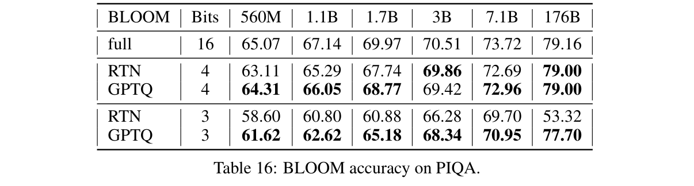</button><figcaption>Table 16 · Original Paper 2210.17323v2 · PDF crop; 原 caption 在截图中 <span>点击放大；保留全部坐标 / 图例。</span></figcaption></figure></details>

BLOOM176 GPTQ4 与 RTN4 均为 79.00，对 FP16 79.16 低 0.16 点；GPTQ3 77.70 对 RTN3 53.32 高 24.38 点。BLOOM3B GPTQ4 69.42 比 RTN4 69.86 低 0.44 点，显示局部重建优势和每项任务 accuracy 不存在逐项严格支配关系。

**Citation audit。** 原论文把 PIQA 引到 Tata & Patel（2003）的蛋白质查询论文，和物理常识 benchmark 无关。任务的正确一手出处是 Bisk et al.，**PIQA: Reasoning about Physical Commonsense in Natural Language**，[arXiv:1911.11641](https://arxiv.org/abs/1911.11641)。这里保留任务数据，明确指出书目错误。

### Tables 17–18 — ARC-easy：常识科学题

<p class="reading-meta">Table 17: OPT accuracy on ARC-easy. · Original Paper</p><div class="table-scroll original-table" role="region" tabindex="0" aria-label="Table 17 完整原始行列"><table class="ltx_tabular ltx_centering ltx_guessed_headers ltx_align_middle">
<tbody class="ltx_tbody">
<tr class="ltx_tr">
<th class="ltx_td ltx_align_left ltx_th ltx_th_row ltx_border_l ltx_border_r ltx_border_tt">OPT</th>
<th class="ltx_td ltx_align_center ltx_th ltx_th_row ltx_border_r ltx_border_tt">Bits</th>
<td class="ltx_td ltx_align_center ltx_border_r ltx_border_tt">125M</td>
<td class="ltx_td ltx_align_center ltx_border_r ltx_border_tt">350M</td>
<td class="ltx_td ltx_align_center ltx_border_r ltx_border_tt">1.3B</td>
<td class="ltx_td ltx_align_center ltx_border_r ltx_border_tt">2.7B</td>
<td class="ltx_td ltx_align_center ltx_border_r ltx_border_tt">6.7B</td>
<td class="ltx_td ltx_align_center ltx_border_r ltx_border_tt">13B</td>
<td class="ltx_td ltx_align_center ltx_border_r ltx_border_tt">30B</td>
<td class="ltx_td ltx_align_center ltx_border_r ltx_border_tt">66B</td>
<td class="ltx_td ltx_align_center ltx_border_r ltx_border_tt">175B</td></tr>
<tr class="ltx_tr">
<th class="ltx_td ltx_align_left ltx_th ltx_th_row ltx_border_l ltx_border_r ltx_border_t">full</th>
<th class="ltx_td ltx_align_center ltx_th ltx_th_row ltx_border_r ltx_border_t">16</th>
<td class="ltx_td ltx_align_center ltx_border_r ltx_border_t">39.69</td>
<td class="ltx_td ltx_align_center ltx_border_r ltx_border_t">40.36</td>
<td class="ltx_td ltx_align_center ltx_border_r ltx_border_t">50.93</td>
<td class="ltx_td ltx_align_center ltx_border_r ltx_border_t">54.34</td>
<td class="ltx_td ltx_align_center ltx_border_r ltx_border_t">60.14</td>
<td class="ltx_td ltx_align_center ltx_border_r ltx_border_t">61.83</td>
<td class="ltx_td ltx_align_center ltx_border_r ltx_border_t">65.40</td>
<td class="ltx_td ltx_align_center ltx_border_r ltx_border_t">67.26</td>
<td class="ltx_td ltx_align_center ltx_border_r ltx_border_t">71.04</td></tr>
<tr class="ltx_tr">
<th class="ltx_td ltx_align_left ltx_th ltx_th_row ltx_border_l ltx_border_r ltx_border_t">RTN</th>
<th class="ltx_td ltx_align_center ltx_th ltx_th_row ltx_border_r ltx_border_t">4</th>
<td class="ltx_td ltx_align_center ltx_border_r ltx_border_t">36.32</td>
<td class="ltx_td ltx_align_center ltx_border_r ltx_border_t"><span class="ltx_text ltx_font_bold">38.55</span></td>
<td class="ltx_td ltx_align_center ltx_border_r ltx_border_t">49.20</td>
<td class="ltx_td ltx_align_center ltx_border_r ltx_border_t">52.90</td>
<td class="ltx_td ltx_align_center ltx_border_r ltx_border_t">57.68</td>
<td class="ltx_td ltx_align_center ltx_border_r ltx_border_t">61.31</td>
<td class="ltx_td ltx_align_center ltx_border_r ltx_border_t">61.11</td>
<td class="ltx_td ltx_align_center ltx_border_r ltx_border_t">40.66</td>
<td class="ltx_td ltx_align_center ltx_border_r ltx_border_t">63.93</td></tr>
<tr class="ltx_tr">
<th class="ltx_td ltx_align_left ltx_th ltx_th_row ltx_border_l ltx_border_r">GPTQ</th>
<th class="ltx_td ltx_align_center ltx_th ltx_th_row ltx_border_r">4</th>
<td class="ltx_td ltx_align_center ltx_border_r"><span class="ltx_text ltx_font_bold">39.02</span></td>
<td class="ltx_td ltx_align_center ltx_border_r">37.92</td>
<td class="ltx_td ltx_align_center ltx_border_r"><span class="ltx_text ltx_font_bold">59.97</span></td>
<td class="ltx_td ltx_align_center ltx_border_r"><span class="ltx_text ltx_font_bold">53.11</span></td>
<td class="ltx_td ltx_align_center ltx_border_r"><span class="ltx_text ltx_font_bold">59.72</span></td>
<td class="ltx_td ltx_align_center ltx_border_r"><span class="ltx_text ltx_font_bold">61.32</span></td>
<td class="ltx_td ltx_align_center ltx_border_r"><span class="ltx_text ltx_font_bold">65.11</span></td>
<td class="ltx_td ltx_align_center ltx_border_r"><span class="ltx_text ltx_font_bold">65.35</span></td>
<td class="ltx_td ltx_align_center ltx_border_r"><span class="ltx_text ltx_font_bold">68.69</span></td></tr>
<tr class="ltx_tr">
<th class="ltx_td ltx_align_left ltx_th ltx_th_row ltx_border_l ltx_border_r ltx_border_t">RTN</th>
<th class="ltx_td ltx_align_center ltx_th ltx_th_row ltx_border_r ltx_border_t">3</th>
<td class="ltx_td ltx_align_center ltx_border_r ltx_border_t">30.43</td>
<td class="ltx_td ltx_align_center ltx_border_r ltx_border_t">36.07</td>
<td class="ltx_td ltx_align_center ltx_border_r ltx_border_t">27.97</td>
<td class="ltx_td ltx_align_center ltx_border_r ltx_border_t">26.05</td>
<td class="ltx_td ltx_align_center ltx_border_r ltx_border_t">25.04</td>
<td class="ltx_td ltx_align_center ltx_border_r ltx_border_t">30.60</td>
<td class="ltx_td ltx_align_center ltx_border_r ltx_border_t">34.22</td>
<td class="ltx_td ltx_align_center ltx_border_r ltx_border_t">25.84</td>
<td class="ltx_td ltx_align_center ltx_border_r ltx_border_t">26.77</td></tr>
<tr class="ltx_tr">
<th class="ltx_td ltx_align_left ltx_th ltx_th_row ltx_border_bb ltx_border_l ltx_border_r">GPTQ</th>
<th class="ltx_td ltx_align_center ltx_th ltx_th_row ltx_border_bb ltx_border_r">3</th>
<td class="ltx_td ltx_align_center ltx_border_bb ltx_border_r"><span class="ltx_text ltx_font_bold">36.15</span></td>
<td class="ltx_td ltx_align_center ltx_border_bb ltx_border_r"><span class="ltx_text ltx_font_bold">36.91</span></td>
<td class="ltx_td ltx_align_center ltx_border_bb ltx_border_r"><span class="ltx_text ltx_font_bold">46.17</span></td>
<td class="ltx_td ltx_align_center ltx_border_bb ltx_border_r"><span class="ltx_text ltx_font_bold">48.19</span></td>
<td class="ltx_td ltx_align_center ltx_border_bb ltx_border_r"><span class="ltx_text ltx_font_bold">53.41</span></td>
<td class="ltx_td ltx_align_center ltx_border_bb ltx_border_r"><span class="ltx_text ltx_font_bold">56.82</span></td>
<td class="ltx_td ltx_align_center ltx_border_bb ltx_border_r"><span class="ltx_text ltx_font_bold">59.72</span></td>
<td class="ltx_td ltx_align_center ltx_border_bb ltx_border_r"><span class="ltx_text ltx_font_bold">52.44</span></td>
<td class="ltx_td ltx_align_center ltx_border_bb ltx_border_r"><span class="ltx_text ltx_font_bold">65.36</span></td></tr>
</tbody>
</table></div><details class="source-evidence"><summary>Table 17 原始排版、加粗 / 下划线与 caption</summary><figure class="original-figure"><button type="button" data-zoom="assets/original/table-17.png" aria-label="放大 Table 17">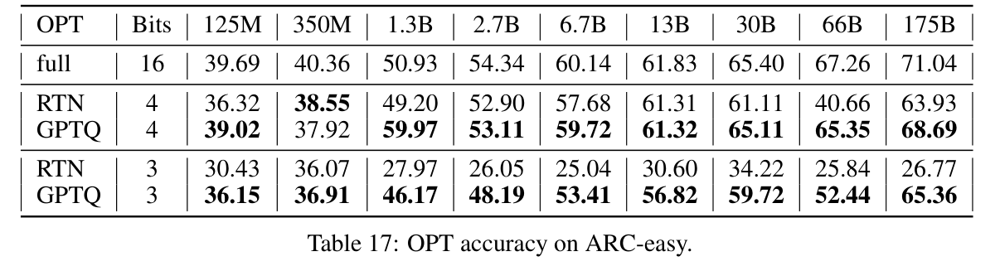</button><figcaption>Table 17 · Original Paper 2210.17323v2 · PDF crop; 原 caption 在截图中 <span>点击放大；保留全部坐标 / 图例。</span></figcaption></figure></details>

OPT175 GPTQ4 68.69 比 FP16 71.04 低 2.35 点，比 RTN4 63.93 高 4.76 点；GPTQ3 65.36。表中 OPT1.3B GPTQ4 **59.97** 高于 baseline 50.93 较多，仍按原文保留，缺少逐样本输出时不自行纠正或解释成稳定提升。

<p class="reading-meta">Table 18: BLOOM accuracy on ARC-easy. · Original Paper</p><div class="table-scroll original-table" role="region" tabindex="0" aria-label="Table 18 完整原始行列"><table class="ltx_tabular ltx_centering ltx_guessed_headers ltx_align_middle">
<tbody class="ltx_tbody">
<tr class="ltx_tr">
<th class="ltx_td ltx_align_left ltx_th ltx_th_row ltx_border_l ltx_border_r ltx_border_tt">BLOOM</th>
<th class="ltx_td ltx_align_center ltx_th ltx_th_row ltx_border_r ltx_border_tt">Bits</th>
<td class="ltx_td ltx_align_center ltx_border_r ltx_border_tt">560M</td>
<td class="ltx_td ltx_align_center ltx_border_r ltx_border_tt">1.1B</td>
<td class="ltx_td ltx_align_center ltx_border_r ltx_border_tt">1.7B</td>
<td class="ltx_td ltx_align_center ltx_border_r ltx_border_tt">3B</td>
<td class="ltx_td ltx_align_center ltx_border_r ltx_border_tt">7.1B</td>
<td class="ltx_td ltx_align_center ltx_border_r ltx_border_tt">176B</td></tr>
<tr class="ltx_tr">
<th class="ltx_td ltx_align_left ltx_th ltx_th_row ltx_border_l ltx_border_r ltx_border_t">full</th>
<th class="ltx_td ltx_align_center ltx_th ltx_th_row ltx_border_r ltx_border_t">16</th>
<td class="ltx_td ltx_align_center ltx_border_r ltx_border_t">41.71</td>
<td class="ltx_td ltx_align_center ltx_border_r ltx_border_t">45.41</td>
<td class="ltx_td ltx_align_center ltx_border_r ltx_border_t">48.11</td>
<td class="ltx_td ltx_align_center ltx_border_r ltx_border_t">53.24</td>
<td class="ltx_td ltx_align_center ltx_border_r ltx_border_t">57.37</td>
<td class="ltx_td ltx_align_center ltx_border_r ltx_border_t">67.47</td></tr>
<tr class="ltx_tr">
<th class="ltx_td ltx_align_left ltx_th ltx_th_row ltx_border_l ltx_border_r ltx_border_t">RTN</th>
<th class="ltx_td ltx_align_center ltx_th ltx_th_row ltx_border_r ltx_border_t">4</th>
<td class="ltx_td ltx_align_center ltx_border_r ltx_border_t">39.40</td>
<td class="ltx_td ltx_align_center ltx_border_r ltx_border_t">42.51</td>
<td class="ltx_td ltx_align_center ltx_border_r ltx_border_t"><span class="ltx_text ltx_font_bold">44.70</span></td>
<td class="ltx_td ltx_align_center ltx_border_r ltx_border_t">51.35</td>
<td class="ltx_td ltx_align_center ltx_border_r ltx_border_t"><span class="ltx_text ltx_font_bold">56.14</span></td>
<td class="ltx_td ltx_align_center ltx_border_r ltx_border_t">66.33</td></tr>
<tr class="ltx_tr">
<th class="ltx_td ltx_align_left ltx_th ltx_th_row ltx_border_l ltx_border_r">GPTQ</th>
<th class="ltx_td ltx_align_center ltx_th ltx_th_row ltx_border_r">4</th>
<td class="ltx_td ltx_align_center ltx_border_r"><span class="ltx_text ltx_font_bold">40.24</span></td>
<td class="ltx_td ltx_align_center ltx_border_r"><span class="ltx_text ltx_font_bold">44.49</span></td>
<td class="ltx_td ltx_align_center ltx_border_r">44.49</td>
<td class="ltx_td ltx_align_center ltx_border_r"><span class="ltx_text ltx_font_bold">52.82</span></td>
<td class="ltx_td ltx_align_center ltx_border_r"><span class="ltx_text ltx_font_bold">56.14</span></td>
<td class="ltx_td ltx_align_center ltx_border_r"><span class="ltx_text ltx_font_bold">67.42</span></td></tr>
<tr class="ltx_tr">
<th class="ltx_td ltx_align_left ltx_th ltx_th_row ltx_border_l ltx_border_r ltx_border_t">RTN</th>
<th class="ltx_td ltx_align_center ltx_th ltx_th_row ltx_border_r ltx_border_t">3</th>
<td class="ltx_td ltx_align_center ltx_border_r ltx_border_t"><span class="ltx_text ltx_font_bold">45.44</span></td>
<td class="ltx_td ltx_align_center ltx_border_r ltx_border_t"><span class="ltx_text ltx_font_bold">46.87</span></td>
<td class="ltx_td ltx_align_center ltx_border_r ltx_border_t">37.58</td>
<td class="ltx_td ltx_align_center ltx_border_r ltx_border_t">45.08</td>
<td class="ltx_td ltx_align_center ltx_border_r ltx_border_t">48.61</td>
<td class="ltx_td ltx_align_center ltx_border_r ltx_border_t">28.87</td></tr>
<tr class="ltx_tr">
<th class="ltx_td ltx_align_left ltx_th ltx_th_row ltx_border_bb ltx_border_l ltx_border_r">GPTQ</th>
<th class="ltx_td ltx_align_center ltx_th ltx_th_row ltx_border_bb ltx_border_r">3</th>
<td class="ltx_td ltx_align_center ltx_border_bb ltx_border_r">39.14</td>
<td class="ltx_td ltx_align_center ltx_border_bb ltx_border_r">41.79</td>
<td class="ltx_td ltx_align_center ltx_border_bb ltx_border_r"><span class="ltx_text ltx_font_bold">42.85</span></td>
<td class="ltx_td ltx_align_center ltx_border_bb ltx_border_r"><span class="ltx_text ltx_font_bold">46.63</span></td>
<td class="ltx_td ltx_align_center ltx_border_bb ltx_border_r"><span class="ltx_text ltx_font_bold">51.56</span></td>
<td class="ltx_td ltx_align_center ltx_border_bb ltx_border_r"><span class="ltx_text ltx_font_bold">62.84</span></td></tr>
</tbody>
</table></div><details class="source-evidence"><summary>Table 18 原始排版、加粗 / 下划线与 caption</summary><figure class="original-figure"><button type="button" data-zoom="assets/original/table-18.png" aria-label="放大 Table 18">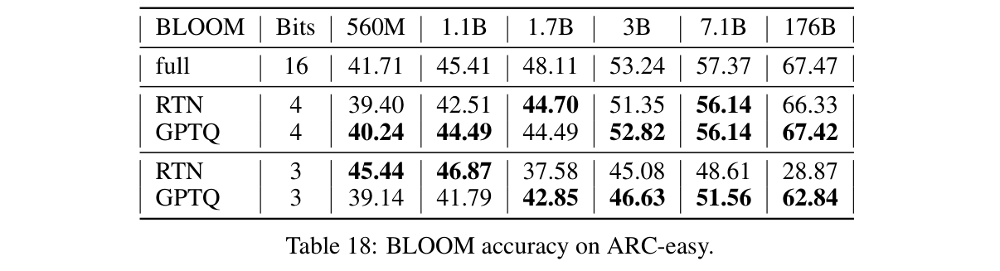</button><figcaption>Table 18 · Original Paper 2210.17323v2 · PDF crop; 原 caption 在截图中 <span>点击放大；保留全部坐标 / 图例。</span></figcaption></figure></details>

BLOOM176 GPTQ4 67.42 对 baseline 67.47 低 0.05 点，对 RTN4 66.33 高 1.09 点；GPTQ3 62.84 比 RTN3 28.87 高 33.97 点。但小 BLOOM560M / 1.1B 的 RTN3 45.44 / 46.87 反而高于 GPTQ3 39.14 / 41.79，再次说明 task accuracy 不能由局部损失单调排序。

### Tables 19–20 — ARC-challenge：更难的科学推理题

<p class="reading-meta">Table 19: OPT accuracy on ARC-challenge. · Original Paper</p><div class="table-scroll original-table" role="region" tabindex="0" aria-label="Table 19 完整原始行列"><table class="ltx_tabular ltx_centering ltx_guessed_headers ltx_align_middle">
<tbody class="ltx_tbody">
<tr class="ltx_tr">
<th class="ltx_td ltx_align_left ltx_th ltx_th_row ltx_border_l ltx_border_r ltx_border_tt">OPT</th>
<th class="ltx_td ltx_align_center ltx_th ltx_th_row ltx_border_r ltx_border_tt">Bits</th>
<td class="ltx_td ltx_align_center ltx_border_r ltx_border_tt">125M</td>
<td class="ltx_td ltx_align_center ltx_border_r ltx_border_tt">350M</td>
<td class="ltx_td ltx_align_center ltx_border_r ltx_border_tt">1.3B</td>
<td class="ltx_td ltx_align_center ltx_border_r ltx_border_tt">2.7B</td>
<td class="ltx_td ltx_align_center ltx_border_r ltx_border_tt">6.7B</td>
<td class="ltx_td ltx_align_center ltx_border_r ltx_border_tt">13B</td>
<td class="ltx_td ltx_align_center ltx_border_r ltx_border_tt">30B</td>
<td class="ltx_td ltx_align_center ltx_border_r ltx_border_tt">66B</td>
<td class="ltx_td ltx_align_center ltx_border_r ltx_border_tt">175B</td></tr>
<tr class="ltx_tr">
<th class="ltx_td ltx_align_left ltx_th ltx_th_row ltx_border_l ltx_border_r ltx_border_t">full</th>
<th class="ltx_td ltx_align_center ltx_th ltx_th_row ltx_border_r ltx_border_t">16</th>
<td class="ltx_td ltx_align_center ltx_border_r ltx_border_t">22.87</td>
<td class="ltx_td ltx_align_center ltx_border_r ltx_border_t">24.06</td>
<td class="ltx_td ltx_align_center ltx_border_r ltx_border_t">29.44</td>
<td class="ltx_td ltx_align_center ltx_border_r ltx_border_t">31.31</td>
<td class="ltx_td ltx_align_center ltx_border_r ltx_border_t">34.56</td>
<td class="ltx_td ltx_align_center ltx_border_r ltx_border_t">35.75</td>
<td class="ltx_td ltx_align_center ltx_border_r ltx_border_t">38.14</td>
<td class="ltx_td ltx_align_center ltx_border_r ltx_border_t">40.02</td>
<td class="ltx_td ltx_align_center ltx_border_r ltx_border_t">43.94</td></tr>
<tr class="ltx_tr">
<th class="ltx_td ltx_align_left ltx_th ltx_th_row ltx_border_l ltx_border_r ltx_border_t">RTN</th>
<th class="ltx_td ltx_align_center ltx_th ltx_th_row ltx_border_r ltx_border_t">4</th>
<td class="ltx_td ltx_align_center ltx_border_r ltx_border_t">22.44</td>
<td class="ltx_td ltx_align_center ltx_border_r ltx_border_t">23.81</td>
<td class="ltx_td ltx_align_center ltx_border_r ltx_border_t">24.91</td>
<td class="ltx_td ltx_align_center ltx_border_r ltx_border_t">29.18</td>
<td class="ltx_td ltx_align_center ltx_border_r ltx_border_t">32.59</td>
<td class="ltx_td ltx_align_center ltx_border_r ltx_border_t"><span class="ltx_text ltx_font_bold">35.24</span></td>
<td class="ltx_td ltx_align_center ltx_border_r ltx_border_t">35.41</td>
<td class="ltx_td ltx_align_center ltx_border_r ltx_border_t">22.87</td>
<td class="ltx_td ltx_align_center ltx_border_r ltx_border_t">37.71</td></tr>
<tr class="ltx_tr">
<th class="ltx_td ltx_align_left ltx_th ltx_th_row ltx_border_l ltx_border_r">GPTQ</th>
<th class="ltx_td ltx_align_center ltx_th ltx_th_row ltx_border_r">4</th>
<td class="ltx_td ltx_align_center ltx_border_r"><span class="ltx_text ltx_font_bold">22.95</span></td>
<td class="ltx_td ltx_align_center ltx_border_r"><span class="ltx_text ltx_font_bold">24.83</span></td>
<td class="ltx_td ltx_align_center ltx_border_r"><span class="ltx_text ltx_font_bold">28.24</span></td>
<td class="ltx_td ltx_align_center ltx_border_r"><span class="ltx_text ltx_font_bold">30.12</span></td>
<td class="ltx_td ltx_align_center ltx_border_r"><span class="ltx_text ltx_font_bold">33.70</span></td>
<td class="ltx_td ltx_align_center ltx_border_r">34.90</td>
<td class="ltx_td ltx_align_center ltx_border_r"><span class="ltx_text ltx_font_bold">37.80</span></td>
<td class="ltx_td ltx_align_center ltx_border_r"><span class="ltx_text ltx_font_bold">39.16</span></td>
<td class="ltx_td ltx_align_center ltx_border_r"><span class="ltx_text ltx_font_bold">42.75</span></td></tr>
<tr class="ltx_tr">
<th class="ltx_td ltx_align_left ltx_th ltx_th_row ltx_border_l ltx_border_r ltx_border_t">RTN</th>
<th class="ltx_td ltx_align_center ltx_th ltx_th_row ltx_border_r ltx_border_t">3</th>
<td class="ltx_td ltx_align_center ltx_border_r ltx_border_t">21.76</td>
<td class="ltx_td ltx_align_center ltx_border_r ltx_border_t">22.18</td>
<td class="ltx_td ltx_align_center ltx_border_r ltx_border_t">23.55</td>
<td class="ltx_td ltx_align_center ltx_border_r ltx_border_t">25.43</td>
<td class="ltx_td ltx_align_center ltx_border_r ltx_border_t">25.85</td>
<td class="ltx_td ltx_align_center ltx_border_r ltx_border_t">23.81</td>
<td class="ltx_td ltx_align_center ltx_border_r ltx_border_t">19.97</td>
<td class="ltx_td ltx_align_center ltx_border_r ltx_border_t">25.77</td>
<td class="ltx_td ltx_align_center ltx_border_r ltx_border_t">23.81</td></tr>
<tr class="ltx_tr">
<th class="ltx_td ltx_align_left ltx_th ltx_th_row ltx_border_bb ltx_border_l ltx_border_r">GPTQ</th>
<th class="ltx_td ltx_align_center ltx_th ltx_th_row ltx_border_bb ltx_border_r">3</th>
<td class="ltx_td ltx_align_center ltx_border_bb ltx_border_r"><span class="ltx_text ltx_font_bold">22.53</span></td>
<td class="ltx_td ltx_align_center ltx_border_bb ltx_border_r"><span class="ltx_text ltx_font_bold">25.09</span></td>
<td class="ltx_td ltx_align_center ltx_border_bb ltx_border_r"><span class="ltx_text ltx_font_bold">27.65</span></td>
<td class="ltx_td ltx_align_center ltx_border_bb ltx_border_r"><span class="ltx_text ltx_font_bold">27.82</span></td>
<td class="ltx_td ltx_align_center ltx_border_bb ltx_border_r"><span class="ltx_text ltx_font_bold">31.91</span></td>
<td class="ltx_td ltx_align_center ltx_border_bb ltx_border_r"><span class="ltx_text ltx_font_bold">33.02</span></td>
<td class="ltx_td ltx_align_center ltx_border_bb ltx_border_r"><span class="ltx_text ltx_font_bold">35.84</span></td>
<td class="ltx_td ltx_align_center ltx_border_bb ltx_border_r"><span class="ltx_text ltx_font_bold">31.66</span></td>
<td class="ltx_td ltx_align_center ltx_border_bb ltx_border_r"><span class="ltx_text ltx_font_bold">41.04</span></td></tr>
</tbody>
</table></div><details class="source-evidence"><summary>Table 19 原始排版、加粗 / 下划线与 caption</summary><figure class="original-figure"><button type="button" data-zoom="assets/original/table-19.png" aria-label="放大 Table 19">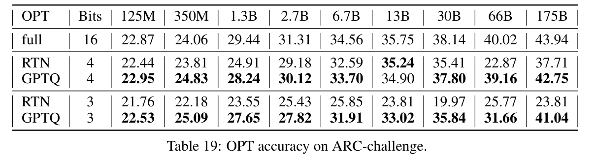</button><figcaption>Table 19 · Original Paper 2210.17323v2 · PDF crop; 原 caption 在截图中 <span>点击放大；保留全部坐标 / 图例。</span></figcaption></figure></details>

OPT175 GPTQ4 42.75 对 FP16 43.94 低 1.19 点，对 RTN4 37.71 高 5.04 点；GPTQ3 41.04，对 RTN3 23.81 高 17.23 点。小规模偶有量化 accuracy 超过 FP16，没有显著性信息时只记录观测。

<p class="reading-meta">Table 20: BLOOM accuracy on ARC-challenge. · Original Paper</p><div class="table-scroll original-table" role="region" tabindex="0" aria-label="Table 20 完整原始行列"><table class="ltx_tabular ltx_centering ltx_guessed_headers ltx_align_middle">
<tbody class="ltx_tbody">
<tr class="ltx_tr">
<th class="ltx_td ltx_align_left ltx_th ltx_th_row ltx_border_l ltx_border_r ltx_border_tt">BLOOM</th>
<th class="ltx_td ltx_align_center ltx_th ltx_th_row ltx_border_r ltx_border_tt">Bits</th>
<td class="ltx_td ltx_align_center ltx_border_r ltx_border_tt">560M</td>
<td class="ltx_td ltx_align_center ltx_border_r ltx_border_tt">1.1B</td>
<td class="ltx_td ltx_align_center ltx_border_r ltx_border_tt">1.7B</td>
<td class="ltx_td ltx_align_center ltx_border_r ltx_border_tt">3B</td>
<td class="ltx_td ltx_align_center ltx_border_r ltx_border_tt">7.1B</td>
<td class="ltx_td ltx_align_center ltx_border_r ltx_border_tt">176B</td></tr>
<tr class="ltx_tr">
<th class="ltx_td ltx_align_left ltx_th ltx_th_row ltx_border_l ltx_border_r ltx_border_t">full</th>
<th class="ltx_td ltx_align_center ltx_th ltx_th_row ltx_border_r ltx_border_t">16</th>
<td class="ltx_td ltx_align_center ltx_border_r ltx_border_t">24.15</td>
<td class="ltx_td ltx_align_center ltx_border_r ltx_border_t">25.68</td>
<td class="ltx_td ltx_align_center ltx_border_r ltx_border_t">26.79</td>
<td class="ltx_td ltx_align_center ltx_border_r ltx_border_t">30.55</td>
<td class="ltx_td ltx_align_center ltx_border_r ltx_border_t">33.45</td>
<td class="ltx_td ltx_align_center ltx_border_r ltx_border_t">44.97</td></tr>
<tr class="ltx_tr">
<th class="ltx_td ltx_align_left ltx_th ltx_th_row ltx_border_l ltx_border_r ltx_border_t">RTN</th>
<th class="ltx_td ltx_align_center ltx_th ltx_th_row ltx_border_r ltx_border_t">4</th>
<td class="ltx_td ltx_align_center ltx_border_r ltx_border_t"><span class="ltx_text ltx_font_bold">23.89</span></td>
<td class="ltx_td ltx_align_center ltx_border_r ltx_border_t">23.34</td>
<td class="ltx_td ltx_align_center ltx_border_r ltx_border_t"><span class="ltx_text ltx_font_bold">26.45</span></td>
<td class="ltx_td ltx_align_center ltx_border_r ltx_border_t"><span class="ltx_text ltx_font_bold">29.52</span></td>
<td class="ltx_td ltx_align_center ltx_border_r ltx_border_t">32.17</td>
<td class="ltx_td ltx_align_center ltx_border_r ltx_border_t">43.17</td></tr>
<tr class="ltx_tr">
<th class="ltx_td ltx_align_left ltx_th ltx_th_row ltx_border_l ltx_border_r">GPTQ</th>
<th class="ltx_td ltx_align_center ltx_th ltx_th_row ltx_border_r">4</th>
<td class="ltx_td ltx_align_center ltx_border_r">23.46</td>
<td class="ltx_td ltx_align_center ltx_border_r"><span class="ltx_text ltx_font_bold">25.51</span></td>
<td class="ltx_td ltx_align_center ltx_border_r">25.94</td>
<td class="ltx_td ltx_align_center ltx_border_r">28.92</td>
<td class="ltx_td ltx_align_center ltx_border_r"><span class="ltx_text ltx_font_bold">32.25</span></td>
<td class="ltx_td ltx_align_center ltx_border_r"><span class="ltx_text ltx_font_bold">44.20</span></td></tr>
<tr class="ltx_tr">
<th class="ltx_td ltx_align_left ltx_th ltx_th_row ltx_border_l ltx_border_r ltx_border_t">RTN</th>
<th class="ltx_td ltx_align_center ltx_th ltx_th_row ltx_border_r ltx_border_t">3</th>
<td class="ltx_td ltx_align_center ltx_border_r ltx_border_t">21.67</td>
<td class="ltx_td ltx_align_center ltx_border_r ltx_border_t">22.86</td>
<td class="ltx_td ltx_align_center ltx_border_r ltx_border_t">23.29</td>
<td class="ltx_td ltx_align_center ltx_border_r ltx_border_t">27.13</td>
<td class="ltx_td ltx_align_center ltx_border_r ltx_border_t"><span class="ltx_text ltx_font_bold">31.31</span></td>
<td class="ltx_td ltx_align_center ltx_border_r ltx_border_t">24.74</td></tr>
<tr class="ltx_tr">
<th class="ltx_td ltx_align_left ltx_th ltx_th_row ltx_border_bb ltx_border_l ltx_border_r">GPTQ</th>
<th class="ltx_td ltx_align_center ltx_th ltx_th_row ltx_border_bb ltx_border_r">3</th>
<td class="ltx_td ltx_align_center ltx_border_bb ltx_border_r"><span class="ltx_text ltx_font_bold">23.21</span></td>
<td class="ltx_td ltx_align_center ltx_border_bb ltx_border_r"><span class="ltx_text ltx_font_bold">24.06</span></td>
<td class="ltx_td ltx_align_center ltx_border_bb ltx_border_r"><span class="ltx_text ltx_font_bold">24.91</span></td>
<td class="ltx_td ltx_align_center ltx_border_bb ltx_border_r"><span class="ltx_text ltx_font_bold">28.58</span></td>
<td class="ltx_td ltx_align_center ltx_border_bb ltx_border_r">30.97</td>
<td class="ltx_td ltx_align_center ltx_border_bb ltx_border_r"><span class="ltx_text ltx_font_bold">40.70</span></td></tr>
</tbody>
</table></div><details class="source-evidence"><summary>Table 20 原始排版、加粗 / 下划线与 caption</summary><figure class="original-figure"><button type="button" data-zoom="assets/original/table-20.png" aria-label="放大 Table 20">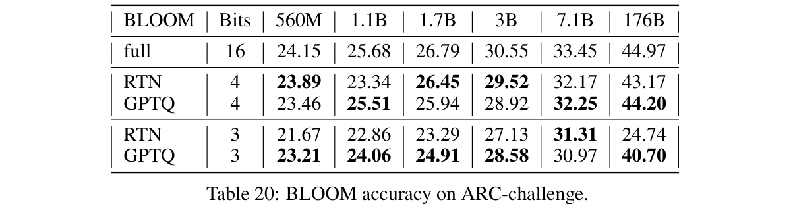</button><figcaption>Table 20 · Original Paper 2210.17323v2 · PDF crop; 原 caption 在截图中 <span>点击放大；保留全部坐标 / 图例。</span></figcaption></figure></details>

BLOOM176 GPTQ4 44.20 对 FP16 44.97 低 0.77 点，对 RTN4 43.17 高 1.03 点；GPTQ3 40.70 对 RTN3 24.74 高 15.96 点。BLOOM560M GPTQ4 23.46 低于 RTN4 23.89，说明“全面优于 RTN”不符合所有原始数据。

### Tables 21–22 — StoryCloze：故事结尾选择

<p class="reading-meta">Table 21: OPT accuracy on StoryCloze. · Original Paper</p><div class="table-scroll original-table" role="region" tabindex="0" aria-label="Table 21 完整原始行列"><table class="ltx_tabular ltx_centering ltx_guessed_headers ltx_align_middle">
<tbody class="ltx_tbody">
<tr class="ltx_tr">
<th class="ltx_td ltx_align_left ltx_th ltx_th_row ltx_border_l ltx_border_r ltx_border_tt">OPT</th>
<th class="ltx_td ltx_align_center ltx_th ltx_th_row ltx_border_r ltx_border_tt">Bits</th>
<td class="ltx_td ltx_align_center ltx_border_r ltx_border_tt">125M</td>
<td class="ltx_td ltx_align_center ltx_border_r ltx_border_tt">350M</td>
<td class="ltx_td ltx_align_center ltx_border_r ltx_border_tt">1.3B</td>
<td class="ltx_td ltx_align_center ltx_border_r ltx_border_tt">2.7B</td>
<td class="ltx_td ltx_align_center ltx_border_r ltx_border_tt">6.7B</td>
<td class="ltx_td ltx_align_center ltx_border_r ltx_border_tt">13B</td>
<td class="ltx_td ltx_align_center ltx_border_r ltx_border_tt">30B</td>
<td class="ltx_td ltx_align_center ltx_border_r ltx_border_tt">66B</td>
<td class="ltx_td ltx_align_center ltx_border_r ltx_border_tt">175B</td></tr>
<tr class="ltx_tr">
<th class="ltx_td ltx_align_left ltx_th ltx_th_row ltx_border_l ltx_border_r ltx_border_t">full</th>
<th class="ltx_td ltx_align_center ltx_th ltx_th_row ltx_border_r ltx_border_t">16</th>
<td class="ltx_td ltx_align_center ltx_border_r ltx_border_t">59.96</td>
<td class="ltx_td ltx_align_center ltx_border_r ltx_border_t">63.21</td>
<td class="ltx_td ltx_align_center ltx_border_r ltx_border_t">70.78</td>
<td class="ltx_td ltx_align_center ltx_border_r ltx_border_t">71.74</td>
<td class="ltx_td ltx_align_center ltx_border_r ltx_border_t">74.60</td>
<td class="ltx_td ltx_align_center ltx_border_r ltx_border_t">76.64</td>
<td class="ltx_td ltx_align_center ltx_border_r ltx_border_t">77.28</td>
<td class="ltx_td ltx_align_center ltx_border_r ltx_border_t">77.34</td>
<td class="ltx_td ltx_align_center ltx_border_r ltx_border_t">79.82</td></tr>
<tr class="ltx_tr">
<th class="ltx_td ltx_align_left ltx_th ltx_th_row ltx_border_l ltx_border_r ltx_border_t">RTN</th>
<th class="ltx_td ltx_align_center ltx_th ltx_th_row ltx_border_r ltx_border_t">4</th>
<td class="ltx_td ltx_align_center ltx_border_r ltx_border_t"><span class="ltx_text ltx_font_bold">60.02</span></td>
<td class="ltx_td ltx_align_center ltx_border_r ltx_border_t">63.08</td>
<td class="ltx_td ltx_align_center ltx_border_r ltx_border_t">59.13</td>
<td class="ltx_td ltx_align_center ltx_border_r ltx_border_t"><span class="ltx_text ltx_font_bold">70.78</span></td>
<td class="ltx_td ltx_align_center ltx_border_r ltx_border_t">73.65</td>
<td class="ltx_td ltx_align_center ltx_border_r ltx_border_t">74.47</td>
<td class="ltx_td ltx_align_center ltx_border_r ltx_border_t">75.37</td>
<td class="ltx_td ltx_align_center ltx_border_r ltx_border_t">51.24</td>
<td class="ltx_td ltx_align_center ltx_border_r ltx_border_t">78.04</td></tr>
<tr class="ltx_tr">
<th class="ltx_td ltx_align_left ltx_th ltx_th_row ltx_border_l ltx_border_r">GPTQ</th>
<th class="ltx_td ltx_align_center ltx_th ltx_th_row ltx_border_r">4</th>
<td class="ltx_td ltx_align_center ltx_border_r">59.58</td>
<td class="ltx_td ltx_align_center ltx_border_r"><span class="ltx_text ltx_font_bold">63.46</span></td>
<td class="ltx_td ltx_align_center ltx_border_r"><span class="ltx_text ltx_font_bold">69.64</span></td>
<td class="ltx_td ltx_align_center ltx_border_r">70.46</td>
<td class="ltx_td ltx_align_center ltx_border_r"><span class="ltx_text ltx_font_bold">73.90</span></td>
<td class="ltx_td ltx_align_center ltx_border_r"><span class="ltx_text ltx_font_bold">76.19</span></td>
<td class="ltx_td ltx_align_center ltx_border_r"><span class="ltx_text ltx_font_bold">77.08</span></td>
<td class="ltx_td ltx_align_center ltx_border_r"><span class="ltx_text ltx_font_bold">77.15</span></td>
<td class="ltx_td ltx_align_center ltx_border_r"><span class="ltx_text ltx_font_bold">80.08</span></td></tr>
<tr class="ltx_tr">
<th class="ltx_td ltx_align_left ltx_th ltx_th_row ltx_border_l ltx_border_r ltx_border_t">RTN</th>
<th class="ltx_td ltx_align_center ltx_th ltx_th_row ltx_border_r ltx_border_t">3</th>
<td class="ltx_td ltx_align_center ltx_border_r ltx_border_t">49.65</td>
<td class="ltx_td ltx_align_center ltx_border_r ltx_border_t">56.78</td>
<td class="ltx_td ltx_align_center ltx_border_r ltx_border_t">47.61</td>
<td class="ltx_td ltx_align_center ltx_border_r ltx_border_t">46.98</td>
<td class="ltx_td ltx_align_center ltx_border_r ltx_border_t">48.12</td>
<td class="ltx_td ltx_align_center ltx_border_r ltx_border_t">49.20</td>
<td class="ltx_td ltx_align_center ltx_border_r ltx_border_t">49.84</td>
<td class="ltx_td ltx_align_center ltx_border_r ltx_border_t">48.19</td>
<td class="ltx_td ltx_align_center ltx_border_r ltx_border_t">46.47</td></tr>
<tr class="ltx_tr">
<th class="ltx_td ltx_align_left ltx_th ltx_th_row ltx_border_bb ltx_border_l ltx_border_r">GPTQ</th>
<th class="ltx_td ltx_align_center ltx_th ltx_th_row ltx_border_bb ltx_border_r">3</th>
<td class="ltx_td ltx_align_center ltx_border_bb ltx_border_r"><span class="ltx_text ltx_font_bold">57.03</span></td>
<td class="ltx_td ltx_align_center ltx_border_bb ltx_border_r"><span class="ltx_text ltx_font_bold">60.15</span></td>
<td class="ltx_td ltx_align_center ltx_border_bb ltx_border_r"><span class="ltx_text ltx_font_bold">65.25</span></td>
<td class="ltx_td ltx_align_center ltx_border_bb ltx_border_r"><span class="ltx_text ltx_font_bold">68.43</span></td>
<td class="ltx_td ltx_align_center ltx_border_bb ltx_border_r"><span class="ltx_text ltx_font_bold">70.97</span></td>
<td class="ltx_td ltx_align_center ltx_border_bb ltx_border_r"><span class="ltx_text ltx_font_bold">73.07</span></td>
<td class="ltx_td ltx_align_center ltx_border_bb ltx_border_r"><span class="ltx_text ltx_font_bold">75.68</span></td>
<td class="ltx_td ltx_align_center ltx_border_bb ltx_border_r"><span class="ltx_text ltx_font_bold">71.23</span></td>
<td class="ltx_td ltx_align_center ltx_border_bb ltx_border_r"><span class="ltx_text ltx_font_bold">78.04</span></td></tr>
</tbody>
</table></div><details class="source-evidence"><summary>Table 21 原始排版、加粗 / 下划线与 caption</summary><figure class="original-figure"><button type="button" data-zoom="assets/original/table-21.png" aria-label="放大 Table 21">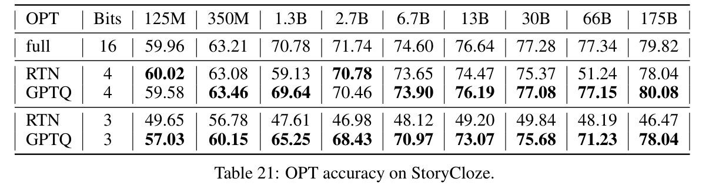</button><figcaption>Table 21 · Original Paper 2210.17323v2 · PDF crop; 原 caption 在截图中 <span>点击放大；保留全部坐标 / 图例。</span></figcaption></figure></details>

OPT175 GPTQ4 80.08 对 FP16 79.82 高 0.26 点，对 RTN4 78.04 高 2.04 点；GPTQ3 78.04 与 RTN4 恰相同，但比 RTN3 46.47 高 31.57 点。不同位宽的偶然相等不是量化等价的证明。

<p class="reading-meta">Table 22: BLOOM accuracy on StoryCloze. · Original Paper</p><div class="table-scroll original-table" role="region" tabindex="0" aria-label="Table 22 完整原始行列"><table class="ltx_tabular ltx_centering ltx_guessed_headers ltx_align_middle">
<tbody class="ltx_tbody">
<tr class="ltx_tr">
<th class="ltx_td ltx_align_left ltx_th ltx_th_row ltx_border_l ltx_border_r ltx_border_tt">BLOOM</th>
<th class="ltx_td ltx_align_center ltx_th ltx_th_row ltx_border_r ltx_border_tt">Bits</th>
<td class="ltx_td ltx_align_center ltx_border_r ltx_border_tt">560M</td>
<td class="ltx_td ltx_align_center ltx_border_r ltx_border_tt">1.1B</td>
<td class="ltx_td ltx_align_center ltx_border_r ltx_border_tt">1.7B</td>
<td class="ltx_td ltx_align_center ltx_border_r ltx_border_tt">3B</td>
<td class="ltx_td ltx_align_center ltx_border_r ltx_border_tt">7.1B</td>
<td class="ltx_td ltx_align_center ltx_border_r ltx_border_tt">176B</td></tr>
<tr class="ltx_tr">
<th class="ltx_td ltx_align_left ltx_th ltx_th_row ltx_border_l ltx_border_r ltx_border_t">full</th>
<th class="ltx_td ltx_align_center ltx_th ltx_th_row ltx_border_r ltx_border_t">16</th>
<td class="ltx_td ltx_align_center ltx_border_r ltx_border_t">61.94</td>
<td class="ltx_td ltx_align_center ltx_border_r ltx_border_t">63.27</td>
<td class="ltx_td ltx_align_center ltx_border_r ltx_border_t">65.44</td>
<td class="ltx_td ltx_align_center ltx_border_r ltx_border_t">67.79</td>
<td class="ltx_td ltx_align_center ltx_border_r ltx_border_t">71.99</td>
<td class="ltx_td ltx_align_center ltx_border_r ltx_border_t">76.89</td></tr>
<tr class="ltx_tr">
<th class="ltx_td ltx_align_left ltx_th ltx_th_row ltx_border_l ltx_border_r ltx_border_t">RTN</th>
<th class="ltx_td ltx_align_center ltx_th ltx_th_row ltx_border_r ltx_border_t">4</th>
<td class="ltx_td ltx_align_center ltx_border_r ltx_border_t">60.15</td>
<td class="ltx_td ltx_align_center ltx_border_r ltx_border_t">60.66</td>
<td class="ltx_td ltx_align_center ltx_border_r ltx_border_t">62.95</td>
<td class="ltx_td ltx_align_center ltx_border_r ltx_border_t">67.09</td>
<td class="ltx_td ltx_align_center ltx_border_r ltx_border_t">70.72</td>
<td class="ltx_td ltx_align_center ltx_border_r ltx_border_t">76.00</td></tr>
<tr class="ltx_tr">
<th class="ltx_td ltx_align_left ltx_th ltx_th_row ltx_border_l ltx_border_r">GPTQ</th>
<th class="ltx_td ltx_align_center ltx_th ltx_th_row ltx_border_r">4</th>
<td class="ltx_td ltx_align_center ltx_border_r"><span class="ltx_text ltx_font_bold">61.17</span></td>
<td class="ltx_td ltx_align_center ltx_border_r"><span class="ltx_text ltx_font_bold">62.32</span></td>
<td class="ltx_td ltx_align_center ltx_border_r"><span class="ltx_text ltx_font_bold">64.48</span></td>
<td class="ltx_td ltx_align_center ltx_border_r"><span class="ltx_text ltx_font_bold">67.22</span></td>
<td class="ltx_td ltx_align_center ltx_border_r"><span class="ltx_text ltx_font_bold">71.36</span></td>
<td class="ltx_td ltx_align_center ltx_border_r"><span class="ltx_text ltx_font_bold">76.32</span></td></tr>
<tr class="ltx_tr">
<th class="ltx_td ltx_align_left ltx_th ltx_th_row ltx_border_l ltx_border_r ltx_border_t">RTN</th>
<th class="ltx_td ltx_align_center ltx_th ltx_th_row ltx_border_r ltx_border_t">3</th>
<td class="ltx_td ltx_align_center ltx_border_r ltx_border_t">54.87</td>
<td class="ltx_td ltx_align_center ltx_border_r ltx_border_t">56.08</td>
<td class="ltx_td ltx_align_center ltx_border_r ltx_border_t">55.79</td>
<td class="ltx_td ltx_align_center ltx_border_r ltx_border_t">59.83</td>
<td class="ltx_td ltx_align_center ltx_border_r ltx_border_t">66.20</td>
<td class="ltx_td ltx_align_center ltx_border_r ltx_border_t">48.50</td></tr>
<tr class="ltx_tr">
<th class="ltx_td ltx_align_left ltx_th ltx_th_row ltx_border_bb ltx_border_l ltx_border_r">GPTQ</th>
<th class="ltx_td ltx_align_center ltx_th ltx_th_row ltx_border_bb ltx_border_r">3</th>
<td class="ltx_td ltx_align_center ltx_border_bb ltx_border_r"><span class="ltx_text ltx_font_bold">57.80</span></td>
<td class="ltx_td ltx_align_center ltx_border_bb ltx_border_r"><span class="ltx_text ltx_font_bold">59.77</span></td>
<td class="ltx_td ltx_align_center ltx_border_bb ltx_border_r"><span class="ltx_text ltx_font_bold">61.81</span></td>
<td class="ltx_td ltx_align_center ltx_border_bb ltx_border_r"><span class="ltx_text ltx_font_bold">63.97</span></td>
<td class="ltx_td ltx_align_center ltx_border_bb ltx_border_r"><span class="ltx_text ltx_font_bold">69.26</span></td>
<td class="ltx_td ltx_align_center ltx_border_bb ltx_border_r"><span class="ltx_text ltx_font_bold">75.37</span></td></tr>
</tbody>
</table></div><details class="source-evidence"><summary>Table 22 原始排版、加粗 / 下划线与 caption</summary><figure class="original-figure"><button type="button" data-zoom="assets/original/table-22.png" aria-label="放大 Table 22">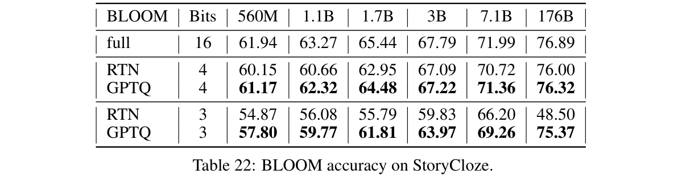</button><figcaption>Table 22 · Original Paper 2210.17323v2 · PDF crop; 原 caption 在截图中 <span>点击放大；保留全部坐标 / 图例。</span></figcaption></figure></details>

BLOOM176 GPTQ4 76.32 对 FP16 76.89 低 0.57 点，对 RTN4 76.00 高 0.32 点；GPTQ3 75.37 对 RTN3 48.50 高 26.87 点。结合全部任务，最强证据是“低位宽补偿大幅避免 RTN 崩溃，尤其在 175B”；更强的“无损、逐项最优、能力提升”没有被全部数据支持。

## 扩展调研 — 技术演进与关键相关工作

**External Source · 核验截至 2026-10-27。** 下面区分 weight-only reconstruction、activation outlier 处理、低比特码本与 kernel 工程。它们经常可以组合，不是一条用新名字完全取代旧方法的线性路线。

<figure class="generated-figure"><svg xmlns="http://www.w3.org/2000/svg" viewBox="0 0 740 397" role="img" aria-label="量化演进：算法表示与执行优化并行"><rect x="20" y="15" width="700" height="60" rx="6" fill="#152235" stroke="#4a6485"/><text x="40" y="39">1993–2022：OBS → OBQ</text><text x="40" y="61" style="font-size:12px;fill:#b2c1d6">二阶约束修正与逐元素PTQ</text><path d="M370 75v26m-5 -6l5 6 5 -6"/><rect x="20" y="103" width="700" height="60" rx="6" fill="#152235" stroke="#4a6485"/><text x="40" y="127">2022–2023：GPTQ + outlier路线</text><text x="40" y="149" style="font-size:12px;fill:#b2c1d6">共享列、块更新与Cholesky；LLM.int8 / SmoothQuant</text><path d="M370 163v26m-5 -6l5 6 5 -6"/><rect x="20" y="191" width="700" height="60" rx="6" fill="#152235" stroke="#4a6485"/><text x="40" y="215">2023–2025：scaling、codebooks、rotation、teacher目标</text><text x="40" y="237" style="font-size:12px;fill:#b2c1d6">AWQ / AQLM / QuIP# / QuaRot / GPTQv2</text><path d="M370 251v26m-5 -6l5 6 5 -6"/><rect x="20" y="279" width="700" height="60" rx="6" fill="#152235" stroke="#4a6485"/><text x="40" y="303">2024–2026：kernel + format + workload</text><text x="40" y="325" style="font-size:12px;fill:#b2c1d6">Marlin / GPTQModel / Humming；精度与吞吐多轴选择</text></svg><figcaption>量化演进：算法表示与执行优化并行 · Agent-created Simplified Diagram · <a href="assets/generated/quantization-timeline.mmd">Mermaid source</a></figcaption></figure>

| 工作 / 年份 | 核心思想 | 优势 | 代价 / 边界 | 与 GPTQ 的关系 |
|---|---|---|---|---|
| [OBC / OBQ · 2022](https://arxiv.org/abs/2208.11580) | 二阶逐元素剪枝 / 量化重建 | 局部补偿有闭式解 | 贪心顺序与逐行消元成本高 | 直接算法前驱 |
| [LLM.int8 · 2022](https://arxiv.org/abs/2208.07339) | activation outlier 的混合高精度分解 | 面向大模型 outlier | 8-bit / 浮点路径与实现开销 | 不等于本论文 RTN 系统 |
| [GPTQ · 2022 / ICLR 2023](https://arxiv.org/abs/2210.17323) | 共享顺序、块更新、Cholesky | 175B 的几小时 PTQ | 局部误差、校准与格式依赖 | 本文 |
| [SmoothQuant · 2022 / ICML 2023](https://arxiv.org/abs/2211.10438) | 等价缩放迁移 activation outlier | W8A8 硬件部署 | 平衡 W/A 的动态范围 | 不同量化对象，可互补 |
| [AWQ · 2023 / MLSys 2024](https://arxiv.org/abs/2306.00978) | 由 activation 统计决定通道 scaling | 保护 salient weights、TinyChat | scale 搜索、实现与目标不同 | weight-only 替代路线 |
| [AQLM · 2024 / ICML](https://arxiv.org/abs/2401.06118) | 学习多个相加码本、联合 block tuning | 面向约 2-bit 精度 | 更多校准优化与码本 kernel | 不同离散表示与预算 |
| [QuIP# · 2024 / ICML](https://arxiv.org/abs/2402.04396) | Hadamard incoherence + E8 lattice | 极低位宽几何与码本 | 旋转、码本、finetuning | 改变表示与误差分布 |
| [QuaRot · 2024](https://arxiv.org/abs/2404.00456) | 旋转减轻 outlier，W/A/KV4 | 同时覆盖更多内存项 | 全链路 dtype / kernel 要求 | 权重环节可使用 GPTQ |
| [GPTQv2 · 2025](https://arxiv.org/abs/2504.02692) | asymmetric teacher/student 输入重建 | 显式考虑累计输入误差 | 目标与实现预算改变 | 改进本论文的局部目标 |
| [Marlin · 2024 起](https://github.com/IST-DASLab/marlin) | FP16×INT4 Tensor Core kernel | 提高适合 batch 的吞吐 | 设备、shape、batch 条件 | 加速已量化权重的运行 |
| [GPTQModel · 持续维护](https://github.com/ModelCloud/GPTQModel) | 量化、模型适配、export/runtime 工具链 | 支持多 backend 与部署格式 | 软件支持不等于统一精度冠军 | 工程生态 |
| [Humming · 2026-10-21](https://vllm.ai/blog/2026-10-21-humming) | 统一量化布局与设备 / workload 特化 | JIT、多个格式和 INT3 路径 | microbenchmark 不等于应用延迟 | 将格式选择与执行调度连接 |

### Before / After：真正发生了哪些变化？

**Before（1993–2022）。** OBS 提供二阶约束修正；OBQ 将它用于 quantization。**This Paper（2022–2023）。** GPTQ 用共享列顺序与 IO 调度解决大规模执行问题。**After（2023–2025）。** AWQ 改变格点前的通道缩放；AQLM / QuIP# 改变离散表示；QuaRot 扩展到 activation / KV；GPTQv2 修改输入不匹配的重建目标。**Current（2026）。** 量化算法、序列化 layout、backend、GPU 与 batch/context 的共同选择越来越重要。

**版本消歧。** 本篇 **2210.17323v2** 是原 GPTQ 论文第二版；**GPTQv2** 是 2025 年独立论文；runtime 中的 **GPTQ_V2** 还可能表示 checkpoint 序列化格式。三个 “v2” 的语义不同。

**GPTQv2 的目标差别。** 原式对 `W X_student` 与 `Q X_student` 重建，重点是当前量化层。后续工作使用 teacher full-precision 输入目标与 student 已量化路径输入，意在纠正前层累计偏差。这与 true-sequential 的输入采集修正有关，但目标不完全相同。

**AWQ 的证据边界。** 作者讨论 GPTQ 在某些校准分布变化下的泛化损伤，这是 AWQ 特定实验设置的外部证据；不能用它覆盖本篇全部 checkpoint，或未经复测宣称 GPTQ 在任何 OOD 都失效。

## 当前最佳实践与 SOTA 审计 — 截至 2026-10-27

**没有一张严格同条件的“所有量化方法总榜”。** 比特 payload、metadata、校准 / tuning 预算、基础 checkpoint、KV precision、GPU、kernel 与并发条件不同，精度与速度也不是一个指标。应按问题挑候选，再同环境比较。

| 目标 / 来源 | Benchmark 与指标 | 模型 / 硬件条件 | 可比较结论 |
|---|---|---|---|
| 原 GPTQ 精度 | Wiki2 PPL 8.37 / FP16 8.34 | OPT175B、4-bit、原校准 | 该设置近 FP16；不是 2026 SOTA 排名 |
| 极低比特精度 | AQLM / QuIP# 各自论文的 PPL / tasks | 多个 checkpoint、码本、tuning 预算 | 是候选先进路线，不能与 untuned GPTQ 只按 “2-bit” 排名 |
| Marlin 官方 kernel | 作者报告接近理想 4× 的特定 batch 区域 | FP16×INT4，支持 GPU，约 16–32 token batch | 开源 kernel 优势，需核对 shape 与服务负载 |
| Qwen 官方 speed recipe | BF16 137.18、FP8 155.55、GPTQ INT4-Marlin **31.29 tokens/s** | Qwen3-30B-A3B、H20、SGLang 0.4.6.post1、input1/output2048、batch1 | 此 MoE 历史软件配置下 INT4 更慢；不是最新 backend 的全局结论 |
| Humming 2026-10-21 官方文章 | warmed kernel、cold-L2 microbenchmark，M=1–8192 | 多格式 / 设备 / workload | 说明布局与执行特化方向；不足以替代 end-to-end TTFT / TPOT |

Qwen 数字来自[官方速度基准](https://qwen.readthedocs.io/en/latest/getting_started/speed_benchmark.html)，其 tokens/s 定义包含输入与输出 token / 总时间，不直接等同于纯 decode TPOT。这里用一个真实反例校准“位宽更低一定更快”的直觉，同时保留旧软件 recipe 的时间边界。

**工程判断。** 常规 4-bit weight-only 可先比较 GPTQ / AWQ 与 backend 支持；更极端位宽再评估码本或旋转方法；长上下文容量先把 KV 纳入账本。开源代码可提高可复现性，不能仅凭项目维护活跃度推断 Accuracy SOTA。

## My Insights — 可迁移的理解、批评与下一步

### 优点、弱点与隐藏交换

**Strengths。** 局部目标数学结构清楚，补偿可推导；三个算法与系统改动协同，真正实现 175B PTQ；完整规模曲线与多个任务支持结论；公开代码降低理解与复现门槛。

**Weaknesses。** 局部输出目标不保证全模型损失与任务指标；共享顺序和 damping 引入取舍；校准域、seed、层内累计误差的系统审计有限；原 GPU 性能实验不覆盖现代 serving 负载、长 KV 或端侧 NPU。

**Hidden Trade-offs。** group 更细，精度通常更好但 metadata 更大；权重更小，反量化和布局开销可能增加；顺序共享减少优化自由度，却使 Hessian 与 GPU 调度共享；校准更多可能改善估计，但更耗时间与内存。

### 如果我是 Reviewer，还希望看到什么？

1. 在 175B 上拆开共享顺序、lazy block、Cholesky 的独立精度 / 耗时消融，以及 B、damping 的 sweep。
2. 多 calibration seed、文本域与长度分布，包含 OOD；报告层输出误差与 end-to-end PPL 的关联。
3. 锁定同服务框架与硬件数量，分别量 prefill TTFT、decode TPOT、并发吞吐、P95、长 prompt / KV 高峰与能耗。
4. 从 W16 → Q/dequantized → packed checkpoint → runtime output 逐段比对，定位量化、导出、packing、kernel 各自的精度损耗。
5. 对 VLM / OCR 使用真实 visual embedding、文字、位置和图像数量分布校准，并测任务级准确度；不能仅从文本 OPT / BLOOM 推断端侧多模态效果。

### 与其他 Paper Readings 的连接

[FlashAttention](../flashattention/) 减少 attention 中间结果的 IO、保留 dense attention 的数学结果；GPTQ 改变 Linear 权重值与权重读取量。[MQA](../mqa/) 与 [GQA](../gqa/) 减少 KV heads，从另一维降低 cache。三者优化的瓶颈可以共存，需要用同一显存与 per-op profiling 账本判断谁最关键。

### 端侧部署：按误差进入链路的顺序排查

**Interpretation。** 先在浮点 reference 下检查量化 / 反量化权重与层输出，确认 GPTQ 目标和校准分布；再对照 scale、zero、group、transpose、act-order permutation 与 packing；最后检查 backend accumulation、算子融合和实际输入处理。这样能区分算法误差、转换误差与 kernel 误差。

对于 QNN / HTP，GPTQ 的 GPTQ-packed INT3/4 layout 不自动对应目标 NPU 的量化算子规范。需核对是否支持所需 per-group zero/scale、混合精度计算及实际算子路径；端侧内存还要分别测 CPU 峰值与 dma-buf / HTP 高峰。本论文没有 QNN 实验，因此不能声称其 3.24× 加速可直接迁移。

## References — 原论文、外部证据与复现入口

**Original Paper / Official Code**

- Frantar et al.，GPTQ，ICLR 2023：[2210.17323v2](https://arxiv.org/abs/2210.17323v2) · [原始 PDF](assets/original/2210.17323v2.pdf) · [结构化全文](https://arxiv.org/html/2210.17323v2)。
- [IST-DASLab/gptq](https://github.com/IST-DASLab/gptq) · [核对的代码 revision](https://github.com/IST-DASLab/gptq/tree/2d65066eeb06a5c9ff5184d8cebdf33662c67faf)。

**Related Papers / Benchmark Sources**

- [OBC / OBQ · 2208.11580](https://arxiv.org/abs/2208.11580)；[LLM.int8 · 2208.07339](https://arxiv.org/abs/2208.07339)。
- [SmoothQuant · 2211.10438](https://arxiv.org/abs/2211.10438)；[AWQ · 2306.00978](https://arxiv.org/abs/2306.00978)。
- [AQLM · 2401.06118](https://arxiv.org/abs/2401.06118)；[QuIP# · 2402.04396](https://arxiv.org/abs/2402.04396)；[QuaRot · 2404.00456](https://arxiv.org/abs/2404.00456)。
- [GPTQv2 · 2504.02692](https://arxiv.org/abs/2504.02692)；[PIQA · 1911.11641](https://arxiv.org/abs/1911.11641)。

**Current Engineering Sources**

- [Marlin 官方仓库](https://github.com/IST-DASLab/marlin)；[GPTQModel 官方仓库](https://github.com/ModelCloud/GPTQModel)。
- [vLLM Humming，2026-10-21](https://vllm.ai/blog/2026-10-21-humming)；[Qwen 官方 speed benchmark](https://qwen.readthedocs.io/en/latest/getting_started/speed_benchmark.html)。

**Reading Assets / Changelog**

[原图表来源清单](sources/manifest.json) · [完整表格结构与值](sources/tables.json) · [原始公式结构](sources/equations.json) · [可复制精读稿](reading.md)

2026-10-27：首次发布；完成 16 页全文与附录、4 张原图、22 张原表、5 个编号公式、Algorithm 1、教学可视化、两轮审阅和本地 / 线上页面 QA。公式 Eq. (3)、跨表 PTB 数字与 PIQA citation 的原文问题均已显式记录。
