# Longformer：用局部窗口和全局节点，让长文档成为可迁移的输入

> 一句话：Longformer 改写 attention 的连接图，再把 RoBERTa / BART 的预训练能力迁移到长文档；线性的是固定窗口和全局节点数量下的稀疏连接成本。

## Paper Metadata

**Longformer: The Long-Document Transformer** · Iz Beltagy、Matthew E. Peters、Arman Cohan（等贡献）· Allen Institute for Artificial Intelligence。arXiv 首次提交 2020-04-10；本次精读本地 **v2，2020-12-02，17 页**，包括参考文献和附录 A–D。未确认独立会议版本或 DOI，因此不填造。

[论文 PDF](assets/original/2004.05150v2.pdf) · [arXiv](https://arxiv.org/abs/2004.05150) · [官方代码](https://github.com/allenai/longformer) · [Hugging Face 文档](https://huggingface.co/docs/transformers/model_doc/longformer) · 阅读 / 更新日期：2026-10-27。

Attention · Long Context · Sparse Attention · Encoder · Seq2Seq · Systems

本文用 **原论文** 标识 [P]，用 **外部资料** 标识 [E]，用 **解读 / 推导** 标识作者未直接报告的分析。原始图表均保留，重排表格供检索，原图供核对；公式与交互读数不能代替实测性能。

## TL;DR：一段话与五个关键点

标准 self-attention 的 score 矩阵随输入长度平方增长，使 RoBERTa 一类预训练 encoder 通常停留在 512 token。Longformer 让大多数 token 只看附近窗口，又让少量任务指定 token 双向连接全文，形成局部建模与长距离汇聚的组合。字符语言模型用因果、部分膨胀窗口验证这种连接图；长文档任务则从 RoBERTa 初始化、继续 MLM 训练，再按任务选择 global attention。v2 新增 LED，把 BART 的 encoder 改成 Longformer，decoder 和 cross-attention 保持稠密。结果说明较长输入有价值，也揭示任务预处理、训练预算和 kernel 实现会左右最终收益。[P 摘要、§1、§3–7]

1. **连接图改变了模型。** 被删掉的远端 attention score 不再参与 softmax，因此它不是 dense attention 的精确加速算法。
2. **全局节点是跨层中继。** 普通 token A 的新信息经 global token G 到普通 token B，通常需要两层同步更新。
3. **稀疏不等于自动更快。** TVM 自定义 kernel 更省内存；冗余计算更多的分块 GEMM 却可能更快。
4. **预训练迁移和结构一起贡献收益。** 复制 position embedding、继续 MLM、增加 fine-tuning 步数，都需要纳入实验解释。
5. **Encoder 线性不代表生成链路线性。** LED 的 dense decoder、cross-attention 和相应 KV cache 是新的成本边界。

## Abstract：论文到底承诺了什么？

**原论文。** 摘要提出随序列长度线性扩展的 attention，把 local window 和任务驱动 global attention 组合起来；报告字符 LM、长文档任务和长文档摘要结果。它同时提供预训练 Longformer 和 LED。[P 摘要]

**解读。** 贡献不是单独发明“窗口”，而是让稀疏图、可训练的远程汇聚、GPU 实现和 pretrained checkpoint 的迁移形成可用系统。“支持数万 token”描述某些设置下的输入能力，不保证任何任务在数万 token 下都准确，也不意味着每个发布模型都有这个位置容量。

## 1. Introduction：长文档为什么不能只切成小段？

**What / Why。** Transformer 的 QK score 通常是 `B × H × n × n`，输入从 512 增加到 4096，矩阵元素增加 64 倍。切段能控制成本，却可能让问题、实体和证据分散在不同段；长文档分类也可能需要远隔位置的共同线索。[P §1]

**How。** 普通 token 保留局部窗口；global token 读全部 token，同时全部 token 可以读它。作者希望底层窗口学到局部语法，高层利用更宽窗口或 dilation 扩大感受野，并用 global token 满足具体任务。

**Evidence / Caveat。** 下文提供三个相互区别的验证：字符 LM 的 BPC、RoBERTa 初始化后的文档理解、BART 初始化后的摘要。不能把 causal 字符实验的 dilation 配置套到发布的 bidirectional Longformer，也不能从某任务收益推出全部长文档任务都应取消分块。附录 D 仍存在分块和截断。

## 2. Related Work：2020 年作者站在哪些路线之间？

论文把已有工作分成几类：稀疏 attention、递归或缓存式长上下文、低秩 / memory 压缩，以及面向任务的模型。这一节的作用是界定 Longformer 的选择：**保留 Transformer 层结构和预训练迁移，主要改变 token 连接方式。** [P §2]

<div class="table-scroll original-table" role="region" tabindex="0" aria-label="原论文 Table 1 完整重排"><table class="ltx_tabular ltx_centering ltx_align_middle">
<tbody class="ltx_tbody">
<tr class="ltx_tr">
<td class="ltx_td ltx_nopad_l ltx_nopad_r ltx_align_left ltx_border_tt" style="padding-left:1.0pt;padding-right:1.0pt;">Model</td>
<td class="ltx_td ltx_nopad_l ltx_nopad_r ltx_align_center ltx_border_tt" style="padding-left:1.0pt;padding-right:1.0pt;">attention</td>
<td class="ltx_td ltx_nopad_l ltx_nopad_r ltx_align_center ltx_border_tt" style="padding-left:1.0pt;padding-right:1.0pt;">char-LM</td>
<td class="ltx_td ltx_nopad_l ltx_nopad_r ltx_align_center ltx_border_tt" style="padding-left:1.0pt;padding-right:1.0pt;">other</td>
<td class="ltx_td ltx_nopad_l ltx_nopad_r ltx_align_right ltx_border_tt" style="padding-left:1.0pt;padding-right:1.0pt;">pretrain</td></tr>
<tr class="ltx_tr">
<td class="ltx_td ltx_nopad_r" style="padding-left:1.0pt;padding-right:1.0pt;"></td>
<td class="ltx_td ltx_nopad_l ltx_nopad_r ltx_align_center" style="padding-left:1.0pt;padding-right:1.0pt;">matrix</td>
<td class="ltx_td ltx_nopad_r" style="padding-left:1.0pt;padding-right:1.0pt;"></td>
<td class="ltx_td ltx_nopad_l ltx_nopad_r ltx_align_center" style="padding-left:1.0pt;padding-right:1.0pt;">tasks</td>
<td class="ltx_td ltx_nopad_r" style="padding-left:1.0pt;padding-right:1.0pt;"></td></tr>
<tr class="ltx_tr">
<td class="ltx_td ltx_nopad_l ltx_nopad_r ltx_align_left ltx_border_t" style="padding-left:1.0pt;padding-right:1.0pt;">Transformer-XL <cite class="ltx_cite ltx_citemacro_cite"><a class="ltx_ref" href="https://arxiv.org/html/2004.05150v2#bib.bib12" title="">Dai et al. (2019)</a></cite></td>
<td class="ltx_td ltx_nopad_l ltx_nopad_r ltx_align_center ltx_border_t" style="padding-left:1.0pt;padding-right:1.0pt;">ltr</td>
<td class="ltx_td ltx_nopad_l ltx_nopad_r ltx_align_center ltx_border_t" style="padding-left:1.0pt;padding-right:1.0pt;">yes</td>
<td class="ltx_td ltx_nopad_l ltx_nopad_r ltx_align_center ltx_border_t" style="padding-left:1.0pt;padding-right:1.0pt;">no</td>
<td class="ltx_td ltx_nopad_l ltx_nopad_r ltx_align_right ltx_border_t" style="padding-left:1.0pt;padding-right:1.0pt;">no</td></tr>
<tr class="ltx_tr">
<td class="ltx_td ltx_nopad_l ltx_nopad_r ltx_align_left" style="padding-left:1.0pt;padding-right:1.0pt;">Adaptive Span <cite class="ltx_cite ltx_citemacro_cite"><a class="ltx_ref" href="https://arxiv.org/html/2004.05150v2#bib.bib44" title="">Sukhbaatar et al. (2019)</a></cite></td>
<td class="ltx_td ltx_nopad_l ltx_nopad_r ltx_align_center" style="padding-left:1.0pt;padding-right:1.0pt;">ltr</td>
<td class="ltx_td ltx_nopad_l ltx_nopad_r ltx_align_center" style="padding-left:1.0pt;padding-right:1.0pt;">yes</td>
<td class="ltx_td ltx_nopad_l ltx_nopad_r ltx_align_center" style="padding-left:1.0pt;padding-right:1.0pt;">no</td>
<td class="ltx_td ltx_nopad_l ltx_nopad_r ltx_align_right" style="padding-left:1.0pt;padding-right:1.0pt;">no</td></tr>
<tr class="ltx_tr">
<td class="ltx_td ltx_nopad_l ltx_nopad_r ltx_align_left" style="padding-left:1.0pt;padding-right:1.0pt;">Compressive <cite class="ltx_cite ltx_citemacro_cite"><a class="ltx_ref" href="https://arxiv.org/html/2004.05150v2#bib.bib39" title="">Rae et al. (2020)</a></cite></td>
<td class="ltx_td ltx_nopad_l ltx_nopad_r ltx_align_center" style="padding-left:1.0pt;padding-right:1.0pt;">ltr</td>
<td class="ltx_td ltx_nopad_l ltx_nopad_r ltx_align_center" style="padding-left:1.0pt;padding-right:1.0pt;">yes</td>
<td class="ltx_td ltx_nopad_l ltx_nopad_r ltx_align_center" style="padding-left:1.0pt;padding-right:1.0pt;">no</td>
<td class="ltx_td ltx_nopad_l ltx_nopad_r ltx_align_right" style="padding-left:1.0pt;padding-right:1.0pt;">no</td></tr>
<tr class="ltx_tr">
<td class="ltx_td ltx_nopad_l ltx_nopad_r ltx_align_left ltx_border_t" style="padding-left:1.0pt;padding-right:1.0pt;">[0.4pt/2pt]
Reformer <cite class="ltx_cite ltx_citemacro_cite"><a class="ltx_ref" href="https://arxiv.org/html/2004.05150v2#bib.bib26" title="">Kitaev et al. (2020)</a></cite></td>
<td class="ltx_td ltx_nopad_l ltx_nopad_r ltx_align_center ltx_border_t" style="padding-left:1.0pt;padding-right:1.0pt;">sparse</td>
<td class="ltx_td ltx_nopad_l ltx_nopad_r ltx_align_center ltx_border_t" style="padding-left:1.0pt;padding-right:1.0pt;">yes</td>
<td class="ltx_td ltx_nopad_l ltx_nopad_r ltx_align_center ltx_border_t" style="padding-left:1.0pt;padding-right:1.0pt;">no</td>
<td class="ltx_td ltx_nopad_l ltx_nopad_r ltx_align_right ltx_border_t" style="padding-left:1.0pt;padding-right:1.0pt;">no</td></tr>
<tr class="ltx_tr">
<td class="ltx_td ltx_nopad_l ltx_nopad_r ltx_align_left" style="padding-left:1.0pt;padding-right:1.0pt;">Sparse <cite class="ltx_cite ltx_citemacro_cite"><a class="ltx_ref" href="https://arxiv.org/html/2004.05150v2#bib.bib7" title="">Child et al. (2019)</a></cite></td>
<td class="ltx_td ltx_nopad_l ltx_nopad_r ltx_align_center" style="padding-left:1.0pt;padding-right:1.0pt;">sparse</td>
<td class="ltx_td ltx_nopad_l ltx_nopad_r ltx_align_center" style="padding-left:1.0pt;padding-right:1.0pt;">yes</td>
<td class="ltx_td ltx_nopad_l ltx_nopad_r ltx_align_center" style="padding-left:1.0pt;padding-right:1.0pt;">no</td>
<td class="ltx_td ltx_nopad_l ltx_nopad_r ltx_align_right" style="padding-left:1.0pt;padding-right:1.0pt;">no</td></tr>
<tr class="ltx_tr">
<td class="ltx_td ltx_nopad_l ltx_nopad_r ltx_align_left" style="padding-left:1.0pt;padding-right:1.0pt;">Routing <cite class="ltx_cite ltx_citemacro_cite"><a class="ltx_ref" href="https://arxiv.org/html/2004.05150v2#bib.bib41" title="">Roy et al. (2020)</a></cite></td>
<td class="ltx_td ltx_nopad_l ltx_nopad_r ltx_align_center" style="padding-left:1.0pt;padding-right:1.0pt;">sparse</td>
<td class="ltx_td ltx_nopad_l ltx_nopad_r ltx_align_center" style="padding-left:1.0pt;padding-right:1.0pt;">yes</td>
<td class="ltx_td ltx_nopad_l ltx_nopad_r ltx_align_center" style="padding-left:1.0pt;padding-right:1.0pt;">no</td>
<td class="ltx_td ltx_nopad_l ltx_nopad_r ltx_align_right" style="padding-left:1.0pt;padding-right:1.0pt;">no</td></tr>
<tr class="ltx_tr">
<td class="ltx_td ltx_nopad_l ltx_nopad_r ltx_align_left ltx_border_t" style="padding-left:1.0pt;padding-right:1.0pt;">[0.4pt/2pt]
BP-Transformer <cite class="ltx_cite ltx_citemacro_cite"><a class="ltx_ref" href="https://arxiv.org/html/2004.05150v2#bib.bib55" title="">Ye et al. (2019)</a></cite></td>
<td class="ltx_td ltx_nopad_l ltx_nopad_r ltx_align_center ltx_border_t" style="padding-left:1.0pt;padding-right:1.0pt;">sparse</td>
<td class="ltx_td ltx_nopad_l ltx_nopad_r ltx_align_center ltx_border_t" style="padding-left:1.0pt;padding-right:1.0pt;">yes</td>
<td class="ltx_td ltx_nopad_l ltx_nopad_r ltx_align_center ltx_border_t" style="padding-left:1.0pt;padding-right:1.0pt;">MT</td>
<td class="ltx_td ltx_nopad_l ltx_nopad_r ltx_align_right ltx_border_t" style="padding-left:1.0pt;padding-right:1.0pt;">no</td></tr>
<tr class="ltx_tr">
<td class="ltx_td ltx_nopad_l ltx_nopad_r ltx_align_left" style="padding-left:1.0pt;padding-right:1.0pt;">Blockwise <cite class="ltx_cite ltx_citemacro_cite"><a class="ltx_ref" href="https://arxiv.org/html/2004.05150v2#bib.bib37" title="">Qiu et al. (2019)</a></cite></td>
<td class="ltx_td ltx_nopad_l ltx_nopad_r ltx_align_center" style="padding-left:1.0pt;padding-right:1.0pt;">sparse</td>
<td class="ltx_td ltx_nopad_l ltx_nopad_r ltx_align_center" style="padding-left:1.0pt;padding-right:1.0pt;">no</td>
<td class="ltx_td ltx_nopad_l ltx_nopad_r ltx_align_center" style="padding-left:1.0pt;padding-right:1.0pt;">QA</td>
<td class="ltx_td ltx_nopad_l ltx_nopad_r ltx_align_right" style="padding-left:1.0pt;padding-right:1.0pt;">yes</td></tr>
<tr class="ltx_tr">
<td class="ltx_td ltx_nopad_l ltx_nopad_r ltx_align_left ltx_border_bb ltx_border_t" style="padding-left:1.0pt;padding-right:1.0pt;">[0.4pt/2pt]
Our Longformer</td>
<td class="ltx_td ltx_nopad_l ltx_nopad_r ltx_align_center ltx_border_bb ltx_border_t" style="padding-left:1.0pt;padding-right:1.0pt;">sparse</td>
<td class="ltx_td ltx_nopad_l ltx_nopad_r ltx_align_center ltx_border_bb ltx_border_t" style="padding-left:1.0pt;padding-right:1.0pt;">yes</td>
<td class="ltx_td ltx_nopad_l ltx_nopad_r ltx_align_center ltx_border_bb ltx_border_t" style="padding-left:1.0pt;padding-right:1.0pt;">multiple</td>
<td class="ltx_td ltx_nopad_l ltx_nopad_r ltx_align_right ltx_border_bb ltx_border_t" style="padding-left:1.0pt;padding-right:1.0pt;">yes</td></tr>
</tbody>
</table></div><details><summary>Table 1 原始截图、caption 与排版（核对用）</summary><figure class="original-figure"><button type="button" data-zoom="assets/original/table-01-prior-work.png" aria-label="放大 Table 1">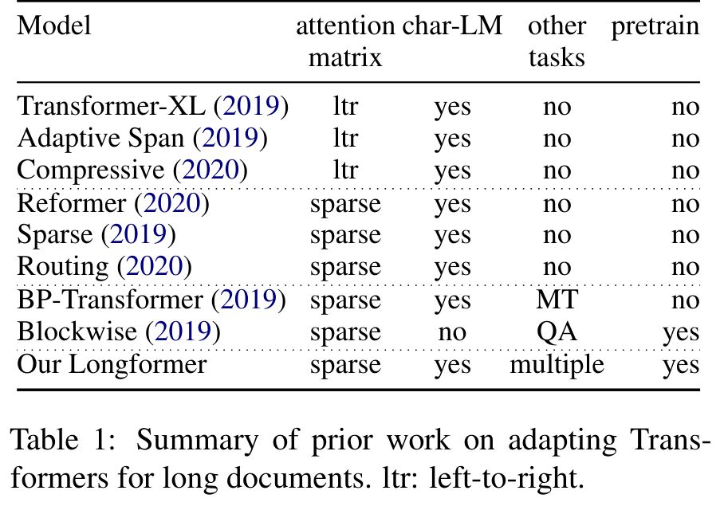</button><figcaption>Table 1 · Original Paper v2。点击放大；原 caption 已完整保留。</figcaption></figure></details>

**Table 1 深读。** 这张表是机制分类，不是 benchmark 排名。Sliding window 保留连续邻域；dilated window 以间隔采样远处；block/local 通过块限制连接；稀疏分解让多步连接覆盖更大区域；memory 路线把历史压成可复用状态。表里的复杂度必须连同窗口、块、memory 长度等隐含参数一起读。“线性”没有保证更低常数，也没有保证与 dense 模型等价。

**解读。** Transformer-XL 的 segment recurrence 能复用过去状态，但段间缓存不等价于一次双向联合编码全文。Sparse Transformer 已探索稀疏分解；Longformer 的辨识度在于局部连续窗口、任务 global hubs 与 RoBERTa 迁移的组合。ETC、BigBird 属于同年相关路线，详见文末按时间整理的对比。

## 3. Longformer：重新构建方法

### 3.1 Attention Pattern：窗口负责连续性，全局节点负责汇聚

<figure class="original-figure"><button type="button" data-zoom="assets/original/fig-02-attention-pattern.png" aria-label="放大 Figure 2">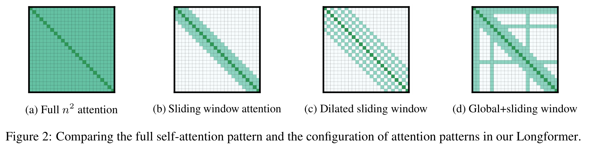</button><figcaption>Figure 2 · Original Paper v2。点击放大；原 caption 已完整保留。</figcaption></figure>

**Figure 2 的问题。** 它比较的是“允许计算哪些 query–key 对”，不是训练后 attention probability 的热力图。按左至右读 full、sliding、dilated、local + global；行对应 query，列对应 key。对角带表示附近连接，膨胀带表示按 stride 取邻居；global 的整行和整列分别表示它能读全文、全文能读它。[P Fig. 2]

**Components / Data flow。** 设序列长 `n`，总局部窗口宽 `w`，双向单侧半径 `r=w/2`。不计边界，普通 query 有 `w+1` 个 local key（包含自身），再加入 `g` 个 global key，并去重。global query 直接读所有 `n` 个 key。图中箭头可理解为上一层 key/value 的信息流向下一层 query 的输出。

**Key observation / Why it matters。** 固定 `w,g` 时，局部带和 global 行列只增加与 `n` 成正比的连接；但如果问题 token 很多、标题和句子标记也设为 global，`g` 会增加，成本不再是同一个常数。

**解读：两层中继。** 第 ℓ 层中，G 可以读到 A 在 ℓ−1 层的状态；B 在同一层读到的仍是 G 在 ℓ−1 层的状态。到 ℓ+1，B 才能读 G 刚汇聚的信息。“任意两点图距离很短”不等于“任意新信息在同一层即时到达”。

<section class="mechanism" id="attention-widget"><p class="reading-meta">AGENT-CREATED VISUALIZATION · TOPOLOGY, NOT PROBABILITIES</p><h3>滑动窗口与两层全局中继</h3><div class="controls"><label>模式<select id="pattern-mode"><option value="global">Local + global</option><option value="local">Local only</option><option value="dilated">Dilated only</option><option value="full">Full attention</option></select></label><label>序列长度 n<input id="pattern-n" type="range" min="16" max="64" step="16" value="32"><output id="pattern-n-out"></output></label><label>单侧窗口半径 r（总宽 w=2r）<input id="pattern-r" type="range" min="1" max="8" value="2"><output id="pattern-r-out"></output></label><label>膨胀间隔 d（Dilated 模式）<input id="pattern-d" type="range" min="1" max="4" value="2"><output id="pattern-d-out"></output></label><label>前 g 个位置设 global<input id="pattern-g" type="range" min="1" max="4" value="1"><output id="pattern-g-out"></output></label><label>源 token / 所选 query<input id="pattern-source" type="range" min="0" max="31" value="31"><output id="pattern-source-out"></output></label><label>同步传播层数<input id="pattern-layers" type="range" min="0" max="8" value="1"><output id="pattern-layers-out"></output></label></div><svg id="attention-svg" viewBox="0 0 580 590" role="img" aria-label="局部与全局 attention 连接矩阵和跨层可达位置"></svg><div class="readout" id="pattern-readout" aria-live="polite"></div><div class="actions"><button id="relay-preset">重置两层中继示例</button><button id="relay-step">推进一层</button></div><p class="hint">示例：n=16，r=1，g=1，源 token=15。第 1 层先抵达 global 0；第 2 层才到全文。没有自动播放；按按钮逐层观察。</p><noscript><p>JavaScript 已关闭：普通 token 15 的新信息第 1 层可到 global 0，第 2 层经 global 到其余普通 token。见下方静态架构图。</p></noscript></section>

**操作说明。** 蓝色是普通局部边，金色是 global 行列，浅色边框标出所选 query；下方 token 带显示指定源 token 的影响在若干层后可到达哪些位置。`d=1` 是普通窗口；`d>1` 只用于解释膨胀结构。纯膨胀邻居可能保留间隔，真实字符模型还混合不膨胀的 heads 和底层。这个图只演示结构上的可达性，不代表权重大小、实际利用证据或准确率。

### 核心公式：同一个 scaled dot-product，不同的允许集合

<div class="formula"><math xmlns="http://www.w3.org/1998/Math/MathML" display="block"><mrow><mi>Attention</mi><mo>(</mo><mi>Q</mi><mo>,</mo><mi>K</mi><mo>,</mo><mi>V</mi><mo>)</mo><mo>=</mo><mi>softmax</mi><mo>(</mo><mfrac><mrow><mi>Q</mi><msup><mi>K</mi><mi>T</mi></msup></mrow><msqrt><msub><mi>d</mi><mi>k</mi></msub></msqrt></mfrac><mo>)</mo><mi>V</mi></mrow></math><span class="equation-number">Original Paper · Eq. (1)</span><details><summary>可复制公式文本</summary><code>Attention(Q,K,V) = softmax(Q K^T / sqrt(d_k)) V</code></details></div>

**原公式 [P Eq. 1]。** `Q,K,V` 分别来自 hidden states 的线性投影；`d_k` 是每个 head 的 key / query 维度。令输入 `X∈R^(B×n×D)`，heads 数 `H`，`d_k=D/H`。每个投影 reshape 为 `B×H×n×d_k`；dense `QKᵀ` 是 `B×H×n×n`，沿 key 轴 softmax，再与 V 相乘，输出 `B×H×n×d_k`，合并 heads 后回到 `B×n×D`。

**逐步解释。** 点积衡量 query 与 key 的匹配；除以 `√d_k` 控制随维度增大的 logit 尺度；softmax 把允许的 key 归一化为权重；权重加权 V。Longformer 不先生成完整矩阵再遮罩，而是尽可能只算允许的带状和全局连接。

<div class="formula"><math xmlns="http://www.w3.org/1998/Math/MathML" display="block"><mrow><msub><mi>S</mi><mi>i</mi></msub><mo>=</mo><msub><mi>L</mi><mi>i</mi></msub><mo>∪</mo><mi>G</mi><mo>,</mo><mspace width="1em"/><msub><mi>y</mi><mi>i</mi></msub><mo>=</mo><munder><mo>∑</mo><mrow><mi>j</mi><mo>∈</mo><msub><mi>S</mi><mi>i</mi></msub></mrow></munder><mfrac><msup><mi>e</mi><msub><mi>s</mi><mrow><mi>i</mi><mi>j</mi></mrow></msub></msup><mrow><munder><mo>∑</mo><mrow><mi>k</mi><mo>∈</mo><msub><mi>S</mi><mi>i</mi></msub></mrow></munder><msup><mi>e</mi><msub><mi>s</mi><mrow><mi>i</mi><mi>k</mi></mrow></msub></msup></mrow></mfrac><msub><mi>v</mi><mi>j</mi></msub></mrow></math><code>S_i = L_i ∪ G; s_ij = q_i · k_j / √d_k; y_i = Σ(j∈S_i) [exp(s_ij)/Σ(k∈S_i)exp(s_ik)] v_j</code><span class="equation-number">Interpretation / derived sparse form · local and global keys share one softmax</span></div>

**符号与工程含义。** `G` 是 global 位置集合，`L_i` 是 query i 的 local 邻居，`S_i=L_i∪G`；对普通 query，global key 与 local key 共用一次 softmax，重叠位置只计一次。选择 global key 不代表普通 query 自动改用 global 投影：Hugging Face 路径中，普通 query 用 local Q/K/V；global query 使用单独的 `Q_g/K_g/V_g` 读全文，最后覆盖该位置原先的普通路径输出。[E HF 实现；推导]

**Toy example。** 若某普通 query 允许的 logits 是 `[0, ln 2, 0]`，softmax 是 `[1/4, 1/2, 1/4]`。若把中间 key 删除，剩余两个权重各为 `1/2`。删边既删除 V 的贡献，也改变保留 key 的归一化；因此不能认为结果等于 dense attention。

```python
# 解释性伪代码；逐 query 写法用于展示语义，不是高效 kernel。
# X: [B,n,D]; local/global projections: [B,H,n,dk]
for i in ordinary_positions:
    keys = sorted(set(local_neighbors(i)) | set(global_positions))
    logits = Q_local[i] @ K_local[keys].T / sqrt(dk)
    Y[i] = softmax(logits, axis=-1) @ V_local[keys]
for i in global_positions:
    logits = Q_global[i] @ K_global.T / sqrt(dk)
    Y[i] = softmax(logits, axis=-1) @ V_global
return output_projection(concat_heads(Y))
```

**输入 / 输出 / 架构。** Token IDs、padding mask、global mask 和 position IDs 进入 embedding；每层稀疏 self-attention、residual / normalization、FFN 更新 hidden states。MLM head 预测被 mask token；classification head 读分类位置；QA head 预测候选或答案 span。输出类型由任务 head 决定，不是通用文本生成器。

<figure class="generated-figure"><svg xmlns="http://www.w3.org/2000/svg" viewBox="0 0 780 325" role="img" aria-label="Longformer 的输入、双投影路径与任务输出"><rect x="35" y="15" width="710" height="66" rx="7" fill="#182335" stroke="#49617f"/><text x="55" y="40">Token IDs + padding/global masks</text><text x="55" y="63" style="font-size:12px;fill:#9fb1c9">B×n → Embedding / absolute positions → B×n×D</text><path d="M390 81v25m-5 -6l5 6 5 -6"/><rect x="35" y="110" width="710" height="66" rx="7" fill="#182335" stroke="#49617f"/><text x="55" y="135">每层 local Q/K/V + global Qg/Kg/Vg</text><text x="55" y="158" style="font-size:12px;fill:#9fb1c9">Ordinary: local ∪ global keys → shared softmax; global query: all keys</text><path d="M390 176v25m-5 -6l5 6 5 -6"/><rect x="35" y="205" width="710" height="66" rx="7" fill="#182335" stroke="#49617f"/><text x="55" y="230">Residual / Norm → FFN → task head</text><text x="55" y="253" style="font-size:12px;fill:#9fb1c9">MLM / candidate / span / classification loss; encoder output B×n×D</text></svg><figcaption>Longformer 的输入、双投影路径与任务输出 · Agent-created Simplified Diagram。[<a href="assets/generated/pipeline.mmd">Mermaid source</a>]</figcaption></figure>

**复杂度 / 内存。** Attention 点积与 V 汇聚约为 `O(B n(w+g)D)`；projection 和 FFN 仍有 `O(B nD²)` 项。局部 score buffer 约 `B H n(w+1)`，global 读写另有约 `B H ng`；分块 kernel 会分配冗余区和中间 buffer。公式估算 score 元素不能当作完整峰值显存，训练还要存反向激活、参数、梯度和 optimizer states。

### 3.2 Implementation：稀疏连接与 GPU 矩阵乘法之间的妥协

<figure class="original-figure"><button type="button" data-zoom="assets/original/fig-01-runtime-memory.png" aria-label="放大 Figure 1">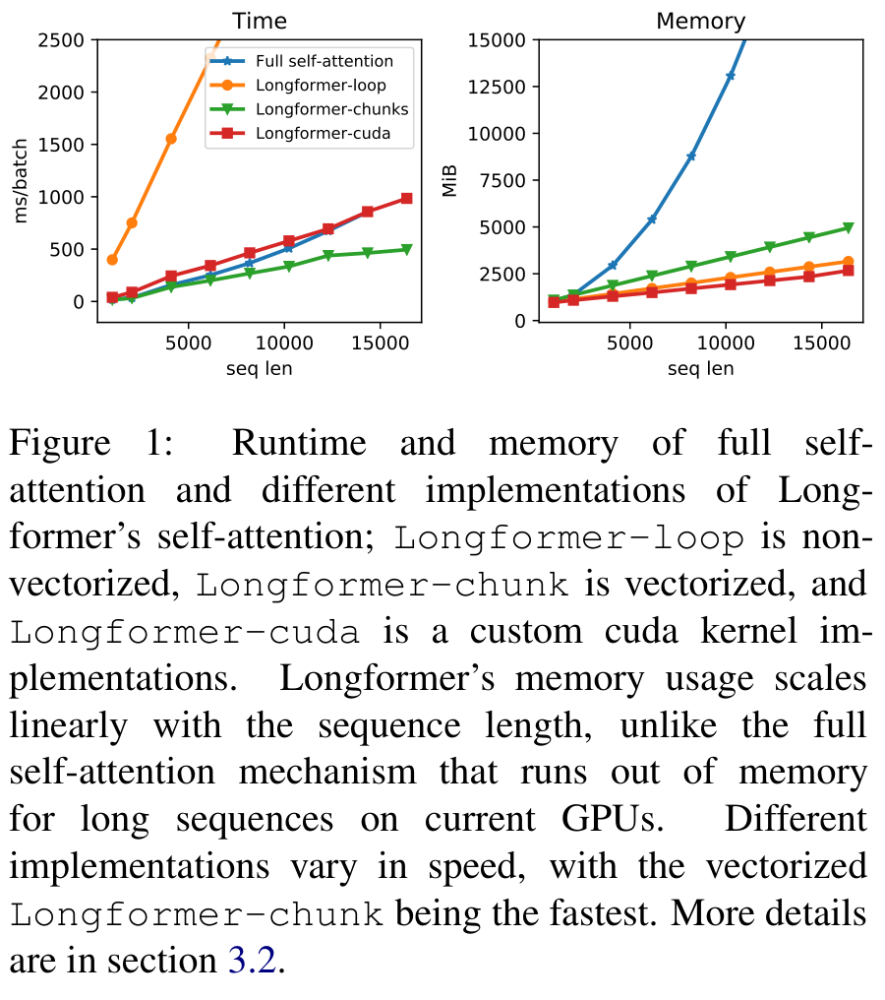</button><figcaption>Figure 1 · Original Paper v2。点击放大；原 caption 已完整保留。</figcaption></figure>

**Figure 1 的问题 / 读法。** 左图读 runtime，单位 **ms / batch**；右图读 memory，单位 **MiB**。横轴是序列长度，分别比较 full、loop、overlapping chunks、TVM 的 diagonaled kernel 和 non-overlapping local-chunks。先看是否随长度扩展，再看同长度的曲线差异。[P Fig. 1、§3.2、附录 A]

**Components / Data flow。** Python loop 逐位置处理窗口，算术规模降低却产生很多小操作。Overlapping chunks 把 Q/K 切成重叠块，以 dense GEMM 求块内 score，再转换成对角布局；它会计算一部分最后被 mask 的元素。TVM 自定义 kernel 直接计算对角带，支持 dilation。Local-chunks 避免块重叠，但相应连接形状有细微差别，不是同一 mask 的纯实现替换。

**Key observation。** 图中 local-chunks 最快；TVM 更节省内存，速度不自动胜过 GEMM 分块。作者选择 PyTorch overlapping-chunks 为 fine-tuning 提供更方便的路径，字符 causal / dilation 设置则需要相应支持的实现。

**Why it matters / 解读。** GPU 时间受矩阵形状、启动次数、layout 转换和带宽影响。需要逐 op 测量 QKV projection → chunk / gather → QK → mask / softmax → PV → scatter → output projection，而不能仅按稀疏率推算速度。论文没有提供可直接迁移到 H100/H200 的完整 kernel 对比协议；这里不从图上编造精确点值，也不把它当成 FlashAttention 的实测对照。

## 4. Autoregressive Language Modeling：先隔离稀疏连接的表达能力

### 4.1 Pattern：这个实验不是发布 encoder 的同一个设置

字符 LM 采用 causal 窗口，不能读未来；底层较小窗口，上层更宽，部分上层 heads 使用 dilation。它**不使用任务 global hubs**，使用 Transformer-XL 代码但关闭 recurrence，并采用相对正弦位置表示。[P §4.1–4.2]

在未膨胀、无 global 情况下，一层只能传播附近信息，L 层才把感受野扩到约 `L×w` 的量级；dilation 用更远间隔换覆盖范围。因果窗口的具体单侧宽度不能直接套用双向 encoder 的 `w/2`。

### 4.2 Setup：BPC、预算、硬件和精度

text8 / enwik8 是字符预测，使用 bits per character（BPC，**越低越好**），相当于以 2 为底的平均负 log likelihood。Small 是 12 层、41M 参数；large 是 30 层、102M；hidden size 512，8 heads。使用多阶段训练，序列和窗口随阶段增加。[P §4.2、附录 B]

硬件为 48GB RTX 8000：small 用 4 卡约 16 天，large 用 8 卡约 13 天。Mixed precision 中 attention 保持 FP32，因为后期 FP16 attention 发生 overflow / NaN。由此不能把该实验的内存曲线解释成全 FP16 的生产配置。

### 4.2.1 Results：小模型竞争力，不是全体 BPC 最优

<div class="table-scroll original-table" role="region" tabindex="0" aria-label="原论文 Table 2 完整重排"><table class="ltx_tabular ltx_centering ltx_guessed_headers ltx_align_middle">
<tbody class="ltx_tbody">
<tr class="ltx_tr">
<th class="ltx_td ltx_align_left ltx_th ltx_th_row ltx_border_tt">Model</th>
<td class="ltx_td ltx_align_right ltx_border_tt">#Param</td>
<td class="ltx_td ltx_align_right ltx_border_tt">Dev</td>
<td class="ltx_td ltx_nopad_r ltx_align_right ltx_border_tt">Test</td></tr>
<tr class="ltx_tr">
<th class="ltx_td ltx_align_left ltx_th ltx_th_row ltx_border_t"><span class="ltx_text ltx_font_bold">Dataset</span> <span class="ltx_text ltx_font_typewriter">text8</span></th>
<td class="ltx_td ltx_border_t"></td>
<td class="ltx_td ltx_border_t"></td>
<td class="ltx_td ltx_nopad_r ltx_border_t"></td></tr>
<tr class="ltx_tr">
<th class="ltx_td ltx_align_left ltx_th ltx_th_row">T12 <cite class="ltx_cite ltx_citemacro_cite"><a class="ltx_ref" href="https://arxiv.org/html/2004.05150v2#bib.bib2" title="">Al-Rfou et al. (2018)</a></cite></th>
<td class="ltx_td ltx_align_right">44M</td>
<td class="ltx_td ltx_align_right">-</td>
<td class="ltx_td ltx_nopad_r ltx_align_right">1.18</td></tr>
<tr class="ltx_tr">
<th class="ltx_td ltx_align_left ltx_th ltx_th_row">Adaptive <cite class="ltx_cite ltx_citemacro_cite"><a class="ltx_ref" href="https://arxiv.org/html/2004.05150v2#bib.bib44" title="">Sukhbaatar et al. (2019)</a></cite></th>
<td class="ltx_td ltx_align_right">38M</td>
<td class="ltx_td ltx_align_right">1.05</td>
<td class="ltx_td ltx_nopad_r ltx_align_right">1.11</td></tr>
<tr class="ltx_tr">
<th class="ltx_td ltx_align_left ltx_th ltx_th_row">BP-Transformer <cite class="ltx_cite ltx_citemacro_cite"><a class="ltx_ref" href="https://arxiv.org/html/2004.05150v2#bib.bib55" title="">Ye et al. (2019)</a></cite></th>
<td class="ltx_td ltx_align_right">39M</td>
<td class="ltx_td ltx_align_right">-</td>
<td class="ltx_td ltx_nopad_r ltx_align_right">1.11</td></tr>
<tr class="ltx_tr">
<th class="ltx_td ltx_align_left ltx_th ltx_th_row" style="padding-bottom: 2.58334pt;">Our Longformer</th>
<td class="ltx_td ltx_align_right" style="padding-bottom: 2.58334pt;">41M</td>
<td class="ltx_td ltx_align_right" style="padding-bottom: 2.58334pt;">1.04</td>
<td class="ltx_td ltx_nopad_r ltx_align_right" style="padding-bottom: 2.58334pt;"><span class="ltx_text ltx_font_bold">1.10</span></td></tr>
<tr class="ltx_tr">
<th class="ltx_td ltx_align_left ltx_th ltx_th_row ltx_border_t">[0.2pt/0.2pt]
<span class="ltx_text ltx_font_bold">Dataset</span> <span class="ltx_text ltx_font_typewriter">enwik8</span></th>
<td class="ltx_td ltx_border_t"></td>
<td class="ltx_td ltx_border_t"></td>
<td class="ltx_td ltx_border_t"></td></tr>
<tr class="ltx_tr">
<th class="ltx_td ltx_align_left ltx_th ltx_th_row">T12 <cite class="ltx_cite ltx_citemacro_cite"><a class="ltx_ref" href="https://arxiv.org/html/2004.05150v2#bib.bib2" title="">Al-Rfou et al. (2018)</a></cite></th>
<td class="ltx_td ltx_align_right">44M</td>
<td class="ltx_td ltx_align_right">-</td>
<td class="ltx_td ltx_nopad_r ltx_align_right">1.11</td></tr>
<tr class="ltx_tr">
<th class="ltx_td ltx_align_left ltx_th ltx_th_row">Transformer-XL <cite class="ltx_cite ltx_citemacro_cite"><a class="ltx_ref" href="https://arxiv.org/html/2004.05150v2#bib.bib12" title="">Dai et al. (2019)</a></cite></th>
<td class="ltx_td ltx_align_right">41M</td>
<td class="ltx_td ltx_align_right">-</td>
<td class="ltx_td ltx_nopad_r ltx_align_right">1.06</td></tr>
<tr class="ltx_tr">
<th class="ltx_td ltx_align_left ltx_th ltx_th_row">Reformer <cite class="ltx_cite ltx_citemacro_cite"><a class="ltx_ref" href="https://arxiv.org/html/2004.05150v2#bib.bib26" title="">Kitaev et al. (2020)</a></cite></th>
<td class="ltx_td ltx_align_right">-</td>
<td class="ltx_td ltx_align_right">-</td>
<td class="ltx_td ltx_nopad_r ltx_align_right">1.05</td></tr>
<tr class="ltx_tr">
<th class="ltx_td ltx_align_left ltx_th ltx_th_row">Adaptive <cite class="ltx_cite ltx_citemacro_cite"><a class="ltx_ref" href="https://arxiv.org/html/2004.05150v2#bib.bib44" title="">Sukhbaatar et al. (2019)</a></cite></th>
<td class="ltx_td ltx_align_right">39M</td>
<td class="ltx_td ltx_align_right">1.04</td>
<td class="ltx_td ltx_nopad_r ltx_align_right">1.02</td></tr>
<tr class="ltx_tr">
<th class="ltx_td ltx_align_left ltx_th ltx_th_row">BP-Transformer <cite class="ltx_cite ltx_citemacro_cite"><a class="ltx_ref" href="https://arxiv.org/html/2004.05150v2#bib.bib55" title="">Ye et al. (2019)</a></cite></th>
<td class="ltx_td ltx_align_right">38M</td>
<td class="ltx_td ltx_align_right">-</td>
<td class="ltx_td ltx_nopad_r ltx_align_right">1.02</td></tr>
<tr class="ltx_tr">
<th class="ltx_td ltx_align_left ltx_th ltx_th_row ltx_border_bb">Our Longformer</th>
<td class="ltx_td ltx_align_right ltx_border_bb">41M</td>
<td class="ltx_td ltx_align_right ltx_border_bb">1.02</td>
<td class="ltx_td ltx_nopad_r ltx_align_right ltx_border_bb"><span class="ltx_text ltx_font_bold">1.00</span></td></tr>
</tbody>
</table></div><details><summary>Table 2 原始截图、caption 与排版（核对用）</summary><figure class="original-figure"><button type="button" data-zoom="assets/original/table-02-small-char-lm.png" aria-label="放大 Table 2">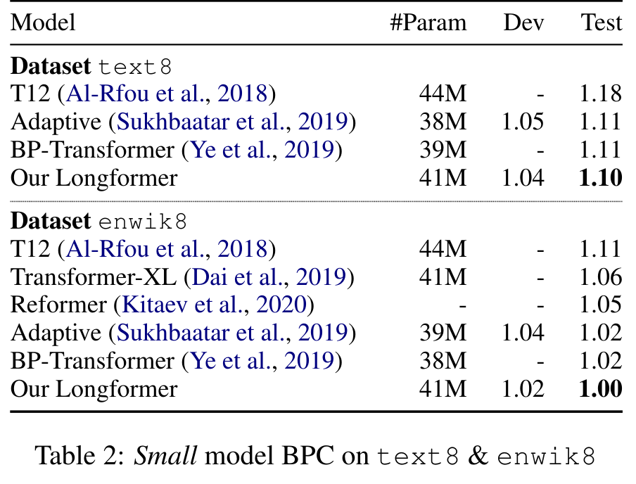</button><figcaption>Table 2 · Original Paper v2。点击放大；原 caption 已完整保留。</figcaption></figure></details>

**Table 2。** 同类 small 规模下，Longformer text8 test BPC **1.10**，最佳此前 small 为 1.11，下降 0.01（相对约 0.90%）；enwik8 **1.00** 对 1.02，下降 0.02（约 1.96%）。这些是 BPC 的相对变化，不是 accuracy 上升。参数、数据处理和训练预算并未逐项完全相等；不能据此推导单位 GPU-hour 的优势。

<div class="table-scroll original-table" role="region" tabindex="0" aria-label="原论文 Table 3 完整重排"><table class="ltx_tabular ltx_centering ltx_guessed_headers ltx_align_middle">
<thead class="ltx_thead">
<tr class="ltx_tr">
<th class="ltx_td ltx_align_left ltx_th ltx_th_column ltx_th_row ltx_border_tt">Model</th>
<th class="ltx_td ltx_align_right ltx_th ltx_th_column ltx_border_tt">#Param</th>
<th class="ltx_td ltx_align_right ltx_th ltx_th_column ltx_border_tt">Test BPC</th></tr>
</thead>
<tbody class="ltx_tbody">
<tr class="ltx_tr">
<th class="ltx_td ltx_align_left ltx_th ltx_th_row ltx_border_t">Transformer-XL (18 layers)</th>
<td class="ltx_td ltx_align_right ltx_border_t">88M</td>
<td class="ltx_td ltx_align_right ltx_border_t">1.03</td></tr>
<tr class="ltx_tr">
<th class="ltx_td ltx_align_left ltx_th ltx_th_row">Sparse <cite class="ltx_cite ltx_citemacro_cite"><a class="ltx_ref" href="https://arxiv.org/html/2004.05150v2#bib.bib7" title="">Child et al. (2019)</a></cite></th>
<td class="ltx_td ltx_align_right"><math alttext="\approx" class="ltx_Math" intent=":literal"><semantics><mo>≈</mo></semantics></math>100M</td>
<td class="ltx_td ltx_align_right">0.99</td></tr>
<tr class="ltx_tr">
<th class="ltx_td ltx_align_left ltx_th ltx_th_row">Transformer-XL (24 layers)</th>
<td class="ltx_td ltx_align_right">277M</td>
<td class="ltx_td ltx_align_right">0.99</td></tr>
<tr class="ltx_tr">
<th class="ltx_td ltx_align_left ltx_th ltx_th_row">Adaptive <cite class="ltx_cite ltx_citemacro_cite"><a class="ltx_ref" href="https://arxiv.org/html/2004.05150v2#bib.bib44" title="">Sukhbaatar et al. (2019)</a></cite></th>
<td class="ltx_td ltx_align_right">209M</td>
<td class="ltx_td ltx_align_right">0.98</td></tr>
<tr class="ltx_tr">
<th class="ltx_td ltx_align_left ltx_th ltx_th_row">Compressive <cite class="ltx_cite ltx_citemacro_cite"><a class="ltx_ref" href="https://arxiv.org/html/2004.05150v2#bib.bib39" title="">Rae et al. (2020)</a></cite></th>
<td class="ltx_td ltx_align_right">277M</td>
<td class="ltx_td ltx_align_right">0.97</td></tr>
<tr class="ltx_tr">
<th class="ltx_td ltx_align_left ltx_th ltx_th_row">Routing <cite class="ltx_cite ltx_citemacro_cite"><a class="ltx_ref" href="https://arxiv.org/html/2004.05150v2#bib.bib41" title="">Roy et al. (2020)</a></cite></th>
<td class="ltx_td ltx_align_right"><math alttext="\approx" class="ltx_Math" intent=":literal"><semantics><mo>≈</mo></semantics></math>223M</td>
<td class="ltx_td ltx_align_right">0.99</td></tr>
<tr class="ltx_tr">
<th class="ltx_td ltx_align_left ltx_th ltx_th_row ltx_border_bb">Our Longformer</th>
<td class="ltx_td ltx_align_right ltx_border_bb">102M</td>
<td class="ltx_td ltx_align_right ltx_border_bb">0.99</td></tr>
</tbody>
</table></div><details><summary>Table 3 原始截图、caption 与排版（核对用）</summary><figure class="original-figure"><button type="button" data-zoom="assets/original/table-03-large-char-lm.png" aria-label="放大 Table 3">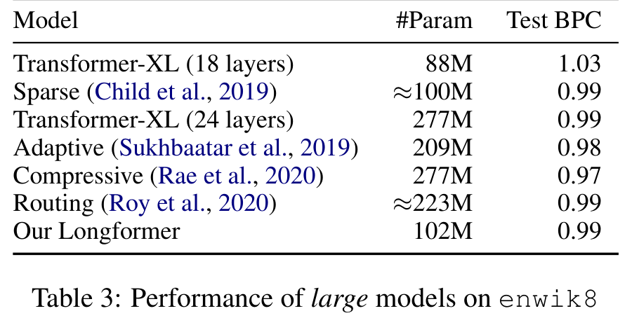</button><figcaption>Table 3 · Original Paper v2。点击放大；原 caption 已完整保留。</figcaption></figure></details>

**Table 3。** Large Longformer 102M 在 enwik8 的 BPC 为 **0.99**；Compressive Transformer 277M 为 **0.97**，仍低 0.02。它说明稀疏模型能在较少参数下达到接近的字符建模质量，不能称“所有规模整体 SOTA”。论文没有统一复训全部 baseline，内存与时长也没有构成完整同预算排名。

### 4.2.2 Ablations：阶段性实验能支持多强的因果结论？

<div class="table-scroll original-table" role="region" tabindex="0" aria-label="原论文 Table 4 完整重排"><table class="ltx_tabular ltx_centering ltx_guessed_headers ltx_align_middle">
<thead class="ltx_thead">
<tr class="ltx_tr">
<th class="ltx_td ltx_align_left ltx_th ltx_th_column ltx_th_row ltx_border_tt">Model</th>
<th class="ltx_td ltx_nopad_r ltx_align_right ltx_th ltx_th_column ltx_border_tt">Dev BPC</th></tr>
</thead>
<tbody class="ltx_tbody">
<tr class="ltx_tr">
<th class="ltx_td ltx_align_left ltx_th ltx_th_row ltx_border_t">Decreasing <math alttext="w" class="ltx_Math" intent=":literal"><semantics><mi>w</mi></semantics></math> (from 512 to 32)</th>
<td class="ltx_td ltx_nopad_r ltx_align_right ltx_border_t">1.24</td></tr>
<tr class="ltx_tr">
<th class="ltx_td ltx_align_left ltx_th ltx_th_row">Fixed <math alttext="w" class="ltx_Math" intent=":literal"><semantics><mi>w</mi></semantics></math> (= 230)</th>
<td class="ltx_td ltx_nopad_r ltx_align_right">1.23</td></tr>
<tr class="ltx_tr">
<th class="ltx_td ltx_align_left ltx_th ltx_th_row">Increasing <math alttext="w" class="ltx_Math" intent=":literal"><semantics><mi>w</mi></semantics></math> (from 32 to 512)</th>
<td class="ltx_td ltx_nopad_r ltx_align_right"><span class="ltx_text ltx_font_bold">1.21</span></td></tr>
<tr class="ltx_tr">
<th class="ltx_td ltx_align_left ltx_th ltx_th_row ltx_border_t">No Dilation</th>
<td class="ltx_td ltx_nopad_r ltx_align_right ltx_border_t">1.21</td></tr>
<tr class="ltx_tr">
<th class="ltx_td ltx_align_left ltx_th ltx_th_row ltx_border_bb">Dilation on 2 heads</th>
<td class="ltx_td ltx_nopad_r ltx_align_right ltx_border_bb"><span class="ltx_text ltx_font_bold">1.20</span></td></tr>
</tbody>
</table></div><details><summary>Table 4 原始截图、caption 与排版（核对用）</summary><figure class="original-figure"><button type="button" data-zoom="assets/original/table-04-char-ablation.png" aria-label="放大 Table 4">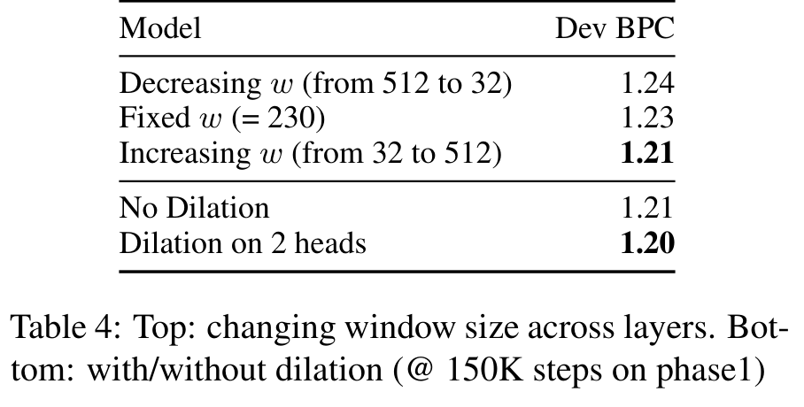</button><figcaption>Table 4 · Original Paper v2。点击放大；原 caption 已完整保留。</figcaption></figure></details>

**Table 4。** 只在 phase 1、150K 更新的 text8 dev BPC 比较：窗口递减 1.24、固定 1.23、递增 1.21；固定其他设置后，无 dilation 1.21、2 heads dilation 1.20。递增比递减降低 0.03（约 2.42%），dilation 降低 0.01（约 0.83%）。作者明确说中途顺序可能不等于完整训练后的顺序。它支持这套训练阶段中的设计方向，尚不能证明任意 task / depth 都应采用相同 schedule。

## 5. Pretraining and Finetuning：把 RoBERTa 迁移到 4096 token

### 初始化：为什么复制位置比随机扩展更稳？

Longformer-base / large 继承 RoBERTa weights。Self-attention 的 local 和 global Q/K/V 分别用已有投影初始化；将原有绝对 position embedding 重复复制到更长位置，再继续 MLM 训练。发布 base 是 12 层、D=768、H=12、FFN=3072；large 是 24 层、D=1024、H=16、FFN=4096。配置 `max_position_embeddings=4098` 包含 RoBERTa offset，实际可用输入容量为 4096。[P §5；E HF config]

复制让新位置从旧分布起步，而非随机干扰整个网络；代价是初始位置表示具有重复性。继续训练能区分重复位置；它没有从数学上赋予无限长度外推能力。

<div class="table-scroll original-table" role="region" tabindex="0" aria-label="原论文 Table 5 完整重排"><table class="ltx_tabular ltx_centering ltx_guessed_headers ltx_align_middle">
<thead class="ltx_thead">
<tr class="ltx_tr">
<th class="ltx_td ltx_align_left ltx_th ltx_th_column ltx_border_tt">Model</th>
<th class="ltx_td ltx_align_right ltx_th ltx_th_column ltx_border_tt">base</th>
<th class="ltx_td ltx_nopad_r ltx_align_right ltx_th ltx_th_column ltx_border_tt">large</th></tr>
</thead>
<tbody class="ltx_tbody">
<tr class="ltx_tr">
<td class="ltx_td ltx_align_left ltx_border_t">RoBERTa (seqlen: 512)</td>
<td class="ltx_td ltx_align_right ltx_border_t">1.846</td>
<td class="ltx_td ltx_nopad_r ltx_align_right ltx_border_t">1.496</td></tr>
<tr class="ltx_tr">
<td class="ltx_td ltx_align_left">Longformer (seqlen: 4,096)</td>
<td class="ltx_td ltx_align_right">10.299</td>
<td class="ltx_td ltx_nopad_r ltx_align_right">8.738</td></tr>
<tr class="ltx_tr">
<td class="ltx_td ltx_align_left">      + copy position embeddings</td>
<td class="ltx_td ltx_align_right">1.957</td>
<td class="ltx_td ltx_nopad_r ltx_align_right">1.597</td></tr>
<tr class="ltx_tr">
<td class="ltx_td ltx_align_left">         + 2K gradient updates</td>
<td class="ltx_td ltx_align_right">1.753</td>
<td class="ltx_td ltx_nopad_r ltx_align_right">1.414</td></tr>
<tr class="ltx_tr">
<td class="ltx_td ltx_align_left">         + 65K gradient updates</td>
<td class="ltx_td ltx_align_right">1.705</td>
<td class="ltx_td ltx_nopad_r ltx_align_right">1.358</td></tr>
<tr class="ltx_tr">
<td class="ltx_td ltx_align_left ltx_border_bb">Longformer (train extra pos. embed. only)</td>
<td class="ltx_td ltx_align_right ltx_border_bb">1.850</td>
<td class="ltx_td ltx_nopad_r ltx_align_right ltx_border_bb">1.504</td></tr>
</tbody>
</table></div><details><summary>Table 5 原始截图、caption 与排版（核对用）</summary><figure class="original-figure"><button type="button" data-zoom="assets/original/table-05-mlm-initialization.png" aria-label="放大 Table 5">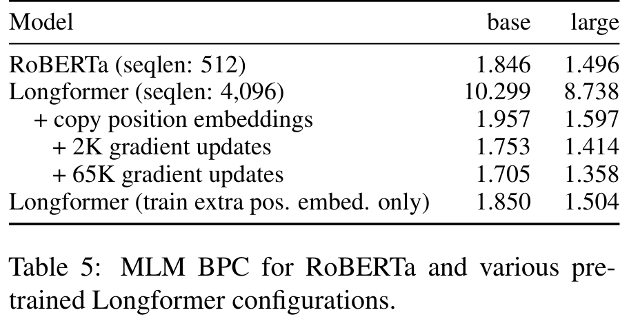</button><figcaption>Table 5 · Original Paper v2。点击放大；原 caption 已完整保留。</figcaption></figure></details>

**Table 5。** 这是 MLM evaluation BPC。Base 随机扩展 **10.299**，复制 **1.957**，2K 更新 **1.753**，65K **1.705**；large 为 **8.738 / 1.597 / 1.414 / 1.358**。复制后冻结旧参数、只训练新位置的结果 base **1.850**、large **1.504**，弱于完整继续训练。原 RoBERTa base **1.846**、large **1.496**；由于评估上下文不同，不能把这列当作严格同输入条件的模型质量比较。

### Training pipeline / Loss / Optimizer

继续训练使用 MLM：只在被选中的预测位置计算词表交叉熵；这不是 causal next-token objective。序列 4096，attention window 512，65K updates，batch 64，最大 LR `3e-5`，warmup 500，power=3 polynomial decay，fairseq 实现，其余 optimizer / 正则等超参继承 RoBERTa，原文未在此逐项重列。[P §5、附录 C]

**迁移的反例。** §5 脚注明确说：像字符 LM 那样给少数 heads 加 dilation，反而损害迁移性能，作者认为它与 RoBERTa 已学到的局部结构不兼容，可能需要从头训练。因此字符实验支持 dilation，不等于 RoBERTa 迁移也应保留 dilation。

**推导。** 每步 `4096×64=262,144` 个 token 位置，65K 步累计 **17.03936B token positions**。这是训练曝光量，包含重访和可能的 padding，不能称新增独立语料大小。附录 C 的 corpus 总量是 6.5B tokens，二者不是同一口径。

**Inference pipeline。** Tokenize / pad 到适合 window 的长度 → 设置 local / global mask → 一次 bidirectional encoder forward → task head。Padding mask 与 global mask 是不同含义；不能把 padding token 设成 global。某些实现的 window divisibility 和返回 attention tensor 布局需按版本核对。

**工程边界。** 标准 encoder-only Longformer 不逐 token decode，因此没有 decoder 式持续增长的 autoregressive KV cache。长输入主要关注 activation、score buffer、mask/gather、FFN 与输出 head 的成本。

## 6. Tasks：长上下文如何落到具体任务？

<div class="table-scroll original-table" role="region" tabindex="0" aria-label="原论文 Table 6 完整重排"><table class="ltx_tabular ltx_centering ltx_guessed_headers ltx_align_middle">
<thead class="ltx_thead">
<tr class="ltx_tr">
<th class="ltx_td ltx_align_left ltx_th ltx_th_column ltx_border_tt" style="padding-left:3.0pt;padding-right:3.0pt;">Wordpieces</th>
<th class="ltx_td ltx_align_right ltx_th ltx_th_column ltx_border_tt" style="padding-left:3.0pt;padding-right:3.0pt;">WH</th>
<th class="ltx_td ltx_align_right ltx_th ltx_th_column ltx_border_tt" style="padding-left:3.0pt;padding-right:3.0pt;">TQA</th>
<th class="ltx_td ltx_align_right ltx_th ltx_th_column ltx_border_tt" style="padding-left:3.0pt;padding-right:3.0pt;">HQA</th>
<th class="ltx_td ltx_align_right ltx_th ltx_th_column ltx_border_tt" style="padding-left:3.0pt;padding-right:3.0pt;">ON</th>
<th class="ltx_td ltx_align_right ltx_th ltx_th_column ltx_border_tt" style="padding-left:3.0pt;padding-right:3.0pt;">IMDB</th>
<th class="ltx_td ltx_nopad_r ltx_align_right ltx_th ltx_th_column ltx_border_tt" style="padding-left:3.0pt;padding-right:3.0pt;">HY</th></tr>
</thead>
<tbody class="ltx_tbody">
<tr class="ltx_tr">
<td class="ltx_td ltx_align_left ltx_border_t" style="padding-left:3.0pt;padding-right:3.0pt;">avg.</td>
<td class="ltx_td ltx_align_right ltx_border_t" style="padding-left:3.0pt;padding-right:3.0pt;">1,535</td>
<td class="ltx_td ltx_align_right ltx_border_t" style="padding-left:3.0pt;padding-right:3.0pt;">6,589</td>
<td class="ltx_td ltx_align_right ltx_border_t" style="padding-left:3.0pt;padding-right:3.0pt;">1,316</td>
<td class="ltx_td ltx_align_right ltx_border_t" style="padding-left:3.0pt;padding-right:3.0pt;">506</td>
<td class="ltx_td ltx_align_right ltx_border_t" style="padding-left:3.0pt;padding-right:3.0pt;">300</td>
<td class="ltx_td ltx_nopad_r ltx_align_right ltx_border_t" style="padding-left:3.0pt;padding-right:3.0pt;">705</td></tr>
<tr class="ltx_tr">
<td class="ltx_td ltx_align_left ltx_border_bb" style="padding-left:3.0pt;padding-right:3.0pt;">95th pctl.</td>
<td class="ltx_td ltx_align_right ltx_border_bb" style="padding-left:3.0pt;padding-right:3.0pt;">3,627</td>
<td class="ltx_td ltx_align_right ltx_border_bb" style="padding-left:3.0pt;padding-right:3.0pt;">17,126</td>
<td class="ltx_td ltx_align_right ltx_border_bb" style="padding-left:3.0pt;padding-right:3.0pt;">1,889</td>
<td class="ltx_td ltx_align_right ltx_border_bb" style="padding-left:3.0pt;padding-right:3.0pt;">1,147</td>
<td class="ltx_td ltx_align_right ltx_border_bb" style="padding-left:3.0pt;padding-right:3.0pt;">705</td>
<td class="ltx_td ltx_nopad_r ltx_align_right ltx_border_bb" style="padding-left:3.0pt;padding-right:3.0pt;">1,975</td></tr>
</tbody>
</table></div><details><summary>Table 6 原始截图、caption 与排版（核对用）</summary><figure class="original-figure"><button type="button" data-zoom="assets/original/table-06-dataset-lengths.png" aria-label="放大 Table 6">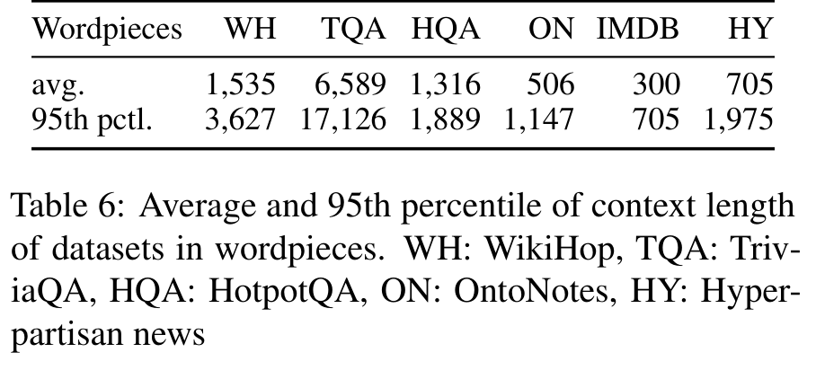</button><figcaption>Table 6 · Original Paper v2。点击放大；原 caption 已完整保留。</figcaption></figure></details>

**Table 6。** 这张表描述数据长度分布，不是结果。平均值会掩盖长尾，95th percentile 与模型最大输入长度要一起看。TriviaQA 平均 6,589 token、p95 17,126，却在本文设置下截断到 4096。支持“长序列”不等于本实验读到了每篇样本的全文。

### 6.1 Question Answering：global mask 是任务设计的一部分

**WikiHop。** 输入组合问题、候选与 supporting documents，把问题 / 候选相关位置指定为 global，从候选表示进行分类；指标是候选选择 **accuracy**。Base 对超过 4096 的文本仍分块，large 因显存只用前 4096。[P §6.1、附录 D]

**TriviaQA。** 阅读问题和文档，span head 预测起止；训练只取前 4096。长尾证据可能在输入外，因此 max context 本身也是 recall 上限之一。

**HotpotQA。** v2 不是把全部段落直接送进 encoder：先选段，保留 raw score > −3 的至多 5 段，再在 question、title、sentence 标记上设 global，联合预测答案和 supporting facts；解码阶段恰选两段证据。两阶段相较单阶段约增加 4.2 个 joint dev F1 点。[P 附录 D]

**解读。** Question tokens 作为全局入口很自然，但大量句子标记 global 化会增大 `g`；段落选择能降低 n，却引入前置召回损失。部署时应该分别记录 selector recall、span quality、支持事实质量和链路时延。

### 6.2 Coreference Resolution：大窗口与跨框架桥接

OntoNotes 使用 span-based coreference 模型，仍做不重叠文档 segmentation；RoBERTa 输入段 384，Longformer 4096。作者将 PyTorch GPU hidden states 拷到 CPU，再交给 TensorFlow GPU 的上层 coreference 模型，反向也桥接梯度。[P §6.2、附录 D]

“Overhead minimal”没有量化拆分。对生产系统应测 GPU→CPU→GPU 的同步、传输、临时 buffer 与 callback 生命周期；更长段并不必然抵消跨框架成本。

### 6.3 Document Classification：小数据收益应如何读？

IMDB 是影评情感分类；Hyperpartisan 是新闻立场分类。分类位置设 global 以读全文。Hyperpartisan 只有 645 篇文档，随机 80/10/10，报告 5 seeds 的均值 F1。[P §6.3、附录 D]

论文没有公开逐样本预测或 confusion matrix，不能反推出 TP、FP、TN、FN，也不能将 accuracy 和 F1 混用。若复现，应同时给出这四个计数及 accuracy / precision / recall / F1，并报告 seed 方差与分割方式。

### 6.4 Results：分开读开发集和有日期的测试榜单

<div class="table-scroll original-table" role="region" tabindex="0" aria-label="原论文 Table 7 完整重排"><table class="ltx_tabular ltx_centering ltx_guessed_headers ltx_align_middle">
<thead class="ltx_thead">
<tr class="ltx_tr">
<th class="ltx_td ltx_th ltx_th_row ltx_border_tt"></th>
<th class="ltx_td ltx_align_center ltx_th ltx_th_column ltx_border_tt" colspan="3">QA</th>
<th class="ltx_td ltx_align_center ltx_th ltx_th_column ltx_border_tt">Coref.</th>
<th class="ltx_td ltx_align_center ltx_th ltx_th_column ltx_border_tt" colspan="2">Classification</th></tr>
<tr class="ltx_tr">
<th class="ltx_td ltx_align_left ltx_th ltx_th_column ltx_th_row">Model</th>
<th class="ltx_td ltx_align_right ltx_th ltx_th_column ltx_border_t">WikiHop</th>
<th class="ltx_td ltx_align_right ltx_th ltx_th_column ltx_border_t">TriviaQA</th>
<th class="ltx_td ltx_align_right ltx_th ltx_th_column ltx_border_t">HotpotQA</th>
<th class="ltx_td ltx_align_right ltx_th ltx_th_column ltx_border_t">OntoNotes</th>
<th class="ltx_td ltx_align_right ltx_th ltx_th_column ltx_border_t">IMDB</th>
<th class="ltx_td ltx_nopad_r ltx_align_right ltx_th ltx_th_column ltx_border_t">Hyperpartisan</th></tr>
</thead>
<tbody class="ltx_tbody">
<tr class="ltx_tr">
<th class="ltx_td ltx_align_left ltx_th ltx_th_row ltx_border_t">RoBERTa-base</th>
<td class="ltx_td ltx_align_right ltx_border_t">72.4</td>
<td class="ltx_td ltx_align_right ltx_border_t">74.3</td>
<td class="ltx_td ltx_align_right ltx_border_t">63.5</td>
<td class="ltx_td ltx_align_right ltx_border_t">78.4</td>
<td class="ltx_td ltx_align_right ltx_border_t">95.3</td>
<td class="ltx_td ltx_nopad_r ltx_align_right ltx_border_t">87.4</td></tr>
<tr class="ltx_tr">
<th class="ltx_td ltx_align_left ltx_th ltx_th_row ltx_border_bb">Longformer-base</th>
<td class="ltx_td ltx_align_right ltx_border_bb"><span class="ltx_text ltx_font_bold">75.0</span></td>
<td class="ltx_td ltx_align_right ltx_border_bb"><span class="ltx_text ltx_font_bold">75.2</span></td>
<td class="ltx_td ltx_align_right ltx_border_bb"><span class="ltx_text ltx_font_bold">64.4</span></td>
<td class="ltx_td ltx_align_right ltx_border_bb"><span class="ltx_text ltx_font_bold">78.6</span></td>
<td class="ltx_td ltx_align_right ltx_border_bb"><span class="ltx_text ltx_font_bold">95.7</span></td>
<td class="ltx_td ltx_nopad_r ltx_align_right ltx_border_bb"><span class="ltx_text ltx_font_bold">94.8</span></td></tr>
</tbody>
</table></div><details><summary>Table 7 原始截图、caption 与排版（核对用）</summary><figure class="original-figure"><button type="button" data-zoom="assets/original/table-07-downstream-base.png" aria-label="放大 Table 7">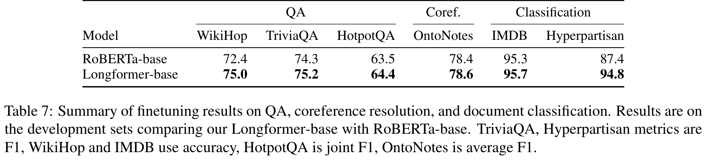</button><figcaption>Table 7 · Original Paper v2。点击放大；原 caption 已完整保留。</figcaption></figure></details>

**Table 7。** 都是 development set，但任务指标不同。RoBERTa→Longformer-base：WikiHop 72.4→75.0（**+2.6pp**，相对 +3.59%），TriviaQA 74.3→75.2（+0.9pp，+1.21%），HotpotQA 63.5→64.4（+0.9pp，+1.42%），OntoNotes 78.4→78.6（+0.2pp，+0.26%），IMDB 95.3→95.7（+0.4pp，+0.42%），Hyperpartisan 87.4→94.8（+7.4pp，+8.47%）。

这里的 relative 只是 `(new−old)/old`，不是错误率相对下降。长文本分类收益较明显，coreference 很小；不能平均六列产生“整体准确率提升”。长上下文、MLM 训练和任务调参共同变化，表本身不是结构单因素实验。

<div class="table-scroll original-table" role="region" tabindex="0" aria-label="原论文 Table 8 完整重排"><table class="ltx_tabular ltx_centering ltx_guessed_headers ltx_align_middle">
<thead class="ltx_thead">
<tr class="ltx_tr">
<th class="ltx_td ltx_align_left ltx_th ltx_th_column ltx_th_row ltx_border_tt">Model</th>
<th class="ltx_td ltx_align_right ltx_th ltx_th_column ltx_border_tt">WikiHop</th>
<th class="ltx_td ltx_align_right ltx_th ltx_th_column ltx_border_tt">TriviaQA</th>
<th class="ltx_td ltx_nopad_r ltx_align_right ltx_th ltx_th_column ltx_border_tt">HotpotQA</th></tr>
</thead>
<tbody class="ltx_tbody">
<tr class="ltx_tr">
<th class="ltx_td ltx_align_left ltx_th ltx_th_row ltx_border_t">Current<sup class="ltx_sup">∗</sup> SOTA</th>
<td class="ltx_td ltx_align_right ltx_border_t">78.3</td>
<td class="ltx_td ltx_align_right ltx_border_t">73.3</td>
<td class="ltx_td ltx_nopad_r ltx_align_right ltx_border_t"><span class="ltx_text ltx_font_bold">74.2</span></td></tr>
<tr class="ltx_tr">
<th class="ltx_td ltx_align_left ltx_th ltx_th_row ltx_border_bb">Longformer-large</th>
<td class="ltx_td ltx_align_right ltx_border_bb"><span class="ltx_text ltx_font_bold">81.9</span></td>
<td class="ltx_td ltx_align_right ltx_border_bb"><span class="ltx_text ltx_font_bold">77.3</span></td>
<td class="ltx_td ltx_nopad_r ltx_align_right ltx_border_bb">73.2</td></tr>
</tbody>
</table></div><details><summary>Table 8 原始截图、caption 与排版（核对用）</summary><figure class="original-figure"><button type="button" data-zoom="assets/original/table-08-qa-leaderboards.png" aria-label="放大 Table 8">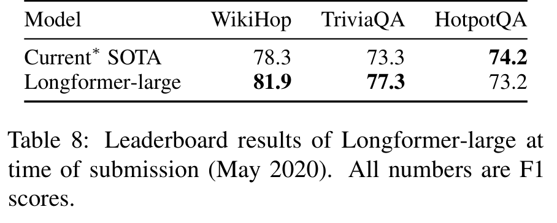</button><figcaption>Table 8 · Original Paper v2。点击放大；原 caption 已完整保留。</figcaption></figure></details>

**Table 8。** 原 caption 写“all F1”，但 WikiHop 实际是 accuracy，这是论文自身的标注冲突，保留原图并勘误。表引用 **May 2020** 榜单：WikiHop 78.3→81.9（+3.6pp），TriviaQA 73.3→77.3（+4.0pp），HotpotQA 74.2→73.2（−1.0pp）。它既不是 v2 日期的完整榜单，也不是 2026 排名。

<div class="table-scroll original-table" role="region" tabindex="0" aria-label="原论文 Table 9 完整重排"><table class="ltx_tabular ltx_centering ltx_guessed_headers ltx_align_middle">
<tbody class="ltx_tbody">
<tr class="ltx_tr">
<th class="ltx_td ltx_align_left ltx_th ltx_th_row ltx_border_tt" style="padding-left:4.0pt;padding-right:4.0pt;">Model</th>
<td class="ltx_td ltx_align_right ltx_border_tt" style="padding-left:4.0pt;padding-right:4.0pt;">ans.</td>
<td class="ltx_td ltx_align_right ltx_border_tt" style="padding-left:4.0pt;padding-right:4.0pt;">supp.</td>
<td class="ltx_td ltx_nopad_r ltx_align_right ltx_border_tt" style="padding-left:4.0pt;padding-right:4.0pt;">joint</td></tr>
<tr class="ltx_tr">
<th class="ltx_td ltx_align_left ltx_th ltx_th_row ltx_border_t" style="padding-left:4.0pt;padding-right:4.0pt;">TAP 2 (ensemble) <cite class="ltx_cite ltx_citemacro_cite"><a class="ltx_ref" href="https://arxiv.org/html/2004.05150v2#bib.bib17" title="">Glaß et al. (2019)</a></cite></th>
<td class="ltx_td ltx_align_right ltx_border_t" style="padding-left:4.0pt;padding-right:4.0pt;">79.8</td>
<td class="ltx_td ltx_align_right ltx_border_t" style="padding-left:4.0pt;padding-right:4.0pt;">86.7</td>
<td class="ltx_td ltx_nopad_r ltx_align_right ltx_border_t" style="padding-left:4.0pt;padding-right:4.0pt;">70.7</td></tr>
<tr class="ltx_tr">
<th class="ltx_td ltx_align_left ltx_th ltx_th_row" style="padding-left:4.0pt;padding-right:4.0pt;">SAE <cite class="ltx_cite ltx_citemacro_cite"><a class="ltx_ref" href="https://arxiv.org/html/2004.05150v2#bib.bib48" title="">Tu et al. (2019)</a></cite></th>
<td class="ltx_td ltx_align_right" style="padding-left:4.0pt;padding-right:4.0pt;">79.6</td>
<td class="ltx_td ltx_align_right" style="padding-left:4.0pt;padding-right:4.0pt;">86.7</td>
<td class="ltx_td ltx_nopad_r ltx_align_right" style="padding-left:4.0pt;padding-right:4.0pt;">71.4</td></tr>
<tr class="ltx_tr">
<th class="ltx_td ltx_align_left ltx_th ltx_th_row" style="padding-left:4.0pt;padding-right:4.0pt;">Quark (dev) <cite class="ltx_cite ltx_citemacro_cite"><a class="ltx_ref" href="https://arxiv.org/html/2004.05150v2#bib.bib19" title="">Groeneveld et al. (2020)</a></cite></th>
<td class="ltx_td ltx_align_right" style="padding-left:4.0pt;padding-right:4.0pt;">81.2</td>
<td class="ltx_td ltx_align_right" style="padding-left:4.0pt;padding-right:4.0pt;">87.0</td>
<td class="ltx_td ltx_nopad_r ltx_align_right" style="padding-left:4.0pt;padding-right:4.0pt;">72.3</td></tr>
<tr class="ltx_tr">
<th class="ltx_td ltx_align_left ltx_th ltx_th_row" style="padding-bottom: 2.15277pt;padding-left:4.0pt;padding-right:4.0pt;">C2F Reader <cite class="ltx_cite ltx_citemacro_cite"><a class="ltx_ref" href="https://arxiv.org/html/2004.05150v2#bib.bib42" title="">Shao et al. (2020)</a></cite></th>
<td class="ltx_td ltx_align_right" style="padding-bottom: 2.15277pt;padding-left:4.0pt;padding-right:4.0pt;">81.2</td>
<td class="ltx_td ltx_align_right" style="padding-bottom: 2.15277pt;padding-left:4.0pt;padding-right:4.0pt;">87.6</td>
<td class="ltx_td ltx_nopad_r ltx_align_right" style="padding-bottom: 2.15277pt;padding-left:4.0pt;padding-right:4.0pt;">72.8</td></tr>
<tr class="ltx_tr">
<th class="ltx_td ltx_align_left ltx_th ltx_th_row ltx_border_t" style="padding-bottom: 2.15277pt;padding-left:4.0pt;padding-right:4.0pt;">[0.4pt/2pt]
Longformer-large</th>
<td class="ltx_td ltx_align_right ltx_border_t" style="padding-bottom: 2.15277pt;padding-left:4.0pt;padding-right:4.0pt;">81.3</td>
<td class="ltx_td ltx_align_right ltx_border_t" style="padding-bottom: 2.15277pt;padding-left:4.0pt;padding-right:4.0pt;">88.3</td>
<td class="ltx_td ltx_nopad_r ltx_align_right ltx_border_t" style="padding-bottom: 2.15277pt;padding-left:4.0pt;padding-right:4.0pt;">73.2</td></tr>
<tr class="ltx_tr">
<th class="ltx_td ltx_align_left ltx_th ltx_th_row ltx_border_t" style="padding-left:4.0pt;padding-right:4.0pt;">[0.4pt/2pt]
ETC-large<sup class="ltx_sup"><span class="ltx_text ltx_font_italic">†</span></sup> <cite class="ltx_cite ltx_citemacro_cite"><a class="ltx_ref" href="https://arxiv.org/html/2004.05150v2#bib.bib1" title="">Ainslie et al. (2020)</a></cite></th>
<td class="ltx_td ltx_align_right ltx_border_t" style="padding-left:4.0pt;padding-right:4.0pt;">81.2</td>
<td class="ltx_td ltx_align_right ltx_border_t" style="padding-left:4.0pt;padding-right:4.0pt;">89.1</td>
<td class="ltx_td ltx_nopad_r ltx_align_right ltx_border_t" style="padding-left:4.0pt;padding-right:4.0pt;">73.6</td></tr>
<tr class="ltx_tr">
<th class="ltx_td ltx_align_left ltx_th ltx_th_row" style="padding-left:4.0pt;padding-right:4.0pt;">GSAN-large<sup class="ltx_sup"><span class="ltx_text ltx_font_italic">†</span></sup></th>
<td class="ltx_td ltx_align_right" style="padding-left:4.0pt;padding-right:4.0pt;">81.6</td>
<td class="ltx_td ltx_align_right" style="padding-left:4.0pt;padding-right:4.0pt;">88.7</td>
<td class="ltx_td ltx_nopad_r ltx_align_right" style="padding-left:4.0pt;padding-right:4.0pt;">73.9</td></tr>
<tr class="ltx_tr">
<th class="ltx_td ltx_align_left ltx_th ltx_th_row ltx_border_bb" style="padding-left:4.0pt;padding-right:4.0pt;">HGN-large <cite class="ltx_cite ltx_citemacro_cite"><a class="ltx_ref" href="https://arxiv.org/html/2004.05150v2#bib.bib14" title="">Fang et al. (2020)</a></cite></th>
<td class="ltx_td ltx_align_right ltx_border_bb" style="padding-left:4.0pt;padding-right:4.0pt;">82.2</td>
<td class="ltx_td ltx_align_right ltx_border_bb" style="padding-left:4.0pt;padding-right:4.0pt;">88.5</td>
<td class="ltx_td ltx_nopad_r ltx_align_right ltx_border_bb" style="padding-left:4.0pt;padding-right:4.0pt;">74.2</td></tr>
</tbody>
</table></div><details><summary>Table 9 原始截图、caption 与排版（核对用）</summary><figure class="original-figure"><button type="button" data-zoom="assets/original/table-09-hotpotqa.png" aria-label="放大 Table 9">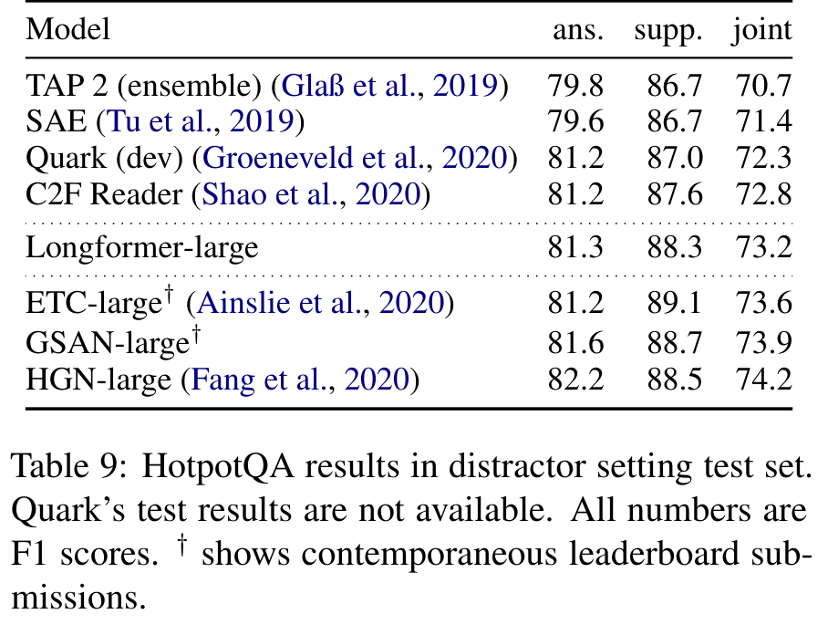</button><figcaption>Table 9 · Original Paper v2。点击放大；原 caption 已完整保留。</figcaption></figure></details>

**Table 9。** HotpotQA 要分别看 answer、supporting facts、joint F1；joint 不是两者简单平均。HGN joint 74.2 优于 Longformer 73.2；ETC 73.6 和 GSAN 73.9 也高于它。Quark 行是 dev，其余主要为 test，不能混排作严格结论。v2 表格不支持“当时 overall 第二”或“全面超过所有 baseline”的说法。

### 6.5 WikiHop Ablations：拆掉 global 与投影的效应不能混算

<div class="table-scroll original-table" role="region" tabindex="0" aria-label="原论文 Table 10 完整重排"><table class="ltx_tabular ltx_centering ltx_guessed_headers ltx_align_middle">
<thead class="ltx_thead">
<tr class="ltx_tr">
<th class="ltx_td ltx_nopad_l ltx_nopad_r ltx_align_left ltx_th ltx_th_column ltx_th_row ltx_border_tt" style="padding-left:-2.0pt;padding-right:-2.0pt;">Model</th>
<th class="ltx_td ltx_nopad_l ltx_nopad_r ltx_align_right ltx_th ltx_th_column ltx_border_tt" style="padding-left:-2.0pt;padding-right:-2.0pt;">Accuracy / <math alttext="\Delta" class="ltx_Math" intent=":literal"><semantics><mi mathvariant="normal">Δ</mi></semantics></math></th></tr>
</thead>
<tbody class="ltx_tbody">
<tr class="ltx_tr">
<th class="ltx_td ltx_nopad_l ltx_nopad_r ltx_align_left ltx_th ltx_th_row ltx_border_t" style="padding-bottom: 2.58334pt;padding-left:-2.0pt;padding-right:-2.0pt;">Longformer (seqlen: 4,096)</th>
<td class="ltx_td ltx_nopad_l ltx_nopad_r ltx_align_right ltx_border_t" style="padding-bottom: 2.58334pt;padding-left:-2.0pt;padding-right:-2.0pt;">73.8</td></tr>
<tr class="ltx_tr">
<th class="ltx_td ltx_nopad_l ltx_nopad_r ltx_align_left ltx_th ltx_th_row ltx_border_t" style="padding-left:-2.0pt;padding-right:-2.0pt;">[0.2pt/0.4pt]
RoBERTa-base (seqlen: 512)</th>
<td class="ltx_td ltx_nopad_l ltx_nopad_r ltx_align_right ltx_border_t" style="padding-left:-2.0pt;padding-right:-2.0pt;">72.4 / -1.4</td></tr>
<tr class="ltx_tr">
<th class="ltx_td ltx_nopad_l ltx_nopad_r ltx_align_left ltx_th ltx_th_row" style="padding-left:-2.0pt;padding-right:-2.0pt;">Longformer (seqlen: 4,096, 15 epochs)</th>
<td class="ltx_td ltx_nopad_l ltx_nopad_r ltx_align_right" style="padding-left:-2.0pt;padding-right:-2.0pt;">75.0 / +1.2</td></tr>
<tr class="ltx_tr">
<th class="ltx_td ltx_nopad_l ltx_nopad_r ltx_align_left ltx_th ltx_th_row" style="padding-left:-2.0pt;padding-right:-2.0pt;">Longformer (seqlen: 512, attention: <math alttext="n^{2}" class="ltx_Math" intent=":literal"><semantics><msup><mi>n</mi><mn>2</mn></msup></semantics></math>)</th>
<td class="ltx_td ltx_nopad_l ltx_nopad_r ltx_align_right" style="padding-left:-2.0pt;padding-right:-2.0pt;">71.7 / -2.1</td></tr>
<tr class="ltx_tr">
<th class="ltx_td ltx_nopad_l ltx_nopad_r ltx_align_left ltx_th ltx_th_row" style="padding-left:-2.0pt;padding-right:-2.0pt;">Longformer (seqlen: 2,048)</th>
<td class="ltx_td ltx_nopad_l ltx_nopad_r ltx_align_right" style="padding-left:-2.0pt;padding-right:-2.0pt;">73.1 / -0.7</td></tr>
<tr class="ltx_tr">
<th class="ltx_td ltx_nopad_l ltx_nopad_r ltx_align_left ltx_th ltx_th_row" style="padding-left:-2.0pt;padding-right:-2.0pt;">Longformer (no MLM pretraining)</th>
<td class="ltx_td ltx_nopad_l ltx_nopad_r ltx_align_right" style="padding-left:-2.0pt;padding-right:-2.0pt;">73.2 / -0.6</td></tr>
<tr class="ltx_tr">
<th class="ltx_td ltx_nopad_l ltx_nopad_r ltx_align_left ltx_th ltx_th_row" style="padding-left:-2.0pt;padding-right:-2.0pt;">Longformer (no linear proj.)</th>
<td class="ltx_td ltx_nopad_l ltx_nopad_r ltx_align_right" style="padding-left:-2.0pt;padding-right:-2.0pt;">72.2 / -1.6</td></tr>
<tr class="ltx_tr">
<th class="ltx_td ltx_nopad_l ltx_nopad_r ltx_align_left ltx_th ltx_th_row" style="padding-left:-2.0pt;padding-right:-2.0pt;">Longformer (no linear proj. no global atten.)</th>
<td class="ltx_td ltx_nopad_l ltx_nopad_r ltx_align_right" style="padding-left:-2.0pt;padding-right:-2.0pt;">65.5 / -8.3</td></tr>
<tr class="ltx_tr">
<th class="ltx_td ltx_nopad_l ltx_nopad_r ltx_align_left ltx_th ltx_th_row ltx_border_bb" style="padding-left:-2.0pt;padding-right:-2.0pt;">Longformer (pretrain extra position embed. only)</th>
<td class="ltx_td ltx_nopad_l ltx_nopad_r ltx_align_right ltx_border_bb" style="padding-left:-2.0pt;padding-right:-2.0pt;">73.5 / -0.3</td></tr>
</tbody>
</table></div><details><summary>Table 10 原始截图、caption 与排版（核对用）</summary><figure class="original-figure"><button type="button" data-zoom="assets/original/table-10-wikihop-ablation.png" aria-label="放大 Table 10">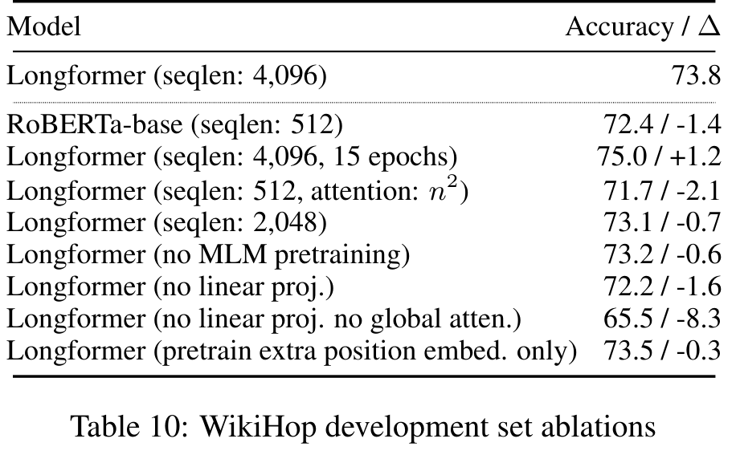</button><figcaption>Table 10 · Original Paper v2。点击放大；原 caption 已完整保留。</figcaption></figure></details>

**Table 10。** 同为 base、5 epochs：完整模型 **73.8**；去 separate global projections **72.2**（−1.6pp）；再去 global attention **65.5**（相对 72.2 再降 6.7pp）。完整→两个组件同时去掉为 **−8.3pp**，不能把全部损失都归因 global mask。

训练 15 epochs 结果 **75.0**，比 5 epochs +1.2pp；不继续 MLM 是 **73.2**，比完整 5 epochs −0.6pp。512 dense attention 继续训练为 **71.7**，RoBERTa baseline **72.4**，显示单纯额外 MLM 不解释所有收益。仍缺 global mask 与 separate projection 的完整 2×2 因子实验，以及同训练 token / 同 context / 同预算对照。

## 7. Longformer-Encoder-Decoder：输入变长，生成仍有成本

LED 从 **已预训练 BART** 初始化：encoder 替换为 local + global attention，decoder self-attention 保持 causal dense，encoder–decoder cross-attention 保持 dense。Base 6 encoder + 6 decoder；large 12+12。把 BART 1K encoder position embedding 复制 16 次到 16K；window 1024，仅首个 `<s>` 设为 global。[P §7；E LED config]

**Training。** Teacher forcing 时输入完整 target，decoder 用 causal mask，交叉熵训练摘要 token。**Inference。** Encoder 一次编码全文；decoder 按 token 自回归，beam search 保留候选。Cross-attention 在每层访问 encoder outputs。论文 v2 没有完整报告 LED optimizer、batch、LR、beam 参数，不能自行补成“原设置”。

<figure class="generated-figure"><svg xmlns="http://www.w3.org/2000/svg" viewBox="0 0 780 420" role="img" aria-label="LED 的编码、cross KV 与生成链路"><rect x="35" y="15" width="710" height="66" rx="7" fill="#182335" stroke="#49617f"/><text x="55" y="40">BART → Longformer encoder</text><text x="55" y="63" style="font-size:12px;fill:#9fb1c9">Input n → local + global → encoder states B×n×D</text><path d="M390 81v25m-5 -6l5 6 5 -6"/><rect x="35" y="110" width="710" height="66" rx="7" fill="#182335" stroke="#49617f"/><text x="55" y="135">Dense cross-attention 的 K/V</text><text x="55" y="158" style="font-size:12px;fill:#9fb1c9">各 decoder layer 投影 encoder states；cross KV=2L_dBnD scalars</text><path d="M390 176v25m-5 -6l5 6 5 -6"/><rect x="35" y="205" width="710" height="66" rx="7" fill="#182335" stroke="#49617f"/><text x="55" y="230">Causal decoder self-attention + cross-attention</text><text x="55" y="253" style="font-size:12px;fill:#9fb1c9">Target m / next token；self KV=2L_dBmD scalars</text><path d="M390 271v25m-5 -6l5 6 5 -6"/><rect x="35" y="300" width="710" height="66" rx="7" fill="#182335" stroke="#49617f"/><text x="55" y="325">FFN → vocabulary logits → beam / next token</text><text x="55" y="348" style="font-size:12px;fill:#9fb1c9">Encoder 只运行一次；decoder 逐 token 更新</text></svg><figcaption>LED 的编码、cross KV 与生成链路 · Agent-created Simplified Diagram。[<a href="assets/generated/led.mmd">Mermaid source</a>]</figcaption></figure>

### 逐项成本：为什么不能只说 O(n)？

设 encoder length `n`、target length `m`、宽度 `D`、encoder / decoder layers `L_e/L_d`。固定窗口与 global 数下，encoder attention 约 `O(L_e B n(w+g)D)`；projection / FFN 另有 `O(L_e B nD²)`。Teacher-forced decoder self-attention 约 `O(L_d B m²D)`，cross-attention 约 `O(L_d B mnD)`。[推导]

**KV memory。** Decoder 每层 cross K/V 是 `2BnD` scalars，所有 decoder 层为 `2L_dBnD`；self K/V 为 `2L_dBmD`。Beam 是否复制 cross KV 取决于实现共享方式。n=16,384、m=256、D=1024、L_d=12、FP16、batch=1：cross KV **768 MiB**，self KV **12 MiB**，还未算 encoder outputs、weights、workspace。量化字节数只能代表容量估算，不证明算子支持或零精度损失。

<section class="mechanism" id="cost-widget"><p class="reading-meta">AGENT-CREATED CALCULATOR · LOGICAL COUNTS, NOT LATENCY</p><h3>Encoder 连接与 LED cache 账本</h3><div class="controls"><label>Encoder length n<select id="cost-n"><option value="1024" >1K</option><option value="4096" >4K</option><option value="8192" >8K</option><option value="16384" selected>16K</option><option value="32768" >32K（假设容量）</option></select></label><label>总窗口 w<select id="cost-w"><option value="128" >128</option><option value="512" >512</option><option value="1024" selected>1024</option><option value="2048" >2048</option></select></label><label>Global token count g<select id="cost-g"><option value="1" selected>1</option><option value="16" >16</option><option value="128" >128</option><option value="512" >512</option></select></label><label>Target length m<select id="cost-m"><option value="128" >128</option><option value="256" selected>256</option><option value="512" >512</option><option value="1024" >1024</option></select></label><label>Hidden dimension D<select id="cost-D"><option value="768" >768</option><option value="1024" selected>1024</option></select></label><label>Decoder layers<select id="cost-layers"><option value="6" >6</option><option value="12" selected>12</option></select></label><label>Attention heads H<select id="cost-heads"><option value="12" >12</option><option value="16" selected>16</option></select></label><label>存储 bytes / scalar<select id="cost-bytes"><option value="4" >FP32 · 4</option><option value="2" selected>FP16/BF16 · 2</option><option value="1" >INT8 · 1（仅容量假设）</option></select></label></div><div class="readout" style="white-space:pre-line" id="cost-readout" aria-live="polite"></div><p class="hint">Global 位置固定为前 g 个；改变位置会轻微改变边界去重。Batch=1，不重复 beam，不含 activation、参数、workspace。32K 和 INT8 是容量假设，不代表原 checkpoint / kernel 支持。</p><noscript><p>16K / D=1024 / 12 decoder layers / FP16：cross KV=768 MiB；m=256 时 self KV=12 MiB。</p></noscript></section>

**读数解释。** Calculator 的 encoder score 是**单层、单 head**的逻辑连接数，包含边界和 global 去重；bytes 用 `H × bytes/element` 转换为 score 元素存储估算。Cross score 是 `mn`，teacher-forced self score 用 dense 矩阵分配 `m²`，虽有 causal mask。KV 显示全部 decoder layers。它不估计 TTFT / TPOT，不包含 FFN、反向或 kernel 冗余。

<div class="table-scroll original-table" role="region" tabindex="0" aria-label="原论文 Table 11 完整重排"><table class="ltx_tabular ltx_centering ltx_guessed_headers ltx_align_middle">
<tbody class="ltx_tbody">
<tr class="ltx_tr">
<td class="ltx_td ltx_border_tt"></td>
<th class="ltx_td ltx_align_right ltx_th ltx_th_column ltx_border_tt">R-1</th>
<th class="ltx_td ltx_align_right ltx_th ltx_th_column ltx_border_tt">R-2</th>
<th class="ltx_td ltx_nopad_r ltx_align_right ltx_th ltx_th_column ltx_border_tt">R-L</th></tr>
<tr class="ltx_tr">
<td class="ltx_td ltx_align_left ltx_border_t">Discourse-aware <cite class="ltx_cite ltx_citemacro_citeyearpar">(<a class="ltx_ref" href="https://arxiv.org/html/2004.05150v2#bib.bib10" title="">2018</a>)</cite></td>
<td class="ltx_td ltx_align_right ltx_border_t">35.80</td>
<td class="ltx_td ltx_align_right ltx_border_t">11.05</td>
<td class="ltx_td ltx_nopad_r ltx_align_right ltx_border_t">31.80</td></tr>
<tr class="ltx_tr">
<td class="ltx_td ltx_align_left">Extr-Abst-TLM <cite class="ltx_cite ltx_citemacro_citeyearpar">(<a class="ltx_ref" href="https://arxiv.org/html/2004.05150v2#bib.bib43" title="">2020</a>)</cite></td>
<td class="ltx_td ltx_align_right">41.62</td>
<td class="ltx_td ltx_align_right">14.69</td>
<td class="ltx_td ltx_nopad_r ltx_align_right">38.03</td></tr>
<tr class="ltx_tr">
<td class="ltx_td ltx_align_left">Dancer <cite class="ltx_cite ltx_citemacro_citeyearpar">(<a class="ltx_ref" href="https://arxiv.org/html/2004.05150v2#bib.bib16" title="">2020</a>)</cite></td>
<td class="ltx_td ltx_align_right">42.70</td>
<td class="ltx_td ltx_align_right">16.54</td>
<td class="ltx_td ltx_nopad_r ltx_align_right">38.44</td></tr>
<tr class="ltx_tr">
<td class="ltx_td ltx_align_left">Pegasus <cite class="ltx_cite ltx_citemacro_citeyearpar">(<a class="ltx_ref" href="https://arxiv.org/html/2004.05150v2#bib.bib58" title="">2020</a>)</cite></td>
<td class="ltx_td ltx_align_right">44.21</td>
<td class="ltx_td ltx_align_right">16.95</td>
<td class="ltx_td ltx_nopad_r ltx_align_right">38.83</td></tr>
<tr class="ltx_tr">
<td class="ltx_td ltx_align_left">LED-large (seqlen: 4,096) (ours)</td>
<td class="ltx_td ltx_align_right">44.40</td>
<td class="ltx_td ltx_align_right">17.94</td>
<td class="ltx_td ltx_nopad_r ltx_align_right">39.76</td></tr>
<tr class="ltx_tr">
<td class="ltx_td ltx_align_left">BigBird (seqlen: 4,096) <cite class="ltx_cite ltx_citemacro_citeyearpar">(<a class="ltx_ref" href="https://arxiv.org/html/2004.05150v2#bib.bib56" title="">2020</a>)</cite></td>
<td class="ltx_td ltx_align_right"><span class="ltx_text ltx_font_bold">46.63</span></td>
<td class="ltx_td ltx_align_right">19.02</td>
<td class="ltx_td ltx_nopad_r ltx_align_right">41.77</td></tr>
<tr class="ltx_tr">
<td class="ltx_td ltx_align_left ltx_border_bb ltx_border_t">[.4pt/1pt]
LED-large (seqlen: 16,384) (ours)</td>
<td class="ltx_td ltx_align_right ltx_border_bb ltx_border_t"><span class="ltx_text ltx_font_bold">46.63</span></td>
<td class="ltx_td ltx_align_right ltx_border_bb ltx_border_t"><span class="ltx_text ltx_font_bold">19.62</span></td>
<td class="ltx_td ltx_nopad_r ltx_align_right ltx_border_bb ltx_border_t"><span class="ltx_text ltx_font_bold">41.83</span></td></tr>
</tbody>
</table></div><details><summary>Table 11 原始截图、caption 与排版（核对用）</summary><figure class="original-figure"><button type="button" data-zoom="assets/original/table-11-led-summarization.png" aria-label="放大 Table 11">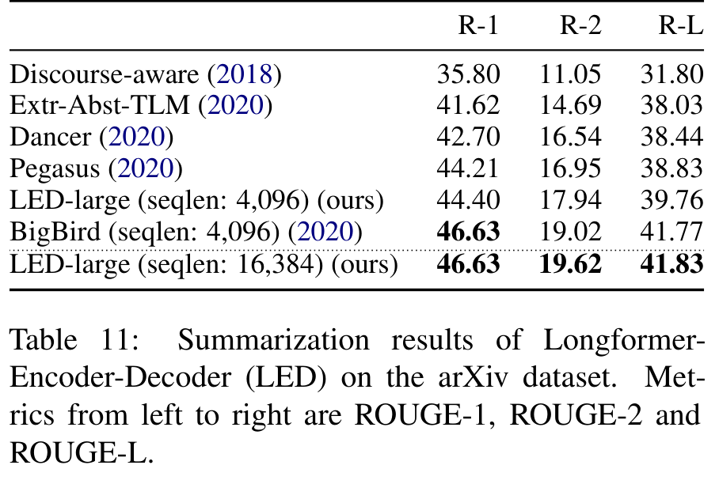</button><figcaption>Table 11 · Original Paper v2。点击放大；原 caption 已完整保留。</figcaption></figure></details>

**Table 11：arXiv test，ROUGE 越高越好。** LED-4096 为 **44.40 / 17.94 / 39.76**；LED-16384 为 **46.63 / 19.62 / 41.83**，R1 / R2 / RL 分别 +2.23 / +1.68 / +2.07（相对 +5.02% / +9.36% / +5.21%）。BigBird-4096 为 **46.63 / 19.02 / 41.77**，LED-16K 的 R1 持平、R2 +0.60、RL +0.06。BigBird 使用 Pegasus 相关初始化，LED 用 BART，输入长度也不同；不是同配置模型替换实验。

<figure class="original-figure"><button type="button" data-zoom="assets/original/fig-03-led-input-length.png" aria-label="放大 Figure 3">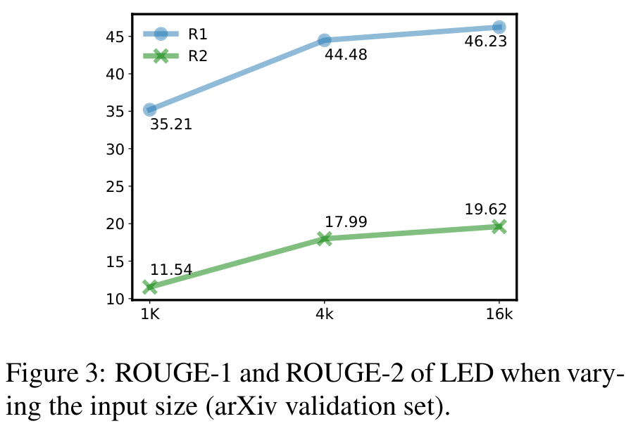</button><figcaption>Figure 3 · Original Paper v2。点击放大；原 caption 已完整保留。</figcaption></figure>

**Figure 3 的问题 / 读法。** 看增加 encoder context 是否改善摘要，在 **validation** 上分别画 ROUGE-1 / ROUGE-2。1K 是 **35.21 / 11.54**，4K **44.48 / 17.99**，16K **46.23 / 19.62**。[P Fig. 3]

**Components / Data flow。** 横轴是输入长度，纵轴是相应 ROUGE；它没有 decoder kernel 流程。作者保持同一路 LED 思路并增加可读内容，趋势说明截断造成的信息损失值得减少。

**Key observation / Why it matters。** 1K→4K 改善很大，4K→16K 仍增加但趋缓。更多输入可以改善摘要覆盖，不代表每增加一倍 context 就同比提升。验证集数值不能与 Table 11 test 数值混写。该图没有报告每个长度的 latency、peak memory、训练 tokens 或置信区间，质量–成本 Pareto 仍需补测。

## 8. Conclusion and Future Work：贡献和未来方向的边界

原论文总结 sparse attention 在字符 LM、长文档理解和摘要中的用途，并提出自适应选择 attention pattern 等未来方向。[P §8]

**解读。** 最值得保留的结论是：预训练 Transformer 可以经过结构和训练的协同改造，成为长文档模型；任务选择的 global tokens 能提供短信息路径。没有得到证明的结论包括无限长度泛化、所有任务最优、现代 GPU 上必然最快、以及从 encoder 复杂度直接推出生成端成本。

## Appendices A–D：复现时最容易漏掉的信息

### A. Implementation Details：三种实现不是同一成本模型

Overlapping chunks 使用大小 `2w`、重叠 `w` 的块，其中这里的实现变量 w 是**单侧 window overlap**，与正文“总窗口”命名要区分。计算 block QK 后 skew 成局部对角带，mask 无效边界；PV 也经过布局处理。它约增加 attention 相关中间存储，但更容易利用优化 GEMM。该 PyTorch 路径不支持字符实验所需的全部 autoregressive / dilation 设置。TVM diagonaled-MM 支持 dilation；local-chunks-nonoverlap 的边界可视范围与对称滑窗不同。[P 附录 A；E 官方 sliding_chunks.py]

**复现建议。** 锁定模型 config、代码 commit、window 语义、padding 规则和 attention mask；先用小 n dense reference 核对 local/global 输出与梯度，再做 kernel profiling。记录 per-op time、布局转换次数、CPU/GPU 同步和峰值物理显存。低精度实验应追踪 logits、softmax 和敏感 projection 层误差，不能把质量下降直接归因于“小模型能力”。

### B. Character LM Hyperparameters：原表中的冲突应保留

<div class="table-scroll original-table" role="region" tabindex="0" aria-label="原论文 Table 12 完整重排"><table class="ltx_tabular ltx_centering ltx_guessed_headers ltx_align_middle">
<tbody class="ltx_tbody">
<tr class="ltx_tr">
<th class="ltx_td ltx_align_left ltx_th ltx_th_row ltx_border_tt">Param</th>
<td class="ltx_td ltx_nopad_r ltx_align_left ltx_border_tt">Value</td></tr>
<tr class="ltx_tr">
<th class="ltx_td ltx_align_left ltx_th ltx_th_row ltx_border_t">Position Embeddings</th>
<td class="ltx_td ltx_nopad_r ltx_align_left ltx_border_t">Relative and Sinusoidal as in <cite class="ltx_cite ltx_citemacro_citet"><a class="ltx_ref" href="https://arxiv.org/html/2004.05150v2#bib.bib12" title="">Dai et al. (2019)</a></cite></td></tr>
<tr class="ltx_tr">
<th class="ltx_td ltx_align_left ltx_th ltx_th_row">Small model config</th>
<td class="ltx_td ltx_nopad_r ltx_align_left">12 layers, 8 heads, 512 hidden size as in <cite class="ltx_cite ltx_citemacro_citet"><a class="ltx_ref" href="https://arxiv.org/html/2004.05150v2#bib.bib12" title="">Dai et al. (2019)</a></cite></td></tr>
<tr class="ltx_tr">
<th class="ltx_td ltx_align_left ltx_th ltx_th_row">Large model config</th>
<td class="ltx_td ltx_nopad_r ltx_align_left">30 layers, 8 heads, 512 hidden size as in <cite class="ltx_cite ltx_citemacro_citet"><a class="ltx_ref" href="https://arxiv.org/html/2004.05150v2#bib.bib7" title="">Child et al. (2019)</a></cite></td></tr>
<tr class="ltx_tr">
<th class="ltx_td ltx_align_left ltx_th ltx_th_row">Optimizer</th>
<td class="ltx_td ltx_nopad_r ltx_align_left">AdamW</td></tr>
<tr class="ltx_tr">
<th class="ltx_td ltx_align_left ltx_th ltx_th_row">Dropout</th>
<td class="ltx_td ltx_nopad_r ltx_align_left">0.2 (small model), 0.4 (large model)</td></tr>
<tr class="ltx_tr">
<th class="ltx_td ltx_align_left ltx_th ltx_th_row">Gradient clipping</th>
<td class="ltx_td ltx_nopad_r ltx_align_left">0.25</td></tr>
<tr class="ltx_tr">
<th class="ltx_td ltx_align_left ltx_th ltx_th_row">Weight Decay</th>
<td class="ltx_td ltx_nopad_r ltx_align_left">0.01</td></tr>
<tr class="ltx_tr">
<th class="ltx_td ltx_align_left ltx_th ltx_th_row">Layernorm Location</th>
<td class="ltx_td ltx_nopad_r ltx_align_left">pre-layernorm <cite class="ltx_cite ltx_citemacro_cite"><a class="ltx_ref" href="https://arxiv.org/html/2004.05150v2#bib.bib53" title="">Xiong et al. (2020)</a></cite></td></tr>
<tr class="ltx_tr">
<th class="ltx_td ltx_align_left ltx_th ltx_th_row">Activation</th>
<td class="ltx_td ltx_nopad_r ltx_align_left">GeLU</td></tr>
<tr class="ltx_tr">
<th class="ltx_td ltx_align_left ltx_th ltx_th_row">Number of phases</th>
<td class="ltx_td ltx_nopad_r ltx_align_left">5</td></tr>
<tr class="ltx_tr">
<th class="ltx_td ltx_align_left ltx_th ltx_th_row">Phase 1 window sizes</th>
<td class="ltx_td ltx_nopad_r ltx_align_left">32 (bottom layer) - 8,192 (top layer)</td></tr>
<tr class="ltx_tr">
<th class="ltx_td ltx_align_left ltx_th ltx_th_row">Phase 5 window sizes</th>
<td class="ltx_td ltx_nopad_r ltx_align_left">512 (bottom layer) - (top layer)</td></tr>
<tr class="ltx_tr">
<th class="ltx_td ltx_align_left ltx_th ltx_th_row">Phase 1 sequence length</th>
<td class="ltx_td ltx_nopad_r ltx_align_left">2,048</td></tr>
<tr class="ltx_tr">
<th class="ltx_td ltx_align_left ltx_th ltx_th_row">Phase 5 sequence length</th>
<td class="ltx_td ltx_nopad_r ltx_align_left">23,040 (gpu memory limit)</td></tr>
<tr class="ltx_tr">
<th class="ltx_td ltx_align_left ltx_th ltx_th_row">Phase 1 LR</th>
<td class="ltx_td ltx_nopad_r ltx_align_left">0.00025</td></tr>
<tr class="ltx_tr">
<th class="ltx_td ltx_align_left ltx_th ltx_th_row">Phase 5 LR</th>
<td class="ltx_td ltx_nopad_r ltx_align_left">000015625</td></tr>
<tr class="ltx_tr">
<th class="ltx_td ltx_align_left ltx_th ltx_th_row">Batch size per phase</th>
<td class="ltx_td ltx_nopad_r ltx_align_left">32, 32, 16, 16, 16</td></tr>
<tr class="ltx_tr">
<th class="ltx_td ltx_align_left ltx_th ltx_th_row">#Steps per phase (small)</th>
<td class="ltx_td ltx_nopad_r ltx_align_left">430K, 50k, 50k, 35k, 5k</td></tr>
<tr class="ltx_tr">
<th class="ltx_td ltx_align_left ltx_th ltx_th_row">#Steps per phase (large)</th>
<td class="ltx_td ltx_nopad_r ltx_align_left">350K, 25k, 10k, 5k, 5k</td></tr>
<tr class="ltx_tr">
<th class="ltx_td ltx_align_left ltx_th ltx_th_row">Warmup</th>
<td class="ltx_td ltx_nopad_r ltx_align_left">10% of the phase steps with maximum 10K steps</td></tr>
<tr class="ltx_tr">
<th class="ltx_td ltx_align_left ltx_th ltx_th_row">LR scheduler</th>
<td class="ltx_td ltx_nopad_r ltx_align_left">constant throughout each phase</td></tr>
<tr class="ltx_tr">
<th class="ltx_td ltx_align_left ltx_th ltx_th_row">Dilation (small model)</th>
<td class="ltx_td ltx_nopad_r ltx_align_left">0 (layers 0-5), 1 (layers 6-7), 2 (layers 8-9), 3 (layers 10-11)</td></tr>
<tr class="ltx_tr">
<th class="ltx_td ltx_align_left ltx_th ltx_th_row">Dilation (large model)</th>
<td class="ltx_td ltx_nopad_r ltx_align_left">0 (layers 0-14), 1 (layers 15-19), 2 (layers 20-24), 3 (layers 25-29)</td></tr>
<tr class="ltx_tr">
<th class="ltx_td ltx_align_left ltx_th ltx_th_row ltx_border_bb">Dilation heads</th>
<td class="ltx_td ltx_nopad_r ltx_align_left ltx_border_bb">2 heads only</td></tr>
</tbody>
</table></div><details><summary>Table 12 原始截图、caption 与排版（核对用）</summary><figure class="original-figure"><button type="button" data-zoom="assets/original/table-12-char-hyperparameters.png" aria-label="放大 Table 12">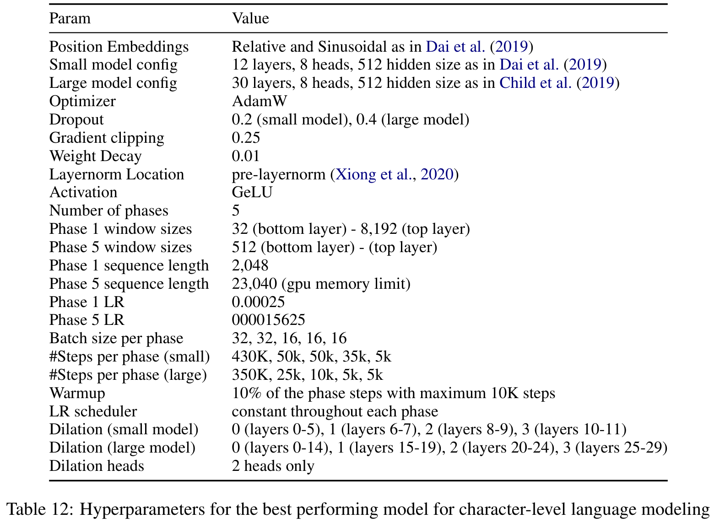</button><figcaption>Table 12 · Original Paper v2。点击放大；原 caption 已完整保留。</figcaption></figure></details>

**Table 12 审计。** 原 PDF 和 HTML 均有明显排版 / 数值异常：phase 1 window 写 **32→8192**，而消融文字为 **32→512**；phase 5 top window 缺失；末阶段 LR 写作 **`000015625`**。不能静默修成合理数字。由起始 `0.00025` 连续减半四次推得 `0.000015625` 仅是推断，需代码或作者确认。

正文说每阶段序列翻倍，但 `2048×16=32768`，实际最后阶段 **23040**，受 GPU memory 限制。底层 dilation 写 0 的含义是“禁用 dilation”，不是公式 stride `d=0`；本文交互中 `d=1` 才是连续窗口。完整表与原图同时呈现，以防误把格式错误当成精确可复现 recipe。

### C. Pretraining Data：语料大小和重复曝光量

<div class="table-scroll original-table" role="region" tabindex="0" aria-label="原论文 Table 13 完整重排"><table class="ltx_tabular ltx_centering ltx_guessed_headers ltx_align_middle">
<thead class="ltx_thead">
<tr class="ltx_tr">
<th class="ltx_td ltx_align_left ltx_th ltx_th_column ltx_th_row ltx_border_tt">Source</th>
<th class="ltx_td ltx_align_right ltx_th ltx_th_column ltx_border_tt">Tokens</th>
<th class="ltx_td ltx_nopad_r ltx_align_right ltx_th ltx_th_column ltx_border_tt">Avg doc len</th></tr>
</thead>
<tbody class="ltx_tbody">
<tr class="ltx_tr">
<th class="ltx_td ltx_align_left ltx_th ltx_th_row ltx_border_t">Books <cite class="ltx_cite ltx_citemacro_cite"><a class="ltx_ref" href="https://arxiv.org/html/2004.05150v2#bib.bib59" title="">Zhu et al. (2015)</a></cite></th>
<td class="ltx_td ltx_align_right ltx_border_t">0.5B</td>
<td class="ltx_td ltx_nopad_r ltx_align_right ltx_border_t">95.9K</td></tr>
<tr class="ltx_tr">
<th class="ltx_td ltx_align_left ltx_th ltx_th_row">English Wikipedia</th>
<td class="ltx_td ltx_align_right">2.1B</td>
<td class="ltx_td ltx_nopad_r ltx_align_right">506</td></tr>
<tr class="ltx_tr">
<th class="ltx_td ltx_align_left ltx_th ltx_th_row">Realnews <cite class="ltx_cite ltx_citemacro_cite"><a class="ltx_ref" href="https://arxiv.org/html/2004.05150v2#bib.bib57" title="">Zellers et al. (2019)</a></cite></th>
<td class="ltx_td ltx_align_right">1.8B</td>
<td class="ltx_td ltx_nopad_r ltx_align_right">1.7K</td></tr>
<tr class="ltx_tr">
<th class="ltx_td ltx_align_left ltx_th ltx_th_row ltx_border_bb">Stories <cite class="ltx_cite ltx_citemacro_cite"><a class="ltx_ref" href="https://arxiv.org/html/2004.05150v2#bib.bib46" title="">Trinh and Le (2018)</a></cite></th>
<td class="ltx_td ltx_align_right ltx_border_bb">2.1B</td>
<td class="ltx_td ltx_nopad_r ltx_align_right ltx_border_bb">7.8K</td></tr>
</tbody>
</table></div><details><summary>Table 13 原始截图、caption 与排版（核对用）</summary><figure class="original-figure"><button type="button" data-zoom="assets/original/table-13-pretraining-corpus.png" aria-label="放大 Table 13">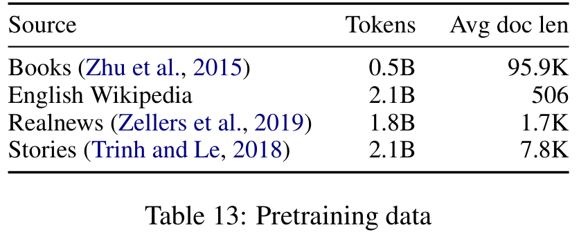</button><figcaption>Table 13 · Original Paper v2。点击放大；原 caption 已完整保留。</figcaption></figure></details>

**Table 13。** 完整语料包括书籍、Wikipedia、RealNews 和 Stories 等，合计 **6.5B tokens**。数据统计不等于训练曝光量，也不能从 token 总量推断去重比例、数据许可或 unique documents。继续 MLM 累积的 17.03936B token positions 是另一个口径。

### D. Task-specific Details：论文结论成立的完整链路

<div class="table-scroll original-table" role="region" tabindex="0" aria-label="原论文 Table 14 完整重排"><table class="ltx_tabular ltx_centering ltx_guessed_headers ltx_align_middle">
<tbody class="ltx_tbody">
<tr class="ltx_tr">
<th class="ltx_td ltx_align_left ltx_th ltx_th_row ltx_border_tt">Param</th>
<td class="ltx_td ltx_align_right ltx_border_tt">WikiHop</td>
<td class="ltx_td ltx_align_right ltx_border_tt">TriviaQA</td>
<td class="ltx_td ltx_nopad_r ltx_align_right ltx_border_tt">HotpotQA</td></tr>
<tr class="ltx_tr">
<th class="ltx_td ltx_align_left ltx_th ltx_th_row ltx_border_t">Epochs</th>
<td class="ltx_td ltx_align_right ltx_border_t">15</td>
<td class="ltx_td ltx_align_right ltx_border_t">5</td>
<td class="ltx_td ltx_nopad_r ltx_align_right ltx_border_t">5</td></tr>
<tr class="ltx_tr">
<th class="ltx_td ltx_align_left ltx_th ltx_th_row">LR</th>
<td class="ltx_td ltx_align_right">3e-5</td>
<td class="ltx_td ltx_align_right">3e-5</td>
<td class="ltx_td ltx_nopad_r ltx_align_right">5e-5</td></tr>
<tr class="ltx_tr">
<th class="ltx_td ltx_align_left ltx_th ltx_th_row">Warmup steps</th>
<td class="ltx_td ltx_align_right">200</td>
<td class="ltx_td ltx_align_right">1000</td>
<td class="ltx_td ltx_nopad_r ltx_align_right">1000</td></tr>
<tr class="ltx_tr">
<th class="ltx_td ltx_align_left ltx_th ltx_th_row">Batch size</th>
<td class="ltx_td ltx_align_right">32</td>
<td class="ltx_td ltx_align_right">32</td>
<td class="ltx_td ltx_nopad_r ltx_align_right">32</td></tr>
<tr class="ltx_tr">
<th class="ltx_td ltx_align_left ltx_th ltx_th_row ltx_border_bb">Optimizer</th>
<td class="ltx_td ltx_align_right ltx_border_bb">Adam</td>
<td class="ltx_td ltx_align_right ltx_border_bb">Adam</td>
<td class="ltx_td ltx_nopad_r ltx_align_right ltx_border_bb">Adam</td></tr>
</tbody>
</table></div><details><summary>Table 14 原始截图、caption 与排版（核对用）</summary><figure class="original-figure"><button type="button" data-zoom="assets/original/table-14-qa-hyperparameters.png" aria-label="放大 Table 14">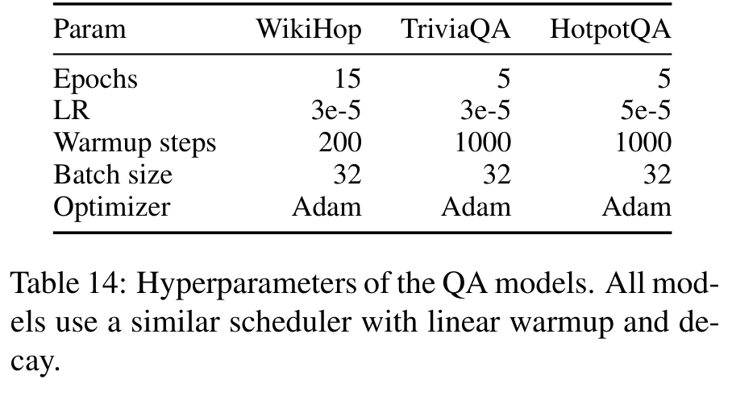</button><figcaption>Table 14 · Original Paper v2。点击放大；原 caption 已完整保留。</figcaption></figure></details>

**Table 14。** 它列 QA 的 optimizer / LR / batch 等设置，须按任务和模型规模分别读。HotpotQA 表内 LR **5e-5**，附录 D 文本所述最佳配置 **3e-5**，冲突未解；复现应两者都记录或向作者求证，而不是任取一个声称原配置。

WikiHop-base 仍分块、large 截断，TriviaQA 截断，Hotpot 两阶段筛选，coreference segmentation 和跨框架桥接，都是原实验的一部分。论文动机中的“避免 chunking”不应覆盖掉这些实际工程细节。

## External Research：前史、同代、后续与替代路线

以下为**外部资料**，截至 **2026-10-27**，优先原论文和官方实现。年份是论文 / 官方资料对应时间，不把后续工作误写为 Longformer 实验的一部分。

| 工作 / 年份 | 核心思路 | 优势 | 限制 | 与 Longformer 的关系 |
|---|---|---|---|---|
| [Transformer-XL, 2019](https://arxiv.org/abs/1901.02860) | Segment recurrence + relative positions | 延续历史状态，减少重算 | 段间缓存与双向全文编码不同 | 字符实验的实现底座，但 Longformer 关闭 recurrence |
| [Sparse Transformer, 2019](https://arxiv.org/abs/1904.10509) | 分解稀疏 attention pattern | 在较少边上扩展覆盖 | 图结构和 kernel 需协同 | 稀疏图前史，不等于任务 global mask |
| **Longformer, 2020-04** | 滑窗 + task global hubs + pretrained transfer | 长文档 encoder 可迁移 | global 选择、局部假设和固定位置容量 | 本文 |
| [ETC, 2020](https://aclanthology.org/2020.emnlp-main.19/) | Global/local 输入结构 + relative positions | 表达结构化长输入 | 额外结构与训练设计 | 同代 global/local 路线，非本文新增 |
| [BigBird, 2020-07](https://arxiv.org/abs/2007.14062) | Local + random + global | 连通性与理论性质；长输入 | Random pattern 与稀疏 kernel 复杂 | 在类似骨架中增加 random connections |
| [LongT5, 2021-12](https://arxiv.org/abs/2112.07916) | Local / transient global encoder + T5 | 长输入 seq2seq 与任务训练协同 | Dense decoder / cross 成本仍在 | LED 后的相关 encoder–decoder 路线 |
| [FlashAttention, 2022-05](https://arxiv.org/abs/2205.14135) | Tiling + online softmax，减少 HBM IO | 精确 dense attention，免全量 score 存储 | Dense 算术仍平方；依赖 kernel | 与删边正交，改变 2020 的实用成本对照 |
| [Mistral 7B, 2023-10](https://arxiv.org/abs/2310.06825) | Decoder SWA + GQA + rolling buffer | 较小 decode KV，可滚动更新 | 不同层/版本配置需核对 | 共享窗口思想；不是 Longformer encoder 的 KV 行为 |
| [FlexAttention, 2024](https://pytorch.org/blog/flexattention/) | score/mask 函数编译为高效 kernel | 更灵活定义 attention pattern | Block sparsity、编译与版本约束 | 今天实现滑窗/global mask 的另一工具路线 |
| [RULER, 2024-04](https://arxiv.org/abs/2404.06654) | 合成长上下文多任务验证 | 区分宣称长度与有效长度 | 合成任务不覆盖全部实际场景 | 检验窗口/全局路由是否真正用到远端信息 |
| [LongBench v2, 2024-12](https://arxiv.org/abs/2412.15204) | 503 多选问题，8K–2M words，六大类 | 更接近长文档理解难点 | 语言、分词与预算影响公平性 | 当前评价基础；不是原 QA 结果可换算指标 |
| [FluxAttention v2, 2026-09-28](https://arxiv.org/abs/2604.07394) | 自适应 head/layer 路由 FA/SA，prefill 决策复用到 decode | 根据输入平衡质量与稀疏成本 | 依赖 router、阈值、模型和 benchmark | 对作者“自适应 pattern”方向的近期相关探索 |
| [TensorRT-LLM Skip Softmax, 2026 资料](https://nvidia.github.io/TensorRT-LLM/1.3.0rc21/blogs/tech_blog/blog16_Accelerating_Long_Context_Inference_with_Skip_Softmax_Attention.html) | 基于 attention 分数跳过部分 softmax / 计算 | 工业 inference 路线，可测 TTFT / TPOT | 阈值、硬件与任务质量依赖 | 动态选择和工程性能，非固定 Longformer 替换 |

<figure class="generated-figure"><svg xmlns="http://www.w3.org/2000/svg" viewBox="0 0 780 420" role="img" aria-label="长上下文技术演进：多条并行路线"><rect x="35" y="15" width="710" height="66" rx="7" fill="#182335" stroke="#49617f"/><text x="55" y="40">2019 · Recurrence / sparse factorization</text><text x="55" y="63" style="font-size:12px;fill:#9fb1c9">Transformer-XL · Sparse Transformer</text><path d="M390 81v25m-5 -6l5 6 5 -6"/><rect x="35" y="110" width="710" height="66" rx="7" fill="#182335" stroke="#49617f"/><text x="55" y="135">2020–2021 · Pretrained long-document / seq2seq</text><text x="55" y="158" style="font-size:12px;fill:#9fb1c9">Longformer · ETC · BigBird · LED · LongT5</text><path d="M390 176v25m-5 -6l5 6 5 -6"/><rect x="35" y="205" width="710" height="66" rx="7" fill="#182335" stroke="#49617f"/><text x="55" y="230">2022–2024 · IO-aware dense + decoder windows + compiled masks</text><text x="55" y="253" style="font-size:12px;fill:#9fb1c9">FlashAttention · Mistral SWA/GQA · FlexAttention</text><path d="M390 271v25m-5 -6l5 6 5 -6"/><rect x="35" y="300" width="710" height="66" rx="7" fill="#182335" stroke="#49617f"/><text x="55" y="325">2024–2026 · Effective length + adaptive sparsity</text><text x="55" y="348" style="font-size:12px;fill:#9fb1c9">RULER · LongBench v2 · FluxAttention · Skip Softmax</text></svg><figcaption>长上下文技术演进：多条并行路线 · Agent-created Simplified Diagram。[<a href="assets/generated/timeline.mmd">Mermaid source</a>]</figcaption></figure>

**时间线解读。** 2019 从 recurrence 和稀疏分解扩展上下文；2020 Longformer 把任务 global hubs 与 pretrained transfer 接起来，ETC / BigBird 提供邻近路线，12 月 v2 加入 LED；2021 LongT5 继续拓展 seq2seq；2022 IO-aware dense attention 改变“稀疏对普通 full”的比较基线；2023 SWA 与 GQA 在 decoder 中组合；2024 后可编译 mask、更严格有效长度评测和动态稀疏受到重视。它是多条并行路线，不是后一篇完全取代前一篇。

## Current State / SOTA Audit：截至 2026-10-27 能说到哪一步？

**必须区分三个问题。** 最佳长文档理解准确率、最快 kernel、最小 KV memory 不是一个排行榜。Longformer 的 OntoNotes / WikiHop / ROUGE 数字无法直接和现代 decoder 的 LongBench v2 accuracy 比较；现代窗口常与 GQA、RoPE、paged KV、FlashAttention、检索或混合层组合，其收益要拆开评估。

**近期原论文。** FluxAttention v2 的检索版本为 2026-09-28，基于 Qwen3-4B / 8B、Llama-3.1-8B，使用 LongBench-E / RULER 等。它让路由选择 full attention 和 sparse attention，并在 decode 复用 prefill 决策。结果属于该模型、阈值、上下文和任务设置，不能宣称跨模型、跨 benchmark 的绝对 SOTA。[E FluxAttention]

**工业资料的可复查实例。** NVIDIA Skip Softmax 文档使用 **Qwen3-30B-A3B-Instruct-2507、H200、concurrency=1**，LongBench v2 medium 子集约 200 样本，截断 256K、平均约 130K tokens。Sparsity=0.5 时 accuracy **37.67** 对基线 **35.81**；TTFT **14,554.04ms** 对 **16,486.70ms**（约下降 **11.72%**）；TPOT **8.45ms** 对 **9.34ms**（约下降 **9.53%**）。更激进稀疏需要额外看质量变化。[E NVIDIA 官方资料]

这是具体系统的样本结果，质量上升不代表稀疏普遍改善推理；需考虑样本方差、测试子集和运行配置。模型权重有公开发布，资料和 TensorRT-LLM 实现公开，但本文没有重新运行该系统。LongBench v2 全集是 503 问题，子集结果不能充当全榜排名。**本次检索未建立在统一硬件、统一长度、同 checkpoint、同准确率预算下的全面最优证明，因此不指定一个“当前通用 SOTA”。**

**部署选择。** 文档理解 encoder 可先看现成 Longformer checkpoint 与任务 global mask；需要摘要可看 LED / 长输入 seq2seq；已有现代 decoder 应先建立 dense IO-optimized baseline，再评价 SWA / 动态稀疏及 GQA。检索缩短输入可以是另一 Pareto 点，但检索召回损失必须进质量账本。

## My Insights：评价、未解问题与可执行改进

以下是**本文解读与研究建议**，不属于原论文的实测结论。

### Strengths / Novelty / Correctness

它把稀疏连接和预训练迁移做成实际可用模型，global hubs 有清楚的图意义；覆盖字符 LM、理解和生成，避免只在单一 toy dataset 讨论复杂度。原论文主线的数学和实现思路成立，但“线性”需固定窗口/global/输出长度，“最优”需固定日期与榜单。

### Weaknesses / Reproducibility / Generalization

任务收益不均、部分 baseline 非同输入 / 同预算；MLM、结构、训练轮数和数据预处理同时变化。Table 8 指标、Table 12 数值、Table 14 LR 存在冲突；LED 缺少足够超参。Copied absolute positions 给出有限容量，没有证明更长长度可靠；global bottleneck 能传递信息但不保证把所有远端证据保留下来。

### Hidden Trade-offs / Cost / Hardware

稀疏降低 score 规模，却可能增加 gather、scatter、padding 和 kernel launch。Global projections 增加参数和全文 projection；大量 global tokens 增加 ng。LED 的 cross KV 可压过短 target self KV；分块或检索降低 n，却可能漏证据。低精度在 score/softmax 处可能出现异常，原字符实验保留 attention FP32 已给出实用提醒。

### 如果重新做实验，我会补什么？

1. **完整因子消融。** Local/full × global 开关 × separate projections × MLM continuation，保持训练 tokens、task epochs 和 input length，分离结构、训练与容量的作用。
2. **有效长度评测。** 在相同全文长度下移动关键证据位置，加入跨窗口多跳和相互冲突的证据；记录准确率、证据召回、截断比例。Global token 数 g 作为显式 sweep 变量。
3. **质量–性能曲线。** 同 checkpoint 比较 dense FlashAttention、overlap chunks、编译稀疏和动态方案，报告 batch、n、w、g、precision、GPU、TTFT 或 encoder latency、TPOT、峰值显存及 per-op time。
4. **LED cache 账本。** 分开记录 encoder output、cross KV、self KV、beam 共享和 workspace；同时 sweep n / m。验证缓存投影是否一次完成、是否有重复复制或 CPU 同步。
5. **可审计分类指标。** 公开 TP/FP/TN/FN、precision/recall/F1 和每 seed 方差；小样本 Hyperpartisan 做多个固定 split 或交叉验证，避免单一分割放大结论。
6. **低精度迁移。** 用真实多样长文档标定，逐层比较 QK logits、softmax 和输出 hidden states；测试敏感层保留 FP16/FP32 的成本，沿量化→转换→导出链路定位误差。

### 最值得带走的工程判断

先问“哪些 token 必须直接交换信息”，再问“怎样把这个图映射成高吞吐 kernel”。二者决定的成本不同。对 encoder，重点是整段激活和数据布局；对 decoder，还要单独核算 cache 和逐 token 链路。Longformer 留下的价值，是一套能把上下文结构、预训练迁移与实现成本同时讨论的方法。

## References & Reading Evidence

**[P]** Beltagy, Peters, Cohan. *Longformer: The Long-Document Transformer*. [arXiv:2004.05150v2](https://arxiv.org/abs/2004.05150v2), 2020-12-02。原文 17 页，本文保留全部 3 figures / 14 tables / Eq. 1。

**[E]** 外部论文与官方资料的可点击入口见 Related Work Matrix。实现证据：[原始 longformer.py](https://github.com/allenai/longformer/blob/master/longformer/longformer.py)、[sliding_chunks.py](https://github.com/allenai/longformer/blob/master/longformer/sliding_chunks.py)、[HF modeling_longformer.py](https://github.com/huggingface/transformers/blob/main/src/transformers/models/longformer/modeling_longformer.py)、[base config](https://huggingface.co/allenai/longformer-base-4096/blob/main/config.json)、[large config](https://huggingface.co/allenai/longformer-large-4096/blob/main/config.json)、[LED config](https://huggingface.co/allenai/led-large-16384/blob/main/config.json)。Mutable main/master 是检索时状态，不宣称未来保持一致；来源清单保存检索日期与文件 hash。

[来源清单](sources/references.json) · [原始视觉清单](sources/visual-manifest.json) · [公式记录](sources/equations.json) · [机制核验结果](sources/mechanism-results.txt) · [研究 Markdown](index.md)。

**站内延伸。** [FlashAttention：IO 与精确 attention](../flashattention/) · [MQA：共享 KV 与 decode 带宽](../mqa/) · [RoFormer：位置编码与长度外推](../roformer/) · [VRoPE：位置结构与多模态](../vrope/) · [Paper Readings 全部文章](../)。
