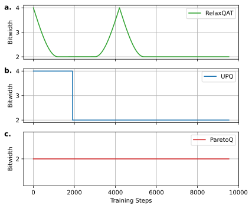
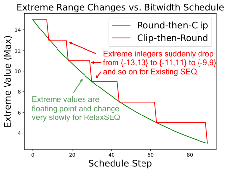
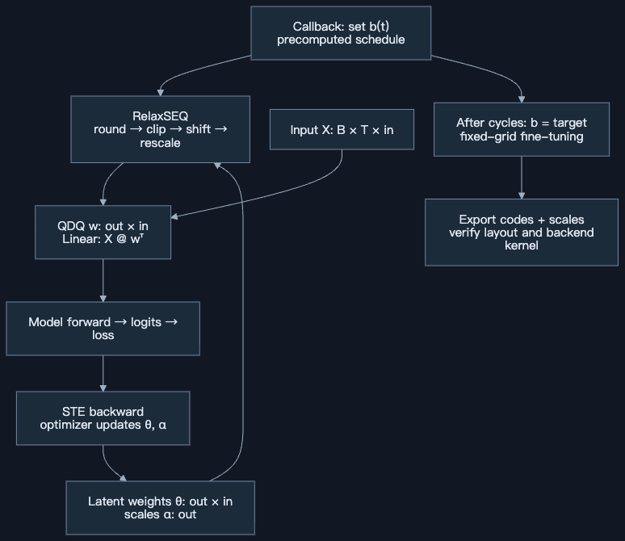
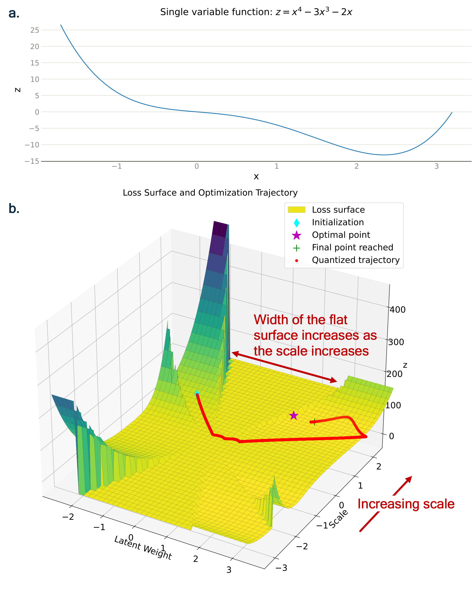
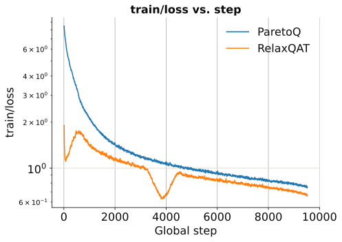
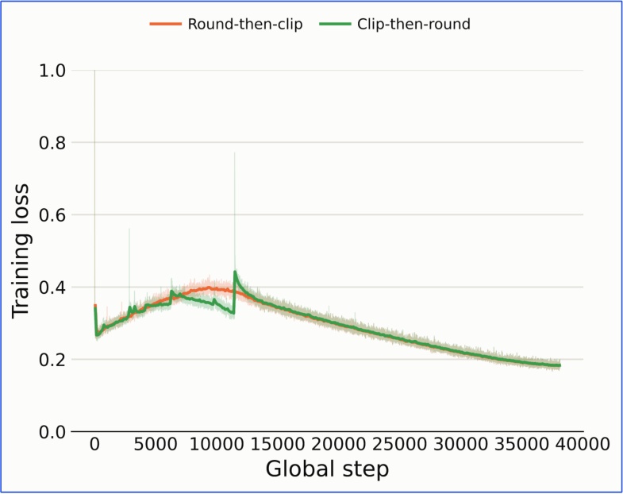
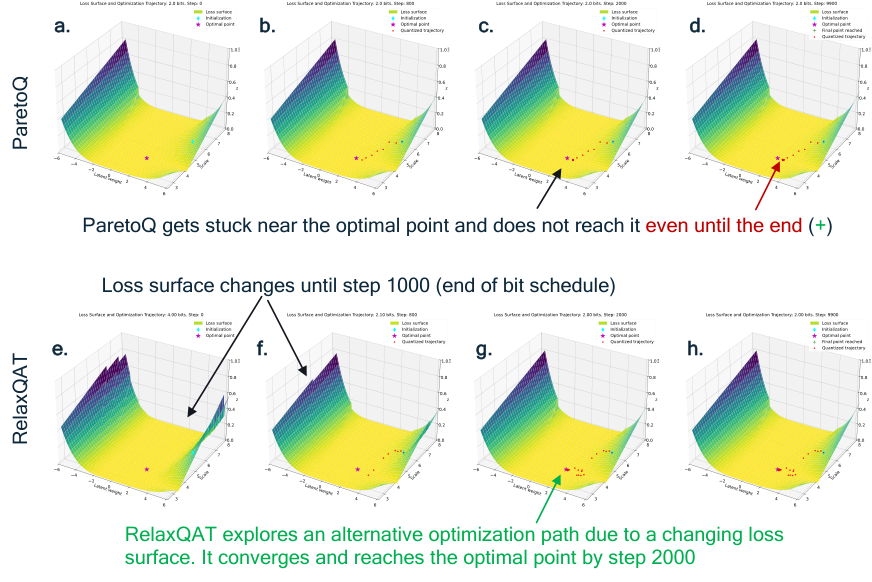
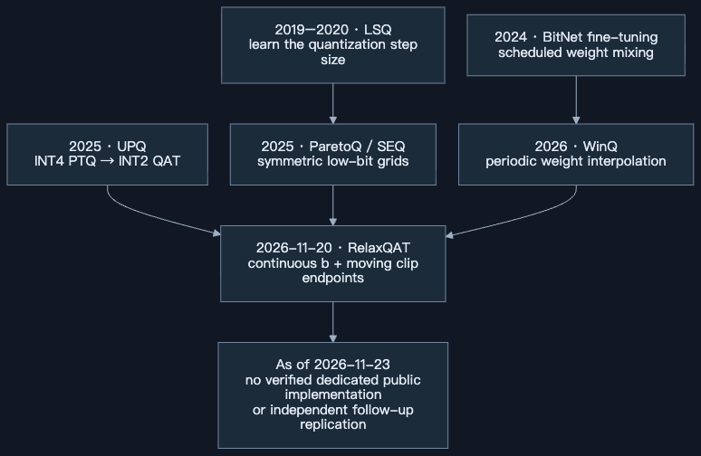

# RelaxQAT：让量化网格随训练移动，再收回到低比特

PAPER READINGS · QUANTIZATION & EDGE AI · ARXIV V1

**一句话：**RelaxQAT 在 QAT 中连续改变有效位宽，并把 SEQ 的 Clip-then-Round 改成 Round-then-Clip，让训练暂时拥有更密的量化网格和可移动的边界，最后固定到 2-bit 或 ternary 权重。

## Paper Metadata

| 字段 | 已核实信息 |
|---|---|
| Original title | A Continuous Relaxation of Quantization-Aware Training |
| Authors | Kartikeya Bhardwaj、Mohammed Almousa、Chaitanya Mullapudi、Ananth Balasubramanian、Nithin Ramesan、Tuc Nguyen、Harris Teague |
| Institution | Qualcomm AI Research；Qualcomm Technologies, Inc. |
| Publication | Preprint · 2026-11-20 · arXiv:2611.27056v1 · 17 页 |
| DOI | [10.48550/arXiv.2611.27056](https://doi.org/10.48550/arXiv.2611.27056) |
| Primary sources | [指定 v1 PDF](https://arxiv.org/pdf/2611.27056v1) · [arXiv metadata](https://arxiv.org/abs/2611.27056v1) · [v1 HTML](https://arxiv.org/html/2611.27056v1) · [保存的 PDF](sources/2611.27056v1.pdf) |
| Reading / Last updated | 2026-11-23 |
| Code / Project | 论文提供算法和 Triton 实现描述；本文专属公开代码、checkpoint 与项目页的核查见扩展研究 |

正文按 Abstract → §1–7 → Appendix A–F 排列，随后给出独立工程分析与扩展研究。**Paper** 表示论文报告；**Interpretation** 表示本精读的推导或判断；**External** 表示外部一手资料。质量分数和 GPU hours 都是作者报告，本次没有训练复现、GPU 性能复现或 HTP 真机测试。

## Abstract / TL;DR

**一段话。**极低比特 QAT 同时优化 latent 浮点权重和少量 channelwise scales。一个 latent 权重即使接到梯度，若更新没有跨越 rounding 边界，实际参与前向的 QDQ 权重也可能不变。RelaxQAT 先从更高有效位宽平滑降到目标位宽，再适时升高、降低一次，让网格边界移动；同时调整量化运算顺序，使非整数位宽下的裁剪端点不被最后一次 round 强行离散化。论文在五个 0.6B–4B 模型、10B-token QAT 上报告了语言和视觉任务收益，但结果是特定训练与 channelwise weight-only 量化设置下的比较，尚不能推出端侧吞吐、功耗或整体系统内存的改善。

五个关键点：

1. **调度的是量化函数参数。**“3.3 bits”表示连续的网格控制量，不是硬件在每个权重上保存 3.3 个物理比特。
2. **两部分需要配合。**仅给原 SEQ 加位宽 schedule，会在端点消失时产生 loss spikes；Round-then-Clip 是另一个核心改动。
3. **最终 2-bit 网格保留四个对称值。**归一化 QDQ 值为 α×{−3/4,−1/4,1/4,3/4}，可等价表示为 scale=α/4、integer codes={−3,−1,1,3}。
4. **摘要增益是百分点。**Qwen3-0.6B 的 47.04−39.34=7.70 pp；Qwen3.5-2B 视觉平均的 63.52−57.26=6.26 pp。相对最强基线分别是 +2.00、+3.75 pp。
5. **理论和工程边界需保留。**命题说明 rounding 单元宽度及条件性的更新方向；未证明大型网络必然逃出 saddle point。论文也没有给出 W2A8、量化 KV 或 QNN/HTP 的端到端结果。

## 1. Introduction：为什么 latent 权重在更新，QDQ 权重却可能停住

**Paper · pp.1–2。**生成模型的权重存储、带宽和能耗推动了低比特部署。4-bit 已有多种可用路线，2-bit 和 sub-2-bit 的难点更尖锐：可用量化级数少，量化损失面存在长时间不改变 integer codes 的区域。PTQ 不继续训练，难以在作者研究的极低比特设置中充分恢复精度；QAT 让模型适应前向里的量化误差。

需要分清三种对象。Latent weight θ 是优化器更新的浮点参数；scale α 是每个输出通道的可训练量；QDQ weight w 是经过 quantize/dequantize 后、真正送进 Linear 的浮点张量。QAT 的梯度通常通过 STE 近似穿过 round，但前向依然执行离散化。梯度非零与实际 QDQ 值改变是两件事。

**Interpretation。**设步长 δ=0.5、latent θ 从 0.06 更新到 0.08：round(θ/δ) 都是 0，实际 QDQ=0。若临时缩小 δ 到 0.125，0.08/0.125=0.64，可以越过 rounding 边界。这个确定性算例说明网格尺度影响前向变化；它不代表真实模型精度实验。

作者的问题因此是：能否连续改变 bitwidth 与 quantization bins，而不是从 FP 突然变成 2-bit，或在 4→2 的转换点突然丢掉一批可用值？论文将这称为 continuous relaxation of QAT。其硬件动机集中在 channelwise 权重量化，但没有把硬件支持当作已实测结果。

## 2. Related Work：优化 scale、混合权重，还是移动网格

**Paper · pp.2–3。**LSQ 将量化步长作为可训练参数；PACT 学习 activation clipping；LSQ+ 同时学习 scale 和 offset。ParetoQ 为 ternary / 2-bit 提出 Stretched Elastic Quantizer（SEQ），用对称网格改善低比特训练。

| 路线 | 本文描述的操作 | 与 RelaxQAT 的区别 |
|---|---|---|
| 固定低位宽 QAT / ParetoQ | 把前向权重放到固定低比特网格，再优化 θ、α | 网格密度的 b 不随训练时间变化 |
| BitNet fine-tuning schedule | 按 schedule 在 latent 与目标低比特权重之间混合 | 改的是混合系数；本文改的是 b 和裁剪端点 |
| WinQ | 周期性插值 quantized / latent weights，试图走出平坦区 | 插值可能改变输出值；RelaxQAT 改变可用网格和边界 |
| UPQ | 先 blockwise INT4 PTQ，再初始化 INT2 distillation QAT | 分阶段切换 precision；本文连续改变有效 b |
| RelaxQAT | sine bit schedule + RelaxSEQ | 两项改动共同构成训练配方 |

**实验身份审计。**论文的 BitNet baseline 是 Hugging Face 的 fine-tuning 路线，并且作者为了比较 2-bit，把原有量化函数换成 ParetoQ SEQ。这不能直接解读为与原始从头训练的 BitNet b1.58 模型公平比较。相关文献的准确出处、年份和公开实现放在文末的一手来源矩阵。

## 3. Proposed RelaxQAT：重新构建前向和训练链路

### 3.1 Bitwidth Schedule：下降、放宽、再下降、固定

ORIGINAL EQUATION (1) · source preserved<table class="ltx_equation ltx_eqn_table" id="S3.E1">
<tbody><tr class="ltx_equation ltx_eqn_row ltx_align_baseline">
<td class="ltx_eqn_cell ltx_eqn_center_padleft"></td>
<td class="ltx_eqn_cell ltx_align_center"><math alttext="b_{t}=b_{s}-(b_{s}-b_{e})\text{sin}\left(\frac{\pi}{2}\omega\right),\ \ \ \ \omega\in[0,1]" class="ltx_Math" display="block" id="S3.E1.m1" intent=":literal"><semantics><mrow><mrow><msub><mi>b</mi><mi>t</mi></msub><mo>=</mo><mrow><msub><mi>b</mi><mi>s</mi></msub><mo>−</mo><mrow><mrow><mo stretchy="false">(</mo><mrow><msub><mi>b</mi><mi>s</mi></msub><mo>−</mo><msub><mi>b</mi><mi>e</mi></msub></mrow><mo stretchy="false">)</mo></mrow><mo lspace="0em" rspace="0em">​</mo><mtext>sin</mtext><mo lspace="0em" rspace="0em">​</mo><mrow><mo>(</mo><mrow><mfrac><mi>π</mi><mn>2</mn></mfrac><mo lspace="0em" rspace="0em">​</mo><mi>ω</mi></mrow><mo>)</mo></mrow></mrow></mrow></mrow><mo rspace="2.167em">,</mo><mrow><mi>ω</mi><mo>∈</mo><mrow><mo stretchy="false">[</mo><mrow><mn>0</mn><mo>,</mo><mn>1</mn></mrow><mo stretchy="false">]</mo></mrow></mrow></mrow><annotation encoding="application/x-tex">b_{t}=b_{s}-(b_{s}-b_{e})\text{sin}\left(\frac{\pi}{2}\omega\right),\ \ \ \ \omega\in[0,1]</annotation></semantics></math></td>
<td class="ltx_eqn_cell ltx_eqn_center_padright"></td>
<td class="ltx_eqn_cell ltx_eqn_eqno ltx_align_middle ltx_align_right" rowspan="1">(1)</td></tr></tbody>
</table>

LaTeX source
<button type="button" class="copy-button">Copy</button><code>b_{t}=b_{s}-(b_{s}-b_{e})\text{sin}\left(\frac{\pi}{2}\omega\right),\ \ \ \ \omega\in[0,1]</code>

**符号与形状。**bₛ 为起始位宽、bₑ 为目标位宽，bₜ 为训练 step t 的有效位宽；ω∈[0,1] 为调度进度，都是标量。主实验 bₛ=4、bₑ=2。它们不属于模型 hidden tensor，也不是需要学习的网络输出。

**逐步运算。**先按本轮进度产生 ω，再计算 sin(πω/2)，以起止差值缩放后从 bₛ 中减去。ω=0 得到 bₛ；ω=1 得到 bₑ。解释性导数 db/dω=−(bₛ−bₑ)(π/2)cos(πω/2)，因此在 ω=1 时为零。这里“零梯度”指 schedule 的导数，不是权重梯度消失。在4-bit的折返处，分段调度可以有导数转折；“smooth”应重点理解为位宽连续、目标低位宽处平缓。

首个 half cycle 从 4 降到 2，在 mₛ 个采样点中完成；随后允许 n 个 full cycles：2→4→2。其余训练固定在 2-bit，给目标部署网格充分适应时间。Figure 1 的示例 mₛ=1200，step 3000 开始放宽，4200 达到 4，5400 回到 2。离散算法以 linspace(0,1,num=mₛ) 采样，所以最后采样索引是 mₛ−1；图上的连续时间节点与数组下标不应混为一谈。

<figure class="original" id="S3.F1"><figcaption class="ltx_caption ltx_centering">Figure 1: (a) An example of our proposed RelaxQAT bitwidth schedule which gradually and smoothly reduces the bitwidth. The gradient of the schedule 0 whenever it is approaches 2-bits; this helps to ease into the 2-bit precision instead of an abrupt change. (b) Prior progressive quantization methods reduce the bitwidth suddenly during training like UPQ, or (c) keep it the same throughout.</figcaption>
Source: Original paper · Figure 1 · complete author-provided asset. Click or press Enter to zoom.
</figure>

**Figure 1 深读。**从 (a) 的 sine 调度读到 (b) 的 UPQ 阶跃，再读 (c) 的 ParetoQ 固定位宽。横轴都是 training steps，纵轴是有效 bitwidth。只有 (a) 在低位宽端变平并回到更高位宽；这张图定义方法和比较概念，不是测得的 accuracy / latency 图。重新放宽后的网络仍用当时的 QDQ 值训练，最后必须回到 bₑ。

<section class="interactive" id="schedule-demo">
AGENT-CREATED VISUALIZATION · TEXTUAL SCHEDULE RECONSTRUCTION
<h4>先改变约束，再固定到目标网格</h4>
调整当前 step、half-cycle 长度与 full cycles，观察连续有效位宽。曲线按正文意图绘制，非原 Algorithm 2 的逐行执行；每次 full cycle 从 step 3000+2600i 开始，最后固定到 2-bit。

<label>Current step <input id="schedule-step" type="range" min="0" max="10000" step="50" value="3800"></label><label>Half-cycle duration <select id="schedule-ms"><option>400</option><option selected>800</option><option>1200</option></select></label><label>Full cycles <select id="schedule-n"><option>0</option><option selected>1</option><option>2</option></select></label>
<svg id="schedule-chart" viewBox="0 0 680 240" role="img" aria-label="有效位宽随训练step变化；标记当前位置"></svg><output id="schedule-result" aria-live="polite"></output>
Exact analytical schedule, not a measured accuracy or throughput curve. Original figure retained above.
</section>

### 3.2 RelaxSEQ：为什么交换 round 与 clip 的顺序

输入 θ∈ℝⁿˣᵐ 是 Linear latent weights，n 为输出通道、m 为输入通道；α∈ℝⁿ 是正的 channelwise scale，沿 m 广播。令 k=2^(b−1)、δ=α/k，输出 wₚ 或 wᵣ 都是 [n,m] 的 QDQ 张量。

ORIGINAL EQUATION (2) · source preserved<table class="ltx_equation ltx_eqn_table" id="S3.E2">
<tbody><tr class="ltx_equation ltx_eqn_row ltx_align_baseline">
<td class="ltx_eqn_cell ltx_eqn_center_padleft"></td>
<td class="ltx_eqn_cell ltx_align_center"><math alttext="w_{p}=\frac{\alpha}{k}\left\{\text{round}\left[\text{clip}\left(\frac{\theta}{\alpha},-1,1\right)\times k-0.5\right]+0.5\right\}." class="ltx_Math" display="block" id="S3.E2.m1" intent=":literal"><semantics><mrow><mrow><msub><mi>w</mi><mi>p</mi></msub><mo>=</mo><mrow><mfrac><mi>α</mi><mi>k</mi></mfrac><mo lspace="0em" rspace="0em">​</mo><mrow><mo>{</mo><mrow><mrow><mtext>round</mtext><mo lspace="0em" rspace="0em">​</mo><mrow><mo>[</mo><mrow><mrow><mrow><mtext>clip</mtext><mo lspace="0em" rspace="0em">​</mo><mrow><mo>(</mo><mfrac><mi>θ</mi><mi>α</mi></mfrac><mo>,</mo><mrow><mo>−</mo><mn>1</mn></mrow><mo>,</mo><mn>1</mn><mo rspace="0.055em">)</mo></mrow></mrow><mo rspace="0.222em">×</mo><mi>k</mi></mrow><mo>−</mo><mn>0.5</mn></mrow><mo>]</mo></mrow></mrow><mo>+</mo><mn>0.5</mn></mrow><mo>}</mo></mrow></mrow></mrow><mo lspace="0em">.</mo></mrow><annotation encoding="application/x-tex">w_{p}=\frac{\alpha}{k}\left\{\text{round}\left[\text{clip}\left(\frac{\theta}{\alpha},-1,1\right)\times k-0.5\right]+0.5\right\}.</annotation></semantics></math></td>
<td class="ltx_eqn_cell ltx_eqn_center_padright"></td>
<td class="ltx_eqn_cell ltx_eqn_eqno ltx_align_middle ltx_align_right" rowspan="1">(2)</td></tr></tbody>
</table>

LaTeX source
<button type="button" class="copy-button">Copy</button><code>w_{p}=\frac{\alpha}{k}\left\{\text{round}\left[\text{clip}\left(\frac{\theta}{\alpha},-1,1\right)\times k-0.5\right]+0.5\right\}.</code>

原 SEQ 先把 θ/α 限制在 [−1,1]，乘 k 并减 0.5，再 round，最后加 0.5、乘 α/k。最外层 round 的输入端点随 k 移动，但输出的 integer 部分只能阶梯改变。因此，非整数 b 不能单独使所有端点连续移动。

ORIGINAL EQUATION (3) · source preserved<table class="ltx_equation ltx_eqn_table" id="S3.E3">
<tbody><tr class="ltx_equation ltx_eqn_row ltx_align_baseline">
<td class="ltx_eqn_cell ltx_eqn_center_padleft"></td>
<td class="ltx_eqn_cell ltx_align_center"><math alttext="w_{r}=\frac{\alpha}{k}\left\{\text{clip}\left(\text{round}\left[\frac{\theta}{\alpha}\times k-0.5\right],-k,k-1\right)+0.5\right\}." class="ltx_Math" display="block" id="S3.E3.m1" intent=":literal"><semantics><mrow><mrow><msub><mi>w</mi><mi>r</mi></msub><mo>=</mo><mrow><mfrac><mi>α</mi><mi>k</mi></mfrac><mo lspace="0em" rspace="0em">​</mo><mrow><mo>{</mo><mrow><mrow><mtext>clip</mtext><mo lspace="0em" rspace="0em">​</mo><mrow><mo>(</mo><mrow><mtext>round</mtext><mo lspace="0em" rspace="0em">​</mo><mrow><mo>[</mo><mrow><mrow><mfrac><mi>θ</mi><mi>α</mi></mfrac><mo lspace="0.222em" rspace="0.222em">×</mo><mi>k</mi></mrow><mo>−</mo><mn>0.5</mn></mrow><mo>]</mo></mrow></mrow><mo>,</mo><mrow><mo>−</mo><mi>k</mi></mrow><mo>,</mo><mrow><mi>k</mi><mo>−</mo><mn>1</mn></mrow><mo>)</mo></mrow></mrow><mo>+</mo><mn>0.5</mn></mrow><mo>}</mo></mrow></mrow></mrow><mo lspace="0em">.</mo></mrow><annotation encoding="application/x-tex">w_{r}=\frac{\alpha}{k}\left\{\text{clip}\left(\text{round}\left[\frac{\theta}{\alpha}\times k-0.5\right],-k,k-1\right)+0.5\right\}.</annotation></semantics></math></td>
<td class="ltx_eqn_cell ltx_eqn_center_padright"></td>
<td class="ltx_eqn_cell ltx_eqn_eqno ltx_align_middle ltx_align_right" rowspan="1">(3)</td></tr></tbody>
</table>

LaTeX source
<button type="button" class="copy-button">Copy</button><code>w_{r}=\frac{\alpha}{k}\left\{\text{clip}\left(\text{round}\left[\frac{\theta}{\alpha}\times k-0.5\right],-k,k-1\right)+0.5\right\}.</code>

RelaxSEQ 先 round(θk/α−0.5)，再裁剪到 [−k,k−1]。当 k 非整数时，clip 可以输出非整数端点，避免最后一次 round 把端点重新固定。内层仍有 round；**连续 relaxation 不等于整个量化函数可微、所有 bins 连续、或整个 loss 处处光滑。**

**2-bit 终点的精确算例。**b=2→k=2。round 输出裁剪为 {−2,−1,0,1}，加 0.5 得 {−1.5,−0.5,0.5,1.5}，乘 α/2 得 α×{−0.75,−0.25,0.25,0.75}。把共同 scale 改写为 α/4，就得到论文所称的对称整数网格 {−3,−1,1,3}。这四个值需要四种 code；数值是 ±3 不代表每个权重必须保存 signed INT3，实际打包仍可以用 2-bit 的四个索引和解码映射。

**非整数位宽时。**饱和正、负端点分别为 α(1−0.5/k)、−α(1−0.5/k)。它们随 k 连续改变；内部 half-integer bins 的数量和归属仍可能离散变化。这个性质解释了作者为何强调 *extreme values*。

**原SEQ端点的实现疑点。**若把Eq.(2)原样交给ties-to-even的round，b=2、θ/α=1时round(1.5)=2，QDQ=1.25α，等价odd code为5，超出论文声称的四级网格；负端却为−0.75α。饱和clip会产生精确端点，因此不能把它简单视作随机浮点数的零概率事件。可能有未印出的epsilon或特殊clamp/rounding；本文没有原实现，不能断言作者真实实验也如此。Eq.(3)在round后再clip，明确限制了输出范围。本页红线忠实计算印刷Eq.(2)，不是未经核实的ParetoQ官方kernel行为。

<figure class="original" id="S3.F2"><figcaption class="ltx_caption ltx_centering">Figure 2: ParetoQ SEQ with a bitwidth schedule loses extreme integers as <math alttext="k=2^{b_{t}-1}" class="ltx_Math" display="inline" id="S3.F2.m2" intent=":literal"><semantics><mrow><mi>k</mi><mo>=</mo><msup><mn>2</mn><mrow><msub><mi>b</mi><mi>t</mi></msub><mo>−</mo><mn>1</mn></mrow></msup></mrow><annotation encoding="application/x-tex">k=2^{b_{t}-1}</annotation></semantics></math> decreases with a shrinking bitwidth. RelaxSEQ shows a smooth change in extreme values which results in a smoothly changing loss.</figcaption>
Source: Original paper · Figure 2 · complete author-provided asset. Click or press Enter to zoom.
</figure>

**Figure 2 深读。**固定 latent weights 和 scales，只改变 b；红线为原 SEQ 的端点、绿线为 RelaxSEQ。横向看红色阶梯如何突然降低，再看绿色如何渐变。论文图中的“整数网格”采用等价的缩放表达，不能把图上 ±15 等标签直接当成输出 α×15。它支持端点变化机制，不能单独证明真实网络一定更快收敛。

<section class="interactive" id="grid-demo">
AGENT-CREATED VISUALIZATION · EXACT EQUATIONS (2), (3), (9)
<h4>看端点怎样移动，而不是把 b 当物理编码宽度</h4>
固定 α=1。左右比较原 SEQ 与 RelaxSEQ；调整 b 或切换 ternary 公式，观察 QDQ 阶梯及饱和端点。round 使用 ties-to-even。

<label>Effective bitwidth <input id="grid-bits" type="range" min="2" max="4" step="0.01" value="3.30"></label><label>Target grid <select id="grid-kind"><option value="two">2-bit SEQ schedule</option><option value="ternary">Ternary · exact log₂3 endpoint</option><option value="literal">Ternary · literal 1.58 endpoint</option></select></label>
<svg id="grid-chart" viewBox="0 0 680 280" role="img" aria-label="latent weight与QDQ weight映射；对比原SEQ和RelaxSEQ"></svg><output id="grid-result" aria-live="polite"></output>
曲线是确定性公式求值，没有生成模拟训练或误差数据；内部 rounding 边界仍可跳变。
</section>

**Backward / STE。**作者称 backward 与 ParetoQ SEQ 类似，只按 Eq.(3) 修改 clipping ranges；没有给出完整 custom autograd 或 Triton backward 源码。训练时 θ 和 α 均可学习，round 的真导数几乎处处为零，需要近似梯度。对于中间 non-clipped bin，采用 round 的 identity STE 时，∂w/∂θ≈1，∂w/∂α≈q/k−θ/α；这是**解释性局部推导**，不包括饱和分支、scale 梯度归一化或作者未披露的实现细节。

### 3.3 RelaxQAT：callback 怎样进入 Linear

<figure class="generated" id="flow-explainer"><figcaption>Agent-created Visualization · RelaxQAT training dependency. Solid arrows carry tensors; schedule controls the quantizer. <a href="assets/generated/flow.mmd">Mermaid source</a>.</figcaption></figure>

**执行链路。**Callback 在 optimizer training step 开始时为所有 SEQ modules 设置 bₜ；各 Linear forward 由 θ、α 和 bₜ 计算 wᵣ，再执行通常的矩阵乘法。损失通过模型回传到 θ、α，optimizer 更新它们。不同 step 改的是同一组 latent 参数的量化映射，并没有串联一个额外语言模型。

| 对象 | 输入 / 形状 | 输出 / 作用 |
|---|---|---|
| Callback 初始化 | bₛ,bₑ,mₛ,cₛₛ,cₑₛ,cₗ，全部为标量 | 长度 mₛ 的预计算数组 B、cycle starts C |
| Linear 参数 | θ:[n,m]，α:[n] | 训练保留浮点 latent 参数和 scale |
| RelaxSEQ | θ、α、当前 bₜ | wᵣ:[n,m]，与输入 weight 维度相同 |
| Linear forward | X:[B,T,m]，wᵣ:[n,m] | Y:[B,T,n]；主矩阵乘法约 2BTmn FLOPs |
| Loss / optimizer | logits:[B,T,V]，labels:[B,T] | 标量 loss，更新 θ、α；论文未完整写出 baseline 各自 loss |
| 最后固定网格 / 导出 | b=bₑ、学到的 θ/α | 固定低比特 codes + scales，部署格式仍需实现 |

<figure class="algorithm" id="alg1"><figcaption>Algorithm 1 RelaxQATCallback: At initialization · Original paper pseudocode</figcaption>

ORIGINAL ALGORITHM 1 · PSEUDOCODE<button type="button" class="copy-button">Copy</button>
<pre><code>1: function InitializeRelaxQATCallback (model, start_bits ( b s ), end_bits ( b e ), cycle_start_step ( c s ​ s ), cycle_end_step ( c e ​ s ), cycle_length ( c l ), max_schedule_steps ( m s ))
2: Assert c s ​ s &gt; m s
3: Assert c l &gt; 2 ⋅ m s
4: Assert b s &gt; b e
5: Assert ( c e ​ s − c s ​ s ) % ​ c l = 0
6: ω ← linspace ⁡ ( 0 , 1 , num = m s )
7: B ← ( b s − ( b s − b e ) CLOSE OPEN sin ⁡ ( ( π / 2 ) ​ ω ) )
8: n ← ( ( c e ​ s − c s ​ s ) / c l ) + 1 # number of cycles
9: 𝒞 ← linspace ⁡ ( c s ​ s , c e ​ s , num = n )
10: m ​ o ​ d ​ u ​ l ​ e ​ s ← all SEQ modules in model
11: for all m ∈ m ​ o ​ d ​ u ​ l ​ e ​ s do
12: m . e ​ n ​ a ​ b ​ l ​ e ​ _ ​ r ​ e ​ l ​ a ​ x ​ _ ​ q ​ a ​ t ← true
13: m . i ← 0 # current bit schedule index
14: m . B ← B # bit schedule list: [ b s , b e ]
15: m . c ​ c ​ i ← 0 # current_cycle_idx
16: m . p ​ c ​ i ← − 1 # previous_cycle_idx
17: end for
18: return initialized callback state
19: end function</code></pre>
</figure>

**Algorithm 1 阅读。**它检查 cₛₛ>mₛ、cₗ>2mₛ、bₛ>bₑ、(cₑₛ−cₛₛ)%cₗ=0，再生成 B 与 n=(cₑₛ−cₛₛ)/cₗ+1 个 cycle starts。预先计算 sine 减少 forward 内的调度计算。C 存储的是循环开始时刻，不是每次循环的完成时刻。

<figure class="algorithm" id="alg2"><figcaption>Algorithm 2 RelaxQATCallback: At each training step · Original paper pseudocode</figcaption>

ORIGINAL ALGORITHM 2 · PSEUDOCODE<button type="button" class="copy-button">Copy</button>
<pre><code>1: function RelaxQATOnStepBegin ( m ​ o ​ d ​ u ​ l ​ e ​ s , global_step ( t ), cycle_intervals ( 𝒞 ), max_schedule_steps ( m s ))
2: for all m ∈ m ​ o ​ d ​ u ​ l ​ e ​ s do
3: if t &lt; 𝒞 ⁡ [ 0 ] then # first half cycle from b s to b e
4: m . i ← min ⁡ ( t , m s − 1 )
5: else if t &lt; 𝒞 ⁡ [ − 1 ] then # n full cycles
6: if t = 𝒞 [ m . c c i ] then
7: # Update current and previous cycle idx
8: m . i ← m s − 1
9: m . c ​ c ​ i ← m . c ​ c ​ i + 1
10: m . p ​ c ​ i ← m . p ​ c ​ i + 1
11: else if t ≤ 𝒞 [ m . p c i ] + m s − 1 then
12: # first: relax bits from b e to b s
13: m . i ← 𝒞 [ m . p c i ] + m s − 1 − t
14: else
15: # second: reduce bits from b s to b e
16: m . i ← min ( t − ( 𝒞 [ m . p c i ] + m s − 1 ) , m s − 1 )
17: end if
18: else # all n cycles ended: set bits to b e
19: m . i ← m s − 1
20: end if
21: m . b t ← m . B [ m . i ] # set dynamic bitwidth b t
22: end for
23: return dynamic bitwidth b t for all SEQ modules
24: end function</code></pre>
</figure>

<strong>原算法边界审计。</strong>Algorithm 2 的 full-cycle 分支条件是 t&lt;C[−1]，结束分支从最后一个 cycle start 起就设置 bₑ。当 n=1 时 C[0]=C[−1]：t&lt;C[0] 执行首个 half cycle，否则直接结束，完整的 2→4→2 循环不可达。n&gt;1 时最后一个循环同样会被跳过。正文与 Figure 1 显示作者意图包含该循环，Table 9 也比较了 n。本精读保留原伪代码；交互按正文意图重构，不能据此断言作者实验源码有同样缺陷。真正复现应核对 cycle end、callback 调用次数、checkpoint 恢复和全部边界。

<figure class="algorithm" id="alg3"><figcaption>Algorithm 3 RelaxSEQ for 2-bit QAT · Original paper pseudocode</figcaption>

ORIGINAL ALGORITHM 3 · PSEUDOCODE<button type="button" class="copy-button">Copy</button>
<pre><code>1: function RelaxSEQ ( θ , α , b )
2: n l ​ e ​ v ​ e ​ l ​ s ← 2 b − 1
3: shift ← 0.5
4: δ ← α / n l ​ e ​ v ​ e ​ l ​ s
5: q b ​ i ​ n ​ s ← round ⁡ ( θ / δ − CLOSE shift )
6: q b ​ i ​ n ​ s ← clip ⁡ ( q b ​ i ​ n ​ s , − n l ​ e ​ v ​ e ​ l ​ s , n l ​ e ​ v ​ e ​ l ​ s − 1 )
7: q ← q b ​ i ​ n ​ s + shift
8: w r ← q ⋅ δ
9: return w r
10: end function</code></pre>
</figure>

**Algorithm 3 阅读。**n_levels 实际表示 k=2^(b−1)，不总是可用 levels 的整数个数。δ=α/k 后 round→clip→shift→rescale 正好实现 Eq.(3)。它输出浮点 QDQ，训练并不因此变成真正的 2-bit GEMM。每步近似复杂度 O(nm)；若逐层 materialize QDQ，需要额外浮点缓冲。

### 3.4 Systems Considerations：训练开销相近，推理尚未测量

<figure class="original-table" id="S3.T1">
<table class="ltx_tabular ltx_guessed_headers ltx_align_middle" id="S3.T1.2.1">
<thead class="ltx_thead">
<tr class="ltx_tr" id="S3.T1.2.1.1">
<th class="ltx_td ltx_align_left ltx_th ltx_th_column ltx_th_row ltx_border_tt" id="S3.T1.2.1.1.1" scope="col">Method</th>
<th class="ltx_td ltx_align_center ltx_th ltx_th_column ltx_border_tt" id="S3.T1.2.1.1.2" scope="col">GPU Hours</th></tr>
</thead>
<tbody class="ltx_tbody">
<tr class="ltx_tr" id="S3.T1.2.1.2">
<th class="ltx_td ltx_align_left ltx_th ltx_th_row ltx_border_t" id="S3.T1.2.1.2.1">ParetoQ</th>
<td class="ltx_td ltx_align_center ltx_border_t" id="S3.T1.2.1.2.2">370</td></tr>
<tr class="ltx_tr" id="S3.T1.2.1.3">
<th class="ltx_td ltx_align_left ltx_th ltx_th_row ltx_border_bb ltx_border_t" id="S3.T1.2.1.3.1">RelaxQAT (ours)</th>
<td class="ltx_td ltx_align_center ltx_border_bb ltx_border_t" id="S3.T1.2.1.3.2">361 (-2.4%)</td></tr>
</tbody>
</table>
<figcaption class="ltx_caption">Table 1: Training Speeds for Qwen3-0.6B model on 10B tokens.</figcaption>
Source: Original paper · Table 1. All rows, columns, emphasis, merged cells and footnotes retained.
</figure>

**Table 1 深读。**同为 Qwen3-0.6B、10B tokens、8×H100，ParetoQ 370 GPU hours、RelaxQAT 361 GPU hours。差 9 GPU hours，相对减少 2.432%；若是累计 GPU hours，等价 wall-clock 分别为 46.25 与 45.125 小时。作者明确称差异处于误差范围，合理结论是实现后训练速度接近，而非可靠的 2.4% speedup。

两种 SEQ 都实现了 Triton kernels，因此比较包含相近优化；sine schedule 预计算后每步只查表赋值。论文没有报告误差条、运行次数、kernel 时间、显存峰值或分层 per-op profiling。该表仅覆盖 0.6B 模型，不能直接推广到 A100 的更大模型、视觉 tower 或不同序列长度。

## 4. Theoretical Insights：两个条件性结论

### LSQ 作为分析模型

ORIGINAL EQUATION (4) · source preserved<table class="ltx_equation ltx_eqn_table" id="S4.E4">
<tbody><tr class="ltx_equation ltx_eqn_row ltx_align_baseline">
<td class="ltx_eqn_cell ltx_eqn_center_padleft"></td>
<td class="ltx_eqn_cell ltx_align_center"><math alttext="w_{l}=\frac{\alpha}{k}\left\{\text{clip}\left(\text{round}\left[\frac{\theta}{\alpha}\times k\right],-k,k-1\right)\right\}." class="ltx_Math" display="block" id="S4.E4.m1" intent=":literal"><semantics><mrow><mrow><msub><mi>w</mi><mi>l</mi></msub><mo>=</mo><mrow><mfrac><mi>α</mi><mi>k</mi></mfrac><mo lspace="0em" rspace="0em">​</mo><mrow><mo>{</mo><mrow><mtext>clip</mtext><mo lspace="0em" rspace="0em">​</mo><mrow><mo>(</mo><mrow><mtext>round</mtext><mo lspace="0em" rspace="0em">​</mo><mrow><mo>[</mo><mrow><mfrac><mi>θ</mi><mi>α</mi></mfrac><mo lspace="0.222em" rspace="0.222em">×</mo><mi>k</mi></mrow><mo>]</mo></mrow></mrow><mo>,</mo><mrow><mo>−</mo><mi>k</mi></mrow><mo>,</mo><mrow><mi>k</mi><mo>−</mo><mn>1</mn></mrow><mo>)</mo></mrow></mrow><mo>}</mo></mrow></mrow></mrow><mo lspace="0em">.</mo></mrow><annotation encoding="application/x-tex">w_{l}=\frac{\alpha}{k}\left\{\text{clip}\left(\text{round}\left[\frac{\theta}{\alpha}\times k\right],-k,k-1\right)\right\}.</annotation></semantics></math></td>
<td class="ltx_eqn_cell ltx_eqn_center_padright"></td>
<td class="ltx_eqn_cell ltx_eqn_eqno ltx_align_middle ltx_align_right" rowspan="1">(4)</td></tr></tbody>
</table>

LaTeX source
<button type="button" class="copy-button">Copy</button><code>w_{l}=\frac{\alpha}{k}\left\{\text{clip}\left(\text{round}\left[\frac{\theta}{\alpha}\times k\right],-k,k-1\right)\right\}.</code>

相比 RelaxSEQ，LSQ 去掉了 half-bin shift，b=2 时为 {−2,−1,0,1}×α/2。这是不对称、包含零的四级网格。论文利用较简单的表达分析边界宽度，再把几何直觉延伸到 SEQ；性能实验的主要方法仍是 RelaxSEQ。

### Proposition 1：网格宽度随 b 怎样改变

固定同一个 α，在未饱和的 LSQ rounding 区域，θ/δ 从一个 bin 中心跨到边界至少需要移动 0.5；对应 θ 的整个 bin 宽度为 δ=α/2^(b−1)。b₁<b₂ 时，宽度缩小 2^(b₂−b₁) 倍。原证明的比值公式在 Appendix B，详见 Eq.(8)。

**边界。**这是固定 α、沿 latent θ 方向、内部未裁剪 rounding 单元的几何关系。若 α 同时更新，应使用 δ₂/δ₁=(α₂/α₁)2^(b₁−b₂)；饱和区宽度不能直接套用内部 bin 宽度。提高位宽可以改变前向映射，未证明每种优化器都必然跨 bin、离开 saddle point 或到达全局最小值。

<figure class="original" id="S4.F3"><figcaption class="ltx_caption ltx_centering">Figure 3: (a) A simple 1-d function to minimize. (b) The 1-d function above results in a highly complex 2-d, 2-bit quantization loss surface (generated using LSQ) where the width of the hyperplanes (defined as the flat regions between integer changes) increases with larger scales. Red line shows the QAT trajectory.</figcaption>
Source: Original paper · Figure 3 · complete author-provided asset. Click or press Enter to zoom.
</figure>

**Figure 3 深读。**(a) 原标量函数 f(x)=x⁴−3x³−2x；(b) 用 w(θ,δ) 替代 x 后，在 latent θ 与 scale δ 的二维面上显示 f(w)。层阶边界对应 integer code 变化，红线是 QAT 轨迹。沿固定 scale 截面能看见更大 δ 的 bin 更宽；二维区域内部随着 δ 改变，f(δz) 仍可以变化，所以“flat”不能理解成整个 θ–δ 平面都常数。它是机制算例，没有大型模型泛化证明。

### Proposition 2：integer codes 不变时，前向更新来自哪里

ORIGINAL EQUATION (5) · source preserved<table class="ltx_equation ltx_eqn_table" id="S4.E5">
<tbody><tr class="ltx_equation ltx_eqn_row ltx_align_baseline">
<td class="ltx_eqn_cell ltx_eqn_center_padleft"></td>
<td class="ltx_eqn_cell ltx_align_center"><math alttext="w^{(t)}=\delta^{(t)}\left\lfloor\frac{\theta^{(t)}}{\delta^{(t)}}\right\rceil=\delta^{(t)}z^{(t)}," class="ltx_Math" display="block" id="S4.E5.m1" intent=":literal"><semantics><mrow><mrow><msup><mi>w</mi><mrow><mo stretchy="false">(</mo><mi>t</mi><mo stretchy="false">)</mo></mrow></msup><mo>=</mo><mrow><msup><mi>δ</mi><mrow><mo stretchy="false">(</mo><mi>t</mi><mo stretchy="false">)</mo></mrow></msup><mo lspace="0em" rspace="0em">​</mo><mrow><mo>⌊</mo><mfrac><msup><mi>θ</mi><mrow><mo stretchy="false">(</mo><mi>t</mi><mo stretchy="false">)</mo></mrow></msup><msup><mi>δ</mi><mrow><mo stretchy="false">(</mo><mi>t</mi><mo stretchy="false">)</mo></mrow></msup></mfrac><mo>⌉</mo></mrow></mrow><mo>=</mo><mrow><msup><mi>δ</mi><mrow><mo stretchy="false">(</mo><mi>t</mi><mo stretchy="false">)</mo></mrow></msup><mo lspace="0em" rspace="0em">​</mo><msup><mi>z</mi><mrow><mo stretchy="false">(</mo><mi>t</mi><mo stretchy="false">)</mo></mrow></msup></mrow></mrow><mo>,</mo></mrow><annotation encoding="application/x-tex">w^{(t)}=\delta^{(t)}\left\lfloor\frac{\theta^{(t)}}{\delta^{(t)}}\right\rceil=\delta^{(t)}z^{(t)},</annotation></semantics></math></td>
<td class="ltx_eqn_cell ltx_eqn_center_padright"></td>
<td class="ltx_eqn_cell ltx_eqn_eqno ltx_align_middle ltx_align_right" rowspan="1">(5)</td></tr></tbody>
</table>

LaTeX source
<button type="button" class="copy-button">Copy</button><code>w^{(t)}=\delta^{(t)}\left\lfloor\frac{\theta^{(t)}}{\delta^{(t)}}\right\rceil=\delta^{(t)}z^{(t)},</code>

w、θ、z 均为 [n,m]；δ:[n] 沿输入通道广播。在本命题中 b 固定为整数，z 是 round-then-clip 得到的 codes。δ 由 α 与固定 k 组成；此处不包含调度引起的 dk/dt。

ORIGINAL EQUATION (6) · source preserved<table class="ltx_equationgroup ltx_eqn_table" id="S4.E6">
<tbody>
<tr class="ltx_equation ltx_eqn_row ltx_align_baseline" id="S4.E6X">
<td class="ltx_eqn_cell ltx_eqn_center_padleft"></td>
<td class="ltx_td ltx_align_right ltx_eqn_cell"><math alttext="\displaystyle w^{(t+1)}" class="ltx_Math" display="inline" id="S4.E6X.m2" intent=":literal"><semantics><msup><mi>w</mi><mrow><mo stretchy="false">(</mo><mrow><mi>t</mi><mo>+</mo><mn>1</mn></mrow><mo stretchy="false">)</mo></mrow></msup><annotation encoding="application/x-tex">\displaystyle w^{(t+1)}</annotation></semantics></math></td>
<td class="ltx_td ltx_align_left ltx_eqn_cell"><math alttext="\displaystyle=\delta^{(t+1)}\left\lfloor\frac{\theta^{(t+1)}}{\delta^{(t+1)}}\right\rceil" class="ltx_Math" display="inline" id="S4.E6X.m3" intent=":literal"><semantics><mrow><mphantom></mphantom><mo>=</mo><mrow><msup><mi>δ</mi><mrow><mo stretchy="false">(</mo><mrow><mi>t</mi><mo>+</mo><mn>1</mn></mrow><mo stretchy="false">)</mo></mrow></msup><mo lspace="0em" rspace="0em">​</mo><mrow><mo>⌊</mo><mstyle displaystyle="true"><mfrac><msup><mi>θ</mi><mrow><mo stretchy="false">(</mo><mrow><mi>t</mi><mo>+</mo><mn>1</mn></mrow><mo stretchy="false">)</mo></mrow></msup><msup><mi>δ</mi><mrow><mo stretchy="false">(</mo><mrow><mi>t</mi><mo>+</mo><mn>1</mn></mrow><mo stretchy="false">)</mo></mrow></msup></mfrac></mstyle><mo>⌉</mo></mrow></mrow></mrow><annotation encoding="application/x-tex">\displaystyle=\delta^{(t+1)}\left\lfloor\frac{\theta^{(t+1)}}{\delta^{(t+1)}}\right\rceil</annotation></semantics></math></td>
<td class="ltx_eqn_cell ltx_eqn_center_padright"></td>
<td class="ltx_eqn_cell ltx_eqn_eqno ltx_align_middle ltx_align_right" rowspan="4">(6)</td></tr>
<tr class="ltx_equation ltx_eqn_row ltx_align_baseline" id="S4.E6Xa">
<td class="ltx_eqn_cell ltx_eqn_center_padleft"></td>
<td class="ltx_td ltx_eqn_cell"></td>
<td class="ltx_td ltx_align_left ltx_eqn_cell"><math alttext="\displaystyle=(\delta^{(t)}-\eta d_{\delta}^{(t)})\left\lfloor\frac{(\theta^{(t)}-\eta d_{\theta}^{(t)})}{(\delta^{(t)}-\eta d_{\delta}^{(t)})}\right\rceil" class="ltx_Math" display="inline" id="S4.E6Xa.m2" intent=":literal"><semantics><mrow><mphantom></mphantom><mo>=</mo><mrow><mrow><mo stretchy="false">(</mo><mrow><msup><mi>δ</mi><mrow><mo stretchy="false">(</mo><mi>t</mi><mo stretchy="false">)</mo></mrow></msup><mo>−</mo><mrow><mi>η</mi><mo lspace="0em" rspace="0em">​</mo><msubsup><mi>d</mi><mi>δ</mi><mrow><mo stretchy="false">(</mo><mi>t</mi><mo stretchy="false">)</mo></mrow></msubsup></mrow></mrow><mo stretchy="false">)</mo></mrow><mo lspace="0em" rspace="0em">​</mo><mrow><mo>⌊</mo><mstyle displaystyle="true"><mfrac><mrow><mo stretchy="false">(</mo><mrow><msup><mi>θ</mi><mrow><mo stretchy="false">(</mo><mi>t</mi><mo stretchy="false">)</mo></mrow></msup><mo>−</mo><mrow><mi>η</mi><mo lspace="0em" rspace="0em">​</mo><msubsup><mi>d</mi><mi>θ</mi><mrow><mo stretchy="false">(</mo><mi>t</mi><mo stretchy="false">)</mo></mrow></msubsup></mrow></mrow><mo stretchy="false">)</mo></mrow><mrow><mo stretchy="false">(</mo><mrow><msup><mi>δ</mi><mrow><mo stretchy="false">(</mo><mi>t</mi><mo stretchy="false">)</mo></mrow></msup><mo>−</mo><mrow><mi>η</mi><mo lspace="0em" rspace="0em">​</mo><msubsup><mi>d</mi><mi>δ</mi><mrow><mo stretchy="false">(</mo><mi>t</mi><mo stretchy="false">)</mo></mrow></msubsup></mrow></mrow><mo stretchy="false">)</mo></mrow></mfrac></mstyle><mo>⌉</mo></mrow></mrow></mrow><annotation encoding="application/x-tex">\displaystyle=(\delta^{(t)}-\eta d_{\delta}^{(t)})\left\lfloor\frac{(\theta^{(t)}-\eta d_{\theta}^{(t)})}{(\delta^{(t)}-\eta d_{\delta}^{(t)})}\right\rceil</annotation></semantics></math></td>
<td class="ltx_eqn_cell ltx_eqn_center_padright"></td></tr>
<tr class="ltx_equation ltx_eqn_row ltx_align_baseline" id="S4.E6Xb">
<td class="ltx_eqn_cell ltx_eqn_center_padleft"></td>
<td class="ltx_td ltx_eqn_cell"></td>
<td class="ltx_td ltx_align_left ltx_eqn_cell"><math alttext="\displaystyle=(\delta^{(t)}-\eta d_{\delta}^{(t)})z^{(t+1)}" class="ltx_Math" display="inline" id="S4.E6Xb.m2" intent=":literal"><semantics><mrow><mphantom></mphantom><mo>=</mo><mrow><mrow><mo stretchy="false">(</mo><mrow><msup><mi>δ</mi><mrow><mo stretchy="false">(</mo><mi>t</mi><mo stretchy="false">)</mo></mrow></msup><mo>−</mo><mrow><mi>η</mi><mo lspace="0em" rspace="0em">​</mo><msubsup><mi>d</mi><mi>δ</mi><mrow><mo stretchy="false">(</mo><mi>t</mi><mo stretchy="false">)</mo></mrow></msubsup></mrow></mrow><mo stretchy="false">)</mo></mrow><mo lspace="0em" rspace="0em">​</mo><msup><mi>z</mi><mrow><mo stretchy="false">(</mo><mrow><mi>t</mi><mo>+</mo><mn>1</mn></mrow><mo stretchy="false">)</mo></mrow></msup></mrow></mrow><annotation encoding="application/x-tex">\displaystyle=(\delta^{(t)}-\eta d_{\delta}^{(t)})z^{(t+1)}</annotation></semantics></math></td>
<td class="ltx_eqn_cell ltx_eqn_center_padright"></td></tr>
<tr class="ltx_equation ltx_eqn_row ltx_align_baseline" id="S4.E6Xc">
<td class="ltx_eqn_cell ltx_eqn_center_padleft"></td>
<td class="ltx_td ltx_eqn_cell"></td>
<td class="ltx_td ltx_align_left ltx_eqn_cell"><math alttext="\displaystyle=\delta^{(t)}z^{(t+1)}-\eta z^{(t+1)}d_{\delta}^{(t)}," class="ltx_Math" display="inline" id="S4.E6Xc.m2" intent=":literal"><semantics><mrow><mrow><mphantom></mphantom><mo>=</mo><mrow><mrow><msup><mi>δ</mi><mrow><mo stretchy="false">(</mo><mi>t</mi><mo stretchy="false">)</mo></mrow></msup><mo lspace="0em" rspace="0em">​</mo><msup><mi>z</mi><mrow><mo stretchy="false">(</mo><mrow><mi>t</mi><mo>+</mo><mn>1</mn></mrow><mo stretchy="false">)</mo></mrow></msup></mrow><mo>−</mo><mrow><mi>η</mi><mo lspace="0em" rspace="0em">​</mo><msup><mi>z</mi><mrow><mo stretchy="false">(</mo><mrow><mi>t</mi><mo>+</mo><mn>1</mn></mrow><mo stretchy="false">)</mo></mrow></msup><mo lspace="0em" rspace="0em">​</mo><msubsup><mi>d</mi><mi>δ</mi><mrow><mo stretchy="false">(</mo><mi>t</mi><mo stretchy="false">)</mo></mrow></msubsup></mrow></mrow></mrow><mo>,</mo></mrow><annotation encoding="application/x-tex">\displaystyle=\delta^{(t)}z^{(t+1)}-\eta z^{(t+1)}d_{\delta}^{(t)},</annotation></semantics></math></td>
<td class="ltx_eqn_cell ltx_eqn_center_padright"></td></tr></tbody>
</table>

LaTeX source
<button type="button" class="copy-button">Copy</button><code>\displaystyle w^{(t+1)}
\displaystyle=\delta^{(t+1)}\left\lfloor\frac{\theta^{(t+1)}}{\delta^{(t+1)}}\right\rceil
\displaystyle=(\delta^{(t)}-\eta d_{\delta}^{(t)})\left\lfloor\frac{(\theta^{(t)}-\eta d_{\theta}^{(t)})}{(\delta^{(t)}-\eta d_{\delta}^{(t)})}\right\rceil
\displaystyle=(\delta^{(t)}-\eta d_{\delta}^{(t)})z^{(t+1)}
\displaystyle=\delta^{(t)}z^{(t+1)}-\eta z^{(t+1)}d_{\delta}^{(t)},</code>

η 为学习率，dθ 和 dδ 是优化器根据梯度、状态给出的 update，不一定等于原始梯度。新的 z^(t+1) 同时取决于 θ 和 δ 的更新。将乘法展开，得到旧 δ×新 z 与 scale-update×新 z 两项；latent 的直接作用体现在新 codes 是否改变。

ORIGINAL EQUATION (7) · source preserved<table class="ltx_equationgroup ltx_eqn_table" id="S4.E7">
<tbody>
<tr class="ltx_equation ltx_eqn_row ltx_align_baseline" id="S4.E7X">
<td class="ltx_eqn_cell ltx_eqn_center_padleft"></td>
<td class="ltx_td ltx_align_right ltx_eqn_cell"><math alttext="\displaystyle w^{(t+1)}" class="ltx_Math" display="inline" id="S4.E7X.m2" intent=":literal"><semantics><msup><mi>w</mi><mrow><mo stretchy="false">(</mo><mrow><mi>t</mi><mo>+</mo><mn>1</mn></mrow><mo stretchy="false">)</mo></mrow></msup><annotation encoding="application/x-tex">\displaystyle w^{(t+1)}</annotation></semantics></math></td>
<td class="ltx_td ltx_align_left ltx_eqn_cell"><math alttext="\displaystyle=\delta^{(t)}z^{(t+1)}-\eta z^{(t+1)}d_{\delta}^{(t)}" class="ltx_Math" display="inline" id="S4.E7X.m3" intent=":literal"><semantics><mrow><mphantom></mphantom><mo>=</mo><mrow><mrow><msup><mi>δ</mi><mrow><mo stretchy="false">(</mo><mi>t</mi><mo stretchy="false">)</mo></mrow></msup><mo lspace="0em" rspace="0em">​</mo><msup><mi>z</mi><mrow><mo stretchy="false">(</mo><mrow><mi>t</mi><mo>+</mo><mn>1</mn></mrow><mo stretchy="false">)</mo></mrow></msup></mrow><mo>−</mo><mrow><mi>η</mi><mo lspace="0em" rspace="0em">​</mo><msup><mi>z</mi><mrow><mo stretchy="false">(</mo><mrow><mi>t</mi><mo>+</mo><mn>1</mn></mrow><mo stretchy="false">)</mo></mrow></msup><mo lspace="0em" rspace="0em">​</mo><msubsup><mi>d</mi><mi>δ</mi><mrow><mo stretchy="false">(</mo><mi>t</mi><mo stretchy="false">)</mo></mrow></msubsup></mrow></mrow></mrow><annotation encoding="application/x-tex">\displaystyle=\delta^{(t)}z^{(t+1)}-\eta z^{(t+1)}d_{\delta}^{(t)}</annotation></semantics></math></td>
<td class="ltx_eqn_cell ltx_eqn_center_padright"></td>
<td class="ltx_eqn_cell ltx_eqn_eqno ltx_align_middle ltx_align_right" rowspan="4">(7)</td></tr>
<tr class="ltx_equation ltx_eqn_row ltx_align_baseline" id="S4.E7Xa">
<td class="ltx_eqn_cell ltx_eqn_center_padleft"></td>
<td class="ltx_td ltx_eqn_cell"></td>
<td class="ltx_td ltx_align_left ltx_eqn_cell"><math alttext="\displaystyle=\delta^{(t)}z^{(t)}-\eta z^{(t)}d_{\delta}^{(t)}\ \ \ \ \ (\text{since }z^{(t+1)}=z^{(t)})" class="ltx_Math" display="inline" id="S4.E7Xa.m2" intent=":literal"><semantics><mrow><mo>=</mo><mi>δ</mi><msup><mrow></mrow><mrow><mo stretchy="false">(</mo><mi>t</mi><mo stretchy="false">)</mo></mrow></msup><mi>z</mi><msup><mrow></mrow><mrow><mo stretchy="false">(</mo><mi>t</mi><mo stretchy="false">)</mo></mrow></msup><mo>−</mo><mi>η</mi><mi>z</mi><msup><mrow></mrow><mrow><mo stretchy="false">(</mo><mi>t</mi><mo stretchy="false">)</mo></mrow></msup><mi>d</mi><msub><mrow></mrow><mi>δ</mi></msub><msup><mrow></mrow><mrow><mo stretchy="false">(</mo><mi>t</mi><mo stretchy="false">)</mo></mrow></msup><mo stretchy="false">(</mo><mtext>since </mtext><mi>z</mi><msup><mrow></mrow><mrow><mo stretchy="false">(</mo><mrow><mi>t</mi><mo>+</mo><mn>1</mn></mrow><mo stretchy="false">)</mo></mrow></msup><mo>=</mo><mi>z</mi><msup><mrow></mrow><mrow><mo stretchy="false">(</mo><mi>t</mi><mo stretchy="false">)</mo></mrow></msup><mo stretchy="false">)</mo></mrow><annotation encoding="application/x-tex">\displaystyle=\delta^{(t)}z^{(t)}-\eta z^{(t)}d_{\delta}^{(t)}\ \ \ \ \ (\text{since }z^{(t+1)}=z^{(t)})</annotation></semantics></math></td>
<td class="ltx_eqn_cell ltx_eqn_center_padright"></td></tr>
<tr class="ltx_equation ltx_eqn_row ltx_align_baseline" id="S4.E7Xb">
<td class="ltx_eqn_cell ltx_eqn_center_padleft"></td>
<td class="ltx_td ltx_eqn_cell"></td>
<td class="ltx_td ltx_align_left ltx_eqn_cell"><math alttext="\displaystyle=w^{(t)}-\eta z^{(t)}d_{\delta}^{(t)}\ \ \ \ \ \ \ \ \ \ (\text{Eq.~\eqref{eq:anotherlsq}})" class="ltx_Math" display="inline" id="S4.E7Xb.m2" intent=":literal"><semantics><mrow><mo>=</mo><mi>w</mi><msup><mrow></mrow><mrow><mo stretchy="false">(</mo><mi>t</mi><mo stretchy="false">)</mo></mrow></msup><mo>−</mo><mi>η</mi><mi>z</mi><msup><mrow></mrow><mrow><mo stretchy="false">(</mo><mi>t</mi><mo stretchy="false">)</mo></mrow></msup><mi>d</mi><msub><mrow></mrow><mi>δ</mi></msub><msup><mrow></mrow><mrow><mo stretchy="false">(</mo><mi>t</mi><mo stretchy="false">)</mo></mrow></msup><mo stretchy="false">(</mo><mrow><mtext>Eq. (</mtext><mtext><a class="ltx_ref" href="#S4.E5" title="In Proof. ‣ 4 Theoretical Insights">5</a></mtext><mtext>)</mtext></mrow><mo stretchy="false">)</mo></mrow><annotation encoding="application/x-tex">\displaystyle=w^{(t)}-\eta z^{(t)}d_{\delta}^{(t)}\ \ \ \ \ \ \ \ \ \ (\text{Eq.~\eqref{eq:anotherlsq}})</annotation></semantics></math></td>
<td class="ltx_eqn_cell ltx_eqn_center_padright"></td></tr>
<tr class="ltx_equation ltx_eqn_row ltx_align_baseline" id="S4.E7Xc">
<td class="ltx_eqn_cell ltx_eqn_center_padleft"></td>
<td class="ltx_td ltx_eqn_cell"></td>
<td class="ltx_td ltx_align_left ltx_eqn_cell"><math alttext="\displaystyle=w^{(t)}-\eta d_{w}^{(t)}," class="ltx_Math" display="inline" id="S4.E7Xc.m2" intent=":literal"><semantics><mrow><mrow><mphantom></mphantom><mo>=</mo><mrow><msup><mi>w</mi><mrow><mo stretchy="false">(</mo><mi>t</mi><mo stretchy="false">)</mo></mrow></msup><mo>−</mo><mrow><mi>η</mi><mo lspace="0em" rspace="0em">​</mo><msubsup><mi>d</mi><mi>w</mi><mrow><mo stretchy="false">(</mo><mi>t</mi><mo stretchy="false">)</mo></mrow></msubsup></mrow></mrow></mrow><mo>,</mo></mrow><annotation encoding="application/x-tex">\displaystyle=w^{(t)}-\eta d_{w}^{(t)},</annotation></semantics></math></td>
<td class="ltx_eqn_cell ltx_eqn_center_padright"></td></tr></tbody>
</table>

LaTeX source
<button type="button" class="copy-button">Copy</button><code>\displaystyle w^{(t+1)}
\displaystyle=\delta^{(t)}z^{(t+1)}-\eta z^{(t+1)}d_{\delta}^{(t)}
\displaystyle=\delta^{(t)}z^{(t)}-\eta z^{(t)}d_{\delta}^{(t)}\ \ \ \ \ (\text{since }z^{(t+1)}=z^{(t)})
\displaystyle=w^{(t)}-\eta z^{(t)}d_{\delta}^{(t)}\ \ \ \ \ \ \ \ \ \ (\text{Eq.~\eqref{eq:anotherlsq}})
\displaystyle=w^{(t)}-\eta d_{w}^{(t)},</code>

若 z^(t+1)=z^(t)，实际 Δw=−ηz·dδ。同一输出通道 m 个权重，此时只能沿由 z 决定的一个 scale 方向改变；潜在 m 个 latent 方向暂时没有改变前向的 code。**latent θ 仍可能接到 STE 梯度、更新 optimizer states 并积累到未来跨界，不能写成“latent 没有梯度”。**

这种局部低自由度解释了作者为何重新加密网格。但 Proposition 2 是对 fixed b 下、两相邻 step codes 不变的恒等式；RelaxQAT 的动态 b 还会主动改变 δ 和端点。理论直觉与 real-model 因果证据应分开，论文没有直接统计真实层中的 code-change rate / scale-gradient dominance。

## 5. Experiments：先定义指标，再读每一个比较

### 5.1 Experimental Setup

| 维度 | 原论文设置与缺口 |
|---|---|
| Models | Qwen3-0.6B、Qwen3-4B；Qwen3.5-2B / 4B（语言及视觉）；Gemma3-1B |
| 4B 主模型 | 语言分析明确使用 Qwen3-4B-Instruct-2507 |
| Quantization | 全部实验 weight-only、channelwise；activation、KV 未量化 |
| QAT data | DCLM-Edu、tulu-3-sft-olmo-2-mixture、xlam-function-calling-60k；VLM 加 Llama-Nemotron-VLM-Dataset-v1 |
| Budget | 各模型 / baseline 声称 10B training tokens；比例、清洗、packing、训练序列长度未披露 |
| Optimizer | AdamW，weight decay=0，初始 LR=1e−4，cosine 接近降至零 |
| Batch | Qwen3/Gemma3 为 256，Qwen3.5 为 320；microbatch / accumulation 未给出 |
| Hardware | 小模型单节点 8×H100；大模型两 A100 节点，文中未明确每节点卡数 |
| Precision / trainable set | 未完整披露浮点训练 dtype、排除量化模块、vision tower 是否训练 / 量化 |
| Schedule | 2-bit 主实验 bₛ=4,bₑ=2,n=1，mₛ 在 {400,800,1200} grid search；各模型选择值和完整 cₛₛ/cₑₛ/cₗ 未逐项给出 |
| Baselines | ParetoQ、UPQ、LLM-QAT、adapted BitNet、WinQ；AdaScale 为 PTQ 参考 |
| Statistical evidence | 未报告多随机种子、置信区间或显著性检验 |

**语言指标。**CSR 为五项 zero-shot 结果的均值。ARC-Easy、ARC-Challenge、HellaSwag、PIQA 使用 accuracy_norm，WinoGrande 使用 accuracy。MMLU 为 five-shot log-likelihood evaluation。IFEval 是四项 prompt/instance × strict/loose accuracy 的均值；它不是单独的 prompt-level-strict-acc。

**Global Avg. 的权重。**(CSR+MMLU+IFEval)/3。因此每个 CSR 子任务的总权重是 1/15，MMLU 是 1/3，IFEval 是 1/3；不是七个任务简单等权平均，也不能混用外部 leaderboard 的 IFEval 单项指标。本论文没有 TP/FP/TN/FN confusion matrix，无法由聚合 accuracy 恢复 Precision、Recall 或 F1。

**视觉指标。**MMMU、DocVQA、ScienceQA 三项取均值。论文表格统一标为 accuracy 和 ↑，但没有充分定义 DocVQA 使用的 scorer、ScienceQA variant 和数据 split。不能把三项聚合直接当成三个同分布的分类准确率，或宣称与另一套评测脚本可直接横比。

### 5.2 Language Modeling Results

<figure class="original" id="S5.F4"><figcaption class="ltx_caption ltx_centering">Figure 4: RelaxQAT converges significantly faster than ParetoQ.</figcaption>
Source: Original paper · Figure 4 · complete author-provided asset. Click or press Enter to zoom.
</figure>

**Figure 4 深读。**横轴为 Qwen3-0.6B training steps，纵轴为对数刻度的 training loss；ParetoQ 与 RelaxQAT 各一条曲线。首个 half cycle 后 RelaxQAT 较低，约 step 3000 ParetoQ 追近；再放宽后 RelaxQAT 最终得到更低训练 loss。不能把图上垂直距离直接当作线性loss差值。放宽期间 loss 改变也受到量化难度变化影响，不能把临时更高位宽 loss 当成最终 2-bit 质量。固定端点后比较更有意义，Table 3 提供独立下游指标。

<figure class="original-table" id="S5.T2">
<table class="ltx_tabular ltx_align_middle" id="S5.T2.2.1">
<tbody class="ltx_tbody">
<tr class="ltx_tr" id="S5.T2.2.1.1">
<th class="ltx_td ltx_align_left ltx_border_r ltx_border_t" id="S5.T2.2.1.1.1" scope="col">Method</th>
<th class="ltx_td ltx_align_center ltx_border_rr ltx_border_t" id="S5.T2.2.1.1.2" scope="col">Type</th>
<th class="ltx_td ltx_align_center ltx_border_t" id="S5.T2.2.1.1.3" scope="col">ArcE(<math alttext="\uparrow" class="ltx_Math" display="inline" id="S5.T2.m1" intent=":literal"><semantics><mo stretchy="false">↑</mo><annotation encoding="application/x-tex">\uparrow</annotation></semantics></math>)</th>
<th class="ltx_td ltx_align_center ltx_border_t" id="S5.T2.2.1.1.4" scope="col">ArcC(<math alttext="\uparrow" class="ltx_Math" display="inline" id="S5.T2.m2" intent=":literal"><semantics><mo stretchy="false">↑</mo><annotation encoding="application/x-tex">\uparrow</annotation></semantics></math>)</th>
<th class="ltx_td ltx_align_center ltx_border_t" id="S5.T2.2.1.1.5" scope="col">HS(<math alttext="\uparrow" class="ltx_Math" display="inline" id="S5.T2.m3" intent=":literal"><semantics><mo stretchy="false">↑</mo><annotation encoding="application/x-tex">\uparrow</annotation></semantics></math>)</th>
<th class="ltx_td ltx_align_center ltx_border_t" id="S5.T2.2.1.1.6" scope="col">WG(<math alttext="\uparrow" class="ltx_Math" display="inline" id="S5.T2.m4" intent=":literal"><semantics><mo stretchy="false">↑</mo><annotation encoding="application/x-tex">\uparrow</annotation></semantics></math>)</th>
<th class="ltx_td ltx_align_center ltx_border_rr ltx_border_t" id="S5.T2.2.1.1.7" scope="col">PIQA(<math alttext="\uparrow" class="ltx_Math" display="inline" id="S5.T2.m5" intent=":literal"><semantics><mo stretchy="false">↑</mo><annotation encoding="application/x-tex">\uparrow</annotation></semantics></math>)</th>
<th class="ltx_td ltx_align_center ltx_border_r ltx_border_t" id="S5.T2.2.1.1.8" scope="col">CSR(<math alttext="\uparrow" class="ltx_Math" display="inline" id="S5.T2.m6" intent=":literal"><semantics><mo stretchy="false">↑</mo><annotation encoding="application/x-tex">\uparrow</annotation></semantics></math>)</th>
<th class="ltx_td ltx_align_center ltx_border_r ltx_border_t" id="S5.T2.2.1.1.9" scope="col">MMLU(<math alttext="\uparrow" class="ltx_Math" display="inline" id="S5.T2.m7" intent=":literal"><semantics><mo stretchy="false">↑</mo><annotation encoding="application/x-tex">\uparrow</annotation></semantics></math>)</th>
<th class="ltx_td ltx_align_center ltx_border_rr ltx_border_t" id="S5.T2.2.1.1.10" scope="col">IFEval(<math alttext="\uparrow" class="ltx_Math" display="inline" id="S5.T2.m8" intent=":literal"><semantics><mo stretchy="false">↑</mo><annotation encoding="application/x-tex">\uparrow</annotation></semantics></math>)</th>
<th class="ltx_td ltx_align_center ltx_border_t" id="S5.T2.2.1.1.11" scope="col">Global Avg.(<math alttext="\uparrow" class="ltx_Math" display="inline" id="S5.T2.m9" intent=":literal"><semantics><mo stretchy="false">↑</mo><annotation encoding="application/x-tex">\uparrow</annotation></semantics></math>)</th></tr>
<tr class="ltx_tr" id="S5.T2.2.1.2">
<td class="ltx_td ltx_border_t" colspan="11" id="S5.T2.2.1.2.1"></td></tr>
<tr class="ltx_tr" id="S5.T2.2.1.3">
<td class="ltx_td ltx_align_left ltx_border_r ltx_border_t" id="S5.T2.2.1.3.1">FP</td>
<td class="ltx_td ltx_align_center ltx_border_rr ltx_border_t" id="S5.T2.2.1.3.2">-</td>
<td class="ltx_td ltx_align_center ltx_border_t" id="S5.T2.2.1.3.3">81.22</td>
<td class="ltx_td ltx_align_center ltx_border_t" id="S5.T2.2.1.3.4">58.44</td>
<td class="ltx_td ltx_align_center ltx_border_t" id="S5.T2.2.1.3.5">69.08</td>
<td class="ltx_td ltx_align_center ltx_border_t" id="S5.T2.2.1.3.6">67.48</td>
<td class="ltx_td ltx_align_center ltx_border_rr ltx_border_t" id="S5.T2.2.1.3.7">75.73</td>
<td class="ltx_td ltx_align_center ltx_border_r ltx_border_t" id="S5.T2.2.1.3.8">70.39</td>
<td class="ltx_td ltx_align_center ltx_border_r ltx_border_t" id="S5.T2.2.1.3.9">72.63</td>
<td class="ltx_td ltx_align_center ltx_border_rr ltx_border_t" id="S5.T2.2.1.3.10">86.55</td>
<td class="ltx_td ltx_align_center ltx_border_t" id="S5.T2.2.1.3.11">76.52</td></tr>
<tr class="ltx_tr" id="S5.T2.2.1.4">
<td class="ltx_td ltx_align_left ltx_border_r ltx_border_t" id="S5.T2.2.1.4.1">AdaScale <cite class="ltx_cite ltx_citemacro_cite"><a class="ltx_ref" href="https://arxiv.org/html/2611.27056v1#bib.bib4" title="">AIMET (2026)</a></cite></td>
<td class="ltx_td ltx_align_center ltx_border_rr ltx_border_t" id="S5.T2.2.1.4.2">PTQ</td>
<td class="ltx_td ltx_align_center ltx_border_t" id="S5.T2.2.1.4.3">25.54</td>
<td class="ltx_td ltx_align_center ltx_border_t" id="S5.T2.2.1.4.4">26.36</td>
<td class="ltx_td ltx_align_center ltx_border_t" id="S5.T2.2.1.4.5">26.94</td>
<td class="ltx_td ltx_align_center ltx_border_t" id="S5.T2.2.1.4.6">50.19</td>
<td class="ltx_td ltx_align_center ltx_border_rr ltx_border_t" id="S5.T2.2.1.4.7">50.76</td>
<td class="ltx_td ltx_align_center ltx_border_r ltx_border_t" id="S5.T2.2.1.4.8">35.95</td>
<td class="ltx_td ltx_align_center ltx_border_r ltx_border_t" id="S5.T2.2.1.4.9">26.89</td>
<td class="ltx_td ltx_align_center ltx_border_rr ltx_border_t" id="S5.T2.2.1.4.10">20.27</td>
<td class="ltx_td ltx_align_center ltx_border_t" id="S5.T2.2.1.4.11">27.70</td></tr>
<tr class="ltx_tr" id="S5.T2.2.1.5">
<td class="ltx_td ltx_align_left ltx_border_r ltx_border_t" id="S5.T2.2.1.5.1">ParetoQ <cite class="ltx_cite ltx_citemacro_cite"><a class="ltx_ref" href="https://arxiv.org/html/2611.27056v1#bib.bib5" title="">Liu et al. (2025b)</a></cite></td>
<td class="ltx_td ltx_align_center ltx_border_b ltx_border_rr ltx_border_t" id="S5.T2.2.1.5.2" rowspan="6">QAT</td>
<td class="ltx_td ltx_align_center ltx_border_t" id="S5.T2.2.1.5.3">74.92</td>
<td class="ltx_td ltx_align_center ltx_border_t" id="S5.T2.2.1.5.4">48.38</td>
<td class="ltx_td ltx_align_center ltx_border_t" id="S5.T2.2.1.5.5">62.08</td>
<td class="ltx_td ltx_align_center ltx_border_t" id="S5.T2.2.1.5.6">63.77</td>
<td class="ltx_td ltx_align_center ltx_border_rr ltx_border_t" id="S5.T2.2.1.5.7">73.78</td>
<td class="ltx_td ltx_align_center ltx_border_r ltx_border_t" id="S5.T2.2.1.5.8">64.58</td>
<td class="ltx_td ltx_align_center ltx_border_r ltx_border_t" id="S5.T2.2.1.5.9">62.30</td>
<td class="ltx_td ltx_align_center ltx_border_rr ltx_border_t" id="S5.T2.2.1.5.10">80.22</td>
<td class="ltx_td ltx_align_center ltx_border_t" id="S5.T2.2.1.5.11">69.03(+0.00%)</td></tr>
<tr class="ltx_tr" id="S5.T2.2.1.6">
<td class="ltx_td ltx_align_left ltx_border_r" id="S5.T2.2.1.6.1">UPQ <cite class="ltx_cite ltx_citemacro_cite"><a class="ltx_ref" href="https://arxiv.org/html/2611.27056v1#bib.bib1" title="">Lee et al. (2025)</a></cite></td>
<td class="ltx_td ltx_align_center" id="S5.T2.2.1.6.2">75.97</td>
<td class="ltx_td ltx_align_center" id="S5.T2.2.1.6.3">49.66</td>
<td class="ltx_td ltx_align_center" id="S5.T2.2.1.6.4">61.79</td>
<td class="ltx_td ltx_align_center" id="S5.T2.2.1.6.5">62.67</td>
<td class="ltx_td ltx_align_center ltx_border_rr" id="S5.T2.2.1.6.6">73.23</td>
<td class="ltx_td ltx_align_center ltx_border_r" id="S5.T2.2.1.6.7">64.66</td>
<td class="ltx_td ltx_align_center ltx_border_r" id="S5.T2.2.1.6.8">61.21</td>
<td class="ltx_td ltx_align_center ltx_border_rr" id="S5.T2.2.1.6.9">79.18</td>
<td class="ltx_td ltx_align_center" id="S5.T2.2.1.6.10">68.35 (-0.68%)</td></tr>
<tr class="ltx_tr" id="S5.T2.2.1.7">
<td class="ltx_td ltx_align_left ltx_border_r" id="S5.T2.2.1.7.1">LLM-QAT <cite class="ltx_cite ltx_citemacro_cite"><a class="ltx_ref" href="https://arxiv.org/html/2611.27056v1#bib.bib16" title="">Liu et al. (2024a)</a></cite></td>
<td class="ltx_td ltx_align_center" id="S5.T2.2.1.7.2">76.94</td>
<td class="ltx_td ltx_align_center" id="S5.T2.2.1.7.3">48.29</td>
<td class="ltx_td ltx_align_center" id="S5.T2.2.1.7.4">61.29</td>
<td class="ltx_td ltx_align_center" id="S5.T2.2.1.7.5">63.93</td>
<td class="ltx_td ltx_align_center ltx_border_rr" id="S5.T2.2.1.7.6">73.45</td>
<td class="ltx_td ltx_align_center ltx_border_r" id="S5.T2.2.1.7.7">64.78</td>
<td class="ltx_td ltx_align_center ltx_border_r" id="S5.T2.2.1.7.8">59.66</td>
<td class="ltx_td ltx_align_center ltx_border_rr" id="S5.T2.2.1.7.9">79.73</td>
<td class="ltx_td ltx_align_center" id="S5.T2.2.1.7.10">68.05 (-0.98%)</td></tr>
<tr class="ltx_tr" id="S5.T2.2.1.8">
<td class="ltx_td ltx_align_left ltx_border_r" id="S5.T2.2.1.8.1">BitNet <cite class="ltx_cite ltx_citemacro_cite"><a class="ltx_ref" href="https://arxiv.org/html/2611.27056v1#bib.bib2" title="">Hugging Face (2024)</a></cite></td>
<td class="ltx_td ltx_align_center" id="S5.T2.2.1.8.2">69.86</td>
<td class="ltx_td ltx_align_center" id="S5.T2.2.1.8.3">43.51</td>
<td class="ltx_td ltx_align_center" id="S5.T2.2.1.8.4">60.67</td>
<td class="ltx_td ltx_align_center" id="S5.T2.2.1.8.5">61.95</td>
<td class="ltx_td ltx_align_center ltx_border_rr" id="S5.T2.2.1.8.6">71.27</td>
<td class="ltx_td ltx_align_center ltx_border_r" id="S5.T2.2.1.8.7">61.45</td>
<td class="ltx_td ltx_align_center ltx_border_r" id="S5.T2.2.1.8.8">60.15</td>
<td class="ltx_td ltx_align_center ltx_border_rr" id="S5.T2.2.1.8.9">79.21</td>
<td class="ltx_td ltx_align_center" id="S5.T2.2.1.8.10">66.93 (-2.10%)</td></tr>
<tr class="ltx_tr" id="S5.T2.2.1.9">
<td class="ltx_td ltx_align_left ltx_border_r" id="S5.T2.2.1.9.1">WinQ <cite class="ltx_cite ltx_citemacro_cite"><a class="ltx_ref" href="https://arxiv.org/html/2611.27056v1#bib.bib6" title="">Li et al. (2026)</a></cite></td>
<td class="ltx_td ltx_align_center" id="S5.T2.2.1.9.2">75.42</td>
<td class="ltx_td ltx_align_center" id="S5.T2.2.1.9.3">48.55</td>
<td class="ltx_td ltx_align_center" id="S5.T2.2.1.9.4">62.23</td>
<td class="ltx_td ltx_align_center" id="S5.T2.2.1.9.5">65.51</td>
<td class="ltx_td ltx_align_center ltx_border_rr" id="S5.T2.2.1.9.6">73.99</td>
<td class="ltx_td ltx_align_center ltx_border_r" id="S5.T2.2.1.9.7">65.14</td>
<td class="ltx_td ltx_align_center ltx_border_r" id="S5.T2.2.1.9.8">62.80</td>
<td class="ltx_td ltx_align_center ltx_border_rr" id="S5.T2.2.1.9.9">80.26</td>
<td class="ltx_td ltx_align_center" id="S5.T2.2.1.9.10">69.40 (+0.37%)</td></tr>
<tr class="ltx_tr" id="S5.T2.2.1.10">
<td class="ltx_td ltx_align_left ltx_border_b ltx_border_r" id="S5.T2.2.1.10.1">RelaxQAT (ours)</td>
<td class="ltx_td ltx_align_center ltx_border_b" id="S5.T2.2.1.10.2">76.47</td>
<td class="ltx_td ltx_align_center ltx_border_b" id="S5.T2.2.1.10.3">50.26</td>
<td class="ltx_td ltx_align_center ltx_border_b" id="S5.T2.2.1.10.4">63.05</td>
<td class="ltx_td ltx_align_center ltx_border_b" id="S5.T2.2.1.10.5">64.48</td>
<td class="ltx_td ltx_align_center ltx_border_b ltx_border_rr" id="S5.T2.2.1.10.6">74.43</td>
<td class="ltx_td ltx_align_center ltx_border_b ltx_border_r" id="S5.T2.2.1.10.7">65.73</td>
<td class="ltx_td ltx_align_center ltx_border_b ltx_border_r" id="S5.T2.2.1.10.8">62.84</td>
<td class="ltx_td ltx_align_center ltx_border_b ltx_border_rr" id="S5.T2.2.1.10.9">81.54</td>
<td class="ltx_td ltx_align_center ltx_border_b" id="S5.T2.2.1.10.10">70.03 (+1.00%)</td></tr>
</tbody>
</table>
<figcaption class="ltx_caption ltx_centering">Table 2: Evaluation of Qwen3-4B on Commonsense Reasoning, MMLU, and IF-Eval benchmarks. WG and HS denote WinoGrande and HellaSwag, respectively. (<math alttext="\uparrow" class="ltx_Math" display="inline" id="S5.T2.m11" intent=":literal"><semantics><mo stretchy="false">↑</mo><annotation encoding="application/x-tex">\uparrow</annotation></semantics></math>): higher is better.  Green and  red denote improvement and degradation relative to ParetoQ, respectively. Bold is best and underline is second-best.</figcaption>
Source: Original paper · Table 2. All rows, columns, emphasis, merged cells and footnotes retained.
</figure>

**Table 2：Qwen3-4B。**Global 70.03 对 ParetoQ 69.03，+1.00 pp、相对 +1.45%；对最强 QAT baseline WinQ 69.40 是 +0.63 pp。RelaxQAT 在表中多数指标较强，但 WinoGrande 64.48 低于 WinQ 65.51；FP Global=76.52，仍有 6.49 pp 差距。8×或更低物理存储未在此表验证，所有方法训练后质量也未等于 FP。

<figure class="original-table" id="S5.T3">
<table class="ltx_tabular ltx_align_middle" id="S5.T3.2.1">
<tbody class="ltx_tbody">
<tr class="ltx_tr" id="S5.T3.2.1.1">
<th class="ltx_td ltx_align_left ltx_border_r ltx_border_t" id="S5.T3.2.1.1.1" scope="col">Method</th>
<th class="ltx_td ltx_align_center ltx_border_rr ltx_border_t" id="S5.T3.2.1.1.2" scope="col">Type</th>
<th class="ltx_td ltx_align_center ltx_border_t" id="S5.T3.2.1.1.3" scope="col">ArcE(<math alttext="\uparrow" class="ltx_Math" display="inline" id="S5.T3.m1" intent=":literal"><semantics><mo stretchy="false">↑</mo><annotation encoding="application/x-tex">\uparrow</annotation></semantics></math>)</th>
<th class="ltx_td ltx_align_center ltx_border_t" id="S5.T3.2.1.1.4" scope="col">ArcC(<math alttext="\uparrow" class="ltx_Math" display="inline" id="S5.T3.m2" intent=":literal"><semantics><mo stretchy="false">↑</mo><annotation encoding="application/x-tex">\uparrow</annotation></semantics></math>)</th>
<th class="ltx_td ltx_align_center ltx_border_t" id="S5.T3.2.1.1.5" scope="col">HS(<math alttext="\uparrow" class="ltx_Math" display="inline" id="S5.T3.m3" intent=":literal"><semantics><mo stretchy="false">↑</mo><annotation encoding="application/x-tex">\uparrow</annotation></semantics></math>)</th>
<th class="ltx_td ltx_align_center ltx_border_t" id="S5.T3.2.1.1.6" scope="col">WG(<math alttext="\uparrow" class="ltx_Math" display="inline" id="S5.T3.m4" intent=":literal"><semantics><mo stretchy="false">↑</mo><annotation encoding="application/x-tex">\uparrow</annotation></semantics></math>)</th>
<th class="ltx_td ltx_align_center ltx_border_rr ltx_border_t" id="S5.T3.2.1.1.7" scope="col">PIQA(<math alttext="\uparrow" class="ltx_Math" display="inline" id="S5.T3.m5" intent=":literal"><semantics><mo stretchy="false">↑</mo><annotation encoding="application/x-tex">\uparrow</annotation></semantics></math>)</th>
<th class="ltx_td ltx_align_center ltx_border_r ltx_border_t" id="S5.T3.2.1.1.8" scope="col">CSR(<math alttext="\uparrow" class="ltx_Math" display="inline" id="S5.T3.m6" intent=":literal"><semantics><mo stretchy="false">↑</mo><annotation encoding="application/x-tex">\uparrow</annotation></semantics></math>)</th>
<th class="ltx_td ltx_align_center ltx_border_r ltx_border_t" id="S5.T3.2.1.1.9" scope="col">MMLU(<math alttext="\uparrow" class="ltx_Math" display="inline" id="S5.T3.m7" intent=":literal"><semantics><mo stretchy="false">↑</mo><annotation encoding="application/x-tex">\uparrow</annotation></semantics></math>)</th>
<th class="ltx_td ltx_align_center ltx_border_rr ltx_border_t" id="S5.T3.2.1.1.10" scope="col">IFEval(<math alttext="\uparrow" class="ltx_Math" display="inline" id="S5.T3.m8" intent=":literal"><semantics><mo stretchy="false">↑</mo><annotation encoding="application/x-tex">\uparrow</annotation></semantics></math>)</th>
<th class="ltx_td ltx_align_center ltx_border_t" id="S5.T3.2.1.1.11" scope="col">Global Avg.(<math alttext="\uparrow" class="ltx_Math" display="inline" id="S5.T3.m9" intent=":literal"><semantics><mo stretchy="false">↑</mo><annotation encoding="application/x-tex">\uparrow</annotation></semantics></math>)</th></tr>
<tr class="ltx_tr" id="S5.T3.2.1.2">
<td class="ltx_td ltx_border_t" colspan="11" id="S5.T3.2.1.2.1"></td></tr>
<tr class="ltx_tr" id="S5.T3.2.1.3">
<td class="ltx_td ltx_align_left ltx_border_r ltx_border_t" id="S5.T3.2.1.3.1">FP</td>
<td class="ltx_td ltx_align_center ltx_border_rr ltx_border_t" id="S5.T3.2.1.3.2">-</td>
<td class="ltx_td ltx_align_center ltx_border_t" id="S5.T3.2.1.3.3">56.01</td>
<td class="ltx_td ltx_align_center ltx_border_t" id="S5.T3.2.1.3.4">34.55</td>
<td class="ltx_td ltx_align_center ltx_border_t" id="S5.T3.2.1.3.5">47.29</td>
<td class="ltx_td ltx_align_center ltx_border_t" id="S5.T3.2.1.3.6">55.48</td>
<td class="ltx_td ltx_align_center ltx_border_rr ltx_border_t" id="S5.T3.2.1.3.7">67.73</td>
<td class="ltx_td ltx_align_center ltx_border_r ltx_border_t" id="S5.T3.2.1.3.8">52.21</td>
<td class="ltx_td ltx_align_center ltx_border_r ltx_border_t" id="S5.T3.2.1.3.9">47.25</td>
<td class="ltx_td ltx_align_center ltx_border_rr ltx_border_t" id="S5.T3.2.1.3.10">64.78</td>
<td class="ltx_td ltx_align_center ltx_border_t" id="S5.T3.2.1.3.11">54.74</td></tr>
<tr class="ltx_tr" id="S5.T3.2.1.4">
<td class="ltx_td ltx_align_left ltx_border_r ltx_border_t" id="S5.T3.2.1.4.1">AdaScale <cite class="ltx_cite ltx_citemacro_cite"><a class="ltx_ref" href="https://arxiv.org/html/2611.27056v1#bib.bib4" title="">AIMET (2026)</a></cite></td>
<td class="ltx_td ltx_align_center ltx_border_rr ltx_border_t" id="S5.T3.2.1.4.2">PTQ</td>
<td class="ltx_td ltx_align_center ltx_border_t" id="S5.T3.2.1.4.3">40.45</td>
<td class="ltx_td ltx_align_center ltx_border_t" id="S5.T3.2.1.4.4">25.51</td>
<td class="ltx_td ltx_align_center ltx_border_t" id="S5.T3.2.1.4.5">32.78</td>
<td class="ltx_td ltx_align_center ltx_border_t" id="S5.T3.2.1.4.6">52.49</td>
<td class="ltx_td ltx_align_center ltx_border_rr ltx_border_t" id="S5.T3.2.1.4.7">59.41</td>
<td class="ltx_td ltx_align_center ltx_border_r ltx_border_t" id="S5.T3.2.1.4.8">42.12</td>
<td class="ltx_td ltx_align_center ltx_border_r ltx_border_t" id="S5.T3.2.1.4.9">25.96</td>
<td class="ltx_td ltx_align_center ltx_border_rr ltx_border_t" id="S5.T3.2.1.4.10">21</td>
<td class="ltx_td ltx_align_center ltx_border_t" id="S5.T3.2.1.4.11">29.69</td></tr>
<tr class="ltx_tr" id="S5.T3.2.1.5">
<td class="ltx_td ltx_align_left ltx_border_r ltx_border_t" id="S5.T3.2.1.5.1">ParetoQ <cite class="ltx_cite ltx_citemacro_cite"><a class="ltx_ref" href="https://arxiv.org/html/2611.27056v1#bib.bib5" title="">Liu et al. (2025b)</a></cite></td>
<td class="ltx_td ltx_align_center ltx_border_b ltx_border_rr ltx_border_t" id="S5.T3.2.1.5.2" rowspan="6">QAT</td>
<td class="ltx_td ltx_align_center ltx_border_t" id="S5.T3.2.1.5.3">50.79</td>
<td class="ltx_td ltx_align_center ltx_border_t" id="S5.T3.2.1.5.4">27.64</td>
<td class="ltx_td ltx_align_center ltx_border_t" id="S5.T3.2.1.5.5">40.19</td>
<td class="ltx_td ltx_align_center ltx_border_t" id="S5.T3.2.1.5.6">52.40</td>
<td class="ltx_td ltx_align_center ltx_border_rr ltx_border_t" id="S5.T3.2.1.5.7">64.03</td>
<td class="ltx_td ltx_align_center ltx_border_r ltx_border_t" id="S5.T3.2.1.5.8">47.01</td>
<td class="ltx_td ltx_align_center ltx_border_r ltx_border_t" id="S5.T3.2.1.5.9">37.18</td>
<td class="ltx_td ltx_align_center ltx_border_rr ltx_border_t" id="S5.T3.2.1.5.10">33.85</td>
<td class="ltx_td ltx_align_center ltx_border_t" id="S5.T3.2.1.5.11">39.34 (+0.00%)</td></tr>
<tr class="ltx_tr" id="S5.T3.2.1.6">
<td class="ltx_td ltx_align_left ltx_border_r" id="S5.T3.2.1.6.1">UPQ <cite class="ltx_cite ltx_citemacro_cite"><a class="ltx_ref" href="https://arxiv.org/html/2611.27056v1#bib.bib1" title="">Lee et al. (2025)</a></cite></td>
<td class="ltx_td ltx_align_center" id="S5.T3.2.1.6.2">50.42</td>
<td class="ltx_td ltx_align_center" id="S5.T3.2.1.6.3">27.56</td>
<td class="ltx_td ltx_align_center" id="S5.T3.2.1.6.4">39.58</td>
<td class="ltx_td ltx_align_center" id="S5.T3.2.1.6.5">52.09</td>
<td class="ltx_td ltx_align_center ltx_border_rr" id="S5.T3.2.1.6.6">63.82</td>
<td class="ltx_td ltx_align_center ltx_border_r" id="S5.T3.2.1.6.7">46.69</td>
<td class="ltx_td ltx_align_center ltx_border_r" id="S5.T3.2.1.6.8">36.54</td>
<td class="ltx_td ltx_align_center ltx_border_rr" id="S5.T3.2.1.6.9">43.89</td>
<td class="ltx_td ltx_align_center" id="S5.T3.2.1.6.10">42.37 (+3.03%)</td></tr>
<tr class="ltx_tr" id="S5.T3.2.1.7">
<td class="ltx_td ltx_align_left ltx_border_r" id="S5.T3.2.1.7.1">LLM-QAT <cite class="ltx_cite ltx_citemacro_cite"><a class="ltx_ref" href="https://arxiv.org/html/2611.27056v1#bib.bib16" title="">Liu et al. (2024a)</a></cite></td>
<td class="ltx_td ltx_align_center" id="S5.T3.2.1.7.2">49.91</td>
<td class="ltx_td ltx_align_center" id="S5.T3.2.1.7.3">28.41</td>
<td class="ltx_td ltx_align_center" id="S5.T3.2.1.7.4">39.76</td>
<td class="ltx_td ltx_align_center" id="S5.T3.2.1.7.5">52.72</td>
<td class="ltx_td ltx_align_center ltx_border_rr" id="S5.T3.2.1.7.6">64.09</td>
<td class="ltx_td ltx_align_center ltx_border_r" id="S5.T3.2.1.7.7">46.97</td>
<td class="ltx_td ltx_align_center ltx_border_r" id="S5.T3.2.1.7.8">37.35</td>
<td class="ltx_td ltx_align_center ltx_border_rr" id="S5.T3.2.1.7.9">44.61</td>
<td class="ltx_td ltx_align_center" id="S5.T3.2.1.7.10">42.97 (+3.63%)</td></tr>
<tr class="ltx_tr" id="S5.T3.2.1.8">
<td class="ltx_td ltx_align_left ltx_border_r" id="S5.T3.2.1.8.1">BitNet <cite class="ltx_cite ltx_citemacro_cite"><a class="ltx_ref" href="https://arxiv.org/html/2611.27056v1#bib.bib2" title="">Hugging Face (2024)</a></cite></td>
<td class="ltx_td ltx_align_center" id="S5.T3.2.1.8.2">52.44</td>
<td class="ltx_td ltx_align_center" id="S5.T3.2.1.8.3">28.49</td>
<td class="ltx_td ltx_align_center" id="S5.T3.2.1.8.4">40.34</td>
<td class="ltx_td ltx_align_center" id="S5.T3.2.1.8.5">55.64</td>
<td class="ltx_td ltx_align_center ltx_border_rr" id="S5.T3.2.1.8.6">64.20</td>
<td class="ltx_td ltx_align_center ltx_border_r" id="S5.T3.2.1.8.7">48.22</td>
<td class="ltx_td ltx_align_center ltx_border_r" id="S5.T3.2.1.8.8">37.62</td>
<td class="ltx_td ltx_align_center ltx_border_rr" id="S5.T3.2.1.8.9">49.29</td>
<td class="ltx_td ltx_align_center" id="S5.T3.2.1.8.10">45.04 (+5.70%)</td></tr>
<tr class="ltx_tr" id="S5.T3.2.1.9">
<td class="ltx_td ltx_align_left ltx_border_r" id="S5.T3.2.1.9.1">WinQ <cite class="ltx_cite ltx_citemacro_cite"><a class="ltx_ref" href="https://arxiv.org/html/2611.27056v1#bib.bib6" title="">Li et al. (2026)</a></cite></td>
<td class="ltx_td ltx_align_center" id="S5.T3.2.1.9.2">50.16</td>
<td class="ltx_td ltx_align_center" id="S5.T3.2.1.9.3">27.30</td>
<td class="ltx_td ltx_align_center" id="S5.T3.2.1.9.4">40.12</td>
<td class="ltx_td ltx_align_center" id="S5.T3.2.1.9.5">55.01</td>
<td class="ltx_td ltx_align_center ltx_border_rr" id="S5.T3.2.1.9.6">63.76</td>
<td class="ltx_td ltx_align_center ltx_border_r" id="S5.T3.2.1.9.7">47.27</td>
<td class="ltx_td ltx_align_center ltx_border_r" id="S5.T3.2.1.9.8">37.02</td>
<td class="ltx_td ltx_align_center ltx_border_rr" id="S5.T3.2.1.9.9">49.56</td>
<td class="ltx_td ltx_align_center" id="S5.T3.2.1.9.10">44.61 (+5.27%)</td></tr>
<tr class="ltx_tr" id="S5.T3.2.1.10">
<td class="ltx_td ltx_align_left ltx_border_b ltx_border_r" id="S5.T3.2.1.10.1">RelaxQAT (ours)</td>
<td class="ltx_td ltx_align_center ltx_border_b" id="S5.T3.2.1.10.2">52.95</td>
<td class="ltx_td ltx_align_center ltx_border_b" id="S5.T3.2.1.10.3">30.03</td>
<td class="ltx_td ltx_align_center ltx_border_b" id="S5.T3.2.1.10.4">40.90</td>
<td class="ltx_td ltx_align_center ltx_border_b" id="S5.T3.2.1.10.5">53.28</td>
<td class="ltx_td ltx_align_center ltx_border_b ltx_border_rr" id="S5.T3.2.1.10.6">64.09</td>
<td class="ltx_td ltx_align_center ltx_border_b ltx_border_r" id="S5.T3.2.1.10.7">48.25</td>
<td class="ltx_td ltx_align_center ltx_border_b ltx_border_r" id="S5.T3.2.1.10.8">40.14</td>
<td class="ltx_td ltx_align_center ltx_border_b ltx_border_rr" id="S5.T3.2.1.10.9">52.73</td>
<td class="ltx_td ltx_align_center ltx_border_b" id="S5.T3.2.1.10.10">47.04 (+7.70%)</td></tr>
</tbody>
</table>
<figcaption class="ltx_caption ltx_centering">Table 3: Evaluation of Qwen3-0.6B on Commonsense Reasoning, MMLU, and IF-Eval benchmarks. WG and HS denote WinoGrande and HellaSwag, respectively. (<math alttext="\uparrow" class="ltx_Math" display="inline" id="S5.T3.m11" intent=":literal"><semantics><mo stretchy="false">↑</mo><annotation encoding="application/x-tex">\uparrow</annotation></semantics></math>): higher is better.  Green and  red denote improvement and degradation relative to ParetoQ, respectively. Bold is best and underline is second-best among QAT methods.</figcaption>
Source: Original paper · Table 3. All rows, columns, emphasis, merged cells and footnotes retained.
</figure>

**Table 3：Qwen3-0.6B。**Global 从 ParetoQ 39.34 到 47.04，+7.70 pp；相对增长是 19.57%。最强 QAT baseline BitNet=45.04，增益只有 +2.00 pp / +4.44%。主增益来自 IFEval 33.85→52.73（+18.88 pp）和 MMLU 37.18→40.14（+2.96 pp），CSR 47.01→48.25（+1.24 pp）。三者的百分点增量平均为 7.693 pp，与表中四舍五入后的 +7.70 一致。

WinoGrande 和 PIQA 并非全面最优，IFEval 也比 FP 64.78 低 12.05 pp。因此摘要最大增益揭示的是小模型在这套恢复训练中的显著收益，尤其 instruction following；它不是所有任务等幅提升。

<figure class="original-table" id="S5.T4">
<table class="ltx_tabular ltx_align_middle" id="S5.T4.2.1">
<tbody class="ltx_tbody">
<tr class="ltx_tr" id="S5.T4.2.1.1">
<th class="ltx_td ltx_align_left ltx_border_r ltx_border_t" id="S5.T4.2.1.1.1" scope="col">Method</th>
<th class="ltx_td ltx_align_center ltx_border_rr ltx_border_t" id="S5.T4.2.1.1.2" scope="col">Type</th>
<th class="ltx_td ltx_align_center ltx_border_t" id="S5.T4.2.1.1.3" scope="col">ArcE(<math alttext="\uparrow" class="ltx_Math" display="inline" id="S5.T4.m1" intent=":literal"><semantics><mo stretchy="false">↑</mo><annotation encoding="application/x-tex">\uparrow</annotation></semantics></math>)</th>
<th class="ltx_td ltx_align_center ltx_border_t" id="S5.T4.2.1.1.4" scope="col">ArcC(<math alttext="\uparrow" class="ltx_Math" display="inline" id="S5.T4.m2" intent=":literal"><semantics><mo stretchy="false">↑</mo><annotation encoding="application/x-tex">\uparrow</annotation></semantics></math>)</th>
<th class="ltx_td ltx_align_center ltx_border_t" id="S5.T4.2.1.1.5" scope="col">HS(<math alttext="\uparrow" class="ltx_Math" display="inline" id="S5.T4.m3" intent=":literal"><semantics><mo stretchy="false">↑</mo><annotation encoding="application/x-tex">\uparrow</annotation></semantics></math>)</th>
<th class="ltx_td ltx_align_center ltx_border_t" id="S5.T4.2.1.1.6" scope="col">WG(<math alttext="\uparrow" class="ltx_Math" display="inline" id="S5.T4.m4" intent=":literal"><semantics><mo stretchy="false">↑</mo><annotation encoding="application/x-tex">\uparrow</annotation></semantics></math>)</th>
<th class="ltx_td ltx_align_center ltx_border_rr ltx_border_t" id="S5.T4.2.1.1.7" scope="col">PIQA(<math alttext="\uparrow" class="ltx_Math" display="inline" id="S5.T4.m5" intent=":literal"><semantics><mo stretchy="false">↑</mo><annotation encoding="application/x-tex">\uparrow</annotation></semantics></math>)</th>
<th class="ltx_td ltx_align_center ltx_border_r ltx_border_t" id="S5.T4.2.1.1.8" scope="col">CSR(<math alttext="\uparrow" class="ltx_Math" display="inline" id="S5.T4.m6" intent=":literal"><semantics><mo stretchy="false">↑</mo><annotation encoding="application/x-tex">\uparrow</annotation></semantics></math>)</th>
<th class="ltx_td ltx_align_center ltx_border_r ltx_border_t" id="S5.T4.2.1.1.9" scope="col">MMLU(<math alttext="\uparrow" class="ltx_Math" display="inline" id="S5.T4.m7" intent=":literal"><semantics><mo stretchy="false">↑</mo><annotation encoding="application/x-tex">\uparrow</annotation></semantics></math>)</th>
<th class="ltx_td ltx_align_center ltx_border_rr ltx_border_t" id="S5.T4.2.1.1.10" scope="col">IFEval(<math alttext="\uparrow" class="ltx_Math" display="inline" id="S5.T4.m8" intent=":literal"><semantics><mo stretchy="false">↑</mo><annotation encoding="application/x-tex">\uparrow</annotation></semantics></math>)</th>
<th class="ltx_td ltx_align_center ltx_border_t" id="S5.T4.2.1.1.11" scope="col">Global Avg.(<math alttext="\uparrow" class="ltx_Math" display="inline" id="S5.T4.m9" intent=":literal"><semantics><mo stretchy="false">↑</mo><annotation encoding="application/x-tex">\uparrow</annotation></semantics></math>)</th></tr>
<tr class="ltx_tr" id="S5.T4.2.1.2">
<td class="ltx_td ltx_border_t" colspan="11" id="S5.T4.2.1.2.1"></td></tr>
<tr class="ltx_tr" id="S5.T4.2.1.3">
<td class="ltx_td ltx_align_left ltx_border_r ltx_border_t" id="S5.T4.2.1.3.1">FP</td>
<td class="ltx_td ltx_align_center ltx_border_rr ltx_border_t" id="S5.T4.2.1.3.2">-</td>
<td class="ltx_td ltx_align_center ltx_border_t" id="S5.T4.2.1.3.3">75.63</td>
<td class="ltx_td ltx_align_center ltx_border_t" id="S5.T4.2.1.3.4">54.35</td>
<td class="ltx_td ltx_align_center ltx_border_t" id="S5.T4.2.1.3.5">73.01</td>
<td class="ltx_td ltx_align_center ltx_border_t" id="S5.T4.2.1.3.6">69.69</td>
<td class="ltx_td ltx_align_center ltx_border_rr ltx_border_t" id="S5.T4.2.1.3.7">77.97</td>
<td class="ltx_td ltx_align_center ltx_border_r ltx_border_t" id="S5.T4.2.1.3.8">70.13</td>
<td class="ltx_td ltx_align_center ltx_border_r ltx_border_t" id="S5.T4.2.1.3.9">69.70</td>
<td class="ltx_td ltx_align_center ltx_border_rr ltx_border_t" id="S5.T4.2.1.3.10">85.31</td>
<td class="ltx_td ltx_align_center ltx_border_t" id="S5.T4.2.1.3.11">75.04</td></tr>
<tr class="ltx_tr" id="S5.T4.2.1.4">
<td class="ltx_td ltx_align_left ltx_border_r ltx_border_t" id="S5.T4.2.1.4.1">AdaScale <cite class="ltx_cite ltx_citemacro_cite"><a class="ltx_ref" href="https://arxiv.org/html/2611.27056v1#bib.bib4" title="">AIMET (2026)</a></cite></td>
<td class="ltx_td ltx_align_center ltx_border_rr ltx_border_t" id="S5.T4.2.1.4.2">PTQ</td>
<td class="ltx_td ltx_align_center ltx_border_t" id="S5.T4.2.1.4.3">24.32</td>
<td class="ltx_td ltx_align_center ltx_border_t" id="S5.T4.2.1.4.4">25</td>
<td class="ltx_td ltx_align_center ltx_border_t" id="S5.T4.2.1.4.5">26.44</td>
<td class="ltx_td ltx_align_center ltx_border_t" id="S5.T4.2.1.4.6">51.22</td>
<td class="ltx_td ltx_align_center ltx_border_rr ltx_border_t" id="S5.T4.2.1.4.7">51.79</td>
<td class="ltx_td ltx_align_center ltx_border_r ltx_border_t" id="S5.T4.2.1.4.8">35.75</td>
<td class="ltx_td ltx_align_center ltx_border_r ltx_border_t" id="S5.T4.2.1.4.9">24.16</td>
<td class="ltx_td ltx_align_center ltx_border_rr ltx_border_t" id="S5.T4.2.1.4.10">16.12</td>
<td class="ltx_td ltx_align_center ltx_border_t" id="S5.T4.2.1.4.11">25.34</td></tr>
<tr class="ltx_tr" id="S5.T4.2.1.5">
<td class="ltx_td ltx_align_left ltx_border_r ltx_border_t" id="S5.T4.2.1.5.1">ParetoQ <cite class="ltx_cite ltx_citemacro_cite"><a class="ltx_ref" href="https://arxiv.org/html/2611.27056v1#bib.bib5" title="">Liu et al. (2025b)</a></cite></td>
<td class="ltx_td ltx_align_center ltx_border_b ltx_border_rr ltx_border_t" id="S5.T4.2.1.5.2" rowspan="6">QAT</td>
<td class="ltx_td ltx_align_center ltx_border_t" id="S5.T4.2.1.5.3">73.94</td>
<td class="ltx_td ltx_align_center ltx_border_t" id="S5.T4.2.1.5.4">49.57</td>
<td class="ltx_td ltx_align_center ltx_border_t" id="S5.T4.2.1.5.5">67.48</td>
<td class="ltx_td ltx_align_center ltx_border_t" id="S5.T4.2.1.5.6">67.48</td>
<td class="ltx_td ltx_align_center ltx_border_rr ltx_border_t" id="S5.T4.2.1.5.7">75.40</td>
<td class="ltx_td ltx_align_center ltx_border_r ltx_border_t" id="S5.T4.2.1.5.8">66.77</td>
<td class="ltx_td ltx_align_center ltx_border_r ltx_border_t" id="S5.T4.2.1.5.9">63.95</td>
<td class="ltx_td ltx_align_center ltx_border_rr ltx_border_t" id="S5.T4.2.1.5.10">74.32</td>
<td class="ltx_td ltx_align_center ltx_border_t" id="S5.T4.2.1.5.11">68.34 (+0.00%)</td></tr>
<tr class="ltx_tr" id="S5.T4.2.1.6">
<td class="ltx_td ltx_align_left ltx_border_r" id="S5.T4.2.1.6.1">UPQ <cite class="ltx_cite ltx_citemacro_cite"><a class="ltx_ref" href="https://arxiv.org/html/2611.27056v1#bib.bib1" title="">Lee et al. (2025)</a></cite></td>
<td class="ltx_td ltx_align_center" id="S5.T4.2.1.6.2">71.84</td>
<td class="ltx_td ltx_align_center" id="S5.T4.2.1.6.3">46.67</td>
<td class="ltx_td ltx_align_center" id="S5.T4.2.1.6.4">67.10</td>
<td class="ltx_td ltx_align_center" id="S5.T4.2.1.6.5">67.64</td>
<td class="ltx_td ltx_align_center ltx_border_rr" id="S5.T4.2.1.6.6">76.33</td>
<td class="ltx_td ltx_align_center ltx_border_r" id="S5.T4.2.1.6.7">65.91</td>
<td class="ltx_td ltx_align_center ltx_border_r" id="S5.T4.2.1.6.8">63.83</td>
<td class="ltx_td ltx_align_center ltx_border_rr" id="S5.T4.2.1.6.9">75.15</td>
<td class="ltx_td ltx_align_center" id="S5.T4.2.1.6.10">68.29 (-0.05%)</td></tr>
<tr class="ltx_tr" id="S5.T4.2.1.7">
<td class="ltx_td ltx_align_left ltx_border_r" id="S5.T4.2.1.7.1">LLM-QAT <cite class="ltx_cite ltx_citemacro_cite"><a class="ltx_ref" href="https://arxiv.org/html/2611.27056v1#bib.bib16" title="">Liu et al. (2024a)</a></cite></td>
<td class="ltx_td ltx_align_center" id="S5.T4.2.1.7.2">73.95</td>
<td class="ltx_td ltx_align_center" id="S5.T4.2.1.7.3">47.78</td>
<td class="ltx_td ltx_align_center" id="S5.T4.2.1.7.4">67.25</td>
<td class="ltx_td ltx_align_center" id="S5.T4.2.1.7.5">65.90</td>
<td class="ltx_td ltx_align_center ltx_border_rr" id="S5.T4.2.1.7.6">75.68</td>
<td class="ltx_td ltx_align_center ltx_border_r" id="S5.T4.2.1.7.7">66.11</td>
<td class="ltx_td ltx_align_center ltx_border_r" id="S5.T4.2.1.7.8">64.03</td>
<td class="ltx_td ltx_align_center ltx_border_rr" id="S5.T4.2.1.7.9">73.95</td>
<td class="ltx_td ltx_align_center" id="S5.T4.2.1.7.10">68.03 (-0.31%)</td></tr>
<tr class="ltx_tr" id="S5.T4.2.1.8">
<td class="ltx_td ltx_align_left ltx_border_r" id="S5.T4.2.1.8.1">BitNet <cite class="ltx_cite ltx_citemacro_cite"><a class="ltx_ref" href="https://arxiv.org/html/2611.27056v1#bib.bib2" title="">Hugging Face (2024)</a></cite></td>
<td class="ltx_td ltx_align_center" id="S5.T4.2.1.8.2">72.90</td>
<td class="ltx_td ltx_align_center" id="S5.T4.2.1.8.3">48.21</td>
<td class="ltx_td ltx_align_center" id="S5.T4.2.1.8.4">66.65</td>
<td class="ltx_td ltx_align_center" id="S5.T4.2.1.8.5">67.32</td>
<td class="ltx_td ltx_align_center ltx_border_rr" id="S5.T4.2.1.8.6">75.24</td>
<td class="ltx_td ltx_align_center ltx_border_r" id="S5.T4.2.1.8.7">66.06</td>
<td class="ltx_td ltx_align_center ltx_border_r" id="S5.T4.2.1.8.8">63.93</td>
<td class="ltx_td ltx_align_center ltx_border_rr" id="S5.T4.2.1.8.9">76.29</td>
<td class="ltx_td ltx_align_center" id="S5.T4.2.1.8.10">68.76 (+0.42%)</td></tr>
<tr class="ltx_tr" id="S5.T4.2.1.9">
<td class="ltx_td ltx_align_left ltx_border_r" id="S5.T4.2.1.9.1">WinQ <cite class="ltx_cite ltx_citemacro_cite"><a class="ltx_ref" href="https://arxiv.org/html/2611.27056v1#bib.bib6" title="">Li et al. (2026)</a></cite></td>
<td class="ltx_td ltx_align_center" id="S5.T4.2.1.9.2">76.73</td>
<td class="ltx_td ltx_align_center" id="S5.T4.2.1.9.3">51.96</td>
<td class="ltx_td ltx_align_center" id="S5.T4.2.1.9.4">67.30</td>
<td class="ltx_td ltx_align_center" id="S5.T4.2.1.9.5">66.69</td>
<td class="ltx_td ltx_align_center ltx_border_rr" id="S5.T4.2.1.9.6">75.46</td>
<td class="ltx_td ltx_align_center ltx_border_r" id="S5.T4.2.1.9.7">67.62</td>
<td class="ltx_td ltx_align_center ltx_border_r" id="S5.T4.2.1.9.8">64.44</td>
<td class="ltx_td ltx_align_center ltx_border_rr" id="S5.T4.2.1.9.9">75.88</td>
<td class="ltx_td ltx_align_center" id="S5.T4.2.1.9.10">69.31 (+0.97%)</td></tr>
<tr class="ltx_tr" id="S5.T4.2.1.10">
<td class="ltx_td ltx_align_left ltx_border_b ltx_border_r" id="S5.T4.2.1.10.1">RelaxQAT (ours)</td>
<td class="ltx_td ltx_align_center ltx_border_b" id="S5.T4.2.1.10.2">74.41</td>
<td class="ltx_td ltx_align_center ltx_border_b" id="S5.T4.2.1.10.3">48.89</td>
<td class="ltx_td ltx_align_center ltx_border_b" id="S5.T4.2.1.10.4">67.47</td>
<td class="ltx_td ltx_align_center ltx_border_b" id="S5.T4.2.1.10.5">68.03</td>
<td class="ltx_td ltx_align_center ltx_border_b ltx_border_rr" id="S5.T4.2.1.10.6">75.79</td>
<td class="ltx_td ltx_align_center ltx_border_b ltx_border_r" id="S5.T4.2.1.10.7">66.91</td>
<td class="ltx_td ltx_align_center ltx_border_b ltx_border_r" id="S5.T4.2.1.10.8">65.21</td>
<td class="ltx_td ltx_align_center ltx_border_b ltx_border_rr" id="S5.T4.2.1.10.9">77.05</td>
<td class="ltx_td ltx_align_center ltx_border_b" id="S5.T4.2.1.10.10">69.72 (+1.38%)</td></tr>
</tbody>
</table>
<figcaption class="ltx_caption ltx_centering">Table 4: Evaluation of Qwen3.5-4B on Commonsense Reasoning, MMLU, and IF-Eval benchmarks. WG and HS denote WinoGrande and HellaSwag, respectively. (<math alttext="\uparrow" class="ltx_Math" display="inline" id="S5.T4.m11" intent=":literal"><semantics><mo stretchy="false">↑</mo><annotation encoding="application/x-tex">\uparrow</annotation></semantics></math>): higher is better.  Green and  red denote improvement and degradation relative to ParetoQ, respectively. Bold is best and underline is second-best among QAT methods.</figcaption>
Source: Original paper · Table 4. All rows, columns, emphasis, merged cells and footnotes retained.
</figure>

**Table 4：Qwen3.5-4B 的语言结果。**Global 69.72 对 ParetoQ 68.34：+1.38 pp / +2.02%；对 WinQ 69.31：+0.41 pp。MMLU、IFEval 贡献较多，但 ARC-Challenge=48.89 低于 ParetoQ 49.57，HellaSwag=67.47 也略低于 67.48。统一的 aggregate 最优不能覆盖每个任务的退化。

<figure class="original-table" id="S5.T5">
<table class="ltx_tabular ltx_align_middle" id="S5.T5.2.1">
<tbody class="ltx_tbody">
<tr class="ltx_tr" id="S5.T5.2.1.1">
<th class="ltx_td ltx_align_left ltx_border_r ltx_border_t" id="S5.T5.2.1.1.1" scope="col">Method</th>
<th class="ltx_td ltx_align_center ltx_border_rr ltx_border_t" id="S5.T5.2.1.1.2" scope="col">Type</th>
<th class="ltx_td ltx_align_center ltx_border_t" id="S5.T5.2.1.1.3" scope="col">ArcE(<math alttext="\uparrow" class="ltx_Math" display="inline" id="S5.T5.m1" intent=":literal"><semantics><mo stretchy="false">↑</mo><annotation encoding="application/x-tex">\uparrow</annotation></semantics></math>)</th>
<th class="ltx_td ltx_align_center ltx_border_t" id="S5.T5.2.1.1.4" scope="col">ArcC(<math alttext="\uparrow" class="ltx_Math" display="inline" id="S5.T5.m2" intent=":literal"><semantics><mo stretchy="false">↑</mo><annotation encoding="application/x-tex">\uparrow</annotation></semantics></math>)</th>
<th class="ltx_td ltx_align_center ltx_border_t" id="S5.T5.2.1.1.5" scope="col">HS(<math alttext="\uparrow" class="ltx_Math" display="inline" id="S5.T5.m3" intent=":literal"><semantics><mo stretchy="false">↑</mo><annotation encoding="application/x-tex">\uparrow</annotation></semantics></math>)</th>
<th class="ltx_td ltx_align_center ltx_border_t" id="S5.T5.2.1.1.6" scope="col">WG(<math alttext="\uparrow" class="ltx_Math" display="inline" id="S5.T5.m4" intent=":literal"><semantics><mo stretchy="false">↑</mo><annotation encoding="application/x-tex">\uparrow</annotation></semantics></math>)</th>
<th class="ltx_td ltx_align_center ltx_border_rr ltx_border_t" id="S5.T5.2.1.1.7" scope="col">PIQA(<math alttext="\uparrow" class="ltx_Math" display="inline" id="S5.T5.m5" intent=":literal"><semantics><mo stretchy="false">↑</mo><annotation encoding="application/x-tex">\uparrow</annotation></semantics></math>)</th>
<th class="ltx_td ltx_align_center ltx_border_r ltx_border_t" id="S5.T5.2.1.1.8" scope="col">CSR(<math alttext="\uparrow" class="ltx_Math" display="inline" id="S5.T5.m6" intent=":literal"><semantics><mo stretchy="false">↑</mo><annotation encoding="application/x-tex">\uparrow</annotation></semantics></math>)</th>
<th class="ltx_td ltx_align_center ltx_border_r ltx_border_t" id="S5.T5.2.1.1.9" scope="col">MMLU(<math alttext="\uparrow" class="ltx_Math" display="inline" id="S5.T5.m7" intent=":literal"><semantics><mo stretchy="false">↑</mo><annotation encoding="application/x-tex">\uparrow</annotation></semantics></math>)</th>
<th class="ltx_td ltx_align_center ltx_border_rr ltx_border_t" id="S5.T5.2.1.1.10" scope="col">IFEval(<math alttext="\uparrow" class="ltx_Math" display="inline" id="S5.T5.m8" intent=":literal"><semantics><mo stretchy="false">↑</mo><annotation encoding="application/x-tex">\uparrow</annotation></semantics></math>)</th>
<th class="ltx_td ltx_align_center ltx_border_t" id="S5.T5.2.1.1.11" scope="col">Global Avg.(<math alttext="\uparrow" class="ltx_Math" display="inline" id="S5.T5.m9" intent=":literal"><semantics><mo stretchy="false">↑</mo><annotation encoding="application/x-tex">\uparrow</annotation></semantics></math>)</th></tr>
<tr class="ltx_tr" id="S5.T5.2.1.2">
<td class="ltx_td ltx_border_t" colspan="11" id="S5.T5.2.1.2.1"></td></tr>
<tr class="ltx_tr" id="S5.T5.2.1.3">
<td class="ltx_td ltx_align_left ltx_border_r ltx_border_t" id="S5.T5.2.1.3.1">FP</td>
<td class="ltx_td ltx_align_center ltx_border_rr ltx_border_t" id="S5.T5.2.1.3.2">-</td>
<td class="ltx_td ltx_align_center ltx_border_t" id="S5.T5.2.1.3.3">66.03</td>
<td class="ltx_td ltx_align_center ltx_border_t" id="S5.T5.2.1.3.4">41.46</td>
<td class="ltx_td ltx_align_center ltx_border_t" id="S5.T5.2.1.3.5">62.06</td>
<td class="ltx_td ltx_align_center ltx_border_t" id="S5.T5.2.1.3.6">62.58</td>
<td class="ltx_td ltx_align_center ltx_border_rr ltx_border_t" id="S5.T5.2.1.3.7">72.52</td>
<td class="ltx_td ltx_align_center ltx_border_r ltx_border_t" id="S5.T5.2.1.3.8">60.93</td>
<td class="ltx_td ltx_align_center ltx_border_r ltx_border_t" id="S5.T5.2.1.3.9">57.19</td>
<td class="ltx_td ltx_align_center ltx_border_rr ltx_border_t" id="S5.T5.2.1.3.10">72.84</td>
<td class="ltx_td ltx_align_center ltx_border_t" id="S5.T5.2.1.3.11">63.65</td></tr>
<tr class="ltx_tr" id="S5.T5.2.1.4">
<td class="ltx_td ltx_align_left ltx_border_r ltx_border_t" id="S5.T5.2.1.4.1">AdaScale <cite class="ltx_cite ltx_citemacro_cite"><a class="ltx_ref" href="https://arxiv.org/html/2611.27056v1#bib.bib4" title="">AIMET (2026)</a></cite></td>
<td class="ltx_td ltx_align_center ltx_border_rr ltx_border_t" id="S5.T5.2.1.4.2">PTQ</td>
<td class="ltx_td ltx_align_center ltx_border_t" id="S5.T5.2.1.4.3">24.32</td>
<td class="ltx_td ltx_align_center ltx_border_t" id="S5.T5.2.1.4.4">25.00</td>
<td class="ltx_td ltx_align_center ltx_border_t" id="S5.T5.2.1.4.5">26.44</td>
<td class="ltx_td ltx_align_center ltx_border_t" id="S5.T5.2.1.4.6">51.22</td>
<td class="ltx_td ltx_align_center ltx_border_rr ltx_border_t" id="S5.T5.2.1.4.7">51.79</td>
<td class="ltx_td ltx_align_center ltx_border_r ltx_border_t" id="S5.T5.2.1.4.8">35.75</td>
<td class="ltx_td ltx_align_center ltx_border_r ltx_border_t" id="S5.T5.2.1.4.9">24.16</td>
<td class="ltx_td ltx_align_center ltx_border_rr ltx_border_t" id="S5.T5.2.1.4.10">16.12</td>
<td class="ltx_td ltx_align_center ltx_border_t" id="S5.T5.2.1.4.11">25.34</td></tr>
<tr class="ltx_tr" id="S5.T5.2.1.5">
<td class="ltx_td ltx_align_left ltx_border_r ltx_border_t" id="S5.T5.2.1.5.1">ParetoQ <cite class="ltx_cite ltx_citemacro_cite"><a class="ltx_ref" href="https://arxiv.org/html/2611.27056v1#bib.bib5" title="">Liu et al. (2025b)</a></cite></td>
<td class="ltx_td ltx_align_center ltx_border_b ltx_border_rr ltx_border_t" id="S5.T5.2.1.5.2" rowspan="6">QAT</td>
<td class="ltx_td ltx_align_center ltx_border_t" id="S5.T5.2.1.5.3">60.81</td>
<td class="ltx_td ltx_align_center ltx_border_t" id="S5.T5.2.1.5.4">37.28</td>
<td class="ltx_td ltx_align_center ltx_border_t" id="S5.T5.2.1.5.5">57.38</td>
<td class="ltx_td ltx_align_center ltx_border_t" id="S5.T5.2.1.5.6">62.50</td>
<td class="ltx_td ltx_align_center ltx_border_rr ltx_border_t" id="S5.T5.2.1.5.7">71.81</td>
<td class="ltx_td ltx_align_center ltx_border_r ltx_border_t" id="S5.T5.2.1.5.8">57.95</td>
<td class="ltx_td ltx_align_center ltx_border_r ltx_border_t" id="S5.T5.2.1.5.9">54.42</td>
<td class="ltx_td ltx_align_center ltx_border_rr ltx_border_t" id="S5.T5.2.1.5.10">62.12</td>
<td class="ltx_td ltx_align_center ltx_border_t" id="S5.T5.2.1.5.11">58.16 (+0.00%)</td></tr>
<tr class="ltx_tr" id="S5.T5.2.1.6">
<td class="ltx_td ltx_align_left ltx_border_r" id="S5.T5.2.1.6.1">UPQ <cite class="ltx_cite ltx_citemacro_cite"><a class="ltx_ref" href="https://arxiv.org/html/2611.27056v1#bib.bib1" title="">Lee et al. (2025)</a></cite></td>
<td class="ltx_td ltx_align_center" id="S5.T5.2.1.6.2">60.77</td>
<td class="ltx_td ltx_align_center" id="S5.T5.2.1.6.3">36.60</td>
<td class="ltx_td ltx_align_center" id="S5.T5.2.1.6.4">56.92</td>
<td class="ltx_td ltx_align_center" id="S5.T5.2.1.6.5">62.66</td>
<td class="ltx_td ltx_align_center ltx_border_rr" id="S5.T5.2.1.6.6">71.27</td>
<td class="ltx_td ltx_align_center ltx_border_r" id="S5.T5.2.1.6.7">57.64</td>
<td class="ltx_td ltx_align_center ltx_border_r" id="S5.T5.2.1.6.8">54.63</td>
<td class="ltx_td ltx_align_center ltx_border_rr" id="S5.T5.2.1.6.9">62.59</td>
<td class="ltx_td ltx_align_center" id="S5.T5.2.1.6.10">58.28 (+0.12%)</td></tr>
<tr class="ltx_tr" id="S5.T5.2.1.7">
<td class="ltx_td ltx_align_left ltx_border_r" id="S5.T5.2.1.7.1">LLM-QAT <cite class="ltx_cite ltx_citemacro_cite"><a class="ltx_ref" href="https://arxiv.org/html/2611.27056v1#bib.bib16" title="">Liu et al. (2024a)</a></cite></td>
<td class="ltx_td ltx_align_center" id="S5.T5.2.1.7.2">58.54</td>
<td class="ltx_td ltx_align_center" id="S5.T5.2.1.7.3">36.77</td>
<td class="ltx_td ltx_align_center" id="S5.T5.2.1.7.4">56.62</td>
<td class="ltx_td ltx_align_center" id="S5.T5.2.1.7.5">62.11</td>
<td class="ltx_td ltx_align_center ltx_border_rr" id="S5.T5.2.1.7.6">71.16</td>
<td class="ltx_td ltx_align_center ltx_border_r" id="S5.T5.2.1.7.7">57.04</td>
<td class="ltx_td ltx_align_center ltx_border_r" id="S5.T5.2.1.7.8">53.40</td>
<td class="ltx_td ltx_align_center ltx_border_rr" id="S5.T5.2.1.7.9">62.15</td>
<td class="ltx_td ltx_align_center" id="S5.T5.2.1.7.10">57.53 (-0.63%)</td></tr>
<tr class="ltx_tr" id="S5.T5.2.1.8">
<td class="ltx_td ltx_align_left ltx_border_r" id="S5.T5.2.1.8.1">BitNet <cite class="ltx_cite ltx_citemacro_cite"><a class="ltx_ref" href="https://arxiv.org/html/2611.27056v1#bib.bib2" title="">Hugging Face (2024)</a></cite></td>
<td class="ltx_td ltx_align_center" id="S5.T5.2.1.8.2">51.64</td>
<td class="ltx_td ltx_align_center" id="S5.T5.2.1.8.3">33.95</td>
<td class="ltx_td ltx_align_center" id="S5.T5.2.1.8.4">54.76</td>
<td class="ltx_td ltx_align_center" id="S5.T5.2.1.8.5">60.77</td>
<td class="ltx_td ltx_align_center ltx_border_rr" id="S5.T5.2.1.8.6">70.02</td>
<td class="ltx_td ltx_align_center ltx_border_r" id="S5.T5.2.1.8.7">54.22</td>
<td class="ltx_td ltx_align_center ltx_border_r" id="S5.T5.2.1.8.8">50.91</td>
<td class="ltx_td ltx_align_center ltx_border_rr" id="S5.T5.2.1.8.9">59.91</td>
<td class="ltx_td ltx_align_center" id="S5.T5.2.1.8.10">55.01 (-3.15%)</td></tr>
<tr class="ltx_tr" id="S5.T5.2.1.9">
<td class="ltx_td ltx_align_left ltx_border_r" id="S5.T5.2.1.9.1">WinQ <cite class="ltx_cite ltx_citemacro_cite"><a class="ltx_ref" href="https://arxiv.org/html/2611.27056v1#bib.bib6" title="">Li et al. (2026)</a></cite></td>
<td class="ltx_td ltx_align_center" id="S5.T5.2.1.9.2">61.36</td>
<td class="ltx_td ltx_align_center" id="S5.T5.2.1.9.3">36.94</td>
<td class="ltx_td ltx_align_center" id="S5.T5.2.1.9.4">56.70</td>
<td class="ltx_td ltx_align_center" id="S5.T5.2.1.9.5">62.03</td>
<td class="ltx_td ltx_align_center ltx_border_rr" id="S5.T5.2.1.9.6">71.32</td>
<td class="ltx_td ltx_align_center ltx_border_r" id="S5.T5.2.1.9.7">57.67</td>
<td class="ltx_td ltx_align_center ltx_border_r" id="S5.T5.2.1.9.8">53.43</td>
<td class="ltx_td ltx_align_center ltx_border_rr" id="S5.T5.2.1.9.9">59.07</td>
<td class="ltx_td ltx_align_center" id="S5.T5.2.1.9.10">56.72 (-1.44%)</td></tr>
<tr class="ltx_tr" id="S5.T5.2.1.10">
<td class="ltx_td ltx_align_left ltx_border_b ltx_border_r" id="S5.T5.2.1.10.1">RelaxQAT (ours)</td>
<td class="ltx_td ltx_align_center ltx_border_b" id="S5.T5.2.1.10.2">62.58</td>
<td class="ltx_td ltx_align_center ltx_border_b" id="S5.T5.2.1.10.3">37.45</td>
<td class="ltx_td ltx_align_center ltx_border_b" id="S5.T5.2.1.10.4">56.72</td>
<td class="ltx_td ltx_align_center ltx_border_b" id="S5.T5.2.1.10.5">60.85</td>
<td class="ltx_td ltx_align_center ltx_border_b ltx_border_rr" id="S5.T5.2.1.10.6">71.59</td>
<td class="ltx_td ltx_align_center ltx_border_b ltx_border_r" id="S5.T5.2.1.10.7">57.83</td>
<td class="ltx_td ltx_align_center ltx_border_b ltx_border_r" id="S5.T5.2.1.10.8">54.34</td>
<td class="ltx_td ltx_align_center ltx_border_b ltx_border_rr" id="S5.T5.2.1.10.9">63.39</td>
<td class="ltx_td ltx_align_center ltx_border_b" id="S5.T5.2.1.10.10">58.52 (+0.36%)</td></tr>
</tbody>
</table>
<figcaption class="ltx_caption ltx_centering">Table 5: Evaluation of Qwen3.5-2B on Commonsense Reasoning, MMLU, and IF-Eval benchmarks. WG and HS denote WinoGrande and HellaSwag, respectively. (<math alttext="\uparrow" class="ltx_Math" display="inline" id="S5.T5.m11" intent=":literal"><semantics><mo stretchy="false">↑</mo><annotation encoding="application/x-tex">\uparrow</annotation></semantics></math>): higher is better.  Green and  red denote improvement and degradation relative to ParetoQ, respectively. Bold is best and underline is second-best among QAT methods.</figcaption>
Source: Original paper · Table 5. All rows, columns, emphasis, merged cells and footnotes retained.
</figure>

**Table 5：Qwen3.5-2B 的语言结果。**Global 58.52 对 ParetoQ 58.16：+0.36 pp / +0.62%；对 UPQ 58.28：+0.24 pp。CSR 57.83 低于 ParetoQ 57.95、MMLU 54.34 低于 54.42，而 IFEval 63.39 高于 62.12。这里“最好或第二好”既可能覆盖组件指标也可能包括汇总列；仍应直接看任务分数，而非只数粗体。

### 5.3 Vision-Language Modeling Results

<figure class="original-table" id="S5.T6">
<table class="ltx_tabular ltx_align_middle" id="S5.T6.2.1">
<tbody class="ltx_tbody">
<tr class="ltx_tr" id="S5.T6.2.1.1">
<th class="ltx_td ltx_align_left ltx_border_r ltx_border_t" id="S5.T6.2.1.1.1" scope="col">Method</th>
<th class="ltx_td ltx_align_center ltx_border_rr ltx_border_t" id="S5.T6.2.1.1.2" scope="col">Type</th>
<th class="ltx_td ltx_align_center ltx_border_t" id="S5.T6.2.1.1.3" scope="col">MMMU(<math alttext="\uparrow" class="ltx_Math" display="inline" id="S5.T6.m1" intent=":literal"><semantics><mo stretchy="false">↑</mo><annotation encoding="application/x-tex">\uparrow</annotation></semantics></math>)</th>
<th class="ltx_td ltx_align_center ltx_border_t" id="S5.T6.2.1.1.4" scope="col">DocVQA(<math alttext="\uparrow" class="ltx_Math" display="inline" id="S5.T6.m2" intent=":literal"><semantics><mo stretchy="false">↑</mo><annotation encoding="application/x-tex">\uparrow</annotation></semantics></math>)</th>
<th class="ltx_td ltx_align_center ltx_border_rr ltx_border_t" id="S5.T6.2.1.1.5" scope="col">ScienceQA(<math alttext="\uparrow" class="ltx_Math" display="inline" id="S5.T6.m3" intent=":literal"><semantics><mo stretchy="false">↑</mo><annotation encoding="application/x-tex">\uparrow</annotation></semantics></math>)</th>
<th class="ltx_td ltx_align_center ltx_border_t" id="S5.T6.2.1.1.6" scope="col">Avg.(<math alttext="\uparrow" class="ltx_Math" display="inline" id="S5.T6.m4" intent=":literal"><semantics><mo stretchy="false">↑</mo><annotation encoding="application/x-tex">\uparrow</annotation></semantics></math>)</th></tr>
<tr class="ltx_tr" id="S5.T6.2.1.2">
<td class="ltx_td ltx_border_t" colspan="6" id="S5.T6.2.1.2.1"></td></tr>
<tr class="ltx_tr" id="S5.T6.2.1.3">
<td class="ltx_td ltx_align_left ltx_border_r ltx_border_t" id="S5.T6.2.1.3.1">FP</td>
<td class="ltx_td ltx_align_center ltx_border_rr ltx_border_t" id="S5.T6.2.1.3.2">-</td>
<td class="ltx_td ltx_align_center ltx_border_t" id="S5.T6.2.1.3.3">41.22</td>
<td class="ltx_td ltx_align_center ltx_border_t" id="S5.T6.2.1.3.4">94.51</td>
<td class="ltx_td ltx_align_center ltx_border_rr ltx_border_t" id="S5.T6.2.1.3.5">85.52</td>
<td class="ltx_td ltx_align_center ltx_border_t" id="S5.T6.2.1.3.6">73.75</td></tr>
<tr class="ltx_tr" id="S5.T6.2.1.4">
<td class="ltx_td ltx_align_left ltx_border_r ltx_border_t" id="S5.T6.2.1.4.1">AdaScale</td>
<td class="ltx_td ltx_align_center ltx_border_rr ltx_border_t" id="S5.T6.2.1.4.2">PTQ</td>
<td class="ltx_td ltx_align_center ltx_border_t" id="S5.T6.2.1.4.3">26.00</td>
<td class="ltx_td ltx_align_center ltx_border_t" id="S5.T6.2.1.4.4">0</td>
<td class="ltx_td ltx_align_center ltx_border_rr ltx_border_t" id="S5.T6.2.1.4.5">0</td>
<td class="ltx_td ltx_align_center ltx_border_t" id="S5.T6.2.1.4.6">8.66</td></tr>
<tr class="ltx_tr" id="S5.T6.2.1.5">
<td class="ltx_td ltx_align_left ltx_border_r ltx_border_t" id="S5.T6.2.1.5.1">ParetoQ</td>
<td class="ltx_td ltx_align_center ltx_border_b ltx_border_rr ltx_border_t" id="S5.T6.2.1.5.2" rowspan="6">QAT</td>
<td class="ltx_td ltx_align_center ltx_border_t" id="S5.T6.2.1.5.3">40.78</td>
<td class="ltx_td ltx_align_center ltx_border_t" id="S5.T6.2.1.5.4">90.42</td>
<td class="ltx_td ltx_align_center ltx_border_rr ltx_border_t" id="S5.T6.2.1.5.5">81.85</td>
<td class="ltx_td ltx_align_center ltx_border_t" id="S5.T6.2.1.5.6">71.02 (+0.00%)</td></tr>
<tr class="ltx_tr" id="S5.T6.2.1.6">
<td class="ltx_td ltx_align_left ltx_border_r" id="S5.T6.2.1.6.1">UPQ</td>
<td class="ltx_td ltx_align_center" id="S5.T6.2.1.6.2">42.44</td>
<td class="ltx_td ltx_align_center" id="S5.T6.2.1.6.3">90.80</td>
<td class="ltx_td ltx_align_center ltx_border_rr" id="S5.T6.2.1.6.4">82.75</td>
<td class="ltx_td ltx_align_center" id="S5.T6.2.1.6.5">72.00 (+0.98%)</td></tr>
<tr class="ltx_tr" id="S5.T6.2.1.7">
<td class="ltx_td ltx_align_left ltx_border_r" id="S5.T6.2.1.7.1">LLM-QAT</td>
<td class="ltx_td ltx_align_center" id="S5.T6.2.1.7.2">39.22</td>
<td class="ltx_td ltx_align_center" id="S5.T6.2.1.7.3">90.76</td>
<td class="ltx_td ltx_align_center ltx_border_rr" id="S5.T6.2.1.7.4">79.67</td>
<td class="ltx_td ltx_align_center" id="S5.T6.2.1.7.5">69.88 (-1.14%)</td></tr>
<tr class="ltx_tr" id="S5.T6.2.1.8">
<td class="ltx_td ltx_align_left ltx_border_r" id="S5.T6.2.1.8.1">BitNet</td>
<td class="ltx_td ltx_align_center" id="S5.T6.2.1.8.2">40.33</td>
<td class="ltx_td ltx_align_center" id="S5.T6.2.1.8.3">90.60</td>
<td class="ltx_td ltx_align_center ltx_border_rr" id="S5.T6.2.1.8.4">81.71</td>
<td class="ltx_td ltx_align_center" id="S5.T6.2.1.8.5">70.88 (-0.14%)</td></tr>
<tr class="ltx_tr" id="S5.T6.2.1.9">
<td class="ltx_td ltx_align_left ltx_border_r" id="S5.T6.2.1.9.1">WinQ</td>
<td class="ltx_td ltx_align_center" id="S5.T6.2.1.9.2">34.00</td>
<td class="ltx_td ltx_align_center" id="S5.T6.2.1.9.3">7.76∗</td>
<td class="ltx_td ltx_align_center ltx_border_rr" id="S5.T6.2.1.9.4">65.94</td>
<td class="ltx_td ltx_align_center" id="S5.T6.2.1.9.5">35.90 (-35.12%)</td></tr>
<tr class="ltx_tr" id="S5.T6.2.1.10">
<td class="ltx_td ltx_align_left ltx_border_b ltx_border_r" id="S5.T6.2.1.10.1">RelaxQAT</td>
<td class="ltx_td ltx_align_center ltx_border_b" id="S5.T6.2.1.10.2">40.33</td>
<td class="ltx_td ltx_align_center ltx_border_b" id="S5.T6.2.1.10.3">91.25</td>
<td class="ltx_td ltx_align_center ltx_border_b ltx_border_rr" id="S5.T6.2.1.10.4">83.94</td>
<td class="ltx_td ltx_align_center ltx_border_b" id="S5.T6.2.1.10.5">71.84 (+0.82%)</td></tr>
</tbody>
</table>
<figcaption class="ltx_caption ltx_centering">Table 6: Evaluation of Qwen3.5-4B on MMMU, DocVQA, and ScienceQA. (<math alttext="\uparrow" class="ltx_Math" display="inline" id="S5.T6.m8" intent=":literal"><semantics><mo stretchy="false">↑</mo><annotation encoding="application/x-tex">\uparrow</annotation></semantics></math>): higher is better.  Green and  red denote improvement and degradation relative to ParetoQ, respectively. Bold is best and underline is second-best among QAT methods. ∗WinQ showed some training instability which caused loss of accuracy.</figcaption>
Source: Original paper · Table 6. All rows, columns, emphasis, merged cells and footnotes retained.
</figure>

**Table 6：Qwen3.5-4B 视觉。**RelaxQAT Avg.=71.84，比 ParetoQ 71.02 高 +0.82 pp / +1.15%，但低于 UPQ 72.00（−0.16 pp）。DocVQA 与 ScienceQA 较好，MMMU 40.33 低于 ParetoQ 40.78 和 UPQ 42.44。WinQ DocVQA=7.76 带 instability 脚注，不能用这个异常低分为所有条件下的稳定 superiority 背书。本文在该模型上没有拿到平均最优。

<figure class="original-table" id="S5.T7">
<table class="ltx_tabular ltx_align_middle" id="S5.T7.2.1">
<tbody class="ltx_tbody">
<tr class="ltx_tr" id="S5.T7.2.1.1">
<th class="ltx_td ltx_align_left ltx_border_r ltx_border_t" id="S5.T7.2.1.1.1" scope="col">Method</th>
<th class="ltx_td ltx_align_center ltx_border_rr ltx_border_t" id="S5.T7.2.1.1.2" scope="col">Type</th>
<th class="ltx_td ltx_align_center ltx_border_t" id="S5.T7.2.1.1.3" scope="col">MMMU(<math alttext="\uparrow" class="ltx_Math" display="inline" id="S5.T7.m1" intent=":literal"><semantics><mo stretchy="false">↑</mo><annotation encoding="application/x-tex">\uparrow</annotation></semantics></math>)</th>
<th class="ltx_td ltx_align_center ltx_border_t" id="S5.T7.2.1.1.4" scope="col">DocVQA(<math alttext="\uparrow" class="ltx_Math" display="inline" id="S5.T7.m2" intent=":literal"><semantics><mo stretchy="false">↑</mo><annotation encoding="application/x-tex">\uparrow</annotation></semantics></math>)</th>
<th class="ltx_td ltx_align_center ltx_border_rr ltx_border_t" id="S5.T7.2.1.1.5" scope="col">ScienceQA(<math alttext="\uparrow" class="ltx_Math" display="inline" id="S5.T7.m3" intent=":literal"><semantics><mo stretchy="false">↑</mo><annotation encoding="application/x-tex">\uparrow</annotation></semantics></math>)</th>
<th class="ltx_td ltx_align_center ltx_border_t" id="S5.T7.2.1.1.6" scope="col">Avg.(<math alttext="\uparrow" class="ltx_Math" display="inline" id="S5.T7.m4" intent=":literal"><semantics><mo stretchy="false">↑</mo><annotation encoding="application/x-tex">\uparrow</annotation></semantics></math>)</th></tr>
<tr class="ltx_tr" id="S5.T7.2.1.2">
<td class="ltx_td ltx_border_t" colspan="6" id="S5.T7.2.1.2.1"></td></tr>
<tr class="ltx_tr" id="S5.T7.2.1.3">
<td class="ltx_td ltx_align_left ltx_border_r ltx_border_t" id="S5.T7.2.1.3.1">FP</td>
<td class="ltx_td ltx_align_center ltx_border_rr ltx_border_t" id="S5.T7.2.1.3.2">-</td>
<td class="ltx_td ltx_align_center ltx_border_t" id="S5.T7.2.1.3.3">39.77</td>
<td class="ltx_td ltx_align_center ltx_border_t" id="S5.T7.2.1.3.4">92.05</td>
<td class="ltx_td ltx_align_center ltx_border_rr ltx_border_t" id="S5.T7.2.1.3.5">82.89</td>
<td class="ltx_td ltx_align_center ltx_border_t" id="S5.T7.2.1.3.6">71.57</td></tr>
<tr class="ltx_tr" id="S5.T7.2.1.4">
<td class="ltx_td ltx_align_left ltx_border_r ltx_border_t" id="S5.T7.2.1.4.1">AdaScale</td>
<td class="ltx_td ltx_align_center ltx_border_rr ltx_border_t" id="S5.T7.2.1.4.2">PTQ</td>
<td class="ltx_td ltx_align_center ltx_border_t" id="S5.T7.2.1.4.3">25.55</td>
<td class="ltx_td ltx_align_center ltx_border_t" id="S5.T7.2.1.4.4">0</td>
<td class="ltx_td ltx_align_center ltx_border_rr ltx_border_t" id="S5.T7.2.1.4.5">0</td>
<td class="ltx_td ltx_align_center ltx_border_t" id="S5.T7.2.1.4.6">8.52</td></tr>
<tr class="ltx_tr" id="S5.T7.2.1.5">
<td class="ltx_td ltx_align_left ltx_border_r ltx_border_t" id="S5.T7.2.1.5.1">ParetoQ</td>
<td class="ltx_td ltx_align_center ltx_border_b ltx_border_rr ltx_border_t" id="S5.T7.2.1.5.2" rowspan="6">QAT</td>
<td class="ltx_td ltx_align_center ltx_border_t" id="S5.T7.2.1.5.3">31.77</td>
<td class="ltx_td ltx_align_center ltx_border_t" id="S5.T7.2.1.5.4">87.73</td>
<td class="ltx_td ltx_align_center ltx_border_rr ltx_border_t" id="S5.T7.2.1.5.5">52.30</td>
<td class="ltx_td ltx_align_center ltx_border_t" id="S5.T7.2.1.5.6">57.26 (+0.00%)</td></tr>
<tr class="ltx_tr" id="S5.T7.2.1.6">
<td class="ltx_td ltx_align_left ltx_border_r" id="S5.T7.2.1.6.1">UPQ</td>
<td class="ltx_td ltx_align_center" id="S5.T7.2.1.6.2">30.55</td>
<td class="ltx_td ltx_align_center" id="S5.T7.2.1.6.3">88.09</td>
<td class="ltx_td ltx_align_center ltx_border_rr" id="S5.T7.2.1.6.4">60.68</td>
<td class="ltx_td ltx_align_center" id="S5.T7.2.1.6.5">59.77 (+2.51%)</td></tr>
<tr class="ltx_tr" id="S5.T7.2.1.7">
<td class="ltx_td ltx_align_left ltx_border_r" id="S5.T7.2.1.7.1">LLM-QAT</td>
<td class="ltx_td ltx_align_center" id="S5.T7.2.1.7.2">30.66</td>
<td class="ltx_td ltx_align_center" id="S5.T7.2.1.7.3">87.34</td>
<td class="ltx_td ltx_align_center ltx_border_rr" id="S5.T7.2.1.7.4">56.66</td>
<td class="ltx_td ltx_align_center" id="S5.T7.2.1.7.5">58.22 (+0.96%)</td></tr>
<tr class="ltx_tr" id="S5.T7.2.1.8">
<td class="ltx_td ltx_align_left ltx_border_r" id="S5.T7.2.1.8.1">BitNet</td>
<td class="ltx_td ltx_align_center" id="S5.T7.2.1.8.2">29.11</td>
<td class="ltx_td ltx_align_center" id="S5.T7.2.1.8.3">87.90</td>
<td class="ltx_td ltx_align_center ltx_border_rr" id="S5.T7.2.1.8.4">59.29</td>
<td class="ltx_td ltx_align_center" id="S5.T7.2.1.8.5">58.76 (+1.50%)</td></tr>
<tr class="ltx_tr" id="S5.T7.2.1.9">
<td class="ltx_td ltx_align_left ltx_border_r" id="S5.T7.2.1.9.1">WinQ</td>
<td class="ltx_td ltx_align_center" id="S5.T7.2.1.9.2">29.11</td>
<td class="ltx_td ltx_align_center" id="S5.T7.2.1.9.3">72.16</td>
<td class="ltx_td ltx_align_center ltx_border_rr" id="S5.T7.2.1.9.4">57.01</td>
<td class="ltx_td ltx_align_center" id="S5.T7.2.1.9.5">52.76 (-4.50%)</td></tr>
<tr class="ltx_tr" id="S5.T7.2.1.10">
<td class="ltx_td ltx_align_left ltx_border_b ltx_border_r" id="S5.T7.2.1.10.1">RelaxQAT</td>
<td class="ltx_td ltx_align_center ltx_border_b" id="S5.T7.2.1.10.2">33.11</td>
<td class="ltx_td ltx_align_center ltx_border_b" id="S5.T7.2.1.10.3">87.71</td>
<td class="ltx_td ltx_align_center ltx_border_b ltx_border_rr" id="S5.T7.2.1.10.4">69.75</td>
<td class="ltx_td ltx_align_center ltx_border_b" id="S5.T7.2.1.10.5">63.52 (+6.26%)</td></tr>
</tbody>
</table>
<figcaption class="ltx_caption ltx_centering">Table 7: Evaluation of Qwen3.5-2B on MMMU, DocVQA, and ScienceQA. (<math alttext="\uparrow" class="ltx_Math" display="inline" id="S5.T7.m6" intent=":literal"><semantics><mo stretchy="false">↑</mo><annotation encoding="application/x-tex">\uparrow</annotation></semantics></math>): higher is better.  Green and  red denote improvement and degradation relative to ParetoQ, respectively. Bold is best and underline is second-best among QAT methods.</figcaption>
Source: Original paper · Table 7. All rows, columns, emphasis, merged cells and footnotes retained.
</figure>

**Table 7：Qwen3.5-2B 视觉。**Avg.63.52 比 ParetoQ 57.26 高 +6.26 pp / +10.93%；对最强 baseline UPQ 59.77 是 +3.75 pp / +6.27%。核心是 ScienceQA 52.30→69.75（+17.45 pp），MMMU +1.34 pp，DocVQA −0.02 pp。摘要的“up to 6.3%”是 6.26 pp 的舍入，而不是比最强方法提高 6.3%。

FP Avg.=71.57，仍有 8.05 pp 差距。视觉与语言量化误差传播、vision tower 设置及 scorer 都可能影响结果；论文没有按视觉编码器/投影层/LLM 分开消融，无法把收益归因给某个子模块。

### 5.4 Ablations：schedule 有收益，但不是单调的

<figure class="original-table" id="S5.T8">
<table class="ltx_tabular ltx_align_middle" id="S5.T8.2.1">
<tbody class="ltx_tbody">
<tr class="ltx_tr" id="S5.T8.2.1.1">
<th class="ltx_td ltx_align_left ltx_border_rr ltx_border_t" id="S5.T8.2.1.1.1" scope="col"><math alttext="\bm{m_{s}}" class="ltx_Math" display="inline" id="S5.T8.m1" intent=":literal"><semantics><msub><mi>𝒎</mi><mi>𝒔</mi></msub><annotation encoding="application/x-tex">\bm{m_{s}}</annotation></semantics></math></th>
<th class="ltx_td ltx_align_center ltx_border_t" id="S5.T8.2.1.1.2" scope="col">ArcE(<math alttext="\uparrow" class="ltx_Math" display="inline" id="S5.T8.m2" intent=":literal"><semantics><mo stretchy="false">↑</mo><annotation encoding="application/x-tex">\uparrow</annotation></semantics></math>)</th>
<th class="ltx_td ltx_align_center ltx_border_t" id="S5.T8.2.1.1.3" scope="col">ArcC(<math alttext="\uparrow" class="ltx_Math" display="inline" id="S5.T8.m3" intent=":literal"><semantics><mo stretchy="false">↑</mo><annotation encoding="application/x-tex">\uparrow</annotation></semantics></math>)</th>
<th class="ltx_td ltx_align_center ltx_border_t" id="S5.T8.2.1.1.4" scope="col">HS(<math alttext="\uparrow" class="ltx_Math" display="inline" id="S5.T8.m4" intent=":literal"><semantics><mo stretchy="false">↑</mo><annotation encoding="application/x-tex">\uparrow</annotation></semantics></math>)</th>
<th class="ltx_td ltx_align_center ltx_border_t" id="S5.T8.2.1.1.5" scope="col">WG(<math alttext="\uparrow" class="ltx_Math" display="inline" id="S5.T8.m5" intent=":literal"><semantics><mo stretchy="false">↑</mo><annotation encoding="application/x-tex">\uparrow</annotation></semantics></math>)</th>
<th class="ltx_td ltx_align_center ltx_border_rr ltx_border_t" id="S5.T8.2.1.1.6" scope="col">PIQA(<math alttext="\uparrow" class="ltx_Math" display="inline" id="S5.T8.m6" intent=":literal"><semantics><mo stretchy="false">↑</mo><annotation encoding="application/x-tex">\uparrow</annotation></semantics></math>)</th>
<th class="ltx_td ltx_align_center ltx_border_r ltx_border_t" id="S5.T8.2.1.1.7" scope="col">CSR(<math alttext="\uparrow" class="ltx_Math" display="inline" id="S5.T8.m7" intent=":literal"><semantics><mo stretchy="false">↑</mo><annotation encoding="application/x-tex">\uparrow</annotation></semantics></math>)</th>
<th class="ltx_td ltx_align_center ltx_border_r ltx_border_t" id="S5.T8.2.1.1.8" scope="col">MMLU(<math alttext="\uparrow" class="ltx_Math" display="inline" id="S5.T8.m8" intent=":literal"><semantics><mo stretchy="false">↑</mo><annotation encoding="application/x-tex">\uparrow</annotation></semantics></math>)</th>
<th class="ltx_td ltx_align_center ltx_border_rr ltx_border_t" id="S5.T8.2.1.1.9" scope="col">IFEval(<math alttext="\uparrow" class="ltx_Math" display="inline" id="S5.T8.m9" intent=":literal"><semantics><mo stretchy="false">↑</mo><annotation encoding="application/x-tex">\uparrow</annotation></semantics></math>)</th>
<th class="ltx_td ltx_align_center ltx_border_t" id="S5.T8.2.1.1.10" scope="col">Global Avg.(<math alttext="\uparrow" class="ltx_Math" display="inline" id="S5.T8.m10" intent=":literal"><semantics><mo stretchy="false">↑</mo><annotation encoding="application/x-tex">\uparrow</annotation></semantics></math>)</th></tr>
<tr class="ltx_tr" id="S5.T8.2.1.2">
<td class="ltx_td ltx_align_left ltx_border_rr ltx_border_tt" id="S5.T8.2.1.2.1">FP</td>
<td class="ltx_td ltx_align_center ltx_border_tt" id="S5.T8.2.1.2.2">56.01</td>
<td class="ltx_td ltx_align_center ltx_border_tt" id="S5.T8.2.1.2.3">34.55</td>
<td class="ltx_td ltx_align_center ltx_border_tt" id="S5.T8.2.1.2.4">47.29</td>
<td class="ltx_td ltx_align_center ltx_border_tt" id="S5.T8.2.1.2.5">55.48</td>
<td class="ltx_td ltx_align_center ltx_border_rr ltx_border_tt" id="S5.T8.2.1.2.6">67.73</td>
<td class="ltx_td ltx_align_center ltx_border_r ltx_border_tt" id="S5.T8.2.1.2.7">52.21</td>
<td class="ltx_td ltx_align_center ltx_border_r ltx_border_tt" id="S5.T8.2.1.2.8">47.25</td>
<td class="ltx_td ltx_align_center ltx_border_rr ltx_border_tt" id="S5.T8.2.1.2.9">64.78</td>
<td class="ltx_td ltx_align_center ltx_border_tt" id="S5.T8.2.1.2.10">54.74</td></tr>
<tr class="ltx_tr" id="S5.T8.2.1.3">
<td class="ltx_td ltx_align_left ltx_border_rr ltx_border_t" id="S5.T8.2.1.3.1">ParetoQ</td>
<td class="ltx_td ltx_align_center ltx_border_t" id="S5.T8.2.1.3.2">50.79</td>
<td class="ltx_td ltx_align_center ltx_border_t" id="S5.T8.2.1.3.3">27.64</td>
<td class="ltx_td ltx_align_center ltx_border_t" id="S5.T8.2.1.3.4">40.19</td>
<td class="ltx_td ltx_align_center ltx_border_t" id="S5.T8.2.1.3.5">52.40</td>
<td class="ltx_td ltx_align_center ltx_border_rr ltx_border_t" id="S5.T8.2.1.3.6">64.03</td>
<td class="ltx_td ltx_align_center ltx_border_r ltx_border_t" id="S5.T8.2.1.3.7">47.01</td>
<td class="ltx_td ltx_align_center ltx_border_r ltx_border_t" id="S5.T8.2.1.3.8">37.18</td>
<td class="ltx_td ltx_align_center ltx_border_rr ltx_border_t" id="S5.T8.2.1.3.9">33.85</td>
<td class="ltx_td ltx_align_center ltx_border_t" id="S5.T8.2.1.3.10">39.34 (+0.00%)</td></tr>
<tr class="ltx_tr" id="S5.T8.2.1.4">
<td class="ltx_td ltx_align_left ltx_border_rr ltx_border_t" id="S5.T8.2.1.4.1">400</td>
<td class="ltx_td ltx_align_center ltx_border_t" id="S5.T8.2.1.4.2">53.11</td>
<td class="ltx_td ltx_align_center ltx_border_t" id="S5.T8.2.1.4.3">29.01</td>
<td class="ltx_td ltx_align_center ltx_border_t" id="S5.T8.2.1.4.4">40.82</td>
<td class="ltx_td ltx_align_center ltx_border_t" id="S5.T8.2.1.4.5">53.91</td>
<td class="ltx_td ltx_align_center ltx_border_rr ltx_border_t" id="S5.T8.2.1.4.6">63.82</td>
<td class="ltx_td ltx_align_center ltx_border_r ltx_border_t" id="S5.T8.2.1.4.7">48.13</td>
<td class="ltx_td ltx_align_center ltx_border_r ltx_border_t" id="S5.T8.2.1.4.8">40.01</td>
<td class="ltx_td ltx_align_center ltx_border_rr ltx_border_t" id="S5.T8.2.1.4.9">51.28</td>
<td class="ltx_td ltx_align_center ltx_border_t" id="S5.T8.2.1.4.10">46.47 (+7.13%)</td></tr>
<tr class="ltx_tr" id="S5.T8.2.1.5">
<td class="ltx_td ltx_align_left ltx_border_rr" id="S5.T8.2.1.5.1">800</td>
<td class="ltx_td ltx_align_center" id="S5.T8.2.1.5.2">52.95</td>
<td class="ltx_td ltx_align_center" id="S5.T8.2.1.5.3">30.03</td>
<td class="ltx_td ltx_align_center" id="S5.T8.2.1.5.4">40.90</td>
<td class="ltx_td ltx_align_center" id="S5.T8.2.1.5.5">53.28</td>
<td class="ltx_td ltx_align_center ltx_border_rr" id="S5.T8.2.1.5.6">64.09</td>
<td class="ltx_td ltx_align_center ltx_border_r" id="S5.T8.2.1.5.7">48.25</td>
<td class="ltx_td ltx_align_center ltx_border_r" id="S5.T8.2.1.5.8">40.14</td>
<td class="ltx_td ltx_align_center ltx_border_rr" id="S5.T8.2.1.5.9">52.73</td>
<td class="ltx_td ltx_align_center" id="S5.T8.2.1.5.10">47.04 (+7.70%)</td></tr>
<tr class="ltx_tr" id="S5.T8.2.1.6">
<td class="ltx_td ltx_align_left ltx_border_rr" id="S5.T8.2.1.6.1">1200</td>
<td class="ltx_td ltx_align_center" id="S5.T8.2.1.6.2">53.24</td>
<td class="ltx_td ltx_align_center" id="S5.T8.2.1.6.3">29.10</td>
<td class="ltx_td ltx_align_center" id="S5.T8.2.1.6.4">40.88</td>
<td class="ltx_td ltx_align_center" id="S5.T8.2.1.6.5">55.49</td>
<td class="ltx_td ltx_align_center ltx_border_rr" id="S5.T8.2.1.6.6">63.98</td>
<td class="ltx_td ltx_align_center ltx_border_r" id="S5.T8.2.1.6.7">48.54</td>
<td class="ltx_td ltx_align_center ltx_border_r" id="S5.T8.2.1.6.8">40.09</td>
<td class="ltx_td ltx_align_center ltx_border_rr" id="S5.T8.2.1.6.9">49.78</td>
<td class="ltx_td ltx_align_center" id="S5.T8.2.1.6.10">46.14 (+6.80%)</td></tr>
<tr class="ltx_tr" id="S5.T8.2.1.7">
<td class="ltx_td ltx_align_left ltx_border_rr" id="S5.T8.2.1.7.1">1600</td>
<td class="ltx_td ltx_align_center" id="S5.T8.2.1.7.2">50.88</td>
<td class="ltx_td ltx_align_center" id="S5.T8.2.1.7.3">28.92</td>
<td class="ltx_td ltx_align_center" id="S5.T8.2.1.7.4">41.19</td>
<td class="ltx_td ltx_align_center" id="S5.T8.2.1.7.5">54.14</td>
<td class="ltx_td ltx_align_center ltx_border_rr" id="S5.T8.2.1.7.6">63.71</td>
<td class="ltx_td ltx_align_center ltx_border_r" id="S5.T8.2.1.7.7">47.77</td>
<td class="ltx_td ltx_align_center ltx_border_r" id="S5.T8.2.1.7.8">40.57</td>
<td class="ltx_td ltx_align_center ltx_border_rr" id="S5.T8.2.1.7.9">49.26</td>
<td class="ltx_td ltx_align_center" id="S5.T8.2.1.7.10">45.87 (+6.53%)</td></tr>
<tr class="ltx_tr" id="S5.T8.2.1.8">
<td class="ltx_td ltx_align_left ltx_border_b ltx_border_rr" id="S5.T8.2.1.8.1">2000</td>
<td class="ltx_td ltx_align_center ltx_border_b" id="S5.T8.2.1.8.2">51.14</td>
<td class="ltx_td ltx_align_center ltx_border_b" id="S5.T8.2.1.8.3">28.75</td>
<td class="ltx_td ltx_align_center ltx_border_b" id="S5.T8.2.1.8.4">41.22</td>
<td class="ltx_td ltx_align_center ltx_border_b" id="S5.T8.2.1.8.5">56.27</td>
<td class="ltx_td ltx_align_center ltx_border_b ltx_border_rr" id="S5.T8.2.1.8.6">63.98</td>
<td class="ltx_td ltx_align_center ltx_border_b ltx_border_r" id="S5.T8.2.1.8.7">48.27</td>
<td class="ltx_td ltx_align_center ltx_border_b ltx_border_r" id="S5.T8.2.1.8.8">40.12</td>
<td class="ltx_td ltx_align_center ltx_border_b ltx_border_rr" id="S5.T8.2.1.8.9">48.99</td>
<td class="ltx_td ltx_align_center ltx_border_b" id="S5.T8.2.1.8.10">45.79 (+6.45%)</td></tr>
</tbody>
</table>
<figcaption class="ltx_caption ltx_centering">Table 8: Ablation study of Qwen3-0.6B with varying maximum schedule steps (<math alttext="m_{s}" class="ltx_Math" display="inline" id="S5.T8.m14" intent=":literal"><semantics><msub><mi>m</mi><mi>s</mi></msub><annotation encoding="application/x-tex">m_{s}</annotation></semantics></math>) and number of full cycles (<math alttext="n" class="ltx_Math" display="inline" id="S5.T8.m15" intent=":literal"><semantics><mi>n</mi><annotation encoding="application/x-tex">n</annotation></semantics></math>) fixed to 1 (after the initial half cycle of bit schedule). Evaluation is performed on Commonsense Reasoning, MMLU, and IF-Eval benchmarks. WG and HS denote WinoGrande and HellaSwag, respectively. (<math alttext="\uparrow" class="ltx_Math" display="inline" id="S5.T8.m16" intent=":literal"><semantics><mo stretchy="false">↑</mo><annotation encoding="application/x-tex">\uparrow</annotation></semantics></math>): higher is better. Bold is best and underline is second-best among QAT methods.</figcaption>
Source: Original paper · Table 8. All rows, columns, emphasis, merged cells and footnotes retained.
</figure>

**Table 8：固定 n=1，改变 mₛ。**五个设置的 Global 都高于 ParetoQ 39.34；mₛ=800 最好 47.04，2000 最低 45.79，跨度 1.25 pp。400 为 46.47，1200 为 46.14，说明收益对一段参数范围稳健，但越慢并不越好。全部结果比 ParetoQ 高也不意味着无需超参搜索；原文主配方选择过 {400,800,1200}，该成本未纳入 Table 1。

<figure class="original-table" id="S5.T9">
<table class="ltx_tabular ltx_align_middle" id="S5.T9.2.1">
<tbody class="ltx_tbody">
<tr class="ltx_tr" id="S5.T9.2.1.1">
<th class="ltx_td ltx_align_left ltx_border_rr ltx_border_t" id="S5.T9.2.1.1.1" scope="col"><math alttext="\bm{n}" class="ltx_Math" display="inline" id="S5.T9.m1" intent=":literal"><semantics><mi>𝒏</mi><annotation encoding="application/x-tex">\bm{n}</annotation></semantics></math></th>
<th class="ltx_td ltx_align_center ltx_border_t" id="S5.T9.2.1.1.2" scope="col">ArcE(<math alttext="\uparrow" class="ltx_Math" display="inline" id="S5.T9.m2" intent=":literal"><semantics><mo stretchy="false">↑</mo><annotation encoding="application/x-tex">\uparrow</annotation></semantics></math>)</th>
<th class="ltx_td ltx_align_center ltx_border_t" id="S5.T9.2.1.1.3" scope="col">ArcC(<math alttext="\uparrow" class="ltx_Math" display="inline" id="S5.T9.m3" intent=":literal"><semantics><mo stretchy="false">↑</mo><annotation encoding="application/x-tex">\uparrow</annotation></semantics></math>)</th>
<th class="ltx_td ltx_align_center ltx_border_t" id="S5.T9.2.1.1.4" scope="col">HS(<math alttext="\uparrow" class="ltx_Math" display="inline" id="S5.T9.m4" intent=":literal"><semantics><mo stretchy="false">↑</mo><annotation encoding="application/x-tex">\uparrow</annotation></semantics></math>)</th>
<th class="ltx_td ltx_align_center ltx_border_t" id="S5.T9.2.1.1.5" scope="col">WG(<math alttext="\uparrow" class="ltx_Math" display="inline" id="S5.T9.m5" intent=":literal"><semantics><mo stretchy="false">↑</mo><annotation encoding="application/x-tex">\uparrow</annotation></semantics></math>)</th>
<th class="ltx_td ltx_align_center ltx_border_rr ltx_border_t" id="S5.T9.2.1.1.6" scope="col">PIQA(<math alttext="\uparrow" class="ltx_Math" display="inline" id="S5.T9.m6" intent=":literal"><semantics><mo stretchy="false">↑</mo><annotation encoding="application/x-tex">\uparrow</annotation></semantics></math>)</th>
<th class="ltx_td ltx_align_center ltx_border_r ltx_border_t" id="S5.T9.2.1.1.7" scope="col">CSR(<math alttext="\uparrow" class="ltx_Math" display="inline" id="S5.T9.m7" intent=":literal"><semantics><mo stretchy="false">↑</mo><annotation encoding="application/x-tex">\uparrow</annotation></semantics></math>)</th>
<th class="ltx_td ltx_align_center ltx_border_r ltx_border_t" id="S5.T9.2.1.1.8" scope="col">MMLU(<math alttext="\uparrow" class="ltx_Math" display="inline" id="S5.T9.m8" intent=":literal"><semantics><mo stretchy="false">↑</mo><annotation encoding="application/x-tex">\uparrow</annotation></semantics></math>)</th>
<th class="ltx_td ltx_align_center ltx_border_rr ltx_border_t" id="S5.T9.2.1.1.9" scope="col">IFEval(<math alttext="\uparrow" class="ltx_Math" display="inline" id="S5.T9.m9" intent=":literal"><semantics><mo stretchy="false">↑</mo><annotation encoding="application/x-tex">\uparrow</annotation></semantics></math>)</th>
<th class="ltx_td ltx_align_center ltx_border_t" id="S5.T9.2.1.1.10" scope="col">Global Avg.(<math alttext="\uparrow" class="ltx_Math" display="inline" id="S5.T9.m10" intent=":literal"><semantics><mo stretchy="false">↑</mo><annotation encoding="application/x-tex">\uparrow</annotation></semantics></math>)</th></tr>
<tr class="ltx_tr" id="S5.T9.2.1.2">
<td class="ltx_td ltx_align_left ltx_border_rr ltx_border_tt" id="S5.T9.2.1.2.1">FP</td>
<td class="ltx_td ltx_align_center ltx_border_tt" id="S5.T9.2.1.2.2">56.01</td>
<td class="ltx_td ltx_align_center ltx_border_tt" id="S5.T9.2.1.2.3">34.55</td>
<td class="ltx_td ltx_align_center ltx_border_tt" id="S5.T9.2.1.2.4">47.29</td>
<td class="ltx_td ltx_align_center ltx_border_tt" id="S5.T9.2.1.2.5">55.48</td>
<td class="ltx_td ltx_align_center ltx_border_rr ltx_border_tt" id="S5.T9.2.1.2.6">67.73</td>
<td class="ltx_td ltx_align_center ltx_border_r ltx_border_tt" id="S5.T9.2.1.2.7">52.21</td>
<td class="ltx_td ltx_align_center ltx_border_r ltx_border_tt" id="S5.T9.2.1.2.8">47.25</td>
<td class="ltx_td ltx_align_center ltx_border_rr ltx_border_tt" id="S5.T9.2.1.2.9">64.78</td>
<td class="ltx_td ltx_align_center ltx_border_tt" id="S5.T9.2.1.2.10">54.74</td></tr>
<tr class="ltx_tr" id="S5.T9.2.1.3">
<td class="ltx_td ltx_align_left ltx_border_rr ltx_border_t" id="S5.T9.2.1.3.1">ParetoQ</td>
<td class="ltx_td ltx_align_center ltx_border_t" id="S5.T9.2.1.3.2">50.79</td>
<td class="ltx_td ltx_align_center ltx_border_t" id="S5.T9.2.1.3.3">27.64</td>
<td class="ltx_td ltx_align_center ltx_border_t" id="S5.T9.2.1.3.4">40.19</td>
<td class="ltx_td ltx_align_center ltx_border_t" id="S5.T9.2.1.3.5">52.40</td>
<td class="ltx_td ltx_align_center ltx_border_rr ltx_border_t" id="S5.T9.2.1.3.6">64.03</td>
<td class="ltx_td ltx_align_center ltx_border_r ltx_border_t" id="S5.T9.2.1.3.7">47.01</td>
<td class="ltx_td ltx_align_center ltx_border_r ltx_border_t" id="S5.T9.2.1.3.8">37.18</td>
<td class="ltx_td ltx_align_center ltx_border_rr ltx_border_t" id="S5.T9.2.1.3.9">33.85</td>
<td class="ltx_td ltx_align_center ltx_border_t" id="S5.T9.2.1.3.10">39.34 (+0.00%)</td></tr>
<tr class="ltx_tr" id="S5.T9.2.1.4">
<td class="ltx_td ltx_align_left ltx_border_rr ltx_border_t" id="S5.T9.2.1.4.1">0</td>
<td class="ltx_td ltx_align_center ltx_border_t" id="S5.T9.2.1.4.2">51.68</td>
<td class="ltx_td ltx_align_center ltx_border_t" id="S5.T9.2.1.4.3">29.10</td>
<td class="ltx_td ltx_align_center ltx_border_t" id="S5.T9.2.1.4.4">41.01</td>
<td class="ltx_td ltx_align_center ltx_border_t" id="S5.T9.2.1.4.5">54.14</td>
<td class="ltx_td ltx_align_center ltx_border_rr ltx_border_t" id="S5.T9.2.1.4.6">63.22</td>
<td class="ltx_td ltx_align_center ltx_border_r ltx_border_t" id="S5.T9.2.1.4.7">47.83</td>
<td class="ltx_td ltx_align_center ltx_border_r ltx_border_t" id="S5.T9.2.1.4.8">39.84</td>
<td class="ltx_td ltx_align_center ltx_border_rr ltx_border_t" id="S5.T9.2.1.4.9">43.81</td>
<td class="ltx_td ltx_align_center ltx_border_t" id="S5.T9.2.1.4.10">43.83 (+4.49%)</td></tr>
<tr class="ltx_tr" id="S5.T9.2.1.5">
<td class="ltx_td ltx_align_left ltx_border_rr" id="S5.T9.2.1.5.1">1</td>
<td class="ltx_td ltx_align_center" id="S5.T9.2.1.5.2">49.66</td>
<td class="ltx_td ltx_align_center" id="S5.T9.2.1.5.3">28.75</td>
<td class="ltx_td ltx_align_center" id="S5.T9.2.1.5.4">40.78</td>
<td class="ltx_td ltx_align_center" id="S5.T9.2.1.5.5">53.43</td>
<td class="ltx_td ltx_align_center ltx_border_rr" id="S5.T9.2.1.5.6">63.98</td>
<td class="ltx_td ltx_align_center ltx_border_r" id="S5.T9.2.1.5.7">47.32</td>
<td class="ltx_td ltx_align_center ltx_border_r" id="S5.T9.2.1.5.8">39.45</td>
<td class="ltx_td ltx_align_center ltx_border_rr" id="S5.T9.2.1.5.9">52.02</td>
<td class="ltx_td ltx_align_center" id="S5.T9.2.1.5.10">46.26 (+6.92%)</td></tr>
<tr class="ltx_tr" id="S5.T9.2.1.6">
<td class="ltx_td ltx_align_left ltx_border_rr" id="S5.T9.2.1.6.1">2</td>
<td class="ltx_td ltx_align_center" id="S5.T9.2.1.6.2">52.95</td>
<td class="ltx_td ltx_align_center" id="S5.T9.2.1.6.3">29.01</td>
<td class="ltx_td ltx_align_center" id="S5.T9.2.1.6.4">40.68</td>
<td class="ltx_td ltx_align_center" id="S5.T9.2.1.6.5">53.91</td>
<td class="ltx_td ltx_align_center ltx_border_rr" id="S5.T9.2.1.6.6">63.38</td>
<td class="ltx_td ltx_align_center ltx_border_r" id="S5.T9.2.1.6.7">47.99</td>
<td class="ltx_td ltx_align_center ltx_border_r" id="S5.T9.2.1.6.8">40.67</td>
<td class="ltx_td ltx_align_center ltx_border_rr" id="S5.T9.2.1.6.9">49.61</td>
<td class="ltx_td ltx_align_center" id="S5.T9.2.1.6.10">46.09 (+6.75%)</td></tr>
<tr class="ltx_tr" id="S5.T9.2.1.7">
<td class="ltx_td ltx_align_left ltx_border_rr" id="S5.T9.2.1.7.1">3</td>
<td class="ltx_td ltx_align_center" id="S5.T9.2.1.7.2">51.18</td>
<td class="ltx_td ltx_align_center" id="S5.T9.2.1.7.3">28.41</td>
<td class="ltx_td ltx_align_center" id="S5.T9.2.1.7.4">41.22</td>
<td class="ltx_td ltx_align_center" id="S5.T9.2.1.7.5">55.01</td>
<td class="ltx_td ltx_align_center ltx_border_rr" id="S5.T9.2.1.7.6">64.42</td>
<td class="ltx_td ltx_align_center ltx_border_r" id="S5.T9.2.1.7.7">48.05</td>
<td class="ltx_td ltx_align_center ltx_border_r" id="S5.T9.2.1.7.8">39.39</td>
<td class="ltx_td ltx_align_center ltx_border_rr" id="S5.T9.2.1.7.9">49.71</td>
<td class="ltx_td ltx_align_center" id="S5.T9.2.1.7.10">45.72 (+6.38%)</td></tr>
<tr class="ltx_tr" id="S5.T9.2.1.8">
<td class="ltx_td ltx_align_left ltx_border_b ltx_border_rr" id="S5.T9.2.1.8.1">4</td>
<td class="ltx_td ltx_align_center ltx_border_b" id="S5.T9.2.1.8.2">50.80</td>
<td class="ltx_td ltx_align_center ltx_border_b" id="S5.T9.2.1.8.3">28.84</td>
<td class="ltx_td ltx_align_center ltx_border_b" id="S5.T9.2.1.8.4">41.09</td>
<td class="ltx_td ltx_align_center ltx_border_b" id="S5.T9.2.1.8.5">54.78</td>
<td class="ltx_td ltx_align_center ltx_border_b ltx_border_rr" id="S5.T9.2.1.8.6">63.33</td>
<td class="ltx_td ltx_align_center ltx_border_b ltx_border_r" id="S5.T9.2.1.8.7">47.77</td>
<td class="ltx_td ltx_align_center ltx_border_b ltx_border_r" id="S5.T9.2.1.8.8">40.45</td>
<td class="ltx_td ltx_align_center ltx_border_b ltx_border_rr" id="S5.T9.2.1.8.9">48.44</td>
<td class="ltx_td ltx_align_center ltx_border_b" id="S5.T9.2.1.8.10">45.55 (+6.21%)</td></tr>
</tbody>
</table>
<figcaption class="ltx_caption ltx_centering">Table 9: Ablation study of Qwen3-0.6B with varying number of full cycles, <math alttext="n" class="ltx_Math" display="inline" id="S5.T9.m14" intent=":literal"><semantics><mi>n</mi><annotation encoding="application/x-tex">n</annotation></semantics></math> (after the initial half cycle of bit schedule), with maximum schedule steps (<math alttext="m_{s}" class="ltx_Math" display="inline" id="S5.T9.m15" intent=":literal"><semantics><msub><mi>m</mi><mi>s</mi></msub><annotation encoding="application/x-tex">m_{s}</annotation></semantics></math>) fixed to 400. Evaluation is performed on Commonsense Reasoning, MMLU, and IF-Eval benchmarks. WG and HS denote WinoGrande and HellaSwag, respectively. (<math alttext="\uparrow" class="ltx_Math" display="inline" id="S5.T9.m16" intent=":literal"><semantics><mo stretchy="false">↑</mo><annotation encoding="application/x-tex">\uparrow</annotation></semantics></math>): higher is better. Bold is best and underline is second-best among QAT methods.</figcaption>
Source: Original paper · Table 9. All rows, columns, emphasis, merged cells and footnotes retained.
</figure>

**Table 9：固定 mₛ=400，改变 n。**仅 half cycle（n=0）Global 43.83 已有 +4.49 pp；n=1 为 46.26，再增加 +2.43 pp；n=2/3/4 为 46.09/45.72/45.55，不继续单调改善。这支持一个 full cycle 在该设置有价值，不能推出循环越多越好。

**跨表一致性。**Table 8 的 mₛ=400,n=1 为 46.47，Table 9 的相同标称配置为 46.26，差 0.21 pp；原文未解释是否不同 run、seed 或其他 cycle timing。保留两个原值，不私自平均或把其当作统计方差。作者只做一个模型家族外的 Gemma3-1B，结果放在 Appendix E。

### 5.5 Does RelaxQAT work for Ternary Quantization?

主文报告 ternary proof-of-concept，完整 Eq.(9) 和 Tables 12–13 位于 Appendix F。论文从 bₛ=3 逐步降到约 1.58；与 2-bit 情况不同，去掉了 −0.5 / +0.5 shift，裁剪端点改成 [−k+0.5,k−0.5]。不能只改目标 b 就沿用原 2-bit forward。

## 6. Conclusion and Future Work

**Paper · p.10。**作者总结：连续位宽调度与端点 relaxation 提高低比特 QAT，语言最大 +7.7、视觉最大 +6.3，并明确将 activation 和 KV-cache quantization 留作未来工作；也讨论了推广到其他 quantization schemes 的可能性。

**Interpretation。**最可迁移的思想是把训练期间的量化映射也当成可调的优化条件。论文展示了多个任务与小中型模型的实用收益，但未给出大规模模型、activation/KV quantization、长上下文、多种硬件部署或全量训练预算扫描。因此本文将结果表述为“在作者所测条件下”，不泛化为全部 2-bit 部署的 SOTA。

## 7. AI Usage Disclosure

**Paper · p.13。**作者披露：AI 未用于 ideation、literature search、experiment design、implementation 和写作；Claude Code 仅用于处理部分 TensorBoard logs 并用 Matplotlib 绘制 Figure 4。此为作者的自我披露，不是本精读对其过程的独立核验，也与本精读使用 AI 辅助分析无关。

## Appendix A：Existing SEQ vs. RelaxSEQ

<figure class="original-table" id="A1.T10">
<table class="ltx_tabular ltx_guessed_headers ltx_align_middle" id="A1.T10.2.1">
<thead class="ltx_thead">
<tr class="ltx_tr" id="A1.T10.2.1.1">
<th class="ltx_td ltx_align_left ltx_th ltx_th_column ltx_th_row ltx_border_tt" id="A1.T10.2.1.1.1" scope="col">Method</th>
<th class="ltx_td ltx_align_center ltx_th ltx_th_column ltx_border_tt" id="A1.T10.2.1.1.2" scope="col">MMLU</th></tr>
</thead>
<tbody class="ltx_tbody">
<tr class="ltx_tr" id="A1.T10.2.1.2">
<th class="ltx_td ltx_align_left ltx_th ltx_th_row ltx_border_t" id="A1.T10.2.1.2.1">ParetoQ SEQ + bit schedule</th>
<td class="ltx_td ltx_align_center ltx_border_t" id="A1.T10.2.1.2.2">62.47</td></tr>
<tr class="ltx_tr" id="A1.T10.2.1.3">
<th class="ltx_td ltx_align_left ltx_th ltx_th_row ltx_border_bb ltx_border_t" id="A1.T10.2.1.3.1">RelaxSEQ + bit schedule</th>
<td class="ltx_td ltx_align_center ltx_border_bb ltx_border_t" id="A1.T10.2.1.3.2">62.96 (+0.5%)</td></tr>
</tbody>
</table>
<figcaption class="ltx_caption">Table 10: Clip-then-Round (Existing SEQ) vs. Round-then-Clip (RelaxSEQ): Early Benchmarking on MMLU.</figcaption>
Source: Original paper · Table 10. All rows, columns, emphasis, merged cells and footnotes retained.
</figure>

**Table 10 深读。**早期 Qwen3-4B-Instruct-2507 测试：原 SEQ + schedule 的 MMLU=62.47，RelaxSEQ + schedule=62.96，差 +0.49 pp / +0.784%；作者列为 +0.5%。两者都加 schedule，较主表更接近对运算顺序的单因素比较，但具体 run 配置与重复次数未列出。

<figure class="original" id="A1.F5"><figcaption class="ltx_caption ltx_centering">Figure 5: Existing SEQ (Clip-then-Round) with a bitwidth schedule shows an unstable training behavior with sudden loss spikes as predicted by Fig. <a class="ltx_ref" href="#S3.F2" title="Figure 2 ‣ 3.2 RelaxSEQ ‣ 3 Proposed RelaxQAT">2</a>. The new RelaxSEQ with Round-the-Clip has a smooth transition in loss with changing bitwidth. Although, the final loss after the end of schedule was similar for both Clip-then-Round vs. Round-then-Clip, we found that RelaxSEQ resulted in better benchmark scores (see Table <a class="ltx_ref" href="#A1.T10" title="Table 10 ‣ Appendix A Existing SEQ vs. RelaxSEQ">10</a>).</figcaption>
Source: Original paper · Figure 5 · complete author-provided asset. Click or press Enter to zoom.
</figure>

**Figure 5 深读。**本图图例中橙线是 Round-then-Clip，绿线是 Clip-then-Round，与 Figure 2 的颜色分配不同。绿线在 schedule 期间出现尖峰，橙线转换较平稳；后期固定网格后最终 train loss 相近。Table 10 的下游分数仍有差异，提醒我们训练 loss 接近不保证 benchmark 接近。尖峰现象与端点变化符合机制预测，但缺少跨种子的统计。

<figure class="original" id="A1.F6"><figcaption class="ltx_caption ltx_centering">Figure 6: (a-d) Clip-then-Round operation in the existing SEQ (Eq. (<a class="ltx_ref" href="#S3.E2" title="In 3.2 RelaxSEQ ‣ 3 Proposed RelaxQAT">2</a>)) creates integers at the extremes (see vertical red dotted lines) since the round operation follows the clip. As the bitwidth reduces, the extreme integers are suddenly lost (e.g., from <math alttext="\{-15,15\}" class="ltx_Math" display="inline" id="A1.F6.m8" intent=":literal"><semantics><mrow><mo stretchy="false">{</mo><mrow><mrow><mo>−</mo><mn>15</mn></mrow><mo>,</mo><mn>15</mn></mrow><mo stretchy="false">}</mo></mrow><annotation encoding="application/x-tex">\{-15,15\}</annotation></semantics></math> to <math alttext="\{-13,13\}" class="ltx_Math" display="inline" id="A1.F6.m9" intent=":literal"><semantics><mrow><mo stretchy="false">{</mo><mrow><mrow><mo>−</mo><mn>13</mn></mrow><mo>,</mo><mn>13</mn></mrow><mo stretchy="false">}</mo></mrow><annotation encoding="application/x-tex">\{-13,13\}</annotation></semantics></math> and so on). This means that a training assumes that the previous range of integers (say <math alttext="\{-15,15\}" class="ltx_Math" display="inline" id="A1.F6.m10" intent=":literal"><semantics><mrow><mo stretchy="false">{</mo><mrow><mrow><mo>−</mo><mn>15</mn></mrow><mo>,</mo><mn>15</mn></mrow><mo stretchy="false">}</mo></mrow><annotation encoding="application/x-tex">\{-15,15\}</annotation></semantics></math>) was available until <math alttext="k=2^{b-1}" class="ltx_Math" display="inline" id="A1.F6.m11" intent=":literal"><semantics><mrow><mi>k</mi><mo>=</mo><msup><mn>2</mn><mrow><mi>b</mi><mo>−</mo><mn>1</mn></mrow></msup></mrow><annotation encoding="application/x-tex">k=2^{b-1}</annotation></semantics></math> reduces sufficiently; once <math alttext="k" class="ltx_Math" display="inline" id="A1.F6.m12" intent=":literal"><semantics><mi>k</mi><annotation encoding="application/x-tex">k</annotation></semantics></math> is sufficiently small, the round abruptly moves on to the new range of integers (i.e., <math alttext="\{-13,13\}" class="ltx_Math" display="inline" id="A1.F6.m13" intent=":literal"><semantics><mrow><mo stretchy="false">{</mo><mrow><mrow><mo>−</mo><mn>13</mn></mrow><mo>,</mo><mn>13</mn></mrow><mo stretchy="false">}</mo></mrow><annotation encoding="application/x-tex">\{-13,13\}</annotation></semantics></math>). The sudden change in integer ranges can cause loss spikes (similar to UPQ <cite class="ltx_cite ltx_citemacro_cite"><a class="ltx_ref" href="https://arxiv.org/html/2611.27056v1#bib.bib1" title="">Lee et al. (2025)</a></cite>) and unstable training behavior. (e-h) RelaxSEQ employs the Round-then-Clip operation (Eq. (<a class="ltx_ref" href="#S3.E3" title="In 3.2 RelaxSEQ ‣ 3 Proposed RelaxQAT">3</a>)) which keeps the extremes in floating point as the <math alttext="k" class="ltx_Math" display="inline" id="A1.F6.m14" intent=":literal"><semantics><mi>k</mi><annotation encoding="application/x-tex">k</annotation></semantics></math> reduces. The range of the distribution changes slowly and the extremes stay floating point until the end of the schedule. This causes the loss to change smoothly as the bitwidth shrinks.</figcaption>
Source: Original paper · Figure 6 · complete author-provided asset. Click or press Enter to zoom.
</figure>

**Figure 6 深读。**必须同时看全部八个子图。(a–d) 原 SEQ 分布在 bitwidth 缩小时保留 integer 端点，直到 rounding 跳跃后丢掉端点；(e–h) RelaxSEQ 的中间 bins 保持离散，极端值随 k 平滑收缩。红色虚线指示 extremes，子图顺序展示时间/位宽变化。原文 Appendix A 正文出现 {−13,−13}，caption 为 {−13,13}，后者符合对称网格；此为笔误，不改变原图和 caption。原图的 axis、legend、全部 panel 和原文 caption 均保留并可放大。

## Appendix B：Proof of Proposition 1

ORIGINAL EQUATION (8) · source preserved<table class="ltx_equation ltx_eqn_table" id="A2.E8">
<tbody><tr class="ltx_equation ltx_eqn_row ltx_align_baseline">
<td class="ltx_eqn_cell ltx_eqn_center_padleft"></td>
<td class="ltx_eqn_cell ltx_align_center"><math alttext="\frac{\delta_{1}}{\delta_{2}}=\frac{\frac{\alpha}{2^{b_{1}-1}}}{\frac{\alpha}{2^{b_{2}-1}}}=2^{b_{2}-b_{1}}\implies\delta_{2}=\frac{\delta_{1}}{2^{b_{2}-b_{1}}}" class="ltx_Math" display="block" id="A2.E8.m1" intent=":literal"><semantics><mrow><mfrac><msub><mi>δ</mi><mn>1</mn></msub><msub><mi>δ</mi><mn>2</mn></msub></mfrac><mo>=</mo><mfrac><mfrac><mi>α</mi><msup><mn>2</mn><mrow><msub><mi>b</mi><mn>1</mn></msub><mo>−</mo><mn>1</mn></mrow></msup></mfrac><mfrac><mi>α</mi><msup><mn>2</mn><mrow><msub><mi>b</mi><mn>2</mn></msub><mo>−</mo><mn>1</mn></mrow></msup></mfrac></mfrac><mo>=</mo><msup><mn>2</mn><mrow><msub><mi>b</mi><mn>2</mn></msub><mo>−</mo><msub><mi>b</mi><mn>1</mn></msub></mrow></msup><mo stretchy="false">⟹</mo><msub><mi>δ</mi><mn>2</mn></msub><mo>=</mo><mfrac><msub><mi>δ</mi><mn>1</mn></msub><msup><mn>2</mn><mrow><msub><mi>b</mi><mn>2</mn></msub><mo>−</mo><msub><mi>b</mi><mn>1</mn></msub></mrow></msup></mfrac></mrow><annotation encoding="application/x-tex">\frac{\delta_{1}}{\delta_{2}}=\frac{\frac{\alpha}{2^{b_{1}-1}}}{\frac{\alpha}{2^{b_{2}-1}}}=2^{b_{2}-b_{1}}\implies\delta_{2}=\frac{\delta_{1}}{2^{b_{2}-b_{1}}}</annotation></semantics></math></td>
<td class="ltx_eqn_cell ltx_eqn_center_padright"></td>
<td class="ltx_eqn_cell ltx_eqn_eqno ltx_align_middle ltx_align_right" rowspan="1">(8)</td></tr></tbody>
</table>

LaTeX source
<button type="button" class="copy-button">Copy</button><code>\frac{\delta_{1}}{\delta_{2}}=\frac{\frac{\alpha}{2^{b_{1}-1}}}{\frac{\alpha}{2^{b_{2}-1}}}=2^{b_{2}-b_{1}}\implies\delta_{2}=\frac{\delta_{1}}{2^{b_{2}-b_{1}}}</code>

原证明先固定 α，令 δ=α/2^(b−1)，计算 bin 中心到邻居边界距离 0.5δ，再令完整宽度为 δ，最后比较两种 b。2→4 bits 给出内部单元宽度四倍缩小，例如 α=1 时 δ 从 0.5 到 0.125。

**严谨性补充。**原文称 round(±0.5) 刚好进入 ±1，但 PyTorch / 常用 round 的 ties-to-even 会把 ±0.5 四舍五入为 0。阈值处的归属需要指定 rounding convention；开区间宽度和 δ 比值不受此零测度边界影响。本页交互采用 ties-to-even，并注明 convention，避免出现 Python 与 JavaScript 半整数不一致。

## Appendix C：SEQ Simulation

<figure class="original" id="A1.F7"><figcaption class="ltx_caption ltx_centering">Figure 7: (a) ParetoQ SEQ simulation for a 1-d optimization problem. QAT gets stuck near the minimum point around step 2000 and stays there until the end of training (10000 steps). (b) RelaxQAT (with just a half cycle bit schedule) converges within the first 2000 steps.</figcaption>
Source: Original paper · Figure 7 · complete author-provided asset. Click or press Enter to zoom.
</figure>

**Figure 7 深读。**上排 (a–d) ParetoQ 固定 2-bit，下排 (e–h) RelaxQAT 仅一个 half cycle；图面、轨迹和最终点一起说明两个优化路径不同。RelaxQAT 在 step 1000 结束调度、约 step 2000 到达图示最小值，ParetoQ 在 10000 steps 仍停在附近。caption 简称 (a)/(b) 的方法行，正文按八个 panel 指代；保留原 caption。

这是论文作者的低维模拟，不是本精读复现，也不是大型网络 convergence theorem。没有多次随机初始化、不同函数和 optimizer 的系统扫描，不能将“此算例到达”写成“一定到达”。

## Appendix D：More Details on Experiments

附录补足 batch 256 / 320、AdamW、zero weight decay 及指标定义。重点是 IFEval 的四项平均，以及 CSR 各任务 accuracy / accuracy_norm 的区分。这些细节会改变外部 benchmark 的可比性。

**仍未关闭的复现缺口。**Sequence length、实际 processed steps、训练 dtype、dataset proportions、样本 packing / truncation、各方法的蒸馏 teacher / loss、quantizer scale 初始化和 gradient normalization、量化排除列表、视觉模块的训练集合、eval harness commit / prompts / decoding options，以及每模型的完整 cycle timing。若按 10B tokens、batch 256、假设每序列 4096 tokens，steps≈9536.74；这个**条件估算**不是文中实际 steps，不能由 Figure 4 的横轴反推所有模型的序列长度。

## Appendix E：Gemma3-1B 泛化检查

<figure class="original-table" id="A5.T11">
<table class="ltx_tabular ltx_align_middle" id="A5.T11.2.1">
<tbody class="ltx_tbody">
<tr class="ltx_tr" id="A5.T11.2.1.1">
<th class="ltx_td ltx_align_left ltx_border_r ltx_border_t" id="A5.T11.2.1.1.1" scope="col">Method</th>
<th class="ltx_td ltx_align_center ltx_border_rr ltx_border_t" id="A5.T11.2.1.1.2" scope="col">Type</th>
<th class="ltx_td ltx_align_center ltx_border_t" id="A5.T11.2.1.1.3" scope="col">ArcE(<math alttext="\uparrow" class="ltx_Math" display="inline" id="A5.T11.m1" intent=":literal"><semantics><mo stretchy="false">↑</mo><annotation encoding="application/x-tex">\uparrow</annotation></semantics></math>)</th>
<th class="ltx_td ltx_align_center ltx_border_t" id="A5.T11.2.1.1.4" scope="col">ArcC(<math alttext="\uparrow" class="ltx_Math" display="inline" id="A5.T11.m2" intent=":literal"><semantics><mo stretchy="false">↑</mo><annotation encoding="application/x-tex">\uparrow</annotation></semantics></math>)</th>
<th class="ltx_td ltx_align_center ltx_border_t" id="A5.T11.2.1.1.5" scope="col">HS(<math alttext="\uparrow" class="ltx_Math" display="inline" id="A5.T11.m3" intent=":literal"><semantics><mo stretchy="false">↑</mo><annotation encoding="application/x-tex">\uparrow</annotation></semantics></math>)</th>
<th class="ltx_td ltx_align_center ltx_border_t" id="A5.T11.2.1.1.6" scope="col">WG(<math alttext="\uparrow" class="ltx_Math" display="inline" id="A5.T11.m4" intent=":literal"><semantics><mo stretchy="false">↑</mo><annotation encoding="application/x-tex">\uparrow</annotation></semantics></math>)</th>
<th class="ltx_td ltx_align_center ltx_border_rr ltx_border_t" id="A5.T11.2.1.1.7" scope="col">PIQA(<math alttext="\uparrow" class="ltx_Math" display="inline" id="A5.T11.m5" intent=":literal"><semantics><mo stretchy="false">↑</mo><annotation encoding="application/x-tex">\uparrow</annotation></semantics></math>)</th>
<th class="ltx_td ltx_align_center ltx_border_r ltx_border_t" id="A5.T11.2.1.1.8" scope="col">CSR(<math alttext="\uparrow" class="ltx_Math" display="inline" id="A5.T11.m6" intent=":literal"><semantics><mo stretchy="false">↑</mo><annotation encoding="application/x-tex">\uparrow</annotation></semantics></math>)</th>
<th class="ltx_td ltx_align_center ltx_border_r ltx_border_t" id="A5.T11.2.1.1.9" scope="col">MMLU(<math alttext="\uparrow" class="ltx_Math" display="inline" id="A5.T11.m7" intent=":literal"><semantics><mo stretchy="false">↑</mo><annotation encoding="application/x-tex">\uparrow</annotation></semantics></math>)</th>
<th class="ltx_td ltx_align_center ltx_border_rr ltx_border_t" id="A5.T11.2.1.1.10" scope="col">IFEval(<math alttext="\uparrow" class="ltx_Math" display="inline" id="A5.T11.m8" intent=":literal"><semantics><mo stretchy="false">↑</mo><annotation encoding="application/x-tex">\uparrow</annotation></semantics></math>)</th>
<th class="ltx_td ltx_align_center ltx_border_t" id="A5.T11.2.1.1.11" scope="col">Global Avg.(<math alttext="\uparrow" class="ltx_Math" display="inline" id="A5.T11.m9" intent=":literal"><semantics><mo stretchy="false">↑</mo><annotation encoding="application/x-tex">\uparrow</annotation></semantics></math>)</th></tr>
<tr class="ltx_tr" id="A5.T11.2.1.2">
<td class="ltx_td ltx_border_t" colspan="11" id="A5.T11.2.1.2.1"></td></tr>
<tr class="ltx_tr" id="A5.T11.2.1.3">
<td class="ltx_td ltx_align_left ltx_border_r ltx_border_t" id="A5.T11.2.1.3.1">FP</td>
<td class="ltx_td ltx_align_center ltx_border_rr ltx_border_t" id="A5.T11.2.1.3.2">-</td>
<td class="ltx_td ltx_align_center ltx_border_t" id="A5.T11.2.1.3.3">63.43</td>
<td class="ltx_td ltx_align_center ltx_border_t" id="A5.T11.2.1.3.4">38.31</td>
<td class="ltx_td ltx_align_center ltx_border_t" id="A5.T11.2.1.3.5">57.79</td>
<td class="ltx_td ltx_align_center ltx_border_t" id="A5.T11.2.1.3.6">58.48</td>
<td class="ltx_td ltx_align_center ltx_border_rr ltx_border_t" id="A5.T11.2.1.3.7">72.42</td>
<td class="ltx_td ltx_align_center ltx_border_r ltx_border_t" id="A5.T11.2.1.3.8">58.09</td>
<td class="ltx_td ltx_align_center ltx_border_r ltx_border_t" id="A5.T11.2.1.3.9">41.37</td>
<td class="ltx_td ltx_align_center ltx_border_rr ltx_border_t" id="A5.T11.2.1.3.10">73.38</td>
<td class="ltx_td ltx_align_center ltx_border_t" id="A5.T11.2.1.3.11">57.61</td></tr>
<tr class="ltx_tr" id="A5.T11.2.1.4">
<td class="ltx_td ltx_align_left ltx_border_r ltx_border_t" id="A5.T11.2.1.4.1">AdaScale <cite class="ltx_cite ltx_citemacro_cite"><a class="ltx_ref" href="https://arxiv.org/html/2611.27056v1#bib.bib4" title="">AIMET (2026)</a></cite></td>
<td class="ltx_td ltx_align_center ltx_border_rr ltx_border_t" id="A5.T11.2.1.4.2">PTQ</td>
<td class="ltx_td ltx_align_center ltx_border_t" id="A5.T11.2.1.4.3">28.49</td>
<td class="ltx_td ltx_align_center ltx_border_t" id="A5.T11.2.1.4.4">23.89</td>
<td class="ltx_td ltx_align_center ltx_border_t" id="A5.T11.2.1.4.5">27.72</td>
<td class="ltx_td ltx_align_center ltx_border_t" id="A5.T11.2.1.4.6">49.56</td>
<td class="ltx_td ltx_align_center ltx_border_rr ltx_border_t" id="A5.T11.2.1.4.7">53.48</td>
<td class="ltx_td ltx_align_center ltx_border_r ltx_border_t" id="A5.T11.2.1.4.8">36.63</td>
<td class="ltx_td ltx_align_center ltx_border_r ltx_border_t" id="A5.T11.2.1.4.9">23.75</td>
<td class="ltx_td ltx_align_center ltx_border_rr ltx_border_t" id="A5.T11.2.1.4.10">9.80</td>
<td class="ltx_td ltx_align_center ltx_border_t" id="A5.T11.2.1.4.11">23.39</td></tr>
<tr class="ltx_tr" id="A5.T11.2.1.5">
<td class="ltx_td ltx_align_left ltx_border_r ltx_border_t" id="A5.T11.2.1.5.1">ParetoQ <cite class="ltx_cite ltx_citemacro_cite"><a class="ltx_ref" href="https://arxiv.org/html/2611.27056v1#bib.bib5" title="">Liu et al. (2025b)</a></cite></td>
<td class="ltx_td ltx_align_center ltx_border_b ltx_border_rr ltx_border_t" id="A5.T11.2.1.5.2" rowspan="6">QAT</td>
<td class="ltx_td ltx_align_center ltx_border_t" id="A5.T11.2.1.5.3">52.48</td>
<td class="ltx_td ltx_align_center ltx_border_t" id="A5.T11.2.1.5.4">30.12</td>
<td class="ltx_td ltx_align_center ltx_border_t" id="A5.T11.2.1.5.5">46.13</td>
<td class="ltx_td ltx_align_center ltx_border_t" id="A5.T11.2.1.5.6">58.41</td>
<td class="ltx_td ltx_align_center ltx_border_rr ltx_border_t" id="A5.T11.2.1.5.7">67.90</td>
<td class="ltx_td ltx_align_center ltx_border_r ltx_border_t" id="A5.T11.2.1.5.8">51.01</td>
<td class="ltx_td ltx_align_center ltx_border_r ltx_border_t" id="A5.T11.2.1.5.9">25.28</td>
<td class="ltx_td ltx_align_center ltx_border_rr ltx_border_t" id="A5.T11.2.1.5.10">53.12</td>
<td class="ltx_td ltx_align_center ltx_border_t" id="A5.T11.2.1.5.11">43.14 (+0.00%)</td></tr>
<tr class="ltx_tr" id="A5.T11.2.1.6">
<td class="ltx_td ltx_align_left ltx_border_r" id="A5.T11.2.1.6.1">UPQ <cite class="ltx_cite ltx_citemacro_cite"><a class="ltx_ref" href="https://arxiv.org/html/2611.27056v1#bib.bib1" title="">Lee et al. (2025)</a></cite></td>
<td class="ltx_td ltx_align_center" id="A5.T11.2.1.6.2">53.03</td>
<td class="ltx_td ltx_align_center" id="A5.T11.2.1.6.3">29.01</td>
<td class="ltx_td ltx_align_center" id="A5.T11.2.1.6.4">45.64</td>
<td class="ltx_td ltx_align_center" id="A5.T11.2.1.6.5">56.83</td>
<td class="ltx_td ltx_align_center ltx_border_rr" id="A5.T11.2.1.6.6">68.17</td>
<td class="ltx_td ltx_align_center ltx_border_r" id="A5.T11.2.1.6.7">50.54</td>
<td class="ltx_td ltx_align_center ltx_border_r" id="A5.T11.2.1.6.8">25.34</td>
<td class="ltx_td ltx_align_center ltx_border_rr" id="A5.T11.2.1.6.9">42.01</td>
<td class="ltx_td ltx_align_center" id="A5.T11.2.1.6.10">39.30 (-3.84%)</td></tr>
<tr class="ltx_tr" id="A5.T11.2.1.7">
<td class="ltx_td ltx_align_left ltx_border_r" id="A5.T11.2.1.7.1">LLM-QAT <cite class="ltx_cite ltx_citemacro_cite"><a class="ltx_ref" href="https://arxiv.org/html/2611.27056v1#bib.bib16" title="">Liu et al. (2024a)</a></cite></td>
<td class="ltx_td ltx_align_center" id="A5.T11.2.1.7.2">25.97</td>
<td class="ltx_td ltx_align_center" id="A5.T11.2.1.7.3">25.68</td>
<td class="ltx_td ltx_align_center" id="A5.T11.2.1.7.4">26.14</td>
<td class="ltx_td ltx_align_center" id="A5.T11.2.1.7.5">50.43</td>
<td class="ltx_td ltx_align_center ltx_border_rr" id="A5.T11.2.1.7.6">51.63</td>
<td class="ltx_td ltx_align_center ltx_border_r" id="A5.T11.2.1.7.7">35.97</td>
<td class="ltx_td ltx_align_center ltx_border_r" id="A5.T11.2.1.7.8">22.95</td>
<td class="ltx_td ltx_align_center ltx_border_rr" id="A5.T11.2.1.7.9">-∗</td>
<td class="ltx_td ltx_align_center" id="A5.T11.2.1.7.10">-∗</td></tr>
<tr class="ltx_tr" id="A5.T11.2.1.8">
<td class="ltx_td ltx_align_left ltx_border_r" id="A5.T11.2.1.8.1">BitNet <cite class="ltx_cite ltx_citemacro_cite"><a class="ltx_ref" href="https://arxiv.org/html/2611.27056v1#bib.bib2" title="">Hugging Face (2024)</a></cite></td>
<td class="ltx_td ltx_align_center" id="A5.T11.2.1.8.2">52.82</td>
<td class="ltx_td ltx_align_center" id="A5.T11.2.1.8.3">28.92</td>
<td class="ltx_td ltx_align_center" id="A5.T11.2.1.8.4">45.24</td>
<td class="ltx_td ltx_align_center" id="A5.T11.2.1.8.5">56.99</td>
<td class="ltx_td ltx_align_center ltx_border_rr" id="A5.T11.2.1.8.6">67.63</td>
<td class="ltx_td ltx_align_center ltx_border_r" id="A5.T11.2.1.8.7">50.32</td>
<td class="ltx_td ltx_align_center ltx_border_r" id="A5.T11.2.1.8.8">26.23</td>
<td class="ltx_td ltx_align_center ltx_border_rr" id="A5.T11.2.1.8.9">46.61</td>
<td class="ltx_td ltx_align_center" id="A5.T11.2.1.8.10">41.05 (-2.09%)</td></tr>
<tr class="ltx_tr" id="A5.T11.2.1.9">
<td class="ltx_td ltx_align_left ltx_border_r" id="A5.T11.2.1.9.1">WinQ <cite class="ltx_cite ltx_citemacro_cite"><a class="ltx_ref" href="https://arxiv.org/html/2611.27056v1#bib.bib6" title="">Li et al. (2026)</a></cite></td>
<td class="ltx_td ltx_align_center" id="A5.T11.2.1.9.2">53.62</td>
<td class="ltx_td ltx_align_center" id="A5.T11.2.1.9.3">28.75</td>
<td class="ltx_td ltx_align_center" id="A5.T11.2.1.9.4">46.33</td>
<td class="ltx_td ltx_align_center" id="A5.T11.2.1.9.5">58.17</td>
<td class="ltx_td ltx_align_center ltx_border_rr" id="A5.T11.2.1.9.6">68.88</td>
<td class="ltx_td ltx_align_center ltx_border_r" id="A5.T11.2.1.9.7">51.15</td>
<td class="ltx_td ltx_align_center ltx_border_r" id="A5.T11.2.1.9.8">25.64</td>
<td class="ltx_td ltx_align_center ltx_border_rr" id="A5.T11.2.1.9.9">54.80</td>
<td class="ltx_td ltx_align_center" id="A5.T11.2.1.9.10">43.86 (+0.72%)</td></tr>
<tr class="ltx_tr" id="A5.T11.2.1.10">
<td class="ltx_td ltx_align_left ltx_border_b ltx_border_r" id="A5.T11.2.1.10.1">RelaxQAT (ours)</td>
<td class="ltx_td ltx_align_center ltx_border_b" id="A5.T11.2.1.10.2">53.45</td>
<td class="ltx_td ltx_align_center ltx_border_b" id="A5.T11.2.1.10.3">29.10</td>
<td class="ltx_td ltx_align_center ltx_border_b" id="A5.T11.2.1.10.4">46.14</td>
<td class="ltx_td ltx_align_center ltx_border_b" id="A5.T11.2.1.10.5">58.09</td>
<td class="ltx_td ltx_align_center ltx_border_b ltx_border_rr" id="A5.T11.2.1.10.6">67.85</td>
<td class="ltx_td ltx_align_center ltx_border_b ltx_border_r" id="A5.T11.2.1.10.7">50.93</td>
<td class="ltx_td ltx_align_center ltx_border_b ltx_border_r" id="A5.T11.2.1.10.8">28.24</td>
<td class="ltx_td ltx_align_center ltx_border_b ltx_border_rr" id="A5.T11.2.1.10.9">60.31</td>
<td class="ltx_td ltx_align_center ltx_border_b" id="A5.T11.2.1.10.10">46.49 (+3.35%)</td></tr>
</tbody>
</table>
<figcaption class="ltx_caption ltx_centering">Table 11: Evaluation of Gemma3-1B on Commonsense Reasoning, MMLU, and IF-Eval benchmarks. WG and HS denote WinoGrande and HellaSwag, respectively. (<math alttext="\uparrow" class="ltx_Math" display="inline" id="A5.T11.m14" intent=":literal"><semantics><mo stretchy="false">↑</mo><annotation encoding="application/x-tex">\uparrow</annotation></semantics></math>): higher is better.  Green and  red denote improvement and degradation relative to ParetoQ, respectively. Bold is best and underline is second-best among QAT methods. ∗LLM-QAT produced repeating tokens for IFEval, hence, its accuracy cannot be reported.</figcaption>
Source: Original paper · Table 11. All rows, columns, emphasis, merged cells and footnotes retained.
</figure>

**Table 11 深读。**Global 46.49 比 ParetoQ 43.14 高 +3.35 pp / +7.77%；对最强 baseline WinQ 43.86 高 +2.63 pp / +6.00%。CSR 50.93 低于 ParetoQ 51.01，优势集中在 MMLU 25.28→28.24、IFEval 53.12→60.31。Gemma 结果说明收益不限于一个 Qwen checkpoint，但一个非 Qwen 小模型不足以证实任意架构泛化。

LLM-QAT 的 IFEval 和 Global 标为缺失并带 repeating-token 脚注。保留 “−*”，不补零、不参与 Global 排名，也不能把缺失值当成准确率为零。

## Appendix F：Ternary Quantization Results

ORIGINAL EQUATION (9) · source preserved<table class="ltx_equation ltx_eqn_table" id="A6.E9">
<tbody><tr class="ltx_equation ltx_eqn_row ltx_align_baseline">
<td class="ltx_eqn_cell ltx_eqn_center_padleft"></td>
<td class="ltx_eqn_cell ltx_align_center"><math alttext="w_{r}=\frac{\alpha}{k}\left\{\text{clip}\left(\text{round}\left[\frac{\theta}{\alpha}\times k\right],-k+0.5,k-0.5\right)\right\}." class="ltx_Math" display="block" id="A6.E9.m1" intent=":literal"><semantics><mrow><mrow><msub><mi>w</mi><mi>r</mi></msub><mo>=</mo><mrow><mfrac><mi>α</mi><mi>k</mi></mfrac><mo lspace="0em" rspace="0em">​</mo><mrow><mo>{</mo><mrow><mtext>clip</mtext><mo lspace="0em" rspace="0em">​</mo><mrow><mo>(</mo><mrow><mtext>round</mtext><mo lspace="0em" rspace="0em">​</mo><mrow><mo>[</mo><mrow><mfrac><mi>θ</mi><mi>α</mi></mfrac><mo lspace="0.222em" rspace="0.222em">×</mo><mi>k</mi></mrow><mo>]</mo></mrow></mrow><mo>,</mo><mrow><mrow><mo>−</mo><mi>k</mi></mrow><mo>+</mo><mn>0.5</mn></mrow><mo>,</mo><mrow><mi>k</mi><mo>−</mo><mn>0.5</mn></mrow><mo>)</mo></mrow></mrow><mo>}</mo></mrow></mrow></mrow><mo lspace="0em">.</mo></mrow><annotation encoding="application/x-tex">w_{r}=\frac{\alpha}{k}\left\{\text{clip}\left(\text{round}\left[\frac{\theta}{\alpha}\times k\right],-k+0.5,k-0.5\right)\right\}.</annotation></semantics></math></td>
<td class="ltx_eqn_cell ltx_eqn_center_padright"></td>
<td class="ltx_eqn_cell ltx_eqn_eqno ltx_align_middle ltx_align_right" rowspan="1">(9)</td></tr></tbody>
</table>

LaTeX source
<button type="button" class="copy-button">Copy</button><code>w_{r}=\frac{\alpha}{k}\left\{\text{clip}\left(\text{round}\left[\frac{\theta}{\alpha}\times k\right],-k+0.5,k-0.5\right)\right\}.</code>

**逐步理解。**b 仍决定 k，θk/α 不再减 0.5，round 后裁剪到 [−k+0.5,k−0.5]。若终点取精确 bₑ=log₂3≈1.5849625，则 k=1.5，codes={−1,0,1}，QDQ=2α/3×codes。三种值的信息量 log₂3≈1.585 bit/weight，不自动等于导出文件的实际平均位宽。

**1.58 的舍入问题。**论文写 bₑ=1.58、k≈1.5。如果把 1.58 当成精确浮点输入，k≈1.494849，端点是 ±0.994849，QDQ 仍只有三种值、幅度约 ±0.665518α，但 codes 不是精确 ±1。对称幅度可以并入 scale 实现 ternary 导出；真正复现仍需核对作者取的是展示值 1.58、精确 log₂3，还是终点强制 k=1.5。本页可切换两种解释，不把近似号静默改成等号。起点b=3时，Eq.(9)的饱和端点为±3.5，内部还有−3…3，最多可形成九种值，也再次说明b是调度参数，不是全程物理3-bit编码保证。

<figure class="original-table" id="A6.T12">
<table class="ltx_tabular ltx_guessed_headers ltx_align_middle" id="A6.T12.2.1">
<thead class="ltx_thead">
<tr class="ltx_tr" id="A6.T12.2.1.1">
<th class="ltx_td ltx_align_left ltx_th ltx_th_column ltx_th_row ltx_border_rr ltx_border_t" id="A6.T12.2.1.1.1" scope="col">Method</th>
<th class="ltx_td ltx_align_center ltx_th ltx_th_column ltx_border_t" id="A6.T12.2.1.1.2" scope="col">ArcE(<math alttext="\uparrow" class="ltx_Math" display="inline" id="A6.T12.m1" intent=":literal"><semantics><mo stretchy="false">↑</mo><annotation encoding="application/x-tex">\uparrow</annotation></semantics></math>)</th>
<th class="ltx_td ltx_align_center ltx_th ltx_th_column ltx_border_t" id="A6.T12.2.1.1.3" scope="col">ArcC(<math alttext="\uparrow" class="ltx_Math" display="inline" id="A6.T12.m2" intent=":literal"><semantics><mo stretchy="false">↑</mo><annotation encoding="application/x-tex">\uparrow</annotation></semantics></math>)</th>
<th class="ltx_td ltx_align_center ltx_th ltx_th_column ltx_border_t" id="A6.T12.2.1.1.4" scope="col">HS(<math alttext="\uparrow" class="ltx_Math" display="inline" id="A6.T12.m3" intent=":literal"><semantics><mo stretchy="false">↑</mo><annotation encoding="application/x-tex">\uparrow</annotation></semantics></math>)</th>
<th class="ltx_td ltx_align_center ltx_th ltx_th_column ltx_border_t" id="A6.T12.2.1.1.5" scope="col">WG(<math alttext="\uparrow" class="ltx_Math" display="inline" id="A6.T12.m4" intent=":literal"><semantics><mo stretchy="false">↑</mo><annotation encoding="application/x-tex">\uparrow</annotation></semantics></math>)</th>
<th class="ltx_td ltx_align_center ltx_th ltx_th_column ltx_border_rr ltx_border_t" id="A6.T12.2.1.1.6" scope="col">PIQA(<math alttext="\uparrow" class="ltx_Math" display="inline" id="A6.T12.m5" intent=":literal"><semantics><mo stretchy="false">↑</mo><annotation encoding="application/x-tex">\uparrow</annotation></semantics></math>)</th>
<th class="ltx_td ltx_align_center ltx_th ltx_th_column ltx_border_r ltx_border_t" id="A6.T12.2.1.1.7" scope="col">CSR(<math alttext="\uparrow" class="ltx_Math" display="inline" id="A6.T12.m6" intent=":literal"><semantics><mo stretchy="false">↑</mo><annotation encoding="application/x-tex">\uparrow</annotation></semantics></math>)</th>
<th class="ltx_td ltx_align_center ltx_th ltx_th_column ltx_border_r ltx_border_t" id="A6.T12.2.1.1.8" scope="col">MMLU(<math alttext="\uparrow" class="ltx_Math" display="inline" id="A6.T12.m7" intent=":literal"><semantics><mo stretchy="false">↑</mo><annotation encoding="application/x-tex">\uparrow</annotation></semantics></math>)</th>
<th class="ltx_td ltx_align_center ltx_th ltx_th_column ltx_border_rr ltx_border_t" id="A6.T12.2.1.1.9" scope="col">IFEval(<math alttext="\uparrow" class="ltx_Math" display="inline" id="A6.T12.m8" intent=":literal"><semantics><mo stretchy="false">↑</mo><annotation encoding="application/x-tex">\uparrow</annotation></semantics></math>)</th>
<th class="ltx_td ltx_align_center ltx_th ltx_th_column ltx_border_t" id="A6.T12.2.1.1.10" scope="col">Global Avg.(<math alttext="\uparrow" class="ltx_Math" display="inline" id="A6.T12.m9" intent=":literal"><semantics><mo stretchy="false">↑</mo><annotation encoding="application/x-tex">\uparrow</annotation></semantics></math>)</th></tr>
<tr class="ltx_tr" id="A6.T12.2.1.2">
<th class="ltx_td ltx_th ltx_th_column ltx_th_row ltx_border_t" colspan="10" id="A6.T12.2.1.2.1"></th></tr>
<tr class="ltx_tr" id="A6.T12.2.1.3">
<th class="ltx_td ltx_align_left ltx_th ltx_th_column ltx_th_row ltx_border_rr ltx_border_t" id="A6.T12.2.1.3.1">FP</th>
<th class="ltx_td ltx_align_center ltx_th ltx_th_column ltx_border_t" id="A6.T12.2.1.3.2">81.22</th>
<th class="ltx_td ltx_align_center ltx_th ltx_th_column ltx_border_t" id="A6.T12.2.1.3.3">58.44</th>
<th class="ltx_td ltx_align_center ltx_th ltx_th_column ltx_border_t" id="A6.T12.2.1.3.4">69.08</th>
<th class="ltx_td ltx_align_center ltx_th ltx_th_column ltx_border_t" id="A6.T12.2.1.3.5">67.48</th>
<th class="ltx_td ltx_align_center ltx_th ltx_th_column ltx_border_rr ltx_border_t" id="A6.T12.2.1.3.6">75.73</th>
<th class="ltx_td ltx_align_center ltx_th ltx_th_column ltx_border_r ltx_border_t" id="A6.T12.2.1.3.7">70.39</th>
<th class="ltx_td ltx_align_center ltx_th ltx_th_column ltx_border_r ltx_border_t" id="A6.T12.2.1.3.8">72.63</th>
<th class="ltx_td ltx_align_center ltx_th ltx_th_column ltx_border_rr ltx_border_t" id="A6.T12.2.1.3.9">86.55</th>
<th class="ltx_td ltx_align_center ltx_th ltx_th_column ltx_border_t" id="A6.T12.2.1.3.10">76.52</th></tr>
</thead>
<tbody class="ltx_tbody">
<tr class="ltx_tr" id="A6.T12.2.1.4">
<th class="ltx_td ltx_align_left ltx_th ltx_th_row ltx_border_rr ltx_border_t" id="A6.T12.2.1.4.1">ParetoQ <cite class="ltx_cite ltx_citemacro_cite"><a class="ltx_ref" href="https://arxiv.org/html/2611.27056v1#bib.bib5" title="">Liu et al. (2025b)</a></cite></th>
<td class="ltx_td ltx_align_center ltx_border_t" id="A6.T12.2.1.4.2">75.08</td>
<td class="ltx_td ltx_align_center ltx_border_t" id="A6.T12.2.1.4.3">47.44</td>
<td class="ltx_td ltx_align_center ltx_border_t" id="A6.T12.2.1.4.4">58.28</td>
<td class="ltx_td ltx_align_center ltx_border_t" id="A6.T12.2.1.4.5">61.56</td>
<td class="ltx_td ltx_align_center ltx_border_rr ltx_border_t" id="A6.T12.2.1.4.6">71.87</td>
<td class="ltx_td ltx_align_center ltx_border_r ltx_border_t" id="A6.T12.2.1.4.7">62.85</td>
<td class="ltx_td ltx_align_center ltx_border_r ltx_border_t" id="A6.T12.2.1.4.8">54.27</td>
<td class="ltx_td ltx_align_center ltx_border_rr ltx_border_t" id="A6.T12.2.1.4.9">68.18</td>
<td class="ltx_td ltx_align_center ltx_border_t" id="A6.T12.2.1.4.10">61.77 (+0.00%)</td></tr>
<tr class="ltx_tr" id="A6.T12.2.1.5">
<th class="ltx_td ltx_align_left ltx_th ltx_th_row ltx_border_rr" id="A6.T12.2.1.5.1">UPQ <cite class="ltx_cite ltx_citemacro_cite"><a class="ltx_ref" href="https://arxiv.org/html/2611.27056v1#bib.bib1" title="">Lee et al. (2025)</a></cite></th>
<td class="ltx_td ltx_align_center" id="A6.T12.2.1.5.2">72.81</td>
<td class="ltx_td ltx_align_center" id="A6.T12.2.1.5.3">45.14</td>
<td class="ltx_td ltx_align_center" id="A6.T12.2.1.5.4">58.48</td>
<td class="ltx_td ltx_align_center" id="A6.T12.2.1.5.5">62.90</td>
<td class="ltx_td ltx_align_center ltx_border_rr" id="A6.T12.2.1.5.6">72.52</td>
<td class="ltx_td ltx_align_center ltx_border_r" id="A6.T12.2.1.5.7">62.37</td>
<td class="ltx_td ltx_align_center ltx_border_r" id="A6.T12.2.1.5.8">55.88</td>
<td class="ltx_td ltx_align_center ltx_border_rr" id="A6.T12.2.1.5.9">74.88</td>
<td class="ltx_td ltx_align_center" id="A6.T12.2.1.5.10">64.38 (+2.61%)</td></tr>
<tr class="ltx_tr" id="A6.T12.2.1.6">
<th class="ltx_td ltx_align_left ltx_th ltx_th_row ltx_border_rr" id="A6.T12.2.1.6.1">BitNet <cite class="ltx_cite ltx_citemacro_cite"><a class="ltx_ref" href="https://arxiv.org/html/2611.27056v1#bib.bib2" title="">Hugging Face (2024)</a></cite></th>
<td class="ltx_td ltx_align_center" id="A6.T12.2.1.6.2">70.96</td>
<td class="ltx_td ltx_align_center" id="A6.T12.2.1.6.3">44.88</td>
<td class="ltx_td ltx_align_center" id="A6.T12.2.1.6.4">57.16</td>
<td class="ltx_td ltx_align_center" id="A6.T12.2.1.6.5">60.93</td>
<td class="ltx_td ltx_align_center ltx_border_rr" id="A6.T12.2.1.6.6">71.49</td>
<td class="ltx_td ltx_align_center ltx_border_r" id="A6.T12.2.1.6.7">61.08</td>
<td class="ltx_td ltx_align_center ltx_border_r" id="A6.T12.2.1.6.8">54.46</td>
<td class="ltx_td ltx_align_center ltx_border_rr" id="A6.T12.2.1.6.9">74.87</td>
<td class="ltx_td ltx_align_center" id="A6.T12.2.1.6.10">63.47(+1.70%)</td></tr>
<tr class="ltx_tr" id="A6.T12.2.1.7">
<th class="ltx_td ltx_align_left ltx_th ltx_th_row ltx_border_rr" id="A6.T12.2.1.7.1">WinQ <cite class="ltx_cite ltx_citemacro_cite"><a class="ltx_ref" href="https://arxiv.org/html/2611.27056v1#bib.bib6" title="">Li et al. (2026)</a></cite></th>
<td class="ltx_td ltx_align_center" id="A6.T12.2.1.7.2">74.49</td>
<td class="ltx_td ltx_align_center" id="A6.T12.2.1.7.3">45.48</td>
<td class="ltx_td ltx_align_center" id="A6.T12.2.1.7.4">56.48</td>
<td class="ltx_td ltx_align_center" id="A6.T12.2.1.7.5">61.01</td>
<td class="ltx_td ltx_align_center ltx_border_rr" id="A6.T12.2.1.7.6">72.25</td>
<td class="ltx_td ltx_align_center ltx_border_r" id="A6.T12.2.1.7.7">61.94</td>
<td class="ltx_td ltx_align_center ltx_border_r" id="A6.T12.2.1.7.8">53.15</td>
<td class="ltx_td ltx_align_center ltx_border_rr" id="A6.T12.2.1.7.9">72.41</td>
<td class="ltx_td ltx_align_center" id="A6.T12.2.1.7.10">62.50 (+0.73%)</td></tr>
<tr class="ltx_tr" id="A6.T12.2.1.8">
<th class="ltx_td ltx_align_left ltx_th ltx_th_row ltx_border_b ltx_border_rr" id="A6.T12.2.1.8.1">RelaxQAT (ours)</th>
<td class="ltx_td ltx_align_center ltx_border_b" id="A6.T12.2.1.8.2">73.23</td>
<td class="ltx_td ltx_align_center ltx_border_b" id="A6.T12.2.1.8.3">47.35</td>
<td class="ltx_td ltx_align_center ltx_border_b" id="A6.T12.2.1.8.4">60.89</td>
<td class="ltx_td ltx_align_center ltx_border_b" id="A6.T12.2.1.8.5">65.35</td>
<td class="ltx_td ltx_align_center ltx_border_b ltx_border_rr" id="A6.T12.2.1.8.6">73.50</td>
<td class="ltx_td ltx_align_center ltx_border_b ltx_border_r" id="A6.T12.2.1.8.7">64.06</td>
<td class="ltx_td ltx_align_center ltx_border_b ltx_border_r" id="A6.T12.2.1.8.8">58.96</td>
<td class="ltx_td ltx_align_center ltx_border_b ltx_border_rr" id="A6.T12.2.1.8.9">74.90</td>
<td class="ltx_td ltx_align_center ltx_border_b" id="A6.T12.2.1.8.10">65.97(+4.20%)</td></tr>
</tbody>
</table>
<figcaption class="ltx_caption ltx_centering">Table 12: Evaluation of Qwen3-4B Ternary model on Commonsense Reasoning, MMLU, and IF-Eval benchmarks. WG and HS denote WinoGrande and HellaSwag, respectively. (<math alttext="\uparrow" class="ltx_Math" display="inline" id="A6.T12.m11" intent=":literal"><semantics><mo stretchy="false">↑</mo><annotation encoding="application/x-tex">\uparrow</annotation></semantics></math>): higher is better.  Green and  red denote improvement and degradation relative to ParetoQ, respectively. Bold is best and underline is second-best among QAT methods.</figcaption>
Source: Original paper · Table 12. All rows, columns, emphasis, merged cells and footnotes retained.
</figure>

**Table 12：Qwen3-4B ternary。**Global65.97 比 ParetoQ61.77 高 +4.20 pp / +6.80%；对最强 baseline UPQ64.38 是 +1.59 pp / +2.47%。HellaSwag、WinoGrande、PIQA、MMLU 较强，但 ARC-Easy73.23 低于 ParetoQ75.08。FP Global76.52，仍有10.55 pp 差距。

<figure class="original-table" id="A6.T13">
<table class="ltx_tabular ltx_guessed_headers ltx_align_middle" id="A6.T13.2.1">
<thead class="ltx_thead">
<tr class="ltx_tr" id="A6.T13.2.1.1">
<th class="ltx_td ltx_align_left ltx_th ltx_th_column ltx_th_row ltx_border_rr ltx_border_t" id="A6.T13.2.1.1.1" scope="col">Method</th>
<th class="ltx_td ltx_align_center ltx_th ltx_th_column ltx_border_t" id="A6.T13.2.1.1.2" scope="col">ArcE(<math alttext="\uparrow" class="ltx_Math" display="inline" id="A6.T13.m1" intent=":literal"><semantics><mo stretchy="false">↑</mo><annotation encoding="application/x-tex">\uparrow</annotation></semantics></math>)</th>
<th class="ltx_td ltx_align_center ltx_th ltx_th_column ltx_border_t" id="A6.T13.2.1.1.3" scope="col">ArcC(<math alttext="\uparrow" class="ltx_Math" display="inline" id="A6.T13.m2" intent=":literal"><semantics><mo stretchy="false">↑</mo><annotation encoding="application/x-tex">\uparrow</annotation></semantics></math>)</th>
<th class="ltx_td ltx_align_center ltx_th ltx_th_column ltx_border_t" id="A6.T13.2.1.1.4" scope="col">HS(<math alttext="\uparrow" class="ltx_Math" display="inline" id="A6.T13.m3" intent=":literal"><semantics><mo stretchy="false">↑</mo><annotation encoding="application/x-tex">\uparrow</annotation></semantics></math>)</th>
<th class="ltx_td ltx_align_center ltx_th ltx_th_column ltx_border_t" id="A6.T13.2.1.1.5" scope="col">WG(<math alttext="\uparrow" class="ltx_Math" display="inline" id="A6.T13.m4" intent=":literal"><semantics><mo stretchy="false">↑</mo><annotation encoding="application/x-tex">\uparrow</annotation></semantics></math>)</th>
<th class="ltx_td ltx_align_center ltx_th ltx_th_column ltx_border_rr ltx_border_t" id="A6.T13.2.1.1.6" scope="col">PIQA(<math alttext="\uparrow" class="ltx_Math" display="inline" id="A6.T13.m5" intent=":literal"><semantics><mo stretchy="false">↑</mo><annotation encoding="application/x-tex">\uparrow</annotation></semantics></math>)</th>
<th class="ltx_td ltx_align_center ltx_th ltx_th_column ltx_border_r ltx_border_t" id="A6.T13.2.1.1.7" scope="col">CSR(<math alttext="\uparrow" class="ltx_Math" display="inline" id="A6.T13.m6" intent=":literal"><semantics><mo stretchy="false">↑</mo><annotation encoding="application/x-tex">\uparrow</annotation></semantics></math>)</th>
<th class="ltx_td ltx_align_center ltx_th ltx_th_column ltx_border_r ltx_border_t" id="A6.T13.2.1.1.8" scope="col">MMLU(<math alttext="\uparrow" class="ltx_Math" display="inline" id="A6.T13.m7" intent=":literal"><semantics><mo stretchy="false">↑</mo><annotation encoding="application/x-tex">\uparrow</annotation></semantics></math>)</th>
<th class="ltx_td ltx_align_center ltx_th ltx_th_column ltx_border_rr ltx_border_t" id="A6.T13.2.1.1.9" scope="col">IFEval(<math alttext="\uparrow" class="ltx_Math" display="inline" id="A6.T13.m8" intent=":literal"><semantics><mo stretchy="false">↑</mo><annotation encoding="application/x-tex">\uparrow</annotation></semantics></math>)</th>
<th class="ltx_td ltx_align_center ltx_th ltx_th_column ltx_border_t" id="A6.T13.2.1.1.10" scope="col">Global Avg.(<math alttext="\uparrow" class="ltx_Math" display="inline" id="A6.T13.m9" intent=":literal"><semantics><mo stretchy="false">↑</mo><annotation encoding="application/x-tex">\uparrow</annotation></semantics></math>)</th></tr>
<tr class="ltx_tr" id="A6.T13.2.1.2">
<th class="ltx_td ltx_th ltx_th_column ltx_th_row ltx_border_t" colspan="10" id="A6.T13.2.1.2.1"></th></tr>
<tr class="ltx_tr" id="A6.T13.2.1.3">
<th class="ltx_td ltx_align_left ltx_th ltx_th_column ltx_th_row ltx_border_rr ltx_border_t" id="A6.T13.2.1.3.1">FP</th>
<th class="ltx_td ltx_align_center ltx_th ltx_th_column ltx_border_t" id="A6.T13.2.1.3.2">66.03</th>
<th class="ltx_td ltx_align_center ltx_th ltx_th_column ltx_border_t" id="A6.T13.2.1.3.3">41.46</th>
<th class="ltx_td ltx_align_center ltx_th ltx_th_column ltx_border_t" id="A6.T13.2.1.3.4">62.06</th>
<th class="ltx_td ltx_align_center ltx_th ltx_th_column ltx_border_t" id="A6.T13.2.1.3.5">62.58</th>
<th class="ltx_td ltx_align_center ltx_th ltx_th_column ltx_border_rr ltx_border_t" id="A6.T13.2.1.3.6">72.52</th>
<th class="ltx_td ltx_align_center ltx_th ltx_th_column ltx_border_r ltx_border_t" id="A6.T13.2.1.3.7">60.93</th>
<th class="ltx_td ltx_align_center ltx_th ltx_th_column ltx_border_r ltx_border_t" id="A6.T13.2.1.3.8">57.19</th>
<th class="ltx_td ltx_align_center ltx_th ltx_th_column ltx_border_rr ltx_border_t" id="A6.T13.2.1.3.9">72.84</th>
<th class="ltx_td ltx_align_center ltx_th ltx_th_column ltx_border_t" id="A6.T13.2.1.3.10">63.65</th></tr>
</thead>
<tbody class="ltx_tbody">
<tr class="ltx_tr" id="A6.T13.2.1.4">
<th class="ltx_td ltx_align_left ltx_th ltx_th_row ltx_border_rr ltx_border_t" id="A6.T13.2.1.4.1">ParetoQ <cite class="ltx_cite ltx_citemacro_cite"><a class="ltx_ref" href="https://arxiv.org/html/2611.27056v1#bib.bib5" title="">Liu et al. (2025b)</a></cite></th>
<td class="ltx_td ltx_align_center ltx_border_t" id="A6.T13.2.1.4.2">62.54</td>
<td class="ltx_td ltx_align_center ltx_border_t" id="A6.T13.2.1.4.3">37.63</td>
<td class="ltx_td ltx_align_center ltx_border_t" id="A6.T13.2.1.4.4">54.82</td>
<td class="ltx_td ltx_align_center ltx_border_t" id="A6.T13.2.1.4.5">61.40</td>
<td class="ltx_td ltx_align_center ltx_border_rr ltx_border_t" id="A6.T13.2.1.4.6">70.24</td>
<td class="ltx_td ltx_align_center ltx_border_r ltx_border_t" id="A6.T13.2.1.4.7">57.33</td>
<td class="ltx_td ltx_align_center ltx_border_r ltx_border_t" id="A6.T13.2.1.4.8">50.31</td>
<td class="ltx_td ltx_align_center ltx_border_rr ltx_border_t" id="A6.T13.2.1.4.9">57.35</td>
<td class="ltx_td ltx_align_center ltx_border_t" id="A6.T13.2.1.4.10">55.00 (+0.00%)</td></tr>
<tr class="ltx_tr" id="A6.T13.2.1.5">
<th class="ltx_td ltx_align_left ltx_th ltx_th_row ltx_border_rr" id="A6.T13.2.1.5.1">UPQ <cite class="ltx_cite ltx_citemacro_cite"><a class="ltx_ref" href="https://arxiv.org/html/2611.27056v1#bib.bib1" title="">Lee et al. (2025)</a></cite></th>
<td class="ltx_td ltx_align_center" id="A6.T13.2.1.5.2">28.66</td>
<td class="ltx_td ltx_align_center" id="A6.T13.2.1.5.3">22.35</td>
<td class="ltx_td ltx_align_center" id="A6.T13.2.1.5.4">24.65</td>
<td class="ltx_td ltx_align_center" id="A6.T13.2.1.5.5">51.38</td>
<td class="ltx_td ltx_align_center ltx_border_rr" id="A6.T13.2.1.5.6">50.38</td>
<td class="ltx_td ltx_align_center ltx_border_r" id="A6.T13.2.1.5.7">35.49∗</td>
<td class="ltx_td ltx_align_center ltx_border_r" id="A6.T13.2.1.5.8">24.08∗</td>
<td class="ltx_td ltx_align_center ltx_border_rr" id="A6.T13.2.1.5.9">18.34∗</td>
<td class="ltx_td ltx_align_center" id="A6.T13.2.1.5.10">25.97∗ (-29.03%)</td></tr>
<tr class="ltx_tr" id="A6.T13.2.1.6">
<th class="ltx_td ltx_align_left ltx_th ltx_th_row ltx_border_rr" id="A6.T13.2.1.6.1">BitNet <cite class="ltx_cite ltx_citemacro_cite"><a class="ltx_ref" href="https://arxiv.org/html/2611.27056v1#bib.bib2" title="">Hugging Face (2024)</a></cite></th>
<td class="ltx_td ltx_align_center" id="A6.T13.2.1.6.2">56.73</td>
<td class="ltx_td ltx_align_center" id="A6.T13.2.1.6.3">35.24</td>
<td class="ltx_td ltx_align_center" id="A6.T13.2.1.6.4">54.09</td>
<td class="ltx_td ltx_align_center" id="A6.T13.2.1.6.5">60.06</td>
<td class="ltx_td ltx_align_center ltx_border_rr" id="A6.T13.2.1.6.6">69.48</td>
<td class="ltx_td ltx_align_center ltx_border_r" id="A6.T13.2.1.6.7">55.12</td>
<td class="ltx_td ltx_align_center ltx_border_r" id="A6.T13.2.1.6.8">47.31</td>
<td class="ltx_td ltx_align_center ltx_border_rr" id="A6.T13.2.1.6.9">60.49</td>
<td class="ltx_td ltx_align_center" id="A6.T13.2.1.6.10">54.31 (-0.69%)</td></tr>
<tr class="ltx_tr" id="A6.T13.2.1.7">
<th class="ltx_td ltx_align_left ltx_th ltx_th_row ltx_border_rr" id="A6.T13.2.1.7.1">WinQ <cite class="ltx_cite ltx_citemacro_cite"><a class="ltx_ref" href="https://arxiv.org/html/2611.27056v1#bib.bib6" title="">Li et al. (2026)</a></cite></th>
<td class="ltx_td ltx_align_center" id="A6.T13.2.1.7.2">61.99</td>
<td class="ltx_td ltx_align_center" id="A6.T13.2.1.7.3">36.86</td>
<td class="ltx_td ltx_align_center" id="A6.T13.2.1.7.4">54.92</td>
<td class="ltx_td ltx_align_center" id="A6.T13.2.1.7.5">61.56</td>
<td class="ltx_td ltx_align_center ltx_border_rr" id="A6.T13.2.1.7.6">71.00</td>
<td class="ltx_td ltx_align_center ltx_border_r" id="A6.T13.2.1.7.7">57.27</td>
<td class="ltx_td ltx_align_center ltx_border_r" id="A6.T13.2.1.7.8">50.28</td>
<td class="ltx_td ltx_align_center ltx_border_rr" id="A6.T13.2.1.7.9">56.60</td>
<td class="ltx_td ltx_align_center" id="A6.T13.2.1.7.10">54.72 (-0.28%)</td></tr>
<tr class="ltx_tr" id="A6.T13.2.1.8">
<th class="ltx_td ltx_align_left ltx_th ltx_th_row ltx_border_b ltx_border_rr" id="A6.T13.2.1.8.1">RelaxQAT (ours)</th>
<td class="ltx_td ltx_align_center ltx_border_b" id="A6.T13.2.1.8.2">59.93</td>
<td class="ltx_td ltx_align_center ltx_border_b" id="A6.T13.2.1.8.3">36.69</td>
<td class="ltx_td ltx_align_center ltx_border_b" id="A6.T13.2.1.8.4">55.33</td>
<td class="ltx_td ltx_align_center ltx_border_b" id="A6.T13.2.1.8.5">61.25</td>
<td class="ltx_td ltx_align_center ltx_border_b ltx_border_rr" id="A6.T13.2.1.8.6">70.29</td>
<td class="ltx_td ltx_align_center ltx_border_b ltx_border_r" id="A6.T13.2.1.8.7">56.70</td>
<td class="ltx_td ltx_align_center ltx_border_b ltx_border_r" id="A6.T13.2.1.8.8">51.64</td>
<td class="ltx_td ltx_align_center ltx_border_b ltx_border_rr" id="A6.T13.2.1.8.9">60.80</td>
<td class="ltx_td ltx_align_center ltx_border_b" id="A6.T13.2.1.8.10">56.38 (+1.38%)</td></tr>
</tbody>
</table>
<figcaption class="ltx_caption ltx_centering">Table 13: Evaluation of Qwen3.5-2B Ternary model on Commonsense Reasoning, MMLU, and IF-Eval benchmarks. WG and HS denote WinoGrande and HellaSwag, respectively. (<math alttext="\uparrow" class="ltx_Math" display="inline" id="A6.T13.m16" intent=":literal"><semantics><mo stretchy="false">↑</mo><annotation encoding="application/x-tex">\uparrow</annotation></semantics></math>): higher is better.  Green and  red denote improvement and degradation relative to ParetoQ, respectively. Bold is best and underline is second-best among QAT methods. ∗UPQ did not converge well for the ternary training for Qwen3.5-2B, which explains its loss of accuracy.</figcaption>
Source: Original paper · Table 13. All rows, columns, emphasis, merged cells and footnotes retained.
</figure>

**Table 13：Qwen3.5-2B ternary。**Global56.38 比 ParetoQ55.00 高 +1.38 pp / +2.51%；ParetoQ 同时是这一表的最强非本文 baseline。CSR56.70 低于57.33，MMLU51.64 与 IFEval60.80 较高。UPQ 未良好收敛的多项数值带脚注，不能把失败 run 与稳定方法的差距当成普遍结论。ternary 两表也未包括全部五种 2-bit QAT baseline，不能声称所有方法均接受了同等完整 ternary 验证。

## Interpretation：部署链路、per-op 成本与实验审计

### 将训练收益变成部署收益，还要经过哪些环节

最终 b=2 后，需要对训练好的 θ 计算离散 codes，保留 channelwise scales，选定 packed layout 和解码映射，再转换为后端能消费的权重格式。训练的浮点 QDQ 与部署的 packed tensor 必须在同一语义网格上，尤其要核对 ±3/±1 与 zero-point 的表示。若后端只支持含 zero 的常见整数 affine grid，四种不含零的对称 levels 未必能用相同算子直接表达。

张量必须保持 θ:[out,in] 与 α:[out] 的广播轴；Linear weight 转置、分组打包或后端布局变换都要同步迁移 scale axis。视觉 convolution 若扩展采用 NCHW/NHWC，channelwise 的“channel”必须与实际 filter layout 匹配。本文没有公开 QNN converter 配置，不能认定 conversion 后精度无损或 HTP 原生接受其 W2 网格。

| 算子 / 阶段 | 成本与潜在损耗 | 本论文能支持的结论 |
|---|---|---|
| Schedule | 初始化 O(mₛ)，每 step 对 M 个 quantizer 赋值 O(M) | 预计算 sine，开销可以很小；callback 边界需核对 |
| QDQ forward | θ/α、乘 k、round、clip、shift、rescale；O(nm) | 可用 Triton 融合；未给出分算子耗时或峰值内存 |
| Linear GEMM | 约 2BTmn FLOPs；训练有浮点 QDQ | QAT 不等于训练时执行 packed W2 GEMM |
| Backward / AdamW | 保存 θ、α、梯度及 optimizer states | 2-bit forward 不意味着 QAT 参数/状态只用2 bit |
| Export / packing | codes 编码、scales 轴、异常模块和 padding | 理论容量下降；没有作者导出包及端侧验证 |
| Decode 权重读取 | 原生 packed kernel 可降低 weight traffic | 缺 TTFT、TPOT、吞吐、功耗与带宽实测 |
| Attention / KV | 本文只量化 weights，不改变 Attention pattern 或 KV dtype | 长上下文 KV 不因 W2 自动压缩 |
| NPU / CPU fallback | 非原生网格可能带 unpack、dequant、重排、fallback | 不能由 H100 training time 推断 HTP 时延 |

### 内存账单：权重变小，不代表训练状态和 KV 同比例变小

假设 P 个量化权重，理想 packed weight=P·b/8 bytes；每输出通道一个 FP16 scale，若平均 input width=m，则 scale 约为 P/m·2 bytes。保留 embeddings、norm、LM head、padding 和 metadata 会增加实际大小。训练仍保留 latent weights；FP32 weights+grad+两个 Adam moments 已约16P bytes，不包括 QDQ、activation、通信或 master copy。

一个标准全层 KV cache 的条件公式为 2LT Hₖᵥ dₕ s bytes，其中 L 是使用标准 KV 的层数，T 是 token 数，Hₖᵥ 是 KV heads，dₕ 为 head dim，s 为每元素 bytes。本论文没有完整模型 KV 配置；Qwen3.5 包含混合 attention 路线，不能把标准全层 KV 公式当作其真实缓存。下面的值由用户选择的假设计算，默认示意模型不是论文 checkpoint。

<section class="interactive" id="memory-demo">
AGENT-CREATED VISUALIZATION · CONDITIONAL STORAGE ACCOUNTING
<h4>把 packed weights、scales 和 KV 分开记账</h4>
假设所有指定权重可量化、每输出通道一个 FP16 scale，且 attention 层使用标准 BF16 KV。默认是解释性配置；不是 Qwen3.5 的真实混合 attention 缓存。

<label>Quantized parameters (billions)<select id="memory-params"><option>0.6</option><option>2</option><option selected>4</option></select></label><label>Physical weight bits<select id="memory-bits"><option selected>2</option><option>4</option><option>8</option><option>16</option></select></label><label>Input width m<select id="memory-width"><option>1024</option><option selected>4096</option><option>8192</option></select></label><label>KV tokens<input id="memory-tokens" type="range" min="1024" max="32768" step="1024" value="8192"></label><label>Standard KV layers<select id="memory-layers"><option>16</option><option selected>32</option><option>64</option></select></label><label>KV heads<select id="memory-heads"><option>4</option><option selected>8</option><option>16</option></select></label>

<output id="memory-result" aria-live="polite"></output>
head_dim=128、KV元素=2 bytes。容量是理论值；排除未量化模块、padding、activation和runtime缓冲。没有TTFT/TPOT预测。
</section>

### Experiments：公平性、可复现性与缺失验证

**有利证据。**所有 QAT 方法声称相同10B tokens、初始LR与cosine schedule；包括多个规模、五种QAT和PTQ参考；Tables8/9拆解schedule长度与cycle count；Table10更直接比较量化运算顺序；两种SEQ都有Triton实现。

**隐藏成本与比较边界。**同tokens不等于同compute：UPQ的PTQ初始化、baseline的蒸馏teacher、loss设计、各模型hyperparameter search可能增加成本。Adapted BitNet与原始方法身份不同，AdaScale没有10B-token训练，权重-only结果不代表activation量化。未给出稳定重复run，异常baseline和小幅收益都需谨慎解释。

**原文数据与版本呈现问题。**Tables4/5的AdaScale九项语言分数完全相同（25与25.00仅显示不同），原文未解释，可能需要作者确认；保留全部原值，不判定原因。部分均值有约0.01pp的舍入或截断差异，例如Table6的26/3=8.666…列为8.66，本页不覆盖作者数值。arXiv HTML将若干LLM-QAT表内引用显示为Liu et al.(2024a)，PDF为(2024b)；PDF参考文献明确(2024b)是LLM-QAT，(2024a)是APIGen。原表HTML忠实保留，同时以PDF和官方ACL来源确认方法身份。

**若我是 reviewer，最希望补充的实验：**

1. 2×2 对照：固定 / 动态 b × 原 SEQ / RelaxSEQ，控制相同 token、seed 和完整 timing；统计 final 2-bit loss、各 benchmark 与 confidence intervals。
2. 真实层逐 step 的 integer-code change rate、饱和比例、scale/latent update，并观察调度放宽时是否与精度改善对应。
3. 固定 wall-clock / GPU budget 比较，纳入 search、PTQ初始化和teacher前向；给出 H100/A100 的kernel、显存与通信分解。
4. 固定2-bit导出后逐层数值对齐：floating QDQ→packed CPU→目标NPU，检查scale axis、rounding、zero-point、weight layout及所有fallback。
5. 多规模 / 长上下文 / 视觉分模块、activation与KV量化、至少三个seed，测真实TTFT/TPOT、VmHWM和设备buffer峰值。

### Critique：贡献、约束和研究方向

| 角度 | 判断 |
|---|---|
| Novelty | 有价值的是连续b与非整数clip端点的组合；schedule/可训练scale/权重插值本身有前驱 |
| Correctness | 核心forward与局部代数清楚；“loss smooth”需限定，Algorithm2与正文存在边界不一致 |
| Experiment quality | 任务覆盖较好；最大增益集中个别小模型/指标，无统计重复，外部可比性有限 |
| Engineering complexity | 可以在QAT quantizer+callback层改动；导出低位code与后端支持可能更难 |
| Scalability / generalization | 最大4B、五模型，未覆盖更大LLM、多数硬件或activation/KV低比特 |
| Compute / memory | Table1支持单一模型训练成本接近；推理与峰值内存缺实测 |
| Hardware dependency | 算法训练可在GPU运行；原生W2/ternary编码与kernel决定部署收益 |
| Reproducibility | 完整算法与原图表可核对；关键loss/backward/数据/序列/导出设置仍缺 |

**我的理解。**RelaxQAT 更像训练中的 continuation：临时放宽约束，改变实际前向映射，再回到目标约束下收敛。关键问题不是“latent 参数动没动”，而是这些更新何时改变 QDQ、改变多少方向。未来可以用 code-change rate 驱动自适应放宽，而非固定 step；还可以将层敏感度、饱和统计与部署格式共同设计。这些是研究建议，论文没有实现或验证。

## External：技术演进与截至 2026-11-23 的证据

截至 **2026-11-23**，检索范围包括论文官方arXiv PDF/HTML/TeX、作者或机构公开仓库、相关论文与官方部署文档。本文刚发布三天；没有找到可核实的RelaxQAT专属公开代码、checkpoint、project page或独立复现。GitHub公开仓库检索`RelaxQAT`返回0条；这限定本次公开检索结果，不证明任何未公开或不同命名项目不存在。TeX补充材料已经包含在17页PDF的Appendix A–F内，没有另行发现独立supplement。来源清单与获取状态另存于研究档案。

### Before / This Paper / After：按实际日期定位

<figure class="generated" id="evolution-explainer"><figcaption>Agent-created Visualization · dated conceptual evolution. Arrows indicate ideas relevant to the comparison, not proof of code inheritance or author collaboration. <a href="assets/generated/evolution.mmd">Mermaid source</a>.</figcaption></figure>

LSQ在2019年首次公开、ICLR2020发表，重点是学习step size及梯度归一化。2024年的BitNet fine-tuning schedule关注latent和quantized weights之间的渐进混合；2025年的ParetoQ针对极低比特选择更合适的grid，UPQ把PTQ初始化与QAT连接起来。2026年WinQ研究固定低位宽训练中的平坦区与周期性重新插值。RelaxQAT在2026-11-20将动态b与非整数clip端点组合。它之后的三天公开记录不足以构成可验证的follow-up路线；不能把更早的2026年工作说成本文后继。

### Related Work Matrix：各方法改变的对象不同

以下引用均链接论文或官方项目。年份优先采用论文首次公开或正式发表，并注明不同版本；代码“未核实”不等于没有实现。

| Work / date | Core idea | Grid / budget evidence | Advantage / limitation | Relation |
|---|---|---|---|---|
| [LSQ](https://arxiv.org/abs/1902.08153) · 2019 / ICLR2020 | 学习量化step及梯度归一化 | 原始ImageNet CNN权重/激活2–8bit；原版每层step | 易于优化；原始CNN协议不同于channelwise LLM | 理论分析的基础量化器 |
| [ParetoQ](https://arxiv.org/abs/2502.02631) · 2025 | binary/SEQ/LSQ按位宽选grid | W1/ternary/2/3/4、A16；MobileLLM/LLaMA、不同token/steps预算 | [官方代码](https://github.com/facebookresearch/ParetoQ)及部分权重可用；固定bit | RelaxQAT的核心SEQ基线 |
| [HF BitNet fine-tuning](https://huggingface.co/blog/1_58_llm_extreme_quantization) · 2024 | 按schedule混合latent与低位权重 | 原版ternary、无learnable scale | 便于fine-tuning；不是原生预训练BitNet全系统 | 本文更换为2-bit SEQ，属于适配版 |
| [UPQ](https://arxiv.org/abs/2506.09104) · 2025-06-10 | INT4 block PTQ→INT2 perchannel QAT，JSD蒸馏 | Llama Instruct、5B/30B，另有PTQ与teacher成本 | 初始化与恢复互补；多阶段及teacher成本 | 阶跃precision的前驱/替代路线 |
| [WinQ](https://proceedings.mlr.press/v306/li26dr.html) · ICML2026 | 固定位宽下重新插值latent/QDQ并加noise | LLaMA/Qwen、FineWebEdu、至20B；[官方代码](https://github.com/facebookresearch/WinQ) | 改善所测收敛；论文4×主要是steps，不是部署吞吐 | 同样处理平坦区，控制变量不同 |
| [LLM-QAT](https://aclanthology.org/2024.findings-acl.26/) · ACL2024 | teacher-generated data与logit distillation | 原工作讨论W/A/KV；[官方代码](https://github.com/facebookresearch/LLM-QAT) | 不需原训练集；仍需训练、teacher与数据生成 | 本文迁移为混合数据weight-only QAT |
| [L4Q](https://arxiv.org/abs/2402.04902) · 2024 / updated2025 | LoRA-wise QAT并学习scale/bias，merge到integer weights | 常用W3/W4、group128、Alpaca、rank4/8 | 减少可训练参数；不是channelwise W2同预算 | **外部补充，非本文引用**；改变trainable set |
| [EfficientQAT](https://arxiv.org/abs/2407.11062) · 2024 / ACL2025 | block全参数重建→端到端仅量化参数 | W2–4、group64/128；[官方代码](https://github.com/OpenGVLab/EfficientQAT) | 缩小训练内存；两阶段/不同calibration | 与b-schedule可组合的训练成本路线 |
| [BitDistiller](https://arxiv.org/abs/2402.10631) · 2024 | clipping/asymmetric quantization与self-distillation | W2/3、常见G128，数据依任务；[官方代码](https://github.com/OpenBitSys/BitDistiller) | 优化量化与目标；group与数据不同 | 目标/粒度维度的替代技术 |
| [QuEST](https://arxiv.org/abs/2502.05003) · 2025 | Hadamard归一化、uniform grid、trust gradient | 30–800M从头训练、C4、W/A1–4；[官方代码](https://github.com/IST-DASLab/QuEST) | 训练低位W/A；预训练协议不同 | forward/backward设计，非同预算恢复QAT |
| [JacQuant](https://arxiv.org/abs/2605.25469) · 2026-05-25 | 学习Jacobian surrogate替代STE | 固定forward，可结合WinQ；粒度说明有channel/group歧义 | 改善gradient approximation；需额外参数/设置 | 论文引用但没有作为实验baseline |
| [Reasoning QAT study](https://arxiv.org/abs/2601.14888) · 2026-01-21 | GPTQ初始化+KD，研究推理任务恢复 | W2/W3 group128，数学数据/长输出；另有W4A4KV4 | 检查数据/初始化/目标；非同评测 | PTQ与QAT互补的一手证据 |
| [Bit-by-Bit](https://aclanthology.org/2026.acl-long.1020/) · ACL2026 | 渐进8→4→2与outlier channel splitting | group32、FP8 scale额外0.25bit/weight、split增参 | 降低所测训练预算；实际存储/模型规模改变 | 较新的progressive route，早于RelaxQAT |
| [Right On Q](https://arxiv.org/abs/2610.29378v1) · 2026-10-21 | block恢复后，on-policy自生成trajectory+DynamicKL | Qwen3 W2/3、group128，32K推理评测 | 关注部署时推理分布；不同任务/数据/预算 | 近期既有工作，不是本文后续 |
| [SGA-Sparse](https://arxiv.org/abs/2611.11223v1) · 2026-11-08 | SwiGLU activation sparsity+低位QAT | SEQ group128；稀疏主结果采用W4或W2/W4混合、至30B tokens | sparse FFN与低bit共同设计；非dense同预算 | 11月前沿，不能并入统一W2 dense排名 |

### Current State / SOTA：限定benchmark和比较条件

截至2026-11-23，最稳妥结论是：**RelaxQAT在作者报告的统一10B-token配方、所列五种QAT基线、0.6B–4B模型、channelwise weight-only 2-bit量化下，大多数语言/视觉聚合结果较强；Qwen3.5-4B视觉平均第二。**这里“统一”来自论文声明，没有独立实现/复现证明严格equal-FLOPs或所有方法调参同等充分。

| 本文可核对的实验格 | RelaxQAT | 最强其他QAT | 差值 / 条件 |
|---|---:|---:|---|
| Qwen3-0.6B，2-bit，Global | 47.04 | adapted BitNet45.04 | +2.00pp；IFEval为四项均值 |
| Qwen3-4B，2-bit，Global | 70.03 | WinQ69.40 | +0.63pp |
| Qwen3.5-4B，2-bit，Global | 69.72 | WinQ69.31 | +0.41pp |
| Qwen3.5-2B，2-bit，Global | 58.52 | UPQ58.28 | +0.24pp |
| Gemma3-1B，2-bit，Global | 46.49 | WinQ43.86 | +2.63pp |
| Qwen3.5-4B，2-bit，视觉均值 | 71.84 | UPQ72.00 | −0.16pp |
| Qwen3.5-2B，2-bit，视觉均值 | 63.52 | UPQ59.77 | +3.75pp |
| Qwen3-4B，ternary，Global | 65.97 | UPQ64.38 | +1.59pp，baseline集合不同 |
| Qwen3.5-2B，ternary，Global | 56.38 | ParetoQ55.00 | +1.38pp，baseline集合不同 |

上述外部前沿工作改变了group size、activation precision、稀疏率、模型规模、data budget或thinking protocol，缺乏可以直接替代这一表的独立公共leaderboard。没有核实到在完全同条件下击败或复现RelaxQAT的后续方法；也不能反过来宣称它优于所有外部方法。JacQuant作为潜在更强gradient baseline值得补测。

官方[Gemma4 QAT发布说明](https://blog.google/innovation-and-ai/technology/developers-tools/quantization-aware-training-gemma-4/)（2026-06-05）也说明mobile/laptop量化设计需要同时考虑channelwise、targeted precision和runtime；它不是均匀W2所有层、10B-token协议，不能与本文分数直接排名。

### AWQ / GPTQ：初始化与训练机制可以互补

[AWQ](https://arxiv.org/abs/2306.00978)使用activation statistics保护重要权重，并提供[官方W4部署实现](https://github.com/mit-han-lab/llm-awq)。它的per-input-channel rescaling不等于整个量化过程每输出通道一个scale，常用group128也与本文channelwise不同。[GPTQ](https://arxiv.org/abs/2210.17323)利用近似二阶误差补偿，提供[官方代码](https://github.com/IST-DASLab/gptq)，支持多种位宽/粒度。

PTQ处理warm start与重建误差，RelaxQAT处理训练期间的forward映射，KD/on-policy处理训练目标和数据分布，LoRA-wise路线处理可训练参数量。UPQ和Reasoning QAT study给出PTQ初始化+QAT的已有实证；**RelaxQAT+AWQ/GPTQ组合是本文提出的后续实验方向，原论文没有验证组合增益。**不能把已packed PTQ权重直接当成可训练latent参数，还需保留/恢复浮点表示并保证scale与最终grid语义一致。

### QNN / HTP：有低比特能力，需要按算子和架构核对

截至检索日的官方[HTP Backend Op Definition Supplement](https://docs.qualcomm.com/bundle/publicresource/80-63442-10/topics/HtpOpDefSupplement.md)列出了部分2/4-bit权重路径、block/per-axis encoding和架构/shape限制。尤其Conv2d条目中有`BW_AXIS_SCALE_OFFSET_MAPPED`、`MAPPING_LINEAR_SYMMETRIC_EXCLUDE_ZERO`的2-bit路径（min architecture v73），从表示方向看与SEQ不含零的对称四级网格相关。但该条目的activation、静态权重、axis及算子限制都要满足，文档没有给出本文RelaxSEQ exporter。

FP16 FullyConnected/MatMul的`BW_FLOAT_BLOCK`路径也有位宽、block axis、input alignment、static weight等约束；不能把Conv2d的exclude-zero映射直接推广到任何ONNX Linear。低层HTP算子能力、QNN版本、上层AI Hub quantize job可用选项是不同层级。[Quantize jobs文档](https://workbench.aihub.qualcomm.com/docs/hub/quantize_examples.html)公开服务示例的int8/int16覆盖，不等于它自动支持所有低层W2配置，也不否定后端另有2-bit路径。

[AIMET官方文档](https://quic.github.io/aimet-pages/releases/latest/index.html)与[AdaScale](https://quic.github.io/aimet-pages/releases/latest/ptq_techniques/adascale.html)提供quantization simulation、训练/校准和部署相关工具说明；“latest”以2026-11-23实际获取为准，不伪造固定SDK对应版本。要确认RelaxQAT端侧收益，仍需固定最终grid→导出encoding→graph compile→检查fallback与布局→CPU/QDQ对齐→HTP真机prefill/decode、功耗和内存测试。本文没有公开context binary或这组验证，暂不能给出QNN/HTP可直接运行、TTFT/TPOT提升或能耗倍数。

## References / Related Readings

**Original paper**

1. Bhardwaj et al. *A Continuous Relaxation of Quantization-Aware Training*. arXiv:2611.27056v1, 2026-11-20. [PDF](https://arxiv.org/pdf/2611.27056v1) · [HTML](https://arxiv.org/html/2611.27056v1) · [metadata](https://arxiv.org/abs/2611.27056v1) · [author source](https://arxiv.org/src/2611.27056v1).

**Related papers / official code**

2. Esser et al. *Learned Step Size Quantization*. 2019 / ICLR2020. https://arxiv.org/abs/1902.08153
3. Liu et al. *ParetoQ: Improving Scaling Laws in Extremely Low-bit LLM Quantization*. 2025. https://arxiv.org/abs/2502.02631 · https://github.com/facebookresearch/ParetoQ
4. Li et al. *WinQ: Accelerating Quantization-Aware Training of Language Models Around Saddle Points*. ICML2026. https://proceedings.mlr.press/v306/li26dr.html · https://github.com/facebookresearch/WinQ
5. Lee et al. *Unifying Block-wise PTQ and Distillation-based QAT for Progressive Quantization toward 2-bit Instruction-Tuned LLMs*. 2025. https://arxiv.org/abs/2506.09104
6. Liu et al. *LLM-QAT: Data-Free Quantization Aware Training for Large Language Models*. ACL2024. https://aclanthology.org/2024.findings-acl.26/ · https://github.com/facebookresearch/LLM-QAT
7. Hugging Face. *Fine-tuning LLMs to 1.58bit: extreme quantization made easy*. 2024. https://huggingface.co/blog/1_58_llm_extreme_quantization
8. *L4Q: Parameter Efficient Quantization-Aware Fine-Tuning on Large Language Models*. Updated2025; v1 first2024. https://arxiv.org/abs/2402.04902
9. *EfficientQAT*. 2024 / ACL2025. https://arxiv.org/abs/2407.11062 · https://github.com/OpenGVLab/EfficientQAT
10. *BitDistiller*. 2024. https://arxiv.org/abs/2402.10631 · https://github.com/OpenBitSys/BitDistiller
11. *QuEST*. 2025. https://arxiv.org/abs/2502.05003 · https://github.com/IST-DASLab/QuEST
12. *JacQuant: STE-Free Quantization-Aware Training via Learned Jacobian Surrogates*. 2026. https://arxiv.org/abs/2605.25469
13. *What Makes Low-Bit Quantization-Aware Training Work for Reasoning LLMs? A Systematic Study*. 2026. https://arxiv.org/abs/2601.14888
14. *Bit-by-Bit: Progressive QAT Strategy with Outlier Channel Splitting for Stable Low-Bit LLMs*. ACL2026. https://aclanthology.org/2026.acl-long.1020/
15. *Right On Q: Recovering Reasoning under Quantization via Self-Generated Trajectories*. 2026-10-21. https://arxiv.org/abs/2610.29378v1
16. *SGA-Sparse: Training Native SwiGLU Gates for Activation-Sparse and Low-Bit LLMs*. 2026-11-08. https://arxiv.org/abs/2611.11223v1
17. Lin et al. *AWQ*. 2023 / MLSys2024. https://arxiv.org/abs/2306.00978 · https://github.com/mit-han-lab/llm-awq
18. Frantar et al. *GPTQ*. 2022 / ICLR2023. https://arxiv.org/abs/2210.17323 · https://github.com/IST-DASLab/gptq

**Official deployment / datasets / evaluation**

19. Qualcomm. [HTP Backend Op Definition Supplement](https://docs.qualcomm.com/bundle/publicresource/80-63442-10/topics/HtpOpDefSupplement.md) · [Quantize jobs](https://workbench.aihub.qualcomm.com/docs/hub/quantize_examples.html) · [AIMET](https://quic.github.io/aimet-pages/releases/latest/index.html) · [AdaScale](https://quic.github.io/aimet-pages/releases/latest/ptq_techniques/adascale.html). Retrieved2026-11-23.
20. Google. [Gemma4 QAT models: optimizing model compression for mobile and laptop efficiency](https://blog.google/innovation-and-ai/technology/developers-tools/quantization-aware-training-gemma-4/). 2026-06-05.
21. [DCLM-Edu training context / SmolLM2](https://arxiv.org/abs/2502.02737) · [Tulu3 SFT mixture](https://huggingface.co/datasets/allenai/tulu-3-sft-olmo-2-mixture) · [xLAM function-calling data / APIGen](https://arxiv.org/abs/2406.18518) · [NVIDIA VLM dataset](https://huggingface.co/datasets/nvidia/Llama-Nemotron-VLM-Dataset-v1).
22. [MMLU](https://arxiv.org/abs/2009.03300) · [IFEval](https://arxiv.org/abs/2311.07911). 本文评测变体以§5.1和Appendix D为准。

各来源的HTTP状态、原始副本、日期/粒度/预算核查见本地研究档案；论文自己的完整bibliography保存在原始PDF/HTML中。本文没有把外部不同协议的benchmark分数拼成统一榜单。

RELATED READINGS
<a href="../awq/">AWQ：activation-aware weight quantization →</a><a href="../gptq/">GPTQ：逐层重建量化误差 →</a><a href="../smoothquant/">SmoothQuant：将激活难度迁移到权重 →</a>
三者主要讨论PTQ或activation-weight误差分配，与本文的低比特恢复训练互补；不能仅凭方法名横向比较分数。

