# Attention：从可学习对齐到长上下文计算系统

Attention 的核心任务是：**给定当前问题，从一组信息中读取与它相关的内容，形成新的表示。**翻译时，问题是“下一个法语词该参考哪些英语词”；图像分类时，问题是“这个 patch 需要从哪些区域获取信息”；语言模型生成时，问题是“当前 token 应读取哪些历史状态”。这个接口保持了十多年，变化的是如何表示相关性、保留历史，以及让计算真正跑得动。

本文追溯 2014 年至 **2026-11-16**，精读 22 篇代表论文，以 88 张原文截图和 5 张原创机制图串起发展主线。范围是现代神经网络的可学习软注意力、Transformer 及长上下文效率；不把更早的认知科学和所有视觉显著性方法收编为同一条发明史。2026 年结果均按原文版本和实验条件讨论，预印本的可复现程度另行说明。

## 01 · 发展总览：连接、状态、执行三条轴

<figure id="diagram-timeline"><div class="diagram-frame"><svg xmlns="http://www.w3.org/2000/svg" viewBox="0 0 900 716" role="img" aria-labelledby="svg-31a393eb-title svg-31a393eb-desc">
<title id="svg-31a393eb-title">Attention 技术发展总览</title><desc id="svg-31a393eb-desc">2014年至2026年，连接结构、历史状态与硬件执行三个问题轴持续并行演进。</desc>
<defs><marker id="svg-31a393eb-arrow" markerWidth="8" markerHeight="8" refX="7" refY="4" orient="auto"><path d="M0 0L8 4L0 8" fill="#8292a8"/></marker></defs>
<style>text{font-family:system-ui,-apple-system,sans-serif;fill:#dce4ef} .muted{fill:#9cabc0} .year{fill:#7dc6b2;font-size:17px;font-weight:600} .label{font-size:16px} .small{font-size:14px} .line{stroke:#718299;stroke-width:2;fill:none;marker-end:url(#svg-31a393eb-arrow)}</style>
<text x="24" y="34" font-size="22" font-weight="600">Attention：连接、状态与执行的并行演进</text><text x="157" y="67" class="small">读取哪些位置</text><text x="402" y="67" class="small">保存什么历史</text><text x="647" y="67" class="small">怎样执行</text><text x="24" y="113" class="year">2014–18</text><rect x="142" y="84" width="230" height="96" rx="8" fill="#182230" stroke="#344355"/><rect x="142" y="96" width="3" height="72" fill="#7dc6b2"/><text x="160" y="114" class="label" font-weight="600">可学习关系</text><text x="160" y="140" class="small muted">Bahdanau / Luong</text><text x="160" y="163" class="small muted">Transformer / Non-local</text><rect x="393" y="84" width="230" height="96" rx="8" fill="#182230" stroke="#344355"/><rect x="393" y="96" width="3" height="72" fill="#a7b5ee"/><text x="411" y="114" class="label" font-weight="600">逐位置状态</text><text x="411" y="140" class="small muted">RNN annotation → Q/K/V</text><text x="411" y="163" class="small muted">通用 self / cross 接口</text><rect x="644" y="84" width="232" height="96" rx="8" fill="#182230" stroke="#344355"/><rect x="644" y="96" width="3" height="72" fill="#e6bf88"/><text x="662" y="114" class="label" font-weight="600">并行计算图</text><text x="662" y="140" class="small muted">RNN 串行 → attention 层</text><text x="662" y="163" class="small muted">生成仍按 token 依赖</text><path d="M257 182V196" class="line"/><path d="M508 182V196" class="line"/><path d="M760 182V196" class="line"/><text x="24" y="229" class="year">2020–21</text><rect x="142" y="200" width="230" height="96" rx="8" fill="#182230" stroke="#344355"/><rect x="142" y="212" width="3" height="72" fill="#7dc6b2"/><text x="160" y="230" class="label" font-weight="600">视觉与长文</text><text x="160" y="256" class="small muted">ViT patch / Longformer</text><text x="160" y="279" class="small muted">RoPE 改匹配几何</text><rect x="393" y="200" width="230" height="96" rx="8" fill="#182230" stroke="#344355"/><rect x="393" y="212" width="3" height="72" fill="#a7b5ee"/><text x="411" y="230" class="label" font-weight="600">核特征统计</text><text x="411" y="256" class="small muted">Performer 随机特征</text><text x="411" y="279" class="small muted">历史汇入有限 S / z</text><rect x="644" y="200" width="232" height="96" rx="8" fill="#182230" stroke="#344355"/><rect x="644" y="212" width="3" height="72" fill="#e6bf88"/><text x="662" y="230" class="label" font-weight="600">复杂度与数据</text><text x="662" y="256" class="small muted">局部 / 全局连接取舍</text><text x="662" y="279" class="small muted">归纳偏置与预训练规模</text><path d="M257 298V312" class="line"/><path d="M508 298V312" class="line"/><path d="M760 298V312" class="line"/><text x="24" y="345" class="year">2022–24</text><rect x="142" y="316" width="230" height="96" rx="8" fill="#182230" stroke="#344355"/><rect x="142" y="328" width="3" height="72" fill="#7dc6b2"/><text x="160" y="346" class="label" font-weight="600">仍可全连接</text><text x="160" y="372" class="small muted">Flash 不删位置关系</text><text x="160" y="395" class="small muted">GQA / MLA 保留历史</text><rect x="393" y="316" width="230" height="96" rx="8" fill="#182230" stroke="#344355"/><rect x="393" y="328" width="3" height="72" fill="#a7b5ee"/><text x="411" y="346" class="label" font-weight="600">共享与 latent</text><text x="411" y="372" class="small muted">GQA 共用 KV heads</text><text x="411" y="395" class="small muted">MLA latent + RoPE key</text><rect x="644" y="316" width="232" height="96" rx="8" fill="#182230" stroke="#344355"/><rect x="644" y="328" width="3" height="72" fill="#e6bf88"/><text x="662" y="346" class="label" font-weight="600">IO 与流水线</text><text x="662" y="372" class="small muted">Flash 1–2 分块 / 分工</text><text x="662" y="395" class="small muted">Flash 3 Hopper 异步</text><path d="M257 414V428" class="line"/><path d="M508 414V428" class="line"/><path d="M760 414V428" class="line"/><text x="24" y="461" class="year">2025</text><rect x="142" y="432" width="230" height="96" rx="8" fill="#182230" stroke="#344355"/><rect x="142" y="444" width="3" height="72" fill="#7dc6b2"/><text x="160" y="462" class="label" font-weight="600">原生稀疏选择</text><text x="160" y="488" class="small muted">NSA 三分支 / DSA 索引</text><text x="160" y="511" class="small muted">Gated 输出特征门</text><rect x="393" y="432" width="230" height="96" rx="8" fill="#182230" stroke="#344355"/><rect x="393" y="444" width="3" height="72" fill="#a7b5ee"/><text x="411" y="462" class="label" font-weight="600">混合有限状态</text><text x="411" y="488" class="small muted">KDA 纠错写入与门控</text><text x="411" y="511" class="small muted">3 KDA : 1 MLA</text><rect x="644" y="432" width="232" height="96" rx="8" fill="#182230" stroke="#344355"/><rect x="644" y="444" width="3" height="72" fill="#e6bf88"/><text x="662" y="462" class="label" font-weight="600">硬件对齐</text><text x="662" y="488" class="small muted">连续 KV blocks / GQA</text><text x="662" y="511" class="small muted">全历史索引仍有成本</text><path d="M257 530V544" class="line"/><path d="M508 530V544" class="line"/><path d="M760 530V544" class="line"/><text x="24" y="577" class="year">2026</text><rect x="142" y="548" width="230" height="96" rx="8" fill="#182230" stroke="#344355"/><rect x="142" y="560" width="3" height="72" fill="#7dc6b2"/><text x="160" y="578" class="label" font-weight="600">训练 / 服务拓展</text><text x="160" y="604" class="small muted">LazyFlash 前向仍 dense</text><text x="160" y="627" class="small muted">反向按梯度预算抽样</text><rect x="393" y="548" width="230" height="96" rx="8" fill="#182230" stroke="#344355"/><rect x="393" y="560" width="3" height="72" fill="#a7b5ee"/><text x="411" y="578" class="label" font-weight="600">分层历史存储</text><text x="411" y="604" class="small muted">LeanSparse 主存完整历史</text><text x="411" y="627" class="small muted">GPU 索引与 KV 分开缓存</text><rect x="644" y="548" width="232" height="96" rx="8" fill="#182230" stroke="#344355"/><rect x="644" y="560" width="3" height="72" fill="#e6bf88"/><text x="662" y="578" class="label" font-weight="600">更宽的关键路径</text><text x="662" y="604" class="small muted">FA4 非矩阵瓶颈</text><text x="662" y="627" class="small muted">admission / 传输 / 尾延迟</text><text x="24" y="692" class="small muted">三列是问题轴，不是互相取代的单线排行榜。各路线可组合；截止 2026-11-16。</text></svg></div><figcaption>原创机制图 · 小屏可局部横向滚动，保留完整关系与标签。</figcaption></figure>

总览图的横向三列分别回答“读哪些位置”“历史以什么形式保存”“怎样执行读取”。Bahdanau 将固定向量翻译改为逐步读取源序列；Transformer 把内容关联变成通用的 self/cross-attention；Non-local 和 ViT 把相同接口迁移到时空位置。它们主要改变模型如何表达关系。

随后出现三条并行路线。Longformer、NSA、DSA 改变可见连接；Performer、KDA、GQA、MLA 改变表示或历史状态；FlashAttention 系列改变同一计算的 IO 和调度。它们可以组合，但收益不能混算：减少 KV 元素数、减少关注的位置、避免物化注意力矩阵，分别解决不同问题。

2026 年的 LazyFlash 和 LeanSparse 把视角继续推向训练梯度与服务系统。前者保留 dense 前向，近似反向更新；后者把完整历史迁至主存，细分 GPU 上的索引和 KV 热缓存。这说明“高效 attention”已从一张矩阵的优化，扩展到学习、存储、调度之间的协同。

推荐阅读路径：初次接触先读第 02–05 节；需要长上下文部署，接着读第 07–10、12–13 节；想理解研究争议，再读第 06、11、14 节。本文与 [ViT token 压缩](../vit-token-compression/)、[MoE](../moe-models/) 和 [投机解码](../speculative-decoding/) 综述互补：分别改变视觉 token 数、通道计算和生成轮数，本篇聚焦 token 之间的读取机制。

## 02 · Q、K、V：同一个 token 为什么有三个角色

假设用户问“会议在哪个房间”，历史中有“周三开会”“地点是 A302”“先准备预算”。当前问题产生 **query**，历史条目产生用于匹配的 **key**，真正被聚合的内容是 **value**。Q/K 像检索条件与目录标签，V 像目录指向的内容；这只是直觉，实际都是可训练的连续向量。

<figure id="diagram-qkv"><div class="diagram-frame"><svg xmlns="http://www.w3.org/2000/svg" viewBox="0 0 900 495" role="img" aria-labelledby="svg-f10ccbb7-title svg-f10ccbb7-desc">
<title id="svg-f10ccbb7-title">QKV 的检索直觉与数据流</title><desc id="svg-f10ccbb7-desc">当前问题产生query，历史生成key与value，匹配归一化后聚合，mask控制可访问的位置。</desc>
<defs><marker id="svg-f10ccbb7-arrow" markerWidth="8" markerHeight="8" refX="7" refY="4" orient="auto"><path d="M0 0L8 4L0 8" fill="#8292a8"/></marker></defs>
<style>text{font-family:system-ui,-apple-system,sans-serif;fill:#dce4ef} .muted{fill:#9cabc0} .year{fill:#7dc6b2;font-size:17px;font-weight:600} .label{font-size:16px} .small{font-size:14px} .line{stroke:#718299;stroke-width:2;fill:none;marker-end:url(#svg-f10ccbb7-arrow)}</style>
<text x="24" y="36" font-size="22" font-weight="600">问会议在哪：相关性匹配与内容读取是两件事</text><rect x="24" y="100" width="230" height="108" rx="8" fill="#182230" stroke="#344355"/><rect x="24" y="112" width="3" height="84" fill="#7dc6b2"/><text x="42" y="130" class="label" font-weight="600">当前问题 → Query</text><text x="42" y="156" class="small muted">会议在哪个房间？</text><text x="42" y="179" class="small muted">投影成查询向量 q</text><rect x="298" y="76" width="270" height="153" rx="8" fill="#182230" stroke="#344355"/><rect x="298" y="88" width="3" height="129" fill="#a7b5ee"/><text x="316" y="106" class="label" font-weight="600">历史 → Keys</text><text x="316" y="132" class="small muted">周三开会 / 地点 A302</text><text x="316" y="155" class="small muted">先准备预算</text><text x="316" y="178" class="small muted">用目录标签与 q 匹配</text><rect x="611" y="76" width="265" height="153" rx="8" fill="#182230" stroke="#344355"/><rect x="611" y="88" width="3" height="129" fill="#7dc6b2"/><text x="629" y="106" class="label" font-weight="600">历史 → Values</text><text x="629" y="132" class="small muted">每条信息的内容向量</text><text x="629" y="155" class="small muted">与 key 对应，但角色不同</text><text x="629" y="178" class="small muted">按权重聚合，而非复制文本</text><rect x="24" y="308" width="230" height="111" rx="8" fill="#182230" stroke="#344355"/><rect x="24" y="320" width="3" height="87" fill="#7dc6b2"/><text x="42" y="338" class="label" font-weight="600">分数 + 可见 mask</text><text x="42" y="364" class="small muted">q · k / √d</text><text x="42" y="387" class="small muted">禁止位置不能参与</text><rect x="298" y="308" width="270" height="111" rx="8" fill="#182230" stroke="#344355"/><rect x="298" y="320" width="3" height="87" fill="#a7b5ee"/><text x="316" y="338" class="label" font-weight="600">逐 query 的 softmax</text><text x="316" y="364" class="small muted">一行权重和为 1</text><text x="316" y="387" class="small muted">相近内容可同时读取</text><rect x="611" y="308" width="265" height="111" rx="8" fill="#182230" stroke="#344355"/><rect x="611" y="320" width="3" height="87" fill="#7dc6b2"/><text x="629" y="338" class="label" font-weight="600">读取 → Output</text><text x="629" y="364" class="small muted">权重 × values → o</text><text x="629" y="387" class="small muted">再投影 / 残差 / FFN</text><path d="M139 210V304" class="line"/><path d="M431 231L226 304" class="line"/><path d="M255 365H294" class="line"/><path d="M569 365H607" class="line"/><path d="M744 231V304" class="line"/><text x="24" y="470" class="small muted">Self / cross 描述来源；causal 描述可见性。权重是内部读取分配，不自动成为因果解释。</text></svg></div><figcaption>原创机制图 · 小屏可局部横向滚动，保留完整关系与标签。</figcaption></figure>

令查询数为 $N_q$、键数为 $N_k$，单头匹配维度为 $d_k$，内容维度为 $d_v$。输入经过学习到的线性投影得到 $Q\in\mathbb{R}^{N_q\times d_k}$、$K\in\mathbb{R}^{N_k\times d_k}$、$V\in\mathbb{R}^{N_k\times d_v}$。标准 scaled dot-product attention 为：

$$
S=\frac{QK^\top}{\sqrt{d_k}}+M,\qquad A_{ij}=\frac{\exp(S_{ij})}{\sum_{u=1}^{N_k}\exp(S_{iu})},\qquad O=AV.
$$

$S$ 是相关性分数，$M$ 是可见性 mask，允许位置加 0，禁止位置加负无穷；$A$ 每行归一化，$O\in\mathbb{R}^{N_q\times d_v}$ 是读取结果。假设每行至少一个有效 key。除以 $\sqrt{d_k}$ 是控制点积随维度增长的尺度，避免 softmax 过早饱和；它不是归一化所有输入，也不保证各 token 分配均匀。

**Self-attention** 的 Q/K/V 来自同一序列；**cross-attention** 的 Q 与 K/V 来自不同序列；**causal attention** 让位置 $i$ 仅访问不晚于它的历史。Self 与 causal 是不同维度的描述：视觉 encoder 常用双向 self-attention，语言 decoder 常用 causal self-attention。

对长度为 $N$ 的 dense self-attention，两个主矩阵乘法的计算量近似为：

$$
F_{\mathrm{attn}}\approx 2N^2d_k+2N^2d_v.
$$

这里一次乘加按两个 FLOPs 计，只计算 QK 和 AV，不含投影、softmax、mask、反向、通信。当 $d_k=d_v=d$ 时约为 $4N^2d$。朴素实现还会存 $N^2$ 分数；Flash 能去掉这个大中间量，但没有删除这些数学连接。短序列时 FFN/投影可能更贵，长序列时 attention 的平方项才逐渐主导。

## 03 · 2014–2015：翻译从固定摘要转向逐词对齐

### Bahdanau：解码时重新读取源句

早期 encoder–decoder 把整句源语言压入一个固定向量，句子越长，信息瓶颈越明显。Bahdanau 等人的工作 <a href="#source-P01">[P01]</a> 用双向 RNN 为每个源词保留 annotation，再根据当前解码状态生成软对齐。这是本文选择的现代序列软注意力起点，不表示它发明了全部“注意力”思想。

$$
e_{tj}=v_a^\top\tanh(W_as_{t-1}+U_ah_j),\qquad
\alpha_{tj}=\frac{\exp(e_{tj})}{\sum_u\exp(e_{tu})},\qquad
c_t=\sum_j\alpha_{tj}h_j.
$$

$s_{t-1}$ 是上一解码状态，$h_j$ 是源位置 $j$ 的双向 annotation，$W_a,U_a,v_a$ 可学习，$c_t$ 是当前上下文。加性打分把两个表示送入小网络，再归一化读取；它与后来的点积 attention 共享“打分—归一化—聚合”结构，但具体函数不同。

<figure id="fig-bahdanau-f1">
<button class="paper-image" type="button" aria-label="Zoom: 源序列 annotation 被每一步解码重复读取">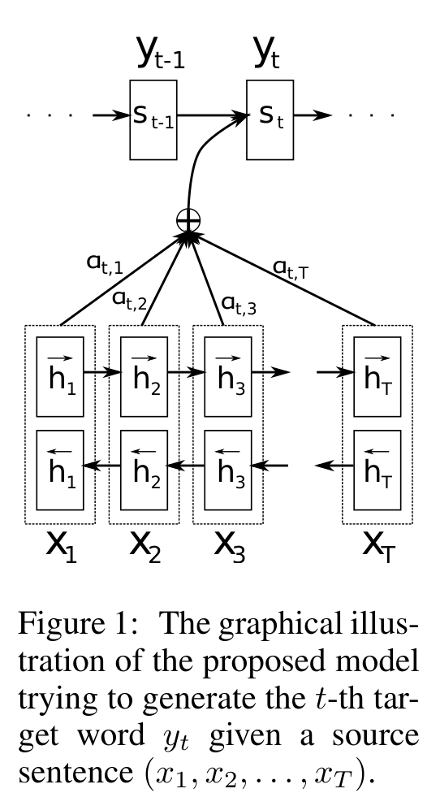</button>
<figcaption><strong>源序列 annotation 被每一步解码重复读取</strong><a href="https://arxiv.org/abs/1409.0473v7" target="_blank" rel="noopener">Neural Machine Translation by Jointly Learning to Align and Translate</a> · Figure 1 · version 1409.0473v7 · PDF p.3 / printed p.3
<button class="original-direct" type="button">Read original size</button>
<details><summary>Original caption &amp; source</summary><div class="original-caption">Figure 1: The graphical illus-
tration of the proposed model
trying to generate the t-th tar-
get word yt given a source
sentence (x1, x2, . . . , xT ).</div><a class="source-url" href="https://arxiv.org/abs/1409.0473v7">https://arxiv.org/abs/1409.0473v7</a></details></figcaption></figure>

这张架构图回答固定向量瓶颈如何解除。先沿底部源序列看编码，再看权重如何将多个 annotation 汇入当前上下文，最后进入生成目标词的状态更新。

关键是上下文随解码步骤变化，而不是 encoder 提交一次摘要后就结束。法语词序与英语词序不完全一致时，模型可以回到另一个源位置。

读取仍依赖串行 RNN 状态，且每个目标词需要扫描源序列。它改善信息通路，尚未获得 Transformer 的训练并行结构。

<figure id="fig-bahdanau-f2">
<button class="paper-image" type="button" aria-label="Zoom: 句子长度增长时，两种信息通路的差异">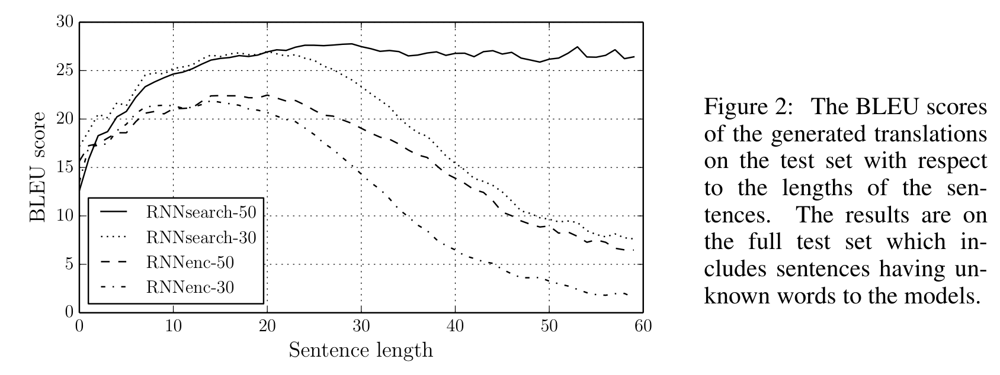</button>
<figcaption><strong>句子长度增长时，两种信息通路的差异</strong><a href="https://arxiv.org/abs/1409.0473v7" target="_blank" rel="noopener">Neural Machine Translation by Jointly Learning to Align and Translate</a> · Figure 2 · version 1409.0473v7 · PDF p.5 / printed p.5
<button class="original-direct" type="button">Read original size</button>
<details><summary>Original caption &amp; source</summary><div class="original-caption">Figure 2: The BLEU scores
of the generated translations
on the test set with respect
to the lengths of the sen-
tences.
The results are on
the full test set which in-
cludes sentences having un-
known words to the models.</div><a class="source-url" href="https://arxiv.org/abs/1409.0473v7">https://arxiv.org/abs/1409.0473v7</a></details></figcaption></figure>

横轴是源句长度分组，纵轴是 BLEU；比较 RNNenc 与 RNNsearch 的曲线，观察长句方向的下降速度。

Attention 模型的优势与“保留可访问的源位置”一致，支持固定摘要是长句困难的一部分。这比只报告平均 BLEU 更能说明研究动机。

图包含未知词样本，长度分组也改变样本组成；不能由曲线推导 attention 对任意超长文本都有效，更不能等同今日百万 token 的评测。

<figure id="fig-bahdanau-f3">
<button class="paper-image" type="button" aria-label="Zoom: 软对齐热图中的词序与多对多关系">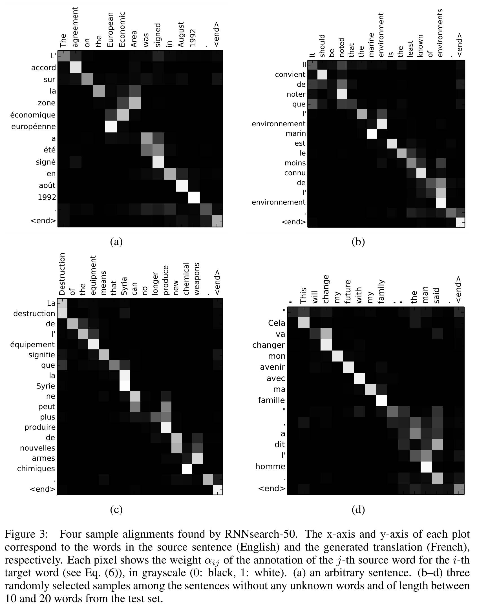</button>
<figcaption><strong>软对齐热图中的词序与多对多关系</strong><a href="https://arxiv.org/abs/1409.0473v7" target="_blank" rel="noopener">Neural Machine Translation by Jointly Learning to Align and Translate</a> · Figure 3 · version 1409.0473v7 · PDF p.6 / printed p.6
<button class="original-direct" type="button">Read original size</button>
<details><summary>Original caption &amp; source</summary><div class="original-caption">Figure 3:
Four sample alignments found by RNNsearch-50. The x-axis and y-axis of each plot
correspond to the words in the source sentence (English) and the generated translation (French),
respectively. Each pixel shows the weight αij of the annotation of the j-th source word for the i-th
target word (see Eq. (6)), in grayscale (0: black, 1: white). (a) an arbitrary sentence. (b–d) three
randomly selected samples among the sentences without any unknown words and of length between
10 and 20 words from the test set.</div><a class="source-url" href="https://arxiv.org/abs/1409.0473v7">https://arxiv.org/abs/1409.0473v7</a></details></figcaption></figure>

四个面板横轴是英语源词，纵轴是生成法语词，白色表示较大权重。先沿每行找到亮区，再看亮区是否沿对角线或出现偏移。

对角线代表大体顺序对齐，偏移与短语重排体现 query 依赖的读取。一个目标词可同时读取多个源词，所以这不是强制一对一词典匹配。

这是有用的行为可视化，但显示高权重不直接证明该源词是预测的唯一因果来源；第 11 节会讨论这个区别。

<figure id="fig-bahdanau-t1">
<button class="paper-image" type="button" aria-label="Zoom: BLEU 主结果必须区分未知词与训练时长">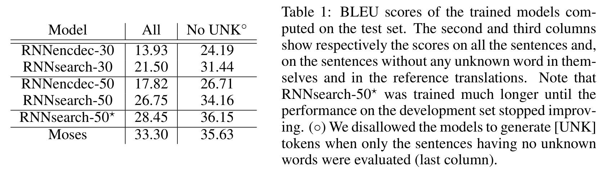</button>
<figcaption><strong>BLEU 主结果必须区分未知词与训练时长</strong><a href="https://arxiv.org/abs/1409.0473v7" target="_blank" rel="noopener">Neural Machine Translation by Jointly Learning to Align and Translate</a> · Table 1 · version 1409.0473v7 · PDF p.7 / printed p.7
<button class="original-direct" type="button">Read original size</button>
<details><summary>Original caption &amp; source</summary><div class="original-caption">Table 1: BLEU scores of the trained models com-
puted on the test set. The second and third columns
show respectively the scores on all the sentences and,
on the sentences without any unknown word in them-
selves and in the reference translations. Note that
RNNsearch-50⋆was trained much longer until the
performance on the development set stopped improv-
ing. (◦) We disallowed the models to generate [UNK]
tokens when only the sentences having no unknown
words were evaluated (last column).</div><a class="source-url" href="https://arxiv.org/abs/1409.0473v7">https://arxiv.org/abs/1409.0473v7</a></details></figcaption></figure>

表格分别报告全部句子和没有未知词的子集；星号版本训练更久。读者应先选定同一列，再比较模型。

RNNsearch 的结果支持软对齐改善翻译；长训练版本说明优化预算也影响收益，不能把所有增量归为架构一项。

本版论文 WMT14 测试集写为 3003 句，后续 Luong 使用另一处理版本。未知词策略与测试文本处理不同，跨论文数字不构成统一榜单。

### Luong：全局、局部和对齐历史

Luong 等人 <a href="#source-P02">[P02]</a> 系统比较点积、general、concat 打分，以及全局与局部读取。问题从“是否读取源位置”推进到“怎样控制读取范围，以及如何记住已经读过什么”。

<figure id="fig-luong-f2">
<button class="paper-image" type="button" aria-label="Zoom: 全局 attention 为所有源状态分配权重">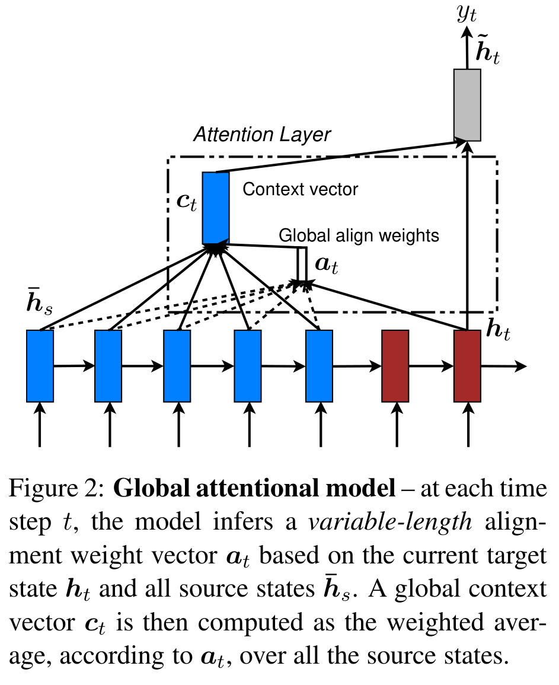</button>
<figcaption><strong>全局 attention 为所有源状态分配权重</strong><a href="https://arxiv.org/abs/1508.04025v5" target="_blank" rel="noopener">Effective Approaches to Attention-based Neural Machine Translation</a> · Figure 2 · version 1508.04025v5 · PDF p.3 / printed p.3
<button class="original-direct" type="button">Read original size</button>
<details><summary>Original caption &amp; source</summary><div class="original-caption">Figure 2: Global attentional model – at each time
step t, the model infers a variable-length align-
ment weight vector at based on the current target
state ht and all source states ¯hs. A global context
vector ct is then computed as the weighted aver-
age, according to at, over all the source states.</div><a class="source-url" href="https://arxiv.org/abs/1508.04025v5">https://arxiv.org/abs/1508.04025v5</a></details></figcaption></figure>

从当前目标状态到全部源状态的打分箭头，是图的阅读主线；归一化权重形成 context，再与目标状态合并。

全局方法保留远距离访问，接口清楚，代价是每一步对整个源句计算分数。源句位置仍由 RNN 编码，不是纯 token 向量的无序集合。

图说明数据流，不证明所有打分函数效果相同；最终比较还要结合表中的实际训练与翻译结果。

<figure id="fig-luong-f3">
<button class="paper-image" type="button" aria-label="Zoom: 局部 attention 先选中心，再读附近窗口">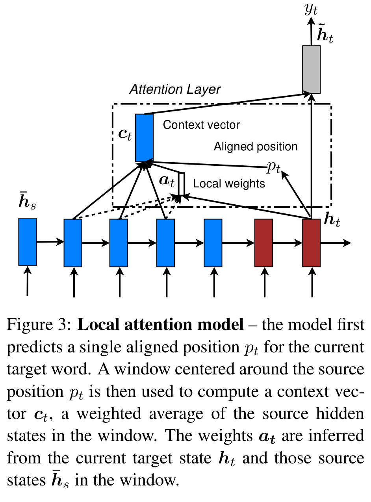</button>
<figcaption><strong>局部 attention 先选中心，再读附近窗口</strong><a href="https://arxiv.org/abs/1508.04025v5" target="_blank" rel="noopener">Effective Approaches to Attention-based Neural Machine Translation</a> · Figure 3 · version 1508.04025v5 · PDF p.4 / printed p.4
<button class="original-direct" type="button">Read original size</button>
<details><summary>Original caption &amp; source</summary><div class="original-caption">Figure 3: Local attention model – the model first
predicts a single aligned position pt for the current
target word. A window centered around the source
position pt is then used to compute a context vec-
tor ct, a weighted average of the source hidden
states in the window. The weights at are inferred
from the current target state ht and those source
states ¯hs in the window.</div><a class="source-url" href="https://arxiv.org/abs/1508.04025v5">https://arxiv.org/abs/1508.04025v5</a></details></figcaption></figure>

先找到预测位置 $p_t$，再看以它为中心的源窗口。local-p 会学习中心，局部权重还可按距离加权。

这里首次清晰展示本文反复出现的取舍：减少候选位置能省计算，但如果中心预测错，关键远程词可能被排除。

它不是无条件等价于全局 attention，也不是简单把全局矩阵乘法切块；候选集合本身改变了。

<figure id="fig-luong-f4">
<button class="paper-image" type="button" aria-label="Zoom: Input feeding 把上一轮上下文带回解码器">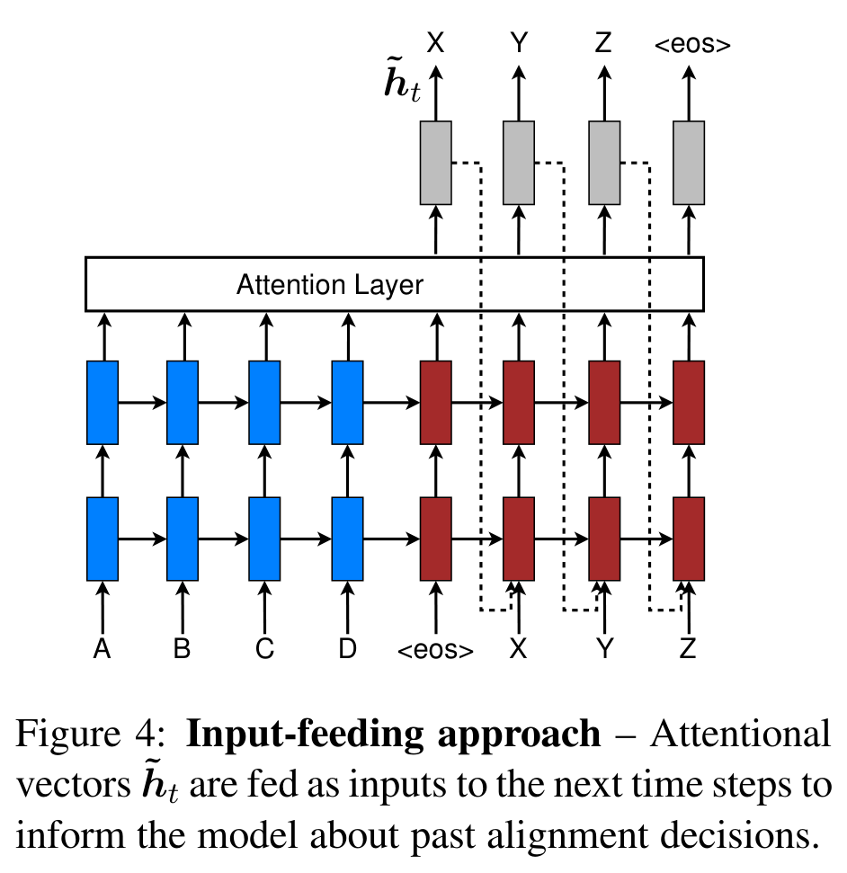</button>
<figcaption><strong>Input feeding 把上一轮上下文带回解码器</strong><a href="https://arxiv.org/abs/1508.04025v5" target="_blank" rel="noopener">Effective Approaches to Attention-based Neural Machine Translation</a> · Figure 4 · version 1508.04025v5 · PDF p.5 / printed p.5
<button class="original-direct" type="button">Read original size</button>
<details><summary>Original caption &amp; source</summary><div class="original-caption">Figure 4: Input-feeding approach – Attentional
vectors ˜ht are fed as inputs to the next time steps to
inform the model about past alignment decisions.</div><a class="source-url" href="https://arxiv.org/abs/1508.04025v5">https://arxiv.org/abs/1508.04025v5</a></details></figcaption></figure>

图中 attentional vector 反馈到下一个步骤的连线，是与前两图最重要的差别。当前决策不只依赖语言状态，也能感知先前对齐信息。

这给模型一个连续的“读过哪些信息”的记忆，减轻重复或遗漏翻译的风险。它体现 attention 与生成状态的耦合，而不是独立检索器。

该反馈路径增加串行依赖；后来的 Transformer 通过各层表示隐式携带历史，不应把这条具体 RNN 反馈线直接搬成相同架构。

<figure id="fig-luong-t1">
<button class="paper-image" type="button" aria-label="Zoom: 逐步改善中混合了 attention、输入策略与后处理">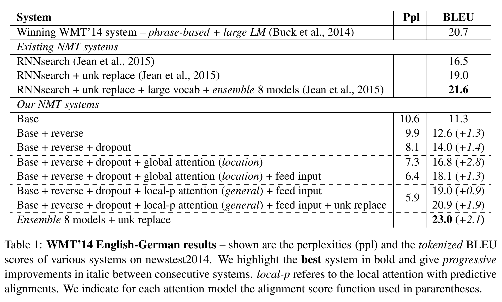</button>
<figcaption><strong>逐步改善中混合了 attention、输入策略与后处理</strong><a href="https://arxiv.org/abs/1508.04025v5" target="_blank" rel="noopener">Effective Approaches to Attention-based Neural Machine Translation</a> · Table 1 · version 1508.04025v5 · PDF p.6 / printed p.6
<button class="original-direct" type="button">Read original size</button>
<details><summary>Original caption &amp; source</summary><div class="original-caption">Table 1: WMT’14 English-German results – shown are the perplexities (ppl) and the tokenized BLEU
scores of various systems on newstest2014. We highlight the best system in bold and give progressive
improvements in italic between consecutive systems. local-p referes to the local attention with predictive
alignments. We indicate for each attention model the alignment score function used in pararentheses.</div><a class="source-url" href="https://arxiv.org/abs/1508.04025v5">https://arxiv.org/abs/1508.04025v5</a></details></figcaption></figure>

表格在 WMT14 英德 newstest2014 上列 perplexity 和 tokenized BLEU；连续行包括多项系统变化，括号注明打分函数。

局部预测对齐和 input feeding 的组合表现较好，说明窗口并非只能牺牲质量：可学习定位与历史反馈能补偿一部分限制。

此处测试集为 2737 句，tokenized BLEU 与 NIST BLEU也要区分。本文采用官方 WMT 说明 <a href="#source-D02">[D02]</a> 核对版本差异，不拿它与上一节 3003 句直接排名。

## 04 · 2017：Transformer 改变了训练计算图

Transformer <a href="#source-P03">[P03]</a> 用 attention 连接序列位置，再用逐位置 FFN 做通道变换。更短的信息路径与并行训练，是它的重要转折；自回归生成的下一 token 仍依赖已经生成的 token，串行 decode 并未消失。

<figure id="fig-transformer-f1">
<button class="paper-image" type="button" aria-label="Zoom: Encoder、decoder 与 cross-attention 的完整数据流">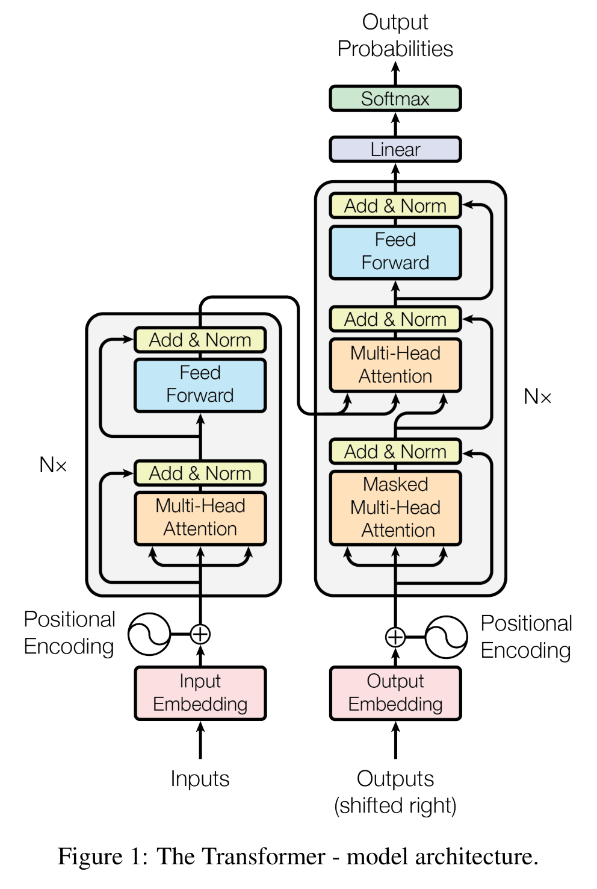</button>
<figcaption><strong>Encoder、decoder 与 cross-attention 的完整数据流</strong><a href="https://arxiv.org/abs/1706.03762v7" target="_blank" rel="noopener">Attention Is All You Need</a> · Figure 1 · version 1706.03762v7 · PDF p.3 / printed p.3
<button class="original-direct" type="button">Read original size</button>
<details><summary>Original caption &amp; source</summary><div class="original-caption">Figure 1: The Transformer - model architecture.</div><a class="source-url" href="https://arxiv.org/abs/1706.03762v7">https://arxiv.org/abs/1706.03762v7</a></details></figcaption></figure>

左侧 encoder 反复进行双向 self-attention 与 FFN；右侧 decoder 先做 masked self-attention，再读取 encoder 输出。残差与归一化包围子层。

沿右侧 cross-attention 的输入线，可以确认 Q 来自 decoder，K/V 来自 encoder。它继承翻译读取接口，却把源与目标的表示计算从 RNN 迁到 attention 层。

Decoder-only LLM 是相关结构的后续使用方式，不能用这张 encoder–decoder 图宣称今天所有大模型都含同样的三子层。

<figure id="fig-transformer-f2">
<button class="paper-image" type="button" aria-label="Zoom: Scaled dot-product 与 multi-head 两层含义">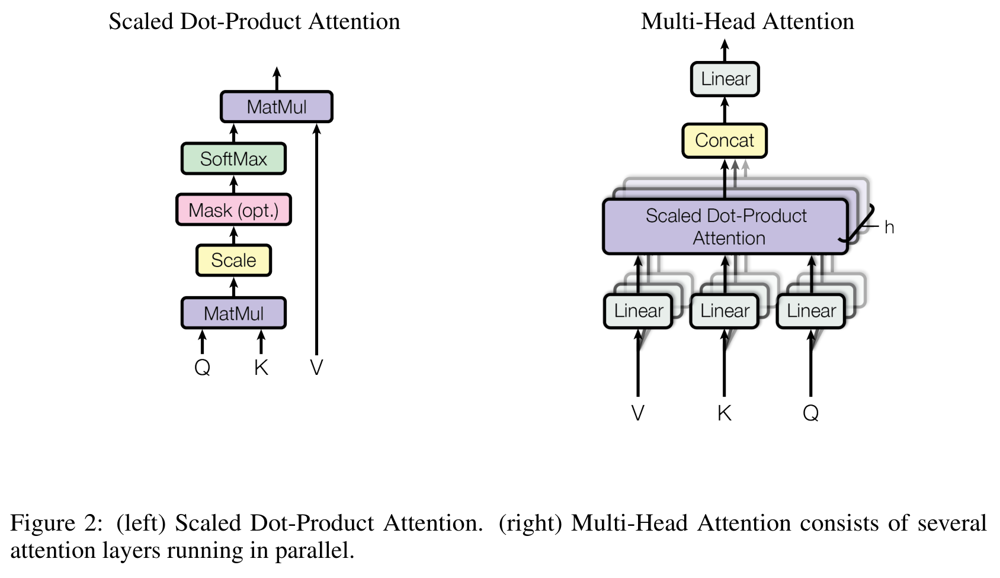</button>
<figcaption><strong>Scaled dot-product 与 multi-head 两层含义</strong><a href="https://arxiv.org/abs/1706.03762v7" target="_blank" rel="noopener">Attention Is All You Need</a> · Figure 2 · version 1706.03762v7 · PDF p.4 / printed p.4
<button class="original-direct" type="button">Read original size</button>
<details><summary>Original caption &amp; source</summary><div class="original-caption">Figure 2: (left) Scaled Dot-Product Attention. (right) Multi-Head Attention consists of several
attention layers running in parallel.</div><a class="source-url" href="https://arxiv.org/abs/1706.03762v7">https://arxiv.org/abs/1706.03762v7</a></details></figcaption></figure>

左图对应第 02 节公式；右图显示多组投影分别完成 attention，然后 concat 并经过输出矩阵。先看单头，再理解并行多个子空间。

多头允许同一 query 用不同表示读取关系，而不是简单把同一注意力图复制多次。各 head 的维度和投影属于模型容量分配。

Head 数改变时若总 hidden size 固定，单头维度会相应变化。不能把头数实验当成“只多了几张独立图”的单因素比较。

$$
\mathrm{MultiHead}(X)=\mathrm{Concat}(O_1,\ldots,O_H)W_O,\qquad
O_h=\mathrm{Attn}(XW_Q^h,XW_K^h,XW_V^h).
$$

$H$ 为 query head 数，$W_Q^h,W_K^h,W_V^h$ 为各头投影，$W_O$ 将拼接内容映回 hidden 维度。这是 self-attention 写法，cross-attention 需替换对应输入。多个头不意味着它们独立学习或各自具有可解释语义。

<figure id="fig-transformer-t1">
<button class="paper-image" type="button" aria-label="Zoom: 层复杂度、顺序操作和最大路径长度">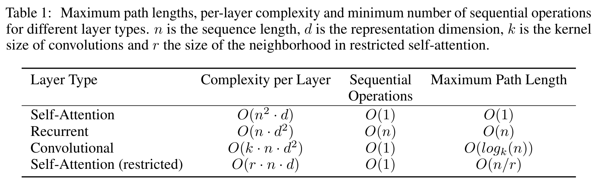</button>
<figcaption><strong>层复杂度、顺序操作和最大路径长度</strong><a href="https://arxiv.org/abs/1706.03762v7" target="_blank" rel="noopener">Attention Is All You Need</a> · Table 1 · version 1706.03762v7 · PDF p.6 / printed p.6
<button class="original-direct" type="button">Read original size</button>
<details><summary>Original caption &amp; source</summary><div class="original-caption">Table 1: Maximum path lengths, per-layer complexity and minimum number of sequential operations
for different layer types. n is the sequence length, d is the representation dimension, k is the kernel
size of convolutions and r the size of the neighborhood in restricted self-attention.</div><a class="source-url" href="https://arxiv.org/abs/1706.03762v7">https://arxiv.org/abs/1706.03762v7</a></details></figcaption></figure>

表中 $n$ 是长度，$d$ 是表示维度；逐列看 per-layer complexity、最少顺序操作和最大路径，而不要只盯平方复杂度。

Self-attention 的训练顺序操作少，任意位置的连接路径短；RNN 的位置路径随长度增长。短路径让远距离关系更容易直接交互。

表是抽象计算图分析，不是 GPU 墙钟模型。投影/FFN、并行利用率和内存 IO 都不在这三个指标中；长上下文后，平方项重新成为瓶颈。

<figure id="fig-transformer-t2">
<button class="paper-image" type="button" aria-label="Zoom: 翻译结果与历史训练成本口径">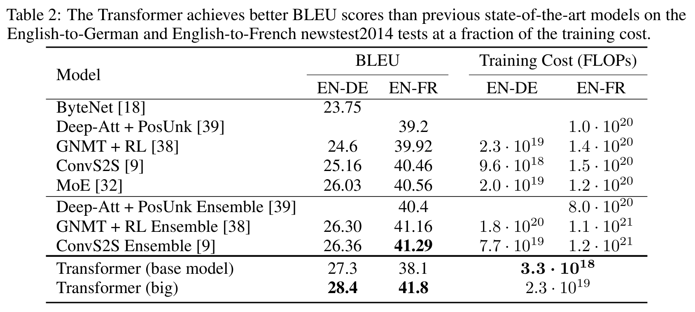</button>
<figcaption><strong>翻译结果与历史训练成本口径</strong><a href="https://arxiv.org/abs/1706.03762v7" target="_blank" rel="noopener">Attention Is All You Need</a> · Table 2 · version 1706.03762v7 · PDF p.8 / printed p.8
<button class="original-direct" type="button">Read original size</button>
<details><summary>Original caption &amp; source</summary><div class="original-caption">Table 2: The Transformer achieves better BLEU scores than previous state-of-the-art models on the
English-to-German and English-to-French newstest2014 tests at a fraction of the training cost.</div><a class="source-url" href="https://arxiv.org/abs/1706.03762v7">https://arxiv.org/abs/1706.03762v7</a></details></figcaption></figure>

Table 2 比较英德、英法 newstest2014 BLEU 和估算训练成本。模型规模、训练策略和数据条件必须随结果一起读。

原文 big 模型英德 28.4、英法表格为 41.8，说明完整系统在当时条件下很强。数字包含 FFN、位置编码、优化器、label smoothing 等整套设计的贡献。

本文选择 v7；它的正文仍有英法 41.0，与表 41.8 不一致，因此引用表格并保留这一版本差异。历史成本估算也不能换算成今日某张 GPU 的端到端耗时。

<figure id="fig-transformer-t3">
<button class="paper-image" type="button" aria-label="Zoom: 头数、维度、位置与 dropout 的消融">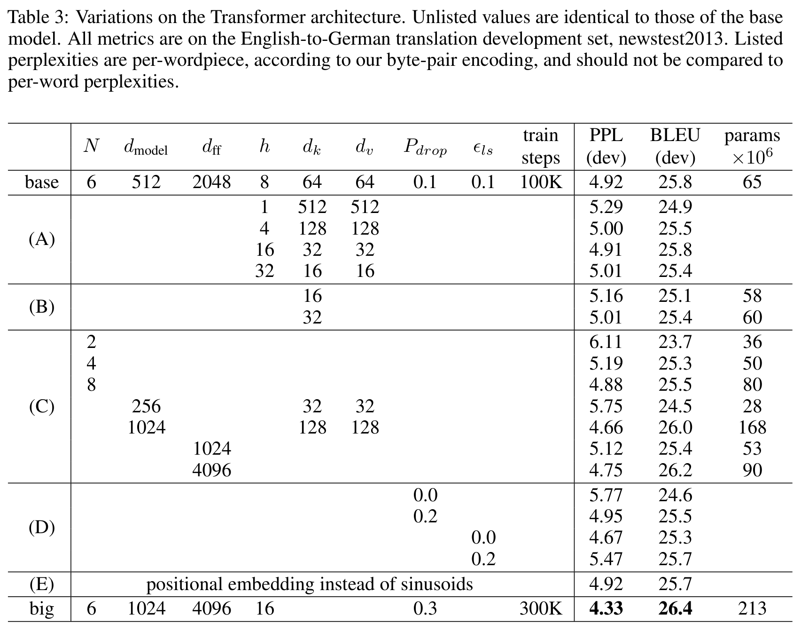</button>
<figcaption><strong>头数、维度、位置与 dropout 的消融</strong><a href="https://arxiv.org/abs/1706.03762v7" target="_blank" rel="noopener">Attention Is All You Need</a> · Table 3 · version 1706.03762v7 · PDF p.9 / printed p.9
<button class="original-direct" type="button">Read original size</button>
<details><summary>Original caption &amp; source</summary><div class="original-caption">Table 3: Variations on the Transformer architecture. Unlisted values are identical to those of the base
model. All metrics are on the English-to-German translation development set, newstest2013. Listed
perplexities are per-wordpiece, according to our byte-pair encoding, and should not be compared to
per-word perplexities.</div><a class="source-url" href="https://arxiv.org/abs/1706.03762v7">https://arxiv.org/abs/1706.03762v7</a></details></figcaption></figure>

这张表使用英德 newstest2013 **开发集**，perplexity 是 per-wordpiece。先看同一变体修改了哪些配置，再比较对应指标。

太少头或不合适的 key 维度会影响性能；位置和正则也属于有效模型的组成。它支持“关系接口加上合适参数化”，不是 attention 一项解释全部收益。

不能把该开发集 BLEU 与 Table 2 的测试集 BLEU混用；per-wordpiece perplexity 也不能直接与按词统计的旧模型 perplexity 比较。

## 05 · 从词到像素：Non-local 与 ViT

### Non-local：把任意时空位置连起来

Non-local <a href="#source-P04">[P04]</a> 的输入仍可来自卷积特征，它通过位置间关系聚合补充局部卷积。其一般形式为：

$$
y_i=\frac{1}{C(x)}\sum_j f(x_i,x_j)g(x_j),\qquad z_i=W_zy_i+x_i.
$$

$i,j$ 是时空位置，$f$ 为关系函数，$g$ 为内容变换，$C(x)$ 是归一化，$W_z$ 为输出变换。embedded Gaussian 的 $f$ 用投影点积加指数并按行归一化，可对应 softmax attention；其他变体并不全部使用 softmax。

<figure id="fig-nonlocal-f2">
<button class="paper-image" type="button" aria-label="Zoom: 时空张量 reshape 后构造跨位置关系">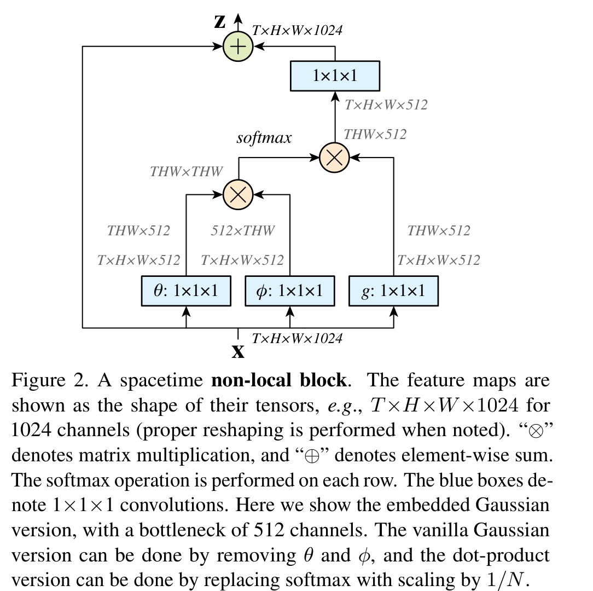</button>
<figcaption><strong>时空张量 reshape 后构造跨位置关系</strong><a href="https://arxiv.org/abs/1711.07971v3" target="_blank" rel="noopener">Non-local Neural Networks</a> · Figure 2 · version 1711.07971v3 · PDF p.3 / printed p.3
<button class="original-direct" type="button">Read original size</button>
<details><summary>Original caption &amp; source</summary><div class="original-caption">Figure 2. A non-local block. The feature maps are shown as the shape of their tensors, e.g., T × H × W × 1024 for 1024 channels (proper reshaping is performed when noted). ⊗ denotes matrix multiplication, and ⊕ denotes element-wise sum. The softmax operation is performed on each row. The blue boxes denote 1×1×1 convolutions. Here we show the embedded Gaussian version, with a bottleneck of 512 channels. The vanilla Gaussian version can be done by removing θ and φ, and the dot-product version can be done by replacing softmax with scaling by 1/N.</div><a class="source-url" href="https://arxiv.org/abs/1711.07971v3">https://arxiv.org/abs/1711.07971v3</a></details></figcaption></figure>

先看 $T\times H\times W$ 的位置维如何展平，再看 $\theta,\phi,g$ 三条投影，以及矩阵乘法最后如何恢复原形状。

模型可从另一个帧、另一个区域读取信息，再通过残差返回原网络。它展示 attention 可作为卷积网络中的模块，而不是必须替换整个 backbone。

图中不同颜色有不同张量形状，工程上不能混淆位置维和通道维；NCHW/NHWC 的排布转换也可能带来实际复制成本。

<figure id="fig-nonlocal-t2">
<button class="paper-image" type="button" aria-label="Zoom: Kinetics 消融检验关系模块的位置与数量">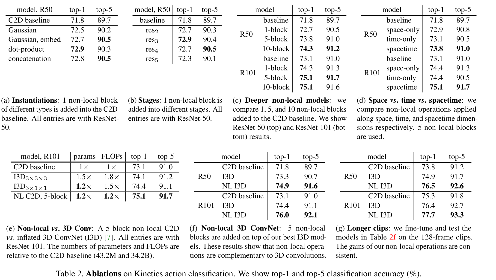</button>
<figcaption><strong>Kinetics 消融检验关系模块的位置与数量</strong><a href="https://arxiv.org/abs/1711.07971v3" target="_blank" rel="noopener">Non-local Neural Networks</a> · Table 2 · version 1711.07971v3 · PDF p.6 / printed p.6
<button class="original-direct" type="button">Read original size</button>
<details><summary>Original caption &amp; source</summary><div class="original-caption">Table 2. Ablations on Kinetics action classification. We show top-1 and top-5 classification accuracy (%).</div><a class="source-url" href="https://arxiv.org/abs/1711.07971v3">https://arxiv.org/abs/1711.07971v3</a></details></figcaption></figure>

表格按 top-1、top-5 分类准确率比较关系函数、block 数量和放置阶段。先固定 backbone 与评测协议，再读各组增量。

不同关系函数的改善支持跨位置聚合的价值，多个 block 的实验说明模块数量与网络位置也会影响结果。

这是视频动作分类的局部证据，不能转写为任意图像、检测、OCR 上都同样提升；top-5 也不能与 top-1 混作一个成绩。

### ViT：patch 序列与数据规模共同改变结果

ViT <a href="#source-P05">[P05]</a> 把图像分成固定大小 patch，经线性映射和位置 embedding 后送入 Transformer encoder。其意义不只是“没有卷积”，而是验证一般序列架构能在足够数据与训练预算下形成强视觉表示。

<figure id="fig-vit-f1">
<button class="paper-image" type="button" aria-label="Zoom: 从二维图像到 patch token 序列">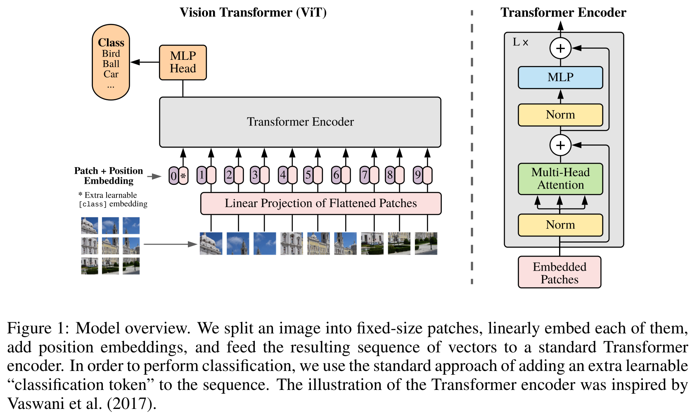</button>
<figcaption><strong>从二维图像到 patch token 序列</strong><a href="https://arxiv.org/abs/2010.11929v2" target="_blank" rel="noopener">An Image is Worth 16x16 Words: Transformers for Image Recognition at Scale</a> · Figure 1 · version 2010.11929v2 · PDF p.3 / printed p.3
<button class="original-direct" type="button">Read original size</button>
<details><summary>Original caption &amp; source</summary><div class="original-caption">Figure 1: Model overview. We split an image into fixed-size patches, linearly embed each of them,
add position embeddings, and feed the resulting sequence of vectors to a standard Transformer
encoder. In order to perform classification, we use the standard approach of adding an extra learnable
“classification token” to the sequence. The illustration of the Transformer encoder was inspired by
Vaswani et al. (2017).</div><a class="source-url" href="https://arxiv.org/abs/2010.11929v2">https://arxiv.org/abs/2010.11929v2</a></details></figcaption></figure>

按 patch 切分、线性 embedding、加入位置与 class token、encoder、分类头的顺序读图。Patch 中的像素被展平，并不表示模型丢掉所有空间信息。

空间信息一部分保留在 patch 内向量，一部分由位置编码表达；self-attention 可以建立远距离区域联系。若将 patch 边长减半，token 数约变四倍，dense attention 的平方项约变十六倍。

分类 token 是本文图中的读出方式；它不是视觉 attention 的必选设计，也不是目标检测任务定义本身。

<figure id="fig-vit-t2">
<button class="paper-image" type="button" aria-label="Zoom: 分类主结果必须带上预训练数据">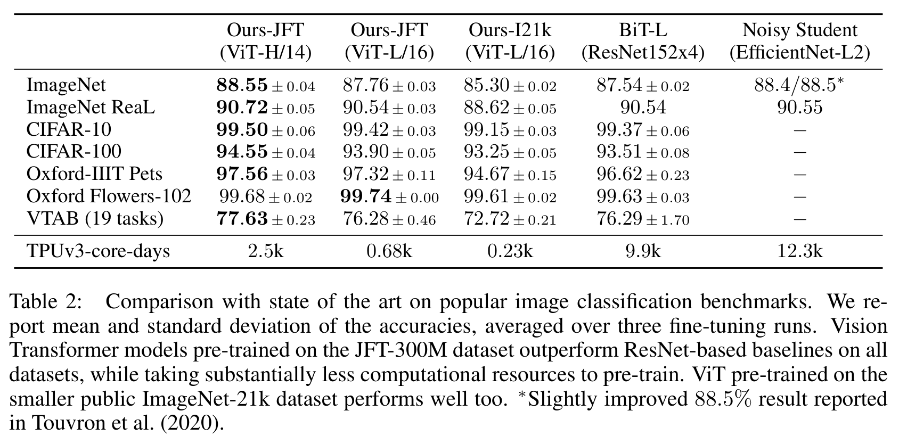</button>
<figcaption><strong>分类主结果必须带上预训练数据</strong><a href="https://arxiv.org/abs/2010.11929v2" target="_blank" rel="noopener">An Image is Worth 16x16 Words: Transformers for Image Recognition at Scale</a> · Table 2 · version 2010.11929v2 · PDF p.6 / printed p.6
<button class="original-direct" type="button">Read original size</button>
<details><summary>Original caption &amp; source</summary><div class="original-caption">Table 2:
Comparison with state of the art on popular image classification benchmarks. We re-
port mean and standard deviation of the accuracies, averaged over three fine-tuning runs. Vision
Transformer models pre-trained on the JFT-300M dataset outperform ResNet-based baselines on all
datasets, while taking substantially less computational resources to pre-train. ViT pre-trained on the
smaller public ImageNet-21k dataset performs well too. ∗Slightly improved 88.5% result reported
in Touvron et al. (2020).</div><a class="source-url" href="https://arxiv.org/abs/2010.11929v2">https://arxiv.org/abs/2010.11929v2</a></details></figcaption></figure>

表格列出多个分类 benchmark、均值与标准差及预训练资源。首先区分 JFT-300M 与公开 ImageNet-21k 预训练。

大规模预训练 ViT 在这些迁移任务上表现强，支持弱局部归纳偏置可以通过数据学习补偿。三次 fine-tuning 的统计也比孤立单次分数更有信息。

JFT 数据不公开，完整主结果并不能仅靠公开权重代码重建训练。分类准确率不是 dense prediction 的质量证据。

<figure id="fig-vit-f3-4">
<button class="paper-image" type="button" aria-label="Zoom: 小数据与大数据条件下，归纳偏置的收益反转">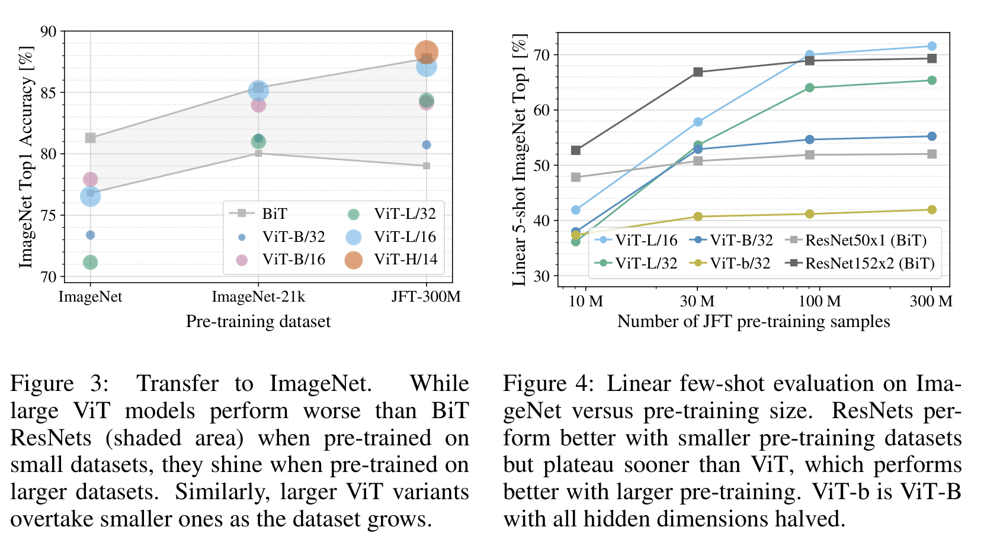</button>
<figcaption><strong>小数据与大数据条件下，归纳偏置的收益反转</strong><a href="https://arxiv.org/abs/2010.11929v2" target="_blank" rel="noopener">An Image is Worth 16x16 Words: Transformers for Image Recognition at Scale</a> · Figure 3 + Figure 4 · version 2010.11929v2 · PDF p.7 / printed p.7
<button class="original-direct" type="button">Read original size</button>
<details><summary>Original caption &amp; source</summary><div class="original-caption">Figure 3:
Transfer to ImageNet.
While
large ViT models perform worse than BiT
ResNets (shaded area) when pre-trained on
small datasets, they shine when pre-trained on
larger datasets. Similarly, larger ViT variants
overtake smaller ones as the dataset grows.

Figure 4: Linear few-shot evaluation on Ima-
geNet versus pre-training size. ResNets per-
form better with smaller pre-training datasets
but plateau sooner than ViT, which performs
better with larger pre-training. ViT-b is ViT-B
with all hidden dimensions halved.</div><a class="source-url" href="https://arxiv.org/abs/2010.11929v2">https://arxiv.org/abs/2010.11929v2</a></details></figcaption></figure>

Figure 3 看迁移准确率随预训练数据规模变化；Figure 4 看 linear few-shot 条件下同一趋势。比较相同横坐标而非不同数据预算的最高点。

小数据时 ResNet 的局部偏置有效；数据变大后 ViT 尤其大模型继续增长。这解释了架构为什么要与训练规模一起判断。

原图支持其设置中的尺度趋势，不能断言 attention 在小数据天然更强。官方实现 <a href="#source-C08">[C08]</a> 可核查 patch projection 和 encoder，但不能替代数据规模消融。

## 06 · 位置与连接：RoPE 和 Longformer

### RoPE：让相对位置进入匹配内积

如果没有任何位置信息，双向 attention 对输入置换具有相应的置换等变性，无法仅从内容知道词序。RoPE <a href="#source-P08">[P08]</a> 把 Q/K 的成对通道按位置旋转：

$$
q'_m=R_mq_m,\qquad k'_n=R_nk_n,\qquad
(q'_m)^\top k'_n=q_m^\top R_{n-m}k_n.
$$

$m,n$ 是位置，$R_m$ 是由多个二维旋转块组成的正交矩阵，角度为 $m\theta_r$，$\theta_r$ 是第 $r$ 对通道的频率。最后一步使用 $R_m^\top R_n=R_{n-m}$；相对位移进入点积，内容仍参与打分。

<figure id="fig-rope-f1">
<button class="paper-image" type="button" aria-label="Zoom: 通道对旋转如何实现相对位置">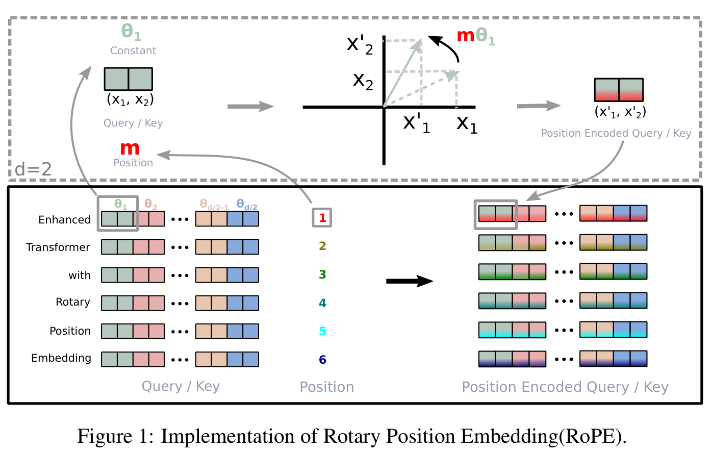</button>
<figcaption><strong>通道对旋转如何实现相对位置</strong><a href="https://arxiv.org/abs/2104.09864v5" target="_blank" rel="noopener">RoFormer: Enhanced Transformer with Rotary Position Embedding</a> · Figure 1 · version 2104.09864v5 · PDF p.5 / printed p.5
<button class="original-direct" type="button">Read original size</button>
<details><summary>Original caption &amp; source</summary><div class="original-caption">Figure 1: Implementation of Rotary Position Embedding(RoPE).</div><a class="source-url" href="https://arxiv.org/abs/2104.09864v5">https://arxiv.org/abs/2104.09864v5</a></details></figcaption></figure>

图中两两配对的通道和正弦余弦分支对应二维旋转；顺着乘法和加法看，可以把它与矩阵 $R_m$ 对上。

位置不是单独相加到 V，而是改变 Q/K 的匹配几何。相同内容在不同相对距离下可以得到不同分数。

通道配对方式、频率、position id、缓存偏移必须一致。相对内积性质不等于“训练 4K 自动泛化到 1M”的定理。

<figure id="fig-rope-t1">
<button class="paper-image" type="button" aria-label="Zoom: WMT14 的位置替代实验">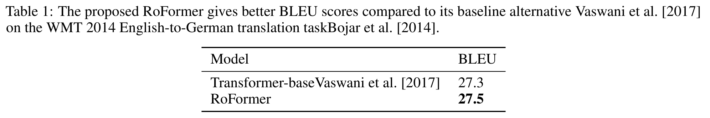</button>
<figcaption><strong>WMT14 的位置替代实验</strong><a href="https://arxiv.org/abs/2104.09864v5" target="_blank" rel="noopener">RoFormer: Enhanced Transformer with Rotary Position Embedding</a> · Table 1 · version 2104.09864v5 · PDF p.9 / printed p.9
<button class="original-direct" type="button">Read original size</button>
<details><summary>Original caption &amp; source</summary><div class="original-caption">Table 1: The proposed RoFormer gives better BLEU scores compared to its baseline alternative Vaswani et al. [2017]
on the WMT 2014 English-to-German translation taskBojar et al. [2014].</div><a class="source-url" href="https://arxiv.org/abs/2104.09864v5">https://arxiv.org/abs/2104.09864v5</a></details></figcaption></figure>

表格比较原始基线和 RoFormer 的英德翻译 BLEU；读者应把这看作特定模型中位置机制的替代实验。

结果支持旋转位置可作为有效参数化，证明它不是只有几何推导却不能训练的构造。

这与第 04 节模型训练预算、版本未必完全相同，不能用几个 BLEU 数字拼接统一历史冠军曲线。

<figure id="fig-rope-t5">
<button class="paper-image" type="button" aria-label="Zoom: 长度截断改变任务可用信息">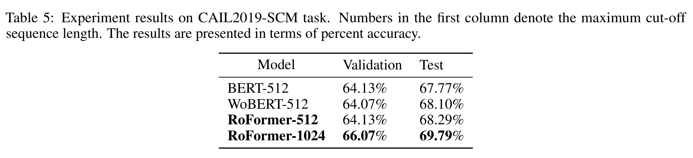</button>
<figcaption><strong>长度截断改变任务可用信息</strong><a href="https://arxiv.org/abs/2104.09864v5" target="_blank" rel="noopener">RoFormer: Enhanced Transformer with Rotary Position Embedding</a> · Table 5 · version 2104.09864v5 · PDF p.12 / printed p.12
<button class="original-direct" type="button">Read original size</button>
<details><summary>Original caption &amp; source</summary><div class="original-caption">Table 5: Experiment results on CAIL2019-SCM task. Numbers in the first column denote the maximum cut-off
sequence length. The results are presented in terms of percent accuracy.</div><a class="source-url" href="https://arxiv.org/abs/2104.09864v5">https://arxiv.org/abs/2104.09864v5</a></details></figcaption></figure>

CAIL2019-SCM 表按 maximum cut-off length 分组，指标是准确率。先比较同一截断长度的模型，再看长度增长趋势。

增加长度可能让法律文本保留更多关键信息；位置机制也影响模型在更长输入上的使用方式。

它是长度与任务证据共同变化的实验，不是纯粹“位置外推误差”测试。系统容量和位置泛化需分开评估。

### Longformer：局部窗口加任务相关全局位置

Longformer <a href="#source-P06">[P06]</a> 保留局部 sliding window，并给少数任务位置全局访问。若窗口宽为 $w$、全局位置数为 $g$，主要连接量约为 $Nw+2Ng$；当 $w,g$ 固定时随 $N$ 线性增长。

<figure id="fig-longformer-f2">
<button class="paper-image" type="button" aria-label="Zoom: 全连接、局部、膨胀与全局的连接图">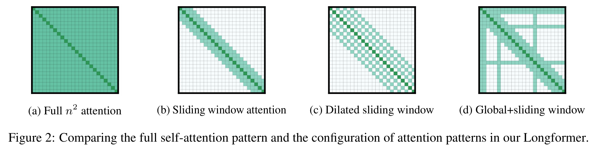</button>
<figcaption><strong>全连接、局部、膨胀与全局的连接图</strong><a href="https://arxiv.org/abs/2004.05150v2" target="_blank" rel="noopener">Longformer: The Long-Document Transformer</a> · Figure 2 · version 2004.05150v2 · PDF p.3 / printed p.3
<button class="original-direct" type="button">Read original size</button>
<details><summary>Original caption &amp; source</summary><div class="original-caption">Figure 2: Comparing the full self-attention pattern and the configuration of attention patterns in our Longformer.</div><a class="source-url" href="https://arxiv.org/abs/2004.05150v2">https://arxiv.org/abs/2004.05150v2</a></details></figcaption></figure>

把每行看作一个 query，每列看作一个 key。Dense 是全色方阵；窗口是对角带；全局位置形成整行与整列，dilation 拉开局部采样距离。

全局位置既能读取全部历史，也让其他位置访问汇聚信息。多层之间由这些“桥”传播远距离内容，而不是每层都逐对直接读取。

复杂度依赖全局 token 数：若把所有位置都设成 global，线性收益消失。任务位置选择不是可忽略的配置。

<figure id="fig-longformer-t7">
<button class="paper-image" type="button" aria-label="Zoom: 不同任务对应不同指标与全局策略">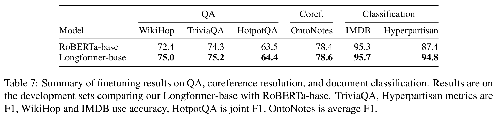</button>
<figcaption><strong>不同任务对应不同指标与全局策略</strong><a href="https://arxiv.org/abs/2004.05150v2" target="_blank" rel="noopener">Longformer: The Long-Document Transformer</a> · Table 7 · version 2004.05150v2 · PDF p.8 / printed p.8
<button class="original-direct" type="button">Read original size</button>
<details><summary>Original caption &amp; source</summary><div class="original-caption">Table 7: Summary of finetuning results on QA, coreference resolution, and document classification. Results are on
the development sets comparing our Longformer-base with RoBERTa-base. TriviaQA, Hyperpartisan metrics are
F1, WikiHop and IMDB use accuracy, HotpotQA is joint F1, OntoNotes is average F1.</div><a class="source-url" href="https://arxiv.org/abs/2004.05150v2">https://arxiv.org/abs/2004.05150v2</a></details></figcaption></figure>

表比较 Longformer-base 与 RoBERTa-base 的开发集：WikiHop/IMDB 用 accuracy，HotpotQA 用 joint F1，其他列按图注的 F1 定义读取。

长文问答、指代、文档分类体现不同输入输出需求；长输入可带来收益，但不是所有任务增量相同。

不能平均混合不同含义的 F1/accuracy 后宣布一个“通用质量”。官方代码 <a href="#source-C02">[C02]</a> 的 global attention mask 是模型行为的一部分。

<figure id="fig-longformer-t10">
<button class="paper-image" type="button" aria-label="Zoom: WikiHop 消融说明窗口、长度和全局位置都重要">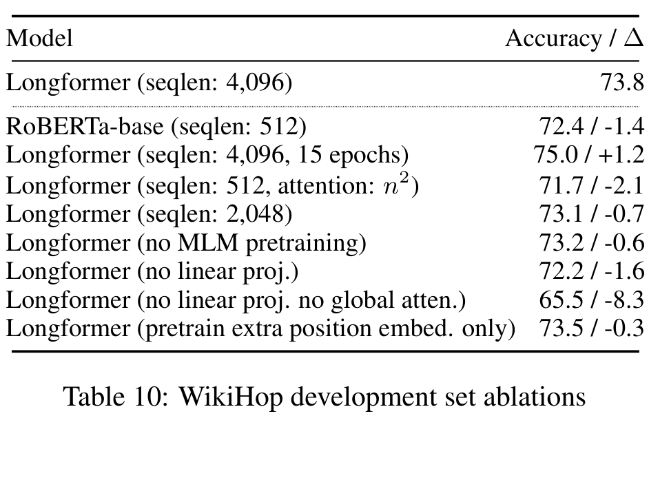</button>
<figcaption><strong>WikiHop 消融说明窗口、长度和全局位置都重要</strong><a href="https://arxiv.org/abs/2004.05150v2" target="_blank" rel="noopener">Longformer: The Long-Document Transformer</a> · Table 10 · version 2004.05150v2 · PDF p.9 / printed p.9
<button class="original-direct" type="button">Read original size</button>
<details><summary>Original caption &amp; source</summary><div class="original-caption">Table 10: WikiHop development set ablations</div><a class="source-url" href="https://arxiv.org/abs/2004.05150v2">https://arxiv.org/abs/2004.05150v2</a></details></figcaption></figure>

这里把注意力配置和输入长度拆开比较，应逐行核对它相对 baseline 改了什么。

结果帮助解释收益来自可访问的证据与连接方式共同作用，而不只是减少计算。窗口可以保留局部处理，全局位置承担跨文档联系。

删除远程连接可能错过必要证据；第 13 节用确定性反例展示，即使局部窗口执行更快，输出也可以大幅变化。

## 07 · 有限状态：Performer 与 Kimi Linear

### Performer：核近似让求和可以重新结合

Performer <a href="#source-P07">[P07]</a> 的 FAVOR+ 用正值随机特征近似 softmax 核，并通过正交采样控制方差。令特征维度为 $r$，有：

$$
\exp(q^\top k)\approx\phi(q)^\top\phi(k),\qquad
S_t=\sum_{j\le t}\phi(k_j)v_j^\top,\qquad
z_t=\sum_{j\le t}\phi(k_j),\qquad
o_t\approx\frac{\phi(q_t)^\top S_t}{\phi(q_t)^\top z_t}.
$$

$S_t\in\mathbb{R}^{r\times d_v}$ 汇聚内容，$z_t\in\mathbb{R}^{r}$ 汇聚归一化分母；假设分母非零且数值稳定。对 scaled attention，应先把 Q/K 按维度缩放后代入核。有限 $r$ 的随机近似不是原始 softmax 的逐元素精确改写。

<figure id="fig-performer-f1">
<button class="paper-image" type="button" aria-label="Zoom: 从先构造 N×N 矩阵改为先汇聚 K/V">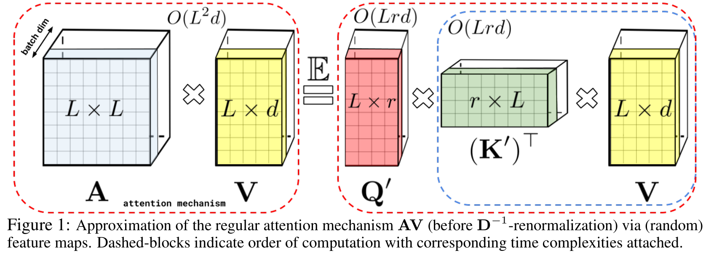</button>
<figcaption><strong>从先构造 N×N 矩阵改为先汇聚 K/V</strong><a href="https://arxiv.org/abs/2009.14794v4" target="_blank" rel="noopener">Rethinking Attention with Performers</a> · Figure 1 · version 2009.14794v4 · PDF p.3 / printed p.3
<button class="original-direct" type="button">Read original size</button>
<details><summary>Original caption &amp; source</summary><div class="original-caption">Figure 1: Approximation of the regular attention mechanism AV (before D−1-renormalization) via (random)
feature maps. Dashed-blocks indicate order of computation with corresponding time complexities attached.</div><a class="source-url" href="https://arxiv.org/abs/2009.14794v4">https://arxiv.org/abs/2009.14794v4</a></details></figcaption></figure>

左边按传统顺序形成位置间关系，右边先将 key 特征与 value 聚合。虚线框标注复杂度和结合次序。

核心不是所有远距离关系被删掉，而是历史被压入有限统计量，query 再读取这个统计量。对 causal 序列可逐步更新，不必重读全部 K/V。

特征数越多通常近似更精细，也增加状态与计算。选择核与有限维表示会改变模型能够区分的历史信息。

<figure id="fig-performer-f4">
<button class="paper-image" type="button" aria-label="Zoom: 正值特征与正交采样的近似误差">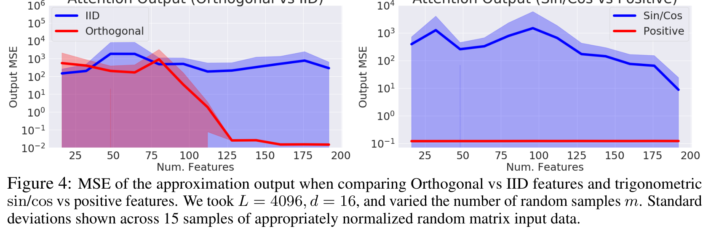</button>
<figcaption><strong>正值特征与正交采样的近似误差</strong><a href="https://arxiv.org/abs/2009.14794v4" target="_blank" rel="noopener">Rethinking Attention with Performers</a> · Figure 4 · version 2009.14794v4 · PDF p.7 / printed p.7
<button class="original-direct" type="button">Read original size</button>
<details><summary>Original caption &amp; source</summary><div class="original-caption">Figure 4: MSE of the approximation output when comparing Orthogonal vs IID features and trigonometric
sin/cos vs positive features. We took L = 4096, d = 16, and varied the number of random samples m. Standard
deviations shown across 15 samples of appropriately normalized random matrix input data.</div><a class="source-url" href="https://arxiv.org/abs/2009.14794v4">https://arxiv.org/abs/2009.14794v4</a></details></figcaption></figure>

横轴是随机特征数，纵轴是输出近似 MSE；图注固定 $L=4096,d=16$，15 次归一化随机输入采样给出误差波动。

正值与正交特征组合在这个实验中降低误差，说明“线性 attention”内部也有重要的估计器设计。

随机输入 MSE 不能替代语言任务质量；低平均误差也不保证每个检索 query 都保留所需细节。

<figure id="fig-performer-f5">
<button class="paper-image" type="button" aria-label="Zoom: Checkpoint 转换不是换完算子就无损">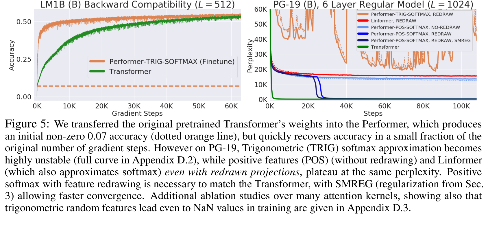</button>
<figcaption><strong>Checkpoint 转换不是换完算子就无损</strong><a href="https://arxiv.org/abs/2009.14794v4" target="_blank" rel="noopener">Rethinking Attention with Performers</a> · Figure 5 · version 2009.14794v4 · PDF p.7 / printed p.7
<button class="original-direct" type="button">Read original size</button>
<details><summary>Original caption &amp; source</summary><div class="original-caption">Figure 5: We transferred the original pretrained Transformer’s weights into the Performer, which produces
an initial non-zero 0.07 accuracy (dotted orange line), but quickly recovers accuracy in a small fraction of the
original number of gradient steps. However on PG-19, Trigonometric (TRIG) softmax approximation becomes
highly unstable (full curve in Appendix D.2), while positive features (POS) (without redrawing) and Linformer
(which also approximates softmax) even with redrawn projections, plateau at the same perplexity. Positive
softmax with feature redrawing is necessary to match the Transformer, with SMREG (regularization from Sec.
3) allowing faster convergence. Additional ablation studies over many attention kernels, showing also that
trigonometric random features lead even to NaN values in training are given in Appendix D.3.</div><a class="source-url" href="https://arxiv.org/abs/2009.14794v4">https://arxiv.org/abs/2009.14794v4</a></details></figcaption></figure>

图中 pretrained Transformer 转 Performer 后，初始任务性能并未自动保持；后续训练和 projection redraw 改变恢复轨迹。

PG-19 曲线说明特征形式影响训练稳定性，正值特征与重采样也要配套。这将核近似误差与模型适应问题区分开。

不能用“同样 Q/K/V 权重”推导同样函数；某些近似训练甚至不稳定。生产 checkpoint 替换必须重新验证。

<figure id="fig-performer-f19">
<button class="paper-image" type="button" aria-label="Zoom: 质量、速度、内存三者的同协议比较">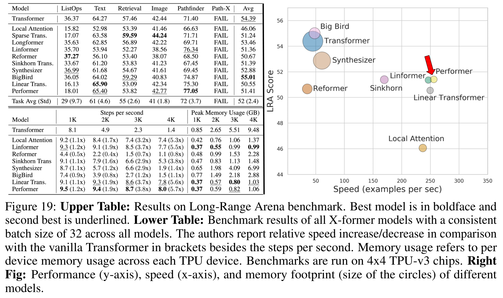</button>
<figcaption><strong>质量、速度、内存三者的同协议比较</strong><a href="https://arxiv.org/abs/2009.14794v4" target="_blank" rel="noopener">Rethinking Attention with Performers</a> · Figure 19 · version 2009.14794v4 · PDF p.25 / printed p.25
<button class="original-direct" type="button">Read original size</button>
<details><summary>Original caption &amp; source</summary><div class="original-caption">Figure 19: Upper Table: Results on Long-Range Arena benchmark. Best model is in boldface and
second best is underlined. Lower Table: Benchmark results of all X-former models with a consistent
batch size of 32 across all models. The authors report relative speed increase/decrease in comparison
with the vanilla Transformer in brackets besides the steps per second. Memory usage refers to per
device memory usage across each TPU device. Benchmarks are run on 4x4 TPU-v3 chips. Right
Fig: Performance (y-axis), speed (x-axis), and memory footprint (size of the circles) of different
models.</div><a class="source-url" href="https://arxiv.org/abs/2009.14794v4">https://arxiv.org/abs/2009.14794v4</a></details></figcaption></figure>

上部是 Long-Range Arena 任务结果，下部采用 batch 32、4×4 TPU-v3，右图把质量、速度和内存放在一个坐标系统中。

这种呈现显示效率与质量不是单一排序：某模型可能更快更省，却在某个任务上落后。固定 batch 的比较比各自最大容量吞吐更适合观察执行差异。

TPU 结果不能照搬 CUDA 或 NPU；LRA 的字符、像素等长序列任务 <a href="#source-D03">[D03]</a> 也不是 today LLM 推理能力的完整代理。

### Kimi Linear：门控、纠错写入与混合全注意力

Kimi Linear <a href="#source-P15">[P15]</a> 的 Kimi Delta Attention（KDA）并非只增加随机特征数，而是学习有限状态的遗忘和写入。论文公式按其更新顺序为：

$$
S_t=(I-\beta_t k_tk_t^\top)\operatorname{Diag}(\alpha_t)S_{t-1}+\beta_t k_tv_t^\top,\qquad o_t=S_t^\top q_t.
$$

$S_t$ 是 key–value 矩阵状态，$q_t,k_t,v_t$ 是当前表示，$\alpha_t$ 为逐通道衰减向量，$\beta_t$ 为写入控制，$I$ 为单位阵。先衰减旧状态，再在当前 key 方向纠正和写入。矩阵通常不交换，不能把两项顺序反过来而声称实现相同。

<figure id="fig-kimi-f3">
<button class="paper-image" type="button" aria-label="Zoom: 三个 KDA 层后接一个 MLA 层">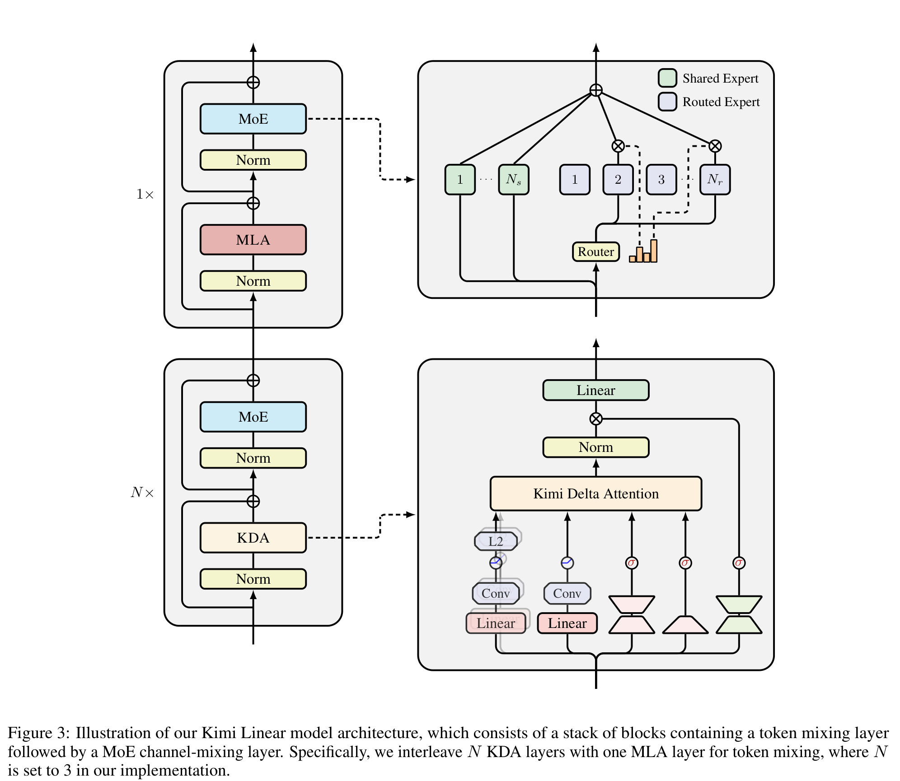</button>
<figcaption><strong>三个 KDA 层后接一个 MLA 层</strong><a href="https://arxiv.org/abs/2510.26692v2" target="_blank" rel="noopener">Kimi Linear: An Expressive, Efficient Attention Architecture</a> · Figure 3 · version 2510.26692v2 · PDF p.6 / printed p.6
<button class="original-direct" type="button">Read original size</button>
<details><summary>Original caption &amp; source</summary><div class="original-caption">Figure 3: Illustration of our Kimi Linear model architecture, which consists of a stack of blocks containing a token mixing layer
followed by a MoE channel-mixing layer. Specifically, we interleave N KDA layers with one MLA layer for token mixing, where N
is set to 3 in our implementation.</div><a class="source-url" href="https://arxiv.org/abs/2510.26692v2">https://arxiv.org/abs/2510.26692v2</a></details></figcaption></figure>

图中 token mixing 与 MoE channel mixing 交替；token mixing 内按 3 KDA : 1 MLA 排列。先区别 attention/state 模块和通道专家模块。

KDA 提供有限状态更新，MLA 保留逐位置全注意力读取，混合结构补偿单一路线的表达限制。

整个模型仍有 MLA KV 随长度增长，所以“线性”名称不意味着模型整体固定内存。MoE 活跃参数也不能替代 attention 状态账。

<figure id="fig-kimi-t1">
<button class="paper-image" type="button" aria-label="Zoom: Hybrid 比例与组件的 perplexity 消融">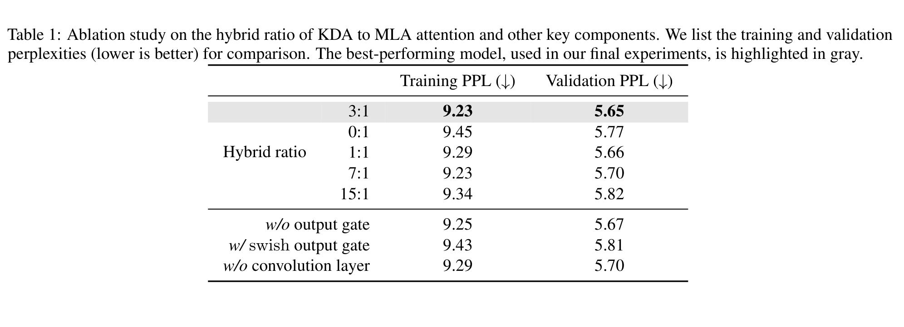</button>
<figcaption><strong>Hybrid 比例与组件的 perplexity 消融</strong><a href="https://arxiv.org/abs/2510.26692v2" target="_blank" rel="noopener">Kimi Linear: An Expressive, Efficient Attention Architecture</a> · Table 1 · version 2510.26692v2 · PDF p.8 / printed p.8
<button class="original-direct" type="button">Read original size</button>
<details><summary>Original caption &amp; source</summary><div class="original-caption">Table 1: Ablation study on the hybrid ratio of KDA to MLA attention and other key components. We list the training and validation
perplexities (lower is better) for comparison. The best-performing model, used in our final experiments, is highlighted in gray.</div><a class="source-url" href="https://arxiv.org/abs/2510.26692v2">https://arxiv.org/abs/2510.26692v2</a></details></figcaption></figure>

表格比较 KDA/MLA 比例及其他组件，以 train/validation perplexity 越低越好读取。

最优配置说明混合比例是一项有经验依据的设计选择，并非全量去掉 full attention 才一定最好。

这是特定训练配置的消融，不能推广为所有模型都应 3:1；若更换任务、长度或参数预算，平衡可能改变。

<figure id="fig-kimi-t5">
<button class="paper-image" type="button" aria-label="Zoom: 同训练 token 预算下的长上下文能力">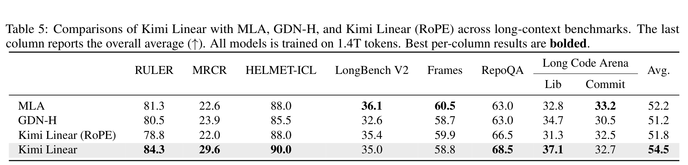</button>
<figcaption><strong>同训练 token 预算下的长上下文能力</strong><a href="https://arxiv.org/abs/2510.26692v2" target="_blank" rel="noopener">Kimi Linear: An Expressive, Efficient Attention Architecture</a> · Table 5 · version 2510.26692v2 · PDF p.12 / printed p.12
<button class="original-direct" type="button">Read original size</button>
<details><summary>Original caption &amp; source</summary><div class="original-caption">Table 5: Comparisons of Kimi Linear with MLA, GDN-H, and Kimi Linear (RoPE) across long-context benchmarks. The last
column reports the overall average (↑). All models is trained on 1.4T tokens. Best per-column results are bolded.</div><a class="source-url" href="https://arxiv.org/abs/2510.26692v2">https://arxiv.org/abs/2510.26692v2</a></details></figcaption></figure>

MLA、GDN-H、Kimi Linear 与 RoPE 变体均按原表 1.4T 训练 tokens 比较，各列任务及总体平均应一起看。

该控制让结果更接近 attention 架构比较，说明有限状态加 full-attention 层能在测试范围保持强长文表现。

总体平均可能掩盖检索和聚合任务差异；特定长度得分也不证明历史压缩对所有信息无损。

<figure id="fig-kimi-f7">
<button class="paper-image" type="button" aria-label="Zoom: Batch 1 的 prefill 与 TPOT 分开测">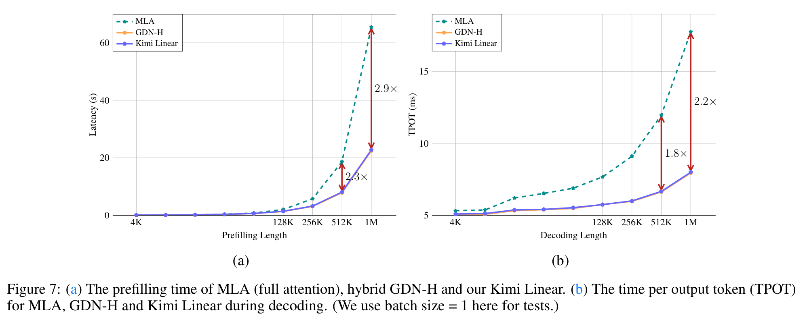</button>
<figcaption><strong>Batch 1 的 prefill 与 TPOT 分开测</strong><a href="https://arxiv.org/abs/2510.26692v2" target="_blank" rel="noopener">Kimi Linear: An Expressive, Efficient Attention Architecture</a> · Figure 7 · version 2510.26692v2 · PDF p.13 / printed p.13
<button class="original-direct" type="button">Read original size</button>
<details><summary>Original caption &amp; source</summary><div class="original-caption">Figure 7: (a) The prefilling time of MLA (full attention), hybrid GDN-H and our Kimi Linear. (b) The time per output token (TPOT)
for MLA, GDN-H and Kimi Linear during decoding. (We use batch size = 1 here for tests.)</div><a class="source-url" href="https://arxiv.org/abs/2510.26692v2">https://arxiv.org/abs/2510.26692v2</a></details></figcaption></figure>

左图是 prefill 时间，右图是 decode 每输出 token 耗时，图注明确 batch=1。长度越长，full attention 的历史读取成本越明显。

在 1M 条件，右图 Kimi Linear 相对 MLA 的 decode 约 2.2×。这是单请求口径，可解释固定状态层如何减少每步历史访问。

论文 Figure 1b 另给出 6.3×（1.84ms 对 11.48ms），正文将它描述为释放内存、允许更大 batch 后的理论 decoding 收益，不能替代本图的 batch-1 结果。相关图未充分列明的硬件/软件细节保持缺失，不补成可严格跨论文比较的数字。

## 08 · 缓存：GQA 共享头，MLA 压缩潜变量

生成一个新 token 时，causal attention 可以复用历史 K/V，避免重算过去的位置；但仍要读取可见历史。令层数 $L$、batch $B$、历史长度 $N$、KV head 数 $H_{kv}$、每头维度 $d$、每元素字节数 $b$：

$$
\mathrm{KVBytes}=2LBNH_{kv}db.
$$

系数 2 表示 K 与 V，假设两者维度相同、统一精度、无分片和额外元数据。它是 raw tensor 容量，不包括权重、激活、分配器、分页、索引、通信缓冲和物理内存重复映射。每步解码读取这批历史，经常成为低 batch 的带宽压力。

<figure id="diagram-cache"><div class="diagram-frame"><svg xmlns="http://www.w3.org/2000/svg" viewBox="0 0 900 530" role="img" aria-labelledby="svg-0c5d0222-title svg-0c5d0222-desc">
<title id="svg-0c5d0222-title">缓存表示与统一容量账</title><desc id="svg-0c5d0222-desc">在统一教学配置下比较MHA GQA MQA与latent加RoPE的raw cache，区别于真实全模型内存。</desc>
<defs><marker id="svg-0c5d0222-arrow" markerWidth="8" markerHeight="8" refX="7" refY="4" orient="auto"><path d="M0 0L8 4L0 8" fill="#8292a8"/></marker></defs>
<style>text{font-family:system-ui,-apple-system,sans-serif;fill:#dce4ef} .muted{fill:#9cabc0} .year{fill:#7dc6b2;font-size:17px;font-weight:600} .label{font-size:16px} .small{font-size:14px} .line{stroke:#718299;stroke-width:2;fill:none;marker-end:url(#svg-0c5d0222-arrow)}</style>
<text x="24" y="36" font-size="22" font-weight="600">逐位置保存历史：头共享与 latent 压缩</text><rect x="24" y="91" width="204" height="157" rx="8" fill="#182230" stroke="#344355"/><rect x="24" y="103" width="3" height="133" fill="#7dc6b2"/><text x="42" y="121" class="label" font-weight="600">MHA</text><text x="42" y="147" class="small muted">32 Q → 32 KV heads</text><text x="42" y="170" class="small muted">每头独立 K / V</text><text x="42" y="193" class="small muted">全部历史位置</text><text x="40" y="287" font-size="23" font-weight="600">16 GiB</text><rect x="240" y="91" width="204" height="157" rx="8" fill="#182230" stroke="#344355"/><rect x="240" y="103" width="3" height="133" fill="#7dc6b2"/><text x="258" y="121" class="label" font-weight="600">GQA</text><text x="258" y="147" class="small muted">32 Q → 8 KV heads</text><text x="258" y="170" class="small muted">每组 query 共用 KV</text><text x="258" y="193" class="small muted">全部历史位置</text><text x="256" y="287" font-size="23" font-weight="600">4 GiB</text><rect x="456" y="91" width="204" height="157" rx="8" fill="#182230" stroke="#344355"/><rect x="456" y="103" width="3" height="133" fill="#7dc6b2"/><text x="474" y="121" class="label" font-weight="600">MQA</text><text x="474" y="147" class="small muted">32 Q → 1 KV head</text><text x="474" y="170" class="small muted">所有 query 共用 KV</text><text x="474" y="193" class="small muted">全部历史位置</text><text x="472" y="287" font-size="23" font-weight="600">0.5 GiB</text><rect x="672" y="91" width="204" height="157" rx="8" fill="#182230" stroke="#344355"/><rect x="672" y="103" width="3" height="133" fill="#a7b5ee"/><text x="690" y="121" class="label" font-weight="600">Latent + RoPE</text><text x="690" y="147" class="small muted">latent 512 + key 64</text><text x="690" y="170" class="small muted">内容与位置分开缓存</text><text x="690" y="193" class="small muted">全部历史位置</text><text x="688" y="287" font-size="23" font-weight="600">1.125 GiB</text><rect x="24" y="339" width="405" height="120" rx="8" fill="#182230" stroke="#344355"/><rect x="24" y="351" width="3" height="96" fill="#7dc6b2"/><text x="42" y="369" class="label" font-weight="600">教学统一几何</text><text x="42" y="395" class="small muted">32 层 / batch 1 / 32768 tokens</text><text x="42" y="418" class="small muted">head dim 128 / BF16 2 bytes</text><text x="42" y="441" class="small muted">不是具体 checkpoint 配置</text><rect x="470" y="339" width="406" height="120" rx="8" fill="#182230" stroke="#344355"/><rect x="470" y="351" width="3" height="96" fill="#e6bf88"/><text x="488" y="369" class="label" font-weight="600">另列实际资源</text><text x="488" y="395" class="small muted">权重 / workspace / pages / indexer</text><text x="488" y="418" class="small muted">host 历史 / 传输 / allocator</text><text x="488" y="441" class="small muted">raw cache ≠ 峰值物理内存</text><text x="24" y="506" class="small muted">共享表示不是删除 token；任意 checkpoint 改结构需适应训练与质量验证。</text></svg></div><figcaption>原创机制图 · 小屏可局部横向滚动，保留完整关系与标签。</figcaption></figure>

### GQA：多个 query head 共用一组 K/V

GQA <a href="#source-P12">[P12]</a> 在 MHA 与 MQA 之间提供连续选项。MHA 每个 Q head 有自己的 K/V，MQA 全部共享一组，GQA 分组共享。它保留全部历史位置，压缩的是每个位置的头表示。

<figure id="fig-gqa-f2">
<button class="paper-image" type="button" aria-label="Zoom: MHA、MQA、GQA 的共享关系">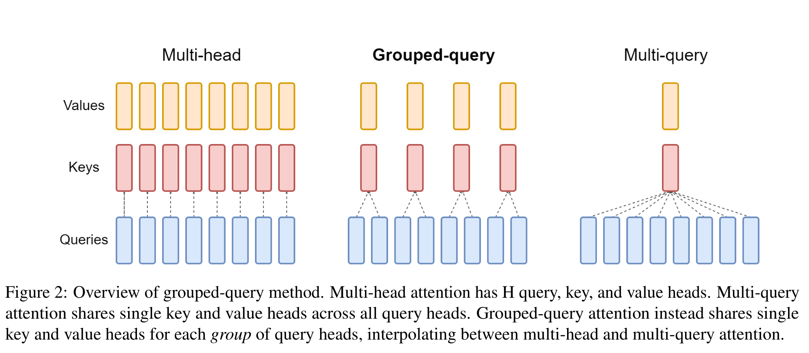</button>
<figcaption><strong>MHA、MQA、GQA 的共享关系</strong><a href="https://arxiv.org/abs/2305.13245v3" target="_blank" rel="noopener">GQA: Training Generalized Multi-Query Transformer Models from Multi-Head Checkpoints</a> · Figure 2 · version 2305.13245v3 · PDF p.2 / printed p.2
<button class="original-direct" type="button">Read original size</button>
<details><summary>Original caption &amp; source</summary><div class="original-caption">Figure 2: Overview of grouped-query method. Multi-head attention has H query, key, and value heads. Multi-query
attention shares single key and value heads across all query heads. Grouped-query attention instead shares single
key and value heads for each group of query heads, interpolating between multi-head and multi-query attention.</div><a class="source-url" href="https://arxiv.org/abs/2305.13245v3">https://arxiv.org/abs/2305.13245v3</a></details></figcaption></figure>

图的底部是 Queries，上方是 Keys 与 Values；从左到右依次是 MHA、GQA、MQA。中图若干 query 共用一个组，右图所有 query 共用一组。

每个 query 仍可形成自己的分数和输出，但相关性与内容来自共享 K/V 子空间。缓存和读取量因 $H_{kv}$ 下降而下降。

这不是删掉历史 token，也不是对任意 MHA checkpoint 的代数等价变换；独立 K/V heads 本来可表达不同内容。

<figure id="fig-gqa-t1">
<button class="paper-image" type="button" aria-label="Zoom: T5 任务质量与推理时间的联合比较">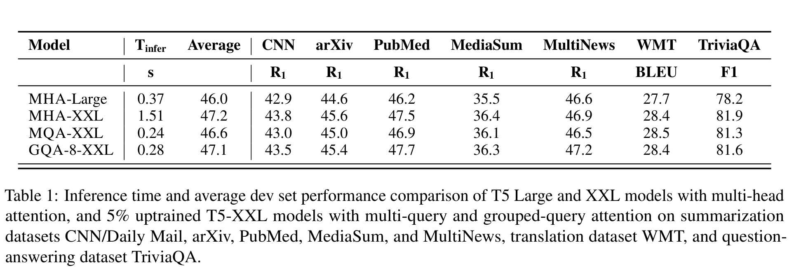</button>
<figcaption><strong>T5 任务质量与推理时间的联合比较</strong><a href="https://arxiv.org/abs/2305.13245v3" target="_blank" rel="noopener">GQA: Training Generalized Multi-Query Transformer Models from Multi-Head Checkpoints</a> · Table 1 · version 2305.13245v3 · PDF p.3 / printed p.3
<button class="original-direct" type="button">Read original size</button>
<details><summary>Original caption &amp; source</summary><div class="original-caption">Table 1: Inference time and average dev set performance comparison of T5 Large and XXL models with multi-head
attention, and 5% uptrained T5-XXL models with multi-query and grouped-query attention on summarization
datasets CNN/Daily Mail, arXiv, PubMed, MediaSum, and MultiNews, translation dataset WMT, and question-
answering dataset TriviaQA.</div><a class="source-url" href="https://arxiv.org/abs/2305.13245v3">https://arxiv.org/abs/2305.13245v3</a></details></figcaption></figure>

表中 summarization、translation、QA 采用各自指标，并列平均开发集表现与 time/sample；转换模型经过 5% uptraining。

GQA 接近 MHA-XXL 质量且推理更快，说明适当共享加恢复训练能形成良好取舍。

“5%”指原预训练计算预算比例的 uptraining 口径，不是任意五条数据；T5 encoder–decoder 的时间也不能直接等同 decoder-only LLM 的 TPOT。

<figure id="fig-gqa-f3">
<button class="paper-image" type="button" aria-label="Zoom: 质量—时间平面上的 GQA-8">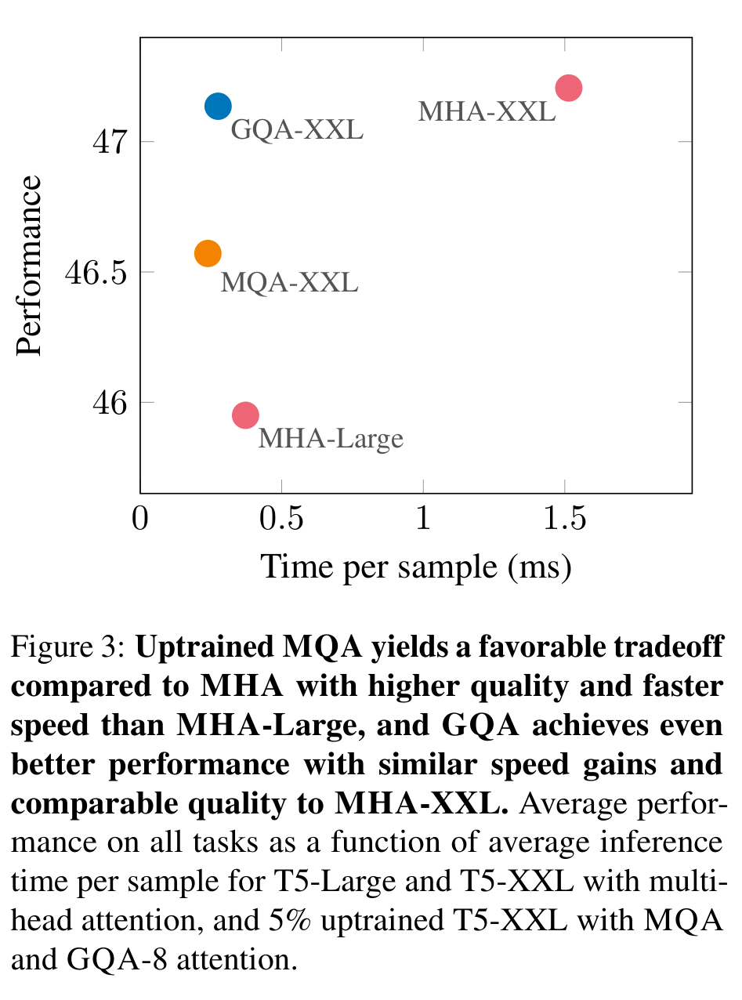</button>
<figcaption><strong>质量—时间平面上的 GQA-8</strong><a href="https://arxiv.org/abs/2305.13245v3" target="_blank" rel="noopener">GQA: Training Generalized Multi-Query Transformer Models from Multi-Head Checkpoints</a> · Figure 3 · version 2305.13245v3 · PDF p.3 / printed p.3
<button class="original-direct" type="button">Read original size</button>
<details><summary>Original caption &amp; source</summary><div class="original-caption">Figure 3: Uptrained MQA yields a favorable tradeoff
compared to MHA with higher quality and faster
speed than MHA-Large, and GQA achieves even
better performance with similar speed gains and
comparable quality to MHA-XXL. Average perfor-
mance on all tasks as a function of average inference
time per sample for T5-Large and T5-XXL with multi-
head attention, and 5% uptrained T5-XXL with MQA
and GQA-8 attention.</div><a class="source-url" href="https://arxiv.org/abs/2305.13245v3">https://arxiv.org/abs/2305.13245v3</a></details></figcaption></figure>

横轴每样本平均推理时间，纵轴跨任务平均表现；用同一模型规模和训练恢复条件判断 GQA-8 与 MQA。

GQA 在这组实验中用小幅缓存增加换回更接近 MHA 的质量，解释了它为什么常作为中间方案。

跨任务平均尺度具有论文定义，不能把曲线高度当统一百分点，也不能由平均结果保证每个任务不退化。

<figure id="fig-gqa-f4">
<button class="paper-image" type="button" aria-label="Zoom: Mean pooling 是转换起点，仍需要适应">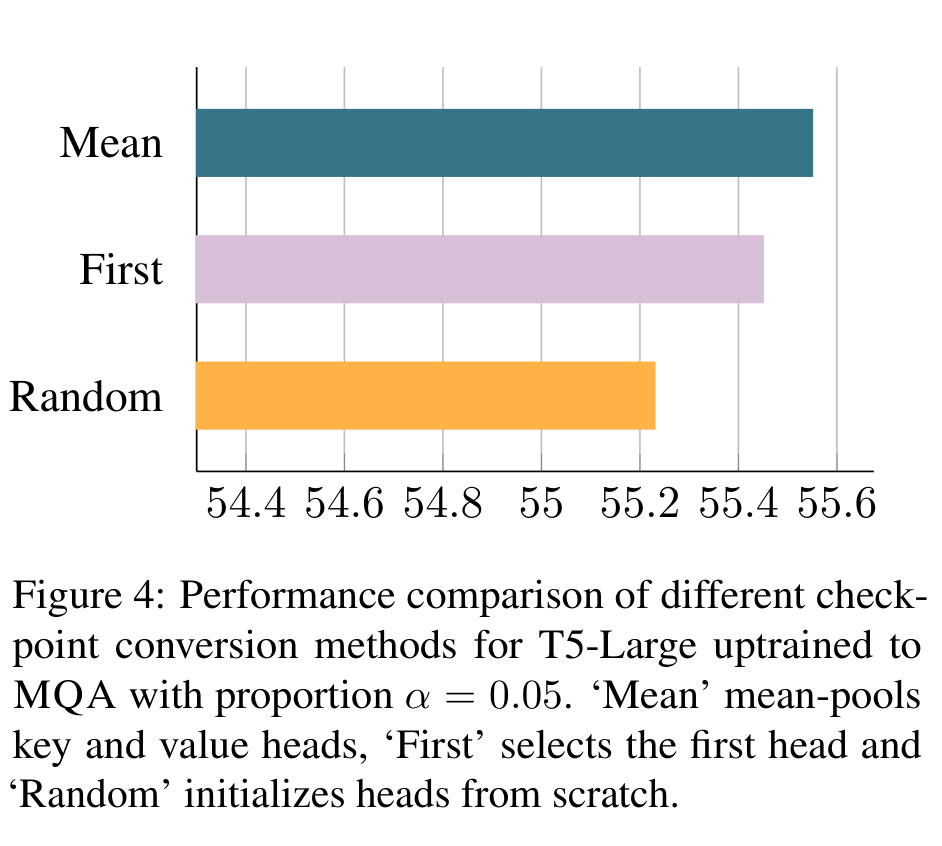</button>
<figcaption><strong>Mean pooling 是转换起点，仍需要适应</strong><a href="https://arxiv.org/abs/2305.13245v3" target="_blank" rel="noopener">GQA: Training Generalized Multi-Query Transformer Models from Multi-Head Checkpoints</a> · Figure 4 · version 2305.13245v3 · PDF p.4 / printed p.4
<button class="original-direct" type="button">Read original size</button>
<details><summary>Original caption &amp; source</summary><div class="original-caption">Figure 4: Performance comparison of different check-
point conversion methods for T5-Large uptrained to
MQA with proportion α = 0.05. ‘Mean’ mean-pools
key and value heads, ‘First’ selects the first head and
‘Random’ initializes heads from scratch.</div><a class="source-url" href="https://arxiv.org/abs/2305.13245v3">https://arxiv.org/abs/2305.13245v3</a></details></figcaption></figure>

图比较 mean、first、random 三种 K/V head 初始化，并控制 T5-Large 的 uptraining 比例。

均值初始化保留更多已有信息，比只取第一头或随机重建更有优势。这是减少转换损失的经验方法。

Mean pooling 不使 softmax 和 value 输出自动保持相同；第 13 节的无误差实验只针对本来已经共享 K/V 的构造。

<figure id="fig-gqa-f5">
<button class="paper-image" type="button" aria-label="Zoom: 恢复训练预算与质量的关系">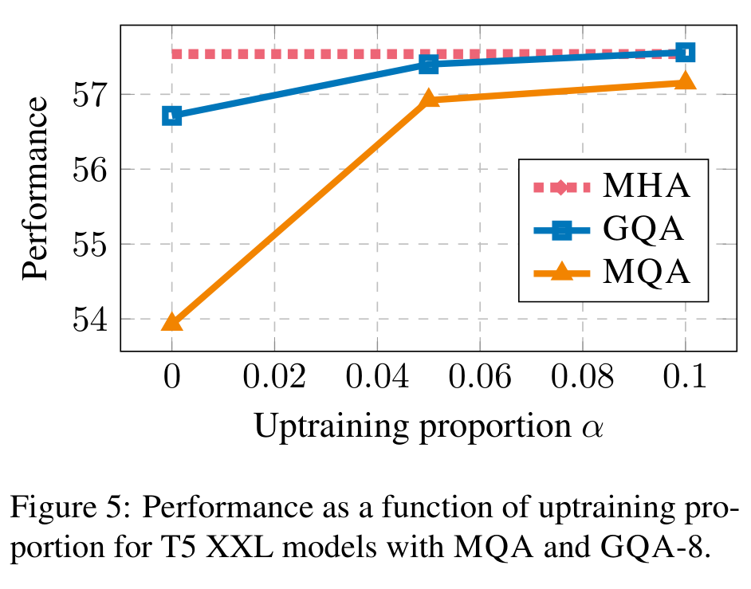</button>
<figcaption><strong>恢复训练预算与质量的关系</strong><a href="https://arxiv.org/abs/2305.13245v3" target="_blank" rel="noopener">GQA: Training Generalized Multi-Query Transformer Models from Multi-Head Checkpoints</a> · Figure 5 · version 2305.13245v3 · PDF p.4 / printed p.4
<button class="original-direct" type="button">Read original size</button>
<details><summary>Original caption &amp; source</summary><div class="original-caption">Figure 5: Performance as a function of uptraining pro-
portion for T5 XXL models with MQA and GQA-8.</div><a class="source-url" href="https://arxiv.org/abs/2305.13245v3">https://arxiv.org/abs/2305.13245v3</a></details></figcaption></figure>

横轴是 uptraining 比例，分别比较 MQA 与 GQA-8 的性能恢复轨迹。

曲线说明结构替换带来的失配可通过训练缓解，而 GQA 保留更多头子空间，通常更容易维持质量。

趋势依赖训练来源和优化设置；不能从小预算恢复曲线推导完全免训练转换，更不能忽略实际恢复训练成本。

<figure id="fig-gqa-f6">
<button class="paper-image" type="button" aria-label="Zoom: KV 组数增加时的时间成本">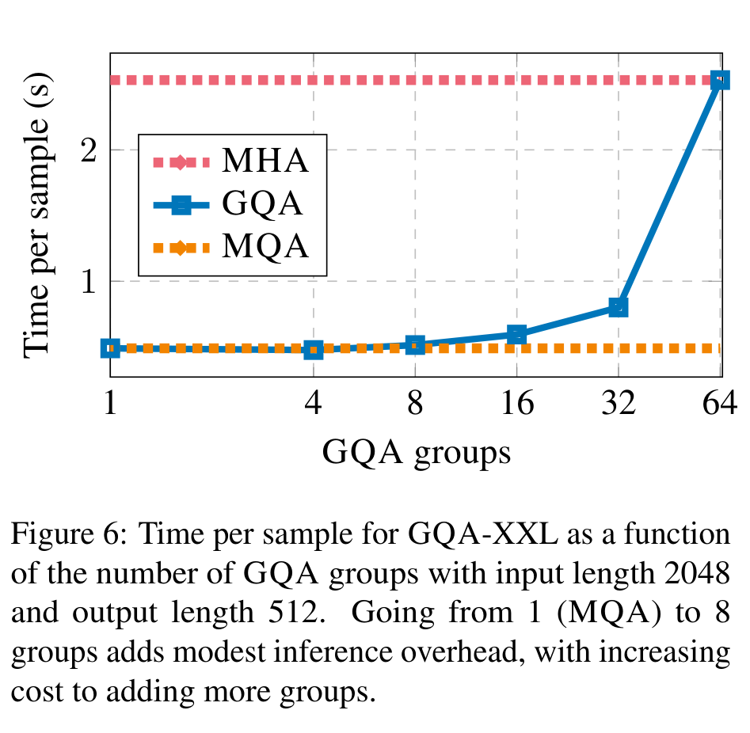</button>
<figcaption><strong>KV 组数增加时的时间成本</strong><a href="https://arxiv.org/abs/2305.13245v3" target="_blank" rel="noopener">GQA: Training Generalized Multi-Query Transformer Models from Multi-Head Checkpoints</a> · Figure 6 · version 2305.13245v3 · PDF p.4 / printed p.4
<button class="original-direct" type="button">Read original size</button>
<details><summary>Original caption &amp; source</summary><div class="original-caption">Figure 6: Time per sample for GQA-XXL as a function
of the number of GQA groups with input length 2048
and output length 512. Going from 1 (MQA) to 8
groups adds modest inference overhead, with increasing
cost to adding more groups.</div><a class="source-url" href="https://arxiv.org/abs/2305.13245v3">https://arxiv.org/abs/2305.13245v3</a></details></figcaption></figure>

输入长度 2048、输出长度 512，横轴 GQA groups，纵轴每样本时间。先看 1 到 8 的变化，再看接近 MHA 时成本增长。

较少组数的时间增长较温和，更多组逐渐增加历史读取和计算压力，形成可调质量—带宽接口。

这不是长度无关常数：更长上下文、不同 batch、分片和 kernel 实现都会改变曲线。

### MLA：历史保存压缩 latent，位置另算

DeepSeek-V2 <a href="#source-P13">[P13]</a> 的 MLA 将 K/V 共同压入低维 latent。简化的无位置形式为：

$$
c_t=W_Dh_t,\qquad k_t=W_{UK}c_t,\qquad v_t=W_{UV}c_t,\qquad
q^\top k_t=(W_{UK}^\top q)^\top c_t.
$$

$h_t$ 是 hidden，$c_t$ 是维度 $d_c$ 的 latent，$W_D$ 为压缩投影，$W_{UK},W_{UV}$ 为恢复投影。线性结合律允许在 decode 中变换 query，直接和 latent 匹配，并把 value 恢复与输出投影结合。完整实现还包含 **decoupled RoPE key**，因为位置依赖旋转不能被朴素吸收成同一固定矩阵。

<figure id="fig-mla-f3">
<button class="paper-image" type="button" aria-label="Zoom: MLA 与共享头方案压缩的是不同结构">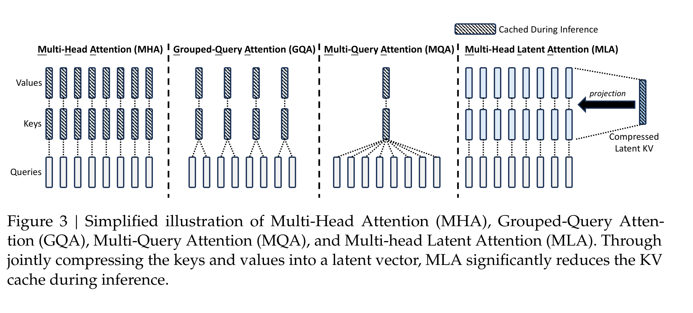</button>
<figcaption><strong>MLA 与共享头方案压缩的是不同结构</strong><a href="https://arxiv.org/abs/2405.04434v5" target="_blank" rel="noopener">DeepSeek-V2: A Strong, Economical, and Efficient Mixture-of-Experts Language Model</a> · Figure 3 · version 2405.04434v5 · PDF p.7 / printed p.7
<button class="original-direct" type="button">Read original size</button>
<details><summary>Original caption &amp; source</summary><div class="original-caption">Figure 3 | Simplified illustration of Multi-Head Attention (MHA), Grouped-Query Atten-
tion (GQA), Multi-Query Attention (MQA), and Multi-head Latent Attention (MLA). Through
jointly compressing the keys and values into a latent vector, MLA significantly reduces the KV
cache during inference.</div><a class="source-url" href="https://arxiv.org/abs/2405.04434v5">https://arxiv.org/abs/2405.04434v5</a></details></figcaption></figure>

先比较 MHA/GQA/MQA 的各头 K/V，再看 MLA 底部共同 latent。箭头显示多个头从同一压缩信息恢复不同表示。

GQA 是共用部分 K/V heads，MLA 是低维共同信息加各头恢复投影；两者约束不同，不能按 head 数画成同一结构。

原图是 simplified illustration，完整缓存必须包含位置支路。忽略它会低估容量，也会误解实际 score 的组成。

<figure id="fig-mla-t1">
<button class="paper-image" type="button" aria-label="Zoom: 完整缓存元素数包含 decoupled RoPE">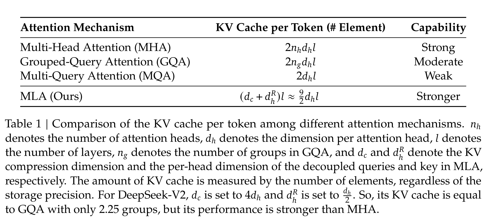</button>
<figcaption><strong>完整缓存元素数包含 decoupled RoPE</strong><a href="https://arxiv.org/abs/2405.04434v5" target="_blank" rel="noopener">DeepSeek-V2: A Strong, Economical, and Efficient Mixture-of-Experts Language Model</a> · Table 1 · version 2405.04434v5 · PDF p.9 / printed p.9
<button class="original-direct" type="button">Read original size</button>
<details><summary>Original caption &amp; source</summary><div class="original-caption">Table 1 | Comparison of the KV cache per token among different attention mechanisms. 𝑛ℎ
denotes the number of attention heads, 𝑑ℎdenotes the dimension per attention head, 𝑙denotes
the number of layers, 𝑛𝑔denotes the number of groups in GQA, and 𝑑𝑐and 𝑑𝑅
ℎdenote the KV
compression dimension and the per-head dimension of the decoupled queries and key in MLA,
respectively. The amount of KV cache is measured by the number of elements, regardless of the
storage precision. For DeepSeek-V2, 𝑑𝑐is set to 4𝑑ℎand 𝑑𝑅
ℎis set to 𝑑ℎ
2 . So, its KV cache is equal
to GQA with only 2.25 groups, but its performance is stronger than MHA.</div><a class="source-url" href="https://arxiv.org/abs/2405.04434v5">https://arxiv.org/abs/2405.04434v5</a></details></figcaption></figure>

表以元素数计，不绑定存储精度；MLA 为 $L(d_c+d_{\mathrm{rope}})$ 每 token，MHA/GQA/MQA 另有各自头数量。

位置 key 可共用，content latent 与位置 key 一起缓存。论文设定 $d_c=4d_h$、$d_{\mathrm{rope}}=d_h/2$，得出相当于 2.25 GQA groups 的元素量。

表中 Strong/Weak 是作者在其架构与训练实验下的表达，不能泛化为所有 GQA 必然弱。真实字节还受 FP8/BF16、对齐和索引支路影响。

<figure id="fig-mla-t9">
<button class="paper-image" type="button" aria-label="Zoom: 困难任务中的 MLA/MHA 架构比较">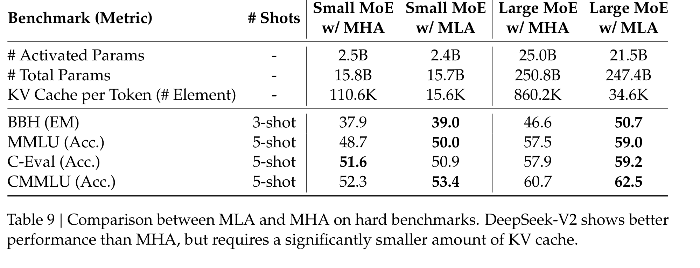</button>
<figcaption><strong>困难任务中的 MLA/MHA 架构比较</strong><a href="https://arxiv.org/abs/2405.04434v5" target="_blank" rel="noopener">DeepSeek-V2: A Strong, Economical, and Efficient Mixture-of-Experts Language Model</a> · Table 9 · version 2405.04434v5 · PDF p.32 / printed p.32
<button class="original-direct" type="button">Read original size</button>
<details><summary>Original caption &amp; source</summary><div class="original-caption">Table 9 | Comparison between MLA and MHA on hard benchmarks. DeepSeek-V2 shows better
performance than MHA, but requires a significantly smaller amount of KV cache.</div><a class="source-url" href="https://arxiv.org/abs/2405.04434v5">https://arxiv.org/abs/2405.04434v5</a></details></figcaption></figure>

这张消融表比完整 DeepSeek-V2 系统排名更适合观察 attention 选择；按各任务列逐项比较。

MLA 在较小缓存下保持或提高难任务表现，但预算并非严格等参：small 模型 active 2.5B/2.4B、total 15.8B/15.7B；large 为 active 25.0B/21.5B、total 250.8B/247.4B（MHA/MLA）。因此这是作者架构比较，不能称完全同参数的单因素实验。

完整 DeepSeek-V2 还包含 MoE 与其他训练改动，不能把完整模型的一切能力归于 MLA。它也不是无需训练压缩任何 MHA checkpoint 的方法。

## 09 · FlashAttention 1–4：从 HBM 到异步流水线

GPU 的 Tensor Core 矩阵乘法很快，但 HBM 访问、指数、归一化、同步可能成为瓶颈。FlashAttention <a href="#source-P09">[P09]</a> 的转折是按 IO 设计实现：不将完整分数和概率矩阵写回 HBM，在 SRAM 内按块读取，在线合并 softmax。

### 在线 softmax：看到下一块时怎样保留正确归一化

<figure id="diagram-online"><div class="diagram-frame"><svg xmlns="http://www.w3.org/2000/svg" viewBox="0 0 900 532" role="img" aria-labelledby="svg-8fe62831-title svg-8fe62831-desc">
<title id="svg-8fe62831-title">分块在线softmax</title><desc id="svg-8fe62831-desc">已处理块的最大值指数和内容和与下一块统一到新最大值，最终归一化，避免存完整概率矩阵。</desc>
<defs><marker id="svg-8fe62831-arrow" markerWidth="8" markerHeight="8" refX="7" refY="4" orient="auto"><path d="M0 0L8 4L0 8" fill="#8292a8"/></marker></defs>
<style>text{font-family:system-ui,-apple-system,sans-serif;fill:#dce4ef} .muted{fill:#9cabc0} .year{fill:#7dc6b2;font-size:17px;font-weight:600} .label{font-size:16px} .small{font-size:14px} .line{stroke:#718299;stroke-width:2;fill:none;marker-end:url(#svg-8fe62831-arrow)}</style>
<text x="24" y="36" font-size="22" font-weight="600">Online softmax：把历史块统一到同一个尺度</text><rect x="24" y="95" width="260" height="147" rx="8" fill="#182230" stroke="#344355"/><rect x="24" y="107" width="3" height="123" fill="#7dc6b2"/><text x="42" y="125" class="label" font-weight="600">已处理的块</text><text x="42" y="151" class="small muted">m：已见最大 score</text><text x="42" y="174" class="small muted">ℓ：缩放后的指数总量</text><text x="42" y="197" class="small muted">u：缩放后的内容总量</text><rect x="318" y="95" width="260" height="147" rx="8" fill="#182230" stroke="#344355"/><rect x="318" y="107" width="3" height="123" fill="#a7b5ee"/><text x="336" y="125" class="label" font-weight="600">下一块 K / V</text><text x="336" y="151" class="small muted">计算这块 scores</text><text x="336" y="174" class="small muted">找到块内最大 score</text><text x="336" y="197" class="small muted">局部指数与内容和</text><rect x="612" y="95" width="264" height="147" rx="8" fill="#182230" stroke="#344355"/><rect x="612" y="107" width="3" height="123" fill="#7dc6b2"/><text x="630" y="125" class="label" font-weight="600">合并尺度</text><text x="630" y="151" class="small muted">m′ = 两个最大值的 max</text><text x="630" y="174" class="small muted">旧 ℓ / u 乘 exp(m−m′)</text><text x="630" y="197" class="small muted">新块按 m′ 缩放后相加</text><path d="M285 169H314" class="line"/><path d="M579 169H608" class="line"/><rect x="24" y="329" width="405" height="129" rx="8" fill="#182230" stroke="#344355"/><rect x="24" y="341" width="3" height="105" fill="#7dc6b2"/><text x="42" y="359" class="label" font-weight="600">重复扫描允许的所有块</text><text x="42" y="385" class="small muted">只保存行统计量与输出</text><text x="42" y="408" class="small muted">不把 N×N 概率写回 HBM</text><text x="42" y="431" class="small muted">反向可重算局部概率</text><rect x="470" y="329" width="406" height="129" rx="8" fill="#182230" stroke="#344355"/><rect x="470" y="341" width="3" height="105" fill="#e6bf88"/><text x="488" y="359" class="label" font-weight="600">最终输出 o = u / ℓ</text><text x="488" y="385" class="small muted">数学上仍是同一 softmax</text><text x="488" y="408" class="small muted">浮点累加顺序改变</text><text x="488" y="431" class="small muted">不承诺 bitwise 一致</text><path d="M744 244L226 325" class="line"/><path d="M430 394H466" class="line"/><text x="24" y="506" class="small muted">省的是中间量 IO；dense 数学连接与主要平方 FLOPs 仍在。空 mask 行需单独处理。</text></svg></div><figcaption>原创机制图 · 小屏可局部横向滚动，保留完整关系与标签。</figcaption></figure>

对单个 query，已处理部分保留最大分数 $m$、指数和 $\ell$ 与未归一化内容和 $u$。新块分数为 $s_j$，内容为 $v_j$，更新为：

$$
m'=\max(m,\max_j s_j),\qquad
\ell'=e^{m-m'}\ell+\sum_j e^{s_j-m'},\qquad
u'=e^{m-m'}u+\sum_j e^{s_j-m'}v_j,\qquad o=\frac{u'}{\ell'}.
$$

初始化 $m=-\infty,\ell=0,u=0$，实现需处理第一块的数值边界。两批数据统一到新的最大值 $m'$ 后相加，最终结果就是同一个 softmax。它不必存全部概率，却仍处理所有允许的位置。浮点结合次序改变，所以“exact attention”是数学语义描述，不能承诺 bitwise 相同。

<figure id="fig-flash-f1">
<button class="paper-image" type="button" aria-label="Zoom: 分块将大中间矩阵留在片上">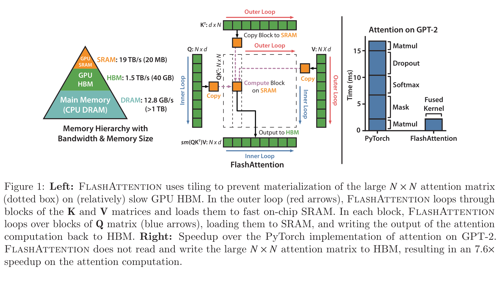</button>
<figcaption><strong>分块将大中间矩阵留在片上</strong><a href="https://arxiv.org/abs/2205.14135v2" target="_blank" rel="noopener">FlashAttention: Fast and Memory-Efficient Exact Attention with IO-Awareness</a> · Figure 1 · version 2205.14135v2 · PDF p.2 / printed p.2
<button class="original-direct" type="button">Read original size</button>
<details><summary>Original caption &amp; source</summary><div class="original-caption">Figure 1: Left: FlashAttention uses tiling to prevent materialization of the large 𝑁× 𝑁attention matrix
(dotted box) on (relatively) slow GPU HBM. In the outer loop (red arrows), FlashAttention loops through</div><a class="source-url" href="https://arxiv.org/abs/2205.14135v2">https://arxiv.org/abs/2205.14135v2</a></details></figcaption></figure>

左图看 Q/K/V 如何在 HBM 与 SRAM 间分块传递，再观察虚线 $N\times N$ 矩阵为何无需物化。

在线归一化把块间依赖缩成少量行统计量，计算结果回写输出而不是完整 attention map。这节省的是中间量 IO。

若应用需要导出完整注意力权重，依旧需要相应存储或重算；普通 Flash 接口的低内存收益不意味着免费得到全图。

<figure id="fig-flash-a1">
<button class="paper-image" type="button" aria-label="Zoom: Algorithm 1 将在线统计嵌入 tile 循环">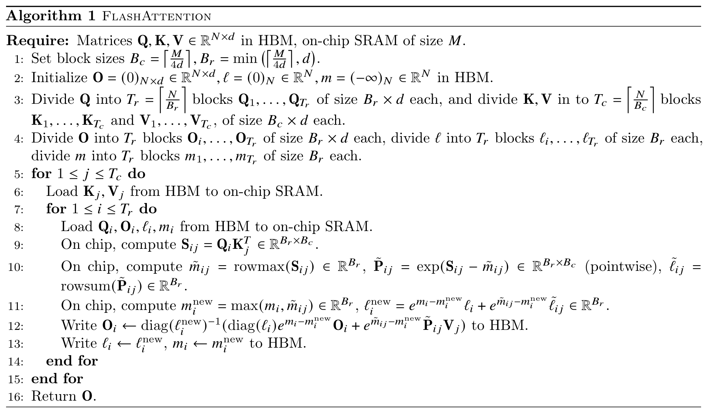</button>
<figcaption><strong>Algorithm 1 将在线统计嵌入 tile 循环</strong><a href="https://arxiv.org/abs/2205.14135v2" target="_blank" rel="noopener">FlashAttention: Fast and Memory-Efficient Exact Attention with IO-Awareness</a> · Algorithm 1 · version 2205.14135v2 · PDF p.5 / printed p.5
<button class="original-direct" type="button">Read original size</button>
<details><summary>Original caption &amp; source</summary><div class="original-caption">Algorithm 1 FlashAttention</div><a class="source-url" href="https://arxiv.org/abs/2205.14135v2">https://arxiv.org/abs/2205.14135v2</a></details></figcaption></figure>

算法逐块加载 Q/K/V，更新每行最大值、归一化与输出。把这些变量与上一公式一一对应，能理解“局部计算、全局归一化”如何同时成立。

反向可利用保存的归一化信息重算局部概率，用额外 FLOPs 换少量 HBM IO。算法设计针对带宽与容量层次。

Tile 尺寸受 SRAM 容量、dtype、head dim 和占用率限制；把它设得更大不保证更快。

<figure id="fig-flash-t2">
<button class="paper-image" type="button" aria-label="Zoom: GPT-2 的端到端训练收益取决于基线">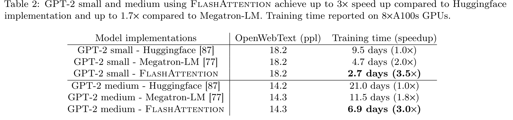</button>
<figcaption><strong>GPT-2 的端到端训练收益取决于基线</strong><a href="https://arxiv.org/abs/2205.14135v2" target="_blank" rel="noopener">FlashAttention: Fast and Memory-Efficient Exact Attention with IO-Awareness</a> · Table 2 · version 2205.14135v2 · PDF p.8 / printed p.8
<button class="original-direct" type="button">Read original size</button>
<details><summary>Original caption &amp; source</summary><div class="original-caption">Table 2: GPT-2 small and medium using FlashAttention achieve up to 3× speed up compared to Huggingface
implementation and up to 1.7× compared to Megatron-LM. Training time reported on 8×A100s GPUs.</div><a class="source-url" href="https://arxiv.org/abs/2205.14135v2">https://arxiv.org/abs/2205.14135v2</a></details></figcaption></figure>

表中训练硬件为 8×A100，比较 HuggingFace 与 Megatron-LM 基线。先看相同模型规模与同一训练工作量。

相对不同基线，“最高约 3×”与“约 1.7×”可以同时成立。优化成熟度不同，attention 在训练总时间中的占比也不同。

这是 GPT-2 训练测量，不能将倍数贴到现代 LLM 的 decode，更不能认为全部 FFN 与通信也变快三倍。

<figure id="fig-flash-f3">
<button class="paper-image" type="button" aria-label="Zoom: 执行时间与中间量内存是两条收益曲线">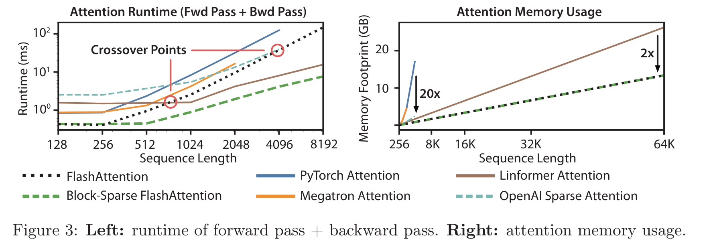</button>
<figcaption><strong>执行时间与中间量内存是两条收益曲线</strong><a href="https://arxiv.org/abs/2205.14135v2" target="_blank" rel="noopener">FlashAttention: Fast and Memory-Efficient Exact Attention with IO-Awareness</a> · Figure 3 · version 2205.14135v2 · PDF p.9 / printed p.9
<button class="original-direct" type="button">Read original size</button>
<details><summary>Original caption &amp; source</summary><div class="original-caption">Figure 3: Left: runtime of forward pass + backward pass. Right: attention memory usage.</div><a class="source-url" href="https://arxiv.org/abs/2205.14135v2">https://arxiv.org/abs/2205.14135v2</a></details></figcaption></figure>

左图是前向加反向时间，右图是 attention 内存，横轴随长度增长。二者都改善，但增幅含义不同。

线性中间量存储可以支持更长训练序列；计算仍有平方项，时间曲线不会因此变成同一条线性复杂度证明。

此处 attention memory 不等于全模型峰值物理 RAM，解码 KV 也不是训练分数矩阵的同一对象。

### FlashAttention-2：减少非矩阵运算与跨 warp 协调

FA2 <a href="#source-P10">[P10]</a> 在 IO 思路上进一步优化工作分配，尤其小 batch/少 heads 时增加沿序列的并行块，减少不必要的 rescaling 和共享内存通信。

<figure id="fig-flash2-f2">
<button class="paper-image" type="button" aria-label="Zoom: 不同 query 行块提供更多并行 worker">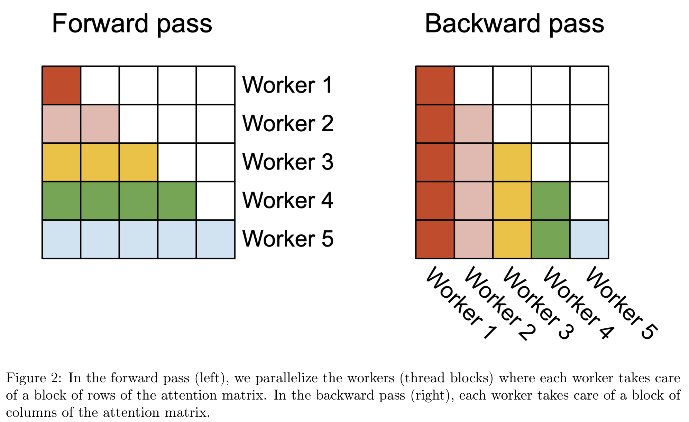</button>
<figcaption><strong>不同 query 行块提供更多并行 worker</strong><a href="https://arxiv.org/abs/2307.08691v1" target="_blank" rel="noopener">FlashAttention-2: Faster Attention with Better Parallelism and Work Partitioning</a> · Figure 2 · version 2307.08691v1 · PDF p.8 / printed p.8
<button class="original-direct" type="button">Read original size</button>
<details><summary>Original caption &amp; source</summary><div class="original-caption">Figure 2: In the forward pass (left), we parallelize the workers (thread blocks) where each worker takes care
of a block of rows of the attention matrix. In the backward pass (right), each worker takes care of a block of
columns of the attention matrix.</div><a class="source-url" href="https://arxiv.org/abs/2307.08691v1">https://arxiv.org/abs/2307.08691v1</a></details></figcaption></figure>

前向沿 attention 行块分配 thread blocks，反向按需要分配列块。图中 worker 的负责区域要与读写目标一起理解。

更多独立 query 块帮助设备在 head/batch 不足时保持占用率；这改善硬件利用，不改变可见性 mask。

并行不是无限扩张：重复读取、资源占用和反向梯度合并仍需考虑。正确的数学块划分只是第一步。

<figure id="fig-flash2-f3">
<button class="paper-image" type="button" aria-label="Zoom: 从 split-K 到 split-Q 减少 warp 间归约">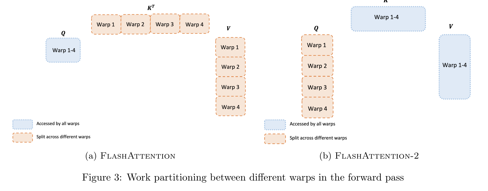</button>
<figcaption><strong>从 split-K 到 split-Q 减少 warp 间归约</strong><a href="https://arxiv.org/abs/2307.08691v1" target="_blank" rel="noopener">FlashAttention-2: Faster Attention with Better Parallelism and Work Partitioning</a> · Figure 3 · version 2307.08691v1 · PDF p.9 / printed p.9
<button class="original-direct" type="button">Read original size</button>
<details><summary>Original caption &amp; source</summary><div class="original-caption">Figure 3: Work partitioning between different warps in the forward pass</div><a class="source-url" href="https://arxiv.org/abs/2307.08691v1">https://arxiv.org/abs/2307.08691v1</a></details></figcaption></figure>

比较两种 warp 分工：分割 K 时，多个 warp 产生同一输出的部分和；分割 Q 时，各自负责不同 query 行。

后者能减少共享内存归约与同步，这说明总 FLOPs 相似也能因通信结构改变而更快。

该图针对具体前向路径，不能泛化为所有 GPU 算子都应 split-Q；head dim 与资源限制会改变最优划分。

<figure id="fig-flash2-f6-t1">
<button class="paper-image" type="button" aria-label="Zoom: Kernel backward 和完整训练速度须分别读取">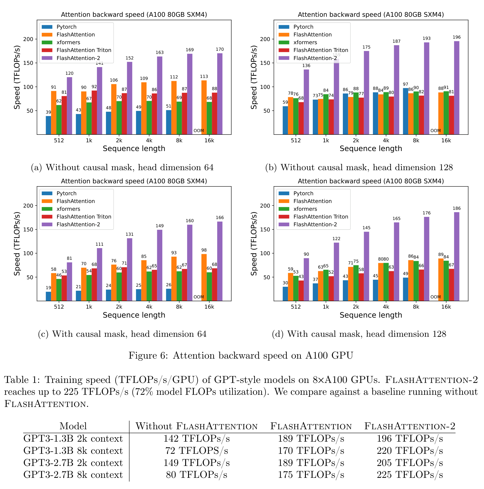</button>
<figcaption><strong>Kernel backward 和完整训练速度须分别读取</strong><a href="https://arxiv.org/abs/2307.08691v1" target="_blank" rel="noopener">FlashAttention-2: Faster Attention with Better Parallelism and Work Partitioning</a> · Figure 6 + Table 1 · version 2307.08691v1 · PDF p.12 / printed p.12
<button class="original-direct" type="button">Read original size</button>
<details><summary>Original caption &amp; source</summary><div class="original-caption">Figure 6: Attention backward speed on A100 GPU

Table 1: Training speed (TFLOPs/s/GPU) of GPT-style models on 8×A100 GPUs. FlashAttention-2
reaches up to 225 TFLOPs/s (72% model FLOPs utilization). We compare against a baseline running without
FlashAttention.</div><a class="source-url" href="https://arxiv.org/abs/2307.08691v1">https://arxiv.org/abs/2307.08691v1</a></details></figcaption></figure>

Figure 6 在 A100 比较 backward speed；Table 1 用 8×A100 比较 GPT 风格训练，最高约 225 TFLOPs/s/GPU、72% model FLOPs utilization。

Kernel 吞吐改善能传递到训练，但训练指标还包括别的算子与流程。两项并列有助于判断收益衰减在哪一层。

TFLOPs/s 和 utilization 的分母随精度、设备和 FLOPs 定义变化；不能与后文 H100/B200 的数字直接排名。

### FlashAttention-3：Hopper 上重叠矩阵乘法与 softmax

FA3 <a href="#source-P11">[P11]</a> 利用 Hopper 的异步 WGMMA 和 TMA，用 producer/consumer 与 pingpong 调度隐藏非矩阵阶段，另研究 FP8 数值路径。

<figure id="fig-flash3-f1">
<button class="paper-image" type="button" aria-label="Zoom: 两个 warpgroup 交错 softmax 与 GEMM">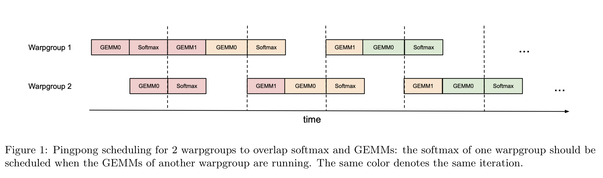</button>
<figcaption><strong>两个 warpgroup 交错 softmax 与 GEMM</strong><a href="https://arxiv.org/abs/2407.08608v2" target="_blank" rel="noopener">FlashAttention-3: Fast and Accurate Attention with Asynchrony and Low-precision</a> · Figure 1 · version 2407.08608v2 · PDF p.6 / printed p.6
<button class="original-direct" type="button">Read original size</button>
<details><summary>Original caption &amp; source</summary><div class="original-caption">Figure 1: Pingpong scheduling for 2 warpgroups to overlap softmax and GEMMs: the softmax of one warpgroup should be
scheduled when the GEMMs of another warpgroup are running. The same color denotes the same iteration.</div><a class="source-url" href="https://arxiv.org/abs/2407.08608v2">https://arxiv.org/abs/2407.08608v2</a></details></figcaption></figure>

时间轴上相同颜色代表同一 iteration；一个 warpgroup 进行 softmax 时，另一个推进 GEMM。

指数单元与 Tensor Core 的使用错峰，减少快矩阵单元等待归一化的空闲。这里的优化目标是关键路径重叠。

需要异步依赖和资源正确安排；不是简单起两个线程就会自动重叠，也不是将 softmax 删除。

<figure id="fig-flash3-f2">
<button class="paper-image" type="button" aria-label="Zoom: 单流水线内的两阶段重叠">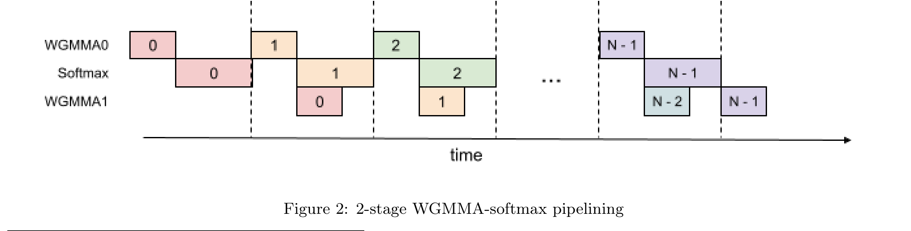</button>
<figcaption><strong>单流水线内的两阶段重叠</strong><a href="https://arxiv.org/abs/2407.08608v2" target="_blank" rel="noopener">FlashAttention-3: Fast and Accurate Attention with Asynchrony and Low-precision</a> · Figure 2 · version 2407.08608v2 · PDF p.6 / printed p.6
<button class="original-direct" type="button">Read original size</button>
<details><summary>Original caption &amp; source</summary><div class="original-caption">Figure 2: 2-stage WGMMA-softmax pipelining</div><a class="source-url" href="https://arxiv.org/abs/2407.08608v2">https://arxiv.org/abs/2407.08608v2</a></details></figcaption></figure>

图中 WGMMA 与 softmax 跨 iteration 交错，展示不同于两 warpgroup pingpong 的流水线层次。

下一块的部分工作可与当前块归一化重叠，但在线 softmax 的统计依赖必须维持；算法与调度共同设计。

更多阶段增加寄存器和在途数据压力。受资源限制时，流水线更深可能降低占用率。

<figure id="fig-flash3-f5">
<button class="paper-image" type="button" aria-label="Zoom: H100 的前向 FP16/BF16 实测"></button>
<figcaption><strong>H100 的前向 FP16/BF16 实测</strong><a href="https://arxiv.org/abs/2407.08608v2" target="_blank" rel="noopener">FlashAttention-3: Fast and Accurate Attention with Asynchrony and Low-precision</a> · Figure 5 · version 2407.08608v2 · PDF p.10 / printed p.10
<button class="original-direct" type="button">Read original size</button>
<details><summary>Original caption &amp; source</summary><div class="original-caption">Figure 5: Attention forward speed (FP16/BF16) on H100 GPU</div><a class="source-url" href="https://arxiv.org/abs/2407.08608v2">https://arxiv.org/abs/2407.08608v2</a></details></figcaption></figure>

按 head dimension、causal/non-causal 与长度分组比较，纵轴是报告的 attention 吞吐。

在 H100 80GB SXM5、FP16、head dim 64/128 的条件下，论文报告前向相对 FA2 约 1.5–2.0×、最高约 740 TFLOPs/s。它支持针对 Hopper 重排执行的价值，硬件能力变化后，旧的最优内核可以不再最优。

图的设备是 H100，不能推断 A100 或 Qualcomm HTP 有同一吞吐比例；不同后端支持也需查实际代码。

<figure id="fig-flash3-t3">
<button class="paper-image" type="button" aria-label="Zoom: FP8 与 FP16 数值误差不能混同数学 exact"></button>
<figcaption><strong>FP8 与 FP16 数值误差不能混同数学 exact</strong><a href="https://arxiv.org/abs/2407.08608v2" target="_blank" rel="noopener">FlashAttention-3: Fast and Accurate Attention with Asynchrony and Low-precision</a> · Table 3 · version 2407.08608v2 · PDF p.12 / printed p.12
<button class="original-direct" type="button">Read original size</button>
<details><summary>Original caption &amp; source</summary><div class="original-caption">Table 3: Numerical error comparisons in FP16 and FP8 (e4m3).</div><a class="source-url" href="https://arxiv.org/abs/2407.08608v2">https://arxiv.org/abs/2407.08608v2</a></details></figcaption></figure>

表按不同精度策略比较数值误差，FP8 e4m3 需要考虑 quantization、块尺度与数据分布。

Block quantization 每块单独取尺度，减少 tensor 共用尺度被 outlier 拉大的损耗；incoherent processing 在量化前对 Q/K 施加同一随机正交变换 $R$，未量化时 $QRR^\top K^\top=QK^\top$，可把极值分散到通道。实现用符号对角矩阵与 Hadamard 变换降低成本。

此处 outlier 随机输入中，FP8 per-tensor baseline RMSE 为 0.024，FA3 为 0.0091，约低 2.6×；去掉 incoherent processing 回到 0.024。低精度路径仍包含量化近似，数学算子、浮点执行和训练/任务质量是三个验证层次。

随机张量误差不能替代模型 perplexity 或任务准确率；per-channel/per-tensor 粒度和 Q/K/V 数据排布也会影响实际部署精度。

### FlashAttention-4：Blackwell 的不对称算力增长

FA4 <a href="#source-P18">[P18]</a> 发现矩阵算力增长快于指数与标量路径，进一步调整 online softmax、指数模拟和 TMEM/2CTA 流水线。它是硬件缩放不对称驱动的算法与 kernel 协同。

<figure id="fig-flash4-f1-t1">
<button class="paper-image" type="button" aria-label="Zoom: 流水线与 roofline 一起定位瓶颈"></button>
<figcaption><strong>流水线与 roofline 一起定位瓶颈</strong><a href="https://arxiv.org/abs/2603.05451v1" target="_blank" rel="noopener">FlashAttention-4: Algorithm and Kernel Pipelining Co-Design for Asymmetric Hardware Scaling</a> · Figure 1 + Table 1 · version 2603.05451v1 · PDF p.6 / printed p.6
<button class="original-direct" type="button">Read original size</button>
<details><summary>Original caption &amp; source</summary><div class="original-caption">Figure 1: FlashAttention-4 forward pipeline. The superscript H denotes the matrices corresponding to the
”high” Q tile, and superscript L denotes matrices corresponding to the ”low” Q tile. Each Q tile corresponds

Table 1: Roofline analysis (cycles) for the attention forward pass. For both tile sizes, MMA compute
and exponential unit are the primary bottlenecks.</div><a class="source-url" href="https://arxiv.org/abs/2603.05451v1">https://arxiv.org/abs/2603.05451v1</a></details></figcaption></figure>

Figure 1 的 high/low query tiles 交错推进；Table 1 用 cycles 比较 MMA 与 exponential 等阶段的压力。

当指数成为与 MMA 相当的瓶颈，只优化矩阵乘法不够；conditional rescaling 与多项式指数模拟减少非矩阵关键路径。

周期模型对应特定 tile 与硬件，不能把某项 theoretical cycles 当实测端到端延迟。图中全部依赖仍需保证归一化语义。

<figure id="fig-flash4-t2">
<button class="paper-image" type="button" aria-label="Zoom: 指数多项式误差相对 BF16 舍入"></button>
<figcaption><strong>指数多项式误差相对 BF16 舍入</strong><a href="https://arxiv.org/abs/2603.05451v1" target="_blank" rel="noopener">FlashAttention-4: Algorithm and Kernel Pipelining Co-Design for Asymmetric Hardware Scaling</a> · Table 2 · version 2603.05451v1 · PDF p.8 / printed p.8
<button class="original-direct" type="button">Read original size</button>
<details><summary>Original caption &amp; source</summary><div class="original-caption">Table 2: Accuracy of 2x polynomial emulation on [0, 1), measured against FP64 reference on 4M
random inputs. FP32 columns measure the raw polynomial output; BF16 columns measure after
rounding to BF16. The BF16 quantization error dominates for all degrees ≥3.</div><a class="source-url" href="https://arxiv.org/abs/2603.05451v1">https://arxiv.org/abs/2603.05451v1</a></details></figcaption></figure>

表对区间 $[0,1)$ 的 4M 随机输入与 FP64 参考比较，分 FP32 输出和 BF16 舍入后误差。

达到一定阶数后，BF16 量化误差占主导，支持在目标 dtype 下平衡多项式成本与精度。

这是指数子函数实验，不能直接给全模型误差上界；“exact attention”仍不承诺与其他实现逐 bit 相同。

<figure id="fig-flash4-f4">
<button class="paper-image" type="button" aria-label="Zoom: B200 前向：比较必须写 cuDNN 版本"></button>
<figcaption><strong>B200 前向：比较必须写 cuDNN 版本</strong><a href="https://arxiv.org/abs/2603.05451v1" target="_blank" rel="noopener">FlashAttention-4: Algorithm and Kernel Pipelining Co-Design for Asymmetric Hardware Scaling</a> · Figure 4 · version 2603.05451v1 · PDF p.15 / printed p.15
<button class="original-direct" type="button">Read original size</button>
<details><summary>Original caption &amp; source</summary><div class="original-caption">Figure 4: Forward pass TFLOPS on B200 (FP16/BF16) with head dimension 128. Left: non-causal attention.
Right: causal attention. FA4 achieves 1.1-1.3× speedup over cuDNN 9.13.0 and 2.1-2.7× over Triton across
sequence lengths. Since the initial release of our implementation, newer versions of cuDNN have incorporated
many of the techniques described in this paper, yielding similar performance to FA4.</div><a class="source-url" href="https://arxiv.org/abs/2603.05451v1">https://arxiv.org/abs/2603.05451v1</a></details></figcaption></figure>

图为 B200、FP16/BF16、head dim 128，分别显示 causal 与 non-causal；正文测试总 tokens 32K，sequence length 1K–32K。

原报告相对 **cuDNN 9.13.0** 约 1.1–1.3×；caption 同时明确新版 cuDNN 已引入许多相同技术，性能相近。

因此不能称 FA4 为截至今天所有后端唯一最快。本版 appendix A 另写 B100，与正文 B200 不一致，本文采用 main Figure 4 的 B200 口径并标明这个版本问题。

<figure id="fig-flash4-f6">
<button class="paper-image" type="button" aria-label="Zoom: Backward 的优化不能由 forward 推测"></button>
<figcaption><strong>Backward 的优化不能由 forward 推测</strong><a href="https://arxiv.org/abs/2603.05451v1" target="_blank" rel="noopener">FlashAttention-4: Algorithm and Kernel Pipelining Co-Design for Asymmetric Hardware Scaling</a> · Figure 6 · version 2603.05451v1 · PDF p.16 / printed p.16
<button class="original-direct" type="button">Read original size</button>
<details><summary>Original caption &amp; source</summary><div class="original-caption">Figure 6: Backward pass TFLOPS on B200 (FP16/BF16) with head dimension 128. Left: non-causal
attention. Right: causal attention.</div><a class="source-url" href="https://arxiv.org/abs/2603.05451v1">https://arxiv.org/abs/2603.05451v1</a></details></figcaption></figure>

图按 causal/non-causal 单列 backward 吞吐，与前向的资源与梯度写回模式不同。

Backward 要恢复局部概率并累积多个输入的梯度，因此同一流水线思路需要不同的任务划分。

训练总收益需要前向、反向、其他算子合并测；一个 forward 图不能证明完整训练加速比例。

<figure id="fig-flash4-f7">
<button class="paper-image" type="button" aria-label="Zoom: Deterministic backward 的顺序与成本"></button>
<figcaption><strong>Deterministic backward 的顺序与成本</strong><a href="https://arxiv.org/abs/2603.05451v1" target="_blank" rel="noopener">FlashAttention-4: Algorithm and Kernel Pipelining Co-Design for Asymmetric Hardware Scaling</a> · Figure 7 · version 2603.05451v1 · PDF p.16 / printed p.16
<button class="original-direct" type="button">Read original size</button>
<details><summary>Original caption &amp; source</summary><div class="original-caption">Figure 7: Ablations for Deterministic Backward pass on B200 (FP16/BF16) with head dimension 128. Causal
attention – SPT, LPT with reverse mblock order, LPT, and naive with no batch/head swizzle.</div><a class="source-url" href="https://arxiv.org/abs/2603.05451v1">https://arxiv.org/abs/2603.05451v1</a></details></figcaption></figure>

比较 SPT、LPT、反转 mblock 等调度策略，观察相同 deterministic 目标下吞吐如何变化。

确定性要求控制梯度归约次序，调度能减轻代价，但不是无成本模式。可重复训练和绝对最快执行可能需要不同设置。

Deterministic 的保证也有软件/设备边界；不同设备、dtype 或算子路径之间不能仅凭该选项承诺 bitwise 一致。

## 10 · 原生稀疏：训练连接与索引器成本

### NSA：压缩、选择和局部三分支

Native Sparse Attention <a href="#source-P14">[P14]</a> 从训练开始采用稀疏连接，避免训练用 dense、推理突然删边的失配。其输出可概括为：

$$
o_t=g_t^{\mathrm{cmp}}o_t^{\mathrm{cmp}}+
g_t^{\mathrm{sel}}o_t^{\mathrm{sel}}+
g_t^{\mathrm{win}}o_t^{\mathrm{win}}.
$$

三个分支分别读取压缩块摘要、选中的原始块、附近窗口，$g$ 是学习到的混合门。这个式子说明输出组合，不假设三个门之和为 1。选择块带来真实省算，但压缩/选择本身也占成本。

<figure id="fig-nsa-f1">
<button class="paper-image" type="button" aria-label="Zoom: 质量概览与 64K 效率是不同证据"></button>
<figcaption><strong>质量概览与 64K 效率是不同证据</strong><a href="https://arxiv.org/abs/2502.11089v2" target="_blank" rel="noopener">Native Sparse Attention: Hardware-Aligned and Natively Trainable Sparse Attention</a> · Figure 1 · version 2502.11089v2 · PDF p.2 / printed p.2
<button class="original-direct" type="button">Read original size</button>
<details><summary>Original caption &amp; source</summary><div class="original-caption">Figure 1 | Comparison of performance and efficiency between Full Attention model and our NSA.
Left: Despite being sparse, NSA surpasses Full Attention baseline on average across general
benchmarks, long-context tasks, and reasoning evaluation. Right: For 64k-length sequence
processing, NSA achieves substantial computational speedup compared to Full Attention in all
stages: decoding, forward propagation, and backward propagation.</div><a class="source-url" href="https://arxiv.org/abs/2502.11089v2">https://arxiv.org/abs/2502.11089v2</a></details></figcaption></figure>

左边归纳 general/long-context/reasoning 的模型表现，右边比较 decode、forward、backward 加速。

原生训练让稀疏结构有机会适应被允许的读取方式，质量不必与直接裁掉 dense 图相同。

概览不能代替任务分项和硬件条件。尤其 decode 11.6× 在正文 §5.2 依据等效 token 访存量估计，不能与前/反向的 kernel 实测混称同一组墙钟加速。

<figure id="fig-nsa-f2">
<button class="paper-image" type="button" aria-label="Zoom: 三分支如何兼顾粗粒度、关键细节与局部性"></button>
<figcaption><strong>三分支如何兼顾粗粒度、关键细节与局部性</strong><a href="https://arxiv.org/abs/2502.11089v2" target="_blank" rel="noopener">Native Sparse Attention: Hardware-Aligned and Natively Trainable Sparse Attention</a> · Figure 2 · version 2502.11089v2 · PDF p.3 / printed p.3
<button class="original-direct" type="button">Read original size</button>
<details><summary>Original caption &amp; source</summary><div class="original-caption">Figure 2 | Overview of NSA’s architecture. Left: The framework processes input sequences
through three parallel attention branches: For a given query, preceding keys and values are
processed into compressed attention for coarse-grained patterns, selected attention for important
token blocks, and sliding attention for local context. Right: Visualization of different attention
patterns produced by each branch. Green areas indicate regions where attention scores need to
be computed, while white areas represent regions that can be skipped.</div><a class="source-url" href="https://arxiv.org/abs/2502.11089v2">https://arxiv.org/abs/2502.11089v2</a></details></figcaption></figure>

左侧看三个 attention 分支和融合，右侧看各自绿色可计算区域。压缩分支的摘要为选择分支提供粗粒度信号。

滑窗保留常用邻近上下文，选择分支读取必要的原始细节，压缩分支保留低成本全局信息；它们针对不同信息需求。

没有选中的原始块不是“已经证明不重要”。选择可能漏掉信息，多分支只是提供补偿路径，不能恢复任意 dense 输出。

<figure id="fig-nsa-f3">
<button class="paper-image" type="button" aria-label="Zoom: 按 GQA group 和连续 KV blocks 对齐硬件"></button>
<figcaption><strong>按 GQA group 和连续 KV blocks 对齐硬件</strong><a href="https://arxiv.org/abs/2502.11089v2" target="_blank" rel="noopener">Native Sparse Attention: Hardware-Aligned and Natively Trainable Sparse Attention</a> · Figure 3 · version 2502.11089v2 · PDF p.9 / printed p.9
<button class="original-direct" type="button">Read original size</button>
<details><summary>Original caption &amp; source</summary><div class="original-caption">Figure 3 | Kernel design for NSA. The kernel loads queries by GQA groups (Grid Loop), fetches
corresponding sparse KV blocks (Inner Loop), and performs attention computation on SRAM.
Green blocks indicate data on SRAM, while blue indicates data on HBM.</div><a class="source-url" href="https://arxiv.org/abs/2502.11089v2">https://arxiv.org/abs/2502.11089v2</a></details></figcaption></figure>

Grid loop 加载 query groups，inner loop 读取选中的 KV blocks；图中 SRAM/HBM 颜色区分缓存层级。

连续块提高访存与复用效率，GQA group 内共享 KV 可摊薄读取。结构化稀疏比随机单点删边更容易形成快 kernel。

稀疏比例相同不意味着速度相同：碎片访问、索引、同步和 tile 填充都会影响真实收益。

<figure id="fig-nsa-f4-t1">
<button class="paper-image" type="button" aria-label="Zoom: 27B 训练损失与通用任务主结果"></button>
<figcaption><strong>27B 训练损失与通用任务主结果</strong><a href="https://arxiv.org/abs/2502.11089v2" target="_blank" rel="noopener">Native Sparse Attention: Hardware-Aligned and Natively Trainable Sparse Attention</a> · Figure 4 + Table 1 · version 2502.11089v2 · PDF p.10 / printed p.10
<button class="original-direct" type="button">Read original size</button>
<details><summary>Original caption &amp; source</summary><div class="original-caption">Figure 4 | Pretraining loss comparison between Full Attention and our NSA on 27B-parameter
model. Both models exhibit stable convergence, with NSA achieving lower loss values.

Table 1 | Pretraining performance comparison between the full attention baseline and NSA
on general benchmarks, across knowledge (MMLU, MMLU-PRO, CMMLU), reasoning (BBH,
GSM8K, MATH, DROP), and coding (MBPP, HumanEval) tasks. NSA achieves superior average
performance on most benchmarks despite high sparsity.</div><a class="source-url" href="https://arxiv.org/abs/2502.11089v2">https://arxiv.org/abs/2502.11089v2</a></details></figcaption></figure>

Figure 4 是 full/NSA 训练 loss；Table 1 按知识、推理、代码等任务比较。先看训练稳定性，再看任务表现。

在作者控制下 NSA 收敛稳定且多数任务表现较强，说明稀疏不是只能用于推理后处理。

这些分数属于该训练实验，不证明稀疏普遍提高智能；平均领先也不能掩盖某些列的持平或退化。

<figure id="fig-nsa-f6">
<button class="paper-image" type="button" aria-label="Zoom: Triton NSA 与 Triton FA2 的长序列延迟"></button>
<figcaption><strong>Triton NSA 与 Triton FA2 的长序列延迟</strong><a href="https://arxiv.org/abs/2502.11089v2" target="_blank" rel="noopener">Native Sparse Attention: Hardware-Aligned and Natively Trainable Sparse Attention</a> · Figure 6 · version 2502.11089v2 · PDF p.13 / printed p.13
<button class="original-direct" type="button">Read original size</button>
<details><summary>Original caption &amp; source</summary><div class="original-caption">Figure 6 | Comparison of Triton-based NSA kernel with Triton-based FlashAttention-2 kernel.
Our implementation significantly reduces latency across all context lengths, with the improve-
ment becoming more pronounced as input length increases.</div><a class="source-url" href="https://arxiv.org/abs/2502.11089v2">https://arxiv.org/abs/2502.11089v2</a></details></figcaption></figure>

图的两个面板仅比较 forward、backward，没有 decode 面板；用同一图内基线观察长度增长时差距。64K 报告前向约 9.0×、反向约 6.0×，堆叠时间包含选定块计算及 compression/window 分支。

关键解释是选定块计算而非全部位置对，长上下文时主 attention 省算逐渐覆盖索引与调度开销。

这里基线是论文的 Triton FA2 实现，相关图未充分明确硬件配置，不能当作跨设备可比记录；它也不是所有设备上最强 FA/cuDNN 后端，不能直接外推到更新的 FA4。

<figure id="fig-nsa-f7-8">
<button class="paper-image" type="button" aria-label="Zoom: 选择策略消融与块聚集现象"></button>
<figcaption><strong>选择策略消融与块聚集现象</strong><a href="https://arxiv.org/abs/2502.11089v2" target="_blank" rel="noopener">Native Sparse Attention: Hardware-Aligned and Natively Trainable Sparse Attention</a> · Figure 7 + Figure 8 · version 2502.11089v2 · PDF p.15 / printed p.15
<button class="original-direct" type="button">Read original size</button>
<details><summary>Original caption &amp; source</summary><div class="original-caption">Figure 7 | Compare training loss on a 3B-
parameter model with Full Attention and different
token selection strategies and. Our NSA achieves
better performance.

Figure 8 | Visualization of Attention Map
on a Full Attention transformer. Light-
colored regions indicate higher attention
values. As shown in the figure, attention
scores exhibit blockwise clustering distri-
bution.</div><a class="source-url" href="https://arxiv.org/abs/2502.11089v2">https://arxiv.org/abs/2502.11089v2</a></details></figcaption></figure>

Figure 7 在 3B 模型中比较不同 selection 的训练 loss；Figure 8 给 dense attention map 的块状聚集例子。

聚集现象为连续块选择提供动机，而策略消融检验“怎么选择”是否影响训练。图像观察和训练结果相互补充。

单个 heatmap 不是所有 token/层都块稀疏的证明；固定稀疏规则必须接受长程检索的失败测试。

### DSA：轻量全历史索引，昂贵 attention 只读 top-k

DeepSeek-V3.2 <a href="#source-P17">[P17]</a> 的 DSA 在 MLA 下增加 lightning indexer。Indexer 对历史产生分数并选 top-k，主 attention 读取少量候选。复杂度账应拆为“全历史廉价打分”与“选定历史昂贵读取”，不能只写后者。

<figure id="fig-dsa-f2">
<button class="paper-image" type="button" aria-label="Zoom: Indexer 与主 MLA 的两条数据流"></button>
<figcaption><strong>Indexer 与主 MLA 的两条数据流</strong><a href="https://arxiv.org/abs/2512.02556v1" target="_blank" rel="noopener">DeepSeek-V3.2: Pushing the Frontier of Open Large Language Models</a> · Figure 2 · version 2512.02556v1 · PDF p.4 / printed p.4
<button class="original-direct" type="button">Read original size</button>
<details><summary>Original caption &amp; source</summary><div class="original-caption">Figure 2 | Attention architecture of DeepSeek-V3.2, where DSA is instantiated under MLA. The
green part illustrates how DSA selects the top-k key-value entries according to the indexer.</div><a class="source-url" href="https://arxiv.org/abs/2512.02556v1">https://arxiv.org/abs/2512.02556v1</a></details></figcaption></figure>

绿色支路从 query 与 indexer keys 得到候选位置，再把这些位置交给主 attention；latent 和位置 key 仍属于历史表示。

Indexer 用较低成本排序降低主计算量，但它本身不是零成本，也不意味着历史永久删除。

完整 DeepSeek-V3.2 同时改变训练与 RL 等流程，不能用全模型能力表证明 DSA 单独提升推理能力。

<figure id="fig-dsa-f3">
<button class="paper-image" type="button" aria-label="Zoom: H800 集群的 token 成本随长度变化"></button>
<figcaption><strong>H800 集群的 token 成本随长度变化</strong><a href="https://arxiv.org/abs/2512.02556v1" target="_blank" rel="noopener">DeepSeek-V3.2: Pushing the Frontier of Open Large Language Models</a> · Figure 3 · version 2512.02556v1 · PDF p.6 / printed p.6
<button class="original-direct" type="button">Read original size</button>
<details><summary>Original caption &amp; source</summary><div class="original-caption">Figure 3 | Inference costs of DeepSeek-V3.1-Terminus and DeepSeek-V3.2 on H800 clusters.</div><a class="source-url" href="https://arxiv.org/abs/2512.02556v1">https://arxiv.org/abs/2512.02556v1</a></details></figcaption></figure>

图比较 V3.1-Terminus 与 V3.2 的输入/输出成本曲线；先看长度和阶段，再理解长序列节省。

主 attention 的 top-k 读取让昂贵部分不再对全部历史处理，成本增长更缓；全历史 indexer 和其他算子仍留下随长度增长的部分。

模型服务 token-cost 不是独立 kernel 的 FLOPs 或同 batch TPOT。硬件、定价/核算口径与模型版本都需随图保留。

<figure id="fig-dsa-f7">
<button class="paper-image" type="button" aria-label="Zoom: MLA 在 prefill 与 decode 的执行模式不同"></button>
<figcaption><strong>MLA 在 prefill 与 decode 的执行模式不同</strong><a href="https://arxiv.org/abs/2512.02556v1" target="_blank" rel="noopener">DeepSeek-V3.2: Pushing the Frontier of Open Large Language Models</a> · Figure 7 · version 2512.02556v1 · PDF p.20 / printed p.20
<button class="original-direct" type="button">Read original size</button>
<details><summary>Original caption &amp; source</summary><div class="original-caption">Figure 7 | Illustration of the MHA and MQA modes of MLA. For DeepSeek-V3.1-Terminus, the
MHA mode is used for training and prefilling, while the MQA mode is used for decoding.</div><a class="source-url" href="https://arxiv.org/abs/2512.02556v1">https://arxiv.org/abs/2512.02556v1</a></details></figcaption></figure>

MHA mode 可以展开多头表示进行高吞吐批量计算；MQA mode 在 decode 中直接利用共同 latent 与吸收后的 query/output 投影。

该图解释“同一模型 attention”为何在两个阶段可能有不同 shape 和内存读取，缓存容量相同不代表 kernel 工作量相同。

参考代码 <a href="#source-C06">[C06]</a> 同时有 kv_cache、pe_cache、indexer k_cache，且显式生成完整 score 再 mask、模拟 FP8 回转。因此它能说明机制，不能当生产稀疏 kernel 的速度或 FP8 物理字节复现。

## 11 · 门控与解释：两种“稀疏”不要混淆

### Gated attention：SDPA 输出再乘一个门

Gated Attention <a href="#source-P16">[P16]</a> 比较多个门控位置，最强配置是在 SDPA 输出后做 sigmoid feature gate：

$$
Y=\mathrm{SDPA}(Q,K,V)\odot\sigma(XW_g),\qquad O=YW_O.
$$

$X$ 为当前 hidden，$W_g$ 为门投影，$\sigma$ 为 sigmoid，$\odot$ 为逐元素乘法，门 shape 按 head/feature 配置广播。这里抑制的是**读取后的输出特征**；普通 sigmoid 通常非零，已经完成 QK/softmax/AV，所以不自动节省平方 FLOPs。

<figure id="fig-gated-f1">
<button class="paper-image" type="button" aria-label="Zoom: 门放在哪个位置影响能力与训练稳定性"></button>
<figcaption><strong>门放在哪个位置影响能力与训练稳定性</strong><a href="https://arxiv.org/abs/2505.06708v1" target="_blank" rel="noopener">Gated Attention for Large Language Models: Non-linearity, Sparsity, and Attention-Sink-Free</a> · Figure 1 · version 2505.06708v1 · PDF p.2 / printed p.2
<button class="original-direct" type="button">Read original size</button>
<details><summary>Original caption &amp; source</summary><div class="original-caption">Figure 1: Left: Investigated positions for applying gating operations.; Middle: Performance comparison (Test PPL
and MMLU) of 15B MoE models with gating applied at various positions. Gating after SDPA (G1) yields the best
overall results. Gating after the Value layer (G2) also demonstrates notable improvements, particularly in PPL. Right:
Training loss comparison (smoothed, 0.9 coeff.) over 3.5T tokens between baseline and SDPA-gated 1.7B dense
models under identical hyperparameters. Gating results in lower final loss and substantially enhanced training
stability, mitigating loss spikes. This stability allows for potentially higher learning rates and facilitates better scaling.</div><a class="source-url" href="https://arxiv.org/abs/2505.06708v1">https://arxiv.org/abs/2505.06708v1</a></details></figcaption></figure>

左侧标 G1/G2 等位置，中间比较 perplexity/MMLU，右边是 1.7B dense 模型 3.5T tokens 的训练 loss。

G1 在 SDPA 后增加输入相关非线性，有较强效果；右图显示训练 spike 减轻，为更稳定优化提供证据。

稳定性和速度是不同性质，新增门还增加投影与乘法。不能把 feature sparsity 宣称为 top-k token-edge kernel。

<figure id="fig-gated-f2">
<button class="paper-image" type="button" aria-label="Zoom: 第一 token 的 sink 权重下降"></button>
<figcaption><strong>第一 token 的 sink 权重下降</strong><a href="https://arxiv.org/abs/2505.06708v1" target="_blank" rel="noopener">Gated Attention for Large Language Models: Non-linearity, Sparsity, and Attention-Sink-Free</a> · Figure 2 · version 2505.06708v1 · PDF p.3 / printed p.3
<button class="original-direct" type="button">Read original size</button>
<details><summary>Original caption &amp; source</summary><div class="original-caption">Figure 2: Left: Proportion of attention allocated to the initial token per layer (test perplexity dataset). The baseline
model suffers from a significant attention sink, with an average of 46.7% of attention scores across layers directed
towards the first token. Introducing a gate effectively alleviates this, reducing the proportion to 4.8%. Right: Average
attention map weights for each head. Layer 21 in the baseline model demonstrates a strong attention sink (83% on the
first token), which is substantially reduced by the gate (4%). In the final output layer, the gate amplifies the existing
tendency for the model to attend to individual tokens within the sequence.</div><a class="source-url" href="https://arxiv.org/abs/2505.06708v1">https://arxiv.org/abs/2505.06708v1</a></details></figcaption></figure>

左图每层分给初始 token 的比例，平均由 46.7% 降至 4.8%；右图提供具体 head/layer 热图。

输出门让模型有另一条控制信息流的途径，不必通过把大量归一化质量放到开头 token 来形成“无用读取”。

这是作者数据与层分布的现象，不能断言所有 sink 都消失或 sink 只有一种因果机制；门本身也不是解释器。

<figure id="fig-gated-t1">
<button class="paper-image" type="button" aria-label="Zoom: 15B MoE 比较需要保留新增参数对照"></button>
<figcaption><strong>15B MoE 比较需要保留新增参数对照</strong><a href="https://arxiv.org/abs/2505.06708v1" target="_blank" rel="noopener">Gated Attention for Large Language Models: Non-linearity, Sparsity, and Attention-Sink-Free</a> · Table 1 · version 2505.06708v1 · PDF p.4 / printed p.4
<button class="original-direct" type="button">Read original size</button>
<details><summary>Original caption &amp; source</summary><div class="original-caption">Table 1: Gating variant performance and results. We train the 15A2B MoE models on 400B tokens. dk is the head
dim, dmodel is the model’s hidden dim, and n is the number of tokens. q refers to the number of query heads, k refers
to the number of key-value heads. ‘Act Func’ is the activation function in Eq 5. ‘Score Shape’ is the gating score shape
for an input X ∈Rn,dmodel. ‘added param’ indicates added parameters (Million).</div><a class="source-url" href="https://arxiv.org/abs/2505.06708v1">https://arxiv.org/abs/2505.06708v1</a></details></figcaption></figure>

表格是 15B total、约 2.54B active、400B tokens 的门控变体，列出新增参数、激活函数和 gate shape。

Headwise/elementwise、位置与非线性的对照帮助拆分收益来源；它不只是多加参数的一种未经控制的比较。

一些变体参数数目仍不同，要读相应对照；dense 模型的参数匹配另通过减 FFN 宽度处理，不能假称所有实验天然等参。

<figure id="fig-gated-t4-f3">
<button class="paper-image" type="button" aria-label="Zoom: 小 gate 值不等于严格零连接"></button>
<figcaption><strong>小 gate 值不等于严格零连接</strong><a href="https://arxiv.org/abs/2505.06708v1" target="_blank" rel="noopener">Gated Attention for Large Language Models: Non-linearity, Sparsity, and Attention-Sink-Free</a> · Table 4 + Figure 3 · version 2505.06708v1 · PDF p.7 / printed p.7
<button class="original-direct" type="button">Read original size</button>
<details><summary>Original caption &amp; source</summary><div class="original-caption">Table 4: Performance of different gating methods with varying activation functions and average gate scores. ‘Act-Func’
refers to the activation function used for computing the gating scores, while ‘M-Act’ denotes the rounded maximum
activation values of the hidden states output by each layer of the model. Additionally, ‘F-Attn’ represents the attention
score of the first token, with higher values indicating more pronounced ‘attention sink’.

Figure 3: Gating score means and distributions for SDPA elementwise (Left), value Elementwise (Middle), and
SDPA elementwise with head-shared gating (Right). Most gating scores are less than 0.5, indicating that the gating
scores are sparse. Among them, the SDPA output gating score exhibits the strongest sparsity.</div><a class="source-url" href="https://arxiv.org/abs/2505.06708v1">https://arxiv.org/abs/2505.06708v1</a></details></figcaption></figure>

Table 4 对不同激活函数报告 gate、激活极值和 first-token attention；Figure 3 显示 gate 分布，多数值小于 0.5。

分布说明很多输出通道被削弱，这可理解为软特征选择，并影响激活尺度和训练动态。

小于 0.5 不等于数值 0，更不是某个历史 key 不需要计算。官方 modeling_qwen3.py <a href="#source-C07">[C07]</a> 也清楚在 SDPA 完成后相乘。

### Attention heatmap 能解释到哪里

Attention 提供模型内部读取权重，适合发现关联和提出假设。Jain/Wallace <a href="#source-P19">[P19]</a> 与 Wiegreffe/Pinter <a href="#source-P20">[P20]</a> 的争论提醒：相关可视化、局部替代与模型级因果解释，需要不同测试。

<figure id="fig-jain-f1">
<button class="paper-image" type="button" aria-label="Zoom: 不同 attention 可以得到近似相同预测"></button>
<figcaption><strong>不同 attention 可以得到近似相同预测</strong><a href="https://arxiv.org/abs/1902.10186v3" target="_blank" rel="noopener">Attention is not Explanation</a> · Figure 1 · version 1902.10186v3 · PDF p.1 / printed p.1
<button class="original-direct" type="button">Read original size</button>
<details><summary>Original caption &amp; source</summary><div class="original-caption">Figure 1: Heatmap of attention weights induced over
a negative movie review. We show observed model at-
tention (left) and an adversarially constructed set of at-
tention weights (right). Despite being quite dissimilar,
these both yield effectively the same prediction (0.01).</div><a class="source-url" href="https://arxiv.org/abs/1902.10186v3">https://arxiv.org/abs/1902.10186v3</a></details></figcaption></figure>

图对同一负面评论展示原权重与 adversarial 权重，预测均约 0.01。先比较高亮位置，再确认输出数值。

它是“权重不是唯一解释”的构造反例：在固定 hidden states 下，输出可能对多组权重不敏感。

不唯一不等于 attention 没有功能，也不证明任何模型的任何权重都能任意替换。Hidden states 已经过上下文处理，不能当原始词的独立贡献。

<figure id="fig-jain-f6-7">
<button class="paper-image" type="button" aria-label="Zoom: 置换与对抗替代检验输出敏感度"></button>
<figcaption><strong>置换与对抗替代检验输出敏感度</strong><a href="https://arxiv.org/abs/1902.10186v3" target="_blank" rel="noopener">Attention is not Explanation</a> · Figure 6 + Figure 7 · version 1902.10186v3 · PDF p.8 / printed p.8
<button class="original-direct" type="button">Read original size</button>
<details><summary>Original caption &amp; source</summary><div class="original-caption">Figure 6: Median change in output ∆ˆymed (x-axis) densities in relation to the max attention (max ˆα) (y-
axis) obtained by randomly permuting instance attention weights. Encoders denoted parenthetically. Plots for all
corpora and using all encoders are available online.

Figure 7: Histogram of maximum adversarial JS Divergence (ϵ-max JSD) between original and adversarial
attentions over all instances. In all cases shown, |ˆyadv −ˆy| &lt; ϵ. Encoders are specified in parantheses.</div><a class="source-url" href="https://arxiv.org/abs/1902.10186v3">https://arxiv.org/abs/1902.10186v3</a></details></figcaption></figure>

Figure 6 比较 random permutation 后的输出变化和最大权重；Figure 7 在预测变化小于阈值时看权重分布 JSD。

在部分数据/encoder 中，变化很大的权重仍保持相近输出，说明直接读 heatmap 为因果重要性可能误导。

实验范围是特定 attention classifier 与替代程序；不是对所有 Transformer heads 的统一定理，也不能由输出稳健推出机制可完全移除。

<figure id="fig-wiegreffe-f1">
<button class="paper-image" type="button" aria-label="Zoom: 先说清改变了模型的哪一部分"></button>
<figcaption><strong>先说清改变了模型的哪一部分</strong><a href="https://arxiv.org/abs/1908.04626v2" target="_blank" rel="noopener">Attention is not not Explanation</a> · Figure 1 · version 1908.04626v2 · PDF p.2 / printed p.2
<button class="original-direct" type="button">Read original size</button>
<details><summary>Original caption &amp; source</summary><div class="original-caption">Figure 1: Schematic diagram of a classification LSTM model with attention, including the components manipu-
lated or replaced in the experiments performed in Jain and Wallace (2019) and in this work (by section).</div><a class="source-url" href="https://arxiv.org/abs/1908.04626v2">https://arxiv.org/abs/1908.04626v2</a></details></figcaption></figure>

图标注 attention classifier 的 encoder、权重生成和输出组件，以及不同实验替换的位置。

局部替代固定了 hidden 表示，end-to-end 重训则允许模型适应；两种实验问的是不同问题。

若不交代操纵边界，就容易把“可构造另一个权重”误说成“原模型从不使用这些信息”。

<figure id="fig-wiegreffe-t2">
<button class="paper-image" type="button" aria-label="Zoom: Uniform attention 作为模型级基线"></button>
<figcaption><strong>Uniform attention 作为模型级基线</strong><a href="https://arxiv.org/abs/1908.04626v2" target="_blank" rel="noopener">Attention is not not Explanation</a> · Table 2 · version 1908.04626v2 · PDF p.4 / printed p.4
<button class="original-direct" type="button">Read original size</button>
<details><summary>Original caption &amp; source</summary><div class="original-caption">Table 2: Classification F1 scores (1-class) on attention
models, both as reported by Jain and Wallace and in
our reproduction, and on models forced to use uniform
attention over hidden states.</div><a class="source-url" href="https://arxiv.org/abs/1908.04626v2">https://arxiv.org/abs/1908.04626v2</a></details></figcaption></figure>

表比较 learned attention 与强制 uniform attention 的分类 F1，标明 1-class 口径。

部分任务明显依赖可学习 attention，说明模块的功能价值可与权重解释的唯一性分开成立。

Uniform 退化也不能证明 learned heatmap 每个高亮词都具有对应因果贡献；encoder 与分类器仍共同决定输出。

<figure id="fig-wiegreffe-f5-t4">
<button class="paper-image" type="button" aria-label="Zoom: 随机种子与 end-to-end 对抗训练的参照"></button>
<figcaption><strong>随机种子与 end-to-end 对抗训练的参照</strong><a href="https://arxiv.org/abs/1908.04626v2" target="_blank" rel="noopener">Attention is not not Explanation</a> · Figure 5 + Table 4 · version 1908.04626v2 · PDF p.7 / printed p.7
<button class="original-direct" type="button">Read original size</button>
<details><summary>Original caption &amp; source</summary><div class="original-caption">Figure 5: Averaged per-instance test set JSD and TVD
from base model for each model variant.
JSD is
bounded at ∼0.693. ▲: random seed; ■: uniform
weights; dotted line: our adversarial setup as λ is var-
ied; +: adversarial setup from Jain and Wallace (2019).

Table 4:
Best-performing adversarial models with
instance-average JSD &gt; 0.4.</div><a class="source-url" href="https://arxiv.org/abs/1908.04626v2">https://arxiv.org/abs/1908.04626v2</a></details></figcaption></figure>

Figure 5 同时看 JSD 与输出 TVD，Table 4 列出高权重差异的 adversarial models。随机种子提供正常模型差异的参照。

端到端替代要同时满足任务效果与权重差异，比只在固定状态上找另一组权重更强。解释结论需要和实际反事实约束对齐。

本文建议使用 heatmap 描述“模型此处如何分配读取权重”，若要说“该词导致结果”，还应做输入干预、模块消融与受控反事实测试。

## 12 · 2026：从梯度预算到完整服务系统

### LazyFlash：前向 dense，反向按梯度信号抽样

LazyFlash <a href="#source-P21">[P21]</a>（2026-10-22 首次公开）关注长上下文 fine-tuning：loss 常只施加到少量输出 token，但 dense backward 仍处理许多低贡献 query blocks。它保留标准 dense 前向，在 backward 依据 attention-output gradient 的块范数分配计算。

对 query block $m$，令 $c_m=\|dO_m\|_F$，$G_m$ 是该块对某个梯度的完整贡献。先对一个 head 的 $M$ 块按 $c_m$ 从小到大排序，用预算计算允许丢弃的目标数量：

$$
k^\star=\max\left\{k:\sum_{i=1}^{k}c_{(i)}^2\le\delta\sum_{m=1}^{M}c_m^2\right\},\qquad
p_m=\min(1,\lambda c_m),\qquad \sum_{m=1}^{M}p_m=M-k^\star.
$$

$c_{(i)}$ 是排序后的第 $i$ 个范数，$\delta$ 约束低梯度尾部占总输出梯度能量的比例，$\lambda$ 通过二分求解，使**期望**保留数等于 $M-k^\star$。这里从能量预算确定数量，再从范数确定抽样概率；它没有保证每次抽到的集合恰好满足同一个能量上界。

选择概率 $p_m>0$ 的 Bernoulli 变量 $B_m$ 后：

$$
\widehat G=\sum_m\frac{B_m}{p_m}G_m,\qquad
\mathbb{E}[\widehat G\mid Q,K,V,dO]=\sum_mG_m.
$$

$\|\cdot\|_F$ 为 Frobenius norm，$B_m\in\{0,1\}$。条件期望等式来自 $\mathbb{E}[B_m]=p_m$，并假设抽样前贡献与概率已经确定；零贡献块可跳过，非零贡献不能以 $p_m=0$ 强行删除。论文根据梯度质量预算 $\delta$ 设置保留概率，而非固定保留相同比例。**无偏是平均更新意义，不是每一步同一个梯度**；方差和优化轨迹仍会改变，预算也不是所有参数梯度误差的统一上界。

<figure id="fig-lazyflash-f1">
<button class="paper-image" type="button" aria-label="Zoom: Dense 前向与 block-sparse 反向的边界"></button>
<figcaption><strong>Dense 前向与 block-sparse 反向的边界</strong><a href="https://arxiv.org/abs/2610.31911v1" target="_blank" rel="noopener">LazyFlash: Forward-Dense, Backward-Sparse Attention for Accelerated Long-Context Fine-Tuning</a> · Figure 1 · version 2610.31911v1 · PDF p.4 / printed p.4
<button class="original-direct" type="button">Read original size</button>
<details><summary>Original caption &amp; source</summary><div class="original-caption">Figure 1: Overview of LazyFlash. The forward pass computes every block, so the trained model
remains an ordinary dense-attention model. In the backward pass, each query block is kept with
a probability set by its output-gradient norm: skipped tiles are never loaded, and kept blocks are
reweighted so that the gradient stays unbiased. As the bars illustrate, a small budget on gradient
mass translates into a much larger saving in computation.</div><a class="source-url" href="https://arxiv.org/abs/2610.31911v1">https://arxiv.org/abs/2610.31911v1</a></details></figcaption></figure>

先看前向所有块计算，再看 backward 按输出梯度信号选择 query blocks，保留块重加权。

Skipping 在 kernel 中直接避免加载与计算，因而可以形成实际加速；模型推理时仍是普通 dense attention。

它改变训练估计器，不是训练/推理均使用相同稀疏图。无偏估计也不自动保证相同训练终点。

<figure id="fig-lazyflash-t1">
<button class="paper-image" type="button" aria-label="Zoom: Qwen3-8B 的质量、前向和反向实际数值"></button>
<figcaption><strong>Qwen3-8B 的质量、前向和反向实际数值</strong><a href="https://arxiv.org/abs/2610.31911v1" target="_blank" rel="noopener">LazyFlash: Forward-Dense, Backward-Sparse Attention for Accelerated Long-Context Fine-Tuning</a> · Table 1 · version 2610.31911v1 · PDF p.6 / printed p.6
<button class="original-direct" type="button">Read original size</button>
<details><summary>Original caption &amp; source</summary><div class="original-caption">Table 1: LongBench-Pro results after fine-tuning Qwen3-8B-Base (higher is better, ↑), with the
attention time per microbatch measured during training. The three indented rows are one MoBA-
trained model served in three ways: sparse attention at prefill and decode, sparse attention at prefill
only, and fully dense attention. They share the training cost listed on the MoBA row.</div><a class="source-url" href="https://arxiv.org/abs/2610.31911v1">https://arxiv.org/abs/2610.31911v1</a></details></figcaption></figure>

实验为 8×H200、BF16、FA2.5.2、Qwen3-8B-Base，LongAlign10K/ShareGPT 1:1，2500 steps、max 65536、global batch 32 sequences，text $\delta=0.1$。

Dense 分数 29.64，前/反向 547.3/1429.8ms；LazyFlash 30.24，562.2/507.4ms。反向比约 **2.82×**，两阶段 attention 时间合并比约 **1.85×**。

Loss 仅在 final assistant 计算，不是全 token pretraining。分数略高不证明方法普遍提升质量；摘要最高 5.7× backward 不能替代本表或完整训练 step 的倍数。

<figure id="fig-lazyflash-f2">
<button class="paper-image" type="button" aria-label="Zoom: Context length 下的算子与训练 step 曲线"></button>
<figcaption><strong>Context length 下的算子与训练 step 曲线</strong><a href="https://arxiv.org/abs/2610.31911v1" target="_blank" rel="noopener">LazyFlash: Forward-Dense, Backward-Sparse Attention for Accelerated Long-Context Fine-Tuning</a> · Figure 2 · version 2610.31911v1 · PDF p.7 / printed p.7
<button class="original-direct" type="button">Read original size</button>
<details><summary>Original caption &amp; source</summary><div class="original-caption">Figure 2: Attention time and end-to-end training step time against context length, measured on real LongAlign examples truncated to each length. Forward and backward are shown separately, and the arrows give the speedup over dense attention.</div><a class="source-url" href="https://arxiv.org/abs/2610.31911v1">https://arxiv.org/abs/2610.31911v1</a></details></figcaption></figure>

图将 attention forward、backward 与 end-to-end step 分开，以真实 LongAlign 样本截断到对应长度。

反向节省占比随长度和有效监督分布变化；完整 step 的加速被前向和其他算子稀释。这正是逐算子账的用途。

截断改变样本内容和监督位置，不能把曲线理解为长度是唯一变化。Forward dense 也可能有 bookkeeping 开销。

<figure id="fig-lazyflash-t3">
<button class="paper-image" type="button" aria-label="Zoom: 信号和预算比简单 random drop 更有价值"></button>
<figcaption><strong>信号和预算比简单 random drop 更有价值</strong><a href="https://arxiv.org/abs/2610.31911v1" target="_blank" rel="noopener">LazyFlash: Forward-Dense, Backward-Sparse Attention for Accelerated Long-Context Fine-Tuning</a> · Table 3 · version 2610.31911v1 · PDF p.8 / printed p.8
<button class="original-direct" type="button">Read original size</button>
<details><summary>Original caption &amp; source</summary><div class="original-caption">Table 3: Selection rules compared on LongBench-Pro. Random drops query blocks with no signal,
the two top-k rules keep a fixed fraction ranked by forward attention mass and by output-gradient
norm, and LazyFlash ranks by the gradient norm but sets the amount skipped with a budget on
gradient mass. The three alternatives share the CUDA implementation of LazyFlash and are tuned
to match its backward time; dense attention is a quality reference and is not matched in cost.</div><a class="source-url" href="https://arxiv.org/abs/2610.31911v1">https://arxiv.org/abs/2610.31911v1</a></details></figcaption></figure>

随机丢块、forward mass top-k、gradient norm top-k 与 LazyFlash 的替代方案使用相同 CUDA 路径并匹配 backward 时间。

控制执行成本后再比较质量，更能说明选择信号和自适应预算的作用，而不是“算得更多所以更准”。

Dense 是质量参考，没有强行匹配成本；它与稀疏候选的比较需要保留这个非对称设置。

<figure id="fig-lazyflash-t4">
<button class="paper-image" type="button" aria-label="Zoom: 语音训练 δ=0.5 的发散是必要反证"></button>
<figcaption><strong>语音训练 δ=0.5 的发散是必要反证</strong><a href="https://arxiv.org/abs/2610.31911v1" target="_blank" rel="noopener">LazyFlash: Forward-Dense, Backward-Sparse Attention for Accelerated Long-Context Fine-Tuning</a> · Table 4 · version 2610.31911v1 · PDF p.9 / printed p.9
<button class="original-direct" type="button">Read original size</button>
<details><summary>Original caption &amp; source</summary><div class="original-caption">Table 4: Effect of the budget δ on long-form ASR (lower is better, ↓). Training diverges at δ = 0.5.</div><a class="source-url" href="https://arxiv.org/abs/2610.31911v1">https://arxiv.org/abs/2610.31911v1</a></details></figcaption></figure>

表按预算列出 long-form ASR 的错误指标，越低越好；$\delta=0.5$ 一行明确训练发散。

监督更密集或梯度结构不同的任务需要不同预算；过强稀疏造成的估计方差可以损害训练。

因此应逐任务调参并监控失败，而不能把文本 $\delta=0.1$ 或“无偏”当跨模态安全保证。截至截止日未确认可直接复现本文实现的公开代码链接。

### LeanSparse：索引器键也会吃满 GPU

LeanSparse <a href="#source-P22">[P22]</a>（2026-11-03 首次公开）研究 native sparse LLM serving。论文在四 H100、tensor parallel、SGLang 上，以其所用 DeepSeek-V4-Flash backbone 实测。主 attention 已稀疏时，完整 indexer keys 的存储和 prefill admission 仍能成为容量瓶颈。

<figure id="fig-leansparse-f1">
<button class="paper-image" type="button" aria-label="Zoom: Hot KV 固定不代表每请求 GPU 内存固定"></button>
<figcaption><strong>Hot KV 固定不代表每请求 GPU 内存固定</strong><a href="https://arxiv.org/abs/2611.04671v1" target="_blank" rel="noopener">LeanSparse: Memory-Efficient Serving for Native Sparse-Attention LLMs</a> · Figure 1 · version 2611.04671v1 · PDF p.2 / printed p.2
<button class="original-direct" type="button">Read original size</button>
<details><summary>Original caption &amp; source</summary><div class="original-caption">Figure 1. Indexer key storage grows with context length. Per-request memory of one CSA layer in HiSparse: FP8 indexer keys versus the fixed hot KV buffer.</div><a class="source-url" href="https://arxiv.org/abs/2611.04671v1">https://arxiv.org/abs/2611.04671v1</a></details></figcaption></figure>

横轴长度，柱/曲线拆开 FP8 indexer keys 和固定 hot KV buffer。先看哪一项随长度继续增长。

全历史 indexer key 存在 GPU 会抵消稀疏 KV hot cache 的容量收益；仅统计主 KV 是漏账。

这是该 CSA layer 的结构与精度条件，不能推导所有 sparse attention 都有同样比例。Indexer、KV、host 历史应分别计量。

<figure id="fig-leansparse-f2">
<button class="paper-image" type="button" aria-label="Zoom: Prefill admission 与 decode 容量竞争"></button>
<figcaption><strong>Prefill admission 与 decode 容量竞争</strong><a href="https://arxiv.org/abs/2611.04671v1" target="_blank" rel="noopener">LeanSparse: Memory-Efficient Serving for Native Sparse-Attention LLMs</a> · Figure 2 · version 2611.04671v1 · PDF p.2 / printed p.2
<button class="original-direct" type="button">Read original size</button>
<details><summary>Original caption &amp; source</summary><div class="original-caption">Figure 2. Prefill admission competes with decode for GPU memory. A prefill request either waits for decode to release memory or uses a reservation that sits idle when no prefill runs.</div><a class="source-url" href="https://arxiv.org/abs/2611.04671v1">https://arxiv.org/abs/2611.04671v1</a></details></figcaption></figure>

图对比等待已有 decode 释放内存与预留 prefill reservation。预留空间闲置时无法承载更多 decode。

问题不是单次 attention 慢，而是一个长输入是否能及时进入设备；内存分配方式直接影响 TTFT 与系统容量。

只测孤立 decode kernel 无法发现这种排队。固定负载下的 admission 延迟需要真实服务回放。

<figure id="fig-leansparse-f5">
<button class="paper-image" type="button" aria-label="Zoom: 主存完整历史，GPU 放可复用缓冲与两种热缓存"></button>
<figcaption><strong>主存完整历史，GPU 放可复用缓冲与两种热缓存</strong><a href="https://arxiv.org/abs/2611.04671v1" target="_blank" rel="noopener">LeanSparse: Memory-Efficient Serving for Native Sparse-Attention LLMs</a> · Figure 5 · version 2611.04671v1 · PDF p.4 / printed p.4
<button class="original-direct" type="button">Read original size</button>
<details><summary>Original caption &amp; source</summary><div class="original-caption">Figure 5. System overview of LeanSparse. Host memory stores the full history of indexer keys and compressed KV. GPU memory holds two reusable history buffers during prefill, and compact PQ codes with separate indexer key and KV caches during decode.</div><a class="source-url" href="https://arxiv.org/abs/2611.04671v1">https://arxiv.org/abs/2611.04671v1</a></details></figcaption></figure>

Host 保存完整 indexer keys 与 compressed KV；prefill 用两块 reusable history buffers，decode 用 PQ codes 加 indexer-key cache 与 KV cache。

它把“持久保存所有历史”和“本轮快速访问少量历史”分离，减少 GPU 随上下文增长的常驻资源。

完整历史没有消失，成本转向 CPU RAM、PCIe/互联、取回与缓存维护。GPU 省内存不能宣称系统总物理内存等比例下降。

<figure id="fig-leansparse-f7">
<button class="paper-image" type="button" aria-label="Zoom: 双缓冲按层流式加载，利用其他计算隐藏传输"></button>
<figcaption><strong>双缓冲按层流式加载，利用其他计算隐藏传输</strong><a href="https://arxiv.org/abs/2611.04671v1" target="_blank" rel="noopener">LeanSparse: Memory-Efficient Serving for Native Sparse-Attention LLMs</a> · Figure 7 · version 2611.04671v1 · PDF p.5 / printed p.5
<button class="original-direct" type="button">Read original size</button>
<details><summary>Original caption &amp; source</summary><div class="original-caption">Figure 7. Double-buffered prefill execution. Each compute segment includes its block’s MoE FFN. The next CSA layer’s prefix load overlaps with the remaining work in the current CSA block and the intervening HCA block.</div><a class="source-url" href="https://arxiv.org/abs/2611.04671v1">https://arxiv.org/abs/2611.04671v1</a></details></figcaption></figure>

时间轴中当前 CSA block、MoE FFN 与中间 HCA block 的工作，为下一 CSA 的 prefix load 提供重叠窗口。

不是一次性把全部层历史搬入 GPU，而是按层复用缓冲，并让传输尽量不在关键路径上。

重叠需要足够计算时长和传输带宽。任务形状、host 拓扑与并发竞争不同，搬运也可能暴露成延迟。

<figure id="fig-leansparse-f9">
<button class="paper-image" type="button" aria-label="Zoom: 粗筛与精排导致两种缓存访问不同位置"></button>
<figcaption><strong>粗筛与精排导致两种缓存访问不同位置</strong><a href="https://arxiv.org/abs/2611.04671v1" target="_blank" rel="noopener">LeanSparse: Memory-Efficient Serving for Native Sparse-Attention LLMs</a> · Figure 9 · version 2611.04671v1 · PDF p.7 / printed p.7
<button class="original-direct" type="button">Read original size</button>
<details><summary>Original caption &amp; source</summary><div class="original-caption">Figure 9. Coarse-to-fine indexing with C = 4 and k = 2. Refinement changes the candidate ranking, so the indexer key cache and KV cache serve different positions.</div><a class="source-url" href="https://arxiv.org/abs/2611.04671v1">https://arxiv.org/abs/2611.04671v1</a></details></figcaption></figure>

示意图用 $C=4,k=2$ 说明 PQ coarse ranking 和 exact reranking 会改变最终候选；真实实验 PQ32 先选 2048，再精排到 512。

粗筛候选需要 indexer keys，最后主 attention 需要对应 KV；两者访问集合不同，分离缓存比绑成一套更合适。

精排只在候选内精确，粗筛仍可能漏掉全历史真正 top-k。因此整体不是完全等价于遍历所有历史的索引。

<figure id="fig-leansparse-f10">
<button class="paper-image" type="button" aria-label="Zoom: TTFT 大幅下降，但 TPOT 变差"></button>
<figcaption><strong>TTFT 大幅下降，但 TPOT 变差</strong><a href="https://arxiv.org/abs/2611.04671v1" target="_blank" rel="noopener">LeanSparse: Memory-Efficient Serving for Native Sparse-Attention LLMs</a> · Figure 10 · version 2611.04671v1 · PDF p.8 / printed p.8
<button class="original-direct" type="button">Read original size</button>
<details><summary>Original caption &amp; source</summary><div class="original-caption">Figure 10. Open-SWE replay latency distributions: (a) TTFT and (b) TPOT for the same 2,432 continuation calls, and (c) completion time for 128 full sessions, including tool waits. Vertical ticks and labels indicate p50 and p95.</div><a class="source-url" href="https://arxiv.org/abs/2611.04671v1">https://arxiv.org/abs/2611.04671v1</a></details></figcaption></figure>

Open-SWE 回放包含 128 sessions、2432 continuation calls，session 按 Poisson 过程每分钟 120 次到达，工具等待按记录时长与命令估计重建。三个分布分别为 TTFT、TPOT 和含工具等待的完整 session 时间。

本图 baseline 是论文作者适配 DeepSeek-V4 的 **ECHO 实现**；HiSparse 只支持分离 prefill/decode，不参与这组 mixed-serving 比较。启用 prefix cache、4K prefill chunks、最多 128 active requests；GPU cache 的共享/请求配额也与 ECHO 不同。

Median TTFT 从 21.58s 降到 0.60s，TPOT 从 66.4ms **升到** 81.7ms；session 从 1418.9s 降到 1168.0s，约减少 17.7%，总吞吐提高约 10.2%。

更积极 admission 减少队首等待，却增加 decode 竞争。完整会话变快与每 token 变慢可以同时发生；工具等待也使 session 时间不能等同纯 GPU 时间。

<figure id="fig-leansparse-f11-12">
<button class="paper-image" type="button" aria-label="Zoom: 最大容量吞吐与同并发 step time 分开"></button>
<figcaption><strong>最大容量吞吐与同并发 step time 分开</strong><a href="https://arxiv.org/abs/2611.04671v1" target="_blank" rel="noopener">LeanSparse: Memory-Efficient Serving for Native Sparse-Attention LLMs</a> · Figure 11 + Figure 12 · version 2611.04671v1 · PDF p.9 / printed p.9
<button class="original-direct" type="button">Read original size</button>
<details><summary>Original caption &amp; source</summary><div class="original-caption">Figure 11. Decode throughput at measured capacities. N denotes concurrency.

Figure 12. Decode step time at equal concurrency. N denotes concurrency.</div><a class="source-url" href="https://arxiv.org/abs/2611.04671v1">https://arxiv.org/abs/2611.04671v1</a></details></figcaption></figure>

Figure 11 标注各自 concurrency $N$；Figure 12 才在相同并发比较 decode step time。

950K 时 HiSparse $N=19$/687 tokens/s，LeanSparse $N=56$/1474 tokens/s，容量约 2.95×、吞吐约 2.14×，主要说明能承载更多请求。

不同 batch 的吞吐不能转写成同 batch TPOT 加速。图 12 的等并发比较补上这一缺口，应共同阅读。

<figure id="fig-leansparse-t1">
<button class="paper-image" type="button" aria-label="Zoom: 质量只在 256K 上验证，不能推到 950K"></button>
<figcaption><strong>质量只在 256K 上验证，不能推到 950K</strong><a href="https://arxiv.org/abs/2611.04671v1" target="_blank" rel="noopener">LeanSparse: Memory-Efficient Serving for Native Sparse-Attention LLMs</a> · Table 1 · version 2611.04671v1 · PDF p.10 / printed p.10
<button class="original-direct" type="button">Read original size</button>
<details><summary>Original caption &amp; source</summary><div class="original-caption">Table 1. Model quality with a 256K context limit. Scores are percentages. Higher is better.</div><a class="source-url" href="https://arxiv.org/abs/2611.04671v1">https://arxiv.org/abs/2611.04671v1</a></details></figcaption></figure>

表按 256K context limit 报告百分比分数，检验候选压缩/粗筛与原方法的任务质量关系。

接近基线的结果支持该实验范围内检索近似可用；它不是仅展示内存和速度而忽略质量。

最高容量测到 950K，质量表测到 256K，两者条件不同。截至截止日未确认作者公开实现链接，本文不声称已经复现服务结果。

## 13 · 实验、Benchmark 与代码：把证据落到可检查对象

### 五项实际执行的机制实验

本文在 macOS ARM、Python 3.12.2、NumPy 2.5.5 上执行 [attention_properties.py](assets/attention_properties.py)，固定 seed 20261116，FP64、257 tokens、head dim 32。[原始结果](assets/results.json) 与 [运行说明](assets/README.md) 可下载。它验证代数关系与构造反例，不是 GPU、训练任务或端侧真机 benchmark。

| 实验 | 实测结果 | 能支持什么 |
| --- | --- | --- |
| Online softmax，tile 1/7/32/128/257 | 最大绝对误差 $6.66\times10^{-16}$ | 分块归一化与同一个 dense attention 在 FP64 下数值接近 |
| Prefix KV 与完整 causal 计算 | 最大绝对误差 $5.00\times10^{-16}$ | 历史固定、位置/mask 一致时可复用缓存 |
| 丢掉远程 key 的 last-2 窗口 | 最大绝对差 0.9862 | 删边可能改变必要信息读取 |
| 有限线性状态碰撞 | 两个 linear 输出均 0，dense 为 0.2658 与 0 | 固定特征摘要可丢失 softmax 可区分的信息 |
| 已共享 K/V 的 MHA 与 GQA | 最大绝对误差 0 | 表示本已共享时，按组读取是等价的 |

窗口反例中，query 强烈匹配远处的 key，而 last-2 窗口只能读相反 value。它解释为什么 sparse quality 需要模型适应和检索测试，不能由 FLOPs 降低推导质量保持。

状态碰撞使用教学特征 $\phi(k)=(1,k)$、keys $(0,1,2)$，两组 values 为 $(1,-2,1)$ 与 $(0,0,0)$。它们的 $S$ 和 $z$ 相同，因此线性读出无法区分；softmax 的非线性权重能区分。**这不是对 FAVOR+ 或 KDA 实现的性能评估，也不证明所有有限状态模型都不实用**，而是说明“任意历史无损等价”的论断需要额外条件。

### 统一几何的 raw cache 账

固定 32 层、batch 1、32768 tokens、head dim 128、BF16 两字节、32 Q heads；latent 取 512、RoPE key 64。这是统一教学配置，**不是 DeepSeek-V2 checkpoint 的真实层配置**。

| 表示 | Raw cache | 相对 MHA |
| --- | --- | --- |
| MHA：32 KV heads | 16 GiB | 1 |
| GQA：8 KV heads | 4 GiB | 1/4 |
| MQA：1 KV head | 0.5 GiB | 1/32 |
| Latent 512 + RoPE 64 | 1.125 GiB | 约 7.0% |

若上端侧，应另外测权重、运行时、CPU staging、NPU DMA buffers 与 peak physical memory。RSS/VmHWM、GPU allocator、dma-buf 可解释不同资源，不能只列一个缓存理论值当作真实峰值。共享映射重复统计也需处理。

### 哪个 benchmark 测了哪一种能力

| 数据或协议 | 输入输出与指标 | 比较限制 |
| --- | --- | --- |
| WMT14 <a href="#source-D02">[D02]</a> | 双语文本 → 翻译；BLEU，分词/大小写/版本须固定 | 3003、filtered 2737 等处理版本不同，tokenized/NIST 也不同 |
| Kinetics / ImageNet（原图 <a href="#source-P04">[P04]</a><a href="#source-P05">[P05]</a>） | 视频/图像 → 类别；top-1、top-5 | Crop、分辨率、预训练来源与 test protocol 影响成绩 |
| LRA <a href="#source-D03">[D03]</a> | 长字符、像素、关系任务 → 分类/匹配；任务准确率 | 不是 LLM generation 或真实长文检索的完整替代 |
| LongBench <a href="#source-D04">[D04]</a> | 长文问答、摘要等 → 文本；按任务用 F1/ROUGE 等 | 同一 tokenizer、截断、prompt 与解码模式方可比较 |
| LongBench-Pro dataset card <a href="#source-D05">[D05]</a> | 1500 test samples，11 个一级、25 个二级任务，Qwen tokenizer 六档 8K–256K；thinking/nonthinking prompt | 使用哪档、哪种 prompt 与论文报告聚合协议必须一致 |
| Open-SWE replay <a href="#source-P22">[P22]</a> | 多轮工具会话 → 持续生成；TTFT、TPOT、session latency、throughput | Arrival、并发、工具等待、缓存和 admission 决定系统表现 |

Perplexity 是指数化平均负对数似然，越低越好，但 tokenization、loss mask 和语料必须相同。生成式 QA 的 token F1 不是二分类 F1；若任务是分类，才应按 TP/FP/TN/FN 推导 accuracy、precision、recall、F1。不能拿名称相同的 F1 混成同一种统计。

性能至少记录 prefill、decode、forward、backward 与端到端；TTFT 包括排队、准备和首 token 路径，TPOT 按正式输出 token 间隔测，throughput 指单位时间总输出量。还应注明 GPU/CPU、dtype、软件版本、head dim、causal mask、batch、长度分布、warmup、同步与 p50/p95。

<figure id="diagram-ledger"><div class="diagram-frame"><svg xmlns="http://www.w3.org/2000/svg" viewBox="0 0 900 652" role="img" aria-labelledby="svg-ac23b806-title svg-ac23b806-desc">
<title id="svg-ac23b806-title">Attention逐算子与系统成本</title><desc id="svg-ac23b806-desc">区分prefill训练decode服务的计算与调度成本，连接状态执行三路线，质量延迟容量吞吐分协议测量。</desc>
<defs><marker id="svg-ac23b806-arrow" markerWidth="8" markerHeight="8" refX="7" refY="4" orient="auto"><path d="M0 0L8 4L0 8" fill="#8292a8"/></marker></defs>
<style>text{font-family:system-ui,-apple-system,sans-serif;fill:#dce4ef} .muted{fill:#9cabc0} .year{fill:#7dc6b2;font-size:17px;font-weight:600} .label{font-size:16px} .small{font-size:14px} .line{stroke:#718299;stroke-width:2;fill:none;marker-end:url(#svg-ac23b806-arrow)}</style>
<text x="24" y="36" font-size="22" font-weight="600">一次读取的成本，从模型扩展到服务关键路径</text><rect x="24" y="83" width="405" height="122" rx="8" fill="#182230" stroke="#344355"/><rect x="24" y="95" width="3" height="98" fill="#7dc6b2"/><text x="42" y="113" class="label" font-weight="600">Prefill / 训练</text><text x="42" y="139" class="small muted">投影 → QK → softmax → AV → O</text><text x="42" y="162" class="small muted">FFN / backward / optimizer</text><text x="42" y="185" class="small muted">长序列：平方项与中间量 IO</text><rect x="470" y="83" width="406" height="122" rx="8" fill="#182230" stroke="#344355"/><rect x="470" y="95" width="3" height="98" fill="#a7b5ee"/><text x="488" y="113" class="label" font-weight="600">Decode / 服务</text><text x="488" y="139" class="small muted">当前 Q + 读取历史 / 更新缓存</text><text x="488" y="162" class="small muted">索引 / gather / 传输 / 通信</text><text x="488" y="185" class="small muted">排队 → admission → 首 token</text><rect x="24" y="273" width="260" height="122" rx="8" fill="#182230" stroke="#344355"/><rect x="24" y="285" width="3" height="98" fill="#7dc6b2"/><text x="42" y="303" class="label" font-weight="600">改连接</text><text x="42" y="329" class="small muted">只读选定 blocks</text><text x="42" y="352" class="small muted">多分支 / indexer 也计时</text><text x="42" y="375" class="small muted">质量需要检索反证</text><rect x="318" y="273" width="260" height="122" rx="8" fill="#182230" stroke="#344355"/><rect x="318" y="285" width="3" height="98" fill="#a7b5ee"/><text x="336" y="303" class="label" font-weight="600">改状态</text><text x="336" y="329" class="small muted">共享 / latent / finite state</text><text x="336" y="352" class="small muted">容量与表达约束分开</text><text x="336" y="375" class="small muted">位置 / indexer 不可漏算</text><rect x="612" y="273" width="264" height="122" rx="8" fill="#182230" stroke="#344355"/><rect x="612" y="285" width="3" height="98" fill="#e6bf88"/><text x="630" y="303" class="label" font-weight="600">改执行</text><text x="630" y="329" class="small muted">tiling / kernel / 重叠</text><text x="630" y="352" class="small muted">HBM → SRAM → host</text><text x="630" y="375" class="small muted">同语义仍有数值边界</text><rect x="24" y="461" width="405" height="123" rx="8" fill="#182230" stroke="#344355"/><rect x="24" y="473" width="3" height="99" fill="#7dc6b2"/><text x="42" y="491" class="label" font-weight="600">同协议质量与延迟</text><text x="42" y="517" class="small muted">固定数据 / prompt / dtype / mask</text><text x="42" y="540" class="small muted">同 batch：TTFT / TPOT / p95</text><text x="42" y="563" class="small muted">前向 / 反向 / 总 step 分列</text><rect x="470" y="461" width="406" height="123" rx="8" fill="#182230" stroke="#344355"/><rect x="470" y="473" width="3" height="99" fill="#e6bf88"/><text x="488" y="491" class="label" font-weight="600">容量与吞吐另列</text><text x="488" y="517" class="small muted">各自最大 N 不等于同 batch</text><text x="488" y="540" class="small muted">GPU / CPU / DMA 峰值分列</text><text x="488" y="563" class="small muted">重叠时测关键路径，不重复加</text><text x="24" y="628" class="small muted">较快 admission 可让 session 更快，却因并发竞争使 TPOT 变差：LeanSparse 的实测例子。</text></svg></div><figcaption>原创机制图 · 小屏可局部横向滚动，保留完整关系与标签。</figcaption></figure>

这张成本图把前面路线放回实际链路：改连接要计索引与 gather，改状态要计位置与历史保留，改执行要计同步与传输。并行重叠阶段按关键路径测量，不能把相互覆盖的时间重复相加；容量实验与同 batch 延迟实验分别报告。

### 固定 revision 的代码入口与核查结论

| 对象 | 代码/文档入口 | 本文核查到的边界 |
| --- | --- | --- |
| Flash 1–4 | <a href="#source-C01">[C01]</a> Dao-AILab/flash-attention，interface 与 cute/interface | FA2 与 FA4 入口不同；截止日 README 中 FA4 支持 Hopper/Blackwell，不代表本文新增设备实测 |
| 标准 SDPA | <a href="#source-D01">[D01]</a> PyTorch 2.15 文档 | Bool mask 的 True 是允许参与；eval 仍须显式设 dropout_p=0 |
| Longformer | <a href="#source-C02">[C02]</a> longformer.py | local/global 两套投影及 global mask 构成真实行为 |
| Performer | <a href="#source-C03">[C03]</a> TensorFlow/JAX fast_attention | 特征投影、重采样与归一化是实现的一部分 |
| Kimi / KDA | <a href="#source-C04">[C04]</a> 官方模型 README；<a href="#source-C09">[C09]</a> fla/ops/kda/chunk.py | 有模型和 chunk kernel 入口；混合层与状态边界须按配置核查 |
| MLA | <a href="#source-C05">[C05]</a> DeepSeek-V2 README | 需区分理论 latent、完整位置 key 与后端执行模式 |
| DSA | <a href="#source-C06">[C06]</a> inference/model.py | reference 的完整 score、三种缓存与 FP8 模拟不等于生产 sparse kernel |
| Gated attention | <a href="#source-C07">[C07]</a> modeling_qwen3.py | G1 在 SDPA 输出后 sigmoid 乘法，再进入 O projection |
| ViT | <a href="#source-C08">[C08]</a> vit_jax/models_vit.py | Patch projection 与 encoder 可核查；JFT 训练不可仅由代码公开性推出可复现 |

所有入口的完整 URL、revision 和访问日期在第 14 节列出；这比引用一个会变动的默认分支更可追溯。LazyFlash/LeanSparse 未确认公开实现，属于论文证据而非本文运行过的工程结果。

PyTorch SDPA 常用 shape 为 batch/head/token/channel，而 Flash interface 常用 batch/token/head/channel；换接口时必须显式检查 transpose、stride 与 contiguous copy。以下是完整序列 prefill 的教学写法：

```python
import torch.nn.functional as F
# q: [B, Hq, N, D], k/v: [B, Hkv, N, D]
out = F.scaled_dot_product_attention(
    q, k, v, dropout_p=0.0,
    is_causal=True, enable_gqa=(q.shape[1] != k.shape[1])
)
```

这个调用让框架按设备、dtype、shape 选择可用 backend，不能仅凭函数名认定命中了某代 Flash。对 prefix decode，$N_q=1,N_k>1$，PyTorch 文档的 non-square causal 是 upper-left 对齐；若直接套同一标志，可能只允许读最前面的 key。单步当前 query 若全部缓存都合法，可显式使用相应全允许 mask/非 causal 调用；多步续写则按绝对位置构造 mask，不能把 prefill 代码不加检查地复制过去。

实际替换应该先对齐 Q/K/V、RoPE、mask、softmax scale、dropout 与输出布局，验证 prefix/full 一致性；再测 per-op 时间、峰值内存和任务质量。小张量与边界测试检查语义，真实长度与负载检查性能，两者解决不同问题。

## 14 · 今天的选择与仍然开放的问题

截至 2026-11-16，证据支持的是一个分条件的选择空间，而不是跨所有硬件、任务、长度的唯一 SOTA。

| 已定位的瓶颈 | 优先研究路线 | 需要补上的验证 |
| --- | --- | --- |
| Dense 训练中间矩阵 IO | Flash/SDPA backend | Same dtype/shape/mask 的数值误差与端到端训练时间 |
| Decode 每步历史读取与 KV 容量 | GQA/MLA | 架构适应、位置支路、真实峰值与单/多请求延迟 |
| 超长序列位置对计算 | Native sparse/DSA | Indexer 全历史成本、块访存、质量失败与训练失配 |
| 用有限状态替代大量历史 | KDA/hybrid、Performer | 检索/聚合分项、状态碰撞风险与 kernel 支持 |
| Long-context fine-tuning backward | LazyFlash 式梯度预算 | 监督分布、方差、预算与发散，独立实现复现 |
| Sparse serving 的 GPU admission | LeanSparse 式分层缓存 | Host 内存、传输、同并发 TPOT、真实到达与 tail latency |

**已解决的一部分**：dense attention 不必物化 $N^2$ 矩阵；KV 可通过结构化共享降低；原生稀疏可以在训练阶段适应；服务缓存可以区分持久历史和本轮访问。**仍未解决的一部分**：关键历史是否被遗漏、有限状态是否保留任务所需信息、位置外推是否稳定、长请求与短请求如何公平共享设备，以及省 GPU 内存后系统是否只是把成本搬到主存。

未来值得检验三类假设。其一，混合层与可学习索引可能按任务动态分配精细读取，前提是检索失败可检测、回退成本可控。其二，训练稀疏可能从前向边选择扩展到梯度预算，但需要更广的监督与模型规模验证。其三，GPU/CPU/NPU 的非对称算力和内存层级会继续驱动专用执行，这要求跨后端测量而非照搬 GPU headline。它们是研究方向，不是已被这 22 篇论文证明的未来事实。

理解 Attention 演进最有用的判断方式，是先问当前任务需要保留什么信息，再问瓶颈在哪条资源路径，最后用同协议质量、时间和内存验证取舍。机制决定可能性，训练决定适应性，系统决定能兑现多少收益。

### 原论文、实现与数据协议

以下保留选定论文版本、首次公开时间和固定代码 revision。原图来源与 PDF 页码在各图 caption 内，点按图片可放大，**Read original size** 可按原始 300DPI 截图查看坐标、数字与图例。

<div class="source-entry" id="source-P01"><h3>P01 · Neural Machine Translation by Jointly Learning to Align and Translate</h3><p>paper · version / revision: <code>1409.0473v7</code> · first public Mon, 1 Sep 2014 16:33:02 UTC · accessed 2026-11-16</p><a class="source-url" href="https://arxiv.org/abs/1409.0473v7" target="_blank" rel="noopener">https://arxiv.org/abs/1409.0473v7</a></div>
<div class="source-entry" id="source-P02"><h3>P02 · Effective Approaches to Attention-based Neural Machine Translation</h3><p>paper · version / revision: <code>1508.04025v5</code> · first public Mon, 17 Aug 2015 13:43:19 UTC · accessed 2026-11-16</p><a class="source-url" href="https://arxiv.org/abs/1508.04025v5" target="_blank" rel="noopener">https://arxiv.org/abs/1508.04025v5</a></div>
<div class="source-entry" id="source-P03"><h3>P03 · Attention Is All You Need</h3><p>paper · version / revision: <code>1706.03762v7</code> · first public Mon, 12 Jun 2017 17:57:34 UTC · accessed 2026-11-16</p><a class="source-url" href="https://arxiv.org/abs/1706.03762v7" target="_blank" rel="noopener">https://arxiv.org/abs/1706.03762v7</a></div>
<div class="source-entry" id="source-P04"><h3>P04 · Non-local Neural Networks</h3><p>paper · version / revision: <code>1711.07971v3</code> · first public Tue, 21 Nov 2017 18:51:16 UTC · accessed 2026-11-16</p><a class="source-url" href="https://arxiv.org/abs/1711.07971v3" target="_blank" rel="noopener">https://arxiv.org/abs/1711.07971v3</a></div>
<div class="source-entry" id="source-P05"><h3>P05 · An Image is Worth 16x16 Words: Transformers for Image Recognition at Scale</h3><p>paper · version / revision: <code>2010.11929v2</code> · first public Thu, 22 Oct 2020 17:55:59 UTC · accessed 2026-11-16</p><a class="source-url" href="https://arxiv.org/abs/2010.11929v2" target="_blank" rel="noopener">https://arxiv.org/abs/2010.11929v2</a></div>
<div class="source-entry" id="source-P06"><h3>P06 · Longformer: The Long-Document Transformer</h3><p>paper · version / revision: <code>2004.05150v2</code> · first public Fri, 10 Apr 2020 17:54:09 UTC · accessed 2026-11-16</p><a class="source-url" href="https://arxiv.org/abs/2004.05150v2" target="_blank" rel="noopener">https://arxiv.org/abs/2004.05150v2</a></div>
<div class="source-entry" id="source-P07"><h3>P07 · Rethinking Attention with Performers</h3><p>paper · version / revision: <code>2009.14794v4</code> · first public Wed, 30 Sep 2020 17:09:09 UTC · accessed 2026-11-16</p><a class="source-url" href="https://arxiv.org/abs/2009.14794v4" target="_blank" rel="noopener">https://arxiv.org/abs/2009.14794v4</a></div>
<div class="source-entry" id="source-P08"><h3>P08 · RoFormer: Enhanced Transformer with Rotary Position Embedding</h3><p>paper · version / revision: <code>2104.09864v5</code> · first public Tue, 20 Apr 2021 09:54:06 UTC · accessed 2026-11-16</p><a class="source-url" href="https://arxiv.org/abs/2104.09864v5" target="_blank" rel="noopener">https://arxiv.org/abs/2104.09864v5</a></div>
<div class="source-entry" id="source-P09"><h3>P09 · FlashAttention: Fast and Memory-Efficient Exact Attention with IO-Awareness</h3><p>paper · version / revision: <code>2205.14135v2</code> · first public Fri, 27 May 2022 17:53:09 UTC · accessed 2026-11-16</p><a class="source-url" href="https://arxiv.org/abs/2205.14135v2" target="_blank" rel="noopener">https://arxiv.org/abs/2205.14135v2</a></div>
<div class="source-entry" id="source-P10"><h3>P10 · FlashAttention-2: Faster Attention with Better Parallelism and Work Partitioning</h3><p>paper · version / revision: <code>2307.08691v1</code> · first public Mon, 17 Jul 2023 17:50:36 UTC · accessed 2026-11-16</p><a class="source-url" href="https://arxiv.org/abs/2307.08691v1" target="_blank" rel="noopener">https://arxiv.org/abs/2307.08691v1</a></div>
<div class="source-entry" id="source-P11"><h3>P11 · FlashAttention-3: Fast and Accurate Attention with Asynchrony and Low-precision</h3><p>paper · version / revision: <code>2407.08608v2</code> · first public Thu, 11 Jul 2024 15:44:48 UTC · accessed 2026-11-16</p><a class="source-url" href="https://arxiv.org/abs/2407.08608v2" target="_blank" rel="noopener">https://arxiv.org/abs/2407.08608v2</a></div>
<div class="source-entry" id="source-P12"><h3>P12 · GQA: Training Generalized Multi-Query Transformer Models from Multi-Head Checkpoints</h3><p>paper · version / revision: <code>2305.13245v3</code> · first public Mon, 22 May 2023 17:16:38 UTC · accessed 2026-11-16</p><a class="source-url" href="https://arxiv.org/abs/2305.13245v3" target="_blank" rel="noopener">https://arxiv.org/abs/2305.13245v3</a></div>
<div class="source-entry" id="source-P13"><h3>P13 · DeepSeek-V2: A Strong, Economical, and Efficient Mixture-of-Experts Language Model</h3><p>paper · version / revision: <code>2405.04434v5</code> · first public Tue, 7 May 2024 15:56:43 UTC · accessed 2026-11-16</p><a class="source-url" href="https://arxiv.org/abs/2405.04434v5" target="_blank" rel="noopener">https://arxiv.org/abs/2405.04434v5</a></div>
<div class="source-entry" id="source-P14"><h3>P14 · Native Sparse Attention: Hardware-Aligned and Natively Trainable Sparse Attention</h3><p>paper · version / revision: <code>2502.11089v2</code> · first public Sun, 16 Feb 2025 11:53:44 UTC · accessed 2026-11-16</p><a class="source-url" href="https://arxiv.org/abs/2502.11089v2" target="_blank" rel="noopener">https://arxiv.org/abs/2502.11089v2</a></div>
<div class="source-entry" id="source-P15"><h3>P15 · Kimi Linear: An Expressive, Efficient Attention Architecture</h3><p>paper · version / revision: <code>2510.26692v2</code> · first public Thu, 30 Oct 2025 16:59:43 UTC · accessed 2026-11-16</p><a class="source-url" href="https://arxiv.org/abs/2510.26692v2" target="_blank" rel="noopener">https://arxiv.org/abs/2510.26692v2</a></div>
<div class="source-entry" id="source-P16"><h3>P16 · Gated Attention for Large Language Models: Non-linearity, Sparsity, and Attention-Sink-Free</h3><p>paper · version / revision: <code>2505.06708v1</code> · first public Sat, 10 May 2025 17:15:49 UTC · accessed 2026-11-16</p><a class="source-url" href="https://arxiv.org/abs/2505.06708v1" target="_blank" rel="noopener">https://arxiv.org/abs/2505.06708v1</a></div>
<div class="source-entry" id="source-P17"><h3>P17 · DeepSeek-V3.2: Pushing the Frontier of Open Large Language Models</h3><p>paper · version / revision: <code>2512.02556v1</code> · first public Tue, 2 Dec 2025 09:25:14 UTC · accessed 2026-11-16</p><a class="source-url" href="https://arxiv.org/abs/2512.02556v1" target="_blank" rel="noopener">https://arxiv.org/abs/2512.02556v1</a></div>
<div class="source-entry" id="source-P18"><h3>P18 · FlashAttention-4: Algorithm and Kernel Pipelining Co-Design for Asymmetric Hardware Scaling</h3><p>paper · version / revision: <code>2603.05451v1</code> · first public Thu, 5 Mar 2026 18:24:49 UTC · accessed 2026-11-16</p><a class="source-url" href="https://arxiv.org/abs/2603.05451v1" target="_blank" rel="noopener">https://arxiv.org/abs/2603.05451v1</a></div>
<div class="source-entry" id="source-P19"><h3>P19 · Attention is not Explanation</h3><p>paper · version / revision: <code>1902.10186v3</code> · first public Tue, 26 Feb 2019 19:59:15 UTC · accessed 2026-11-16</p><a class="source-url" href="https://arxiv.org/abs/1902.10186v3" target="_blank" rel="noopener">https://arxiv.org/abs/1902.10186v3</a></div>
<div class="source-entry" id="source-P20"><h3>P20 · Attention is not not Explanation</h3><p>paper · version / revision: <code>1908.04626v2</code> · first public Tue, 13 Aug 2019 13:15:04 UTC · accessed 2026-11-16</p><a class="source-url" href="https://arxiv.org/abs/1908.04626v2" target="_blank" rel="noopener">https://arxiv.org/abs/1908.04626v2</a></div>
<div class="source-entry" id="source-P21"><h3>P21 · LazyFlash: Forward-Dense, Backward-Sparse Attention for Accelerated Long-Context Fine-Tuning</h3><p>paper · version / revision: <code>2610.31911v1</code> · first public Thu, 22 Oct 2026 21:04:07 UTC · accessed 2026-11-16</p><a class="source-url" href="https://arxiv.org/abs/2610.31911v1" target="_blank" rel="noopener">https://arxiv.org/abs/2610.31911v1</a></div>
<div class="source-entry" id="source-P22"><h3>P22 · LeanSparse: Memory-Efficient Serving for Native Sparse-Attention LLMs</h3><p>paper · version / revision: <code>2611.04671v1</code> · first public Tue, 3 Nov 2026 10:55:47 UTC · accessed 2026-11-16</p><a class="source-url" href="https://arxiv.org/abs/2611.04671v1" target="_blank" rel="noopener">https://arxiv.org/abs/2611.04671v1</a></div>
<div class="source-entry" id="source-C01"><h3>C01 · Dao-AILab/flash-attention</h3><p>official-code · version / revision: <code>328dd7b5a6905c75500a9bce334ac012763409a9</code> · accessed 2026-11-16</p><a class="source-url" href="https://github.com/Dao-AILab/flash-attention" target="_blank" rel="noopener">https://github.com/Dao-AILab/flash-attention</a><p>Verified source: <a class="source-url" href="https://github.com/Dao-AILab/flash-attention/blob/328dd7b5a6905c75500a9bce334ac012763409a9/README.md">https://github.com/Dao-AILab/flash-attention/blob/328dd7b5a6905c75500a9bce334ac012763409a9/README.md</a></p><p>Verified source: <a class="source-url" href="https://github.com/Dao-AILab/flash-attention/blob/328dd7b5a6905c75500a9bce334ac012763409a9/flash_attn/flash_attn_interface.py">https://github.com/Dao-AILab/flash-attention/blob/328dd7b5a6905c75500a9bce334ac012763409a9/flash_attn/flash_attn_interface.py</a></p><p>Verified source: <a class="source-url" href="https://github.com/Dao-AILab/flash-attention/blob/328dd7b5a6905c75500a9bce334ac012763409a9/flash_attn/cute/interface.py">https://github.com/Dao-AILab/flash-attention/blob/328dd7b5a6905c75500a9bce334ac012763409a9/flash_attn/cute/interface.py</a></p></div>
<div class="source-entry" id="source-C02"><h3>C02 · allenai/longformer</h3><p>official-code · version / revision: <code>caefee668e39cacdece7dd603a0bebf24df6d8ca</code> · accessed 2026-11-16</p><a class="source-url" href="https://github.com/allenai/longformer" target="_blank" rel="noopener">https://github.com/allenai/longformer</a><p>Verified source: <a class="source-url" href="https://github.com/allenai/longformer/blob/caefee668e39cacdece7dd603a0bebf24df6d8ca/README.md">https://github.com/allenai/longformer/blob/caefee668e39cacdece7dd603a0bebf24df6d8ca/README.md</a></p><p>Verified source: <a class="source-url" href="https://github.com/allenai/longformer/blob/caefee668e39cacdece7dd603a0bebf24df6d8ca/longformer/longformer.py">https://github.com/allenai/longformer/blob/caefee668e39cacdece7dd603a0bebf24df6d8ca/longformer/longformer.py</a></p></div>
<div class="source-entry" id="source-C03"><h3>C03 · google-research/google-research</h3><p>official-code · version / revision: <code>bb18d9b0cb460fee1a080fa2eeb4109fe3805275</code> · accessed 2026-11-16</p><a class="source-url" href="https://github.com/google-research/google-research" target="_blank" rel="noopener">https://github.com/google-research/google-research</a><p>Verified source: <a class="source-url" href="https://github.com/google-research/google-research/blob/bb18d9b0cb460fee1a080fa2eeb4109fe3805275/performer/fast_attention/tensorflow/fast_attention.py">https://github.com/google-research/google-research/blob/bb18d9b0cb460fee1a080fa2eeb4109fe3805275/performer/fast_attention/tensorflow/fast_attention.py</a></p><p>Verified source: <a class="source-url" href="https://github.com/google-research/google-research/blob/bb18d9b0cb460fee1a080fa2eeb4109fe3805275/performer/fast_attention/jax/fast_attention.py">https://github.com/google-research/google-research/blob/bb18d9b0cb460fee1a080fa2eeb4109fe3805275/performer/fast_attention/jax/fast_attention.py</a></p></div>
<div class="source-entry" id="source-C04"><h3>C04 · MoonshotAI/Kimi-Linear</h3><p>official-code · version / revision: <code>8c1d85eb6b5f8fcefb15758691b0ce50b0827ce3</code> · accessed 2026-11-16</p><a class="source-url" href="https://github.com/MoonshotAI/Kimi-Linear" target="_blank" rel="noopener">https://github.com/MoonshotAI/Kimi-Linear</a><p>Verified source: <a class="source-url" href="https://github.com/MoonshotAI/Kimi-Linear/blob/8c1d85eb6b5f8fcefb15758691b0ce50b0827ce3/README.md">https://github.com/MoonshotAI/Kimi-Linear/blob/8c1d85eb6b5f8fcefb15758691b0ce50b0827ce3/README.md</a></p></div>
<div class="source-entry" id="source-C05"><h3>C05 · deepseek-ai/DeepSeek-V2</h3><p>official-code · version / revision: <code>ec98ee3cbffc32104cd55dba8af884b3d772602a</code> · accessed 2026-11-16</p><a class="source-url" href="https://github.com/deepseek-ai/DeepSeek-V2" target="_blank" rel="noopener">https://github.com/deepseek-ai/DeepSeek-V2</a><p>Verified source: <a class="source-url" href="https://github.com/deepseek-ai/DeepSeek-V2/blob/ec98ee3cbffc32104cd55dba8af884b3d772602a/README.md">https://github.com/deepseek-ai/DeepSeek-V2/blob/ec98ee3cbffc32104cd55dba8af884b3d772602a/README.md</a></p></div>
<div class="source-entry" id="source-C06"><h3>C06 · deepseek-ai/DeepSeek-V3.2-Exp</h3><p>official-code · version / revision: <code>87e509a2e5a100d221c97df52c6e8be7835f0057</code> · accessed 2026-11-16</p><a class="source-url" href="https://github.com/deepseek-ai/DeepSeek-V3.2-Exp" target="_blank" rel="noopener">https://github.com/deepseek-ai/DeepSeek-V3.2-Exp</a><p>Verified source: <a class="source-url" href="https://github.com/deepseek-ai/DeepSeek-V3.2-Exp/blob/87e509a2e5a100d221c97df52c6e8be7835f0057/README.md">https://github.com/deepseek-ai/DeepSeek-V3.2-Exp/blob/87e509a2e5a100d221c97df52c6e8be7835f0057/README.md</a></p><p>Verified source: <a class="source-url" href="https://github.com/deepseek-ai/DeepSeek-V3.2-Exp/blob/87e509a2e5a100d221c97df52c6e8be7835f0057/inference/model.py">https://github.com/deepseek-ai/DeepSeek-V3.2-Exp/blob/87e509a2e5a100d221c97df52c6e8be7835f0057/inference/model.py</a></p></div>
<div class="source-entry" id="source-C07"><h3>C07 · qiuzh20/gated_attention</h3><p>official-code · version / revision: <code>f4c2a5f6ffd6ec709e0c60072c95ed4f5ce5b5d2</code> · accessed 2026-11-16</p><a class="source-url" href="https://github.com/qiuzh20/gated_attention" target="_blank" rel="noopener">https://github.com/qiuzh20/gated_attention</a><p>Verified source: <a class="source-url" href="https://github.com/qiuzh20/gated_attention/blob/f4c2a5f6ffd6ec709e0c60072c95ed4f5ce5b5d2/README.md">https://github.com/qiuzh20/gated_attention/blob/f4c2a5f6ffd6ec709e0c60072c95ed4f5ce5b5d2/README.md</a></p><p>Verified source: <a class="source-url" href="https://github.com/qiuzh20/gated_attention/blob/f4c2a5f6ffd6ec709e0c60072c95ed4f5ce5b5d2/modeling_qwen3.py">https://github.com/qiuzh20/gated_attention/blob/f4c2a5f6ffd6ec709e0c60072c95ed4f5ce5b5d2/modeling_qwen3.py</a></p></div>
<div class="source-entry" id="source-C08"><h3>C08 · google-research/vision_transformer</h3><p>official-code · version / revision: <code>64801f1b3b367b3611cc27a3d45cc22870a36fb3</code> · accessed 2026-11-16</p><a class="source-url" href="https://github.com/google-research/vision_transformer" target="_blank" rel="noopener">https://github.com/google-research/vision_transformer</a><p>Verified source: <a class="source-url" href="https://github.com/google-research/vision_transformer/blob/64801f1b3b367b3611cc27a3d45cc22870a36fb3/README.md">https://github.com/google-research/vision_transformer/blob/64801f1b3b367b3611cc27a3d45cc22870a36fb3/README.md</a></p><p>Verified source: <a class="source-url" href="https://github.com/google-research/vision_transformer/blob/64801f1b3b367b3611cc27a3d45cc22870a36fb3/vit_jax/models_vit.py">https://github.com/google-research/vision_transformer/blob/64801f1b3b367b3611cc27a3d45cc22870a36fb3/vit_jax/models_vit.py</a></p></div>
<div class="source-entry" id="source-D03"><h3>D03 · google-research/long-range-arena</h3><p>official-benchmark · version / revision: <code>cd31e5c6b8e5bceabd28de2d2afb23f7ae5d36d8</code> · accessed 2026-11-16</p><a class="source-url" href="https://github.com/google-research/long-range-arena" target="_blank" rel="noopener">https://github.com/google-research/long-range-arena</a><p>Verified source: <a class="source-url" href="https://github.com/google-research/long-range-arena/blob/cd31e5c6b8e5bceabd28de2d2afb23f7ae5d36d8/README.md">https://github.com/google-research/long-range-arena/blob/cd31e5c6b8e5bceabd28de2d2afb23f7ae5d36d8/README.md</a></p><p>Verified source: <a class="source-url" href="https://github.com/google-research/long-range-arena/blob/cd31e5c6b8e5bceabd28de2d2afb23f7ae5d36d8/lra_benchmarks/models/performer/performer_attention.py">https://github.com/google-research/long-range-arena/blob/cd31e5c6b8e5bceabd28de2d2afb23f7ae5d36d8/lra_benchmarks/models/performer/performer_attention.py</a></p></div>
<div class="source-entry" id="source-D04"><h3>D04 · THUDM/LongBench</h3><p>official-benchmark · version / revision: <code>2e00731f8d0bff23dc4325161044d0ed8af94c1e</code> · accessed 2026-11-16</p><a class="source-url" href="https://github.com/THUDM/LongBench" target="_blank" rel="noopener">https://github.com/THUDM/LongBench</a><p>Verified source: <a class="source-url" href="https://github.com/THUDM/LongBench/blob/2e00731f8d0bff23dc4325161044d0ed8af94c1e/README.md">https://github.com/THUDM/LongBench/blob/2e00731f8d0bff23dc4325161044d0ed8af94c1e/README.md</a></p></div>
<div class="source-entry" id="source-C09"><h3>C09 · fla-org/flash-linear-attention</h3><p>author-linked-kernel · version / revision: <code>9c102739e348968753d86bb729c57dd6efa1c413</code> · accessed 2026-11-16</p><a class="source-url" href="https://github.com/fla-org/flash-linear-attention" target="_blank" rel="noopener">https://github.com/fla-org/flash-linear-attention</a><p>Verified source: <a class="source-url" href="https://github.com/fla-org/flash-linear-attention/blob/9c102739e348968753d86bb729c57dd6efa1c413/fla/ops/kda/chunk.py">https://github.com/fla-org/flash-linear-attention/blob/9c102739e348968753d86bb729c57dd6efa1c413/fla/ops/kda/chunk.py</a></p></div>
<div class="source-entry" id="source-D01"><h3>D01 · PyTorch scaled_dot_product_attention API</h3><p>official-runtime-docs · version / revision: <code>PyTorch 2.15; stable alias resolved on 2026-11-16</code> · accessed 2026-11-16</p><a class="source-url" href="https://docs.pytorch.org/docs/2.15/generated/torch.nn.functional.scaled_dot_product_attention.html" target="_blank" rel="noopener">https://docs.pytorch.org/docs/2.15/generated/torch.nn.functional.scaled_dot_product_attention.html</a></div>
<div class="source-entry" id="source-D02"><h3>D02 · WMT14 Translation Task and cleaned/filtered test sets</h3><p>official-benchmark · version / revision: <code>live page snapshot accessed 2026-11-16</code> · accessed 2026-11-16</p><a class="source-url" href="https://www.statmt.org/wmt14/translation-task.html" target="_blank" rel="noopener">https://www.statmt.org/wmt14/translation-task.html</a></div>
<div class="source-entry" id="source-D05"><h3>D05 · LongBench-Pro dataset card</h3><p>official-dataset-card · version / revision: <code>live page snapshot accessed 2026-11-16</code> · accessed 2026-11-16</p><a class="source-url" href="https://huggingface.co/datasets/caskcsg/LongBench-Pro" target="_blank" rel="noopener">https://huggingface.co/datasets/caskcsg/LongBench-Pro</a><p>Dataset revision: <code>4996884deae51f5e5d23c88da9d857fc54e5fa15</code>; evaluation revision: <code>49ee3192bd2f9176515444370348aa55db5348ce</code></p><p><a class="source-url" href="https://github.com/caskcsg/longcontext/blob/49ee3192bd2f9176515444370348aa55db5348ce/LongBench-Pro/README.md">https://github.com/caskcsg/longcontext/blob/49ee3192bd2f9176515444370348aa55db5348ce/LongBench-Pro/README.md</a></p><p><a class="source-url" href="https://github.com/caskcsg/longcontext/blob/49ee3192bd2f9176515444370348aa55db5348ce/LongBench-Pro/modules/evaluation.py">https://github.com/caskcsg/longcontext/blob/49ee3192bd2f9176515444370348aa55db5348ce/LongBench-Pro/modules/evaluation.py</a></p></div>
