# CNN 模型综述：从特征骨干到分类、检测、关键点与分割

卷积神经网络（CNN）可以给整张图分类，也可以找出每个人的关节、把车辆边缘逐像素描出来，或将文字图片变成字符串。这些模型共享“从局部像素学习层次特征”的起点，但输出表示、训练监督和运行瓶颈很不一样。理解 CNN，需要把 **backbone、任务结构和部署链路** 接起来看。

本文追溯 LeNet 到 2026 年可核验的新路线，逐篇解释 43 篇原始论文，覆盖分类、目标检测、人体姿态、人脸 landmark、语义与实例分割，并延伸到 OCR、超分辨率和人脸识别。主体是二维图像；视频、三维点云、医学专用模型与全部 CNN 变体无法在一篇文章中穷尽。Transformer 和混合模型只在解释 CNN 的变化与边界时出现。调研截止 **2026-11-23**；文中的历史最佳是当时、该协议下的结果，前沿章节单独说明今天可以验证什么。

<figure id="diagram-overview">
<svg xmlns="http://www.w3.org/2000/svg" viewBox="0 0 1000 632" role="img" aria-label="CNN 的发展：共享特征，分别解决识别、空间和部署问题"><rect width="1000" height="632" rx="12" fill="#111821"/><text x="28" y="37" font-size="22" font-weight="600">CNN 的发展：共享特征，分别解决识别、空间和部署问题</text><text x="155" y="80" class="head">特征骨干</text><text x="430" y="80" class="head">任务与输出</text><text x="705" y="80" class="head">算子与工程</text><text x="26" y="139" font-size="15">1998–2014</text><rect x="140" y="105" width="258" height="107" rx="6" fill="#1a2634" stroke="#405368"/><text x="152" y="132" font-size="16" font-weight="600">LeNet → Alex / VGG</text><text x="152" y="160" class="small">局部共享 → 数据与深度</text><text x="152" y="187" class="small">分类成为通用特征的训练入口</text><rect x="415" y="105" width="258" height="107" rx="6" fill="#1a2634" stroke="#405368"/><text x="427" y="132" font-size="16" font-weight="600">分类 → 检测与定位</text><text x="427" y="160" class="small">图像标签不能表达坐标</text><text x="427" y="187" class="small">检测框、热图与像素图需要新头</text><rect x="690" y="105" width="258" height="107" rx="6" fill="#1a2634" stroke="#405368"/><text x="702" y="132" font-size="16" font-weight="600">Inception</text><text x="702" y="160" class="small">并行尺度 + 1×1 压缩</text><text x="702" y="187" class="small">计算预算成为结构约束</text><text x="26" y="267" font-size="15">2015–2019</text><rect x="140" y="233" width="258" height="107" rx="6" fill="#1a2634" stroke="#405368"/><text x="152" y="260" font-size="16" font-weight="600">ResNet / DenseNet / SE</text><text x="152" y="288" class="small">残差、复用与通道选择</text><text x="152" y="315" class="small">深度更可训练，特征更可迁移</text><rect x="415" y="233" width="258" height="107" rx="6" fill="#1a2634" stroke="#405368"/><text x="427" y="260" font-size="16" font-weight="600">FPN / HRNet / U-Net</text><text x="427" y="288" class="small">融合语义与空间细节</text><text x="427" y="315" class="small">小目标、关键点、边界各有需求</text><rect x="690" y="233" width="258" height="107" rx="6" fill="#1a2634" stroke="#405368"/><text x="702" y="260" font-size="16" font-weight="600">MobileNet / EfficientNet</text><text x="702" y="288" class="small">可分离卷积与复合缩放</text><text x="702" y="315" class="small">MACs 降低 ≠ 所有硬件更快</text><text x="26" y="395" font-size="15">2021–2024</text><rect x="140" y="361" width="258" height="107" rx="6" fill="#1a2634" stroke="#405368"/><text x="152" y="388" font-size="16" font-weight="600">ConvNeXt / V2 / UniRep</text><text x="152" y="416" class="small">现代配方、GRN、大卷积核</text><text x="152" y="443" class="small">架构与预训练要一起比较</text><rect x="415" y="361" width="258" height="107" rx="6" fill="#1a2634" stroke="#405368"/><text x="427" y="388" font-size="16" font-weight="600">FCOS → YOLOv10 / RTMPose</text><text x="427" y="416" class="small">样本分配、输出编码、去重</text><text x="427" y="443" class="small">任务收益未必来自更强 backbone</text><rect x="690" y="361" width="258" height="107" rx="6" fill="#1a2634" stroke="#405368"/><text x="702" y="388" font-size="16" font-weight="600">RepVGG / RepViT / MobileV4</text><text x="702" y="416" class="small">重参数化与硬件感知搜索</text><text x="702" y="443" class="small">训练图、部署图和硬件分开核对</text><text x="26" y="523" font-size="15">2025–2026</text><rect x="140" y="489" width="258" height="107" rx="6" fill="#1a2634" stroke="#405368"/><text x="152" y="516" font-size="16" font-weight="600">DINOv3 CNN 蒸馏 / PolyNeXt</text><text x="152" y="544" class="small">大教师迁移 / 多项式结构探索</text><text x="152" y="571" class="small">纯 CNN、混合模型与训练区分</text><rect x="415" y="489" width="258" height="107" rx="6" fill="#1a2634" stroke="#405368"/><text x="427" y="516" font-size="16" font-weight="600">YOLO26 软件 + 多任务头</text><text x="427" y="544" class="small">当前工程路线的可核验例子</text><text x="427" y="571" class="small">各 benchmark 保留独立协议</text><rect x="690" y="489" width="258" height="107" rx="6" fill="#1a2634" stroke="#405368"/><text x="702" y="516" font-size="16" font-weight="600">布局 / 量化 / 常驻运行</text><text x="702" y="544" class="small">真正的端上链路与内存证据</text><text x="702" y="571" class="small">最终指标是精度、延迟与峰值</text></svg>
<figcaption>原创机制图 · Read left to right; small screens support local horizontal scrolling.</figcaption></figure>

**怎样读这张总览。** 从上往下看时间，从左往右看三类问题。左列是特征表达：共享卷积、增加深度、残差、现代训练与预训练。中列是空间任务：分类器即使知道“图中有人”，也没有输出手腕坐标或人体掩码的接口；FPN、HRNet、U-Net 和不同任务头补上这些能力。右列是计算约束：低 MACs、可融合结构和真实设备延迟分别解决不同问题。三列互相影响，却不能用一个分类 Top-1 或一个 FLOPs 数字概括全部进步。

## 1. 同一张图片，为什么需要不同的 CNN

以一张街景为例：分类回答“这是道路场景”；检测输出每辆车的矩形框；人体姿态输出每个人的肩、肘、腕等点及其置信度；人脸 landmark 输出眼角、鼻尖和轮廓点；语义分割给每个像素标上道路、车或人的类别；实例分割还要区分两辆相邻的车。OCR 进一步输出车牌文字，人脸识别则把裁剪后的人脸变成用于比对的向量。它们的监督信息和评价规则都不同。

| 层次 | 输入 → 输出 | 典型责任 | 常见误区 |
| --- | --- | --- | --- |
| Backbone | 图像 → 分层特征图 | 提取边缘、纹理、部件和语义 | 更高分类分数一定让定位更准确 |
| Neck | 多层特征 → 融合特征 | 汇合不同分辨率与感受野 | 所有任务都必须使用 FPN |
| Head | 特征 → logits、框、热图、掩码、向量 | 定义任务表示与预测规则 | Head 只是最后一层全连接 |
| 训练与后处理 | 标注 → 分配与损失；预测 → 最终结果 | 解决匹配、去重、坐标和实例归属 | 换 backbone 就能解决所有误检 |
| 运行时 | Tensor → 算子执行与缓冲流转 | 布局、融合、精度、调度和恢复 | 网络跑通就等于业务功能正确 |

<figure id="diagram-chain">
<svg xmlns="http://www.w3.org/2000/svg" viewBox="0 0 1000 504" role="img" aria-label="从一张图到任务结果：每一步都有独立的责任"><rect width="1000" height="504" rx="12" fill="#111821"/><text x="28" y="37" font-size="22" font-weight="600">从一张图到任务结果：每一步都有独立的责任</text><text x="155" y="80" class="head">表示</text><text x="430" y="80" class="head">空间推理</text><text x="705" y="80" class="head">结果与条件</text><text x="26" y="139" font-size="15">① 输入</text><rect x="140" y="105" width="258" height="107" rx="6" fill="#1a2634" stroke="#405368"/><text x="152" y="132" font-size="16" font-weight="600">解码与预处理</text><text x="152" y="160" class="small">RGB、归一化、resize / pad</text><text x="152" y="187" class="small">记录坐标变换与真实 tensor 布局</text><rect x="415" y="105" width="258" height="107" rx="6" fill="#1a2634" stroke="#405368"/><text x="427" y="132" font-size="16" font-weight="600">Backbone 多尺度特征</text><text x="427" y="160" class="small">C2 / C3 / C4 / C5</text><text x="427" y="187" class="small">stride 决定可分辨的空间尺度</text><rect x="690" y="105" width="258" height="107" rx="6" fill="#1a2634" stroke="#405368"/><text x="702" y="132" font-size="16" font-weight="600">Neck 跨尺度融合</text><text x="702" y="160" class="small">FPN 上采样 + 横向连接</text><text x="702" y="187" class="small">高层语义与低层细节相遇</text><text x="26" y="267" font-size="15">② 输出</text><rect x="140" y="233" width="258" height="107" rx="6" fill="#1a2634" stroke="#405368"/><text x="152" y="260" font-size="16" font-weight="600">分类 / 人脸表征</text><text x="152" y="288" class="small">pool → logits / embedding</text><text x="152" y="315" class="small">一张图一个类别或一个向量</text><rect x="415" y="233" width="258" height="107" rx="6" fill="#1a2634" stroke="#405368"/><text x="427" y="260" font-size="16" font-weight="600">检测 / landmark</text><text x="427" y="288" class="small">box + class / heatmap / SimCC</text><text x="427" y="315" class="small">候选分配、坐标解码和 NMS</text><rect x="690" y="233" width="258" height="107" rx="6" fill="#1a2634" stroke="#405368"/><text x="702" y="260" font-size="16" font-weight="600">语义 / 实例分割</text><text x="702" y="288" class="small">pixel classes / per-object mask</text><text x="702" y="315" class="small">类别、实例归属与边界对齐</text><text x="26" y="395" font-size="15">③ 验证</text><rect x="140" y="361" width="258" height="107" rx="6" fill="#1a2634" stroke="#405368"/><text x="152" y="388" font-size="16" font-weight="600">任务精度</text><text x="152" y="416" class="small">Top-1 / AP / OKS / NME / mIoU</text><text x="152" y="443" class="small">匹配规则与数据划分先固定</text><rect x="415" y="361" width="258" height="107" rx="6" fill="#1a2634" stroke="#405368"/><text x="427" y="388" font-size="16" font-weight="600">运行时性能</text><text x="427" y="416" class="small">算子耗时 + 拷贝 + 后处理</text><text x="427" y="443" class="small">batch、精度、硬件和线程要固定</text><rect x="690" y="361" width="258" height="107" rx="6" fill="#1a2634" stroke="#405368"/><text x="702" y="388" font-size="16" font-weight="600">闭环结果</text><text x="702" y="416" class="small">文字、坐标、类别、掩码</text><text x="702" y="443" class="small">数值接近与业务语义同时成立</text></svg>
<figcaption>原创机制图 · Read left to right; small screens support local horizontal scrolling.</figcaption></figure>

**沿图读一遍检测链路。** 解码图像，按训练时约定进行 RGB 转换、归一化与缩放；backbone 输出多个 stride 的特征；neck 混合高层语义和低层空间细节；head 预测类别、框和质量；后处理去除重复候选并将坐标映射回原图。分类可以省略 neck 和框解码，关键点可以用热图或坐标分布替换框输出，分割则需要恢复像素分辨率。真正共享的是特征学习，结果接口并不共享。

“Landmark”在本文主要指人体关键点与人脸定位点。人体姿态通常还要解决“这个左手属于哪个人”，人脸定位更多受到轮廓标注歧义、遮挡和大姿态影响。两者都预测坐标，但不能把 COCO 的 OKS AP 与 WFLW 的 NME 直接放在同一个精度排行榜上。

## 2. 看懂结构图前：卷积、尺度与计算量

### 卷积怎样共享参数

深度学习框架常把互相关操作也称为卷积。忽略边界填充，二维层可写为：

$$
y_{n,o,i,j}=b_o+\sum_{c=1}^{C_{\mathrm{in}}}\sum_{u=0}^{K_h-1}\sum_{v=0}^{K_w-1}W_{o,c,u,v}x_{n,c,si+du,sj+dv}.
$$

$n$ 是 batch 索引，$o,c$ 是输出与输入通道，$i,j$ 是输出空间位置，$u,v$ 遍历卷积核；$W,b$ 是可学习权重与偏置，$s$ 是 stride，$d$ 是 dilation。这里先假设普通非分组卷积，填充项省略。**同一个 $W$ 在所有位置使用**，所以学到的竖边缘检测器可以在整张图上寻找竖边缘。它对平移具有结构上的等变倾向；stride、边界、池化和后续操作会改变严格等变性，不能据此声称对旋转或任意形变天然不变。

输出高度与宽度按各自维度计算：

$$
H_{\mathrm{out}}=\left\lfloor\frac{H_{\mathrm{in}}+2p-d(K_h-1)-1}{s}+1\right\rfloor.
$$

$p$ 是对称 padding，其他符号同前，宽度公式将高度和核高换成宽度与核宽。例如 224 输入、3×3 核、padding=1、stride=2、dilation=1，得到 112。这条计算也说明：图中标记的 stride=32，是最终位置间距相对原图为 32 像素，不是卷积核大小为 32。

### 分辨率、感受野和语义不是同一个量

多层卷积逐步聚合更大的邻域。令第 $l$ 层的理论感受野为 $r_l$，相邻特征位置在输入上的间距为 $j_l$，则：

$$
j_l=j_{l-1}s_l,\qquad r_l=r_{l-1}+(k_l-1)d_lj_{l-1},\qquad r_0=j_0=1.
$$

$k_l,s_l,d_l$ 是该层核大小、stride 和 dilation；假设单条串行路径，分支网络要分别算路径。两个 stride=1 的 3×3 卷积获得 5×5 的理论感受野，同时插入一次非线性。理论覆盖范围不意味着每个像素贡献相同。对关键点和边界，空间采样太粗可能丢掉精确信息；扩大感受野解决上下文问题，却不能自动把已丢失的位置细节找回来。

### MACs 与真实时延

普通卷积的权重数和乘加数约为：

$$
P=K_hK_wC_{\mathrm{in}}C_{\mathrm{out}},\qquad
\mathrm{MACs}=H_{\mathrm{out}}W_{\mathrm{out}}K_hK_wC_{\mathrm{in}}C_{\mathrm{out}}.
$$

这里 batch=1、不计偏置，分组卷积还要除以 groups。一次乘加称一个 MAC；若把乘法与加法各记一个 FLOP，数值约为两倍。论文和工具可能使用不同惯例，本文保留原表单位；实验中的 Conv MACs 仅统计卷积，不包括线性层、激活、归一化和后处理。

Depthwise separable convolution 先让每个通道独立执行空间卷积，再用 1×1 pointwise 混合通道。假设 depth multiplier=1、同一输出空间大小，则相对普通卷积的乘加比为：

$$
\frac{K^2C_{\mathrm{in}}+C_{\mathrm{in}}C_{\mathrm{out}}}{K^2C_{\mathrm{in}}C_{\mathrm{out}}}
=\frac{1}{C_{\mathrm{out}}}+\frac{1}{K^2}.
$$

$K$ 是方核边长。3×3、输出通道=256 时，比例约为 0.115，即算术量约降至原来的 11.5%。但 depthwise 的算术强度和并行方式不同，实际设备可能受内存带宽、布局变换或小算子调度限制。后文 MobileNetV4 的原图和真实实验将检验这点。

## 3. 从 LeNet 到 SE：分类为什么推动通用 backbone

### LeNet-5：局部连接与共享权重形成视觉归纳偏置

LeCun 等人的 1998 年文献<a href="#source-1">[1]</a>不只介绍一个数字分类器，还讲了文档识别与可训练模块组合。这里聚焦 LeNet-5。输入是 32×32，交替使用卷积与 subsampling，然后连接到更高层表示和输出。原实现包含可训练的下采样以及 Gaussian/RBF 输出，并不是今天教程里“ReLU + max pooling + softmax”的完全同一个网络。

<figure id="fig-lenet-f2"><button class="paper-image" type="button" aria-label="Zoom: LeNet-5：从局部笔画到整字表示">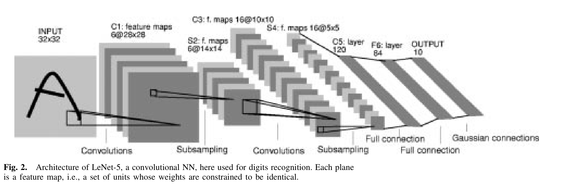</button><figcaption><strong>LeNet-5：从局部笔画到整字表示</strong><a href="https://leon.bottou.org/papers/lecun-98h">Gradient-Based Learning Applied to Document Recognition</a> · Figure 2 · version publisher / author PDF · PDF p.6 / printed p.2283<button class="original-direct" type="button">Read original size</button>

Original caption &amp; source

Fig. 2.
Architecture of LeNet-5, a convolutional NN, here used for digits recognition. Each plane
is a feature map, i.e., a set of units whose weights are constrained to be identical.
<a class="source-url" href="https://princetonuniversity.github.io/NEU-PSY-502/_static/pdf/Class%204/LeCunn1998.pdf">https://princetonuniversity.github.io/NEU-PSY-502/_static/pdf/Class%204/LeCunn1998.pdf</a>
</figcaption></figure>

沿左到右看：C1 在局部图块上提取特征，S2 减少空间采样，C3 组合更复杂笔画，后续层汇合为数字类别。通道增多与分辨率下降一起发生；这形成了后来许多 CNN 的阶段结构。

<figure id="fig-lenet-t1"><button class="paper-image" type="button" aria-label="Zoom: C3 的部分通道连接规则">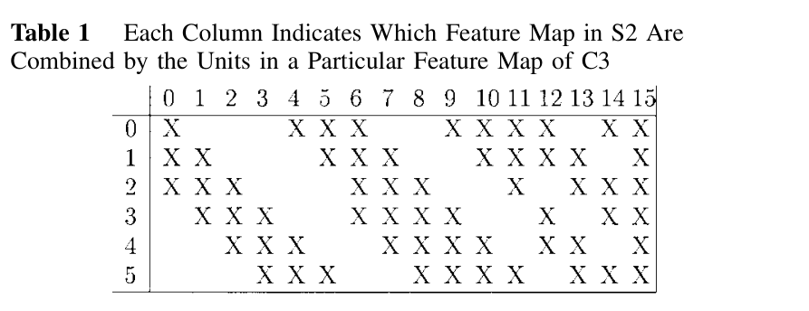</button><figcaption><strong>C3 的部分通道连接规则</strong><a href="https://leon.bottou.org/papers/lecun-98h">Gradient-Based Learning Applied to Document Recognition</a> · Table 1 · version publisher / author PDF · PDF p.8 / printed p.2285<button class="original-direct" type="button">Read original size</button>

Original caption &amp; source

Table 1
Each Column Indicates Which Feature Map in S2 Are
Combined by the Units in a Particular Feature Map of C3
<a class="source-url" href="https://princetonuniversity.github.io/NEU-PSY-502/_static/pdf/Class%204/LeCunn1998.pdf">https://princetonuniversity.github.io/NEU-PSY-502/_static/pdf/Class%204/LeCunn1998.pdf</a>
</figcaption></figure>

表中行与列规定哪些 S2 特征连接到哪些 C3 特征，X 代表存在连接。它是人为设计的部分连接，不能简单套用现代“每个输出通道连接全部输入通道”的参数公式，也不能直接叫作今日标准 depthwise。

<figure id="fig-lenet-f5"><button class="paper-image" type="button" aria-label="Zoom: LeNet-5 的训练与测试误差随迭代变化">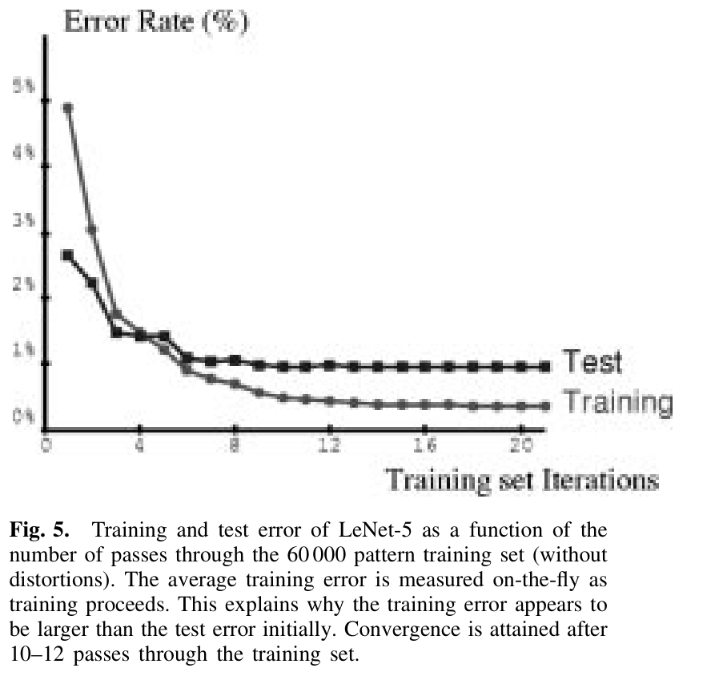</button><figcaption><strong>LeNet-5 的训练与测试误差随迭代变化</strong><a href="https://leon.bottou.org/papers/lecun-98h">Gradient-Based Learning Applied to Document Recognition</a> · Figure 5 · version publisher / author PDF · PDF p.11 / printed p.2288<button class="original-direct" type="button">Read original size</button>

Original caption &amp; source

Fig. 5.
Training and test error of LeNet-5 as a function of the
number of passes through the 60 000 pattern training set (without
distortions). The average training error is measured on-the-fly as
training proceeds. This explains why the training error appears to
be larger than the test error initially. Convergence is attained after
10–12 passes through the training set.
<a class="source-url" href="https://princetonuniversity.github.io/NEU-PSY-502/_static/pdf/Class%204/LeCunn1998.pdf">https://princetonuniversity.github.io/NEU-PSY-502/_static/pdf/Class%204/LeCunn1998.pdf</a>
</figcaption></figure>

横轴是对 60,000 个训练样本的遍历次数，纵轴为错误率；图注明确此设置没有输入扭曲增强。曲线显示早期快速学习后测试误差趋于平台，训练误差继续更低。开头训练曲线高于测试曲线，是训练过程在线统计造成，不能解释成测试集比训练集更容易的充分证据。它验证共享局部结构可以学习识别，但手写数字的规模和复杂度不能等同自然场景 ImageNet。

### AlexNet：数据、GPU、非线性与正则化共同改变规模

AlexNet<a href="#source-2">[2]</a>的转折是大规模 ImageNet 学习可行，而非“首次使用卷积”。五个卷积层、三个全连接层与 ReLU、数据增强、dropout、GPU 训练一起构成方案。需要分别理解表达结构与训练配方的贡献。

<figure id="fig-alex-f1"><button class="paper-image" type="button" aria-label="Zoom: ReLU 与 tanh 的训练收敛比较">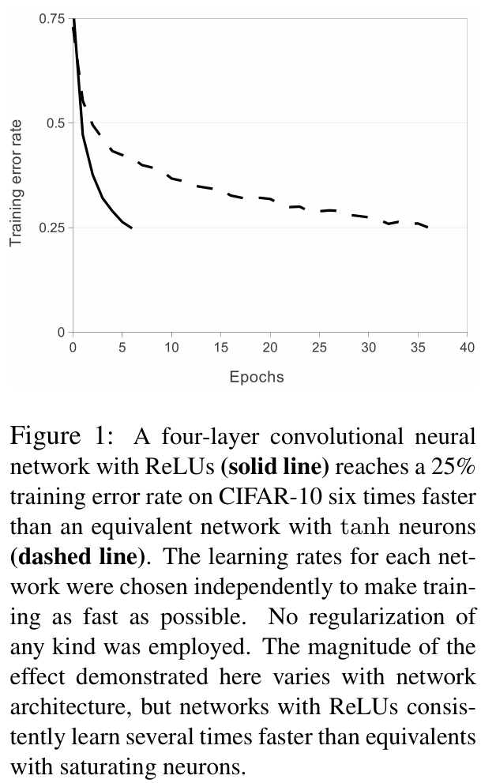</button><figcaption><strong>ReLU 与 tanh 的训练收敛比较</strong><a href="https://papers.nips.cc/paper_files/paper/2012/hash/c399862d3b9d6b76c8436e924a68c45b-Abstract.html">ImageNet Classification with Deep Convolutional Neural Networks</a> · Figure 1 · version publisher / author PDF · PDF p.3 / printed p.3<button class="original-direct" type="button">Read original size</button>

Original caption &amp; source

Figure 1: A four-layer convolutional neural
network with ReLUs (solid line) reaches a 25%
training error rate on CIFAR-10 six times faster
than an equivalent network with tanh neurons
(dashed line). The learning rates for each net-
work were chosen independently to make train-
ing as fast as possible.
No regularization of
any kind was employed. The magnitude of the
effect demonstrated here varies with network
architecture, but networks with ReLUs consis-
tently learn several times faster than equivalents
with saturating neurons.
<a class="source-url" href="https://papers.nips.cc/paper_files/paper/2012/file/c399862d3b9d6b76c8436e924a68c45b-Paper.pdf">https://papers.nips.cc/paper_files/paper/2012/file/c399862d3b9d6b76c8436e924a68c45b-Paper.pdf</a>
</figcaption></figure>

横轴迭代、纵轴训练错误率；在原图所示的实验上，ReLU 更快达到较低训练错误。这个小实验支持非饱和激活的优化优势，不能单独归因整个 ImageNet 提升。

<figure id="fig-alex-f2"><button class="paper-image" type="button" aria-label="Zoom: AlexNet 的双 GPU 分组架构">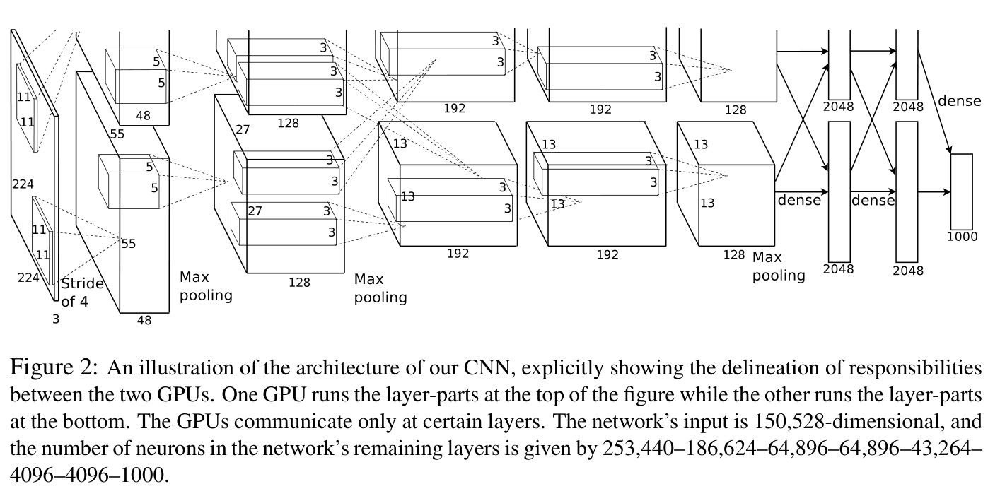</button><figcaption><strong>AlexNet 的双 GPU 分组架构</strong><a href="https://papers.nips.cc/paper_files/paper/2012/hash/c399862d3b9d6b76c8436e924a68c45b-Abstract.html">ImageNet Classification with Deep Convolutional Neural Networks</a> · Figure 2 · version publisher / author PDF · PDF p.5 / printed p.5<button class="original-direct" type="button">Read original size</button>

Original caption &amp; source

Figure 2: An illustration of the architecture of our CNN, explicitly showing the delineation of responsibilities
between the two GPUs. One GPU runs the layer-parts at the top of the figure while the other runs the layer-parts
at the bottom. The GPUs communicate only at certain layers. The network’s input is 150,528-dimensional, and
the number of neurons in the network’s remaining layers is given by 253,440–186,624–64,896–64,896–43,264–
4096–4096–1000.
<a class="source-url" href="https://papers.nips.cc/paper_files/paper/2012/file/c399862d3b9d6b76c8436e924a68c45b-Paper.pdf">https://papers.nips.cc/paper_files/paper/2012/file/c399862d3b9d6b76c8436e924a68c45b-Paper.pdf</a>
</figcaption></figure>

两个分支最初反映 GPU 内存约束；部分层跨 GPU 通信，部分层保持分组。该图不等于今日任意 group convolution 的通用设计原则。大的全连接头也让模型参数量与卷积 MACs 分布不同。

<figure id="fig-alex-t2"><button class="paper-image" type="button" aria-label="Zoom: ILSVRC 2012：单模型与模型集成要分别看">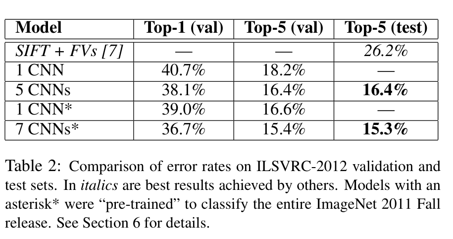</button><figcaption><strong>ILSVRC 2012：单模型与模型集成要分别看</strong><a href="https://papers.nips.cc/paper_files/paper/2012/hash/c399862d3b9d6b76c8436e924a68c45b-Abstract.html">ImageNet Classification with Deep Convolutional Neural Networks</a> · Table 2 · version publisher / author PDF · PDF p.7 / printed p.7<button class="original-direct" type="button">Read original size</button>

Original caption &amp; source

Table 2: Comparison of error rates on ILSVRC-2012 validation and
test sets. In italics are best results achieved by others. Models with an
asterisk* were “pre-trained” to classify the entire ImageNet 2011 Fall
release. See Section 6 for details.
<a class="source-url" href="https://papers.nips.cc/paper_files/paper/2012/file/c399862d3b9d6b76c8436e924a68c45b-Paper.pdf">https://papers.nips.cc/paper_files/paper/2012/file/c399862d3b9d6b76c8436e924a68c45b-Paper.pdf</a>
</figcaption></figure>

表中的单 CNN 验证 Top-5 错误率为 18.2%，多模型与额外预训练进一步提高，7 CNN 的测试 Top-5 错误率为 15.3%。训练数据、模型数量和验证／测试列都不同，不能把 15.3% 说成原始单网络的成绩。历史突破包含数据与训练规模的共同作用。

### VGG：用重复的小卷积研究深度

VGG<a href="#source-3">[3]</a>把结构做得规则：大量 3×3 stride=1 卷积，阶段之间池化，再接分类头。连续小卷积扩大感受野，增加非线性；在通道固定的简化条件下，两个 3×3 的参数少于一个 5×5。但真实网络通道数变化时仍需逐层计算。

<figure id="fig-vgg-t1"><button class="paper-image" type="button" aria-label="Zoom: VGG A–E：深度增加时哪些结构保持一致">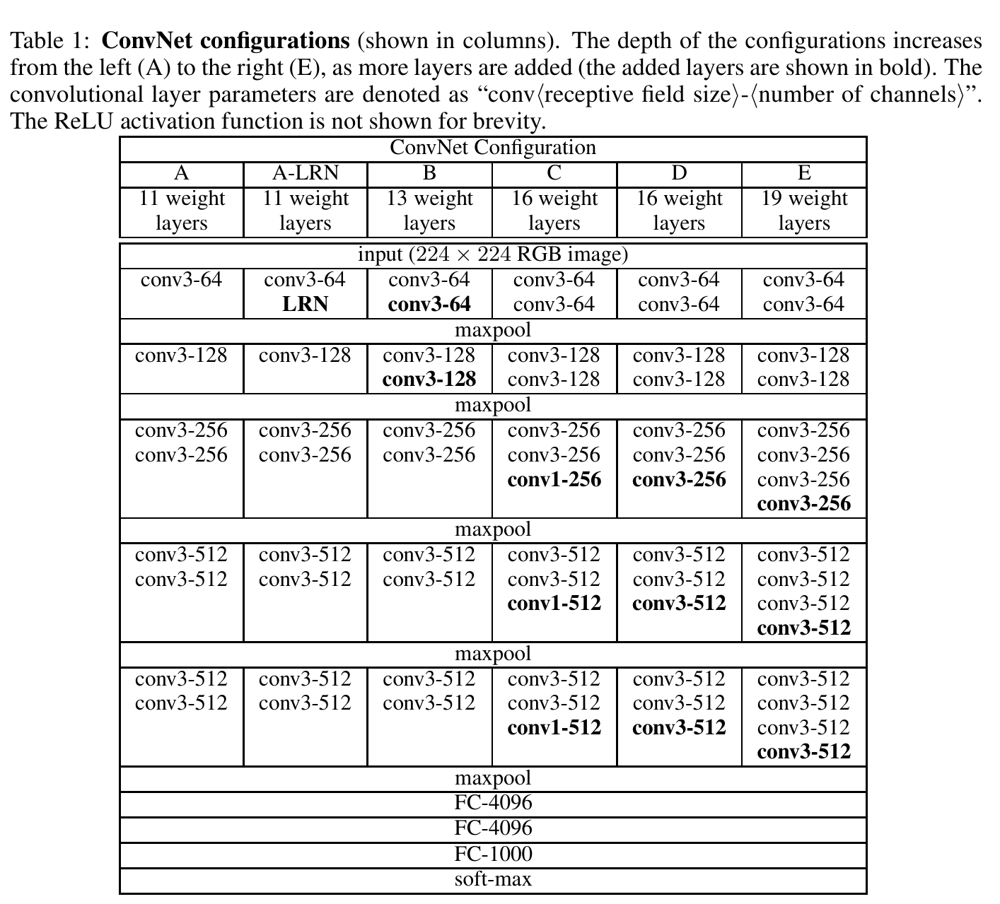</button><figcaption><strong>VGG A–E：深度增加时哪些结构保持一致</strong><a href="https://arxiv.org/abs/1409.1556">Very Deep Convolutional Networks for Large-Scale Image Recognition</a> · Table 1 · version v6 · PDF p.3 / printed p.3<button class="original-direct" type="button">Read original size</button>

Original caption &amp; source

Table 1: ConvNet configurations (shown in columns). The depth of the configurations increases
from the left (A) to the right (E), as more layers are added (the added layers are shown in bold). The
convolutional layer parameters are denoted as “conv⟨receptive field size⟩-⟨number of channels⟩”.
The ReLU activation function is not shown for brevity.
<a class="source-url" href="https://arxiv.org/pdf/1409.1556v6">https://arxiv.org/pdf/1409.1556v6</a>
</figcaption></figure>

A 到 E 逐渐增加层数，D、E 对应常见的 VGG-16／19。表中的卷积通道随阶段增大，三个全连接层对参数与内存占用很重要。

<figure id="fig-vgg-t3"><button class="paper-image" type="button" aria-label="Zoom: VGG 的单尺度分类结果">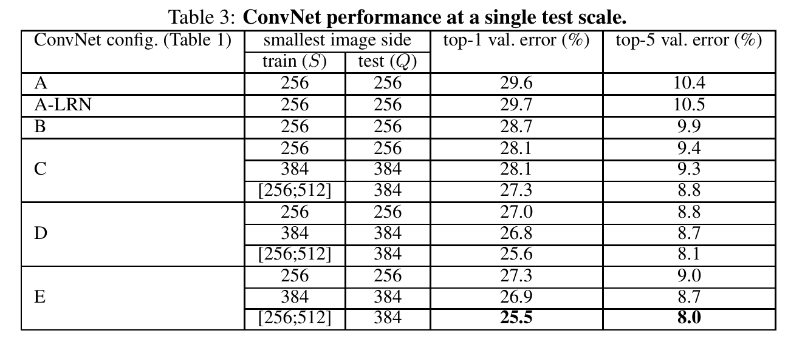</button><figcaption><strong>VGG 的单尺度分类结果</strong><a href="https://arxiv.org/abs/1409.1556">Very Deep Convolutional Networks for Large-Scale Image Recognition</a> · Table 3 · version v6 · PDF p.6 / printed p.6<button class="original-direct" type="button">Read original size</button>

Original caption &amp; source

Table 3: ConvNet performance at a single test scale.
ConvNet config. (Table 1)
smallest image side
top-1 val. error (%)
top-5 val. error (%)
train (S)
test (Q)
A
256
256
29.6
10.4
A-LRN
256
256
29.7
10.5
B
256
256
28.7
9.9
<a class="source-url" href="https://arxiv.org/pdf/1409.1556v6">https://arxiv.org/pdf/1409.1556v6</a>
</figcaption></figure>

注意表中训练尺度、评估尺度和 Top-1／Top-5 错误分别列出。同一结构使用不同尺度训练与测试也会改变结果，深度效果要在对应设置之间判断。

<figure id="fig-vgg-t6"><button class="paper-image" type="button" aria-label="Zoom: VGG 模型融合的验证与测试结果">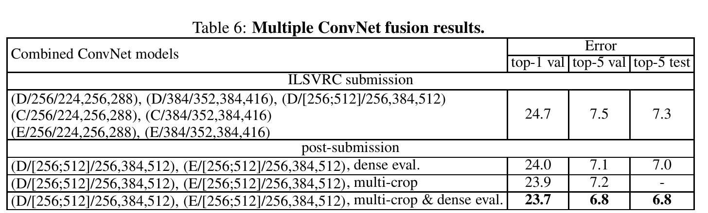</button><figcaption><strong>VGG 模型融合的验证与测试结果</strong><a href="https://arxiv.org/abs/1409.1556">Very Deep Convolutional Networks for Large-Scale Image Recognition</a> · Table 6 · version v6 · PDF p.8 / printed p.8<button class="original-direct" type="button">Read original size</button>

Original caption &amp; source

Table 6: Multiple ConvNet fusion results.
<a class="source-url" href="https://arxiv.org/pdf/1409.1556v6">https://arxiv.org/pdf/1409.1556v6</a>
</figcaption></figure>

Table 6 比较多个 VGG 网络融合，使用密集与多裁剪评估；冻结 v6 的 post-submission D/E 两网融合给出验证 Top-1/Top-5 错误 23.7/6.8%，测试 Top-5 也为 6.8%；竞赛提交的多个模型融合测试 Top-5 为 7.3%。它没有列出其他家族，也不是单裁剪成绩。VGG 表明规则加深可改进表征，但大参数头与高分辨率密集卷积使其不适合仅凭“结构简单”就判断移动端效率。其价值更多在通用特征和可分析性。

### GoogLeNet / Inception：在一个阶段并行看不同尺度

Inception<a href="#source-4">[4]</a>在同一输入上并行执行不同核大小的卷积与池化，然后沿通道拼接；1×1 层先压缩昂贵分支的输入通道。它改变的是模块内的计算分配，不是把所有大核机械地换成小核。

<figure id="fig-inception-f2"><button class="paper-image" type="button" aria-label="Zoom: 朴素 Inception 与瓶颈降维版">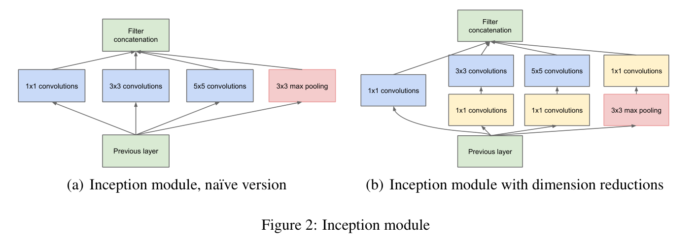</button><figcaption><strong>朴素 Inception 与瓶颈降维版</strong><a href="https://arxiv.org/abs/1409.4842">Going Deeper with Convolutions</a> · Figure 2 · version v1 · PDF p.5 / printed p.5<button class="original-direct" type="button">Read original size</button>

Original caption &amp; source

Figure 2: Inception module
<a class="source-url" href="https://arxiv.org/pdf/1409.4842v1">https://arxiv.org/pdf/1409.4842v1</a>
</figcaption></figure>

左图多个空间分支直接作用于输入，右图在 3×3、5×5 前加入 1×1。把输入通道压缩后，大核 MACs 相应下降；拼接依然要求各分支的空间尺寸相同。

<figure id="fig-inception-f3"><button class="paper-image" type="button" aria-label="Zoom: 完整 GoogLeNet：主干、辅助分类器与最终头">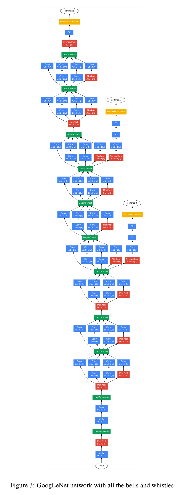</button><figcaption><strong>完整 GoogLeNet：主干、辅助分类器与最终头</strong><a href="https://arxiv.org/abs/1409.4842">Going Deeper with Convolutions</a> · Figure 3 · version v1 · PDF p.7 / printed p.7<button class="original-direct" type="button">Read original size</button>

Original caption &amp; source

Figure 3: GoogLeNet network with all the bells and whistles
<a class="source-url" href="https://arxiv.org/pdf/1409.4842v1">https://arxiv.org/pdf/1409.4842v1</a>
</figcaption></figure>

从底部输入沿主路径往上读，多个 Inception 模块串联，两个辅助分类分支在训练时提供额外监督，最终使用全局平均池化附近的分类头。辅助分类器不意味着部署必须输出三个类别结果。

<figure id="fig-inception-t2"><button class="paper-image" type="button" aria-label="Zoom: ILSVRC 分类竞赛结果：以当年的协议看提升">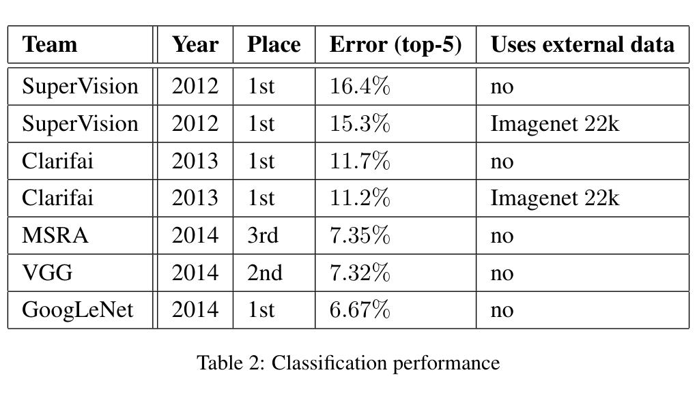</button><figcaption><strong>ILSVRC 分类竞赛结果：以当年的协议看提升</strong><a href="https://arxiv.org/abs/1409.4842">Going Deeper with Convolutions</a> · Table 2 · version v1 · PDF p.9 / printed p.9<button class="original-direct" type="button">Read original size</button>

Original caption &amp; source

Table 2: Classification performance
<a class="source-url" href="https://arxiv.org/pdf/1409.4842v1">https://arxiv.org/pdf/1409.4842v1</a>
</figcaption></figure>

<figure id="fig-inception-t3"><button class="paper-image" type="button" aria-label="Zoom: 裁剪与集成策略也会改变 Top-5">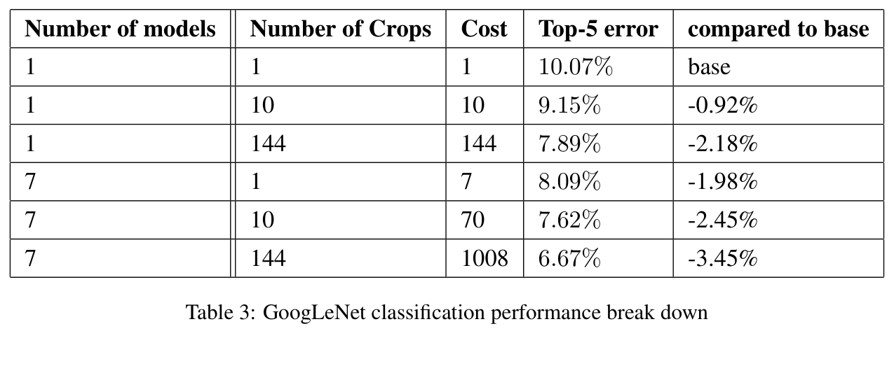</button><figcaption><strong>裁剪与集成策略也会改变 Top-5</strong><a href="https://arxiv.org/abs/1409.4842">Going Deeper with Convolutions</a> · Table 3 · version v1 · PDF p.9 / printed p.9<button class="original-direct" type="button">Read original size</button>

Original caption &amp; source

Table 3: GoogLeNet classification performance break down
<a class="source-url" href="https://arxiv.org/pdf/1409.4842v1">https://arxiv.org/pdf/1409.4842v1</a>
</figcaption></figure>

Table 2 给出当年竞赛系统比较；Table 3 将模型数量和裁剪数拆开，展示评估策略本身的增益。GoogLeNet 的竞赛 Top-5 错误率 6.67% 是集成与多裁剪设置，不能直接和 AlexNet 单模型单裁剪对比。Inception 的复杂分支也会产生工程开销。

### ResNet：用残差参数化缓解深度退化

ResNet<a href="#source-5">[5]</a>针对“更深的普通网络训练误差反而更大”的现象，引入恒等捷径。一个形状相容的 block 写为：

$$
y=x+F(x;\theta).
$$

$x$ 为输入，$F$ 是含卷积的残差分支，$\theta$ 为参数。若输入输出通道或空间尺寸不同，要用投影 $P(x)$ 替换直接相加的 $x$。直觉是让残差分支学习对已有表示的修正；不能声称捷径把所有梯度问题永久消除。

<figure id="fig-resnet-f1"><button class="paper-image" type="button" aria-label="Zoom: 深度退化：训练与测试误差一起变坏">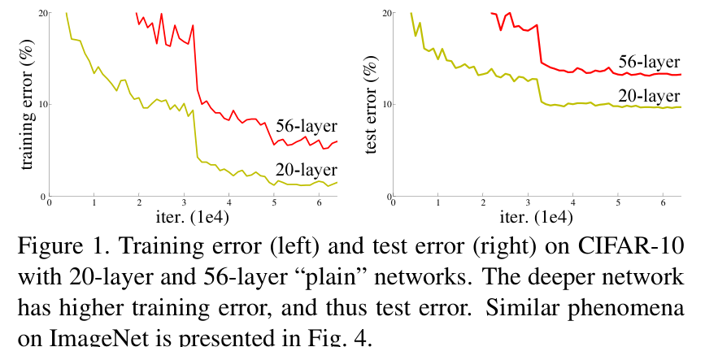</button><figcaption><strong>深度退化：训练与测试误差一起变坏</strong><a href="https://arxiv.org/abs/1512.03385">Deep Residual Learning for Image Recognition</a> · Figure 1 · version v1 · PDF p.1 / printed p.1<button class="original-direct" type="button">Read original size</button>

Original caption &amp; source

Figure 1. Training error (left) and test error (right) on CIFAR-10
with 20-layer and 56-layer “plain” networks. The deeper network
has higher training error, and thus test error. Similar phenomena
on ImageNet is presented in Fig. 4.
<a class="source-url" href="https://arxiv.org/pdf/1512.03385v1">https://arxiv.org/pdf/1512.03385v1</a>
</figcaption></figure>

这不是典型的“训练更好、测试更差”过拟合图。普通 56 层网络的训练误差也更大，支持优化层面的诊断。

<figure id="fig-resnet-f2"><button class="paper-image" type="button" aria-label="Zoom: 残差 block 的加法数据流">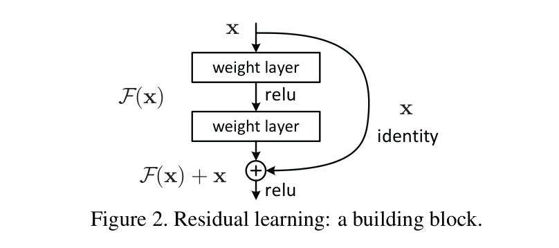</button><figcaption><strong>残差 block 的加法数据流</strong><a href="https://arxiv.org/abs/1512.03385">Deep Residual Learning for Image Recognition</a> · Figure 2 · version v1 · PDF p.2 / printed p.2<button class="original-direct" type="button">Read original size</button>

Original caption &amp; source

Figure 2. Residual learning: a building block.
<a class="source-url" href="https://arxiv.org/pdf/1512.03385v1">https://arxiv.org/pdf/1512.03385v1</a>
</figcaption></figure>

箭头上的输入直接到加法节点，卷积分支只预测修正。必须先检查 shape；错误的广播或 stride 会改变模型含义。

<figure id="fig-resnet-f4"><button class="paper-image" type="button" aria-label="Zoom: ImageNet：普通网络与残差网络的深度对照">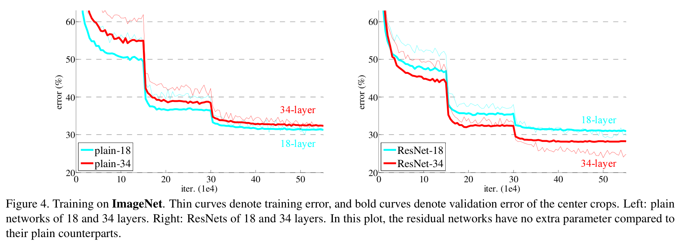</button><figcaption><strong>ImageNet：普通网络与残差网络的深度对照</strong><a href="https://arxiv.org/abs/1512.03385">Deep Residual Learning for Image Recognition</a> · Figure 4 · version v1 · PDF p.5 / printed p.5<button class="original-direct" type="button">Read original size</button>

Original caption &amp; source

Figure 4. Training on ImageNet. Thin curves denote training error, and bold curves denote validation error of the center crops. Left: plain
networks of 18 and 34 layers. Right: ResNets of 18 and 34 layers. In this plot, the residual networks have no extra parameter compared to
their plain counterparts.
<a class="source-url" href="https://arxiv.org/pdf/1512.03385v1">https://arxiv.org/pdf/1512.03385v1</a>
</figcaption></figure>

左图普通 34 层难以胜过 18 层，右图残差参数化后更深网络表现改善。控制比较对象才可把改善归于残差结构，而不能把所有后续配方差异算到捷径上。

<figure id="fig-resnet-f5"><button class="paper-image" type="button" aria-label="Zoom: Basic block 与 bottleneck 的通道设计">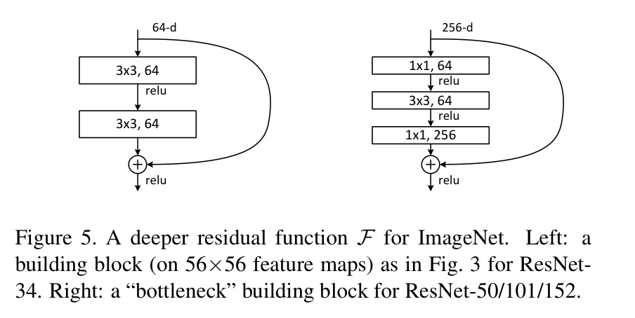</button><figcaption><strong>Basic block 与 bottleneck 的通道设计</strong><a href="https://arxiv.org/abs/1512.03385">Deep Residual Learning for Image Recognition</a> · Figure 5 · version v1 · PDF p.6 / printed p.6<button class="original-direct" type="button">Read original size</button>

Original caption &amp; source

Figure 5. A deeper residual function F for ImageNet. Left: a
building block (on 56×56 feature maps) as in Fig. 3 for ResNet-
34. Right: a “bottleneck” building block for ResNet-50/101/152.
<a class="source-url" href="https://arxiv.org/pdf/1512.03385v1">https://arxiv.org/pdf/1512.03385v1</a>
</figcaption></figure>

瓶颈先 1×1 压缩，再 3×3 空间混合，再 1×1 扩展。它与 MobileNetV2 的“先扩展”方向相反，后者还使用 depthwise 空间卷积。

<figure id="fig-resnet-t2"><button class="paper-image" type="button" aria-label="Zoom: ResNet 深度对照的分类错误率">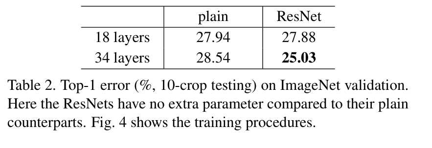</button><figcaption><strong>ResNet 深度对照的分类错误率</strong><a href="https://arxiv.org/abs/1512.03385">Deep Residual Learning for Image Recognition</a> · Table 2 · version v1 · PDF p.5 / printed p.5<button class="original-direct" type="button">Read original size</button>

Original caption &amp; source

Table 2. Top-1 error (%, 10-crop testing) on ImageNet validation.
Here the ResNets have no extra parameter compared to their plain
counterparts. Fig. 4 shows the training procedures.
<a class="source-url" href="https://arxiv.org/pdf/1512.03385v1">https://arxiv.org/pdf/1512.03385v1</a>
</figcaption></figure>

<figure id="fig-resnet-t4"><button class="paper-image" type="button" aria-label="Zoom: 更深 residual 网络的单模型结果">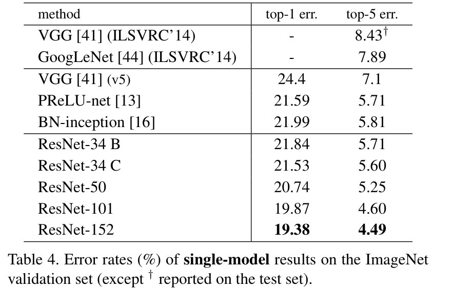</button><figcaption><strong>更深 residual 网络的单模型结果</strong><a href="https://arxiv.org/abs/1512.03385">Deep Residual Learning for Image Recognition</a> · Table 4 · version v1 · PDF p.6 / printed p.6<button class="original-direct" type="button">Read original size</button>

Original caption &amp; source

Table 4. Error rates (%) of single-model results on the ImageNet
validation set (except † reported on the test set).
<a class="source-url" href="https://arxiv.org/pdf/1512.03385v1">https://arxiv.org/pdf/1512.03385v1</a>
</figcaption></figure>

Table 2 的 18→34 层残差网络改善，与普通网络退化形成对照；Table 4 展示更深单模型的多尺度全卷积评估，ResNet-152 为 19.38% Top-1／4.49% Top-5 错误。单模型仍可以多尺度测试，不等于一次前向、一个裁剪；后续集成又是另一条件。残差 backbone 后来迁移到检测与分割，但它没有直接定义这些任务的输出。

### DenseNet：让旧特征保持可见

DenseNet<a href="#source-6">[6]</a>把同一 dense block 内所有先前特征沿通道拼接：

$$
x_l=H_l([x_0,x_1,\ldots,x_{l-1}]).
$$

$H_l$ 是该层变换，方括号表示通道拼接，$l$ 是层号。若每层产生 $k$ 个新通道，block 的通道数线性增长；$k$ 称 growth rate。ResNet 是同形状相加，DenseNet 是保存并拼接，两个操作的内存行为不同。

<figure id="fig-dense-f1"><button class="paper-image" type="button" aria-label="Zoom: Dense block 内每层都能读取之前的特征">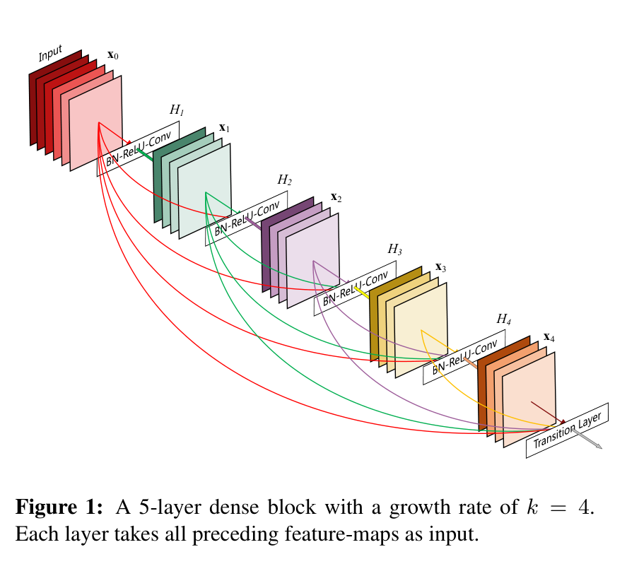</button><figcaption><strong>Dense block 内每层都能读取之前的特征</strong><a href="https://arxiv.org/abs/1608.06993">Densely Connected Convolutional Networks</a> · Figure 1 · version v5 · PDF p.1 / printed p.1<button class="original-direct" type="button">Read original size</button>

Original caption &amp; source

Figure 1: A 5-layer dense block with a growth rate of k = 4.
Each layer takes all preceding feature-maps as input.
<a class="source-url" href="https://arxiv.org/pdf/1608.06993v5">https://arxiv.org/pdf/1608.06993v5</a>
</figcaption></figure>

<figure id="fig-dense-f2"><button class="paper-image" type="button" aria-label="Zoom: 多个 dense block 与 transition 的整体网络">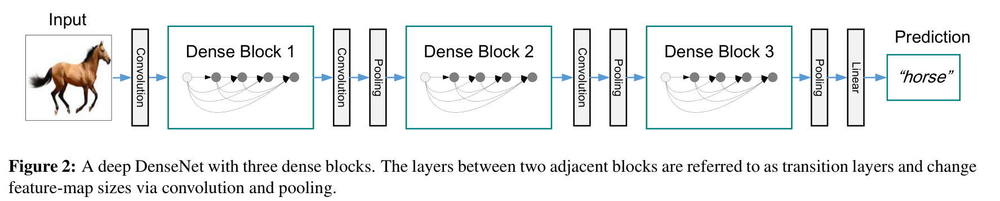</button><figcaption><strong>多个 dense block 与 transition 的整体网络</strong><a href="https://arxiv.org/abs/1608.06993">Densely Connected Convolutional Networks</a> · Figure 2 · version v5 · PDF p.3 / PDF page used for source lookup<button class="original-direct" type="button">Read original size</button>

Original caption &amp; source

Figure 2: A deep DenseNet with three dense blocks. The layers between two adjacent blocks are referred to as transition layers and change
feature-map sizes via convolution and pooling.
<a class="source-url" href="https://arxiv.org/pdf/1608.06993v5">https://arxiv.org/pdf/1608.06993v5</a>
</figcaption></figure>

第一张图可逐箭头追踪特征复用；第二张图在 block 之间放置压缩和下采样，控制增长。保留旧特征有利于复用与监督传播，但拼接与保存激活可能让运行内存和访存成本上升。

<figure id="fig-dense-t2"><button class="paper-image" type="button" aria-label="Zoom: CIFAR 与 SVHN：参数效率的原始证据">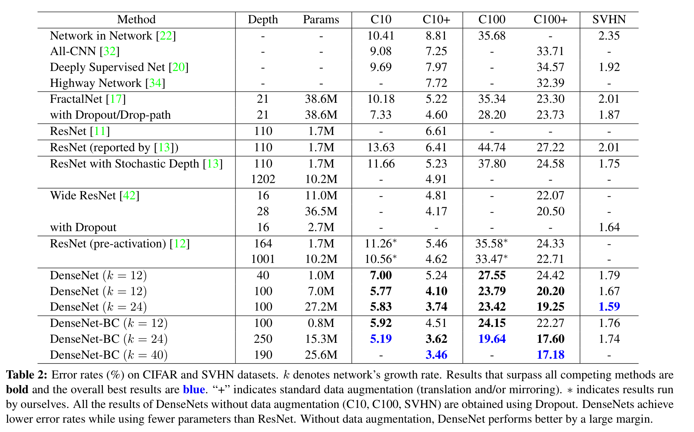</button><figcaption><strong>CIFAR 与 SVHN：参数效率的原始证据</strong><a href="https://arxiv.org/abs/1608.06993">Densely Connected Convolutional Networks</a> · Table 2 · version v5 · PDF p.5 / PDF page used for source lookup<button class="original-direct" type="button">Read original size</button>

Original caption &amp; source

Table 2: Error rates (%) on CIFAR and SVHN datasets. k denotes network’s growth rate. Results that surpass all competing methods are
bold and the overall best results are blue. “+” indicates standard data augmentation (translation and/or mirroring). ∗indicates results run
by ourselves. All the results of DenseNets without data augmentation (C10, C100, SVHN) are obtained using Dropout. DenseNets achieve
lower error rates while using fewer parameters than ResNet. Without data augmentation, DenseNet performs better by a large margin.
<a class="source-url" href="https://arxiv.org/pdf/1608.06993v5">https://arxiv.org/pdf/1608.06993v5</a>
</figcaption></figure>

表中不同数据集、增强设置、模型深度、growth rate 和参数量分别列出。DenseNet-BC 的 bottleneck 与 compression 改变资源开销，不能只按层数比较。该证据支持较好的参数效率，不能自动证明比残差网络有更低真机延迟。

### SE：让网络按图像内容重新分配通道权重

SE<a href="#source-7">[7]</a>对每个通道做全局空间平均得到描述，再通过小型网络输出缩放系数：

$$
z_c=\frac{1}{HW}\sum_{i,j}u_{c,i,j},\qquad
s=\sigma(W_2\delta(W_1z)),\qquad
\widetilde u_c=s_cu_c.
$$

$u$ 是输入特征，$H,W$ 是空间大小，$z$ 为通道描述，$\delta$ 是 ReLU，$\sigma$ 是 sigmoid；$W_1,W_2$ 先降维再升维。$s_c$ 通常对同一通道所有位置共享，所以 SE 是内容相关的通道选择，不是每个像素都有独立的空间注意力。

<figure id="fig-se-f1"><button class="paper-image" type="button" aria-label="Zoom: Squeeze → excitation → 通道缩放">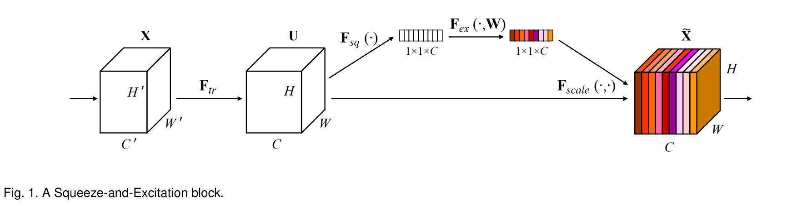</button><figcaption><strong>Squeeze → excitation → 通道缩放</strong><a href="https://arxiv.org/abs/1709.01507">Squeeze-and-Excitation Networks</a> · Figure 1 · version v4 · PDF p.2 / printed p.2<button class="original-direct" type="button">Read original size</button>

Original caption &amp; source

Fig. 1. A Squeeze-and-Excitation block.
<a class="source-url" href="https://arxiv.org/pdf/1709.01507v4">https://arxiv.org/pdf/1709.01507v4</a>
</figcaption></figure>

<figure id="fig-se-f2"><button class="paper-image" type="button" aria-label="Zoom: SE 如何插入 Inception 分支之后">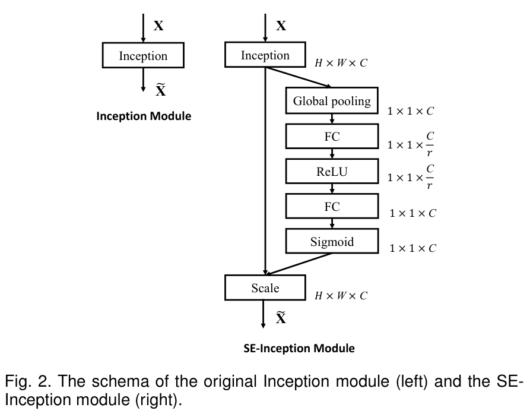</button><figcaption><strong>SE 如何插入 Inception 分支之后</strong><a href="https://arxiv.org/abs/1709.01507">Squeeze-and-Excitation Networks</a> · Figure 2 · version v4 · PDF p.4 / printed p.4<button class="original-direct" type="button">Read original size</button>

Original caption &amp; source

Fig. 2. The schema of the original Inception module (left) and the SE-
Inception module (right).
<a class="source-url" href="https://arxiv.org/pdf/1709.01507v4">https://arxiv.org/pdf/1709.01507v4</a>
</figcaption></figure>

<figure id="fig-se-f3"><button class="paper-image" type="button" aria-label="Zoom: SE 如何插入 ResNet 的残差分支">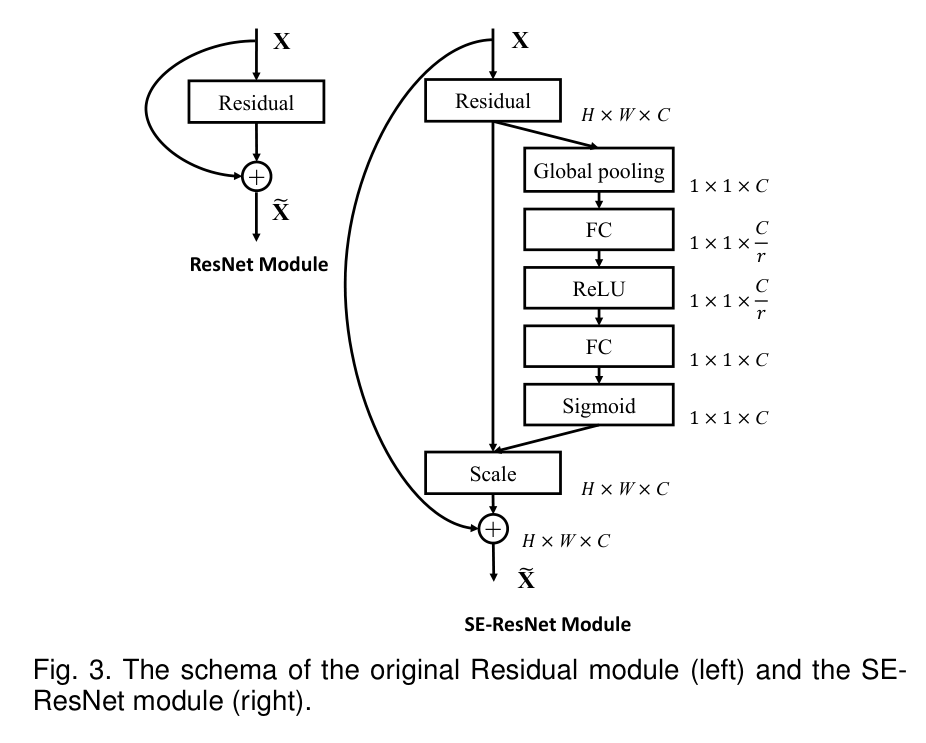</button><figcaption><strong>SE 如何插入 ResNet 的残差分支</strong><a href="https://arxiv.org/abs/1709.01507">Squeeze-and-Excitation Networks</a> · Figure 3 · version v4 · PDF p.4 / printed p.4<button class="original-direct" type="button">Read original size</button>

Original caption &amp; source

Fig. 3. The schema of the original Residual module (left) and the SE-
ResNet module (right).
<a class="source-url" href="https://arxiv.org/pdf/1709.01507v4">https://arxiv.org/pdf/1709.01507v4</a>
</figcaption></figure>

三图分别给出一般数据流、Inception 和残差模块的接入位置。残差版是在残差变换之后、与捷径相加之前缩放；全局池化、两个小矩阵和缩放都属于真实计算图。

<figure id="fig-se-t2"><button class="paper-image" type="button" aria-label="Zoom: 原实现、重训基线与 SENet 分列比较">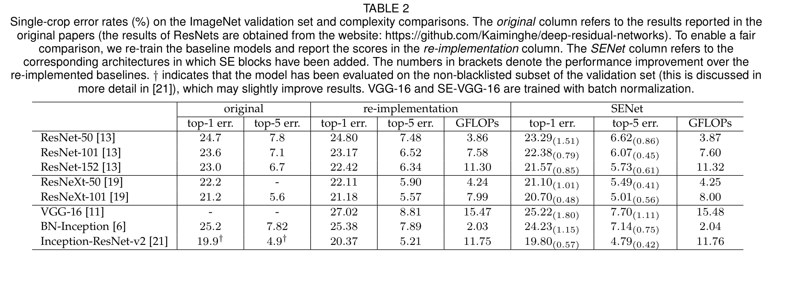</button><figcaption><strong>原实现、重训基线与 SENet 分列比较</strong><a href="https://arxiv.org/abs/1709.01507">Squeeze-and-Excitation Networks</a> · Table 2 · version v4 · PDF p.5 / printed p.5<button class="original-direct" type="button">Read original size</button>

Original caption &amp; source

TABLE 2
Single-crop error rates (%) on the ImageNet validation set and complexity comparisons. The original column refers to the results reported in the
original papers (the results of ResNets are obtained from the website: https://github.com/Kaiminghe/deep-residual-networks). To enable a fair
comparison, we re-train the baseline models and report the scores in the re-implementation column. The SENet column refers to the
corresponding architectures in which SE blocks have been added. The numbers in brackets denote the performance improvement over the
re-implemented baselines. † indicates that the model has been evaluated on the non-blacklisted subset of the validation set (this is discussed in
more detail in [21]), which may slightly improve results. VGG-16 and SE-VGG-16 are trained with batch normalization.
<a class="source-url" href="https://arxiv.org/pdf/1709.01507v4">https://arxiv.org/pdf/1709.01507v4</a>
</figcaption></figure>

例如重实现 ResNet-50 的 Top-1 错误为 24.80%，SE 版本 23.29%，表中约 3.86→3.87 GFLOPs。应对比同一重训基线，不能把另一个来源的 24.7% 当成严格控制实验。额外算术量小，实际延迟仍取决于池化与小算子的实现。

## 4. 移动与高效 CNN：轻量化不只是减少卷积核

### MobileNetV1：空间与通道混合分工

MobileNetV1<a href="#source-8">[8]</a>将普通卷积替换为 depthwise + pointwise，另外用 width multiplier 缩小通道，用 resolution multiplier 缩小空间输入。两类缩放影响不同：减少分辨率可能损失小目标与关键点信息，缩小通道降低表达容量。

<figure id="fig-mobile1-f2"><button class="paper-image" type="button" aria-label="Zoom: 普通卷积与可分离卷积的滤波结构">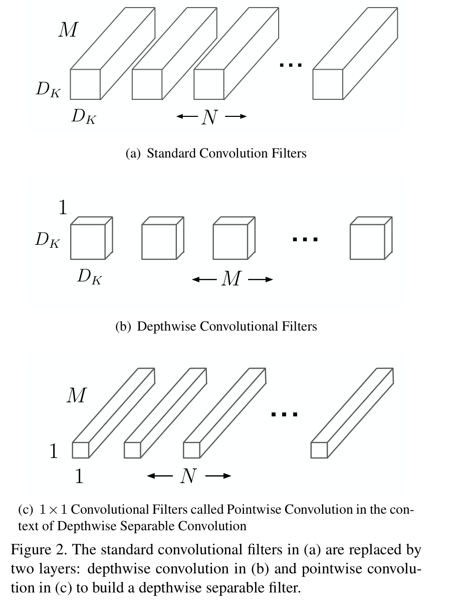</button><figcaption><strong>普通卷积与可分离卷积的滤波结构</strong><a href="https://arxiv.org/abs/1704.04861">MobileNets: Efficient Convolutional Neural Networks for Mobile Vision Applications</a> · Figure 2 · version v1 · PDF p.3 / PDF page used for source lookup<button class="original-direct" type="button">Read original size</button>

Original caption &amp; source

Figure 2. The standard convolutional filters in (a) are replaced by
two layers: depthwise convolution in (b) and pointwise convolu-
tion in (c) to build a depthwise separable filter.
<a class="source-url" href="https://arxiv.org/pdf/1704.04861v1">https://arxiv.org/pdf/1704.04861v1</a>
</figcaption></figure>

空间滤波分别在每个输入通道上进行，后续 1×1 汇合通道。上节计算比展示的是理论 MACs 优势；图中的两步不是没有代价的抽象分解。

<figure id="fig-mobile1-t4"><button class="paper-image" type="button" aria-label="Zoom: 同一 MobileNet 结构：可分离卷积与普通卷积比较">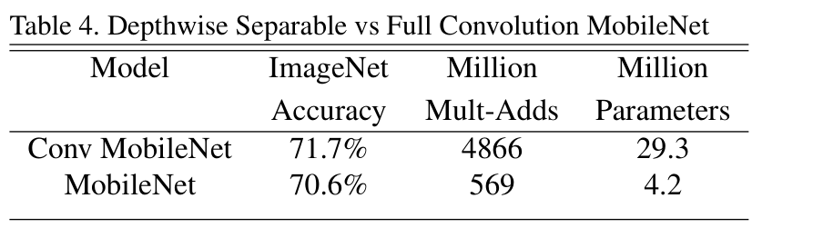</button><figcaption><strong>同一 MobileNet 结构：可分离卷积与普通卷积比较</strong><a href="https://arxiv.org/abs/1704.04861">MobileNets: Efficient Convolutional Neural Networks for Mobile Vision Applications</a> · Table 4 · version v1 · PDF p.5 / PDF page used for source lookup<button class="original-direct" type="button">Read original size</button>

Original caption &amp; source

Table 4. Depthwise Separable vs Full Convolution MobileNet
<a class="source-url" href="https://arxiv.org/pdf/1704.04861v1">https://arxiv.org/pdf/1704.04861v1</a>
</figcaption></figure>

原表可分离版为 70.6% Top-1、569 M Mult-Adds、4.2 M 参数；改成普通卷积为 71.7%、4866 M、29.3 M。前者以 1.1 个百分点换取约 8.6 倍乘加减少，这是直接的结构对照。移动部署必须继续测每种操作的延迟，尤其 pointwise 通常承担主要乘加，depthwise 常有不同访存瓶颈。

### MobileNetV2：扩展后处理，再线性压缩

MobileNetV2<a href="#source-9">[9]</a>的 inverted residual 在窄通道之间建立捷径，分支先用 1×1 扩展，再 depthwise，最后线性投影回窄通道。最后不加 ReLU，是为了避免低维瓶颈中再次截断信息。

<figure id="fig-mobile2-f2"><button class="paper-image" type="button" aria-label="Zoom: 从普通卷积到可分离卷积，再到线性瓶颈">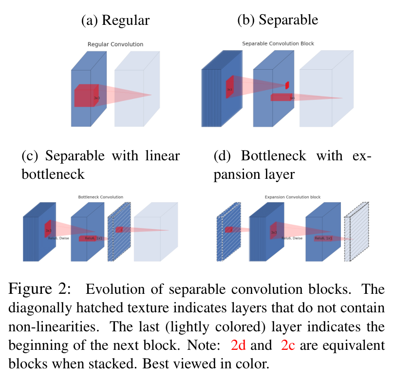</button><figcaption><strong>从普通卷积到可分离卷积，再到线性瓶颈</strong><a href="https://arxiv.org/abs/1801.04381">MobileNetV2: Inverted Residuals and Linear Bottlenecks</a> · Figure 2 · version v4 · PDF p.3 / PDF page used for source lookup<button class="original-direct" type="button">Read original size</button>

Original caption &amp; source

Figure 2:
Evolution of separable convolution blocks. The
diagonally hatched texture indicates layers that do not contain
non-linearities. The last (lightly colored) layer indicates the
beginning of the next block. Note: 2d and 2c are equivalent
blocks when stacked. Best viewed in color.
<a class="source-url" href="https://arxiv.org/pdf/1801.04381v4">https://arxiv.org/pdf/1801.04381v4</a>
</figcaption></figure>

Figure 2 从 (a) 普通卷积，走到 (b) 可分离卷积、(c) 引入瓶颈和 (d) 调整连接位置；空间操作与通道变换的分工越来越清楚。低维瓶颈避免再次 ReLU 截断，是作者的信息保留动机，不是“ReLU 在所有低维层都必须删除”的定理。

<figure id="fig-mobile2-f3"><button class="paper-image" type="button" aria-label="Zoom: 普通 residual 与 inverted residual">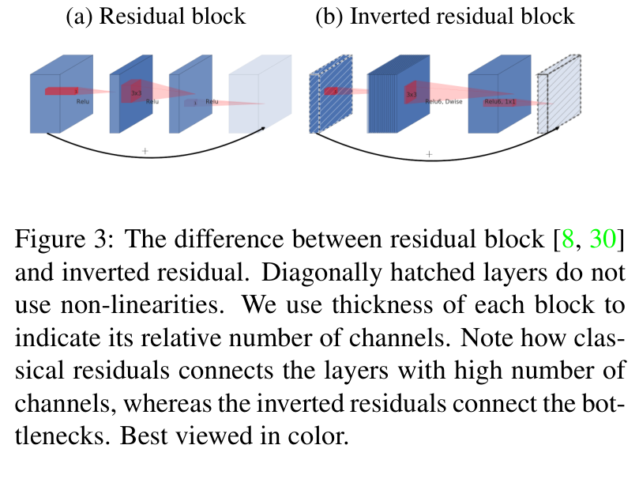</button><figcaption><strong>普通 residual 与 inverted residual</strong><a href="https://arxiv.org/abs/1801.04381">MobileNetV2: Inverted Residuals and Linear Bottlenecks</a> · Figure 3 · version v4 · PDF p.3 / PDF page used for source lookup<button class="original-direct" type="button">Read original size</button>

Original caption &amp; source

Figure 3: The difference between residual block [8, 30]
and inverted residual. Diagonally hatched layers do not
use non-linearities. We use thickness of each block to
indicate its relative number of channels. Note how clas-
sical residuals connects the layers with high number of
channels, whereas the inverted residuals connect the bot-
tlenecks. Best viewed in color.
<a class="source-url" href="https://arxiv.org/pdf/1801.04381v4">https://arxiv.org/pdf/1801.04381v4</a>
</figcaption></figure>

右图先扩展通道，用 depthwise 做空间处理，再压缩；输入输出匹配且 stride=1 才能走残差。部署时扩展激活可能成为内存峰值，不能只看最终窄输出。

<figure id="fig-mobile2-t4"><button class="paper-image" type="button" aria-label="Zoom: ImageNet 分类：MACs、参数和输入尺寸并列">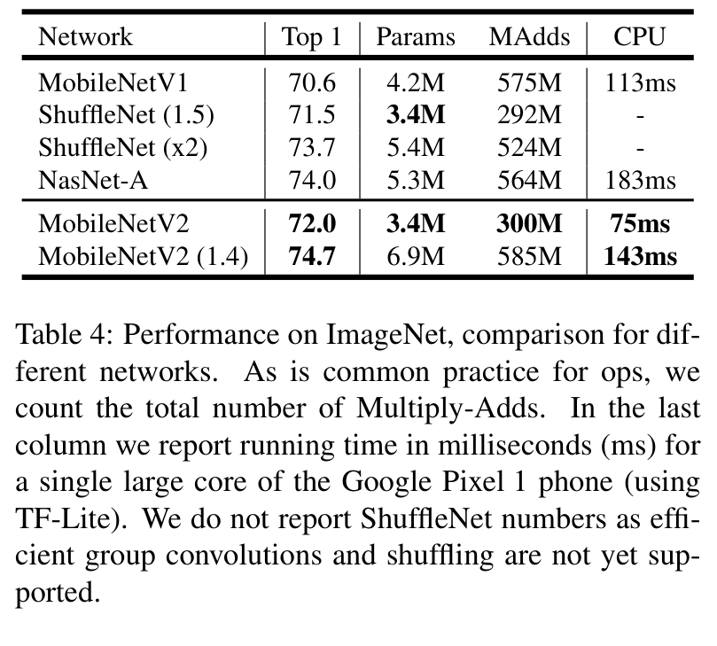</button><figcaption><strong>ImageNet 分类：MACs、参数和输入尺寸并列</strong><a href="https://arxiv.org/abs/1801.04381">MobileNetV2: Inverted Residuals and Linear Bottlenecks</a> · Table 4 · version v4 · PDF p.7 / PDF page used for source lookup<button class="original-direct" type="button">Read original size</button>

Original caption &amp; source

Table 4: Performance on ImageNet, comparison for dif-
ferent networks. As is common practice for ops, we
count the total number of Multiply-Adds. In the last
column we report running time in milliseconds (ms) for
a single large core of the Google Pixel 1 phone (using
TF-Lite). We do not report ShuffleNet numbers as effi-
cient group convolutions and shuffling are not yet sup-
ported.
<a class="source-url" href="https://arxiv.org/pdf/1801.04381v4">https://arxiv.org/pdf/1801.04381v4</a>
</figcaption></figure>

标准 V2 约 3.4 M 参数、300 M MAdds、72.0% Top-1；更宽和不同输入尺寸的变体另列。本文后面的真实诊断使用 torchvision 的 V2 权重，训练版本不同，不以 8 张图片“复现”这张分类成绩。

### EfficientNet：深度、宽度与分辨率一起缩放

EfficientNet<a href="#source-10">[10]</a>在搜索得到的基础网络上用复合缩放：

$$
d=\alpha^\phi,\qquad w=\beta^\phi,\qquad r=\gamma^\phi,\qquad
\alpha\beta^2\gamma^2\approx2.
$$

$d,w,r$ 是相对基础网络的深度、宽度、输入分辨率倍率，$\phi$ 是资源等级，$\alpha,\beta,\gamma\ge1$ 为固定系数。近似约束来自卷积计算量对深度线性、对宽度和分辨率近似平方的增长，不是每个模型与设备都恰好翻倍。

<figure id="fig-efficient-f2"><button class="paper-image" type="button" aria-label="Zoom: 单维缩放与复合缩放">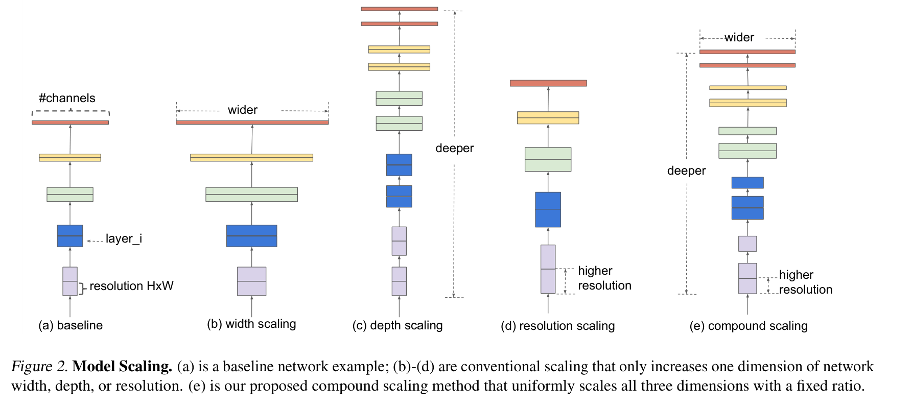</button><figcaption><strong>单维缩放与复合缩放</strong><a href="https://arxiv.org/abs/1905.11946">EfficientNet: Rethinking Model Scaling for Convolutional Neural Networks</a> · Figure 2 · version v5 · PDF p.2 / PDF page used for source lookup<button class="original-direct" type="button">Read original size</button>

Original caption &amp; source

Figure 2. Model Scaling. (a) is a baseline network example; (b)-(d) are conventional scaling that only increases one dimension of network
width, depth, or resolution. (e) is our proposed compound scaling method that uniformly scales all three dimensions with a fixed ratio.
<a class="source-url" href="https://arxiv.org/pdf/1905.11946v5">https://arxiv.org/pdf/1905.11946v5</a>
</figcaption></figure>

<figure id="fig-efficient-f3"><button class="paper-image" type="button" aria-label="Zoom: 只扩大深度、宽度或分辨率时的收益递减">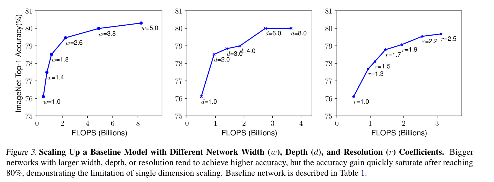</button><figcaption><strong>只扩大深度、宽度或分辨率时的收益递减</strong><a href="https://arxiv.org/abs/1905.11946">EfficientNet: Rethinking Model Scaling for Convolutional Neural Networks</a> · Figure 3 · version v5 · PDF p.4 / PDF page used for source lookup<button class="original-direct" type="button">Read original size</button>

Original caption &amp; source

Figure 3. Scaling Up a Baseline Model with Different Network Width (w), Depth (d), and Resolution (r) Coefficients. Bigger
networks with larger width, depth, or resolution tend to achieve higher accuracy, but the accuracy gain quickly saturate after reaching
80%, demonstrating the limitation of single dimension scaling. Baseline network is described in Table 1.
<a class="source-url" href="https://arxiv.org/pdf/1905.11946v5">https://arxiv.org/pdf/1905.11946v5</a>
</figcaption></figure>

Figure 2 将三种独立方向与组合画出；Figure 3 的三个子图分别改变宽度、深度和分辨率，横轴都为 FLOPs、纵轴都为 Top-1，曲线旁标出相应倍率。它展示单维增长的收益趋于饱和；相同计算预算也可能产生不同精度。复合缩放据此改善资源分配。

<figure id="fig-efficient-t2"><button class="paper-image" type="button" aria-label="Zoom: EfficientNet 家族的 ImageNet 结果与模型规模">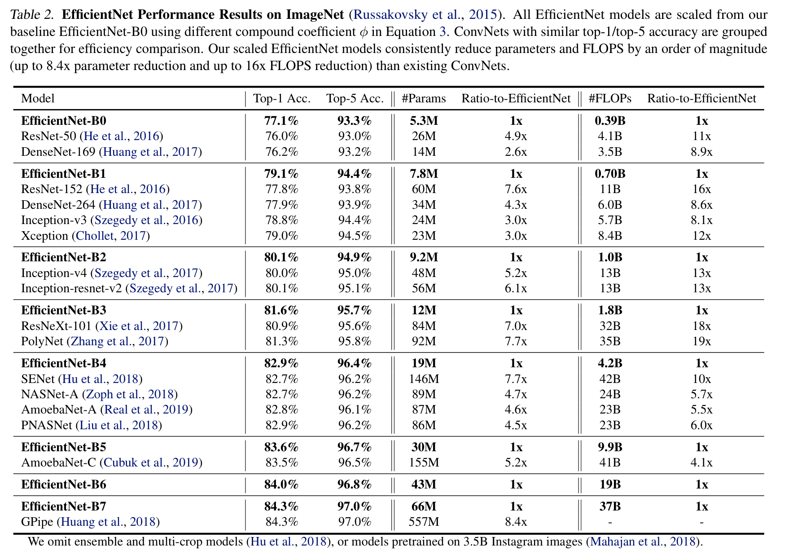</button><figcaption><strong>EfficientNet 家族的 ImageNet 结果与模型规模</strong><a href="https://arxiv.org/abs/1905.11946">EfficientNet: Rethinking Model Scaling for Convolutional Neural Networks</a> · Table 2 · version v5 · PDF p.6 / PDF page used for source lookup<button class="original-direct" type="button">Read original size</button>

Original caption &amp; source

Table 2. EfficientNet Performance Results on ImageNet (Russakovsky et al., 2015). All EfficientNet models are scaled from our
baseline EfficientNet-B0 using different compound coefficient φ in Equation 3. ConvNets with similar top-1/top-5 accuracy are grouped
together for efficiency comparison. Our scaled EfficientNet models consistently reduce parameters and FLOPS by an order of magnitude
(up to 8.4x parameter reduction and up to 16x FLOPS reduction) than existing ConvNets.
<a class="source-url" href="https://arxiv.org/pdf/1905.11946v5">https://arxiv.org/pdf/1905.11946v5</a>
</figcaption></figure>

B0 的原文 Top-1 为 77.1%，约 5.3 M 参数；更大 B7 的高精度伴随输入分辨率和开销增加。跨家族比较要同时检查训练与评估配方；这个方案主要优化精度／算术预算关系，不保证所有硬件延迟最优。

### EfficientNetV2：训练时间也成为结构目标

EfficientNetV2<a href="#source-11">[11]</a>发现早期高分辨率阶段的 depthwise block 在特定训练硬件上不够快，使用 Fused-MBConv，并在训练中逐渐增大图片与正则化强度。这里“融合”是 block 结构改变，不能理解成任意导出器自动进行的算子 fusion。

<figure id="fig-efficient2-f2"><button class="paper-image" type="button" aria-label="Zoom: MBConv 与 Fused-MBConv 的数据流">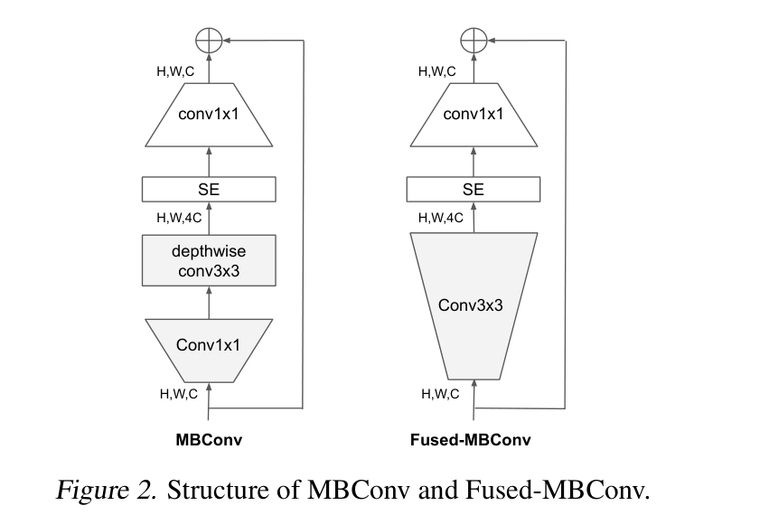</button><figcaption><strong>MBConv 与 Fused-MBConv 的数据流</strong><a href="https://arxiv.org/abs/2104.00298">EfficientNetV2: Smaller Models and Faster Training</a> · Figure 2 · version v3 · PDF p.3 / PDF page used for source lookup<button class="original-direct" type="button">Read original size</button>

Original caption &amp; source

Figure 2. Structure of MBConv and Fused-MBConv.
<a class="source-url" href="https://arxiv.org/pdf/2104.00298v3">https://arxiv.org/pdf/2104.00298v3</a>
</figcaption></figure>

Fused block 用普通空间卷积承担扩展与空间混合，增加一些算术但可能提高硬件利用率。

<figure id="fig-efficient2-t2"><button class="paper-image" type="button" aria-label="Zoom: 分辨率与 batch size 怎样改变 EfficientNet 的训练吞吐">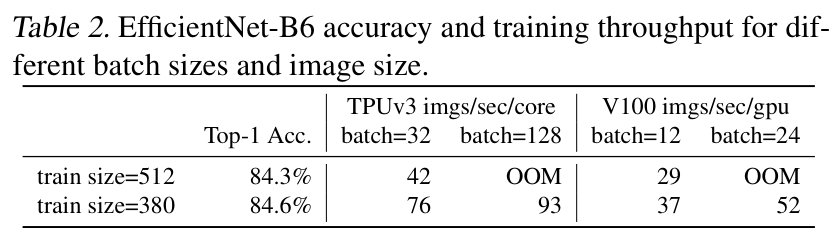</button><figcaption><strong>分辨率与 batch size 怎样改变 EfficientNet 的训练吞吐</strong><a href="https://arxiv.org/abs/2104.00298">EfficientNetV2: Smaller Models and Faster Training</a> · Table 2 · version v3 · PDF p.3 / PDF page used for source lookup<button class="original-direct" type="button">Read original size</button>

Original caption &amp; source

Table 2. EfficientNet-B6 accuracy and training throughput for dif-
ferent batch sizes and image size.
<a class="source-url" href="https://arxiv.org/pdf/2104.00298v3">https://arxiv.org/pdf/2104.00298v3</a>
</figcaption></figure>

原表固定 EfficientNet-B6，比对 train size=512 与 380：TPUv3、batch=32 时由 42 升至 76 images/sec/core；380 还能用 batch=128 达到 93，而 512 在该 batch 下 OOM。V100、batch=12 时为 29→37 images/sec/GPU。精度为 84.3→84.6%。这是训练分辨率与 batch 的证据，不能当成仅替换 fused block 的收益。

<figure id="fig-efficient2-t3"><button class="paper-image" type="button" aria-label="Zoom: 固定基础网络，改变 Fused-MBConv 的替换阶段">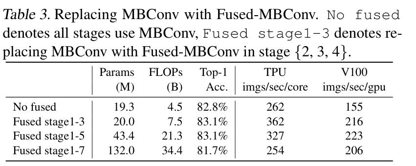</button><figcaption><strong>固定基础网络，改变 Fused-MBConv 的替换阶段</strong><a href="https://arxiv.org/abs/2104.00298">EfficientNetV2: Smaller Models and Faster Training</a> · Table 3 · version v3 · PDF p.3 / PDF page used for source lookup<button class="original-direct" type="button">Read original size</button>

Original caption &amp; source

Table 3. Replacing MBConv with Fused-MBConv. No fused
denotes all stages use MBConv, Fused stage1-3 denotes re-
placing MBConv with Fused-MBConv in stage {2, 3, 4}.
<a class="source-url" href="https://arxiv.org/pdf/2104.00298v3">https://arxiv.org/pdf/2104.00298v3</a>
</figcaption></figure>

Table 3 才隔离融合范围：No fused 为 19.3 M 参数、4.5 B FLOPs、82.8% Top-1、TPU/V100 吞吐 262/155；替换早期 stage 1–3 后为 20.0 M、7.5 B、83.1%、362/216。扩大到所有 stage 1–7 时变成 132.0 M、34.4 B、81.7%、254/206。因此适量普通卷积可改善实际吞吐，全面替换却增加过多成本，参数、FLOPs、精度与速度不是同向变化。

<figure id="fig-efficient2-t7"><button class="paper-image" type="button" aria-label="Zoom: ImageNet 训练数据与训练效率的完整比较">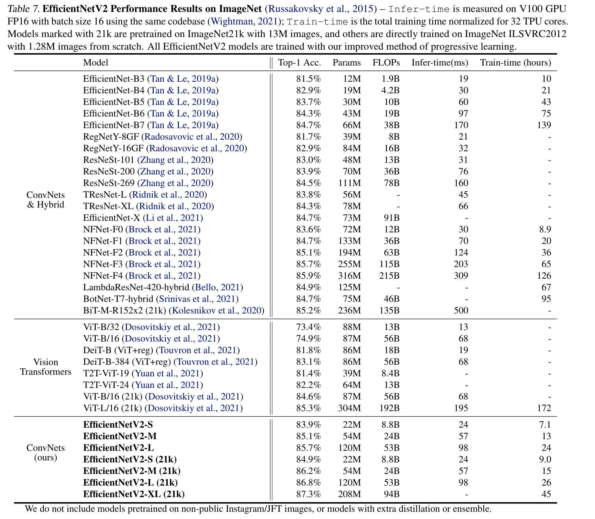</button><figcaption><strong>ImageNet 训练数据与训练效率的完整比较</strong><a href="https://arxiv.org/abs/2104.00298">EfficientNetV2: Smaller Models and Faster Training</a> · Table 7 · version v3 · PDF p.7 / PDF page used for source lookup<button class="original-direct" type="button">Read original size</button>

Original caption &amp; source

Table 7. EfficientNetV2 Performance Results on ImageNet (Russakovsky et al., 2015) – Infer-time is measured on V100 GPU
FP16 with batch size 16 using the same codebase (Wightman, 2021); Train-time is the total training time normalized for 32 TPU cores.
Models marked with 21k are pretrained on ImageNet21k with 13M images, and others are directly trained on ImageNet ILSVRC2012
with 1.28M images from scratch. All EfficientNetV2 models are trained with our improved method of progressive learning.
<a class="source-url" href="https://arxiv.org/pdf/2104.00298v3">https://arxiv.org/pdf/2104.00298v3</a>
</figcaption></figure>

表中 1k、21k 与 21k 后微调设置不同，必须在相应行之间看精度和时间。progressive learning 同时改变训练过程，结果不能全部归于一个 fused block。训练吞吐与手机单张推理也是不同指标。

### RepVGG：复杂训练图，简单部署图

RepVGG<a href="#source-12">[12]</a>在训练时并联 3×3、1×1 和恒等分支，各含适用的 BN；部署时将线性分支合并成一个 3×3 卷积。前提是分支输出对齐、BN 使用固定统计、非线性位于分支相加之后。

<figure id="fig-repvgg-f2"><button class="paper-image" type="button" aria-label="Zoom: 训练时多分支，推理时单路径">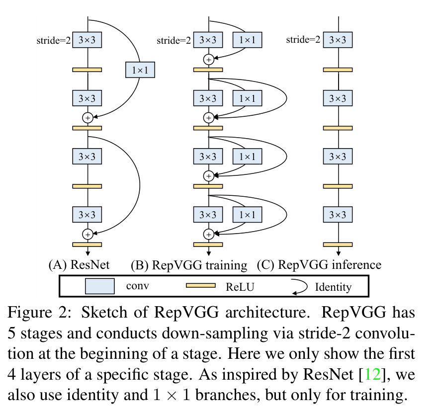</button><figcaption><strong>训练时多分支，推理时单路径</strong><a href="https://arxiv.org/abs/2101.03697">RepVGG: Making VGG-style ConvNets Great Again</a> · Figure 2 · version v3 · PDF p.2 / PDF page used for source lookup<button class="original-direct" type="button">Read original size</button>

Original caption &amp; source

Figure 2: Sketch of RepVGG architecture. RepVGG has
5 stages and conducts down-sampling via stride-2 convolu-
tion at the beginning of a stage. Here we only show the first
4 layers of a specific stage. As inspired by ResNet [12], we
also use identity and 1 × 1 branches, but only for training.
<a class="source-url" href="https://arxiv.org/pdf/2101.03697v3">https://arxiv.org/pdf/2101.03697v3</a>
</figcaption></figure>

<figure id="fig-repvgg-f4"><button class="paper-image" type="button" aria-label="Zoom: 从 BN 折叠到卷积核相加">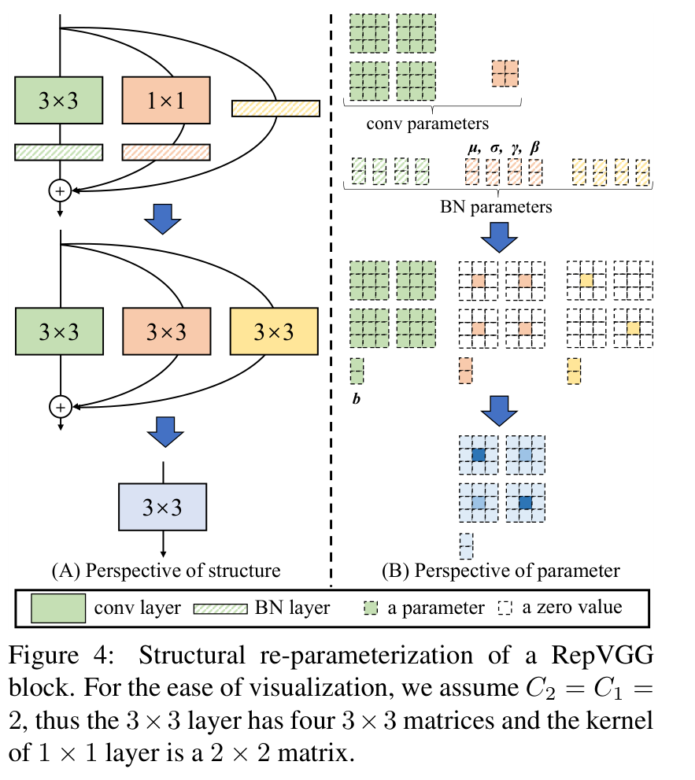</button><figcaption><strong>从 BN 折叠到卷积核相加</strong><a href="https://arxiv.org/abs/2101.03697">RepVGG: Making VGG-style ConvNets Great Again</a> · Figure 4 · version v3 · PDF p.5 / PDF page used for source lookup<button class="original-direct" type="button">Read original size</button>

Original caption &amp; source

Figure 4:
Structural re-parameterization of a RepVGG
block. For the ease of visualization, we assume C2 = C1 =
2, thus the 3×3 layer has four 3×3 matrices and the kernel
of 1 × 1 layer is a 2 × 2 matrix.
<a class="source-url" href="https://arxiv.org/pdf/2101.03697v3">https://arxiv.org/pdf/2101.03697v3</a>
</figcaption></figure>

1×1 核补零到 3×3 中心，恒等映射表示为相应中心核，再将各分支核与偏置相加。这是可验证的代数等价，不能跨分支内的 ReLU 任意合并。BN folding 的符号与验证见部署章节。

<figure id="fig-repvgg-t1"><button class="paper-image" type="button" aria-label="Zoom: 不同卷积核的算术量、时间与有效吞吐">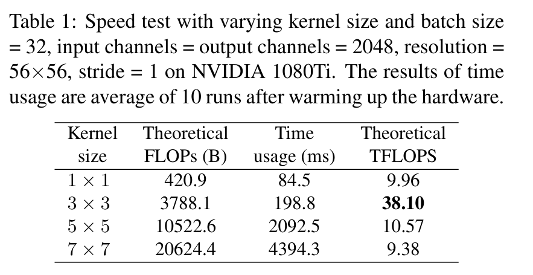</button><figcaption><strong>不同卷积核的算术量、时间与有效吞吐</strong><a href="https://arxiv.org/abs/2101.03697">RepVGG: Making VGG-style ConvNets Great Again</a> · Table 1 · version v3 · PDF p.4 / PDF page used for source lookup<button class="original-direct" type="button">Read original size</button>

Original caption &amp; source

Table 1: Speed test with varying kernel size and batch size
= 32, input channels = output channels = 2048, resolution =
56×56, stride = 1 on NVIDIA 1080Ti. The results of time
usage are average of 10 runs after warming up the hardware.
<a class="source-url" href="https://arxiv.org/pdf/2101.03697v3">https://arxiv.org/pdf/2101.03697v3</a>
</figcaption></figure>

<figure id="fig-repvgg-t6"><button class="paper-image" type="button" aria-label="Zoom: 分支配置消融：训练表达也有价值">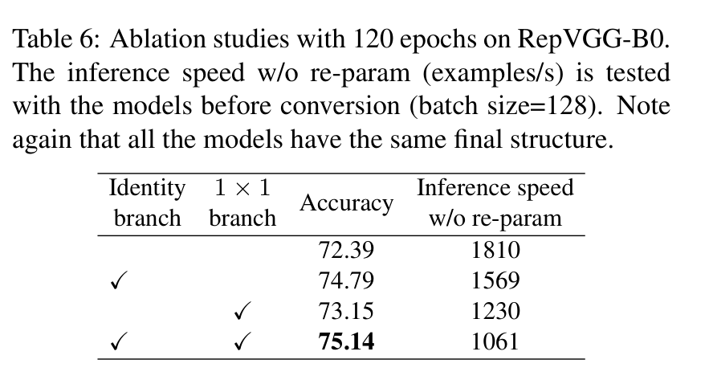</button><figcaption><strong>分支配置消融：训练表达也有价值</strong><a href="https://arxiv.org/abs/2101.03697">RepVGG: Making VGG-style ConvNets Great Again</a> · Table 6 · version v3 · PDF p.8 / PDF page used for source lookup<button class="original-direct" type="button">Read original size</button>

Original caption &amp; source

Table 6: Ablation studies with 120 epochs on RepVGG-B0.
The inference speed w/o re-param (examples/s) is tested
with the models before conversion (batch size=128). Note
again that all the models have the same final structure.
<a class="source-url" href="https://arxiv.org/pdf/2101.03697v3">https://arxiv.org/pdf/2101.03697v3</a>
</figcaption></figure>

Table 1 在 NVIDIA 1080Ti、batch=32、输入输出各 2048 通道、56×56、stride=1 下比较 1×1 与 3×3：FLOPs 为 420.9 与 3788.1 G，时间为 84.5 与 198.8 ms，有效吞吐为 9.96 与 38.10 TFLOPS。算术量约 9 倍，时间约 2.35 倍，说明硬件利用率不同。Table 6 在同一 B0 部署结构、120 epoch 下比较训练分支，三分支比仅 3×3 的 72.39% 高至 75.14%；表中未合并前的速度也各不相同。简单部署图不意味着训练图更小，也不意味着所有目标硬件都获得原 GPU 吞吐倍数。使用官方 `switch_to_deploy` 前后应对齐 eval 输出。

### RepViT：借鉴 ViT 的结构组织，保留纯 CNN

RepViT<a href="#source-16">[16]</a>从 MobileNetV3 风格结构出发，分离 spatial/token mixer 与 channel mixer，调整扩展比、stem、下采样、分类器和阶段深度，并使用重参数化 depthwise。名字带 ViT，论文主模型仍是纯轻量 CNN。

<figure id="fig-repvit-f2"><button class="paper-image" type="button" aria-label="Zoom: 逐步现代化：哪些改动提升精度，哪些降低延迟">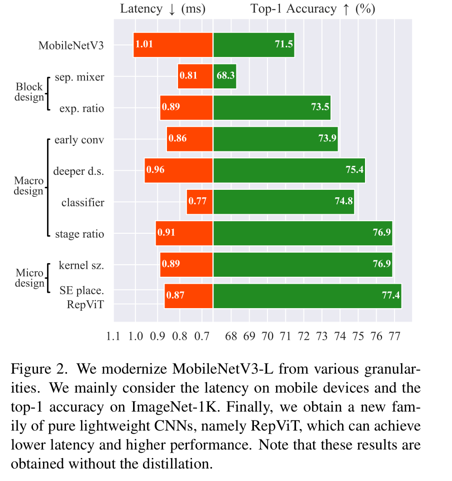</button><figcaption><strong>逐步现代化：哪些改动提升精度，哪些降低延迟</strong><a href="https://arxiv.org/abs/2307.09283">RepViT: Revisiting Mobile CNN From ViT Perspective</a> · Figure 2 · version v8 · PDF p.3 / printed p.3<button class="original-direct" type="button">Read original size</button>

Original caption &amp; source

Figure 2. We modernize MobileNetV3-L from various granular-
ities. We mainly consider the latency on mobile devices and the
top-1 accuracy on ImageNet-1K. Finally, we obtain a new fam-
ily of pure lightweight CNNs, namely RepViT, which can achieve
lower latency and higher performance. Note that these results are
obtained without the distillation.
<a class="source-url" href="https://arxiv.org/pdf/2307.09283v8">https://arxiv.org/pdf/2307.09283v8</a>
</figcaption></figure>

这组实验不使用蒸馏；分离 mixer 首步反而损失精度，随后配合扩展比和宏观结构才改善。它说明不能把整套最终收益归给一个局部替换。

<figure id="fig-repvit-f3"><button class="paper-image" type="button" aria-label="Zoom: RepViT block 的训练分支与部署分支">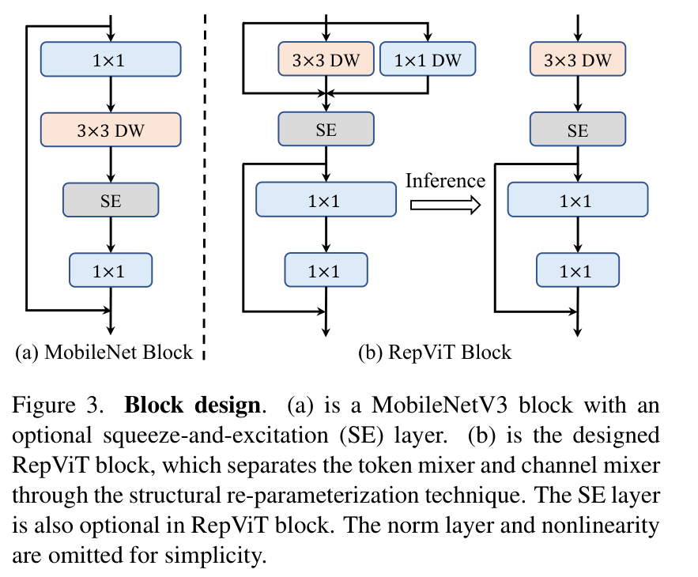</button><figcaption><strong>RepViT block 的训练分支与部署分支</strong><a href="https://arxiv.org/abs/2307.09283">RepViT: Revisiting Mobile CNN From ViT Perspective</a> · Figure 3 · version v8 · PDF p.4 / printed p.4<button class="original-direct" type="button">Read original size</button>

Original caption &amp; source

Figure 3. Block design. (a) is a MobileNetV3 block with an
optional squeeze-and-excitation (SE) layer. (b) is the designed
RepViT block, which separates the token mixer and channel mixer
through the structural re-parameterization technique. The SE layer
is also optional in RepViT block. The norm layer and nonlinearity
are omitted for simplicity.
<a class="source-url" href="https://arxiv.org/pdf/2307.09283v8">https://arxiv.org/pdf/2307.09283v8</a>
</figcaption></figure>

先处理空间混合，再使用两个 1×1 做通道变换，图中可选 SE 与重参数化分支各有位置。示意图省略归一化与非线性，完整实施要读代码。

<figure id="fig-repvit-t1"><button class="paper-image" type="button" aria-label="Zoom: 移动延迟与 GPU 吞吐使用不同设备">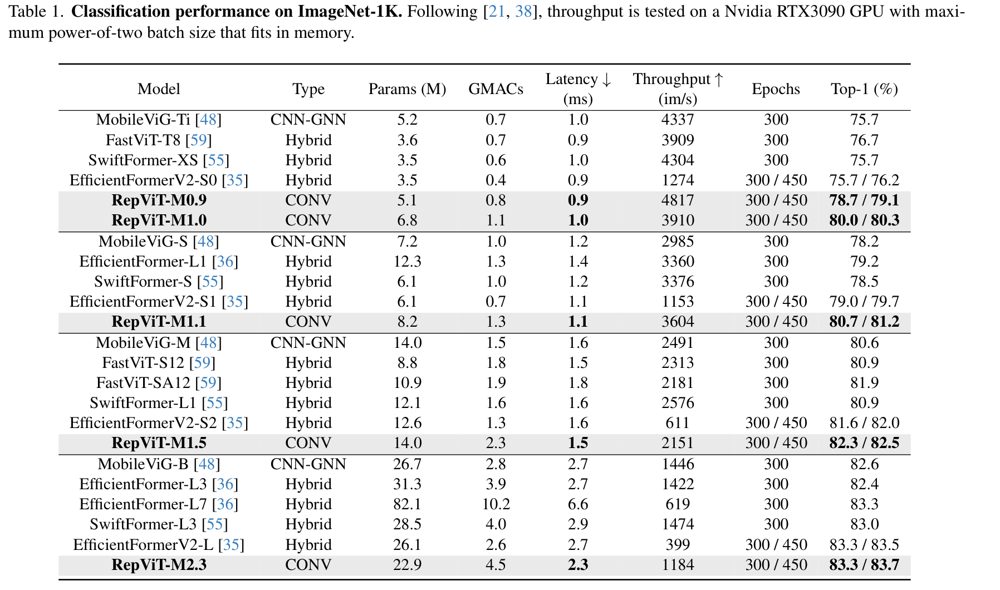</button><figcaption><strong>移动延迟与 GPU 吞吐使用不同设备</strong><a href="https://arxiv.org/abs/2307.09283">RepViT: Revisiting Mobile CNN From ViT Perspective</a> · Table 1 · version v8 · PDF p.6 / printed p.6<button class="original-direct" type="button">Read original size</button>

Original caption &amp; source

Table 1. Classification performance on ImageNet-1K. Following [21, 38], throughput is tested on a Nvidia RTX3090 GPU with maxi-
mum power-of-two batch size that fits in memory.
<a class="source-url" href="https://arxiv.org/pdf/2307.09283v8">https://arxiv.org/pdf/2307.09283v8</a>
</figcaption></figure>

M1.0 的原表约 1.0 ms、80.0／80.3% Top-1，斜线对应 300／450 epoch。手机延迟与 RTX3090 吞吐的列不能互换，训练蒸馏与 Figure 2 的非蒸馏消融也不是同一条件。

### MobileNetV4：以多类设备的成本模型设计结构

MobileNetV4<a href="#source-17">[17]</a>引入 Universal Inverted Bottleneck（UIB），允许在不同位置放置 depthwise，并探索 Mobile MQA 注意力；因此 **Conv 家族与 Hybrid 家族必须区分**。性能约束从 MACs 扩展到跨 CPU、GPU 和专用加速器。

<figure id="fig-mobile4-f2"><button class="paper-image" type="button" aria-label="Zoom: Roofline：不同 ridge point 下的延迟与精度趋势">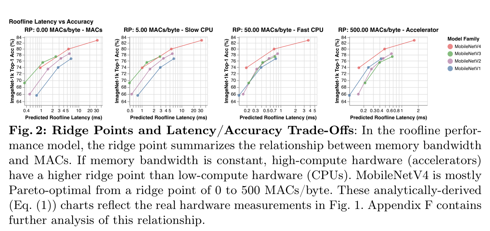</button><figcaption><strong>Roofline：不同 ridge point 下的延迟与精度趋势</strong><a href="https://arxiv.org/abs/2404.10518">MobileNetV4: Universal Models for the Mobile Ecosystem</a> · Figure 2 · version v2 · PDF p.4 / printed p.4<button class="original-direct" type="button">Read original size</button>

Original caption &amp; source

Fig. 2: Ridge Points and Latency/Accuracy Trade-Offs: In the roofline perfor-
mance model, the ridge point summarizes the relationship between memory bandwidth
and MACs. If memory bandwidth is constant, high-compute hardware (accelerators)
have a higher ridge point than low-compute hardware (CPUs). MobileNetV4 is mostly
Pareto-optimal from a ridge point of 0 to 500 MACs/byte. These analytically-derived
(Eq. (1)) charts reflect the real hardware measurements in Fig. 1. Appendix F contains
further analysis of this relationship.
<a class="source-url" href="https://arxiv.org/pdf/2404.10518v2">https://arxiv.org/pdf/2404.10518v2</a>
</figcaption></figure>

ridge point 是计算能力与带宽的比值。图里若干硬件是分析模型，不应直接当作实机测试；曲线说明同一网络在计算受限和带宽受限设备上可能改变排序。

<figure id="fig-mobile4-f3"><button class="paper-image" type="button" aria-label="Zoom: 逐算子成本：depthwise 与 pointwise 的硬件角色不同">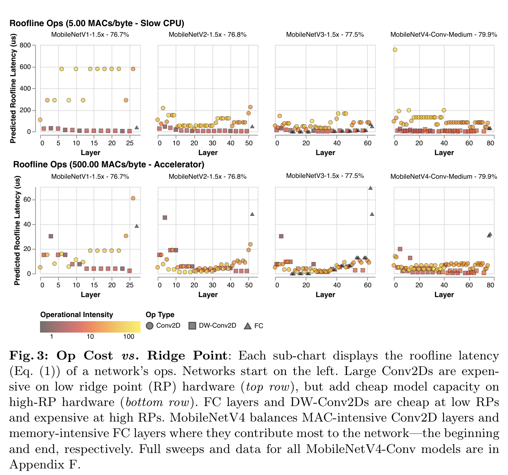</button><figcaption><strong>逐算子成本：depthwise 与 pointwise 的硬件角色不同</strong><a href="https://arxiv.org/abs/2404.10518">MobileNetV4: Universal Models for the Mobile Ecosystem</a> · Figure 3 · version v2 · PDF p.5 / printed p.5<button class="original-direct" type="button">Read original size</button>

Original caption &amp; source

Fig. 3: Op Cost vs. Ridge Point: Each sub-chart displays the roofline latency
(Eq. (1)) of a network’s ops. Networks start on the left. Large Conv2Ds are expen-
sive on low ridge point (RP) hardware (top row), but add cheap model capacity on
high-RP hardware (bottom row). FC layers and DW-Conv2Ds are cheap at low RPs
and expensive at high RPs. MobileNetV4 balances MAC-intensive Conv2D layers and
memory-intensive FC layers where they contribute most to the network—the beginning
and end, respectively. Full sweeps and data for all MobileNetV4-Conv models are in
Appendix F.
<a class="source-url" href="https://arxiv.org/pdf/2404.10518v2">https://arxiv.org/pdf/2404.10518v2</a>
</figcaption></figure>

横轴逐层，纵轴 roofline 估算成本；颜色区分算子。较低计算能力时 pointwise 的算术更突出，计算能力提高后访存开销可能显现。每种算子要用真实后端验证。

<figure id="fig-mobile4-f4"><button class="paper-image" type="button" aria-label="Zoom: UIB 的可选 depthwise 位置及其 block 家族">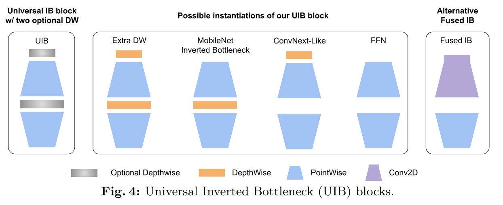</button><figcaption><strong>UIB 的可选 depthwise 位置及其 block 家族</strong><a href="https://arxiv.org/abs/2404.10518">MobileNetV4: Universal Models for the Mobile Ecosystem</a> · Figure 4 · version v2 · PDF p.6 / printed p.6<button class="original-direct" type="button">Read original size</button>

Original caption &amp; source

Fig. 4: Universal Inverted Bottleneck (UIB) blocks.
<a class="source-url" href="https://arxiv.org/pdf/2404.10518v2">https://arxiv.org/pdf/2404.10518v2</a>
</figcaption></figure>

可选空间混合位置将若干已有 block 纳入统一搜索空间，不表示所有变体都同时启用所有分支。

<figure id="fig-mobile4-t2"><button class="paper-image" type="button" aria-label="Zoom: Mobile MQA 的注意力模块消融">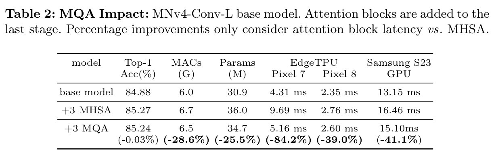</button><figcaption><strong>Mobile MQA 的注意力模块消融</strong><a href="https://arxiv.org/abs/2404.10518">MobileNetV4: Universal Models for the Mobile Ecosystem</a> · Table 2 · version v2 · PDF p.8 / printed p.8<button class="original-direct" type="button">Read original size</button>

Original caption &amp; source

Table 2: MQA Impact: MNv4-Conv-L base model. Attention blocks are added to the
last stage. Percentage improvements only consider attention block latency vs. MHSA.
<a class="source-url" href="https://arxiv.org/pdf/2404.10518v2">https://arxiv.org/pdf/2404.10518v2</a>
</figcaption></figure>

这是在 Conv-L 最后阶段添加注意力后的模块比较；它证明注意力设计能改变特定成本，却不能把 Hybrid 结果标成纯 CNN。

<figure id="fig-mobile4-t4"><button class="paper-image" type="button" aria-label="Zoom: 一阶段与两阶段搜索的结果">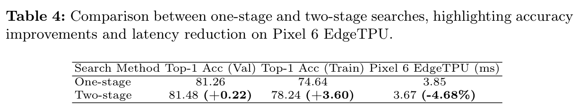</button><figcaption><strong>一阶段与两阶段搜索的结果</strong><a href="https://arxiv.org/abs/2404.10518">MobileNetV4: Universal Models for the Mobile Ecosystem</a> · Table 4 · version v2 · PDF p.9 / printed p.9<button class="original-direct" type="button">Read original size</button>

Original caption &amp; source

Table 4: Comparison between one-stage and two-stage searches, highlighting accuracy
improvements and latency reduction on Pixel 6 EdgeTPU.
<a class="source-url" href="https://arxiv.org/pdf/2404.10518v2">https://arxiv.org/pdf/2404.10518v2</a>
</figcaption></figure>

该表是搜索流程，不是整张跨硬件 benchmark。两阶段搜索比较 ImageNet 准确率与 Pixel 6 EdgeTPU 延迟。

<figure id="fig-mobile4-t5"><button class="paper-image" type="button" aria-label="Zoom: JFT 蒸馏收益：训练数据也是变量"></button><figcaption><strong>JFT 蒸馏收益：训练数据也是变量</strong><a href="https://arxiv.org/abs/2404.10518">MobileNetV4: Universal Models for the Mobile Ecosystem</a> · Table 5 · version v2 · PDF p.10 / printed p.10<button class="original-direct" type="button">Read original size</button>

Original caption &amp; source

Table 5: Performance Boost from JFT Distillation: NAS Training on ImageNet-1k vs.
JFT Data. Highlights efficiency improvements and slight accuracy differences.
<a class="source-url" href="https://arxiv.org/pdf/2404.10518v2">https://arxiv.org/pdf/2404.10518v2</a>
</figcaption></figure>

这是 NAS 阶段用 ImageNet 标签或 JFT 教师信号训练搜索模型的对照，列名为 Val/Train。验证精度 82.4→82.3% 略降，训练精度 72.9→74.0% 上升，同时 MACs、参数与设备时延下降；“Performance Boost”主要包含效率收益，不能说精度全面提高。

<figure id="fig-mobile4-t6"><button class="paper-image" type="button" aria-label="Zoom: MobileNetV4 的真实跨设备分类结果"></button><figcaption><strong>MobileNetV4 的真实跨设备分类结果</strong><a href="https://arxiv.org/abs/2404.10518">MobileNetV4: Universal Models for the Mobile Ecosystem</a> · Table 6 · version v2 · PDF p.11 / printed p.11<button class="original-direct" type="button">Read original size</button>

Original caption &amp; source

Table 6: Classification results on ImageNet-1K [12], along with on-device
benchmarks. Median latency is reported. A −indicates that we did not benchmark a
model due to missing corresponding model file for a platform. Failed indicates that the
model is not supported by the platform. Dividers denote approximate latency classes.
<a class="source-url" href="https://arxiv.org/pdf/2404.10518v2">https://arxiv.org/pdf/2404.10518v2</a>
</figcaption></figure>

这是核验设备表现应看的表：列出 Pixel 6 CPU、Pixel 8 EdgeTPU、iPhone 13 CoreML、Pixel 4 Hexagon、Pixel 7 GPU、Samsung S23 CPU/GPU，使用中位延迟。表中某些模型为 Failed，表示平台执行限制；不能删掉这些列后宣布“普遍最优”。Conv-M 为 79.9% Top-1，Pixel 6 CPU 11.4 ms、iPhone CoreML 1.1 ms、S23 CPU/GPU 8.6/4.1 ms。Pixel 4 Hexagon 7.3 ms 是论文的特定执行路径，不能直接当作本文已验证的 QNN HTP 部署收益。

## 5. 现代 CNN：训练配方、大核与视觉预训练

### ConvNeXt：重新审视“CNN 落后”的控制变量

ConvNeXt<a href="#source-13">[13]</a>从 ResNet 出发，先改训练配方，再调整阶段计算分配、stem、depthwise、大核、倒瓶颈、归一化与非线性。它试图回答：与现代 ViT 比较时，有多少差距来自陈旧训练方式和结构细节。

<figure id="fig-convnext-f2"><button class="paper-image" type="button" aria-label="Zoom: 从 ResNet 到 ConvNeXt 的逐项现代化"></button><figcaption><strong>从 ResNet 到 ConvNeXt 的逐项现代化</strong><a href="https://arxiv.org/abs/2201.03545">A ConvNet for the 2020s</a> · Figure 2 · version v2 · PDF p.3 / PDF page used for source lookup<button class="original-direct" type="button">Read original size</button>

Original caption &amp; source

Figure 2. We modernize a standard ConvNet (ResNet) towards
the design of a hierarchical vision Transformer (Swin), without
introducing any attention-based modules. The foreground bars are
model accuracies in the ResNet-50/Swin-T FLOP regime; results
for the ResNet-200/Swin-B regime are shown with the gray bars. A
hatched bar means the modification is not adopted. Detailed results
for both regimes are in the appendix. Many Transformer archi-
tectural choices can be incorporated in a ConvNet, and they lead
to increasingly better performance. In the end, our pure ConvNet
model, named ConvNeXt, can outperform the Swin Transformer.
<a class="source-url" href="https://arxiv.org/pdf/2201.03545v2">https://arxiv.org/pdf/2201.03545v2</a>
</figcaption></figure>

逐步消融并非每一步都提高；最终收益依赖组合。单独移动某个算子时必须保留其前后结构和训练条件。

<figure id="fig-convnext-f4"><button class="paper-image" type="button" aria-label="Zoom: ResNet、Swin 与 ConvNeXt 的 block 对照"></button><figcaption><strong>ResNet、Swin 与 ConvNeXt 的 block 对照</strong><a href="https://arxiv.org/abs/2201.03545">A ConvNet for the 2020s</a> · Figure 4 · version v2 · PDF p.5 / PDF page used for source lookup<button class="original-direct" type="button">Read original size</button>

Original caption &amp; source

Figure 4. Block designs for a ResNet, a Swin Transformer, and a
ConvNeXt. Swin Transformer’s block is more sophisticated due to
the presence of multiple specialized modules and two residual con-
nections. For simplicity, we note the linear layers in Transformer
MLP blocks also as “1×1 convs” since they are equivalent.
<a class="source-url" href="https://arxiv.org/pdf/2201.03545v2">https://arxiv.org/pdf/2201.03545v2</a>
</figcaption></figure>

ConvNeXt 先大核 depthwise 空间混合，再 LayerNorm 和通道 MLP，使用较少非线性。示意图从组织方式上借鉴 Transformer，但不采用标准全局 self-attention。

<figure id="fig-convnext-t1"><button class="paper-image" type="button" aria-label="Zoom: ImageNet-1k 与 22k 预训练结果分组"></button><figcaption><strong>ImageNet-1k 与 22k 预训练结果分组</strong><a href="https://arxiv.org/abs/2201.03545">A ConvNet for the 2020s</a> · Table 1 · version v2 · PDF p.7 / PDF page used for source lookup<button class="original-direct" type="button">Read original size</button>

Original caption &amp; source

Table 1. Classification accuracy on ImageNet-1K. Similar to
Transformers, ConvNeXt also shows promising scaling behavior
with higher-capacity models and a larger (pre-training) dataset. In-
ference throughput is measured on a V100 GPU, following [45]. On
an A100 GPU, ConvNeXt can have a much higher throughput than
Swin Transformer. See Appendix E. (T)ViT results with 90-epoch
AugReg [67] training, provided through personal communication
with the authors.
<a class="source-url" href="https://arxiv.org/pdf/2201.03545v2">https://arxiv.org/pdf/2201.03545v2</a>
</figcaption></figure>

<figure id="fig-convnext-t3"><button class="paper-image" type="button" aria-label="Zoom: 迁移到 COCO 检测和实例分割"></button><figcaption><strong>迁移到 COCO 检测和实例分割</strong><a href="https://arxiv.org/abs/2201.03545">A ConvNet for the 2020s</a> · Table 3 · version v2 · PDF p.8 / PDF page used for source lookup<button class="original-direct" type="button">Read original size</button>

Original caption &amp; source

Table 3. COCO object detection and segmentation results using
Mask-RCNN and Cascade Mask-RCNN. ‡ indicates that the model
is pre-trained on ImageNet-22K. ImageNet-1K pre-trained Swin
results are from their Github repository [3]. AP numbers of the
ResNet-50 and X101 models are from [45]. We measure FPS on
an A100 GPU. FLOPs are calculated with image size (1280, 800).
<a class="source-url" href="https://arxiv.org/pdf/2201.03545v2">https://arxiv.org/pdf/2201.03545v2</a>
</figcaption></figure>

分类主表需要区分预训练数据与分辨率；COCO 表固定相应检测框架和训练 schedule 比较 backbone。ConvNeXt 的迁移能力有具体证据，但它没有替代框匹配、RoIAlign 或 mask head。延迟方面，LayerNorm、GELU、布局改变和大核也可能产生设备成本。

### ConvNeXt V2：让架构适应 masked 预训练

ConvNeXt V2<a href="#source-14">[14]</a>将 FCMAE 与 Global Response Normalization（GRN）共同设计。直接把 masked autoencoding 套到旧 CNN 上，可能出现通道激活冗余；GRN 鼓励通道间响应竞争。

<figure id="fig-convnext2-f2"><button class="paper-image" type="button" aria-label="Zoom: FCMAE：只对可见区域编码，再重建被遮挡内容"></button><figcaption><strong>FCMAE：只对可见区域编码，再重建被遮挡内容</strong><a href="https://arxiv.org/abs/2301.00808">ConvNeXt V2: Co-designing and Scaling ConvNets with Masked Autoencoders</a> · Figure 2 · version v1 · PDF p.3 / printed p.3<button class="original-direct" type="button">Read original size</button>

Original caption &amp; source

Figure 2. Our FCMAE framework. We introduce a fully con-
volutional masked autoencoder (FCMAE). It consists of a sparse
convolution-based ConvNeXt encoder and a lightweight Con-
vNeXt block decoder. Overall, the architecture of our autoencoder
is asymmetric. The encoder processes only the visible pixels, and
the decoder reconstructs the image using the encoded pixels and
mask tokens. The loss is calculated only on the masked region.
<a class="source-url" href="https://arxiv.org/pdf/2301.00808v1">https://arxiv.org/pdf/2301.00808v1</a>
</figcaption></figure>

编码器使用稀疏卷积处理可见区域，轻量 decoder 重建，损失仅在被遮区域计算。把输入简单置零后跑普通密集 CNN，不必然复现它的算力或训练行为。

<figure id="fig-convnext2-f3"><button class="paper-image" type="button" aria-label="Zoom: 通道可视化：feature collapse 是怎样被观察到的"></button><figcaption><strong>通道可视化：feature collapse 是怎样被观察到的</strong><a href="https://arxiv.org/abs/2301.00808">ConvNeXt V2: Co-designing and Scaling ConvNets with Masked Autoencoders</a> · Figure 3 · version v1 · PDF p.4 / printed p.4<button class="original-direct" type="button">Read original size</button>

Original caption &amp; source

Figure 3. Feature activation visualization. We visualize the activation map for each feature channel in small squares. For clarity, we
display 64 channels in each visualization. The ConvNeXt V1 model suffers from a feature collapse issue, which is characterized by the
presence of redundant activations (dead or saturated neurons) across channels. To fix this problem, we introduce a new method to promote
feature diversity during training: the global response normalization (GRN) layer. This technique is applied to high-dimensional features in
every block, leading to the development of the ConvNeXt V2 architecture.
<a class="source-url" href="https://arxiv.org/pdf/2301.00808v1">https://arxiv.org/pdf/2301.00808v1</a>
</figcaption></figure>

每个小格表示一个通道的激活，V1 的部分通道冗余或近饱和，V2 激活更具多样性。这是给定样例的可视化，需结合消融才支持设计效果。

$$
G_c=\|X_c\|_2,\qquad N_c=\frac{G_c}{\frac{1}{C}\sum_{j=1}^{C}G_j+\epsilon},\qquad
Y_c=X_c+\gamma_c(X_cN_c)+\beta_c.
$$

$X_c$ 是第 $c$ 通道空间特征，范数沿空间求，$C$ 为通道数；$\epsilon$ 防止除零，$\gamma,\beta$ 可学习并按通道广播。不同通道的空间响应相对均值被归一化，随后用残差校准；它不是把每个像素的所有通道做普通 LayerNorm。

<figure id="fig-convnext2-t2"><button class="paper-image" type="button" aria-label="Zoom: GRN 的聚合、归一化、残差和训练阶段消融"></button><figcaption><strong>GRN 的聚合、归一化、残差和训练阶段消融</strong><a href="https://arxiv.org/abs/2301.00808">ConvNeXt V2: Co-designing and Scaling ConvNets with Masked Autoencoders</a> · Table 2 · version v1 · PDF p.6 / printed p.6<button class="original-direct" type="button">Read original size</button>

Original caption &amp; source

Table 2. GRN ablations with ConvNeXt-Base. We report fine-tuning accuracy on ImageNet-1K. Our final proposal is marked in gray .
<a class="source-url" href="https://arxiv.org/pdf/2301.00808v1">https://arxiv.org/pdf/2301.00808v1</a>
</figcaption></figure>

<figure id="fig-convnext2-f5"><button class="paper-image" type="button" aria-label="Zoom: V2 在扩展通道后加入 GRN"></button><figcaption><strong>V2 在扩展通道后加入 GRN</strong><a href="https://arxiv.org/abs/2301.00808">ConvNeXt V2: Co-designing and Scaling ConvNets with Masked Autoencoders</a> · Figure 5 · version v1 · PDF p.6 / printed p.6<button class="original-direct" type="button">Read original size</button>

Original caption &amp; source

Figure 5. ConvNeXt Block Designs. In ConvNeXt V2, we add
the GRN layer after the dimension-expansion MLP layer and drop
LayerScale [65] as it becomes redundant.
<a class="source-url" href="https://arxiv.org/pdf/2301.00808v1">https://arxiv.org/pdf/2301.00808v1</a>
</figcaption></figure>

Table 2 对 L1/L2、归一化分母、捷径、SE 等替换和预训练／微调阶段分别比较；Figure 5 显示 GRN 的实际位置与 LayerScale 删除。二者相互补充，不能把 GRN 说成任意位置的通用插件。

<figure id="fig-convnext2-t3"><button class="paper-image" type="button" aria-label="Zoom: co-design：同一规模下结构与训练的四组对照"></button><figcaption><strong>co-design：同一规模下结构与训练的四组对照</strong><a href="https://arxiv.org/abs/2301.00808">ConvNeXt V2: Co-designing and Scaling ConvNets with Masked Autoencoders</a> · Table 3 · version v1 · PDF p.7 / printed p.7<button class="original-direct" type="button">Read original size</button>

Original caption &amp; source

Table 3. Co-design matters. When the architecture and the learn-
ing framework are co-designed and used together, masked image
pre-training becomes effective for ConvNeXt. We report the fine-
tuning performance from 800 epoch FCMAE pre-trained models.
The relative improvement is bigger with a larger model.
<a class="source-url" href="https://arxiv.org/pdf/2301.00808v1">https://arxiv.org/pdf/2301.00808v1</a>
</figcaption></figure>

Base 的 V1 supervised 为 83.8%，V1 FCMAE 为 83.7%；V2 supervised 为 84.3%，V2 FCMAE 为 84.6%，表明架构和预训练相容性很重要。Large 同样展示更大增益。这里是特定预训练／微调协议，不是冻结 encoder 的分类结果。

### UniRepLKNet：大核空间混合与可合并的训练分支

UniRepLKNet<a href="#source-15">[15]</a>探索大 depthwise 核、dilated reparameterization 和阶段设计，并展示图像之外的输入适配。本文只用其二维图像证据讨论 backbone，跨模态实验说明可复用设计思路，不表示一个权重文件自动解决所有模态。

<figure id="fig-unirep-f1"><button class="paper-image" type="button" aria-label="Zoom: UniRepLKNet 的 block 与大核角色"></button><figcaption><strong>UniRepLKNet 的 block 与大核角色</strong><a href="https://arxiv.org/abs/2311.15599">UniRepLKNet: A Universal Perception Large-Kernel ConvNet for Audio, Video, Point Cloud, Time-Series and Image Recognition</a> · Figure 1 · version v2 · PDF p.2 / printed p.2<button class="original-direct" type="button">Read original size</button>

Original caption &amp; source

Figure 1. Architectural design of UniRepLKNet. A LarK Block
comprises a Dilated Reparam Block proposed in this paper, an SE
Block [33], an FFN, and Batch Normalization (BN) [37] layers.
The only difference between a SmaK Block and a LarK Block is
that the former uses a depth-wise 3×3 conv layer in replacement
of the Dilated Reparam Block in the latter. Stages are connected
by downsampling blocks implemented by stride-2 dense 3×3 conv
layers. We may flexibly arrange the blocks in different stages and
the details of our provided instances are shown in Table 5.
<a class="source-url" href="https://arxiv.org/pdf/2311.15599v2">https://arxiv.org/pdf/2311.15599v2</a>
</figcaption></figure>

大核直接扩大空间混合范围，通道混合、SE 和残差仍承担不同职责。扩大核会增加权重、访存与后端支持要求。

<figure id="fig-unirep-f2"><button class="paper-image" type="button" aria-label="Zoom: Dilated reparameterization：稀疏位置映射到大核"></button><figcaption><strong>Dilated reparameterization：稀疏位置映射到大核</strong><a href="https://arxiv.org/abs/2311.15599">UniRepLKNet: A Universal Perception Large-Kernel ConvNet for Audio, Video, Point Cloud, Time-Series and Image Recognition</a> · Figure 2 · version v2 · PDF p.4 / printed p.4<button class="original-direct" type="button">Read original size</button>

Original caption &amp; source

Figure 2. Dilated Reparam Block uses dilated small-kernel conv layers to enhance a non-dilated large-kernel layer. Such dilated layers are
equivalent to a non-dilated conv layer with a larger sparse kernel, as shown from the parameter perspective, so that the whole block can be
equivalently transformed into a single large-kernel conv. This example shows K=9, and we may use more dilated layers for larger K.
<a class="source-url" href="https://arxiv.org/pdf/2311.15599v2">https://arxiv.org/pdf/2311.15599v2</a>
</figcaption></figure>

小核 dilated 分支的系数放入等效大核的对应采样位置，再与主分支合并。必须保持 padding 和输出对齐；不能先插入非线性再按线性核相加。

<figure id="fig-unirep-t6"><button class="paper-image" type="button" aria-label="Zoom: ImageNet：同预训练设置下比较模型规模"></button><figcaption><strong>ImageNet：同预训练设置下比较模型规模</strong><a href="https://arxiv.org/abs/2311.15599">UniRepLKNet: A Universal Perception Large-Kernel ConvNet for Audio, Video, Point Cloud, Time-Series and Image Recognition</a> · Table 6 · version v2 · PDF p.7 / printed p.7<button class="original-direct" type="button">Read original size</button>

Original caption &amp; source

Table 6. ImageNet classification. Throughput is tested with an
A100 GPU and batch size of 128. “T/C” denote transformer/Con-
vNet. “‡” indicates ImageNet-22K [12] pretraining.
<a class="source-url" href="https://arxiv.org/pdf/2311.15599v2">https://arxiv.org/pdf/2311.15599v2</a>
</figcaption></figure>

<figure id="fig-unirep-t7"><button class="paper-image" type="button" aria-label="Zoom: COCO：使用相应检测框架比较迁移结果"></button><figcaption><strong>COCO：使用相应检测框架比较迁移结果</strong><a href="https://arxiv.org/abs/2311.15599">UniRepLKNet: A Universal Perception Large-Kernel ConvNet for Audio, Video, Point Cloud, Time-Series and Image Recognition</a> · Table 7 · version v2 · PDF p.7 / printed p.7<button class="original-direct" type="button">Read original size</button>

Original caption &amp; source

Table 7. Object detection on COCO validation set. FLOPs are
measured with 1280×800 inputs. “‡” ImageNet-22K pretraining.
<a class="source-url" href="https://arxiv.org/pdf/2311.15599v2">https://arxiv.org/pdf/2311.15599v2</a>
</figcaption></figure>

原表拆分 1k 与 22k 预训练，后者增加数据；检测表中框架和输入设置也影响结果。这些证据支持大核 CNN 的竞争力，尚不能说明其在端侧后端上一定快于小核。部署前必须检查目标设备对大 depthwise 核是否直接支持。

### DINOv3：CNN 可以接收大型视觉教师的表示

DINOv3<a href="#source-18">[18]</a>的核心教师是大 ViT，自监督训练和 Gram anchoring 提升并维持密集表示。作者同时蒸馏 ConvNeXt。这里要分清：**教师的结构、训练目标、CNN 学生与下游评估头** 是四个变量。

<figure id="fig-dinov3-f6"><button class="paper-image" type="button" aria-label="Zoom: 训练越久，局部特征相似性可能退化"></button><figcaption><strong>训练越久，局部特征相似性可能退化</strong><a href="https://arxiv.org/abs/2508.10104">DINOv3</a> · Figure 6 · version v1 · PDF p.11 / printed p.11<button class="original-direct" type="button">Read original size</button>

Original caption &amp; source

Figure 6: Evolution of the cosine similarity between the patch noted in red and all other patches. As training
progresses, the features produced by the model become less localized and the similarity maps become noisier.
<a class="source-url" href="https://arxiv.org/pdf/2508.10104v1">https://arxiv.org/pdf/2508.10104v1</a>
</figcaption></figure>

原图比较训练进程中的 patch 相似性：类别表示可以继续改善，局部对应却变得嘈杂。Gram anchoring 用早期教师的局部关系约束后续模型，保存 patch 间的相对几何，不要求特征坐标轴逐元素完全相同。

<figure id="fig-dinov3-f8"><button class="paper-image" type="button" aria-label="Zoom: 加入 Gram anchoring 后，全局与密集任务的变化"></button><figcaption><strong>加入 Gram anchoring 后，全局与密集任务的变化</strong><a href="https://arxiv.org/abs/2508.10104">DINOv3</a> · Figure 8 · version v1 · PDF p.13 / printed p.13<button class="original-direct" type="button">Read original size</button>

Original caption &amp; source

Figure 8: Evolution of the results on different benchmarks after applying our proposed Gram anchoring
method. We visualize results when continuing the original training with our refinement step, noted ‘LRef’.
We also plot results obtained when using higher-resolution features for the Gram objective as introduced in
following Sec. 4.3 and noted ‘LHRef’. We highlight the iterations which use the Gram objective.
<a class="source-url" href="https://arxiv.org/pdf/2508.10104v1">https://arxiv.org/pdf/2508.10104v1</a>
</figcaption></figure>

横轴为训练步数，曲线区分原训练、refinement 和高分辨率 refinement；密集任务与全局任务收益不同。这是 ViT 教师训练证据，后续 Table 15 才检验 CNN 学生迁移，两者不可混称。

<figure id="fig-dinov3-f2"><button class="paper-image" type="button" aria-label="Zoom: DINOv3 模型家族：全局与密集任务的表现"></button><figcaption><strong>DINOv3 模型家族：全局与密集任务的表现</strong><a href="https://arxiv.org/abs/2508.10104">DINOv3</a> · Figure 2 · version v1 · PDF p.3 / printed p.3<button class="original-direct" type="button">Read original size</button>

Original caption &amp; source

Figure 2: Performance of the DINOv3 family of models, compared to other families of self- or weakly-
supervised models, on different benchmarks. DINOv3 significantly surpasses others on dense benchmarks,
including models that leverage mask annotation priors such as AM-RADIO (Heinrich et al., 2025).
<a class="source-url" href="https://arxiv.org/pdf/2508.10104v1">https://arxiv.org/pdf/2508.10104v1</a>
</figcaption></figure>

气泡与曲线描述不同规模模型的族级性能，不能把最右端大 ViT 的成绩移到 CNN 名下。

<figure id="fig-dinov3-t1"><button class="paper-image" type="button" aria-label="Zoom: 数据策划消融：200k 迭代的教师训练设置"></button><figcaption><strong>数据策划消融：200k 迭代的教师训练设置</strong><a href="https://arxiv.org/abs/2508.10104">DINOv3</a> · Table 1 · version v1 · PDF p.8 / printed p.8<button class="original-direct" type="button">Read original size</button>

Original caption &amp; source

Table 1: Influence of training data on features quality shown via performance on downstream tasks. We
compare datasets curated with clustering (Vo et al., 2024) and retrieval (Oquab et al., 2024) to raw data
and to our data mixture. This ablation study is run for a shorter schedule of 200k iterations.
<a class="source-url" href="https://arxiv.org/pdf/2508.10104v1">https://arxiv.org/pdf/2508.10104v1</a>
</figcaption></figure>

这张表说明训练数据组成会影响 k-NN、linear、ObjectNet 和检索；它不是 ConvNeXt 的独立 ImageNet 微调主表。

<figure id="fig-dinov3-f3"><button class="paper-image" type="button" aria-label="Zoom: 高分辨率局部匹配：看 patch 与其他 patch 的相似度"></button><figcaption><strong>高分辨率局部匹配：看 patch 与其他 patch 的相似度</strong><a href="https://arxiv.org/abs/2508.10104">DINOv3</a> · Figure 3 · version v1 · PDF p.4 / printed p.4<button class="original-direct" type="button">Read original size</button>

Original caption &amp; source

Figure 3:
High-resolution dense features.
We visualize the cosine similarity maps obtained with DI-
NOv3 output features between the patches marked with a red cross and all other patches. Input image at
4096×4096. Please zoom in, do you agree with DINOv3?
<a class="source-url" href="https://arxiv.org/pdf/2508.10104v1">https://arxiv.org/pdf/2508.10104v1</a>
</figcaption></figure>

红叉选中一个 patch，其他像素颜色显示余弦相似度。图检验密集语义表示是否能找到相关区域；高相似度不等于人工标注的分割精度。

<figure id="fig-dinov3-f4"><button class="paper-image" type="button" aria-label="Zoom: 512 到 4096 分辨率下的密集特征 PCA"></button><figcaption><strong>512 到 4096 分辨率下的密集特征 PCA</strong><a href="https://arxiv.org/abs/2508.10104">DINOv3</a> · Figure 4 · version v1 · PDF p.7 / printed p.7<button class="original-direct" type="button">Read original size</button>

Original caption &amp; source

Figure 4: DINOv3 at very high resolution. We visualize dense features of DINOv3 by mapping the first
three components of a PCA computed over the feature space to RGB. To focus the PCA on the subject,
we mask the feature maps via background subtraction. With increasing resolution, DINOv3 produces crisp
features that stay semantically meaningful. We visualize more PCAs in Sec. 6.1.1.
<a class="source-url" href="https://arxiv.org/pdf/2508.10104v1">https://arxiv.org/pdf/2508.10104v1</a>
</figcaption></figure>

前三个主成分映射成 RGB，因此颜色是特征可视化，不是预测的语义类别。这些大教师示例不用于证明 CNN 也原样拥有相同高分辨率行为。

<figure id="fig-dinov3-t15"><button class="paper-image" type="button" aria-label="Zoom: DINOv3 蒸馏 ConvNeXt 的专属主结果"></button><figcaption><strong>DINOv3 蒸馏 ConvNeXt 的专属主结果</strong><a href="https://arxiv.org/abs/2508.10104">DINOv3</a> · Table 15 · version v1 · PDF p.32 / printed p.32<button class="original-direct" type="button">Read original size</button>

Original caption &amp; source

Table 15: Evaluation of our distilled DINOv3 ConvNeXt models. We compare our models to off-the-shelf
ConvNeXts trained supervised on ImageNet-22k (Liu et al., 2022). For global tasks, we give results at input
resolutions 256 and 512, as we found the supervised models to significantly degrade at resolution 512.
<a class="source-url" href="https://arxiv.org/pdf/2508.10104v1">https://arxiv.org/pdf/2508.10104v1</a>
</figcaption></figure>

这张表才直接比较 CNN：T/S/B/L 的 supervised 与 DINOv3 学生，分别列出 IN-ReaL、IN-R、ObjectNet、ADE20k 和 NYU，全球任务还分 256 与 512 分辨率。例如 Tiny 的 ADE20k 由 24.8 到 42.7，NYU 数字由 0.666 到 0.448；前者越高越好，深度误差越低越好。它说明学生在给定评估协议中的表示迁移效果，不等于重新完整微调的最佳语义分割系统。原 CNN 配置与论文 Table 15 可交叉核对。

### PolyNeXt：2026 年的 activation-free 探索

2026 年 5 月公开的 PolyNeXt<a href="#source-19">[19]</a>研究乘法交互等多项式结构能否替代常见激活。它仍属于早期可核验的新路线，需要分清纯卷积 PolyNeXt-C、含注意力的 A 变体与不同 normalization 设定。

<figure id="fig-poly-f1"><button class="paper-image" type="button" aria-label="Zoom: ImageNet 精度与 FLOPs：区分 C 与 A 家族"></button><figcaption><strong>ImageNet 精度与 FLOPs：区分 C 与 A 家族</strong><a href="https://arxiv.org/abs/2605.20839">Activation-Free Backbones for Image Recognition: Polynomial Alternatives within MetaFormer-Style Vision Models</a> · Figure 1 · version v1 · PDF p.2 / printed p.2<button class="original-direct" type="button">Read original size</button>

Original caption &amp; source

Figure 1. ImageNet-1K accuracy comparison. Our polynomial backbones (CPolyNeXt, APolyNeXt) consistently outperform MetaFormer
instantiations (ConvFormer, CAFormer) and prior polynomial networks (MONet, DTTN) across model scales. Curves show accuracy vs.
(a) parameters and (b) FLOPs.
<a class="source-url" href="https://arxiv.org/pdf/2605.20839v1">https://arxiv.org/pdf/2605.20839v1</a>
</figcaption></figure>

<figure id="fig-poly-f2"><button class="paper-image" type="button" aria-label="Zoom: PolyNeXt-C 与 A 分支的数据流"></button><figcaption><strong>PolyNeXt-C 与 A 分支的数据流</strong><a href="https://arxiv.org/abs/2605.20839">Activation-Free Backbones for Image Recognition: Polynomial Alternatives within MetaFormer-Style Vision Models</a> · Figure 2 · version v1 · PDF p.3 / printed p.3<button class="original-direct" type="button">Read original size</button>

Original caption &amp; source

Figure 2. Polynomial module primitives. We introduce activation-free replacements for three core vision operators: (a) PolyMLP for
channel mixing, which forms a second-degree polynomial by Hadamard-multiplying two linear projections (with LayerNorm) before
an output projection; (b) PolyConv for convolutional spatial mixing, which replaces the activation in separable convolutions with a
Hadamard fusion of a coarse (dilated) and fine depthwise branch (with channel reversal) followed by consolidation and output projection;
and (c) PolyAttn for attention-based spatial mixing, which shares the Q/K projection, injects local context via depthwise convolutions
on Q, K, V , and replaces softmax with a polynomial attention kernel (s · QK⊤+ 1)p followed by ℓ1 normalization, where s = σ(λ) is
a learnable scale and p is the polynomial degree. Layer-by-layer comparisons to standard MLP/Conv/Attention blocks are deferred to
Appendix Fig. S4.
<a class="source-url" href="https://arxiv.org/pdf/2605.20839v1">https://arxiv.org/pdf/2605.20839v1</a>
</figcaption></figure>

乘法让输入特征之间形成高阶交互；“不含传统激活”并不等于线性模型。A 分支使用注意力，不能叫作纯 CNN；含 LayerNorm 的变体也不能把全网络当作严格有限阶多项式。

<figure id="fig-poly-t1"><button class="paper-image" type="button" aria-label="Zoom: ImageNet-1k：模型规模与结构类型并列"></button><figcaption><strong>ImageNet-1k：模型规模与结构类型并列</strong><a href="https://arxiv.org/abs/2605.20839">Activation-Free Backbones for Image Recognition: Polynomial Alternatives within MetaFormer-Style Vision Models</a> · Table 1 · version v1 · PDF p.6 / printed p.6<button class="original-direct" type="button">Read original size</button>

Original caption &amp; source

Table 1. ImageNet-1K classification results. PolyNeXt variants match or exceed comparable activation-based models across all scales
while outperforming prior polynomial networks by 2–3 points. Models trained at 224 × 224 resolution without additional pre-training
data.♦indicates activation-free (polynomial) models. †StarNet uses element-wise multiplication but retains activations.
<a class="source-url" href="https://arxiv.org/pdf/2605.20839v1">https://arxiv.org/pdf/2605.20839v1</a>
</figcaption></figure>

<figure id="fig-poly-t3"><button class="paper-image" type="button" aria-label="Zoom: 在 PolyNeXt 基础上增加传统激活的消融"></button><figcaption><strong>在 PolyNeXt 基础上增加传统激活的消融</strong><a href="https://arxiv.org/abs/2605.20839">Activation-Free Backbones for Image Recognition: Polynomial Alternatives within MetaFormer-Style Vision Models</a> · Table 3 · version v1 · PDF p.7 / printed p.7<button class="original-direct" type="button">Read original size</button>

Original caption &amp; source

Table 3. Polynomial modules vs. activations. Reintroducing acti-
vations degrades performance (negative ∆). CPolyNeXt-T base-
line: 80.2%. APolyNeXt-T baseline: 80.9%. †Requires warmup
and post-MLP LayerNorm. ‡Number of heads reduced to match
compute.
<a class="source-url" href="https://arxiv.org/pdf/2605.20839v1">https://arxiv.org/pdf/2605.20839v1</a>
</figcaption></figure>

Figure 1 左图横轴为参数量，右图为 FLOPs，两图纵轴均为 Top-1；C 是纯卷积路线，A 是混合注意力路线。Table 3 以 C-T 与 A-T 为基线，添加激活或替换乘法、注意力核、归一化等组件，观察精度变化。例如 C-T 将 Hadamard 乘法改成加法下降 22.3 个百分点，直接说明乘法交互的重要性；不能把整个表只理解为 activation 或 normalization 消融。作者代码 `model.py`、`operations.py` 与分割 backbone 可检验实际算子。主表提供该训练协议下的精度与吞吐，尚不足以断言取代所有 CNN 或统一 SOTA。实际端侧价值还取决于乘法、归一化、动态范围与量化稳定性。

## 6. 目标检测：从候选框到密集预测，再到学习去重

检测要同时回答“是什么”和“在哪里”，还要决定哪些位置属于正样本、重叠框是否属于同一目标。它的发展不能简化成不断更换 backbone：候选生成、多尺度融合、样本分配、损失和去重都曾成为主要瓶颈。

### Faster R-CNN：共享特征上的区域建议网络

Faster R-CNN<a href="#source-20">[20]</a>让 RPN 在共享卷积特征上预测 anchors 的目标性与框偏移，再将 proposals 交给后续分类与回归。Two-stage 表示候选生成与候选识别分工，不是对每个候选重新跑完整图像 backbone。

<figure id="fig-faster-f2"><button class="paper-image" type="button" aria-label="Zoom: Faster R-CNN：共享特征、生成 proposals，再做 RoI 分类"></button><figcaption><strong>Faster R-CNN：共享特征、生成 proposals，再做 RoI 分类</strong><a href="https://arxiv.org/abs/1506.01497">Faster R-CNN: Towards Real-Time Object Detection with Region Proposal Networks</a> · Figure 2 · version v3 · PDF p.3 / printed p.3<button class="original-direct" type="button">Read original size</button>

Original caption &amp; source

Figure 2: Faster R-CNN is a single, unified network
for object detection. The RPN module serves as the
‘attention’ of this unified network.
<a class="source-url" href="https://arxiv.org/pdf/1506.01497v3">https://arxiv.org/pdf/1506.01497v3</a>
</figcaption></figure>

从底部图像沿卷积特征向上，RPN 生成 proposals；proposals 与同一份特征进入 RoI pooling，再接分类与回归。RPN 内部的滑动小网络分别输出目标性和坐标；anchor 是预设参考框，预测的是修正。多个尺度和长宽比增加覆盖，也增加匹配规则。

<figure id="fig-faster-t3"><button class="paper-image" type="button" aria-label="Zoom: Region proposals 与训练方式的比较"></button><figcaption><strong>Region proposals 与训练方式的比较</strong><a href="https://arxiv.org/abs/1506.01497">Faster R-CNN: Towards Real-Time Object Detection with Region Proposal Networks</a> · Table 3 · version v3 · PDF p.8 / printed p.8<button class="original-direct" type="button">Read original size</button>

Original caption &amp; source

Table 3: Detection results on PASCAL VOC 2007 test set. The detector is Fast R-CNN and VGG-16. Training
data: “07”: VOC 2007 trainval, “07+12”: union set of VOC 2007 trainval and VOC 2012 trainval. For RPN,
the train-time proposals for Fast R-CNN are 2000. †: this number was reported in [2]; using the repository
provided by this paper, this result is higher (68.1).
<a class="source-url" href="https://arxiv.org/pdf/1506.01497v3">https://arxiv.org/pdf/1506.01497v3</a>
</figcaption></figure>

<figure id="fig-faster-t5"><button class="paper-image" type="button" aria-label="Zoom: ZF 与 VGG：共享卷积和区域处理的时间分解"></button><figcaption><strong>ZF 与 VGG：共享卷积和区域处理的时间分解</strong><a href="https://arxiv.org/abs/1506.01497">Faster R-CNN: Towards Real-Time Object Detection with Region Proposal Networks</a> · Table 5 · version v3 · PDF p.8 / printed p.8<button class="original-direct" type="button">Read original size</button>

Original caption &amp; source

Table 5: Timing (ms) on a K40 GPU, except SS proposal is evaluated in a CPU. “Region-wise” includes NMS,
pooling, fully-connected, and softmax layers. See our released code for the profiling of running time.
<a class="source-url" href="https://arxiv.org/pdf/1506.01497v3">https://arxiv.org/pdf/1506.01497v3</a>
</figcaption></figure>

Table 3 比较 RPN、外部候选与特征共享等条件；Table 5 在共享卷积、RPN、区域处理之间拆开时间，ZF 总计 59 ms、VGG 198 ms，分别约 17／5 FPS。两行并不是候选数消融；主要成本仍包含 backbone 与区域处理。经典 RPN 与检测头还有训练方式差异，现代框架实施应读具体代码。

### YOLO v1：一次预测整张图的框与类别

YOLO v1<a href="#source-21">[21]</a>将图像划为网格，各格预测有限数量的框、置信度与类别。原始置信度融合目标存在性和定位质量，它与现代 YOLO 的分类头、分配方式不完全相同。

<figure id="fig-yolo-f1"><button class="paper-image" type="button" aria-label="Zoom: YOLO 的输入、单次网络与后处理"></button><figcaption><strong>YOLO 的输入、单次网络与后处理</strong><a href="https://arxiv.org/abs/1506.02640">You Only Look Once: Unified, Real-Time Object Detection</a> · Figure 1 · version v5 · PDF p.1 / printed p.1<button class="original-direct" type="button">Read original size</button>

Original caption &amp; source

Figure 1: The YOLO Detection System. Processing images
with YOLO is simple and straightforward. Our system (1) resizes
the input image to 448 × 448, (2) runs a single convolutional net-
work on the image, and (3) thresholds the resulting detections by
the model’s confidence.
<a class="source-url" href="https://arxiv.org/pdf/1506.02640v5">https://arxiv.org/pdf/1506.02640v5</a>
</figcaption></figure>

原图直接写出 NMS：single-shot 并不等于 NMS-free。网格限制与固定输出容量让早期模型对拥挤小目标和定位存在约束。

<figure id="fig-yolo-t1"><button class="paper-image" type="button" aria-label="Zoom: VOC 2007：实时精度与速度的历史取舍"></button><figcaption><strong>VOC 2007：实时精度与速度的历史取舍</strong><a href="https://arxiv.org/abs/1506.02640">You Only Look Once: Unified, Real-Time Object Detection</a> · Table 1 · version v5 · PDF p.6 / PDF page used for source lookup<button class="original-direct" type="button">Read original size</button>

Original caption &amp; source

Table 1: Real-Time Systems on PASCAL VOC 2007. Compar-
ing the performance and speed of fast detectors. Fast YOLO is
the fastest detector on record for PASCAL VOC detection and is
still twice as accurate as any other real-time detector. YOLO is
10 mAP more accurate than the fast version while still well above
real-time in speed.
<a class="source-url" href="https://arxiv.org/pdf/1506.02640v5">https://arxiv.org/pdf/1506.02640v5</a>
</figcaption></figure>

原 YOLO 63.4 mAP、45 FPS，Fast YOLO 52.7 mAP、155 FPS；这是 VOC2007 的当年指标和硬件，不是 COCO AP 或今天手机速度。

<figure id="fig-yolo-t2"><button class="paper-image" type="button" aria-label="Zoom: 与 Fast R-CNN 结合：错误有互补性"></button><figcaption><strong>与 Fast R-CNN 结合：错误有互补性</strong><a href="https://arxiv.org/abs/1506.02640">You Only Look Once: Unified, Real-Time Object Detection</a> · Table 2 · version v5 · PDF p.6 / PDF page used for source lookup<button class="original-direct" type="button">Read original size</button>

Original caption &amp; source

Table 2: Model combination experiments on VOC 2007. We
examine the effect of combining various models with the best ver-
sion of Fast R-CNN. Other versions of Fast R-CNN provide only
a small benefit while YOLO provides a significant performance
boost.
<a class="source-url" href="https://arxiv.org/pdf/1506.02640v5">https://arxiv.org/pdf/1506.02640v5</a>
</figcaption></figure>

YOLO 与 Fast R-CNN 结合后提升，说明不同检测器的错误分布有互补。它不证明 YOLO 单模型达到 combined 那一列，也不证明其定位错误已经解决。

### SSD：在不同分辨率的特征图上预测

SSD<a href="#source-22">[22]</a>使用多个层级上的 default boxes 做密集分类与坐标回归，用不同特征尺度覆盖不同目标大小，并使用 hard negative mining 控制大量背景样本。

<figure id="fig-ssd-f1"><button class="paper-image" type="button" aria-label="Zoom: Default boxes 如何在特征图上匹配目标"></button><figcaption><strong>Default boxes 如何在特征图上匹配目标</strong><a href="https://arxiv.org/abs/1512.02325">SSD: Single Shot MultiBox Detector</a> · Figure 1 · version v5 · PDF p.3 / PDF page used for source lookup<button class="original-direct" type="button">Read original size</button>

Original caption &amp; source

Fig. 1: SSD framework. (a) SSD only needs an input image and ground truth boxes for
each object during training. In a convolutional fashion, we evaluate a small set (e.g. 4)
of default boxes of different aspect ratios at each location in several feature maps with
different scales (e.g. 8 × 8 and 4 × 4 in (b) and (c)). For each default box, we predict
both the shape offsets and the confidences for all object categories ((c1, c2, · · · , cp)).
At training time, we first match these default boxes to the ground truth boxes. For
example, we have matched two default boxes with the cat and one with the dog, which
are treated as positives and the rest as negatives. The model loss is a weighted sum
between localization loss (e.g. Smooth L1 [6]) and confidence loss (e.g. Softmax).
<a class="source-url" href="https://arxiv.org/pdf/1512.02325v5">https://arxiv.org/pdf/1512.02325v5</a>
</figcaption></figure>

8×8 与 4×4 示意对应不同尺度特征，每个位置有若干长宽比参考框，匹配后决定正负样本。它不等于后来 FPN 的自顶向下特征融合。

<figure id="fig-ssd-f2"><button class="paper-image" type="button" aria-label="Zoom: SSD 与 YOLO v1 的输出层级差异"></button><figcaption><strong>SSD 与 YOLO v1 的输出层级差异</strong><a href="https://arxiv.org/abs/1512.02325">SSD: Single Shot MultiBox Detector</a> · Figure 2 · version v5 · PDF p.4 / PDF page used for source lookup<button class="original-direct" type="button">Read original size</button>

Original caption &amp; source

Fig. 2: A comparison between two single shot detection models: SSD and YOLO [5].
Our SSD model adds several feature layers to the end of a base network, which predict
the offsets to default boxes of different scales and aspect ratios and their associated
confidences. SSD with a 300 × 300 input size significantly outperforms its 448 × 448
YOLO counterpart in accuracy on VOC2007 test while also improving the speed.
<a class="source-url" href="https://arxiv.org/pdf/1512.02325v5">https://arxiv.org/pdf/1512.02325v5</a>
</figcaption></figure>

SSD 在多个层直接接预测，YOLO v1 由后端统一输出。高分辨率浅层更利于小目标，但语义相对弱，因此后来的特征融合继续有价值。

<figure id="fig-ssd-t1"><button class="paper-image" type="button" aria-label="Zoom: 输入尺寸与额外 COCO 训练如何改变 VOC 成绩"></button><figcaption><strong>输入尺寸与额外 COCO 训练如何改变 VOC 成绩</strong><a href="https://arxiv.org/abs/1512.02325">SSD: Single Shot MultiBox Detector</a> · Table 1 · version v5 · PDF p.8 / PDF page used for source lookup<button class="original-direct" type="button">Read original size</button>

Original caption &amp; source

Method
data
mAP
aero
bike
bird
boat
bottle
bus
car
cat
chair
cow
table
dog
horse mbike person plant sheep
sofa
train
tv
Fast [6]
07
66.9 74.5 78.3 69.2 53.2 36.6 77.3 78.2 82.0 40.7 72.7 67.9 79.6 79.2 73.0
69.0 30.1 65.4 70.2 75.8 65.8
Fast [6]
07+12
70.0 77.0 78.1 69.3 59.4 38.3 81.6 78.6 86.7 42.8 78.8 68.9 84.7 82.0 76.6
69.9 31.8 70.1 74.8 80.4 70.4
Faster [2]
07
69.9 70.0 80.6 70.1 57.3 49.9 78.2 80.4 82.0 52.2 75.3 67.2 80.3 79.8 75.0
76.3 39.1 68.3 67.3 81.1 67.6
Faster [2]
07+12
73.2 76.5 79.0 70.9 65.5 52.1 83.1 84.7 86.4 52.0 81.9 65.7 84.8 84.6 77.5
76.7 38.8 73.6 73.9 83.0 72.6
Faster [2] 07+12+COCO 78.8 84.3 82.0 77.7 68.9 65.7 88.1 88.4 88.9 63.6 86.3 70.8 85.9 87.6 80.1
82.3 53.6 80.4 75.8 86.6 78.9
SSD300
07
68.0 73.4 77.5 64.1 59.0 38.9 75.2 80.8 78.5 46.0 67.8 69.2 76.6 82.1 77.0
72.5 41.2 64.2 69.1 78.0 68.5
SSD300
07+12
74.3 75.5 80.2 72.3 66.3 47.6 83.0 84.2 86.1 54.7 78.3 73.9 84.5 85.3 82.6
76.2 48.6 73.9 76.0 83.4 74.0
SSD300
07+12+COCO 79.6 80.9 86.3 79.0 76.2 57.6 87.3 88.2 88.6 60.5 85.4 76.7 87.5 89.2 84.5
81.4 55.0 81.9 81.5 85.9 78.9
SSD512
07
71.6 75.1 81.4 69.8 60.8 46.3 82.6 84.7 84.1 48.5 75.0 67.4 82.3 83.9 79.4
76.6 44.9 69.9 69.1 78.1 71.8
SSD512
07+12
76.8 82.4 84.7 78.4 73.8 53.2 86.2 87.5 86.0 57.8 83.1 70.2 84.9 85.2 83.9
79.7 50.3 77.9 73.9 82.5 75.3
SSD512
07+12+COCO 81.6 86.6 88.3 82.4 76.0 66.3 88.6 88.9 89.1 65.1 88.4 73.6 86.5 88.9 85.3
84.6 59.1 85.0 80.4 87.4 81.2
Table 1: PASCAL VOC2007 test detection results. Both Fast and Faster R-CNN
use input images whose minimum dimension is 600. The two SSD models have exactly
the same settings except that they have different input sizes (300×300 vs. 512×512). It
is obvious that larger input size leads to better results, and more data always helps. Data:
”07”: VOC2007 trainval, ”07+12”: union of VOC2007 and VOC2012 trainval.
”07+12+COCO”: first train on COCO trainval35k then fine-tune on 07+12.
<a class="source-url" href="https://arxiv.org/pdf/1512.02325v5">https://arxiv.org/pdf/1512.02325v5</a>
</figcaption></figure>

相同 07+12 数据，SSD300 74.3 mAP、SSD512 76.8；额外 COCO 预训练再提升，不能归于单纯放大输入。不同分辨率还改变速度与小目标表现。

### FPN：把高层语义传给高分辨率特征

FPN<a href="#source-23">[23]</a>在 backbone 的自底向上特征之上建立自顶向下路径，通过 lateral 1×1 连接和上采样逐层融合。它是 neck，可与不同检测头结合。

<figure id="fig-fpn-f1"><button class="paper-image" type="button" aria-label="Zoom: 不同多尺度策略：图像金字塔、层级特征与 FPN"></button><figcaption><strong>不同多尺度策略：图像金字塔、层级特征与 FPN</strong><a href="https://arxiv.org/abs/1612.03144">Feature Pyramid Networks for Object Detection</a> · Figure 1 · version v2 · PDF p.1 / printed p.1<button class="original-direct" type="button">Read original size</button>

Original caption &amp; source

Figure 1. (a) Using an image pyramid to build a feature pyramid.
Features are computed on each of the image scales independently,
which is slow. (b) Recent detection systems have opted to use
only single scale features for faster detection. (c) An alternative is
to reuse the pyramidal feature hierarchy computed by a ConvNet
as if it were a featurized image pyramid. (d) Our proposed Feature
Pyramid Network (FPN) is fast like (b) and (c), but more accurate.
In this figure, feature maps are indicate by blue outlines and thicker
outlines denote semantically stronger features.
<a class="source-url" href="https://arxiv.org/pdf/1612.03144v2">https://arxiv.org/pdf/1612.03144v2</a>
</figcaption></figure>

图像金字塔多次处理输入；普通层级直接用不同层；FPN 将语义向高分辨率传递。三者计算与表达不同。

<figure id="fig-fpn-f2"><button class="paper-image" type="button" aria-label="Zoom: Top-down 与 lateral 相加的位置"></button><figcaption><strong>Top-down 与 lateral 相加的位置</strong><a href="https://arxiv.org/abs/1612.03144">Feature Pyramid Networks for Object Detection</a> · Figure 2 · version v2 · PDF p.2 / printed p.2<button class="original-direct" type="button">Read original size</button>

Original caption &amp; source

Figure 2. Top: a top-down architecture with skip connections,
where predictions are made on the finest level (e.g., [28]). Bottom:
our model that has a similar structure but leverages it as a feature
pyramid, with predictions made independently at all levels.
<a class="source-url" href="https://arxiv.org/pdf/1612.03144v2">https://arxiv.org/pdf/1612.03144v2</a>
</figcaption></figure>

上采样的粗特征与相同空间尺寸的 lateral 特征相加，然后进一步卷积。实现中应明确插值方式、尺寸对齐与通道映射。

<figure id="fig-fpn-t1"><button class="paper-image" type="button" aria-label="Zoom: RPN proposals：多尺度融合先改善召回"></button><figcaption><strong>RPN proposals：多尺度融合先改善召回</strong><a href="https://arxiv.org/abs/1612.03144">Feature Pyramid Networks for Object Detection</a> · Table 1 · version v2 · PDF p.6 / printed p.6<button class="original-direct" type="button">Read original size</button>

Original caption &amp; source

Table 1. Bounding box proposal results using RPN [29], evaluated on the COCO minival set. All models are trained on trainval35k.
The columns “lateral” and “top-down” denote the presence of lateral and top-down connections, respectively. The column “feature” denotes
the feature maps on which the heads are attached. All results are based on ResNet-50 and share the same hyper-parameters.
<a class="source-url" href="https://arxiv.org/pdf/1612.03144v2">https://arxiv.org/pdf/1612.03144v2</a>
</figcaption></figure>

<figure id="fig-fpn-t2"><button class="paper-image" type="button" aria-label="Zoom: Fast R-CNN：FPN 在固定 proposals 上的检测消融"></button><figcaption><strong>Fast R-CNN：FPN 在固定 proposals 上的检测消融</strong><a href="https://arxiv.org/abs/1612.03144">Feature Pyramid Networks for Object Detection</a> · Table 2 · version v2 · PDF p.6 / printed p.6<button class="original-direct" type="button">Read original size</button>

Original caption &amp; source

Table 2. Object detection results using Fast R-CNN [11] on a fixed set of proposals (RPN, {Pk}, Table 1(c)), evaluated on the COCO
minival set. Models are trained on the trainval35k set. All results are based on ResNet-50 and share the same hyper-parameters.
<a class="source-url" href="https://arxiv.org/pdf/1612.03144v2">https://arxiv.org/pdf/1612.03144v2</a>
</figcaption></figure>

Table 1 以 RPN proposals 的 AR 为指标；Table 2 使用同一组由 FPN-RPN 生成的 proposals，比较 Fast R-CNN 特征与 top-down/lateral 组件，完整 FPN 为 33.9 AP。前者核验候选召回，后者核验区域识别，AR 与 AP 不能互换。FPN 更有语义的小尺度特征，为后续检测建立基础，但 head 与分配仍决定最终结果。

### RetinaNet：密集检测中的正负样本不平衡

RetinaNet<a href="#source-24">[24]</a>在 FPN 上使用分类与回归 subnet。Focal Loss 抑制易分类样本的损失：

$$
\mathrm{FL}(p_t)=-\alpha_t(1-p_t)^\gamma\log p_t.
$$

$p_t$ 为对真实类别的预测概率，$\alpha_t$ 平衡类别权重，$\gamma\ge0$ 控制调制。正确且高置信度样本的 $p_t$ 接近 1，损失被大幅压低；难样本仍保留较大权重。这里先解释二元形式，多类别密集实现按各类别处理。

<figure id="fig-retina-f1"><button class="paper-image" type="button" aria-label="Zoom: 调制因子怎样降低易样本的权重"></button><figcaption><strong>调制因子怎样降低易样本的权重</strong><a href="https://arxiv.org/abs/1708.02002">Focal Loss for Dense Object Detection</a> · Figure 1 · version v2 · PDF p.1 / printed p.1<button class="original-direct" type="button">Read original size</button>

Original caption &amp; source

Figure 1. We propose a novel loss we term the Focal Loss that
adds a factor (1 −pt)γ to the standard cross entropy criterion.
Setting γ &gt; 0 reduces the relative loss for well-classified examples
(pt &gt; .5), putting more focus on hard, misclassified examples. As
our experiments will demonstrate, the proposed focal loss enables
training highly accurate dense object detectors in the presence of
vast numbers of easy background examples.
<a class="source-url" href="https://arxiv.org/pdf/1708.02002v2">https://arxiv.org/pdf/1708.02002v2</a>
</figcaption></figure>

横轴是真实类别概率，纵轴损失，不同 $\gamma$ 改变曲线。它针对优化中的样本数量失衡，不自动解决错误标注或所有难样本。

<figure id="fig-retina-f2"><button class="paper-image" type="button" aria-label="Zoom: RetinaNet 的速度与准确率位置"></button><figcaption><strong>RetinaNet 的速度与准确率位置</strong><a href="https://arxiv.org/abs/1708.02002">Focal Loss for Dense Object Detection</a> · Figure 2 · version v2 · PDF p.1 / printed p.1<button class="original-direct" type="button">Read original size</button>

Original caption &amp; source

Figure 2. Speed (ms) versus accuracy (AP) on COCO test-dev.
Enabled by the focal loss, our simple one-stage RetinaNet detec-
tor outperforms all previous one-stage and two-stage detectors, in-
cluding the best reported Faster R-CNN [28] system from [20].
We show variants of RetinaNet with ResNet-50-FPN (blue circles)
and ResNet-101-FPN (orange diamonds) at five scales (400-800
pixels). Ignoring the low-accuracy regime (AP&lt;25), RetinaNet
forms an upper envelope of all current detectors, and an improved
variant (not shown) achieves 40.8 AP. Details are given in §5.
<a class="source-url" href="https://arxiv.org/pdf/1708.02002v2">https://arxiv.org/pdf/1708.02002v2</a>
</figcaption></figure>

这是当年选定系统的比较，backbone、输入和硬件要一起读，不能把曲线当作 2026 统一排名。

<figure id="fig-retina-t1"><button class="paper-image" type="button" aria-label="Zoom: Focal、类别权重和训练设置的消融"></button><figcaption><strong>Focal、类别权重和训练设置的消融</strong><a href="https://arxiv.org/abs/1708.02002">Focal Loss for Dense Object Detection</a> · Table 1 · version v2 · PDF p.6 / printed p.6<button class="original-direct" type="button">Read original size</button>

Original caption &amp; source

Table 1. Ablation experiments for RetinaNet and Focal Loss (FL). All models are trained on trainval35k and tested on minival
unless noted. If not specified, default values are: γ = 2; anchors for 3 scales and 3 aspect ratios; ResNet-50-FPN backbone; and a 600
pixel train and test image scale. (a) RetinaNet with α-balanced CE achieves at most 31.1 AP. (b) In contrast, using FL with the same exact
network gives a 2.9 AP gain and is fairly robust to exact γ/α settings. (c) Using 2-3 scale and 3 aspect ratio anchors yields good results
after which point performance saturates. (d) FL outperforms the best variants of online hard example mining (OHEM) [31, 22] by over 3
points AP. (e) Accuracy/Speed trade-off of RetinaNet on test-dev for various network depths and image scales (see also Figure 2).
<a class="source-url" href="https://arxiv.org/pdf/1708.02002v2">https://arxiv.org/pdf/1708.02002v2</a>
</figcaption></figure>

表中对调制、权重等变量进行对照，支持“损失设计使一阶段密集检测更可训练”。更大的 backbone 或尺度是另一变量，不能替代消融逻辑。

### FCOS：以点到框边缘的距离代替 anchor 修正

FCOS<a href="#source-25">[25]</a>在前景位置预测左、上、右、下距离 $(l,t,r,b)$，并用尺度分配和 centerness 抑制远离框中心的低质量位置。Anchor-free 去除了预设框参数，却没有去掉训练匹配。

<figure id="fig-fcos-f1"><button class="paper-image" type="button" aria-label="Zoom: 一个像素位置怎样编码一个框；重叠目标仍有歧义"></button><figcaption><strong>一个像素位置怎样编码一个框；重叠目标仍有歧义</strong><a href="https://arxiv.org/abs/1904.01355">FCOS: Fully Convolutional One-Stage Object Detection</a> · Figure 1 · version v5 · PDF p.1 / PDF page used for source lookup<button class="original-direct" type="button">Read original size</button>

Original caption &amp; source

Figure 1 – As shown in the left image, FCOS works by pre-
dicting a 4D vector (l, t, r, b) encoding the location of a bound-
ing box at each foreground pixel (supervised by ground-truth
bounding box information during training). The right plot shows
that when a location residing in multiple bounding boxes, it
can be ambiguous in terms of which bounding box this location
should regress.
<a class="source-url" href="https://arxiv.org/pdf/1904.01355v5">https://arxiv.org/pdf/1904.01355v5</a>
</figcaption></figure>

同一位置处于多个框时，需要规则选择目标。图中两个目标重叠正说明几何编码简化以后，分配问题仍存在。

<figure id="fig-fcos-f2"><button class="paper-image" type="button" aria-label="Zoom: FCOS：Backbone → FPN → 分类、centerness、距离回归"></button><figcaption><strong>FCOS：Backbone → FPN → 分类、centerness、距离回归</strong><a href="https://arxiv.org/abs/1904.01355">FCOS: Fully Convolutional One-Stage Object Detection</a> · Figure 2 · version v5 · PDF p.3 / printed p.3<button class="original-direct" type="button">Read original size</button>

Original caption &amp; source

Figure 2 – The network architecture of FCOS, where C3, C4, and C5 denote the feature maps of the backbone network and P3 to P7 are
the feature levels used for the final prediction. H × W is the height and width of feature maps. ‘/s’ (s = 8, 16, ..., 128) is the down-
sampling ratio of the feature maps at the level to the input image. As an example, all the numbers are computed with an 800 × 1024
input.
<a class="source-url" href="https://arxiv.org/pdf/1904.01355v5">https://arxiv.org/pdf/1904.01355v5</a>
</figcaption></figure>

各层处理不同对象尺度；分类与回归共享部分组织但预测量不同。经典 centerness 可写为：

$$
c=\sqrt{\frac{\min(l,r)}{\max(l,r)}\frac{\min(t,b)}{\max(t,b)}}.
$$

四个距离来自前景位置的真实框目标，假设距离为正；位置在中心时左右、上下较平衡，分数高。它是质量偏置，不能等同最终正确概率。

<figure id="fig-fcos-t1"><button class="paper-image" type="button" aria-label="Zoom: Best Possible Recall：分配覆盖与最终 AP 不同"></button><figcaption><strong>Best Possible Recall：分配覆盖与最终 AP 不同</strong><a href="https://arxiv.org/abs/1904.01355">FCOS: Fully Convolutional One-Stage Object Detection</a> · Table 1 · version v5 · PDF p.6 / printed p.6<button class="original-direct" type="button">Read original size</button>

Original caption &amp; source

Method
w/ FPN
Low-quality matches
BPR (%)
RetinaNet
✓
None
86.82
RetinaNet
✓
≥0.4
90.92
RetinaNet
✓
All
99.23
FCOS
-
95.55
FCOS
✓
-
98.40
Table 1 – The BPR for anchor-based RetinaNet under a vari-
ety of matching rules and the BPR for FCN-based FCOS. FCN-
based FCOS has very similar recall to the best anchor-based one
and has much higher recall than the official implementation in
Detectron [7], where only low-quality matches with IOU ≥0.4
are considered.
<a class="source-url" href="https://arxiv.org/pdf/1904.01355v5">https://arxiv.org/pdf/1904.01355v5</a>
</figcaption></figure>

FCOS 配合 FPN 的 BPR 98.40%，anchor RetinaNet 在某些匹配规则下 99.23%；两者覆盖接近。但理论最好召回不是网络预测召回。

<figure id="fig-fcos-t3"><button class="paper-image" type="button" aria-label="Zoom: 原 FCOS 与后续改进不能混算"></button><figcaption><strong>原 FCOS 与后续改进不能混算</strong><a href="https://arxiv.org/abs/1904.01355">FCOS: Fully Convolutional One-Stage Object Detection</a> · Table 3 · version v5 · PDF p.7 / printed p.7<button class="original-direct" type="button">Read original size</button>

Original caption &amp; source

Method
C5/P5
w/ GN
nms thr.
AP
AP50
AP75
APS
APM
APL
AR1
AR10
AR100
RetinaNet
C5
.50
35.9
56.0
38.2
20.0
39.8
47.4
31.0
49.4
52.5
FCOS
C5
.50
36.3
54.8
38.7
20.5
39.8
47.8
31.5
50.6
53.5
FCOS
P5
.50
36.4
54.9
38.8
19.7
39.7
48.8
31.4
50.6
53.4
FCOS
P5
.60
36.5
54.5
39.2
19.8
40.0
48.9
31.3
51.2
54.5
FCOS
P5
✓
.60
37.1
55.9
39.8
21.3
41.0
47.8
31.4
51.4
54.9
Improvements
+ ctr. on reg.
P5
✓
.60
37.4
56.1
40.3
21.8
41.2
48.8
31.5
51.7
55.2
+ ctr. sampling [1]
P5
✓
.60
38.1
56.7
41.4
22.6
41.6
50.4
32.1
52.8
56.3
+ GIoU [1]
P5
✓
.60
38.3
57.1
41.0
21.9
42.4
49.5
32.0
52.9
56.5
+ Normalization
P5
✓
.60
38.6
57.4
41.4
22.3
42.5
49.8
32.3
53.4
57.1
Table 3 – FCOS vs. RetinaNet on the minival split with ResNet-50-FPN as the backbone. Directly using the training and testing
settings of RetinaNet, our anchor-free FCOS achieves even better performance than anchor-based RetinaNet both in AP and AR. With
Group Normalization (GN) in heads and NMS threshold being 0.6, FCOS can achieve 37.1 in AP. After our submission, some almost
cost-free improvements have been made for FCOS and the performance has been improved by a large margin, as shown by the rows
below “Improvements”. “ctr. on reg.”: moving the center-ness branch to the regression branch. “ctr. sampling”: only sampling the
central portion of ground-truth boxes as positive samples. “GIoU”: penalizing the union area over the circumscribed rectangle’s area in
IoU Loss. “Normalization”: normalizing the regression targets in Eq. (1) with the strides of FPN levels. Refer to our code for details.
<a class="source-url" href="https://arxiv.org/pdf/1904.01355v5">https://arxiv.org/pdf/1904.01355v5</a>
</figcaption></figure>

主对照在 ResNet-50-FPN、minival 上约 37.1 AP；后续 center sampling、GIoU 与 normalization 等改进累计到 38.6。应该区分最初模型与后续训练／解码改进，而不是说“去掉 anchor 自动获得 38.6”。

### YOLOv10：训练时保留密集监督，推理时一对一输出

YOLOv10<a href="#source-26">[26]</a>用 consistent dual assignments 同时训练 one-to-many 与 one-to-one head。前者提供充分正样本监督，后者学习较少重复的结果；推理主要使用 one-to-one。更大版本还可能包含注意力，不能把全部家族当作完全相同的纯 CNN。

<figure id="fig-yolov10-f2"><button class="paper-image" type="button" aria-label="Zoom: 双头监督与一致匹配度量"></button><figcaption><strong>双头监督与一致匹配度量</strong><a href="https://arxiv.org/abs/2405.14458">YOLOv10: Real-Time End-to-End Object Detection</a> · Figure 2 · version v2 · PDF p.4 / printed p.4<button class="original-direct" type="button">Read original size</button>

Original caption &amp; source

Figure 2: (a) Consistent dual assignments for NMS-free training. (b) Frequency of one-to-one
assignments in Top-1/5/10 of one-to-many results for YOLOv8-S which employs αo2m=0.5 and
βo2m=6 by default [21]. For consistency, αo2o=0.5; βo2o=6. For inconsistency, αo2o=0.5; βo2o =2.
<a class="source-url" href="https://arxiv.org/pdf/2405.14458v2">https://arxiv.org/pdf/2405.14458v2</a>
</figcaption></figure>

图中不同头共用 backbone／neck，匹配排序尽量保持一致。NMS-free 是学习结果与解码设计的性质，不是从所有代码路径删掉一个 NMS 函数就能得到。

<figure id="fig-yolov10-t4"><button class="paper-image" type="button" aria-label="Zoom: 改变一对一匹配度量会改变 AP"></button><figcaption><strong>改变一对一匹配度量会改变 AP</strong><a href="https://arxiv.org/abs/2405.14458">YOLOv10: Real-Time End-to-End Object Detection</a> · Table 4 · version v2 · PDF p.8 / printed p.8<button class="original-direct" type="button">Read original size</button>

Original caption &amp; source

Table 4: Matching metric.
<a class="source-url" href="https://arxiv.org/pdf/2405.14458v2">https://arxiv.org/pdf/2405.14458v2</a>
</figcaption></figure>

不同指数使分类质量与 IoU 的权重变化；一致性对学习有效，有具体消融。分配设置需要与损失实现交叉阅读。

<figure id="fig-yolov10-t1"><button class="paper-image" type="button" aria-label="Zoom: 前向与整条推理时延必须拆开"></button><figcaption><strong>前向与整条推理时延必须拆开</strong><a href="https://arxiv.org/abs/2405.14458">YOLOv10: Real-Time End-to-End Object Detection</a> · Table 1 · version v2 · PDF p.7 / printed p.7<button class="original-direct" type="button">Read original size</button>

Original caption &amp; source

Table 1: Comparisons with state-of-the-arts. Latency is measured using official pre-trained models.
Latencyf denotes the latency in the forward process of model without post-processing. † means the
results of YOLOv10 with the original one-to-many training using NMS. All results below are without
the additional advanced training techniques like knowledge distillation or PGI for fair comparisons.
<a class="source-url" href="https://arxiv.org/pdf/2405.14458v2">https://arxiv.org/pdf/2405.14458v2</a>
</figcaption></figure>

表中 $\mathrm{Latency}^f$ 为不含后处理的前向时间，Latency 包含相应推理过程；N 的端到端约 38.5 AP、1.84 ms，带 † 的 one-to-many + NMS 约 39.5 AP。二者精度与路径不同。原文对应的 TensorRT／T4、640 输入等条件决定数字含义，不能将它移到 CPU 或 QNN HTP。

现代检测进步由特征、样本分配和后处理共同推动。小目标、遮挡、长尾类别、标注边界与跨域仍未消失。实际选择时，需要保存 AP50/AP75、AP small/medium/large、召回与完整延迟，才能定位是“看不见”“分错类”“框不准”还是“重复输出”。

## 7. Landmark：人体姿态与人脸定位的共同点和差异

关键点可以直接回归坐标，也可以预测每个点的二维热图，或分别预测 x、y 的一维坐标分布。热图保留空间不确定性，但输出分辨率、峰值解码和坐标变换会引入误差；直接坐标输出紧凑，但表示多峰不确定性更困难。人体多人姿态还必须解决实例关联。

<figure id="diagram-routing">
<svg xmlns="http://www.w3.org/2000/svg" viewBox="0 0 1000 376" role="img" aria-label="关键点与分割：低分辨率语义怎样回到正确位置"><rect width="1000" height="376" rx="12" fill="#111821"/><text x="28" y="37" font-size="22" font-weight="600">关键点与分割：低分辨率语义怎样回到正确位置</text><text x="155" y="80" class="head">保存位置</text><text x="430" y="80" class="head">聚合上下文</text><text x="705" y="80" class="head">解码与实例归属</text><text x="26" y="139" font-size="15">热图</text><rect x="140" y="105" width="258" height="107" rx="6" fill="#1a2634" stroke="#405368"/><text x="152" y="132" font-size="16" font-weight="600">Hourglass</text><text x="152" y="160" class="small">下采样 → 上采样 + skip</text><text x="152" y="187" class="small">多阶段预测修正局部误差</text><rect x="415" y="105" width="258" height="107" rx="6" fill="#1a2634" stroke="#405368"/><text x="427" y="132" font-size="16" font-weight="600">HRNet</text><text x="427" y="160" class="small">高分辨率分支持续保留</text><text x="427" y="187" class="small">反复跨尺度交换语义</text><rect x="690" y="105" width="258" height="107" rx="6" fill="#1a2634" stroke="#405368"/><text x="702" y="132" font-size="16" font-weight="600">RTMPose</text><text x="702" y="160" class="small">x / y 一维坐标分布</text><text x="702" y="187" class="small">解码更细，不等同于 2D 热图</text><text x="26" y="267" font-size="15">分割</text><rect x="140" y="233" width="258" height="107" rx="6" fill="#1a2634" stroke="#405368"/><text x="152" y="260" font-size="16" font-weight="600">FCN / U-Net</text><text x="152" y="288" class="small">粗特征与浅层细节融合</text><text x="152" y="315" class="small">上采样不足以恢复已丢失细节</text><rect x="415" y="233" width="258" height="107" rx="6" fill="#1a2634" stroke="#405368"/><text x="427" y="260" font-size="16" font-weight="600">DeepLabv3+ / SegNeXt</text><text x="427" y="288" class="small">空洞多尺度 / 卷积注意力</text><text x="427" y="315" class="small">感受野、边界与上下文折中</text><rect x="690" y="233" width="258" height="107" rx="6" fill="#1a2634" stroke="#405368"/><text x="702" y="260" font-size="16" font-weight="600">Mask R-CNN / YOLACT</text><text x="702" y="288" class="small">对齐 RoI / 原型线性组合</text><text x="702" y="315" class="small">实例分开与像素分类不同</text></svg>
<figcaption>原创机制图 · Read left to right; small screens support local horizontal scrolling.</figcaption></figure>

图中第一行是关键点，第二行是分割。共同问题是让语义回到精确位置；不同方法分别保留高分辨率、反复融合、改变输出编码，或单独处理实例。看懂这张图后，就能解释为什么“同一个 backbone 接不同 head”仍可能有完全不同的定位误差。

### Stacked Hourglass：反复汇合全局姿态与局部细节

Hourglass<a href="#source-27">[27]</a>通过对称的下采样／上采样、多尺度 skip 和多个堆叠模块预测热图，并在中间阶段监督。一个身体部位被遮挡时，更广上下文可以帮助判断；可见的手腕则需要高分辨率局部信息。

<figure id="fig-hourglass-f2"><button class="paper-image" type="button" aria-label="Zoom: 每个关节对应一张热图"></button><figcaption><strong>每个关节对应一张热图</strong><a href="https://arxiv.org/abs/1603.06937">Stacked Hourglass Networks for Human Pose Estimation</a> · Figure 2 · version v2 · PDF p.3 / printed p.3<button class="original-direct" type="button">Read original size</button>

Original caption &amp; source

Fig. 2. Example output produced by our network. On the left we see the final pose
estimate provided by the max activations across each heatmap. On the right we show
sample heatmaps. (From left to right: neck, left elbow, left wrist, right knee, right
ankle)
<a class="source-url" href="https://arxiv.org/pdf/1603.06937v2">https://arxiv.org/pdf/1603.06937v2</a>
</figcaption></figure>

右侧每张图对应 neck、elbow、wrist、knee、ankle 等不同点，峰值给出位置，颜色不是不同类别的语义分割。一个点一张图使预测接口清楚。

<figure id="fig-hourglass-f3"><button class="paper-image" type="button" aria-label="Zoom: 单个 hourglass：压缩、恢复与多尺度跳连"></button><figcaption><strong>单个 hourglass：压缩、恢复与多尺度跳连</strong><a href="https://arxiv.org/abs/1603.06937">Stacked Hourglass Networks for Human Pose Estimation</a> · Figure 3 · version v2 · PDF p.4 / printed p.4<button class="original-direct" type="button">Read original size</button>

Original caption &amp; source

Fig. 3. An illustration of a single “hourglass” module. Each box in the figure corre-
sponds to a residual module as seen in Figure 4. The number of features is consistent
across the whole hourglass.
<a class="source-url" href="https://arxiv.org/pdf/1603.06937v2">https://arxiv.org/pdf/1603.06937v2</a>
</figcaption></figure>

从左下输入沿缩小路径聚合上下文，再逐级恢复并与旁路特征相加。重复堆叠让下一阶段利用上一次预测修正，但增加时延与激活存储。

<figure id="fig-hourglass-t1"><button class="paper-image" type="button" aria-label="Zoom: FLIC 的 wrist / elbow PCK"></button><figcaption><strong>FLIC 的 wrist / elbow PCK</strong><a href="https://arxiv.org/abs/1603.06937">Stacked Hourglass Networks for Human Pose Estimation</a> · Table 1 · version v2 · PDF p.9 / printed p.9<button class="original-direct" type="button">Read original size</button>

Original caption &amp; source

Table 1. FLIC results (PCK@0.2)
<a class="source-url" href="https://arxiv.org/pdf/1603.06937v2">https://arxiv.org/pdf/1603.06937v2</a>
</figcaption></figure>

<figure id="fig-hourglass-t2"><button class="paper-image" type="button" aria-label="Zoom: MPII：不同关节的 PCKh 不能只看总分"></button><figcaption><strong>MPII：不同关节的 PCKh 不能只看总分</strong><a href="https://arxiv.org/abs/1603.06937">Stacked Hourglass Networks for Human Pose Estimation</a> · Table 2 · version v2 · PDF p.9 / printed p.9<button class="original-direct" type="button">Read original size</button>

Original caption &amp; source

Table 2. Results on MPII Human Pose (PCKh@0.5)
<a class="source-url" href="https://arxiv.org/pdf/1603.06937v2">https://arxiv.org/pdf/1603.06937v2</a>
</figcaption></figure>

FLIC 表使用 PCK@0.2，MPII 表以头部尺度归一化，MPII overall 为 90.9，手腕为 87.1、踝为 83.6。难点分布不同，整体平均会掩盖末端关节问题。该经典结果不是 COCO 多人 OKS AP；本文没有实际重新训练。

### OpenPose：从点检测走向多人关联

OpenPose<a href="#source-28">[28]</a>使用关键点 confidence maps 和 Part Affinity Fields（PAF）。PAF 为身体连线上的像素预测方向向量，让网络判断两端点是否属于同一条肢体，再用匹配组合多人骨架。它代表 bottom-up：先找所有点，再连接人。

<figure id="fig-openpose-f2"><button class="paper-image" type="button" aria-label="Zoom: 点置信图、方向场、二分匹配到多人骨架"></button><figcaption><strong>点置信图、方向场、二分匹配到多人骨架</strong><a href="https://arxiv.org/abs/1611.08050">Realtime Multi-Person 2D Pose Estimation using Part Affinity Fields</a> · Figure 2 · version v2 · PDF p.2 / PDF page used for source lookup<button class="original-direct" type="button">Read original size</button>

Original caption &amp; source

Fig. 2 illustrates the overall pipeline of our method. The
system takes, as input, a color image of size w × h (Fig. 2a)
and produces, as output, the 2D locations of anatomical key-
points for each person in the image (Fig. 2e). First, a feed-
forward network simultaneously predicts a set of 2D con-
fidence maps S of body part locations (Fig. 2b) and a set
of 2D vector fields L of part affinities, which encode the
degree of association between parts (Fig. 2c). The set S =
(S1, S2, ..., SJ) has J confidence maps, one per part, where
Sj ∈Rw×h, j ∈{1 . . . J}. The set L = (L1, L2, ..., LC)
has C vector fields, one per limb1, where Lc ∈Rw×h×2,
c ∈{1 . . . C}, each image location in Lc encodes a 2D vec-
tor (as shown in Fig. 1). Finally, the confidence maps and
the affinity fields are parsed by greedy inference (Fig. 2d)
to output the 2D keypoints for all people in the image.
<a class="source-url" href="https://arxiv.org/pdf/1611.08050v2">https://arxiv.org/pdf/1611.08050v2</a>
</figcaption></figure>

Figure 2 从输入图像走到 confidence maps、PAF，再用候选肢体的二分匹配组成人体骨架。候选两点之间采样向量场，检查沿连线方向的一致性；点置信图给出位置，方向场帮助判断实例归属。

<figure id="fig-openpose-f3"><button class="paper-image" type="button" aria-label="Zoom: 双分支、多阶段 CNN：同时细化位置与关联"></button><figcaption><strong>双分支、多阶段 CNN：同时细化位置与关联</strong><a href="https://arxiv.org/abs/1611.08050">Realtime Multi-Person 2D Pose Estimation using Part Affinity Fields</a> · Figure 3 · version v2 · PDF p.2 / PDF page used for source lookup<button class="original-direct" type="button">Read original size</button>

Original caption &amp; source

Figure 3. Architecture of the two-branch multi-stage CNN. Each
stage in the first branch predicts confidence maps St, and each
stage in the second branch predicts PAFs Lt. After each stage, the
predictions from the two branches, along with the image features,
are concatenated for next stage.
<a class="source-url" href="https://arxiv.org/pdf/1611.08050v2">https://arxiv.org/pdf/1611.08050v2</a>
</figcaption></figure>

Figure 3 的一个分支输出 confidence maps，另一个输出 PAF；后续阶段同时读取前一阶段预测与原特征，逐步改正。单看关节热图无法保证左手连接到正确的人；关联错误也是姿态错误。

<figure id="fig-openpose-t1"><button class="paper-image" type="button" aria-label="Zoom: MPII 多人：独立点与带 PAF 关联的对照"></button><figcaption><strong>MPII 多人：独立点与带 PAF 关联的对照</strong><a href="https://arxiv.org/abs/1611.08050">Realtime Multi-Person 2D Pose Estimation using Part Affinity Fields</a> · Table 1 · version v2 · PDF p.5 / PDF page used for source lookup<button class="original-direct" type="button">Read original size</button>

Original caption &amp; source

Table 1. Results on the MPII dataset. Top: Comparison result on
the testing subset. Middle: Comparison results on the whole test-
ing set. Testing without scale search is denoted as “(one scale)”.
<a class="source-url" href="https://arxiv.org/pdf/1611.08050v2">https://arxiv.org/pdf/1611.08050v2</a>
</figcaption></figure>

原表按身体部位报告多人结果。它支持关联建模的重要性，不保证任意人群密度和遮挡下都正确。工程上总耗时仍包括 CNN、峰值提取和匹配，不能只统计卷积前向。

### HRNet：始终保留高分辨率分支

HRNet<a href="#source-29">[29]</a>不等到末端才恢复分辨率，而是并行维护高低分辨率流，反复进行跨尺度交换。高分辨率流保留位置，低分辨率流提供更广语义。它可作 keypoint backbone，也可迁移分类或分割，但输出头和训练配置不同。

<figure id="fig-hrnet-f1"><button class="paper-image" type="button" aria-label="Zoom: 串行高低分辨率与并行多分辨率的区别"></button><figcaption><strong>串行高低分辨率与并行多分辨率的区别</strong><a href="https://arxiv.org/abs/1902.09212">Deep High-Resolution Representation Learning for Human Pose Estimation</a> · Figure 1 · version v1 · PDF p.1 / printed p.1<button class="original-direct" type="button">Read original size</button>

Original caption &amp; source

Figure 1. Illustrating the architecture of the proposed HRNet. It
consists of parallel high-to-low resolution subnetworks with re-
peated information exchange across multi-resolution subnetworks
(multi-scale fusion). The horizontal and vertical directions cor-
respond to the depth of the network and the scale of the feature
maps, respectively.
<a class="source-url" href="https://arxiv.org/pdf/1902.09212v1">https://arxiv.org/pdf/1902.09212v1</a>
</figcaption></figure>

<figure id="fig-hrnet-f3"><button class="paper-image" type="button" aria-label="Zoom: 反复融合如何把语义送回高分辨率流"></button><figcaption><strong>反复融合如何把语义送回高分辨率流</strong><a href="https://arxiv.org/abs/1902.09212">Deep High-Resolution Representation Learning for Human Pose Estimation</a> · Figure 3 · version v1 · PDF p.4 / PDF page used for source lookup<button class="original-direct" type="button">Read original size</button>

Original caption &amp; source

Figure 3. Illustrating how the exchange unit aggregates the infor-
mation for high, medium and low resolutions from the left to the
right, respectively. Right legend: strided 3×3 = strided 3×3 con-
volution, up samp. 1×1 = nearest neighbor up-sampling following
a 1 × 1 convolution.
<a class="source-url" href="https://arxiv.org/pdf/1902.09212v1">https://arxiv.org/pdf/1902.09212v1</a>
</figcaption></figure>

图中的上采样与下采样连接把各分辨率映射到共同尺度再融合。读图时要追踪每条支路的空间尺寸与通道，不能把 HRNet 说成单条高分辨率网络。

<figure id="fig-hrnet-t1"><button class="paper-image" type="button" aria-label="Zoom: COCO val：输入尺寸、参数、GFLOPs 与关键点 AP"></button><figcaption><strong>COCO val：输入尺寸、参数、GFLOPs 与关键点 AP</strong><a href="https://arxiv.org/abs/1902.09212">Deep High-Resolution Representation Learning for Human Pose Estimation</a> · Table 1 · version v1 · PDF p.5 / PDF page used for source lookup<button class="original-direct" type="button">Read original size</button>

Original caption &amp; source

Table 1. Comparisons on the COCO validation set. Pretrain = pretrain the backbone on the ImageNet classification task. OHKM = online
hard keypoints mining [11].
<a class="source-url" href="https://arxiv.org/pdf/1902.09212v1">https://arxiv.org/pdf/1902.09212v1</a>
</figcaption></figure>

例如 W32、256×192 输入的表中 AP 为 74.4；更大输入和 W48 变体另列。这里是 top-down 姿态，先有人体框再预测点，检测框来源会影响结果。其优势不等于“高分辨率没有成本”，多支路和融合会占算力与内存。

### FAN：人脸对齐需要检查标注本身

FAN<a href="#source-30">[30]</a>将 Hourglass 用于人脸热图定位，并用专门的 2D-to-3D FAN 生成与比较 3D landmark 的二维投影。人脸侧转时可见輪廓点与解剖固定点并不总是一回事，标签定义会改变误差。

<figure id="fig-fan-f1"><button class="paper-image" type="button" aria-label="Zoom: FAN：堆叠 Hourglass 与层次并行 block"></button><figcaption><strong>FAN：堆叠 Hourglass 与层次并行 block</strong><a href="https://arxiv.org/abs/1703.07332">How far are we from solving the 2D &amp; 3D Face Alignment problem? (and a dataset of 230,000 3D facial landmarks)</a> · Figure 1 · version v3 · PDF p.2 / PDF page used for source lookup<button class="original-direct" type="button">Read original size</button>

Original caption &amp; source

Figure 1: The Face Alignment Network (FAN) constructed by stacking four HGs in which all bottleneck blocks (depicted as
rectangles) were replaced with the hierarchical, parallel and multi-scale block of [7].
<a class="source-url" href="https://arxiv.org/pdf/1703.07332v3">https://arxiv.org/pdf/1703.07332v3</a>
</figcaption></figure>

这是实际人脸定位模型的结构，不能把下一张数据构建网络当成同一个输入输出接口。

<figure id="fig-fan-f2"><button class="paper-image" type="button" aria-label="Zoom: 2D-to-3D FAN：用于 LS3D-W 标注构建"></button><figcaption><strong>2D-to-3D FAN：用于 LS3D-W 标注构建</strong><a href="https://arxiv.org/abs/1703.07332">How far are we from solving the 2D &amp; 3D Face Alignment problem? (and a dataset of 230,000 3D facial landmarks)</a> · Figure 2 · version v3 · PDF p.4 / PDF page used for source lookup<button class="original-direct" type="button">Read original size</button>

Original caption &amp; source

Figure 2: The 2D-to-3D-FAN network used for the creation
of the LS3D-W dataset. The network takes as input the
RGB image and the 2D landmarks and outputs the corre-
sponding 2D projections of the 3D landmarks.
<a class="source-url" href="https://arxiv.org/pdf/1703.07332v3">https://arxiv.org/pdf/1703.07332v3</a>
</figcaption></figure>

输入包含 RGB 与 2D landmark，输出是 3D landmark 的对应二维投影。它包含额外先验，因此不能拿它与只读 RGB 的模型做无条件公平比较。

<figure id="fig-fan-f3"><button class="paper-image" type="button" aria-label="Zoom: 300-VW 高误差样例：预测与标注可能有分歧"></button><figcaption><strong>300-VW 高误差样例：预测与标注可能有分歧</strong><a href="https://arxiv.org/abs/1703.07332">How far are we from solving the 2D &amp; 3D Face Alignment problem? (and a dataset of 230,000 3D facial landmarks)</a> · Figure 3 · version v3 · PDF p.5 / PDF page used for source lookup<button class="original-direct" type="button">Read original size</button>

Original caption &amp; source

Figure 3: Fittings with the highest error from 300-VW
(NME 6.8-7%). Red: ground truth. White: our predictions.
In most cases, our predictions are more accurate than the
ground truth.
<a class="source-url" href="https://arxiv.org/pdf/1703.07332v3">https://arxiv.org/pdf/1703.07332v3</a>
</figcaption></figure>

红色为 ground truth、白色为预测。作者指出部分高误差来自标签不一致；这是样例分析，不代表所有失误都应归咎标注。

<figure id="fig-fan-f5"><button class="paper-image" type="button" aria-label="Zoom: AFLW2000-3D：自动标注误差的分布"></button><figcaption><strong>AFLW2000-3D：自动标注误差的分布</strong><a href="https://arxiv.org/abs/1703.07332">How far are we from solving the 2D &amp; 3D Face Alignment problem? (and a dataset of 230,000 3D facial landmarks)</a> · Figure 5 · version v3 · PDF p.6 / PDF page used for source lookup<button class="original-direct" type="button">Read original size</button>

Original caption &amp; source

Figure 5: NME on AFLW2000-3D, between the original
annotations of [50] and the ones generated by 2D-to-3D-
FAN. The error is mainly introduced by the automatic an-
notation process of [50]. See Fig. 6 for visual examples.
<a class="source-url" href="https://arxiv.org/pdf/1703.07332v3">https://arxiv.org/pdf/1703.07332v3</a>
</figcaption></figure>

<figure id="fig-fan-t2"><button class="paper-image" type="button" aria-label="Zoom: 2D 对齐的 AUC：阈值与 bounding box 来源要一起看"></button><figcaption><strong>2D 对齐的 AUC：阈值与 bounding box 来源要一起看</strong><a href="https://arxiv.org/abs/1703.07332">How far are we from solving the 2D &amp; 3D Face Alignment problem? (and a dataset of 230,000 3D facial landmarks)</a> · Table 2 · version v3 · PDF p.6 / PDF page used for source lookup<button class="original-direct" type="button">Read original size</button>

Original caption &amp; source

Table 2: AUC (calculated for a threshold of 7%) on all major 2D face alignment datasets. MDM, CFSS and TCDCN were
evaluated using ground truth bounding boxes and the openly available code.
<a class="source-url" href="https://arxiv.org/pdf/1703.07332v3">https://arxiv.org/pdf/1703.07332v3</a>
</figcaption></figure>

Figure 5 比较原标注与生成标注的 NME 分布，Table 2 是多个 2D 数据集上阈值 7% 的 AUC。测试框使用 ground-truth boxes 的结果，与检测框条件不同。FAN 的“接近饱和”判断应限制在这些数据和协议，遮挡、轮廓歧义与新域仍存在。

### Wing Loss：让小定位误差得到足够梯度

Wing<a href="#source-31">[31]</a>研究坐标回归损失。L2 对大误差敏感，小误差梯度较弱；L1 梯度恒定。Wing 在小误差区间使用对数形状，较大误差保留线性：

$$
\mathrm{wing}(e)=
\begin{cases}
w\ln(1+|e|/\epsilon),&|e|<w,\\
|e|-C,&|e|\ge w,
\end{cases}
\qquad C=w-w\ln(1+w/\epsilon).
$$

$e$ 是单个坐标残差，$w$ 是两段切换阈值，$\epsilon>0$ 控制小误差曲率，$C$ 让边界连续。该标量式累加到各点坐标；参数单位随坐标归一化方式变化。它增加小到中等误差的学习权重，并非“对所有 outlier 都不敏感”。

<figure id="fig-wing-f2"><button class="paper-image" type="button" aria-label="Zoom: 用于损失比较的 CNN-6 架构"></button><figcaption><strong>用于损失比较的 CNN-6 架构</strong><a href="https://arxiv.org/abs/1711.06753">Wing Loss for Robust Facial Landmark Localisation with Convolutional Neural Networks</a> · Figure 2 · version v5 · PDF p.3 / PDF page used for source lookup<button class="original-direct" type="button">Read original size</button>

Original caption &amp; source

Figure 2. Our simple CNN-6 network consisting of 5 convolutional
and 1 fully connected layers followed by an output layer.
<a class="source-url" href="https://arxiv.org/pdf/1711.06753v5">https://arxiv.org/pdf/1711.06753v5</a>
</figcaption></figure>

<figure id="fig-wing-f3"><button class="paper-image" type="button" aria-label="Zoom: L1、L2 与 smooth L1 的损失曲线"></button><figcaption><strong>L1、L2 与 smooth L1 的损失曲线</strong><a href="https://arxiv.org/abs/1711.06753">Wing Loss for Robust Facial Landmark Localisation with Convolutional Neural Networks</a> · Figure 3 · version v5 · PDF p.4 / PDF page used for source lookup<button class="original-direct" type="button">Read original size</button>

Original caption &amp; source

Figure 3. Plots of the L1, L2 and smooth L1 loss functions.
<a class="source-url" href="https://arxiv.org/pdf/1711.06753v5">https://arxiv.org/pdf/1711.06753v5</a>
</figcaption></figure>

Figure 2 给出五层卷积与一层全连接的 CNN-6；Figure 3 的横轴为有符号残差，纵轴为损失，比较 L1、L2 和 smooth L1，图中没有 Wing 曲线。L2 在原点附近的斜率较小，L1 为常量，说明小误差梯度不同；Wing 的对数段由上式解释，成绩仍依赖网络和数据增强。

<figure id="fig-wing-t1"><button class="paper-image" type="button" aria-label="Zoom: 控制实验：换损失后的定位误差"></button><figcaption><strong>控制实验：换损失后的定位误差</strong><a href="https://arxiv.org/abs/1711.06753">Wing Loss for Robust Facial Landmark Localisation with Convolutional Neural Networks</a> · Table 1 · version v5 · PDF p.4 / PDF page used for source lookup<button class="original-direct" type="button">Read original size</button>

Original caption &amp; source

Table 1. A comparison of different loss functions with the three
baseline algorithms in terms of the average error normalised by
face size. Each training has been performed for 120k iterations.
The learning rate is reduced from 3 × 10−6 to 3 × 10−8 for L2,
and from 3 × 10−5 to 3 × 10−7 for the other loss functions.
<a class="source-url" href="https://arxiv.org/pdf/1711.06753v5">https://arxiv.org/pdf/1711.06753v5</a>
</figcaption></figure>

<figure id="fig-wing-t4"><button class="paper-image" type="button" aria-label="Zoom: 300W：Common、Challenging 与 Full 三个划分"></button><figcaption><strong>300W：Common、Challenging 与 Full 三个划分</strong><a href="https://arxiv.org/abs/1711.06753">Wing Loss for Robust Facial Landmark Localisation with Convolutional Neural Networks</a> · Table 4 · version v5 · PDF p.7 / PDF page used for source lookup<button class="original-direct" type="button">Read original size</button>

Original caption &amp; source

Table 4. A comparison of the proposed approach with the state-
of-the-art approaches on the 300W dataset in terms of the NME
averaged over all the test samples. We follow the protocol used
in [48]. Note that the error is normalised by the inter-pupil dis-
tance, rather than the outer eye corner distance.
<a class="source-url" href="https://arxiv.org/pdf/1711.06753v5">https://arxiv.org/pdf/1711.06753v5</a>
</figcaption></figure>

Table 1 在 AFLW 比较 CNN-6 的不同损失，误差按人脸大小归一化，Wing 为 1.88×10⁻²，L1 为 2.00×10⁻²；该表没有 PDB 列。Table 4 是 300W，按眼间距而非眼外角距归一化；CNN-7 + PDB 的 Wing 为 3.27／7.18／4.04 NME%，依次对应 Common／Challenging／Full。Wing 改善回归学习，未直接解决轮廓点语义歧义；不要把损失函数单独称作完整 landmark 模型。

### STAR Loss：同一个轮廓点可能有方向性歧义

STAR<a href="#source-32">[32]</a>从热图预测的分布估计位置协方差，沿特征方向调整坐标误差约束。轮廓的切线方向常比法线方向更难唯一标注，因此各方向不确定性不同。它利用分布信息减轻语义歧义，而非允许网络任意放大不确定性逃避学习。

<figure id="fig-star-f1"><button class="paper-image" type="button" aria-label="Zoom: 轮廓标注：切线方向与法线方向的歧义不同"></button><figcaption><strong>轮廓标注：切线方向与法线方向的歧义不同</strong><a href="https://arxiv.org/abs/2306.02763">STAR Loss: Reducing Semantic Ambiguity in Facial Landmark Detection</a> · Figure 1 · version v1 · PDF p.1 / printed p.1<button class="original-direct" type="button">Read original size</button>

Original caption &amp; source

Figure 1. The impact of semantic ambiguity. We visualize the
outputs of five models trained with the same architecture under the
same experimental setting. (1) The first row shows the predicted
facial landmarks for Mr. Tony Stark, marked as red points. And
the green point refers to the corresponding mean value. (2) The
second row shows the results of predicted probability distribution
(i.e., heatmap) from one of the trained models.
<a class="source-url" href="https://arxiv.org/pdf/2306.02763v1">https://arxiv.org/pdf/2306.02763v1</a>
</figcaption></figure>

<figure id="fig-star-f3"><button class="paper-image" type="button" aria-label="Zoom: STAR 的误差方向与协方差特征空间"></button><figcaption><strong>STAR 的误差方向与协方差特征空间</strong><a href="https://arxiv.org/abs/2306.02763">STAR Loss: Reducing Semantic Ambiguity in Facial Landmark Detection</a> · Figure 3 · version v1 · PDF p.4 / printed p.4<button class="original-direct" type="button">Read original size</button>

Original caption &amp; source

Figure 3. The visualization of the PCA results. The yellow and
blue arrows indicate the predicted discrete distribution’s first and
second principal components, respectively. The length of the ar-
row is the corresponding eigenvalues. We use the (λ1/λ2) to for-
mulate the ambiguity, which is represented by the shading of the
blue ellipse. (Best view in color.)
<a class="source-url" href="https://arxiv.org/pdf/2306.02763v1">https://arxiv.org/pdf/2306.02763v1</a>
</figcaption></figure>

椭圆表示各向异性的空间分布，长轴方向容许更大定位歧义。沿协方差特征向量分析误差，比单一欧氏距离更细致；原文还限制特征值，防止分布能量异常增大。

<figure id="fig-star-t1"><button class="paper-image" type="button" aria-label="Zoom: 多个 landmark 数据集的 NME 与失败率"></button><figcaption><strong>多个 landmark 数据集的 NME 与失败率</strong><a href="https://arxiv.org/abs/2306.02763">STAR Loss: Reducing Semantic Ambiguity in Facial Landmark Detection</a> · Table 1 · version v1 · PDF p.6 / printed p.6<button class="original-direct" type="button">Read original size</button>

Original caption &amp; source

Table 1. Comparing with state-of-the-art methods on COFW, 300W and WFLW. The best and second best results are marked in colors of
red and blue, respectively. We mainly report NME score on COFW, 300W, and WFLW. On WFLW, we also report the FR and AUC, whose
thresholds are both set to 10%.
<a class="source-url" href="https://arxiv.org/pdf/2306.02763v1">https://arxiv.org/pdf/2306.02763v1</a>
</figcaption></figure>

<figure id="fig-star-t2"><button class="paper-image" type="button" aria-label="Zoom: 300W → 300VW：不同距离函数的跨数据集验证"></button><figcaption><strong>300W → 300VW：不同距离函数的跨数据集验证</strong><a href="https://arxiv.org/abs/2306.02763">STAR Loss: Reducing Semantic Ambiguity in Facial Landmark Detection</a> · Table 2 · version v1 · PDF p.6 / printed p.6<button class="original-direct" type="button">Read original size</button>

Original caption &amp; source

Table 2. The cross-dataset validations with different distance func-
tions. We train all modes on 300W with or without using STAR
loss, and we report the NME scores on 300VW.
<a class="source-url" href="https://arxiv.org/pdf/2306.02763v1">https://arxiv.org/pdf/2306.02763v1</a>
</figcaption></figure>

Table 1 的 Hourglass + STAR 在 WFLW 为 4.02 NME、2.32% failure rate、0.605 AUC，后两项以 10% NME 为阈值；300W Full 为 2.87 NME。Table 2 在 300W 训练，在 300VW 的 A/B/C 类视频测试，每格比较无／有 STAR，例如 smooth-L1 在 C 类由 8.69 降至 8.42。它是跨数据集消融。NME、AUC 和 failure rate 分别反映平均误差、阈值内分布与大失误。STAR 不能替代人脸检测或点位语义定义；官方 loss 可核对协方差与特征值限制。

### RTMPose：用坐标分类兼顾精度与实时性

RTMPose<a href="#source-33">[33]</a>将每个点的 x 与 y 分别预测为一维离散分布，结合 CNN backbone、RTMCC head、训练配方和部署。它避免必须生成大二维热图，坐标 bin 数可以高于特征图的分辨率。

<figure id="fig-rtmpose-f2"><button class="paper-image" type="button" aria-label="Zoom: RTMPose：特征提取与一维坐标分类"></button><figcaption><strong>RTMPose：特征提取与一维坐标分类</strong><a href="https://arxiv.org/abs/2303.07399">RTMPose: Real-Time Multi-Person Pose Estimation based on MMPose</a> · Figure 2 · version v2 · PDF p.3 / printed p.3<button class="original-direct" type="button">Read original size</button>

Original caption &amp; source

Figure 2. The overall architecture of RTMPose, which contains a convolutional layer, a fully-connected layer and a Gated Attention Unit
(GAU) to refine K keypoint representations. After that 2d pose estimation is regarded as two classification tasks for x-axis and y-axis
coordinates to predict the horizontal and vertical locations of keypoints.
<a class="source-url" href="https://arxiv.org/pdf/2303.07399v2">https://arxiv.org/pdf/2303.07399v2</a>
</figcaption></figure>

两个分布分别表示横纵坐标。图中的 GAU 是 Gated Attention Unit，用于精炼关键点表示；相关姿态信息可以在共享 head 中建模，两个一维输出不等于证明真实横纵坐标相互独立。

<figure id="fig-rtmpose-f4"><button class="paper-image" type="button" aria-label="Zoom: 视频推理链：复用上一帧 ROI 来减少检测调用"></button><figcaption><strong>视频推理链：复用上一帧 ROI 来减少检测调用</strong><a href="https://arxiv.org/abs/2303.07399">RTMPose: Real-Time Multi-Person Pose Estimation based on MMPose</a> · Figure 4 · version v2 · PDF p.5 / printed p.5<button class="original-direct" type="button">Read original size</button>

Original caption &amp; source

Figure 4. Inference pipeline of RTMPose.
<a class="source-url" href="https://arxiv.org/pdf/2303.07399v2">https://arxiv.org/pdf/2303.07399v2</a>
</figcaption></figure>

第二帧使用上一帧后处理得到的 ROI，再预测姿态；它展示检测调用频率的优化，不是 GAU 的内部结构。跟踪漂移、人物进出时仍需重新检测。RTMPose 有 CNN 骨干与注意力 head，需要分别命名。

<figure id="fig-rtmpose-t1"><button class="paper-image" type="button" aria-label="Zoom: 热图、SimCC 与去掉上采样的 SimCC：输出和成本比较"></button><figcaption><strong>热图、SimCC 与去掉上采样的 SimCC：输出和成本比较</strong><a href="https://arxiv.org/abs/2303.07399">RTMPose: Real-Time Multi-Person Pose Estimation based on MMPose</a> · Table 1 · version v2 · PDF p.3 / printed p.3<button class="original-direct" type="button">Read original size</button>

Original caption &amp; source

Table 1. Computational costs and accuracy of baseline methods.
We show FLOPs and model parameters of prediction heads for a
detailed comparison. “SimCC*” denotes the removal of upsam-
pling layers from the standard SimCC head.
<a class="source-url" href="https://arxiv.org/pdf/2303.07399v2">https://arxiv.org/pdf/2303.07399v2</a>
</figcaption></figure>

Table 1 的 SimCC 保留上采样时，head 开销仍接近热图；SimCC* 去掉上采样后 head 从 1.472 G 降至 0.002 G FLOPs，但 AP 从 72.1 降至 71.3。表示改变与结构优化需要联合考虑。

<figure id="fig-rtmpose-t5"><button class="paper-image" type="button" aria-label="Zoom: COCO-SinglePerson：检测与姿态的合计计算量"></button><figcaption><strong>COCO-SinglePerson：检测与姿态的合计计算量</strong><a href="https://arxiv.org/abs/2303.07399">RTMPose: Real-Time Multi-Person Pose Estimation based on MMPose</a> · Table 5 · version v2 · PDF p.7 / printed p.7<button class="original-direct" type="button">Read original size</button>

Original caption &amp; source

Table 5. Body pose estimation results on COCO-SinglePerson validation set. We sum up top-down methods’ GFLOPs of detection and
pose for a fair comparison with bottom-up methods. “*” denotes double inference. Flip test is not used.
<a class="source-url" href="https://arxiv.org/pdf/2303.07399v2">https://arxiv.org/pdf/2303.07399v2</a>
</figcaption></figure>

Table 5 专门测试 COCO-SinglePerson validation：RTMPose-m + RTMDet-nano、320×320 检测与 256×192 姿态输入、含 AIC 额外训练数据，报告 82.4 AP、合计 2.23 GFLOPs；不能当作标准 COCO 多人完整集上的同条件成绩。该表没有速度列。多人整体延迟应统计检测、逐人姿态和后处理；inverse affine 与 flip test 都会影响数值与性能。

## 8. 分割：类别、边界与实例归属分别建模

语义分割给每个像素一个类别，实例分割还给同类像素分配不同实例。全景分割要联合 thing/stuff 并处理覆盖关系；本文以语义与实例为主，全景作为接口延伸，不把不同任务指标混用。

### FCN：把分类网络变成密集预测网络

FCN<a href="#source-34">[34]</a>将分类网络中的全连接转为卷积式操作，输出空间 score map，再用上采样和浅层 skip 改善分辨率。Fully convolutional 允许空间输出随输入变化，不表示模型没有任何下采样。

<figure id="fig-fcn-f2"><button class="paper-image" type="button" aria-label="Zoom: 从全连接分类到空间类别分数"></button><figcaption><strong>从全连接分类到空间类别分数</strong><a href="https://arxiv.org/abs/1411.4038">Fully Convolutional Networks for Semantic Segmentation</a> · Figure 2 · version v2 · PDF p.3 / PDF page used for source lookup<button class="original-direct" type="button">Read original size</button>

Original caption &amp; source

Figure 2.
Transforming fully connected layers into convolution
layers enables a classification net to output a heatmap. Adding
layers and a spatial loss (as in Figure 1) produces an efficient ma-
chine for end-to-end dense learning.
<a class="source-url" href="https://arxiv.org/pdf/1411.4038v2">https://arxiv.org/pdf/1411.4038v2</a>
</figcaption></figure>

将权重作用到局部空间特征后，网络不再只输出一个整图类别向量。但粗网格的上采样只能插值已有信息。

<figure id="fig-fcn-f3"><button class="paper-image" type="button" aria-label="Zoom: FCN-32s、16s、8s 的 skip 融合"></button><figcaption><strong>FCN-32s、16s、8s 的 skip 融合</strong><a href="https://arxiv.org/abs/1411.4038">Fully Convolutional Networks for Semantic Segmentation</a> · Figure 3 · version v2 · PDF p.6 / PDF page used for source lookup<button class="original-direct" type="button">Read original size</button>

Original caption &amp; source

Figure 3. Our DAG nets learn to combine coarse, high layer information with fine, low layer information. Layers are shown as grids that
reveal relative spatial coarseness. Only pooling and prediction layers are shown; intermediate convolution layers (including our converted
fully connected layers) are omitted. Solid line (FCN-32s): Our single-stream net, described in Section 4.1, upsamples stride 32 predictions
back to pixels in a single step. Dashed line (FCN-16s): Combining predictions from both the final layer and the pool4 layer, at stride
16, lets our net predict finer details, while retaining high-level semantic information. Dotted line (FCN-8s): Additional predictions from
pool3, at stride 8, provide further precision.
<a class="source-url" href="https://arxiv.org/pdf/1411.4038v2">https://arxiv.org/pdf/1411.4038v2</a>
</figcaption></figure>

32s 是粗输出，16s 和 8s 引入较浅层的细节。加法融合时类别通道与空间对齐必须一致，名称表示输出相对 stride，不是卷积层数。

<figure id="fig-fcn-t1"><button class="paper-image" type="button" aria-label="Zoom: AlexNet、VGG 与 GoogLeNet 转成 FCN 后的比较"></button><figcaption><strong>AlexNet、VGG 与 GoogLeNet 转成 FCN 后的比较</strong><a href="https://arxiv.org/abs/1411.4038">Fully Convolutional Networks for Semantic Segmentation</a> · Table 1 · version v2 · PDF p.5 / PDF page used for source lookup<button class="original-direct" type="button">Read original size</button>

Original caption &amp; source

Table 1. We adapt and extend three classification convnets to seg-
mentation. We compare performance by mean intersection over
union on the validation set of PASCAL VOC 2011 and by infer-
ence time (averaged over 20 trials for a 500 × 500 input on an
NVIDIA Tesla K40c). We detail the architecture of the adapted
nets as regards dense prediction: number of parameter layers, re-
ceptive field size of output units, and the coarsest stride within the
net. (These numbers give the best performance obtained at a fixed
learning rate, not best performance possible.)
<a class="source-url" href="https://arxiv.org/pdf/1411.4038v2">https://arxiv.org/pdf/1411.4038v2</a>
</figcaption></figure>

<figure id="fig-fcn-t3"><button class="paper-image" type="button" aria-label="Zoom: VOC test：FCN-8s 与区域分割系统比较"></button><figcaption><strong>VOC test：FCN-8s 与区域分割系统比较</strong><a href="https://arxiv.org/abs/1411.4038">Fully Convolutional Networks for Semantic Segmentation</a> · Table 3 · version v2 · PDF p.7 / PDF page used for source lookup<button class="original-direct" type="button">Read original size</button>

Original caption &amp; source

Table 3. Our fully convolutional net gives a 20% relative improve-
ment over the state-of-the-art on the PASCAL VOC 2011 and 2012
test sets, and reduces inference time.
<a class="source-url" href="https://arxiv.org/pdf/1411.4038v2">https://arxiv.org/pdf/1411.4038v2</a>
</figcaption></figure>

FCN-8s 的 VOC 结果约 62.2 mean IoU；它是原文相应数据／协议，不能当作今日最佳。class mean IoU 与 pixel accuracy 不同，后者容易被背景或大类别主导。

### U-Net：对称解码与高分辨率 skip，适应少量医学标注

U-Net<a href="#source-35">[35]</a>通过 contracting path 聚合上下文，expanding path 恢复空间，并拼接相应浅层特征。原设计含 valid convolution、crop-and-concat 与 overlap-tile，现代 same-padding 实现的尺寸行为不同。

<figure id="fig-unet-f1"><button class="paper-image" type="button" aria-label="Zoom: U 形结构：通道、尺寸与拼接的位置"></button><figcaption><strong>U 形结构：通道、尺寸与拼接的位置</strong><a href="https://arxiv.org/abs/1505.04597">U-Net: Convolutional Networks for Biomedical Image Segmentation</a> · Figure 1 · version v1 · PDF p.2 / PDF page used for source lookup<button class="original-direct" type="button">Read original size</button>

Original caption &amp; source

Fig. 1. U-net architecture (example for 32x32 pixels in the lowest resolution). Each blue
box corresponds to a multi-channel feature map. The number of channels is denoted
on top of the box. The x-y-size is provided at the lower left edge of the box. White
boxes represent copied feature maps. The arrows denote the different operations.
<a class="source-url" href="https://arxiv.org/pdf/1505.04597v1">https://arxiv.org/pdf/1505.04597v1</a>
</figcaption></figure>

向下分辨率缩小通道增多，向上恢复尺寸并与浅层特征拼接。原图每一步给出尺寸，skip 前需要裁剪对齐；不能忽略这些数字直接使用无条件相加。

<figure id="fig-unet-f3"><button class="paper-image" type="button" aria-label="Zoom: 相邻细胞的边界监督与像素损失权重"></button><figcaption><strong>相邻细胞的边界监督与像素损失权重</strong><a href="https://arxiv.org/abs/1505.04597">U-Net: Convolutional Networks for Biomedical Image Segmentation</a> · Figure 3 · version v1 · PDF p.5 / PDF page used for source lookup<button class="original-direct" type="button">Read original size</button>

Original caption &amp; source

Fig. 3. HeLa cells on glass recorded with DIC (differential interference contrast) mi-
croscopy. (a) raw image. (b) overlay with ground truth segmentation. Different colors
indicate different instances of the HeLa cells. (c) generated segmentation mask (white:
foreground, black: background). (d) map with a pixel-wise loss weight to force the
network to learn the border pixels.
<a class="source-url" href="https://arxiv.org/pdf/1505.04597v1">https://arxiv.org/pdf/1505.04597v1</a>
</figcaption></figure>

图 (a) 是原始 HeLa 图像，(b) 是实例标注，(c) 是前景掩码，(d) 使相邻细胞间隙得到更大损失权重，促使网络学会分开接触物体。论文还使用弹性形变增强，但这张图不是形变示例；增强应同时作用于图像与标签。

<figure id="fig-unet-t1"><button class="paper-image" type="button" aria-label="Zoom: EM 神经结构分割挑战的结果与指标"></button><figcaption><strong>EM 神经结构分割挑战的结果与指标</strong><a href="https://arxiv.org/abs/1505.04597">U-Net: Convolutional Networks for Biomedical Image Segmentation</a> · Table 1 · version v1 · PDF p.6 / PDF page used for source lookup<button class="original-direct" type="button">Read original size</button>

Original caption &amp; source

Table 1. Ranking on the EM segmentation challenge [14] (march 6th, 2015), sorted
by warping error.
<a class="source-url" href="https://arxiv.org/pdf/1505.04597v1">https://arxiv.org/pdf/1505.04597v1</a>
</figcaption></figure>

原表是电子显微镜（EM）神经结构分割挑战，按 warping error 排名，U-Net 为 0.000353；Rand error 与 pixel error 又有不同排序。它并非 HeLa 细胞结果或通用 mean IoU 排行榜。U-Net 的成功包含数据增强与训练设计，单独复制 U 形图不能保证小数据上复现结果。边界权重和 touching objects 则由上张细胞示例解释。

### DeepLabv3+：空洞上下文与轻量 decoder 补边界

DeepLabv3+<a href="#source-36">[36]</a>使用 atrous spatial pyramid pooling（ASPP）汇合不同 dilation 的上下文，再结合低层特征解码。空洞卷积扩大理论感受野，同时避免额外下降输出分辨率。

<figure id="fig-deeplab-f2"><button class="paper-image" type="button" aria-label="Zoom: Encoder–decoder：ASPP 与低层特征的接入"></button><figcaption><strong>Encoder–decoder：ASPP 与低层特征的接入</strong><a href="https://arxiv.org/abs/1802.02611">Encoder-Decoder with Atrous Separable Convolution for Semantic Image Segmentation</a> · Figure 2 · version v3 · PDF p.4 / printed p.4<button class="original-direct" type="button">Read original size</button>

Original caption &amp; source

Fig. 2. Our proposed DeepLabv3+ extends DeepLabv3 by employing a encoder-
decoder structure. The encoder module encodes multi-scale contextual information by
applying atrous convolution at multiple scales, while the simple yet effective decoder
module refines the segmentation results along object boundaries.
<a class="source-url" href="https://arxiv.org/pdf/1802.02611v3">https://arxiv.org/pdf/1802.02611v3</a>
</figcaption></figure>

Encoder 的多尺度分支与图像池化提供上下文，decoder 对低层特征先压缩通道，再与上采样高层特征融合。过多浅层通道可能淹没语义，不能仅靠“拼得更多”提高精度。

<figure id="fig-deeplab-t2"><button class="paper-image" type="button" aria-label="Zoom: 固定低层通道为 48 后，比较 decoder 结构"></button><figcaption><strong>固定低层通道为 48 后，比较 decoder 结构</strong><a href="https://arxiv.org/abs/1802.02611">Encoder-Decoder with Atrous Separable Convolution for Semantic Image Segmentation</a> · Table 2 · version v3 · PDF p.9 / printed p.9<button class="original-direct" type="button">Read original size</button>

Original caption &amp; source

Table 2. Effect of decoder structure when fixing [1 × 1, 48] to reduce the encoder
feature channels. We found that it is most effective to use the Conv2 (before striding)
feature map and two extra [3 × 3, 256] operations. Performance on VOC 2012 val set.
<a class="source-url" href="https://arxiv.org/pdf/1802.02611v3">https://arxiv.org/pdf/1802.02611v3</a>
</figcaption></figure>

表中固定低层 1×1 压缩为 48 通道，再比较 Conv2/Conv3 与额外卷积层；只接 Conv2、两层 3×3 的 VOC val mIoU 为 78.85%，比一层的 78.21% 高。它没有扫描降维通道数，不能把两类消融混为一谈。

<figure id="fig-deeplab-t6"><button class="paper-image" type="button" aria-label="Zoom: VOC 2012 test：额外数据与多尺度评估必须标明"></button><figcaption><strong>VOC 2012 test：额外数据与多尺度评估必须标明</strong><a href="https://arxiv.org/abs/1802.02611">Encoder-Decoder with Atrous Separable Convolution for Semantic Image Segmentation</a> · Table 6 · version v3 · PDF p.13 / printed p.13<button class="original-direct" type="button">Read original size</button>

Original caption &amp; source

DeepLabv3+ (Xception)
87.8
DeepLabv3+ (Xception-JFT)
89.0
Table 6. PASCAL VOC 2012 test set results with top-performing models.
<a class="source-url" href="https://arxiv.org/pdf/1802.02611v3">https://arxiv.org/pdf/1802.02611v3</a>
</figcaption></figure>

原表 89.0 mIoU 涉及 JFT 等额外训练数据设置；不应拿它与只用 VOC 的模型无条件比较。Output stride、训练 crop、multi-scale、flip test 和 backbone 都影响最终表。ASPP 的平行分支与 dilation 也要验证后端支持和延迟。

### Mask R-CNN：先对齐实例区域，再预测像素

Mask R-CNN<a href="#source-37">[37]</a>在 Faster R-CNN 上增加 per-instance mask branch，使用 RoIAlign 保留连续坐标映射，避免 RoIPool 的离散量化。它同时输出框、类别和实例 mask。

<figure id="fig-mask-f1"><button class="paper-image" type="button" aria-label="Zoom: 检测分支与 mask 分支并行"></button><figcaption><strong>检测分支与 mask 分支并行</strong><a href="https://arxiv.org/abs/1703.06870">Mask R-CNN</a> · Figure 1 · version v3 · PDF p.1 / printed p.1<button class="original-direct" type="button">Read original size</button>

Original caption &amp; source

Figure 1. The MaskR-CNN framework for instance segmentation.
<a class="source-url" href="https://arxiv.org/pdf/1703.06870v3">https://arxiv.org/pdf/1703.06870v3</a>
</figcaption></figure>

一个 proposal 的 mask 不是整幅图的语义图，推理时需要选择其类别通道再映回原坐标。

<figure id="fig-mask-f3"><button class="paper-image" type="button" aria-label="Zoom: RoIAlign 如何在连续坐标上采样"></button><figcaption><strong>RoIAlign 如何在连续坐标上采样</strong><a href="https://arxiv.org/abs/1703.06870">Mask R-CNN</a> · Figure 3 · version v3 · PDF p.3 / printed p.3<button class="original-direct" type="button">Read original size</button>

Original caption &amp; source

Figure 3. RoIAlign: The dashed grid rep-
resents a feature map, the solid lines an RoI
(with 2×2 bins in this example), and the dots
the 4 sampling points in each bin. RoIAlign
computes the value of each sampling point
by bilinear interpolation from the nearby grid
points on the feature map. No quantization is
performed on any coordinates involved in the
RoI, its bins, or the sampling points.
<a class="source-url" href="https://arxiv.org/pdf/1703.06870v3">https://arxiv.org/pdf/1703.06870v3</a>
</figcaption></figure>

图中采样点通过双线性插值读取特征，避免先把 ROI 边界和 bin 边界取整。它改善对齐，不能恢复 backbone 已丢失的全部细节。

<figure id="fig-mask-t1"><button class="paper-image" type="button" aria-label="Zoom: COCO 实例 mask AP 的主比较"></button><figcaption><strong>COCO 实例 mask AP 的主比较</strong><a href="https://arxiv.org/abs/1703.06870">Mask R-CNN</a> · Table 1 · version v3 · PDF p.5 / printed p.5<button class="original-direct" type="button">Read original size</button>

Original caption &amp; source

Table 1. Instance segmentation mask AP on COCO test-dev. MNC [10] and FCIS [26] are the winners of the COCO 2015 and 2016
segmentation challenges, respectively. Without bells and whistles, Mask R-CNN outperforms the more complex FCIS+++, which includes
multi-scale train/test, horizontal flip test, and OHEM [38]. All entries are single-model results.
<a class="source-url" href="https://arxiv.org/pdf/1703.06870v3">https://arxiv.org/pdf/1703.06870v3</a>
</figcaption></figure>

<figure id="fig-mask-t2"><button class="paper-image" type="button" aria-label="Zoom: RoIAlign、RoIPool、采样与 mask 预测形式消融"></button><figcaption><strong>RoIAlign、RoIPool、采样与 mask 预测形式消融</strong><a href="https://arxiv.org/abs/1703.06870">Mask R-CNN</a> · Table 2 · version v3 · PDF p.6 / printed p.6<button class="original-direct" type="button">Read original size</button>

Original caption &amp; source

Table 2. Ablations. We train on trainval35k, test on minival, and report mask AP unless otherwise noted.
<a class="source-url" href="https://arxiv.org/pdf/1703.06870v3">https://arxiv.org/pdf/1703.06870v3</a>
</figcaption></figure>

原表将框架、backbone 和 mask AP 拆开，消融支持对齐效果。Mask AP 与 box AP 匹配的区域不同，二者不能等同。更多 proposals、mask 分辨率和后处理会增加实际延迟。

### YOLACT：用共享原型分摊实例 mask 成本

YOLACT<a href="#source-38">[38]</a>预测全图共享的 mask prototypes，每个候选再预测一组系数，线性组合为该实例的 mask：

$$
M_i=\sigma\left(\sum_{k=1}^{K}a_{ik}P_k\right).
$$

$P_k$ 是第 $k$ 个空间原型，$a_{ik}$ 是实例 $i$ 的系数，$K$ 为原型数，$\sigma$ 为 sigmoid；实际还要按框裁剪与空间映射。原型不用逐个对应“头发”“轮胎”等人工语义部件。

<figure id="fig-yolact-f2"><button class="paper-image" type="button" aria-label="Zoom: Prototype branch 与系数预测如何组合"></button><figcaption><strong>Prototype branch 与系数预测如何组合</strong><a href="https://arxiv.org/abs/1904.02689">YOLACT: Real-time Instance Segmentation</a> · Figure 2 · version v2 · PDF p.3 / printed p.3<button class="original-direct" type="button">Read original size</button>

Original caption &amp; source

Figure 2: YOLACT Architecture Blue/yellow indicates low/high values in the prototypes, gray nodes indicate functions
that are not trained, and k = 4 in this example. We base this architecture off of RetinaNet [27] using ResNet-101 + FPN.
<a class="source-url" href="https://arxiv.org/pdf/1904.02689v2">https://arxiv.org/pdf/1904.02689v2</a>
</figcaption></figure>

Protonet 对整图执行一次，实例系数由检测分支产生；这种分工减少逐 ROI 重计算。一个实例仍要有正确框与候选去重。

<figure id="fig-yolact-t1"><button class="paper-image" type="button" aria-label="Zoom: COCO mask AP 与原硬件 FPS"></button><figcaption><strong>COCO mask AP 与原硬件 FPS</strong><a href="https://arxiv.org/abs/1904.02689">YOLACT: Real-time Instance Segmentation</a> · Table 1 · version v2 · PDF p.8 / printed p.8<button class="original-direct" type="button">Read original size</button>

Original caption &amp; source

Table 1: MS COCO [28] Results We compare to state-of-the-art methods for mask mAP and speed on COCO test-dev
and include several ablations of our base model, varying backbone network and image size. We denote the backbone archi-
tecture with network-depth-features, where R and D refer to ResNet [19] and DarkNet [36], respectively. Our base
model, YOLACT-550 with ResNet-101, is 3.9x faster than the previous fastest approach with competitive mask mAP.
<a class="source-url" href="https://arxiv.org/pdf/1904.02689v2">https://arxiv.org/pdf/1904.02689v2</a>
</figcaption></figure>

<figure id="fig-yolact-t2"><button class="paper-image" type="button" aria-label="Zoom: 原型数、Fast NMS 和组件的精度／速度代价"></button><figcaption><strong>原型数、Fast NMS 和组件的精度／速度代价</strong><a href="https://arxiv.org/abs/1904.02689">YOLACT: Real-time Instance Segmentation</a> · Table 2 · version v2 · PDF p.8 / printed p.8<button class="original-direct" type="button">Read original size</button>

Original caption &amp; source

Table 2: Ablations All models evaluated on COCO val2017 using our servers. Models in Table 2b were trained for 400k
iterations instead of 800k. Time in milliseconds reported for convenience.
<a class="source-url" href="https://arxiv.org/pdf/1904.02689v2">https://arxiv.org/pdf/1904.02689v2</a>
</figcaption></figure>

YOLACT-550、ResNet-101 的原文约 29.8 mask AP、33.5 FPS，硬件与输入固定。不同 NMS 与 mask 组件会改变速度，不能只取最快 FPS 配最准确 AP。共享原型带来实时性，但边界、遮挡和复杂实例仍可能更难。

### SegNeXt：多尺度卷积注意力也能聚合分割上下文

SegNeXt<a href="#source-39">[39]</a>提出 MSCA：用 depthwise 与不同跨度的 strip convolution 捕获多尺度空间模式，再生成注意力权重。它是卷积构造的空间调制，不是标准的全局 self-attention 矩阵。

<figure id="fig-segnext-f2"><button class="paper-image" type="button" aria-label="Zoom: MSCA：大尺度条带卷积与特征调制"></button><figcaption><strong>MSCA：大尺度条带卷积与特征调制</strong><a href="https://arxiv.org/abs/2209.08575">SegNeXt: Rethinking Convolutional Attention Design for Semantic Segmentation</a> · Figure 2 · version v1 · PDF p.4 / printed p.4<button class="original-direct" type="button">Read original size</button>

Original caption &amp; source

Figure 2: Illustration of the proposed MSCA and MSCAN. Here, d, k1 × k2 means a depth-wise
convolution (d) using a kernel size of k1 × k2. We extract multi-scale features using convolutions
and then utilize them as attention weights to reweigh the input of MSCA.
<a class="source-url" href="https://arxiv.org/pdf/2209.08575v1">https://arxiv.org/pdf/2209.08575v1</a>
</figcaption></figure>

多个分支覆盖不同空间范围，1×1 汇合，再与输入相乘。空间感受野和通道混合仍需分开；“注意力”一词不意味着一定用 QK 点积。

<figure id="fig-segnext-f3"><button class="paper-image" type="button" aria-label="Zoom: 三种 decoder：选用哪些 encoder 层、何处聚合上下文"></button><figcaption><strong>三种 decoder：选用哪些 encoder 层、何处聚合上下文</strong><a href="https://arxiv.org/abs/2209.08575">SegNeXt: Rethinking Convolutional Attention Design for Semantic Segmentation</a> · Figure 3 · version v1 · PDF p.5 / printed p.5<button class="original-direct" type="button">Read original size</button>

Original caption &amp; source

Figure 3: Three different decoder designs.
<a class="source-url" href="https://arxiv.org/pdf/2209.08575v1">https://arxiv.org/pdf/2209.08575v1</a>
</figcaption></figure>

图中 (a)(b)(c) 比较不同层级输入与上下文聚合位置，其中 (c) 在融合后接 Hamburger。不是三套 encoder；decoder 本身仍有计算与配置变量，Table 7 再量化它们的区别。

<figure id="fig-segnext-t1"><button class="paper-image" type="button" aria-label="Zoom: 分割网络设计的组件比较"></button><figcaption><strong>分割网络设计的组件比较</strong><a href="https://arxiv.org/abs/2209.08575">SegNeXt: Rethinking Convolutional Attention Design for Semantic Segmentation</a> · Table 1 · version v1 · PDF p.1 / PDF page used for source lookup<button class="original-direct" type="button">Read original size</button>

Original caption &amp; source

Table 1: Properties we observe from the successful semantic segmentation methods that are beneficial
to the boost of model performance. Here, n refers to the number of pixels or tokens. Strong encoder
denotes strong backbones, like ViT [17] and VAN [24].
<a class="source-url" href="https://arxiv.org/pdf/2209.08575v1">https://arxiv.org/pdf/2209.08575v1</a>
</figcaption></figure>

这是论文开篇对不同体系的组织对照，不能直接作为主 AP 排行榜。

<figure id="fig-segnext-t2"><button class="paper-image" type="button" aria-label="Zoom: SegNeXt T/S/B/L 的阶段、扩展比与 decoder 配置"></button><figcaption><strong>SegNeXt T/S/B/L 的阶段、扩展比与 decoder 配置</strong><a href="https://arxiv.org/abs/2209.08575">SegNeXt: Rethinking Convolutional Attention Design for Semantic Segmentation</a> · Table 2 · version v1 · PDF p.5 / printed p.5<button class="original-direct" type="button">Read original size</button>

Original caption &amp; source

Table 2: Detailed settings of different sizes of the proposed SegNeXt. In this table, ‘e.r.’ represents the
expansion ratio in the feed-forward network. ‘C’ and ‘L’ are the numbers of channels and building
blocks, respectively. ‘Decoder dimension’ denotes the MLP dimension in the decoder. ‘Parameters’
are calculated on the ADE20K dataset [98]. Due to the different numbers of the categories in different
datasets, the number of parameters may change slightly.
<a class="source-url" href="https://arxiv.org/pdf/2209.08575v1">https://arxiv.org/pdf/2209.08575v1</a>
</figcaption></figure>

<figure id="fig-segnext-t3"><button class="paper-image" type="button" aria-label="Zoom: MSCAN encoder 在 ImageNet 的分类表现"></button><figcaption><strong>MSCAN encoder 在 ImageNet 的分类表现</strong><a href="https://arxiv.org/abs/2209.08575">SegNeXt: Rethinking Convolutional Attention Design for Semantic Segmentation</a> · Table 3 · version v1 · PDF p.6 / printed p.6<button class="original-direct" type="button">Read original size</button>

Original caption &amp; source

Table 3:
Comparison with state-of-the-art
methods on ImageNet validation set. ‘Acc.’
denotes Top-1 accuracy.
<a class="source-url" href="https://arxiv.org/pdf/2209.08575v1">https://arxiv.org/pdf/2209.08575v1</a>
</figcaption></figure>

Table 2 定义各规模结构，Table 3 检验预训练 encoder 的分类能力；高分类分数与最终分割表现有关，但不是同一个指标。

<figure id="fig-segnext-t4"><button class="paper-image" type="button" aria-label="Zoom: iSAID：遥感场景的单尺度主结果"></button><figcaption><strong>iSAID：遥感场景的单尺度主结果</strong><a href="https://arxiv.org/abs/2209.08575">SegNeXt: Rethinking Convolutional Attention Design for Semantic Segmentation</a> · Table 4 · version v1 · PDF p.6 / printed p.6<button class="original-direct" type="button">Read original size</button>

Original caption &amp; source

Table 4: Comparison with state-of-the-art methods
on the remote sensing dataset iSAID. Single-scale
(SS) test is applied by default. Our SegNeXt-T has
achieved state-of-the-art performance.
<a class="source-url" href="https://arxiv.org/pdf/2209.08575v1">https://arxiv.org/pdf/2209.08575v1</a>
</figcaption></figure>

<figure id="fig-segnext-t9"><button class="paper-image" type="button" aria-label="Zoom: ADE20K、Cityscapes 与 COCO-Stuff 的语义分割主结果"></button><figcaption><strong>ADE20K、Cityscapes 与 COCO-Stuff 的语义分割主结果</strong><a href="https://arxiv.org/abs/2209.08575">SegNeXt: Rethinking Convolutional Attention Design for Semantic Segmentation</a> · Table 9 · version v1 · PDF p.9 / printed p.9<button class="original-direct" type="button">Read original size</button>

Original caption &amp; source

Table 9: Comparison with state-of-the-art methods on the ADE20K, Cityscapes and COCO-Stuff
benchmarks. The number of FLOPs (G) is calculated on the input size of 512×512 for ADE20K and
COCO-Stuff, and 2,048×1,024 for Cityscapes. † means models pretrained on ImageNet-22K.
<a class="source-url" href="https://arxiv.org/pdf/2209.08575v1">https://arxiv.org/pdf/2209.08575v1</a>
</figcaption></figure>

<figure id="fig-segnext-t5"><button class="paper-image" type="button" aria-label="Zoom: Decoder 的不同上下文机制消融"></button><figcaption><strong>Decoder 的不同上下文机制消融</strong><a href="https://arxiv.org/abs/2209.08575">SegNeXt: Rethinking Convolutional Attention Design for Semantic Segmentation</a> · Table 5 · version v1 · PDF p.7 / printed p.7<button class="original-direct" type="button">Read original size</button>

Original caption &amp; source

Table 5: Performance of different attention mechanisms in decoder. SegNeXt-B w/ Ham means the
MSCAN-B encoder plus the Ham decoder. FLOPs are calculated using the input size of 512×512.
<a class="source-url" href="https://arxiv.org/pdf/2209.08575v1">https://arxiv.org/pdf/2209.08575v1</a>
</figcaption></figure>

<figure id="fig-segnext-t6"><button class="paper-image" type="button" aria-label="Zoom: MSCA 分支、1×1 混合与空间调制消融"></button><figcaption><strong>MSCA 分支、1×1 混合与空间调制消融</strong><a href="https://arxiv.org/abs/2209.08575">SegNeXt: Rethinking Convolutional Attention Design for Semantic Segmentation</a> · Table 6 · version v1 · PDF p.7 / printed p.7<button class="original-direct" type="button">Read original size</button>

Original caption &amp; source

Table 6: Ablation study on the design of MSCA. Top-1 means Top-1 accuracy on ImageNet dataset
and mIoU denotes mIoU on ADE20K benchmark. Br: Branch.
<a class="source-url" href="https://arxiv.org/pdf/2209.08575v1">https://arxiv.org/pdf/2209.08575v1</a>
</figcaption></figure>

<figure id="fig-segnext-t7"><button class="paper-image" type="button" aria-label="Zoom: Decoder 层级选择与高分辨率 stage 的取舍"></button><figcaption><strong>Decoder 层级选择与高分辨率 stage 的取舍</strong><a href="https://arxiv.org/abs/2209.08575">SegNeXt: Rethinking Convolutional Attention Design for Semantic Segmentation</a> · Table 7 · version v1 · PDF p.7 / printed p.7<button class="original-direct" type="button">Read original size</button>

Original caption &amp; source

Table 7: Performance of different decoder structures. SegNeXt-T (a) means Fig. 3 (a) is used in
decoder. FLOPs are calculated using the input size of 512×512. SegNeXt-T (c) w/ stage 1 means the
output of stage 1 is also sent into the decoder.
<a class="source-url" href="https://arxiv.org/pdf/2209.08575v1">https://arxiv.org/pdf/2209.08575v1</a>
</figcaption></figure>

Table 5 比较 decoder 的上下文机制；Table 6 拆开不同核跨度与调制组件；Table 7 检查哪些层送入 decoder。结构和计算量的差异都需保留，不能只挑最高 mIoU。

各表的数据集、单尺度／多尺度评估、输入 crop 与模型大小要分别读。SegNeXt 支持卷积空间调制的有效性；不能将 iSAID 的 mIoU 与 ADE20K 相互比较，也不能把多尺度测试数字称为单次部署精度。它与 ConvNeXt 一起说明现代 CNN 仍可构建有竞争力的密集任务网络。

## 9. CNN 还做什么：超分、OCR 与人脸表征

### SRCNN：用卷积学习像素重建

SRCNN<a href="#source-40">[40]</a>先把低分辨率图片插值到目标尺寸，再以三层卷积学习 patch 表示、非线性映射和图像重建。它预测像素而非类别；多个通道的中间表示是可学习的重建特征。

<figure id="fig-srcnn-f2"><button class="paper-image" type="button" aria-label="Zoom: SRCNN：输入插值图到高分辨率重建"></button><figcaption><strong>SRCNN：输入插值图到高分辨率重建</strong><a href="https://arxiv.org/abs/1501.00092">Image Super-Resolution Using Deep Convolutional Networks</a> · Figure 2 · version v3 · PDF p.4 / printed p.4<button class="original-direct" type="button">Read original size</button>

Original caption &amp; source

Fig. 2. Given a low-resolution image Y, the first convolutional layer of the SRCNN extracts a set of feature maps. The
second layer maps these feature maps nonlinearly to high-resolution patch representations. The last layer combines
the predictions within a spatial neighbourhood to produce the final high-resolution image F(Y).
<a class="source-url" href="https://arxiv.org/pdf/1501.00092v3">https://arxiv.org/pdf/1501.00092v3</a>
</figcaption></figure>

第一层提取重叠 patch 表示，第二层将低分辨率特征映到重建空间，第三层在邻域汇合预测。损失与退化模型决定学到什么，不能直接推广到任意真实相机退化。

<figure id="fig-srcnn-f3"><button class="paper-image" type="button" aria-label="Zoom: 稀疏编码思路与卷积表达的对应"></button><figcaption><strong>稀疏编码思路与卷积表达的对应</strong><a href="https://arxiv.org/abs/1501.00092">Image Super-Resolution Using Deep Convolutional Networks</a> · Figure 3 · version v3 · PDF p.5 / printed p.5<button class="original-direct" type="button">Read original size</button>

Original caption &amp; source

Fig. 3. An illustration of sparse-coding-based methods in the view of a convolutional neural network.
<a class="source-url" href="https://arxiv.org/pdf/1501.00092v3">https://arxiv.org/pdf/1501.00092v3</a>
</figcaption></figure>

这张图解释传统 patch 编码／重建怎样对应网络步骤，并不表示 SRCNN 运行时必须调用外部稀疏求解器。

<figure id="fig-srcnn-t1"><button class="paper-image" type="button" aria-label="Zoom: 通道数消融：PSNR 与时间的折中"></button><figcaption><strong>通道数消融：PSNR 与时间的折中</strong><a href="https://arxiv.org/abs/1501.00092">Image Super-Resolution Using Deep Convolutional Networks</a> · Table 1 · version v3 · PDF p.7 / printed p.7<button class="original-direct" type="button">Read original size</button>

Original caption &amp; source

TABLE 1
The results of using different filter numbers in SRCNN.
Training is performed on ImageNet whilst the evaluation
is conducted on the Set5 dataset.
<a class="source-url" href="https://arxiv.org/pdf/1501.00092v3">https://arxiv.org/pdf/1501.00092v3</a>
</figcaption></figure>

<figure id="fig-srcnn-t2"><button class="paper-image" type="button" aria-label="Zoom: Set5：倍率、PSNR、SSIM 与其他质量指标"></button><figcaption><strong>Set5：倍率、PSNR、SSIM 与其他质量指标</strong><a href="https://arxiv.org/abs/1501.00092">Image Super-Resolution Using Deep Convolutional Networks</a> · Table 2 · version v3 · PDF p.10 / printed p.10<button class="original-direct" type="button">Read original size</button>

Original caption &amp; source

TABLE 2
The average results of PSNR (dB), SSIM, IFC, NQM, WPSNR (dB) and MSSIM on the Set5 dataset.
<a class="source-url" href="https://arxiv.org/pdf/1501.00092v3">https://arxiv.org/pdf/1501.00092v3</a>
</figcaption></figure>

Table 1 在 ImageNet 训练、Set5 评估下比较中间通道，Table 2 分 ×2/×3/×4。PSNR 相对同一参考图计算，越高代表像素误差小，但主观锐利、纹理真实感与身份保真不能只用它衡量；Y 通道、边界裁剪与双三次退化协议都会影响分数。

### CRNN：CNN 提取文字特征，序列模型与 CTC 读出字符串

CRNN<a href="#source-41">[41]</a>将文本图片的空间特征沿宽度转为序列，再用双向 LSTM 和 CTC 训练。它是 CNN + RNN 的混合任务系统，不是纯卷积文字识别器。

<figure id="fig-crnn-f1"><button class="paper-image" type="button" aria-label="Zoom: 从字符图像向上走到最终字符串"></button><figcaption><strong>从字符图像向上走到最终字符串</strong><a href="https://arxiv.org/abs/1507.05717">An End-to-End Trainable Neural Network for Image-based Sequence Recognition and Its Application to Scene Text Recognition</a> · Figure 1 · version v1 · PDF p.2 / PDF page used for source lookup<button class="original-direct" type="button">Read original size</button>

Original caption &amp; source

Figure 1. The network architecture. The architecture consists of
three parts: 1) convolutional layers, which extract a feature se-
quence from the input image; 2) recurrent layers, which predict
a label distribution for each frame; 3) transcription layer, which
translates the per-frame predictions into the final label sequence.
<a class="source-url" href="https://arxiv.org/pdf/1507.05717v1">https://arxiv.org/pdf/1507.05717v1</a>
</figcaption></figure>

卷积缩小高度并保留宽度序列，RNN 汇合左右文，CTC 处理不同帧数与不同文本长度的对齐。图中的逐帧预测存在重复字母与 blank，需要 collapse。

<figure id="fig-crnn-f2"><button class="paper-image" type="button" aria-label="Zoom: 一个宽度位置对应输入上的文字邻域"></button><figcaption><strong>一个宽度位置对应输入上的文字邻域</strong><a href="https://arxiv.org/abs/1507.05717">An End-to-End Trainable Neural Network for Image-based Sequence Recognition and Its Application to Scene Text Recognition</a> · Figure 2 · version v1 · PDF p.3 / PDF page used for source lookup<button class="original-direct" type="button">Read original size</button>

Original caption &amp; source

Receptive field
Figure 2. The receptive field. Each vector in the extracted feature
sequence is associated with a receptive field on the input image,
and can be considered as the feature vector of that field.
<a class="source-url" href="https://arxiv.org/pdf/1507.05717v1">https://arxiv.org/pdf/1507.05717v1</a>
</figcaption></figure>

感受野覆盖一个局部图块，序列的先后对应从左到右的输入列。水平文字、固定高度是这条经典结构的重要条件。

$$
\mathcal{L}_{\mathrm{CTC}}=-\log\sum_{\pi:\mathcal{B}(\pi)=y}\prod_{t=1}^{T}p_t(\pi_t).
$$

$p_t$ 是第 $t$ 帧的字符／blank 分布，$\pi$ 是长度 $T$ 的路径，$y$ 是目标文本，$\mathcal{B}$ 合并相邻重复并去 blank。求和覆盖所有与文本一致的对齐，训练无需每个字符精确框。两个相同字母若要保留为两个字符，路径中通常需要 blank 隔开；不应随意“去掉所有重复字符”。

<figure id="fig-crnn-t1"><button class="paper-image" type="button" aria-label="Zoom: 网络配置：非对称池化保护宽度序列"></button><figcaption><strong>网络配置：非对称池化保护宽度序列</strong><a href="https://arxiv.org/abs/1507.05717">An End-to-End Trainable Neural Network for Image-based Sequence Recognition and Its Application to Scene Text Recognition</a> · Table 1 · version v1 · PDF p.5 / PDF page used for source lookup<button class="original-direct" type="button">Read original size</button>

Original caption &amp; source

Table 1. Network configuration summary. The first row is the top
layer. ‘k’, ‘s’ and ‘p’ stand for kernel size, stride and padding size
respectively
<a class="source-url" href="https://arxiv.org/pdf/1507.05717v1">https://arxiv.org/pdf/1507.05717v1</a>
</figcaption></figure>

<figure id="fig-crnn-t2"><button class="paper-image" type="button" aria-label="Zoom: IIIT5K、SVT、IC03、IC13：词典条件大幅影响准确率"></button><figcaption><strong>IIIT5K、SVT、IC03、IC13：词典条件大幅影响准确率</strong><a href="https://arxiv.org/abs/1507.05717">An End-to-End Trainable Neural Network for Image-based Sequence Recognition and Its Application to Scene Text Recognition</a> · Table 2 · version v1 · PDF p.7 / PDF page used for source lookup<button class="original-direct" type="button">Read original size</button>

Original caption &amp; source

Table 2. Recognition accuracies (%) on four datasets. In the second row, “50”, “1k”, “50k” and “Full” denote the lexicon used, and “None”
denotes recognition without a lexicon. (*[22] is not lexicon-free in the strict sense, as its outputs are constrained to a 90k dictionary.
<a class="source-url" href="https://arxiv.org/pdf/1507.05717v1">https://arxiv.org/pdf/1507.05717v1</a>
</figcaption></figure>

表中 50、1k、50k、Full 是词典大小，None 才是相应无词典设置。把词典约束成绩称作开放词汇 OCR 会误导；文字检测 crop、方向校正、解码和语言先验也会影响最终业务。官方原实现是 Torch7，现代 PyTorch 版本要核对 CTC 长度、blank id 和输入布局。

### ArcFace：训练时拉开角度，推理时比对 embedding

ArcFace<a href="#source-42">[42]</a>对人脸特征与分类权重归一化，对目标类别加入角度 margin：

$$
\mathcal{L}=-\log\frac{\exp(s\cos(\theta_y+m))}
{\exp(s\cos(\theta_y+m))+\sum_{j\ne y}\exp(s\cos\theta_j)}.
$$

$\theta_j$ 是归一化人脸向量与类别权重 $j$ 的夹角，$y$ 为真实身份，$m$ 是角度 margin，$s$ 是 logits 缩放。为了判对真实身份，向量需更接近该类中心；推理阶段通常使用 embedding 余弦相似度，不再使用训练身份分类器。实际实现还处理角度边界与数值稳定性。

<figure id="fig-arcface-f2"><button class="paper-image" type="button" aria-label="Zoom: 归一化 embedding、类别中心与角度 margin"></button><figcaption><strong>归一化 embedding、类别中心与角度 margin</strong><a href="https://arxiv.org/abs/1801.07698">ArcFace: Additive Angular Margin Loss for Deep Face Recognition</a> · Figure 2 · version v4 · PDF p.4 / PDF page used for source lookup<button class="original-direct" type="button">Read original size</button>

Original caption &amp; source

Fig. 2. Training the deep face recognition model by the proposed ArcFace loss (K=1) and sub-center ArcFace loss (e.g. K=3). Based on a
ℓ2 normalization step on both embedding feature xi ∈R512 and all sub-centers W ∈R512×N×K, we get the subclass-wise similarity score
S ∈RN×K by a matrix multiplication W T xi. After a max pooling step, we can easily get the class-wise similarity score S′ ∈RN×1. Afterwards, we
calculate the arccosθyi and get the angle between the feature xi and the ground truth center Wyi. Then, we add an angular margin penalty m on
the target (ground truth) angle θyi. After that, we calculate cos(θyi + m) and multiply all logits by the feature scale s. Finally, the logits go through
the softmax function and contribute to the cross entropy loss.
<a class="source-url" href="https://arxiv.org/pdf/1801.07698v4">https://arxiv.org/pdf/1801.07698v4</a>
</figcaption></figure>

本文冻结的是扩展 v4，图中还包含 sub-center ArcFace 的多中心设计；$K=1$ 对应原 ArcFace，$K>1$ 用于对噪声或多模式分布进一步建模，不能把后者的全部结果归为最初 2018 模型。

<figure id="fig-arcface-f3"><button class="paper-image" type="button" aria-label="Zoom: 二维示例：固定球面上的角度间隔"></button><figcaption><strong>二维示例：固定球面上的角度间隔</strong><a href="https://arxiv.org/abs/1801.07698">ArcFace: Additive Angular Margin Loss for Deep Face Recognition</a> · Figure 3 · version v4 · PDF p.5 / PDF page used for source lookup<button class="original-direct" type="button">Read original size</button>

Original caption &amp; source

Fig. 3. Toy examples under the Norm-Softmax and ArcFace loss on 8
identities with 2D features. Dots indicate samples and lines refer to the
center direction of each identity. Based on the feature normalization,
all face features are pushed to the arc space with a fixed radius. The
geodesic distance margin between closest classes becomes evident as
the additive angular margin penalty is incorporated.
<a class="source-url" href="https://arxiv.org/pdf/1801.07698v4">https://arxiv.org/pdf/1801.07698v4</a>
</figcaption></figure>

点为身份样本，线为身份方向。角度分离是几何直觉，真实部署的误识别仍需在阈值与数据上测。

<figure id="fig-arcface-t3"><button class="paper-image" type="button" aria-label="Zoom: Sub-center：训练数据、中心数与 IJB 指标的消融"></button><figcaption><strong>Sub-center：训练数据、中心数与 IJB 指标的消融</strong><a href="https://arxiv.org/abs/1801.07698">ArcFace: Additive Angular Margin Loss for Deep Face Recognition</a> · Table 3 · version v4 · PDF p.9 / PDF page used for source lookup<button class="original-direct" type="button">Read original size</button>

Original caption &amp; source

TABLE 3
Ablation experiments of different settings of the proposed sub-center
ArcFace on MS1MV0, MS1MV3 and Celeb500K. The 1:1 verification
accuracy (TPR@FPR=1e−4) is reported on the IJB-B and IJB-C
datasets. ([MS1MV0 / MS1MV3 / Celeb500K, ResNet50, Sub-center
ArcFace])
Settings
IJB-B
IJB-C
(1) MS1MV0,K=1
87.87
90.27
(2) MS1MV0,K=3
91.70
93.72
(3) MS1MV0,K=3, softmax pooling [62]
91.53
93.55
(4) MS1MV0,K=5
91.47
93.62
(5) MS1MV0,K=10
63.84
67.94
(6) MS1MV0, K = 3 ↓1, drop &gt; 70◦
94.44
95.91
(7) MS1MV0, K = 3 ↓1, drop &gt; 75◦
94.56
95.92
(8) MS1MV0, K = 3 ↓1, drop &gt; 80◦
94.04
95.74
(9) MS1MV0, K = 3 ↓1, drop &gt; 85◦
93.33
95.10
(10) MS1MV0, K=3, regularizer [62]
91.53
93.64
(11) MS1MV0,Co-mining [21]
91.80
93.82
(12) MS1MV0,NT [19]
91.57
93.65
(13) MS1MV0,NR [20]
91.58
93.60
(14) MS1MV3, K=1
95.13
96.50
(15) MS1MV3, K=3
94.84
96.35
(16) MS1MV3, K = 3 ↓1
94.87
96.43
(17) Celeb500K, K=1
90.96
92.15
(18) Celeb500K, K=3
93.76
94.90
(19) Celeb500K, K = 3 ↓1
95.65
96.91
<a class="source-url" href="https://arxiv.org/pdf/1801.07698v4">https://arxiv.org/pdf/1801.07698v4</a>
</figcaption></figure>

<figure id="fig-arcface-t4"><button class="paper-image" type="button" aria-label="Zoom: LFW 与 YTF：训练数据和规模不同"></button><figcaption><strong>LFW 与 YTF：训练数据和规模不同</strong><a href="https://arxiv.org/abs/1801.07698">ArcFace: Additive Angular Margin Loss for Deep Face Recognition</a> · Table 4 · version v4 · PDF p.10 / printed p.350<button class="original-direct" type="button">Read original size</button>

Original caption &amp; source

TABLE 4
Verification performance (%) of different methods on LFW and YTF.
([Dataset*, ResNet100, ArcFace])
Method
#Image
LFW
YTF
DeepID [1]
0.2M
99.47
93.20
Deep Face [2]
4.4M
97.35
91.4
VGG Face [4]
2.6M
98.95
97.30
FaceNet [3]
200M
99.63
95.10
Baidu [95]
1.3M
99.13
-
Center Loss [72]
0.7M
99.28
94.9
Range Loss [73]
5M
99.52
93.70
Marginal Loss [17]
3.8M
99.48
95.98
SphereFace [13]
0.5M
99.42
95.0
SphereFace+ [84]
0.5M
99.47
-
CosFace [14]
5M
99.73
97.6
RegularFace [51]
3.1M
99.61
96.7
UniformFace [52]
6.1M
99.8
97.7
DAL [96]
0.5M
99.47
-
FTL [97]
5M
99.55
-
Fair Loss [98]
0.5M
99.57
96.2
Unequal-training [20]
0.55M
99.53
96.04
Noise-Tolerant [19]
1M noisy
99.72
97.36
AdaptiveFace [50]
5M
99.62
-
AFRN [99]
3.1M
99.85
97.1
PFE [100]
4.4M
99.82
97.36
DUL [101]
3.6M
99.78
96.78
RDCFace [102]
1.7M
99.80
97.10
HPDA [103]
5M
99.80
-
URFace [104]
5M
99.78
-
CircleLoss [105]
3.6M
99.73
96.38
GroupFace [55]
5.8M
99.85
97.8
BioMetricNet [106]
3.8M
99.80
98.06
BroadFace [107]
5.8M
99.85
98.0
IBUG500K,R100,BroadFace
11.96M
99.83
98.03
MS1MV3, R100, ArcFace
5.1M
99.83
98.02
IBUG500K, R100, ArcFace
11.96M
99.83
98.01
<a class="source-url" href="https://arxiv.org/pdf/1801.07698v4">https://arxiv.org/pdf/1801.07698v4</a>
</figcaption></figure>

IJB 使用特定 FPR 下的 TPR，LFW／YTF 常报告验证准确率，无法直接相减比较。大训练数据与清洗会改变成绩；CNN backbone、ArcFace 损失、对齐、阈值及业务人群要分别验证。这个例子最清楚地说明“CNN 模型”可以指 backbone，也可以指带监督目标的整个系统。

## 10. 数据集与指标：先定义错误，才能比较模型

### 分类与二元决策：混淆矩阵是诊断起点

ImageNet-1k 含 1000 类，常用约 1.28 M 训练、50,000 验证图像；Top-1 判断最高分标签是否正确，Top-5 判断真标签是否落在前五。ImageNet-22k 预训练增加类别与数据，不能归为相同训练条件。

针对一个明确的二元业务决策，如“该 crop 是否包含车牌”，定义 TP 为真阳性、FP 为误报、TN 为真阴性、FN 为漏报：

$$
\mathrm{Accuracy}=\frac{TP+TN}{TP+FP+TN+FN},\quad
\mathrm{Precision}=\frac{TP}{TP+FP},\quad
\mathrm{Recall}=\frac{TP}{TP+FN},\quad
F_1=\frac{2TP}{2TP+FP+FN}.
$$

假设分母非零；没有正样本或正预测时，要明确约定和汇总方式。例如 TP=80、FP=20、FN=10、TN=890，Accuracy=97.0%，Precision=80.0%，Recall≈88.9%，F1≈84.2%。总体 Accuracy 很高仍有 20 个误报；这些是解释公式的构造例子，**不是本文模型实测结果**。多分类报告还需说明 micro／macro／weighted averaging。

### 检测与实例分割：匹配以后才有 TP

$$
\mathrm{IoU}(A,B)=\frac{|A\cap B|}{|A\cup B|}.
$$

$A,B$ 是预测与标注的框区域或二值 mask，集合面积使用相同坐标空间。检测 TP 要同时满足类别正确、IoU 阈值和匹配规则；重复预测通常计 FP，未匹配真目标为 FN。AP 汇总按置信度排序后的 precision–recall，不是固定阈值下的 Accuracy。

VOC2007 有 20 类，历史常见 AP@0.5 与 11-point 插值；COCO val2017 有 5000 张，检测类别为 80。COCO 主 AP 平均 IoU=0.50:0.05:0.95，并按类别、面积与 maxDets 等配置汇总；AP50 与 AP75帮助区分粗定位和精确定位。标准 small/medium/large 分界以目标面积 32² 和 96² 为界，边界与 ignore 行为以官方 `cocoeval.py` 为准。

COCO 不使用普通二元 TN 来计算检测 AP，不能给“所有没预测的背景位置”随意计海量 TN。即使需要业务混淆矩阵，也要另定义候选全集、匹配阈值、背景与重复规则。实例 mask AP 使用掩码 IoU，检测 box AP 使用框 IoU。

### 人体点与人脸点：归一化尺度决定分数含义

COCO 姿态用 Object Keypoint Similarity：

$$
\mathrm{OKS}=\frac{\sum_i\exp(-d_i^2/(2s^2k_i^2))\,\mathbf{1}[v_i>0]}
{\sum_i\mathbf{1}[v_i>0]}.
$$

$d_i$ 是第 $i$ 点的欧氏误差，$s$ 是目标尺度，$k_i$ 控制不同关节的容差，$v_i$ 表示该点是否有可用标注；要求分母非零。官方代码对尺度、sigma 和 ignore 有具体实现。相同像素误差对小人体更严重，不同关节容差不同，因此 OKS AP 不等于固定像素阈值正确率。

人脸 NME 常写为：

$$
\mathrm{NME}=\frac{1}{K}\sum_{i=1}^{K}\frac{\|\widehat p_i-p_i\|_2}{d_{\mathrm{norm}}}.
$$

$K$ 是点数，$\widehat p_i,p_i$ 为预测和真值，$d_{\mathrm{norm}}$ 为眼间距、眼外角距或框尺度等协议规定值，必须固定。WFLW 含 10,000 张、98 点，常见 7500 train／2500 test；300W 常用 68 点；AFLW 有不同可见性与点集合，不能仅按数据集名字复用分母。Failure rate 与 AUC还依赖 NME 阈值。

### 语义分割、重建与 OCR

$$
\mathrm{mIoU}=\frac{1}{C}\sum_{c=1}^{C}\frac{TP_c}{TP_c+FP_c+FN_c}.
$$

$C$ 是参与评估的语义类，$TP_c,FP_c,FN_c$ 由像素混淆矩阵统计，ignore label 不参与。缺失类与零分母处理需遵守 benchmark。Cityscapes 常用 19 类，精细标注 2975 train／500 val／1525 test；ADE20K Scene Parsing 常用 150 类、20,210 train／2000 val／3352 test。完整 ADE20K 与 Scene Parsing 子集不是同一规模，不能混记。

SRCNN 等重建常报告 PSNR：

$$
\mathrm{PSNR}=10\log_{10}\frac{L^2}{\mathrm{MSE}},\qquad
\mathrm{MSE}=\frac{1}{N}\sum_{i=1}^{N}(\widehat x_i-x_i)^2.
$$

$L$ 为像素动态范围上限，$N$ 为参与评估的标量样本数，要求 MSE>0，完美重建对应无穷 PSNR。RGB/Y、范围 0–1/0–255、退化与裁边要一致。OCR 常用整词 accuracy、CER/WER；是否词典约束、大小写、标点与 edit-distance 规范必须说明。

| 任务 | 至少保存的条件 | 最容易混用的数字 |
| --- | --- | --- |
| 分类 | train/pretrain 数据、crop、resolution、ensemble | 单模型 vs 集成；Top-1 accuracy vs error |
| 检测 | split、box AP、IoU、maxDets、输入、后处理 | VOC AP50 vs COCO AP；forward vs total |
| Landmark | 点集合、检测框、归一化尺度、可见性、解码 | PCKh vs OKS AP vs NME；GT box vs detected |
| 分割 | class/ignore、crop、single/multi-scale、mask/box | mIoU vs pixel accuracy；mask AP vs box AP |
| OCR／重建／表征 | 文本规范／退化／阈值和对齐 | 词典 vs open lexicon；PSNR vs perceptual；TPR@FPR vs accuracy |

## 11. 可核验的 2026 前沿：YOLO26 与多任务工程

YOLO26 的软件在 2026 年 1 月发布，官方论文<a href="#source-43">[43]</a>在 6 月 2 日公开；它与 2 月由第三方作者写的架构分析不是同一来源。官方论文将轻量回归头、dual assignments、Progressive Loss、STAL 和 MuSGD 作为联合方案，并扩展到 segmentation、pose、OBB 与开放词汇版本。

冻结的 YOLO26 配置含 CNN block，也含 `C2PSA` 注意力模块，因此宜称卷积为主体的检测体系，不能从 YOLO 名称推出整个网络严格只有卷积算子。

<figure id="fig-yolo26-f2"><button class="paper-image" type="button" aria-label="Zoom: YOLO26 的训练链：双头、分配、损失权重与优化器"></button><figcaption><strong>YOLO26 的训练链：双头、分配、损失权重与优化器</strong><a href="https://arxiv.org/abs/2606.03748">Ultralytics YOLO26: Unified Real-Time End-to-End Vision Models</a> · Figure 2 · version v1 · PDF p.6 / printed p.6<button class="original-direct" type="button">Read original size</button>

Original caption &amp; source

Figure 2. Training pipeline of Ultralytics YOLO26. The shared backbone and neck feed the dual detection heads, STAL improves
assignment robustness for tiny targets, Progressive Loss reweights the one-to-many and one-to-one objectives over training, and MuSGD
performs the final parameter updates.
<a class="source-url" href="https://arxiv.org/pdf/2606.03748v1">https://arxiv.org/pdf/2606.03748v1</a>
</figcaption></figure>

STAL 对极小目标的候选分配做调整；Progressive Loss 随训练将更多监督权重移向推理用一对一头；MuSGD改变训练优化。head 去除 DFL 的离散分布回归后，使用直接回归和相应损失，这降低 head 开销，但需要组件联合补偿精度。

<figure id="fig-yolo26-f3"><button class="paper-image" type="button" aria-label="Zoom: 训练模型怎样选择 NMS-free 或带 NMS 的部署路径"></button><figcaption><strong>训练模型怎样选择 NMS-free 或带 NMS 的部署路径</strong><a href="https://arxiv.org/abs/2606.03748">Ultralytics YOLO26: Unified Real-Time End-to-End Vision Models</a> · Figure 3 · version v1 · PDF p.10 / printed p.10<button class="original-direct" type="button">Read original size</button>

Original caption &amp; source

Figure 3. Deployment pipeline of Ultralytics YOLO26. A trained model supports two inference paths: the default one-to-one NMS-free
path and the optional one-to-many path with NMS, while preserving compatibility with a broad set of export targets.
<a class="source-url" href="https://arxiv.org/pdf/2606.03748v1">https://arxiv.org/pdf/2606.03748v1</a>
</figcaption></figure>

原论文称一对一为默认、带 NMS 为可选；冻结源码 `yolo26.yaml` 也设置 `end2end: True`、`reg_max: 1`。同日抓取的官方文档局部却称 one-to-many 为默认，并以 `nms=False` 描述另一分支，文字存在不一致。**运行时显式核对冻结版本的 head、`end2end` 与输出 shape**，避免依赖“默认”一词。源码构造出双分支，不代表两头同时成为最终输出。

<figure id="fig-yolo26-t2"><button class="paper-image" type="button" aria-label="Zoom: 从 YOLO11s 到 YOLO26s：逐项改动与不同 AP 列"></button><figcaption><strong>从 YOLO11s 到 YOLO26s：逐项改动与不同 AP 列</strong><a href="https://arxiv.org/abs/2606.03748">Ultralytics YOLO26: Unified Real-Time End-to-End Vision Models</a> · Table 2 · version v1 · PDF p.12 / printed p.12<button class="original-direct" type="button">Read original size</button>

Original caption &amp; source

Table 2. Step-by-step ablation from the YOLO11s baseline to the final YOLO26s configuration. Replacing DFL with direct box regres-
sion and L1 loss reduces complexity with limited accuracy change, STAL and the backbone/neck refinement recover and improve the
NMS-based AP, and end-to-end training with Progressive Loss improves the one-to-one branch. MuSGD, Objects365 pretraining, and
hyperparameter search provide the remaining gains to the final result.
<a class="source-url" href="https://arxiv.org/pdf/2606.03748v1">https://arxiv.org/pdf/2606.03748v1</a>
</figcaption></figure>

移除 DFL 单独有精度损失，后续 L1、STAL、backbone/neck、双头训练、优化与数据逐步弥补。这样才能知道收益来自什么，不能把完整差值都算到“删除 DFL”。

<figure id="fig-yolo26-t3"><button class="paper-image" type="button" aria-label="Zoom: 640 与 1280 下的 DFL 控制消融"></button><figcaption><strong>640 与 1280 下的 DFL 控制消融</strong><a href="https://arxiv.org/abs/2606.03748">Ultralytics YOLO26: Unified Real-Time End-to-End Vision Models</a> · Table 3 · version v1 · PDF p.12 / printed p.12<button class="original-direct" type="button">Read original size</button>

Original caption &amp; source

Table 3.
Controlled DFL removal ablation on COCO using
YOLO26s at 640 and 1280 resolution. Removing DFL improves
AP at both resolutions, with the gain increasing from +0.3 AP /
+1.0 APL at 640 to +1.3 AP / +2.2 APL at 1280.
<a class="source-url" href="https://arxiv.org/pdf/2606.03748v1">https://arxiv.org/pdf/2606.03748v1</a>
</figcaption></figure>

有限分布回归支持范围在大输入、大目标上可能有影响。原消融在同一 YOLO26 体系中比较，不能据此断言所有分布回归都落后于直接回归。

<figure id="fig-yolo26-t7"><button class="paper-image" type="button" aria-label="Zoom: 发布模型 COCO benchmark：常规 AP、端到端 AP 与速度分列"></button><figcaption><strong>发布模型 COCO benchmark：常规 AP、端到端 AP 与速度分列</strong><a href="https://arxiv.org/abs/2606.03748">Ultralytics YOLO26: Unified Real-Time End-to-End Vision Models</a> · Table 7 · version v1 · PDF p.14 / printed p.14<button class="original-direct" type="button">Read original size</button>

Original caption &amp; source

Table 7. Released YOLO26 detection benchmarks on COCO from the Ultralytics repository [76]. ‘mAP‘ denotes standard validation of
the one-to-many branch with NMS (‘end2end=False‘), whereas ‘mAP (E2E)‘ denotes true end-to-end validation of the default one-to-one
branch. Speed values are the published CPU ONNX (Intel Xeon CPU @ 2.00 GHz) and T4 TensorRT10 benchmarks for the released
models.
<a class="source-url" href="https://arxiv.org/pdf/2606.03748v1">https://arxiv.org/pdf/2606.03748v1</a>
</figcaption></figure>

n：40.9 常规 AP／40.1 e2e AP，约 38.9 ms CPU ONNX、1.7 ms T4 TensorRT；x：57.5／56.9 AP，约 525.8／11.8 ms。输入 640，CPU 说明为 Intel Xeon @2.00GHz，速度列选择 NMS-free head，参数和 FLOPs 是折叠 BN 并移除不用分支后的部署图。因此 **40.9 AP + 1.7 ms 不是同一头的严格组合**，n 的 NMS-free 比较应配 40.1 AP。

<figure id="fig-yolo26-t8"><button class="paper-image" type="button" aria-label="Zoom: 实例分割 head 与辅助 loss 的消融"></button><figcaption><strong>实例分割 head 与辅助 loss 的消融</strong><a href="https://arxiv.org/abs/2606.03748">Ultralytics YOLO26: Unified Real-Time End-to-End Vision Models</a> · Table 8 · version v1 · PDF p.14 / printed p.14<button class="original-direct" type="button">Read original size</button>

Original caption &amp; source

Table 8. Effectiveness of module modification and auxiliary loss
for instance segmentation on COCO.
<a class="source-url" href="https://arxiv.org/pdf/2606.03748v1">https://arxiv.org/pdf/2606.03748v1</a>
</figcaption></figure>

<figure id="fig-yolo26-t9"><button class="paper-image" type="button" aria-label="Zoom: 姿态中 OKS 与 RLE 损失权重的消融"></button><figcaption><strong>姿态中 OKS 与 RLE 损失权重的消融</strong><a href="https://arxiv.org/abs/2606.03748">Ultralytics YOLO26: Unified Real-Time End-to-End Vision Models</a> · Table 9 · version v1 · PDF p.15 / printed p.15<button class="original-direct" type="button">Read original size</button>

Original caption &amp; source

Table 9. Ablation study on different weight configurations of the
OKS and RLE loss, evaluated with YOLO26s pose model on the
COCO keypoints validation set.
<a class="source-url" href="https://arxiv.org/pdf/2606.03748v1">https://arxiv.org/pdf/2606.03748v1</a>
</figcaption></figure>

任务特有损失和 head 说明多任务网络不只是复用最后一层。OBB 还需角度参数化与方形目标的角度歧义处理；开放词汇 YOLOE-26 使用额外文本／视觉编码和训练数据，不属于纯 CNN closed-set检测的相同评估。

截至调研日期，可以核验的前沿包括以下几类。原作者“state of the art”措辞限定在表中比较集与设置；本文没有证据建立跨全部 CNN、混合模型、私有数据和硬件的统一全球第一榜。

| 路线 | 可以核验的证据 | 适用的判断 | 不能外推到 |
| --- | --- | --- | --- |
| 大型教师 → CNN | DINOv3 Table 15、ConvNeXt distillation config | 固定表征评估中显著改善多任务迁移 | ViT 最大模型成绩属于 CNN；完整分割微调全球最好 |
| 移动与重参数化 | RepViT Table 1；MobileNetV4 Table 6 | 给定模型与设备上的精度／延迟取舍 | 无真机证据的 HTP/NPU 最优 |
| 多项式探索 | PolyNeXt 原论文主表、消融和代码 | 特定训练协议下 activation-free 可行 | 含 LN 的网络严格全多项式；A 变体纯 CNN |
| 实时检测／多任务 | YOLO26 Table 7–9，官方代码 | COCO 与该推理路径的发布 Pareto 结果 | 单一数字涵盖姿态、分割、开放世界或全设备 |

YOLO27 在同日官方文档中仍是 unreleased preview / coming soon，不能以预告数字当作已发布可复核 SOTA。当前工程与论文有版本演化，冻结 commit、PDF version 和访问日期才能使比较长期有意义。

## 12. 工程实现：从训练图到量化与完整业务链

### 先验证图等价，再判断量化损失

BatchNorm 在 eval 时可折叠到前面的卷积：

$$
a_o=\frac{\gamma_o}{\sqrt{v_o+\epsilon}},\qquad
W'_o=a_oW_o,\qquad b'_o=\beta_o+a_o(b_o-\mu_o).
$$

$\mu_o,v_o$ 是固定 running mean/variance，$\gamma_o,\beta_o$ 是 BN affine 参数，$W_o,b_o$ 是卷积第 $o$ 输出通道；没有 bias 时按零处理。该式要求 eval 统计固定，且 BN 直接作用于对应卷积输出。训练时用当前 batch 的统计不能预先固定折叠。RepVGG 再将分支等效核相加，但不可越过非线性合并。更详细推导见本站 [BatchNorm folding](../../foundations/batchnorm-folding.html)。

量化可用简化的均匀仿射形式解释：

$$
q=\operatorname{clip}\left(\operatorname{round}(x/s)+z,q_{\min},q_{\max}\right),\qquad
\widehat x=s(q-z).
$$

$s>0$ 为 scale，$z$ 为 zero point，整数范围由位宽与有符号约定决定。范围过宽会使量化步长变粗，范围过窄会饱和；真实、多样的标定样本用于估计业务激活范围。Per-channel 权重通常为每个输出通道一组参数，per-tensor 共享一组，量化轴必须与实际布局和 kernel 约定一致。

<figure id="diagram-deployment">
<svg xmlns="http://www.w3.org/2000/svg" viewBox="0 0 1000 376" role="img" aria-label="部署核对：从训练参数到业务输出的四道边界"><rect width="1000" height="376" rx="12" fill="#111821"/><text x="28" y="37" font-size="22" font-weight="600">部署核对：从训练参数到业务输出的四道边界</text><text x="155" y="80" class="head">参数与数值</text><text x="430" y="80" class="head">算子与内存</text><text x="705" y="80" class="head">完整链路</text><text x="26" y="139" font-size="15">图变换</text><rect x="140" y="105" width="258" height="107" rx="6" fill="#1a2634" stroke="#405368"/><text x="152" y="132" font-size="16" font-weight="600">训练图 → 等价部署图</text><text x="152" y="160" class="small">BN folding、RepVGG 分支合并</text><text x="152" y="187" class="small">eval 统计固定，逐层数值对照</text><rect x="415" y="105" width="258" height="107" rx="6" fill="#1a2634" stroke="#405368"/><text x="427" y="132" font-size="16" font-weight="600">浮点 → 量化图</text><text x="427" y="160" class="small">标定范围、粒度与饱和</text><text x="427" y="187" class="small">真实样本覆盖 + 中间 tensor 误差</text><rect x="690" y="105" width="258" height="107" rx="6" fill="#1a2634" stroke="#405368"/><text x="702" y="132" font-size="16" font-weight="600">Tensor → 硬件映射</text><text x="702" y="160" class="small">NCHW / NHWC、内存步幅</text><text x="702" y="187" class="small">名称、shape、stride 与量化轴一致</text><text x="26" y="267" font-size="15">业务链</text><rect x="140" y="233" width="258" height="107" rx="6" fill="#1a2634" stroke="#405368"/><text x="152" y="260" font-size="16" font-weight="600">输入与调度</text><text x="152" y="288" class="small">缓冲生命周期、队列、超时</text><text x="152" y="315" class="small">常驻 runner 分开冷启动与执行</text><rect x="415" y="233" width="258" height="107" rx="6" fill="#1a2634" stroke="#405368"/><text x="427" y="260" font-size="16" font-weight="600">实际后处理</text><text x="427" y="288" class="small">NMS、关键点解码、坐标还原</text><text x="427" y="315" class="small">有效结果随异常恢复一起验证</text><rect x="690" y="233" width="258" height="107" rx="6" fill="#1a2634" stroke="#405368"/><text x="702" y="260" font-size="16" font-weight="600">性能与内存</text><text x="702" y="288" class="small">per-op、拷贝、峰值物理占用</text><text x="702" y="315" class="small">目标设备实测才能称端上收益</text></svg>
<figcaption>原创机制图 · Read left to right; small screens support local horizontal scrolling.</figcaption></figure>

沿上行依次核验：导出前后、BN/重参数化前后、浮点与量化中间张量、逻辑维度与物理步幅。沿下行检查业务调度、后处理和结果。出现准确率下降时，优先定位哪层开始偏离、是否溢出或饱和、是否错误转置；“模型本来小”无法解释一个原本准确的浮点模型在转换后突然失效。

### NCHW、NHWC 与 channels_last

PyTorch 的 `channels_last` 通常保持逻辑 shape 为 NCHW，但改变 stride 以按通道连续存储；它不等于把 `permute(0,2,3,1)` 的结果重新按 NCHW shape 解释。后者会把不同像素与通道放到错误逻辑位置，shape 相同也可能完全改变输出。

边界要记录：图像 RGB/BGR、tensor shape/stride、归一化、量化 scale/zero point、输出通道与坐标系。人脸／人体 crop 常含 affine transform，OCR 还有高度归一化和宽度长度约束，分割 mask需正确 resize 与裁剪。导出图中的布局重排必须可追踪，不能靠 tensor 名称判断数据排布。

### 端侧性能要测完整路径

| 开销 | 需要的证据 | 常见遗漏 |
| --- | --- | --- |
| 网络执行 | 每个算子、后端分区、FP32/FP16/W8A8/W8A16、shape | unsupported ops回退与布局变换 |
| 数据流转 | 图片解码、resize、tensor 拷贝、shared buffer | 转换临时激活、反复分配 |
| 调度 | 冷启动 vs 常驻、队列、异步 callback、timeout | 回调未完成就复用 buffer |
| 后处理 | NMS、heatmap/SimCC/CTC解码、坐标还原、mask组合 | 只测 forward，遗漏最终输出 |
| 物理内存 | CPU RSS/VmHWM 与设备 buffer 统计；目标设备 dmabuf_dump | 只统计模型参数或一侧内存 |

对 QNN/HTP，W8A8 与 W8A16 应在相同业务样本与设备上对照精度和每阶段时延；CPU 的 layout 收益不能当成 HTP 收益。关键点的亚像素坐标、人脸 embedding、OCR 的 CTC logits 和分割边缘可能对误差有不同敏感性，应保存任务结果与中间误差，避免只验证“不崩溃”。

异常恢复也属于正确性：主动注入 graph abort／timeout，再确认下一轮文字、点坐标和掩码与基线相容，检查回调与缓冲生命周期。本文没有对 QNN 做真机异常注入或声称修复某个 SDK；这里给出由模型结构推导出的验证边界，下面实测的是本地 CPU。

## 13. 实际诊断：真实图片上的布局一致性与算子耗时

使用八张固定 DreamBench++ 图片，含动物、人、物体与风格图，读取有 ImageNet 预训练的 ResNet-18 和 MobileNetV2。目的有三项：检查正确 memory format 改变是否保持 logits；主动制造错误重排，确认相同 shape 并不保证相同输入；观察 MACs、分层特征与 CPU 算子耗时之间的关系。

**这是布局／运行时诊断，未进行 ImageNet accuracy 复现。** 八图没有这里使用的类别真值，不能从 Top-1 相同率推出模型 accuracy、Precision、Recall 或 F1。两种模型的官方预训练版本也不同，不能按此诊断给精度排名。

| 模型 | 参数 | Conv MACs | NCHW / channels_last 中位 ms | 正确布局最大 logit 误差 | 错误重排 Top-1 一致 |
| --- | ---: | ---: | --- | ---: | ---: |
| resnet18 | 11.69 M | 1813.6 M | 22.17 / 21.48 | 1.10e-05 | 0/8 |
| mobilenet_v2 | 3.50 M | 299.5 M | 36.79 / 232.78 | 6.44e-06 | 0/8 |

**resnet18 的特征尺寸。** conv1: [1, 64, 112, 112] → layer1: [1, 64, 56, 56] → layer2: [1, 128, 28, 28] → layer3: [1, 256, 14, 14] → layer4: [1, 512, 7, 7].

| 模型 / 布局 | 算子 | Self CPU ms | 调用数 |
| --- | --- | ---: | ---: |
| resnet18 / nchw | `aten::_slow_conv2d_forward` | 20.042 | 20 |
| resnet18 / nchw | `aten::native_batch_norm` | 1.726 | 20 |
| resnet18 / nchw | `aten::max_pool2d_with_indices` | 1.294 | 1 |
| resnet18 / nchw | `aten::clamp_min_` | 0.627 | 17 |
| resnet18 / nchw | `aten::add_` | 0.325 | 8 |
| resnet18 / channels_last | `aten::_slow_conv2d_forward` | 20.391 | 20 |
| resnet18 / channels_last | `aten::native_batch_norm` | 1.805 | 20 |
| resnet18 / channels_last | `aten::clamp_min_` | 0.585 | 17 |
| resnet18 / channels_last | `aten::add_` | 0.336 | 8 |
| resnet18 / channels_last | `aten::max_pool2d_with_indices` | 0.281 | 1 |

**mobilenet_v2 的特征尺寸。** features.0: [1, 32, 112, 112] → features.3: [1, 24, 56, 56] → features.6: [1, 32, 28, 28] → features.13: [1, 96, 14, 14] → features.18: [1, 1280, 7, 7].

| 模型 / 布局 | 算子 | Self CPU ms | 调用数 |
| --- | --- | ---: | ---: |
| mobilenet_v2 / nchw | `aten::_slow_conv2d_forward` | 27.314 | 1043 |
| mobilenet_v2 / nchw | `aten::_convolution` | 3.281 | 52 |
| mobilenet_v2 / nchw | `aten::native_batch_norm` | 3.174 | 52 |
| mobilenet_v2 / nchw | `aten::clamp` | 1.175 | 35 |
| mobilenet_v2 / nchw | `aten::slice` | 1.073 | 2019 |
| mobilenet_v2 / channels_last | `aten::_slow_conv2d_forward` | 249.556 | 7171 |
| mobilenet_v2 / channels_last | `aten::_convolution` | 16.945 | 52 |
| mobilenet_v2 / channels_last | `aten::copy_` | 10.113 | 7138 |
| mobilenet_v2 / channels_last | `aten::slice` | 8.617 | 14288 |
| mobilenet_v2 / channels_last | `aten::narrow` | 8.047 | 14288 |

实测环境：Apple M3 Pro；macOS-27.2.1-arm64-arm-64bit；PyTorch 2.15.0／torchvision 0.29.2；FP32、4 线程、batch=1、每布局预热10次后50次，原始样本与全部时延记录见[results.json](assets/results.json)。

完整输入与权重 SHA256、处理方式、每轮耗时和 profiler记录保存在 [results.json](assets/results.json)，脚本为 [experiment.py](assets/experiment.py)，复现范围见 [experiment-README.md](assets/experiment-README.md)。

输出的正确布局误差用于判断浮点计算的一致性，错误布局一致数用于诊断数据重排失效。计时包括所测模型前向，不含图片解码和目标任务 head；50 次的单机时间会受线程调度、缓存与热状态影响，顺序测试也没有控制全部温度与频率变量。Profiler 是额外一次带插桩的执行，其 Self CPU 时间不能与正式计时直接相加，也不能把带父子关系的 total time重复求和。

两种模型正确布局的 Top-1 一致均为 8/8，错误重排均为 0/8。ResNet-18 的中位时间约 22.17→21.48 ms，差异小；MobileNetV2 约 36.79→232.78 ms，channels_last在本环境明显更慢。其 profiler 中 `_slow_conv2d_forward` 从 1043 次增至 7171 次，并出现 7138 次 `copy_`，提供了后端分组／小卷积与拷贝展开的运行证据。不能因此得出 channels_last普遍更慢；这里使用的 PyTorch CPU 路径与支持优化 depthwise 的其他后端不同。

两个模型的 feature shapes 展示通道增加与空间缩小；MobileNetV2 还会产生更宽的内部扩展激活。**Conv MACs 比较的是算術量，真正时延取决于 backend kernel、访存和调度。** 因此工程上先测所部署路径的瓶颈，再决定换 backbone、删拷贝、融合 BN 或调整精度。

## 14. 怎么选模型，下一步还有哪些问题

### 把需求变成能验证的约束

分类或语义表征可从 ResNet／ConvNeXt 作为清楚基线，关注数据与预训练；端侧可比较 MobileNetV2／V4、RepViT 的实际后端支持。检测先固定数据、box AP 与完整时延，再比较 backbone、neck、分配和去重。关键点先固定点集合、crop、坐标归一化与 decode；需要位置细节时，HRNet／Hourglass 与坐标分类代表不同资源方案。语义分割固定 class/ignore 与尺度，实例分割则额外测试实例关联和边缘。

| 场景约束 | 先检查 | 合理候选路线 | 失败时优先定位 |
| --- | --- | --- | --- |
| 低算力／低时延 | 后端支持、输入尺寸、memory bandwidth | 可分离卷积、RepViT、硬件感知 MobileV4 | depthwise 实现、布局、fallback、小算子 |
| 小目标／精细点 | 有效 stride、像素尺寸、分配和 decode | FPN、HRNet、多尺度与细坐标输出 | resize 丢失、候选未分配、坐标映射 |
| 边界与实例 | mask尺度、ROI对齐、邻近实例 | U-Net/DeepLab、Mask R-CNN/YOLACT | 低层细节、对齐、重复与实例归属 |
| 少标注／跨域 | 数据覆盖、预训练、标签一致性 | masked／教师蒸馏、任务专用增强 | 背景捷径、标签歧义、域迁移 |
| 量化后下降 | 浮点基线、逐层误差、scale粒度 | 数值对照后做标定／精度混合 | 转换、布局、饱和、量化轴 |

### 已缓解的瓶颈，与还没解决的瓶颈

残差显著缓解深度退化，FPN和HRNet帮助多尺度语义与位置交换，损失／分配缓解密集负样本和小目标监督问题，重参数化简化部署图。这些是具体机制的进展，不意味着任意任务的泛化、标注和计算问题结束。

小目标仍可能在输入 resize时丢失；拥挤场景仍存在实例与关键点关联错误；人脸轮廓仍有标签歧义；跨域、长尾和未知类别需要额外数据和协议。更大预训练可能改善表征，但也可能带来 teacher／data依赖、不同分辨率适应与蒸馏损失问题。端侧仍受算子支持、物理内存、量化和调度限制。

### 有依据的未来方向

1. **架构与预训练共同设计。** ConvNeXt V2 的控制实验支持这一方向，DINOv3 的 CNN 蒸馏证明大型视觉表征可向较小卷积骨干迁移；未来能否降低教师成本或扩大跨域收益，仍需要独立验证。
2. **学习目标与输出表示共同优化。** Wing/STAR、RTMPose与YOLO的双头／分配说明损失和解码是结构设计的一部分。更稳定的任务表示可能比单纯换更大 backbone 更有效，但要保留困难子集和异常结果。
3. **硬件成本进入训练与搜索。** MobileNetV4 和 Rep 系列有直接证据；下一步是把目标后端的真实算子、布局、量化和峰值内存作为约束，而非套用跨设备 FLOPs。
4. **严格区分纯卷积、混合网络和软件系统。** 大核、卷积注意力、Transformer head、文本 encoder与多项式算子可以组合。公开报告应逐个组件说明，而不是从名称推断整条模型。

这些是证据支持的研究方向，不是确定会取代全部 CNN 的预测。读者可以将最初街景例子重新走一遍：特征里找到人，检测头分出每个人，姿态头定位手腕，分割头恢复边缘，最后运行时保持布局与坐标一致。每一步都需要自己的数据、结构和错误诊断。

## 15. 从论文到代码：冻结实现与阅读入口

本文保存作者实现、作者框架与维护型参考实现的 commit。torchvision／timm 是现代参考，不能称为 1998或2012的原作者实现；PyTorch-UNet为第三方移植；CRNN原作者为Torch7。读模型不应止于README：沿建模、forward、loss、decode、deployment一路追踪。

| 需要理解的问题 | 具体代码入口 |
| --- | --- |
| Residual、stride、输出阶段 | torchvision `resnet.py` 与 `mobilenetv2.py` |
| 重参数化是否代数等价 | RepVGG `repvgg.py`；RepViT `repvit.py` |
| GRN 与 masked sparse编码 | ConvNeXt-V2 `convnextv2.py`、`fcmae.py` |
| CNN教师蒸馏的真实配置 | DINOv3 `models/convnext.py` 与 `distillation_convnext` config |
| PolyNeXt是否含激活／LN／attention | 作者 `model.py`、`operations.py` |
| FPN、anchor-free loss、mask头 | Detectron2；FCOS `loss.py`、`inference.py` |
| 双头预测、去重、部署计数 | YOLOv10／YOLO26 `head.py`、`loss.py`、`yolo26.yaml` |
| Landmark编码与坐标还原 | HRNet；MMPose `simcc_label.py`、`rtmcc_head.py`；STAR loss |
| Mask prototype与卷积调制 | YOLACT `yolact.py`；SegNeXt `mscan.py` |
| CTC与角度margin | 原CRNN `CtcCriterion.lua`；InsightFace `losses.py` |
| 指标不是凭印象实现 | 官方COCO `cocoeval.py` |

<h3>pytorch/vision</h3>
maintained reference, not historical author release · accessed 2026-11-23 · commit <code>4174d08e42fb04453a373a1208bb086913347adf</code>

<a href="https://github.com/pytorch/vision/blob/4174d08e42fb04453a373a1208bb086913347adf/README.md">README.md</a>, <a href="https://github.com/pytorch/vision/blob/4174d08e42fb04453a373a1208bb086913347adf/torchvision/models/resnet.py">torchvision/models/resnet.py</a>, <a href="https://github.com/pytorch/vision/blob/4174d08e42fb04453a373a1208bb086913347adf/torchvision/models/mobilenetv2.py">torchvision/models/mobilenetv2.py</a>, <a href="https://github.com/pytorch/vision/blob/4174d08e42fb04453a373a1208bb086913347adf/torchvision/models/detection/faster_rcnn.py">torchvision/models/detection/faster_rcnn.py</a>, <a href="https://github.com/pytorch/vision/blob/4174d08e42fb04453a373a1208bb086913347adf/torchvision/ops/roi_align.py">torchvision/ops/roi_align.py</a>
<a class="source-url" href="https://github.com/pytorch/vision/tree/4174d08e42fb04453a373a1208bb086913347adf">https://github.com/pytorch/vision/tree/4174d08e42fb04453a373a1208bb086913347adf</a>

<h3>huggingface/pytorch-image-models</h3>
maintained reference · accessed 2026-11-23 · commit <code>b4f423c19f778672f875e0948f296322c775f24b</code>

<a href="https://github.com/huggingface/pytorch-image-models/blob/b4f423c19f778672f875e0948f296322c775f24b/README.md">README.md</a>, <a href="https://github.com/huggingface/pytorch-image-models/blob/b4f423c19f778672f875e0948f296322c775f24b/timm/models/convnext.py">timm/models/convnext.py</a>, <a href="https://github.com/huggingface/pytorch-image-models/blob/b4f423c19f778672f875e0948f296322c775f24b/timm/models/efficientnet.py">timm/models/efficientnet.py</a>
<a class="source-url" href="https://github.com/huggingface/pytorch-image-models/tree/b4f423c19f778672f875e0948f296322c775f24b">https://github.com/huggingface/pytorch-image-models/tree/b4f423c19f778672f875e0948f296322c775f24b</a>

<h3>facebookresearch/ConvNeXt</h3>
author · accessed 2026-11-23 · commit <code>048efcea897d999aed302f2639b6270aedf8d4c8</code>

<a href="https://github.com/facebookresearch/ConvNeXt/blob/048efcea897d999aed302f2639b6270aedf8d4c8/README.md">README.md</a>, <a href="https://github.com/facebookresearch/ConvNeXt/blob/048efcea897d999aed302f2639b6270aedf8d4c8/models/convnext.py">models/convnext.py</a>
<a class="source-url" href="https://github.com/facebookresearch/ConvNeXt/tree/048efcea897d999aed302f2639b6270aedf8d4c8">https://github.com/facebookresearch/ConvNeXt/tree/048efcea897d999aed302f2639b6270aedf8d4c8</a>

<h3>facebookresearch/ConvNeXt-V2</h3>
author · accessed 2026-11-23 · commit <code>2553895753323c6fe0b2bf390683f5ea358a42b9</code>

<a href="https://github.com/facebookresearch/ConvNeXt-V2/blob/2553895753323c6fe0b2bf390683f5ea358a42b9/README.md">README.md</a>, <a href="https://github.com/facebookresearch/ConvNeXt-V2/blob/2553895753323c6fe0b2bf390683f5ea358a42b9/models/convnextv2.py">models/convnextv2.py</a>, <a href="https://github.com/facebookresearch/ConvNeXt-V2/blob/2553895753323c6fe0b2bf390683f5ea358a42b9/models/fcmae.py">models/fcmae.py</a>
<a class="source-url" href="https://github.com/facebookresearch/ConvNeXt-V2/tree/2553895753323c6fe0b2bf390683f5ea358a42b9">https://github.com/facebookresearch/ConvNeXt-V2/tree/2553895753323c6fe0b2bf390683f5ea358a42b9</a>

<h3>AILab-CVC/UniRepLKNet</h3>
author · accessed 2026-11-23 · commit <code>b5677d8fb0e7b8af61eac39c1bf02727f5afc1d5</code>

<a href="https://github.com/AILab-CVC/UniRepLKNet/blob/b5677d8fb0e7b8af61eac39c1bf02727f5afc1d5/README.md">README.md</a>, <a href="https://github.com/AILab-CVC/UniRepLKNet/blob/b5677d8fb0e7b8af61eac39c1bf02727f5afc1d5/unireplknet.py">unireplknet.py</a>
<a class="source-url" href="https://github.com/AILab-CVC/UniRepLKNet/tree/b5677d8fb0e7b8af61eac39c1bf02727f5afc1d5">https://github.com/AILab-CVC/UniRepLKNet/tree/b5677d8fb0e7b8af61eac39c1bf02727f5afc1d5</a>

<h3>THU-MIG/RepViT</h3>
author · accessed 2026-11-23 · commit <code>298f42075eda5d2e6102559fad260c970769d34e</code>

<a href="https://github.com/THU-MIG/RepViT/blob/298f42075eda5d2e6102559fad260c970769d34e/README.md">README.md</a>, <a href="https://github.com/THU-MIG/RepViT/blob/298f42075eda5d2e6102559fad260c970769d34e/model/repvit.py">model/repvit.py</a>
<a class="source-url" href="https://github.com/THU-MIG/RepViT/tree/298f42075eda5d2e6102559fad260c970769d34e">https://github.com/THU-MIG/RepViT/tree/298f42075eda5d2e6102559fad260c970769d34e</a>

<h3>DingXiaoH/RepVGG</h3>
author · accessed 2026-11-23 · commit <code>eae7c5204001eaf195bbe2ee72fb6a37855cce33</code>

<a href="https://github.com/DingXiaoH/RepVGG/blob/eae7c5204001eaf195bbe2ee72fb6a37855cce33/README.md">README.md</a>, <a href="https://github.com/DingXiaoH/RepVGG/blob/eae7c5204001eaf195bbe2ee72fb6a37855cce33/repvgg.py">repvgg.py</a>
<a class="source-url" href="https://github.com/DingXiaoH/RepVGG/tree/eae7c5204001eaf195bbe2ee72fb6a37855cce33">https://github.com/DingXiaoH/RepVGG/tree/eae7c5204001eaf195bbe2ee72fb6a37855cce33</a>

<h3>facebookresearch/dinov3</h3>
author · accessed 2026-11-23 · commit <code>6876159a11b4df116f30f667f8c9888617df0751</code>

<a href="https://github.com/facebookresearch/dinov3/blob/6876159a11b4df116f30f667f8c9888617df0751/README.md">README.md</a>, <a href="https://github.com/facebookresearch/dinov3/blob/6876159a11b4df116f30f667f8c9888617df0751/dinov3/models/convnext.py">dinov3/models/convnext.py</a>, <a href="https://github.com/facebookresearch/dinov3/blob/6876159a11b4df116f30f667f8c9888617df0751/dinov3/configs/train/distillation_convnext/convnext_tiny_p16.yaml">dinov3/configs/train/distillation_convnext/convnext_tiny_p16.yaml</a>
<a class="source-url" href="https://github.com/facebookresearch/dinov3/tree/6876159a11b4df116f30f667f8c9888617df0751">https://github.com/facebookresearch/dinov3/tree/6876159a11b4df116f30f667f8c9888617df0751</a>

<h3>jjwang8/PolyNeXt</h3>
author · accessed 2026-11-23 · commit <code>be990cbcc898f67b8ed1f8c66a37ae61c73ff65a</code>

<a href="https://github.com/jjwang8/PolyNeXt/blob/be990cbcc898f67b8ed1f8c66a37ae61c73ff65a/README.md">README.md</a>, <a href="https://github.com/jjwang8/PolyNeXt/blob/be990cbcc898f67b8ed1f8c66a37ae61c73ff65a/model.py">model.py</a>, <a href="https://github.com/jjwang8/PolyNeXt/blob/be990cbcc898f67b8ed1f8c66a37ae61c73ff65a/operations.py">operations.py</a>, <a href="https://github.com/jjwang8/PolyNeXt/blob/be990cbcc898f67b8ed1f8c66a37ae61c73ff65a/segmentation/mmseg/models/backbones/polynext.py">segmentation/mmseg/models/backbones/polynext.py</a>
<a class="source-url" href="https://github.com/jjwang8/PolyNeXt/tree/be990cbcc898f67b8ed1f8c66a37ae61c73ff65a">https://github.com/jjwang8/PolyNeXt/tree/be990cbcc898f67b8ed1f8c66a37ae61c73ff65a</a>

<h3>facebookresearch/detectron2</h3>
maintained author framework · accessed 2026-11-23 · commit <code>247691a1c292654867deb35cabb27f18d75a1363</code>

<a href="https://github.com/facebookresearch/detectron2/blob/247691a1c292654867deb35cabb27f18d75a1363/README.md">README.md</a>, <a href="https://github.com/facebookresearch/detectron2/blob/247691a1c292654867deb35cabb27f18d75a1363/detectron2/modeling/backbone/fpn.py">detectron2/modeling/backbone/fpn.py</a>, <a href="https://github.com/facebookresearch/detectron2/blob/247691a1c292654867deb35cabb27f18d75a1363/detectron2/modeling/meta_arch/retinanet.py">detectron2/modeling/meta_arch/retinanet.py</a>, <a href="https://github.com/facebookresearch/detectron2/blob/247691a1c292654867deb35cabb27f18d75a1363/detectron2/modeling/roi_heads/mask_head.py">detectron2/modeling/roi_heads/mask_head.py</a>
<a class="source-url" href="https://github.com/facebookresearch/detectron2/tree/247691a1c292654867deb35cabb27f18d75a1363">https://github.com/facebookresearch/detectron2/tree/247691a1c292654867deb35cabb27f18d75a1363</a>

<h3>tianzhi0549/FCOS</h3>
author · accessed 2026-11-23 · commit <code>a773f1281275cf1e1cdaa0ca8c4a06b33036bb71</code>

<a href="https://github.com/tianzhi0549/FCOS/blob/a773f1281275cf1e1cdaa0ca8c4a06b33036bb71/README.md">README.md</a>, <a href="https://github.com/tianzhi0549/FCOS/blob/a773f1281275cf1e1cdaa0ca8c4a06b33036bb71/fcos_core/modeling/rpn/fcos/loss.py">fcos_core/modeling/rpn/fcos/loss.py</a>, <a href="https://github.com/tianzhi0549/FCOS/blob/a773f1281275cf1e1cdaa0ca8c4a06b33036bb71/fcos_core/modeling/rpn/fcos/inference.py">fcos_core/modeling/rpn/fcos/inference.py</a>
<a class="source-url" href="https://github.com/tianzhi0549/FCOS/tree/a773f1281275cf1e1cdaa0ca8c4a06b33036bb71">https://github.com/tianzhi0549/FCOS/tree/a773f1281275cf1e1cdaa0ca8c4a06b33036bb71</a>

<h3>pjreddie/darknet</h3>
author · accessed 2026-11-23 · commit <code>f6afaabcdf85f77e7aff2ec55c020c0e297c77f9</code>

<a href="https://github.com/pjreddie/darknet/blob/f6afaabcdf85f77e7aff2ec55c020c0e297c77f9/README.md">README.md</a>, <a href="https://github.com/pjreddie/darknet/blob/f6afaabcdf85f77e7aff2ec55c020c0e297c77f9/src/detection_layer.c">src/detection_layer.c</a>
<a class="source-url" href="https://github.com/pjreddie/darknet/tree/f6afaabcdf85f77e7aff2ec55c020c0e297c77f9">https://github.com/pjreddie/darknet/tree/f6afaabcdf85f77e7aff2ec55c020c0e297c77f9</a>

<h3>THU-MIG/yolov10</h3>
author · accessed 2026-11-23 · commit <code>453c6e38a51e9d1d5a2aa5fb7f1014a711913397</code>

<a href="https://github.com/THU-MIG/yolov10/blob/453c6e38a51e9d1d5a2aa5fb7f1014a711913397/README.md">README.md</a>, <a href="https://github.com/THU-MIG/yolov10/blob/453c6e38a51e9d1d5a2aa5fb7f1014a711913397/ultralytics/nn/modules/head.py">ultralytics/nn/modules/head.py</a>, <a href="https://github.com/THU-MIG/yolov10/blob/453c6e38a51e9d1d5a2aa5fb7f1014a711913397/ultralytics/utils/loss.py">ultralytics/utils/loss.py</a>
<a class="source-url" href="https://github.com/THU-MIG/yolov10/tree/453c6e38a51e9d1d5a2aa5fb7f1014a711913397">https://github.com/THU-MIG/yolov10/tree/453c6e38a51e9d1d5a2aa5fb7f1014a711913397</a>

<h3>ultralytics/ultralytics</h3>
official author software; official paper verified as arXiv:2606.03748v1 · accessed 2026-11-23 · commit <code>99c8486b7d54d13fd5be88e1e08cdfc68b442925</code>

<a href="https://github.com/ultralytics/ultralytics/blob/99c8486b7d54d13fd5be88e1e08cdfc68b442925/README.md">README.md</a>, <a href="https://github.com/ultralytics/ultralytics/blob/99c8486b7d54d13fd5be88e1e08cdfc68b442925/ultralytics/cfg/models/26/yolo26.yaml">ultralytics/cfg/models/26/yolo26.yaml</a>, <a href="https://github.com/ultralytics/ultralytics/blob/99c8486b7d54d13fd5be88e1e08cdfc68b442925/ultralytics/nn/modules/head.py">ultralytics/nn/modules/head.py</a>
<a class="source-url" href="https://github.com/ultralytics/ultralytics/tree/99c8486b7d54d13fd5be88e1e08cdfc68b442925">https://github.com/ultralytics/ultralytics/tree/99c8486b7d54d13fd5be88e1e08cdfc68b442925</a>

<h3>open-mmlab/mmpose</h3>
author RTMPose and maintained reference HRNet/landmarks · accessed 2026-11-23 · commit <code>759b39c13fea6ba094afc1fa932f51dc1b11cbf9</code>

<a href="https://github.com/open-mmlab/mmpose/blob/759b39c13fea6ba094afc1fa932f51dc1b11cbf9/README.md">README.md</a>, <a href="https://github.com/open-mmlab/mmpose/blob/759b39c13fea6ba094afc1fa932f51dc1b11cbf9/projects/rtmpose/README.md">projects/rtmpose/README.md</a>, <a href="https://github.com/open-mmlab/mmpose/blob/759b39c13fea6ba094afc1fa932f51dc1b11cbf9/mmpose/codecs/simcc_label.py">mmpose/codecs/simcc_label.py</a>, <a href="https://github.com/open-mmlab/mmpose/blob/759b39c13fea6ba094afc1fa932f51dc1b11cbf9/mmpose/models/heads/coord_cls_heads/rtmcc_head.py">mmpose/models/heads/coord_cls_heads/rtmcc_head.py</a>
<a class="source-url" href="https://github.com/open-mmlab/mmpose/tree/759b39c13fea6ba094afc1fa932f51dc1b11cbf9">https://github.com/open-mmlab/mmpose/tree/759b39c13fea6ba094afc1fa932f51dc1b11cbf9</a>

<h3>CMU-Perceptual-Computing-Lab/openpose</h3>
author · accessed 2026-11-23 · commit <code>5c5d96523ef917bd30301245fdc8343937cae48d</code>

<a href="https://github.com/CMU-Perceptual-Computing-Lab/openpose/blob/5c5d96523ef917bd30301245fdc8343937cae48d/README.md">README.md</a>, <a href="https://github.com/CMU-Perceptual-Computing-Lab/openpose/blob/5c5d96523ef917bd30301245fdc8343937cae48d/src/openpose/pose/poseExtractorCaffe.cpp">src/openpose/pose/poseExtractorCaffe.cpp</a>
<a class="source-url" href="https://github.com/CMU-Perceptual-Computing-Lab/openpose/tree/5c5d96523ef917bd30301245fdc8343937cae48d">https://github.com/CMU-Perceptual-Computing-Lab/openpose/tree/5c5d96523ef917bd30301245fdc8343937cae48d</a>

<h3>HRNet/HRNet-Human-Pose-Estimation</h3>
author · accessed 2026-11-23 · commit <code>00d7bf72f56382165e504b10ff0dddb82dca6fd2</code>

<a href="https://github.com/HRNet/HRNet-Human-Pose-Estimation/blob/00d7bf72f56382165e504b10ff0dddb82dca6fd2/README.md">README.md</a>, <a href="https://github.com/HRNet/HRNet-Human-Pose-Estimation/blob/00d7bf72f56382165e504b10ff0dddb82dca6fd2/lib/models/pose_hrnet.py">lib/models/pose_hrnet.py</a>
<a class="source-url" href="https://github.com/HRNet/HRNet-Human-Pose-Estimation/tree/00d7bf72f56382165e504b10ff0dddb82dca6fd2">https://github.com/HRNet/HRNet-Human-Pose-Estimation/tree/00d7bf72f56382165e504b10ff0dddb82dca6fd2</a>

<h3>1adrianb/face-alignment</h3>
author toolkit · accessed 2026-11-23 · commit <code>608505febb47082eb83c2e54254294b3044d976f</code>

<a href="https://github.com/1adrianb/face-alignment/blob/608505febb47082eb83c2e54254294b3044d976f/README.md">README.md</a>, <a href="https://github.com/1adrianb/face-alignment/blob/608505febb47082eb83c2e54254294b3044d976f/face_alignment/models/fan.py">face_alignment/models/fan.py</a>
<a class="source-url" href="https://github.com/1adrianb/face-alignment/tree/608505febb47082eb83c2e54254294b3044d976f">https://github.com/1adrianb/face-alignment/tree/608505febb47082eb83c2e54254294b3044d976f</a>

<h3>shelhamer/fcn.berkeleyvision.org</h3>
author · accessed 2026-11-23 · commit <code>1305c7378a9f0ab44b2c936f4d60e4687e3d8743</code>

<a href="https://github.com/shelhamer/fcn.berkeleyvision.org/blob/1305c7378a9f0ab44b2c936f4d60e4687e3d8743/README.md">README.md</a>, <a href="https://github.com/shelhamer/fcn.berkeleyvision.org/blob/1305c7378a9f0ab44b2c936f4d60e4687e3d8743/voc-fcn8s/train.prototxt">voc-fcn8s/train.prototxt</a>
<a class="source-url" href="https://github.com/shelhamer/fcn.berkeleyvision.org/tree/1305c7378a9f0ab44b2c936f4d60e4687e3d8743">https://github.com/shelhamer/fcn.berkeleyvision.org/tree/1305c7378a9f0ab44b2c936f4d60e4687e3d8743</a>

<h3>milesial/Pytorch-UNet</h3>
third-party modern implementation · accessed 2026-11-23 · commit <code>21d7850f2af30a9695bbeea75f3136aa538cfc4a</code>

<a href="https://github.com/milesial/Pytorch-UNet/blob/21d7850f2af30a9695bbeea75f3136aa538cfc4a/README.md">README.md</a>, <a href="https://github.com/milesial/Pytorch-UNet/blob/21d7850f2af30a9695bbeea75f3136aa538cfc4a/unet/unet_model.py">unet/unet_model.py</a>
<a class="source-url" href="https://github.com/milesial/Pytorch-UNet/tree/21d7850f2af30a9695bbeea75f3136aa538cfc4a">https://github.com/milesial/Pytorch-UNet/tree/21d7850f2af30a9695bbeea75f3136aa538cfc4a</a>

<h3>dbolya/yolact</h3>
author · accessed 2026-11-23 · commit <code>902073d414728280b496c5f0a59a8e8285b3c13c</code>

<a href="https://github.com/dbolya/yolact/blob/902073d414728280b496c5f0a59a8e8285b3c13c/README.md">README.md</a>, <a href="https://github.com/dbolya/yolact/blob/902073d414728280b496c5f0a59a8e8285b3c13c/yolact.py">yolact.py</a>
<a class="source-url" href="https://github.com/dbolya/yolact/tree/902073d414728280b496c5f0a59a8e8285b3c13c">https://github.com/dbolya/yolact/tree/902073d414728280b496c5f0a59a8e8285b3c13c</a>

<h3>Visual-Attention-Network/SegNeXt</h3>
author · accessed 2026-11-23 · commit <code>c87bcaef22ed2ad72ed3decb3727e5f879343516</code>

<a href="https://github.com/Visual-Attention-Network/SegNeXt/blob/c87bcaef22ed2ad72ed3decb3727e5f879343516/README.md">README.md</a>, <a href="https://github.com/Visual-Attention-Network/SegNeXt/blob/c87bcaef22ed2ad72ed3decb3727e5f879343516/mmseg/models/backbones/mscan.py">mmseg/models/backbones/mscan.py</a>
<a class="source-url" href="https://github.com/Visual-Attention-Network/SegNeXt/tree/c87bcaef22ed2ad72ed3decb3727e5f879343516">https://github.com/Visual-Attention-Network/SegNeXt/tree/c87bcaef22ed2ad72ed3decb3727e5f879343516</a>

<h3>bgshih/crnn</h3>
author Torch7 · accessed 2026-11-23 · commit <code>f5d41e3355fc4447f77cd6d5e5777b3a160c93cb</code>

<a href="https://github.com/bgshih/crnn/blob/f5d41e3355fc4447f77cd6d5e5777b3a160c93cb/README.md">README.md</a>, <a href="https://github.com/bgshih/crnn/blob/f5d41e3355fc4447f77cd6d5e5777b3a160c93cb/model/crnn_demo/config.lua">model/crnn_demo/config.lua</a>, <a href="https://github.com/bgshih/crnn/blob/f5d41e3355fc4447f77cd6d5e5777b3a160c93cb/src/CtcCriterion.lua">src/CtcCriterion.lua</a>
<a class="source-url" href="https://github.com/bgshih/crnn/tree/f5d41e3355fc4447f77cd6d5e5777b3a160c93cb">https://github.com/bgshih/crnn/tree/f5d41e3355fc4447f77cd6d5e5777b3a160c93cb</a>

<h3>deepinsight/insightface</h3>
author toolkit · accessed 2026-11-23 · commit <code>c6c3af7bd2d0a0bf4b78c78437357f3521aa5d52</code>

<a href="https://github.com/deepinsight/insightface/blob/c6c3af7bd2d0a0bf4b78c78437357f3521aa5d52/README.md">README.md</a>, <a href="https://github.com/deepinsight/insightface/blob/c6c3af7bd2d0a0bf4b78c78437357f3521aa5d52/recognition/arcface_torch/losses.py">recognition/arcface_torch/losses.py</a>
<a class="source-url" href="https://github.com/deepinsight/insightface/tree/c6c3af7bd2d0a0bf4b78c78437357f3521aa5d52">https://github.com/deepinsight/insightface/tree/c6c3af7bd2d0a0bf4b78c78437357f3521aa5d52</a>

<h3>cocodataset/cocoapi</h3>
official benchmark · accessed 2026-11-23 · commit <code>8c9bcc3cf640524c4c20a9c40e89cb6a2f2fa0e9</code>

<a href="https://github.com/cocodataset/cocoapi/blob/8c9bcc3cf640524c4c20a9c40e89cb6a2f2fa0e9/PythonAPI/pycocotools/cocoeval.py">PythonAPI/pycocotools/cocoeval.py</a>
<a class="source-url" href="https://github.com/cocodataset/cocoapi/tree/8c9bcc3cf640524c4c20a9c40e89cb6a2f2fa0e9">https://github.com/cocodataset/cocoapi/tree/8c9bcc3cf640524c4c20a9c40e89cb6a2f2fa0e9</a>

<h3>ZhenglinZhou/STAR</h3>
author · accessed 2026-11-23 · commit <code>9b125749b0d35766ed83d047036d1aa5e384984c</code>

<a href="https://github.com/ZhenglinZhou/STAR/blob/9b125749b0d35766ed83d047036d1aa5e384984c/README.md">README.md</a>, <a href="https://github.com/ZhenglinZhou/STAR/blob/9b125749b0d35766ed83d047036d1aa5e384984c/lib/loss/__init__.py">lib/loss/__init__.py</a>, <a href="https://github.com/ZhenglinZhou/STAR/blob/9b125749b0d35766ed83d047036d1aa5e384984c/lib/loss/awingLoss.py">lib/loss/awingLoss.py</a>, <a href="https://github.com/ZhenglinZhou/STAR/blob/9b125749b0d35766ed83d047036d1aa5e384984c/lib/loss/smoothL1Loss.py">lib/loss/smoothL1Loss.py</a>, <a href="https://github.com/ZhenglinZhou/STAR/blob/9b125749b0d35766ed83d047036d1aa5e384984c/lib/loss/starLoss.py">lib/loss/starLoss.py</a>, <a href="https://github.com/ZhenglinZhou/STAR/blob/9b125749b0d35766ed83d047036d1aa5e384984c/lib/loss/starLoss_v2.py">lib/loss/starLoss_v2.py</a>, <a href="https://github.com/ZhenglinZhou/STAR/blob/9b125749b0d35766ed83d047036d1aa5e384984c/lib/loss/wingLoss.py">lib/loss/wingLoss.py</a>
<a class="source-url" href="https://github.com/ZhenglinZhou/STAR/tree/9b125749b0d35766ed83d047036d1aa5e384984c">https://github.com/ZhenglinZhou/STAR/tree/9b125749b0d35766ed83d047036d1aa5e384984c</a>

## 16. 原始论文与来源

图表保持原论文比例并可打开原尺寸；每个图注包含版本、PDF页码、印刷页码（有明确页码时）与原文链接。部分早期扫描图原始分辨率较低，提高渲染 DPI无法创造原稿细节；阅读时结合旁边解读。原论文、代码与官方文档是不同证据类型，公开版本及访问日期已经冻结。

<h3>[1] Gradient-Based Learning Applied to Document Recognition</h3>
Original paper · version publisher / author PDF · first public 1998-11 · accessed 2026-11-23
<a class="source-url" href="https://leon.bottou.org/papers/lecun-98h">https://leon.bottou.org/papers/lecun-98h</a>
<a class="source-url" href="https://princetonuniversity.github.io/NEU-PSY-502/_static/pdf/Class%204/LeCunn1998.pdf">https://princetonuniversity.github.io/NEU-PSY-502/_static/pdf/Class%204/LeCunn1998.pdf</a>

Frozen source identity

PDF SHA256 <code>4a5f7e2708bf2a9946d151aa1aee7589fb4a5ca0aed7ac998f9e3eea40fc3437</code>

<h3>[2] ImageNet Classification with Deep Convolutional Neural Networks</h3>
Original paper · version publisher / author PDF · first public 2012 · accessed 2026-11-23
<a class="source-url" href="https://papers.nips.cc/paper_files/paper/2012/hash/c399862d3b9d6b76c8436e924a68c45b-Abstract.html">https://papers.nips.cc/paper_files/paper/2012/hash/c399862d3b9d6b76c8436e924a68c45b-Abstract.html</a>
<a class="source-url" href="https://papers.nips.cc/paper_files/paper/2012/file/c399862d3b9d6b76c8436e924a68c45b-Paper.pdf">https://papers.nips.cc/paper_files/paper/2012/file/c399862d3b9d6b76c8436e924a68c45b-Paper.pdf</a>

Frozen source identity

PDF SHA256 <code>90137160c57217953d5f61857e64ca58e85f06e1b13b4f475c918b1b582b9771</code>

<h3>[3] Very Deep Convolutional Networks for Large-Scale Image Recognition</h3>
Original paper · version v6 · first public 2014-09 · accessed 2026-11-23
<a class="source-url" href="https://arxiv.org/abs/1409.1556">https://arxiv.org/abs/1409.1556</a>
<a class="source-url" href="https://arxiv.org/pdf/1409.1556v6">https://arxiv.org/pdf/1409.1556v6</a>

Frozen source identity

PDF SHA256 <code>83728f9efc21081792902b4c17a4657022d1e4a92ec81655c2427f4ef0755e50</code>

<h3>[4] Going Deeper with Convolutions</h3>
Original paper · version v1 · first public 2014-09 · accessed 2026-11-23
<a class="source-url" href="https://arxiv.org/abs/1409.4842">https://arxiv.org/abs/1409.4842</a>
<a class="source-url" href="https://arxiv.org/pdf/1409.4842v1">https://arxiv.org/pdf/1409.4842v1</a>

Frozen source identity

PDF SHA256 <code>ba83bd105ffa669ccb2aa240d3176b8cb1c98355257ddee8e64aa486d5ade92a</code>

<h3>[5] Deep Residual Learning for Image Recognition</h3>
Original paper · version v1 · first public 2015-12 · accessed 2026-11-23
<a class="source-url" href="https://arxiv.org/abs/1512.03385">https://arxiv.org/abs/1512.03385</a>
<a class="source-url" href="https://arxiv.org/pdf/1512.03385v1">https://arxiv.org/pdf/1512.03385v1</a>

Frozen source identity

PDF SHA256 <code>1e0651b6810ecba34a3dbc5b5b0209226f889004607c1f203540a48d64e5a93a</code>

<h3>[6] Densely Connected Convolutional Networks</h3>
Original paper · version v5 · first public 2016-08 · accessed 2026-11-23
<a class="source-url" href="https://arxiv.org/abs/1608.06993">https://arxiv.org/abs/1608.06993</a>
<a class="source-url" href="https://arxiv.org/pdf/1608.06993v5">https://arxiv.org/pdf/1608.06993v5</a>

Frozen source identity

PDF SHA256 <code>b55aa1adbdf07f731daa84b94d23103d1eb22d1821a556b80212debee69b096d</code>

<h3>[7] Squeeze-and-Excitation Networks</h3>
Original paper · version v4 · first public 2017-09 · accessed 2026-11-23
<a class="source-url" href="https://arxiv.org/abs/1709.01507">https://arxiv.org/abs/1709.01507</a>
<a class="source-url" href="https://arxiv.org/pdf/1709.01507v4">https://arxiv.org/pdf/1709.01507v4</a>

Frozen source identity

PDF SHA256 <code>d6e451c492c7c492fdcf1e40265bae9bf51fd9ecb45e624aaaeeebcdb38b2828</code>

<h3>[8] MobileNets: Efficient Convolutional Neural Networks for Mobile Vision Applications</h3>
Original paper · version v1 · first public 2017-04 · accessed 2026-11-23
<a class="source-url" href="https://arxiv.org/abs/1704.04861">https://arxiv.org/abs/1704.04861</a>
<a class="source-url" href="https://arxiv.org/pdf/1704.04861v1">https://arxiv.org/pdf/1704.04861v1</a>

Frozen source identity

PDF SHA256 <code>9fd87b02ecc96c1ecf2b8c2166faf969a2acb187ab3e1e9333b26d226387ff55</code>

<h3>[9] MobileNetV2: Inverted Residuals and Linear Bottlenecks</h3>
Original paper · version v4 · first public 2018-01 · accessed 2026-11-23
<a class="source-url" href="https://arxiv.org/abs/1801.04381">https://arxiv.org/abs/1801.04381</a>
<a class="source-url" href="https://arxiv.org/pdf/1801.04381v4">https://arxiv.org/pdf/1801.04381v4</a>

Frozen source identity

PDF SHA256 <code>1f4c30fa6b938c0b7a4d82bc274077dbece70e7cd553a69f591eba7482b51736</code>

<h3>[10] EfficientNet: Rethinking Model Scaling for Convolutional Neural Networks</h3>
Original paper · version v5 · first public 2019-05 · accessed 2026-11-23
<a class="source-url" href="https://arxiv.org/abs/1905.11946">https://arxiv.org/abs/1905.11946</a>
<a class="source-url" href="https://arxiv.org/pdf/1905.11946v5">https://arxiv.org/pdf/1905.11946v5</a>

Frozen source identity

PDF SHA256 <code>af6b1bd620f81bfaea81edf8227484588e1fcc2427d6b5020fa17454d7566c70</code>

<h3>[11] EfficientNetV2: Smaller Models and Faster Training</h3>
Original paper · version v3 · first public 2021-04 · accessed 2026-11-23
<a class="source-url" href="https://arxiv.org/abs/2104.00298">https://arxiv.org/abs/2104.00298</a>
<a class="source-url" href="https://arxiv.org/pdf/2104.00298v3">https://arxiv.org/pdf/2104.00298v3</a>

Frozen source identity

PDF SHA256 <code>6a63e2954f0d80a77a9da50587dfdefdb185c51efc83319a215a9ec588016d57</code>

<h3>[12] RepVGG: Making VGG-style ConvNets Great Again</h3>
Original paper · version v3 · first public 2021-01 · accessed 2026-11-23
<a class="source-url" href="https://arxiv.org/abs/2101.03697">https://arxiv.org/abs/2101.03697</a>
<a class="source-url" href="https://arxiv.org/pdf/2101.03697v3">https://arxiv.org/pdf/2101.03697v3</a>

Frozen source identity

PDF SHA256 <code>3a3c24c0d3b7dd27d0b5c7451c4b3e463d32baba6cb7175a32f5d921151c6b04</code>

<h3>[13] A ConvNet for the 2020s</h3>
Original paper · version v2 · first public 2022-01 · accessed 2026-11-23
<a class="source-url" href="https://arxiv.org/abs/2201.03545">https://arxiv.org/abs/2201.03545</a>
<a class="source-url" href="https://arxiv.org/pdf/2201.03545v2">https://arxiv.org/pdf/2201.03545v2</a>

Frozen source identity

PDF SHA256 <code>1fde2340370d0eb8045bda97fc94da7adb2a7abe8e6ded1a473d22475b945e1a</code>

<h3>[14] ConvNeXt V2: Co-designing and Scaling ConvNets with Masked Autoencoders</h3>
Original paper · version v1 · first public 2023-01 · accessed 2026-11-23
<a class="source-url" href="https://arxiv.org/abs/2301.00808">https://arxiv.org/abs/2301.00808</a>
<a class="source-url" href="https://arxiv.org/pdf/2301.00808v1">https://arxiv.org/pdf/2301.00808v1</a>

Frozen source identity

PDF SHA256 <code>5159ce5ca776a93330cd5184fd2b395b9cf698d4762f8a0311785d6acfd9e3d5</code>

<h3>[15] UniRepLKNet: A Universal Perception Large-Kernel ConvNet for Audio, Video, Point Cloud, Time-Series and Image Recognition</h3>
Original paper · version v2 · first public 2023-11 · accessed 2026-11-23
<a class="source-url" href="https://arxiv.org/abs/2311.15599">https://arxiv.org/abs/2311.15599</a>
<a class="source-url" href="https://arxiv.org/pdf/2311.15599v2">https://arxiv.org/pdf/2311.15599v2</a>

Frozen source identity

PDF SHA256 <code>c73559453d702406e7aaa271a59069aaf8fcab3521bbd6aea6fa7edbe331d80a</code>

<h3>[16] RepViT: Revisiting Mobile CNN From ViT Perspective</h3>
Original paper · version v8 · first public 2023-07 · accessed 2026-11-23
<a class="source-url" href="https://arxiv.org/abs/2307.09283">https://arxiv.org/abs/2307.09283</a>
<a class="source-url" href="https://arxiv.org/pdf/2307.09283v8">https://arxiv.org/pdf/2307.09283v8</a>

Frozen source identity

PDF SHA256 <code>de57361ab2c1a9a23ef1aeace4feb5091689f8f70ce5dcb22bfd1df7ffefc4e9</code>

<h3>[17] MobileNetV4: Universal Models for the Mobile Ecosystem</h3>
Original paper · version v2 · first public 2024-04 · accessed 2026-11-23
<a class="source-url" href="https://arxiv.org/abs/2404.10518">https://arxiv.org/abs/2404.10518</a>
<a class="source-url" href="https://arxiv.org/pdf/2404.10518v2">https://arxiv.org/pdf/2404.10518v2</a>

Frozen source identity

PDF SHA256 <code>e617d74ed21e65780435b77efdccaec4341ecd2eebe1e1f97f2da2c3c1eaf5bf</code>

<h3>[18] DINOv3</h3>
Original paper · version v1 · first public 2025-08 · accessed 2026-11-23
<a class="source-url" href="https://arxiv.org/abs/2508.10104">https://arxiv.org/abs/2508.10104</a>
<a class="source-url" href="https://arxiv.org/pdf/2508.10104v1">https://arxiv.org/pdf/2508.10104v1</a>

Frozen source identity

PDF SHA256 <code>c68dc50b1f73e1641a592f777984fc360759e84b7fe65ac4f6e1377927f20b2e</code>

<h3>[19] Activation-Free Backbones for Image Recognition: Polynomial Alternatives within MetaFormer-Style Vision Models</h3>
Original paper · version v1 · first public 2026-05 · accessed 2026-11-23
<a class="source-url" href="https://arxiv.org/abs/2605.20839">https://arxiv.org/abs/2605.20839</a>
<a class="source-url" href="https://arxiv.org/pdf/2605.20839v1">https://arxiv.org/pdf/2605.20839v1</a>

Frozen source identity

PDF SHA256 <code>e0ac96be3f35edd3deaf51a6e1d3bcc629b9a85313db87dd4e3e4e74cbb0b4d0</code>

<h3>[20] Faster R-CNN: Towards Real-Time Object Detection with Region Proposal Networks</h3>
Original paper · version v3 · first public 2015-06 · accessed 2026-11-23
<a class="source-url" href="https://arxiv.org/abs/1506.01497">https://arxiv.org/abs/1506.01497</a>
<a class="source-url" href="https://arxiv.org/pdf/1506.01497v3">https://arxiv.org/pdf/1506.01497v3</a>

Frozen source identity

PDF SHA256 <code>f2630182ccfabd6fc89ac20270b4daf15a0ca849298a7db1e5d124ca443051f1</code>

<h3>[21] You Only Look Once: Unified, Real-Time Object Detection</h3>
Original paper · version v5 · first public 2015-06 · accessed 2026-11-23
<a class="source-url" href="https://arxiv.org/abs/1506.02640">https://arxiv.org/abs/1506.02640</a>
<a class="source-url" href="https://arxiv.org/pdf/1506.02640v5">https://arxiv.org/pdf/1506.02640v5</a>

Frozen source identity

PDF SHA256 <code>54bcd2dd05dc618849e8a94d8b88fe3eeb37f80e96e200600d38f1f733931678</code>

<h3>[22] SSD: Single Shot MultiBox Detector</h3>
Original paper · version v5 · first public 2015-12 · accessed 2026-11-23
<a class="source-url" href="https://arxiv.org/abs/1512.02325">https://arxiv.org/abs/1512.02325</a>
<a class="source-url" href="https://arxiv.org/pdf/1512.02325v5">https://arxiv.org/pdf/1512.02325v5</a>

Frozen source identity

PDF SHA256 <code>e4b11c92a23d099d8380fc92fbd894c65151fec43293291477b7a619a4c35e92</code>

<h3>[23] Feature Pyramid Networks for Object Detection</h3>
Original paper · version v2 · first public 2016-12 · accessed 2026-11-23
<a class="source-url" href="https://arxiv.org/abs/1612.03144">https://arxiv.org/abs/1612.03144</a>
<a class="source-url" href="https://arxiv.org/pdf/1612.03144v2">https://arxiv.org/pdf/1612.03144v2</a>

Frozen source identity

PDF SHA256 <code>3a33e7ad38c17037624defde57f380f49dee918c1c14abd5dbcad032bae91428</code>

<h3>[24] Focal Loss for Dense Object Detection</h3>
Original paper · version v2 · first public 2017-08 · accessed 2026-11-23
<a class="source-url" href="https://arxiv.org/abs/1708.02002">https://arxiv.org/abs/1708.02002</a>
<a class="source-url" href="https://arxiv.org/pdf/1708.02002v2">https://arxiv.org/pdf/1708.02002v2</a>

Frozen source identity

PDF SHA256 <code>2e6f45b97007009f32b82a3c19f35638d8da7022d8d4e4416b9078de91339f71</code>

<h3>[25] FCOS: Fully Convolutional One-Stage Object Detection</h3>
Original paper · version v5 · first public 2019-04 · accessed 2026-11-23
<a class="source-url" href="https://arxiv.org/abs/1904.01355">https://arxiv.org/abs/1904.01355</a>
<a class="source-url" href="https://arxiv.org/pdf/1904.01355v5">https://arxiv.org/pdf/1904.01355v5</a>

Frozen source identity

PDF SHA256 <code>371091dbe8d3d9e990eecd9a435d350ce24a0602c0ceec327d0a48eddbf95ec4</code>

<h3>[26] YOLOv10: Real-Time End-to-End Object Detection</h3>
Original paper · version v2 · first public 2024-05 · accessed 2026-11-23
<a class="source-url" href="https://arxiv.org/abs/2405.14458">https://arxiv.org/abs/2405.14458</a>
<a class="source-url" href="https://arxiv.org/pdf/2405.14458v2">https://arxiv.org/pdf/2405.14458v2</a>

Frozen source identity

PDF SHA256 <code>db381148c9c2f5d8c45617e1ab05d581280963f44f84b358da2462fa84c2f36d</code>

<h3>[27] Stacked Hourglass Networks for Human Pose Estimation</h3>
Original paper · version v2 · first public 2016-03 · accessed 2026-11-23
<a class="source-url" href="https://arxiv.org/abs/1603.06937">https://arxiv.org/abs/1603.06937</a>
<a class="source-url" href="https://arxiv.org/pdf/1603.06937v2">https://arxiv.org/pdf/1603.06937v2</a>

Frozen source identity

PDF SHA256 <code>b10550651bb945b1374bdfd9c8319af74caaedd0c2b2b08741a8768f945fecca</code>

<h3>[28] Realtime Multi-Person 2D Pose Estimation using Part Affinity Fields</h3>
Original paper · version v2 · first public 2016-11 · accessed 2026-11-23
<a class="source-url" href="https://arxiv.org/abs/1611.08050">https://arxiv.org/abs/1611.08050</a>
<a class="source-url" href="https://arxiv.org/pdf/1611.08050v2">https://arxiv.org/pdf/1611.08050v2</a>

Frozen source identity

PDF SHA256 <code>956802ee5b7288662e7612eb1288c6c7ca0c6af9d42158e1b9f415a7d664e427</code>

<h3>[29] Deep High-Resolution Representation Learning for Human Pose Estimation</h3>
Original paper · version v1 · first public 2019-02 · accessed 2026-11-23
<a class="source-url" href="https://arxiv.org/abs/1902.09212">https://arxiv.org/abs/1902.09212</a>
<a class="source-url" href="https://arxiv.org/pdf/1902.09212v1">https://arxiv.org/pdf/1902.09212v1</a>

Frozen source identity

PDF SHA256 <code>a940b9a5799981a9e2210875c9b1c4fc6063f499f31b1ec4bea06407ac95b23d</code>

<h3>[30] How far are we from solving the 2D &amp; 3D Face Alignment problem? (and a dataset of 230,000 3D facial landmarks)</h3>
Original paper · version v3 · first public 2017-03 · accessed 2026-11-23
<a class="source-url" href="https://arxiv.org/abs/1703.07332">https://arxiv.org/abs/1703.07332</a>
<a class="source-url" href="https://arxiv.org/pdf/1703.07332v3">https://arxiv.org/pdf/1703.07332v3</a>

Frozen source identity

PDF SHA256 <code>81978c65e6dffe2488f72ad50eba84ede6345aff0c0f1e1cc36b3b5319f962ab</code>

<h3>[31] Wing Loss for Robust Facial Landmark Localisation with Convolutional Neural Networks</h3>
Original paper · version v5 · first public 2017-11 · accessed 2026-11-23
<a class="source-url" href="https://arxiv.org/abs/1711.06753">https://arxiv.org/abs/1711.06753</a>
<a class="source-url" href="https://arxiv.org/pdf/1711.06753v5">https://arxiv.org/pdf/1711.06753v5</a>

Frozen source identity

PDF SHA256 <code>60dfcb61bab08ae46d99c69a804ff419759202d9ea95e7d789116445414ed04d</code>

<h3>[32] STAR Loss: Reducing Semantic Ambiguity in Facial Landmark Detection</h3>
Original paper · version v1 · first public 2023-06 · accessed 2026-11-23
<a class="source-url" href="https://arxiv.org/abs/2306.02763">https://arxiv.org/abs/2306.02763</a>
<a class="source-url" href="https://arxiv.org/pdf/2306.02763v1">https://arxiv.org/pdf/2306.02763v1</a>

Frozen source identity

PDF SHA256 <code>b146784e1e903e20e5e76981517ae9ec11ac287b953787d6847fcf20bfedb327</code>

<h3>[33] RTMPose: Real-Time Multi-Person Pose Estimation based on MMPose</h3>
Original paper · version v2 · first public 2023-03 · accessed 2026-11-23
<a class="source-url" href="https://arxiv.org/abs/2303.07399">https://arxiv.org/abs/2303.07399</a>
<a class="source-url" href="https://arxiv.org/pdf/2303.07399v2">https://arxiv.org/pdf/2303.07399v2</a>

Frozen source identity

PDF SHA256 <code>8b627e839807081bfc7e8eefb53d4af6e9e2b199f645420b8c73c69e3e246b21</code>

<h3>[34] Fully Convolutional Networks for Semantic Segmentation</h3>
Original paper · version v2 · first public 2014-11 · accessed 2026-11-23
<a class="source-url" href="https://arxiv.org/abs/1411.4038">https://arxiv.org/abs/1411.4038</a>
<a class="source-url" href="https://arxiv.org/pdf/1411.4038v2">https://arxiv.org/pdf/1411.4038v2</a>

Frozen source identity

PDF SHA256 <code>a81b80808c2b9342fd2a3d9d0373db5aa81d83bd05c32cbb8cc7cc5596530d35</code>

<h3>[35] U-Net: Convolutional Networks for Biomedical Image Segmentation</h3>
Original paper · version v1 · first public 2015-05 · accessed 2026-11-23
<a class="source-url" href="https://arxiv.org/abs/1505.04597">https://arxiv.org/abs/1505.04597</a>
<a class="source-url" href="https://arxiv.org/pdf/1505.04597v1">https://arxiv.org/pdf/1505.04597v1</a>

Frozen source identity

PDF SHA256 <code>a3172b2124f38e260dc2c7ed968d87c31bc94dbc19a42a7ab3dcbd7534319c44</code>

<h3>[36] Encoder-Decoder with Atrous Separable Convolution for Semantic Image Segmentation</h3>
Original paper · version v3 · first public 2018-02 · accessed 2026-11-23
<a class="source-url" href="https://arxiv.org/abs/1802.02611">https://arxiv.org/abs/1802.02611</a>
<a class="source-url" href="https://arxiv.org/pdf/1802.02611v3">https://arxiv.org/pdf/1802.02611v3</a>

Frozen source identity

PDF SHA256 <code>6d266d4f88f6314c423c9e0156b3a0969068d1d9991228ce3d7de5b16540a2d3</code>

<h3>[37] Mask R-CNN</h3>
Original paper · version v3 · first public 2017-03 · accessed 2026-11-23
<a class="source-url" href="https://arxiv.org/abs/1703.06870">https://arxiv.org/abs/1703.06870</a>
<a class="source-url" href="https://arxiv.org/pdf/1703.06870v3">https://arxiv.org/pdf/1703.06870v3</a>

Frozen source identity

PDF SHA256 <code>b595a882b763d55d933543131f32a2c4b6f41d0818d418ef46a2b66f946b67a8</code>

<h3>[38] YOLACT: Real-time Instance Segmentation</h3>
Original paper · version v2 · first public 2019-04 · accessed 2026-11-23
<a class="source-url" href="https://arxiv.org/abs/1904.02689">https://arxiv.org/abs/1904.02689</a>
<a class="source-url" href="https://arxiv.org/pdf/1904.02689v2">https://arxiv.org/pdf/1904.02689v2</a>

Frozen source identity

PDF SHA256 <code>223c83bd8f229beeaaf316b4eb4d4a92b1798c4ff61346d4ed142ad81e345d16</code>

<h3>[39] SegNeXt: Rethinking Convolutional Attention Design for Semantic Segmentation</h3>
Original paper · version v1 · first public 2022-09 · accessed 2026-11-23
<a class="source-url" href="https://arxiv.org/abs/2209.08575">https://arxiv.org/abs/2209.08575</a>
<a class="source-url" href="https://arxiv.org/pdf/2209.08575v1">https://arxiv.org/pdf/2209.08575v1</a>

Frozen source identity

PDF SHA256 <code>8e3dfb6ce9561dca941cc6f779eefc76322997c78904e56d004cf7864f2c4edc</code>

<h3>[40] Image Super-Resolution Using Deep Convolutional Networks</h3>
Original paper · version v3 · first public 2014 (conference) / 2014-12-31 (journal preprint) · accessed 2026-11-23
<a class="source-url" href="https://arxiv.org/abs/1501.00092">https://arxiv.org/abs/1501.00092</a>
<a class="source-url" href="https://arxiv.org/pdf/1501.00092v3">https://arxiv.org/pdf/1501.00092v3</a>

Frozen source identity

PDF SHA256 <code>d0bf3b1b84bc9b6c540a96e52f3f157bae02b5390a9ac4df5b793efe65fdd02e</code>

<h3>[41] An End-to-End Trainable Neural Network for Image-based Sequence Recognition and Its Application to Scene Text Recognition</h3>
Original paper · version v1 · first public 2015-07 · accessed 2026-11-23
<a class="source-url" href="https://arxiv.org/abs/1507.05717">https://arxiv.org/abs/1507.05717</a>
<a class="source-url" href="https://arxiv.org/pdf/1507.05717v1">https://arxiv.org/pdf/1507.05717v1</a>

Frozen source identity

PDF SHA256 <code>16274fe89262a9dee10acb47d84b417ffb50cbddee6acba026efa3c9d1e6c13e</code>

<h3>[42] ArcFace: Additive Angular Margin Loss for Deep Face Recognition</h3>
Original paper · version v4 · first public 2018-01 · accessed 2026-11-23
<a class="source-url" href="https://arxiv.org/abs/1801.07698">https://arxiv.org/abs/1801.07698</a>
<a class="source-url" href="https://arxiv.org/pdf/1801.07698v4">https://arxiv.org/pdf/1801.07698v4</a>

Frozen source identity

PDF SHA256 <code>b3a622d7cbb03af0a035c9833d5d913ede525d81244ace47997f9fb19e791cf4</code>

<h3>[43] Ultralytics YOLO26: Unified Real-Time End-to-End Vision Models</h3>
Original paper · version v1 · first public 2026-06-02 (paper); 2026-01 (software) · accessed 2026-11-23
<a class="source-url" href="https://arxiv.org/abs/2606.03748">https://arxiv.org/abs/2606.03748</a>
<a class="source-url" href="https://arxiv.org/pdf/2606.03748v1">https://arxiv.org/pdf/2606.03748v1</a>

Frozen source identity

PDF SHA256 <code>8dec3ca2adbbc78cbd4f338eb33235e4b9c13704e355e19d029fd0a4bc67fcff</code>

