# 文生图与图片编辑：怎样让人物、物体和画风保持一致

从 DreamBooth、LoRA、PhotoMaker 到多人物绑定与长期编辑。调研截止 **2026-11-20**；覆盖 34 篇原始研究及其不同版本。本篇聚焦静态图片和逐帧故事素材，讨论生成模型如何使用参考素材，以及如何验证“还是同一个”。视频的运动连续性、三维重建和完整工业产品线不在本篇覆盖范围内。

你想让同一个女孩，穿着不同衣服出现在不同场景中；让一只带特殊斑纹的狗跨越十张插画；或者只替换广告中的背景，保留商品、标签和商标。它们都叫“素材一致性”，需要保护的信息却不同。**核心进展是把“记住什么”“改动什么”和“信息属于谁”分开表示，再用合适的监督与评测约束生成过程。** 单纯固定 seed、重复提示词，或提高参考图权重，都不能同时保证身份、细节、可编辑性和长期稳定。

<figure id="diagram-timeline">
<svg xmlns="http://www.w3.org/2000/svg" viewBox="0 0 900 794" role="img" aria-labelledby="svg-75543f17-title svg-75543f17-desc">
<title id="svg-75543f17-title">素材一致性技术发展总览</title><desc id="svg-75543f17-desc">三条并行路线连接参数个性化、即时参考和结构编辑，标明时间、机制突破和瓶颈。</desc>
<defs><marker id="svg-75543f17-arrow" markerWidth="8" markerHeight="8" refX="7" refY="4" orient="auto"><path d="M0 0L8 4L0 8" fill="#8292a8"/></marker></defs>

<text x="24" y="36" font-size="23" font-weight="600">素材一致性：记住什么、允许改什么、信息属于谁</text><text x="138" y="75" class="label">写入专属参数</text><text x="390" y="75" class="label">推理时读取参考</text><text x="642" y="75" class="label">编辑与空间关系</text><text x="24" y="124" class="year">2022</text><rect x="138" y="92" width="234" height="112" rx="8" fill="#182230" stroke="#344355"/><rect x="138" y="104" width="3" height="88" fill="#7dc6b2"/><text x="156" y="122" class="label" font-weight="600">低维词 → 全权重</text><text x="156" y="148" class="small muted">TI / DreamBooth</text><text x="156" y="171" class="small muted">保真提高，背景也可能被记住</text><path d="M255 207V218" class="line"/><rect x="390" y="92" width="234" height="112" rx="8" fill="#182230" stroke="#344355"/><rect x="390" y="104" width="3" height="88" fill="#a7b5ee"/><text x="408" y="122" class="label" font-weight="600">即时参考的需求</text><text x="408" y="148" class="small muted">每主体训练成本高</text><text x="408" y="171" class="small muted">需把适配摊到共享模型</text><path d="M507 207V218" class="line"/><rect x="642" y="92" width="234" height="112" rx="8" fill="#182230" stroke="#344355"/><rect x="642" y="104" width="3" height="88" fill="#e6bf88"/><text x="660" y="122" class="label" font-weight="600">注意力地图与特征</text><text x="660" y="148" class="small muted">Prompt-to-Prompt / PnP</text><text x="660" y="171" class="small muted">保护布局，反演仍有误差</text><path d="M759 207V218" class="line"/><text x="24" y="253" class="year">2023</text><rect x="138" y="221" width="234" height="112" rx="8" fill="#182230" stroke="#344355"/><rect x="138" y="233" width="3" height="88" fill="#7dc6b2"/><text x="156" y="251" class="label" font-weight="600">选择性更新与合并</text><text x="156" y="277" class="small muted">Custom / 图像 LoRA / Zip</text><text x="156" y="300" class="small muted">小资产，主体与风格仍冲突</text><path d="M255 336V347" class="line"/><rect x="390" y="221" width="234" height="112" rx="8" fill="#182230" stroke="#344355"/><rect x="390" y="233" width="3" height="88" fill="#a7b5ee"/><text x="408" y="251" class="label" font-weight="600">共享视觉与多照条件</text><text x="408" y="277" class="small muted">BLIP / IP / PhotoMaker</text><text x="408" y="300" class="small muted">每用户免微调，语义≠身份</text><path d="M507 336V347" class="line"/><rect x="642" y="221" width="234" height="112" rx="8" fill="#182230" stroke="#344355"/><rect x="642" y="233" width="3" height="88" fill="#e6bf88"/><text x="660" y="251" class="label" font-weight="600">几何约束与源内容</text><text x="660" y="277" class="small muted">ControlNet / MasaCtrl</text><text x="660" y="300" class="small muted">位置、姿态与身份各有职责</text><path d="M759 336V347" class="line"/><text x="24" y="382" class="year">2024</text><rect x="138" y="350" width="234" height="112" rx="8" fill="#182230" stroke="#344355"/><rect x="138" y="362" width="3" height="88" fill="#7dc6b2"/><text x="156" y="380" class="label" font-weight="600">专属资产与共享条件</text><text x="156" y="406" class="small muted">用户 LoRA 可与适配器组合</text><text x="156" y="429" class="small muted">适配模块也可能含 LoRA</text><path d="M255 465V476" class="line"/><rect x="390" y="350" width="234" height="112" rx="8" fill="#182230" stroke="#344355"/><rect x="390" y="362" width="3" height="88" fill="#a7b5ee"/><text x="408" y="380" class="label" font-weight="600">身份、布局与局部对齐</text><text x="408" y="406" class="small muted">InstantID / PuLID / 局部身份</text><text x="408" y="429" class="small muted">身份更强，指令自由度需保护</text><path d="M507 465V476" class="line"/><rect x="642" y="350" width="234" height="112" rx="8" fill="#182230" stroke="#344355"/><rect x="642" y="362" width="3" height="88" fill="#e6bf88"/><text x="660" y="380" class="label" font-weight="600">跨图片共享主体</text><text x="660" y="406" class="small muted">ConsiStory / StoryDiffusion</text><text x="660" y="429" class="small muted">角色更稳，属性与背景会泄漏</text><path d="M759 465V476" class="line"/><text x="24" y="511" class="year">2025</text><rect x="138" y="479" width="234" height="112" rx="8" fill="#182230" stroke="#344355"/><rect x="138" y="491" width="3" height="88" fill="#7dc6b2"/><text x="156" y="509" class="label" font-weight="600">参考寻址与细节融合</text><text x="156" y="535" class="small muted">DreamO / XVerse</text><text x="156" y="558" class="small muted">多种素材，不只是人脸</text><path d="M255 594V605" class="line"/><rect x="390" y="479" width="234" height="112" rx="8" fill="#182230" stroke="#344355"/><rect x="390" y="491" width="3" height="88" fill="#a7b5ee"/><text x="408" y="509" class="label" font-weight="600">多人物与不同姿态</text><text x="408" y="535" class="small muted">UMO / WithAnyone</text><text x="408" y="558" class="small muted">抑制串脸和参考姿态复制</text><path d="M507 594V605" class="line"/><rect x="642" y="479" width="234" height="112" rx="8" fill="#182230" stroke="#344355"/><rect x="642" y="491" width="3" height="88" fill="#e6bf88"/><text x="660" y="509" class="label" font-weight="600">原生上下文编辑</text><text x="660" y="535" class="small muted">Kontext / OmniGen2 / Qwen</text><text x="660" y="558" class="small muted">语义＋latent，仍不是无损</text><path d="M759 594V605" class="line"/><text x="24" y="640" class="year">2026</text><rect x="138" y="608" width="234" height="112" rx="8" fill="#182230" stroke="#344355"/><rect x="138" y="620" width="3" height="88" fill="#7dc6b2"/><text x="156" y="638" class="label" font-weight="600">局部风格优化</text><text x="156" y="664" class="small muted">Stylus：测试时额外计算</text><text x="156" y="687" class="small muted">身份、内容与风格分开测</text><rect x="390" y="608" width="234" height="112" rx="8" fill="#182230" stroke="#344355"/><rect x="390" y="620" width="3" height="88" fill="#a7b5ee"/><text x="408" y="638" class="label" font-weight="600">身份绑定布局</text><text x="408" y="664" class="small muted">WithEveryone：五至十人</text><text x="408" y="687" class="small muted">小脸与公开复现仍是边界</text><rect x="642" y="608" width="234" height="112" rx="8" fill="#182230" stroke="#344355"/><rect x="642" y="620" width="3" height="88" fill="#e6bf88"/><text x="660" y="638" class="label" font-weight="600">属性、锚点与反馈</text><text x="660" y="664" class="small muted">AttriStory / ELECT / 闭环</text><text x="660" y="687" class="small muted">长链漂移，候选与测量有成本</text><path d="M374 533H386" class="line"/><path d="M628 533H638" class="line"/><text x="24" y="768" class="small muted">按首次公开年份，三条路线可组合；2026 行包含早期工作的续版与新任务。截止 2026-11-20。</text></svg>
<figcaption>原创机制图 · 小屏可局部横向滚动；正文提供阅读说明。</figcaption></figure>

总览按首次公开年份排列，而不是按最新 arXiv 更新日期。左路把素材写入参数，适合反复使用的专属资产；中路在推理时读参考图，把每个用户的微调成本摊到共享预训练；右路保存空间关系与编辑上下文。三条路线逐渐汇合：LoRA 可以训练参考适配器，身份适配器可以配合 ControlNet，故事注意力可以结合 PhotoMaker。2025—2026 年的新瓶颈是多人物串脸、属性错绑、把参考照姿态一起复制，以及编辑链中的误差积累。

## 1. 先定义“保持一致”的对象

贯穿本文的例子是一套广告故事：女孩 **小林**牵着斑点狗 **团子**，手拿有红色盖子和白色文字的保温杯。第一张在公园，第二张改成夜市，第三张把女孩衣服改为蓝色，第四张增加另一个人。小林的脸、团子的斑纹、杯子的结构与文字需要保持；姿态、场景、衣服可以按指令变化。最后，还希望所有图片采用同一种水彩风格。

| 约束 | 输入与期望输出 | 需要保留的量 | 合适的检查 |
| --- | --- | --- | --- |
| 人物身份 | 若干照片 → 新姿态的新图片 | 同一人的可识别特征 | 独立人脸编码器、目标照与参考照的双向比较、人评 |
| 物体／角色 | 产品或虚构角色图 → 新构图 | 形状、局部纹理、配件、非人类特征 | 分区域特征、关键点、细节检查；必要时文字识别 |
| 画风 | 风格图或风格 LoRA → 新内容 | 笔触、材质表现、色彩语言 | 风格指标与内容指标分开；检查风格内容泄漏 |
| 编辑保真 | 原图＋指令／蒙版 → 编辑结果 | 允许区域外的原内容 | 区域外像素误差、局部感知差异、尺寸与坐标 |
| 多主体绑定 | 多张参考＋位置说明 → 群像 | 谁是谁，谁穿什么，谁在何处 | 一对一匹配、漏人、重复身份、属性归属 |
| 长期一致 | 原始资产＋多轮修改 → 图片序列 | 身份和累积状态 | 每轮回到原始锚点评估，同时检查局部修改是否成功 |

身份不等于整张参考图。女孩可以转头、闭眼或换画风；若所有输出都复制同一张正面照，身份分数可能很好，却没有完成任务。风格也不等于“画里出现了同一个物体”。产品商标又比类别识别严格：模型画出了“保温杯”，不代表杯盖、字号和字序都对。

“免训练”通常指**新用户无需训练**。PhotoMaker、InstantID、IP-Adapter 都先训练过共享模块。ConsiStory 的图像一致注意力属于无需额外权重训练的另一种情形。两者的上线成本和能力来源不同。

“PS LoRA”这一简称尚未对应到可靠的视觉个性化论文或项目，因此本文不替它指定技术含义。与本题直接相关的是 **DreamBooth-LoRA**、用于主体与风格合并的 **ZipLoRA**，以及共享参考模块里的 LoRA；若简称指向具体产品，还需要核对该产品的实现。关于低秩适配本身，可继续阅读 [LoRA 专题](../lora/)。

## 2. 前置知识：参考信息在哪个接口进入生成模型

扩散模型反复预测噪声或去噪方向，逐步把随机状态变成图像。潜空间模型先用变分自编码器 **VAE** 把图片压缩为较小的 latent，生成后再解码。**U-Net** 是早期常用去噪骨干；**DiT** 是以 Transformer 处理图像 token 的骨干。两者都要读取文字或参考图条件。压缩和生成都可能改变细节，因此“输入原图”本身没有像素原样输出的保证。

注意力可以看成查询图像位置应读取哪一条条件信息：

$$
\operatorname{Attn}(Q,K,V)=\operatorname{softmax}\left(\frac{QK^\top}{\sqrt d}\right)V.
$$

这里 $Q\in\mathbb R^{n_q\times d}$ 是查询，$K\in\mathbb R^{n_k\times d}$ 是键，$V\in\mathbb R^{n_k\times d_v}$ 是值；softmax 对每个查询的键维度归一化，输出有 $n_q$ 行。交叉注意力让图像位置读取文字／参考 token；自注意力在图像位置间交换信息。键决定“读谁”，值决定“读到什么”。后文编辑方法之所以不同，往往正是因为它们替换了不同的 $Q/K/V$。

<figure id="diagram-interfaces">
<svg xmlns="http://www.w3.org/2000/svg" viewBox="0 0 900 678" role="img" aria-labelledby="svg-90543801-title svg-90543801-desc">
<title id="svg-90543801-title">参考条件的五种接口</title><desc id="svg-90543801-desc">参数、文字、图像注意力、空间latent与输出反馈的职责不同。</desc>
<defs><marker id="svg-90543801-arrow" markerWidth="8" markerHeight="8" refX="7" refY="4" orient="auto"><path d="M0 0L8 4L0 8" fill="#8292a8"/></marker></defs>

<text x="24" y="36" font-size="23" font-weight="600">参考信息进入模型的五种接口</text><rect x="24" y="278" width="180" height="116" rx="8" fill="#182230" stroke="#344355"/><rect x="24" y="290" width="3" height="92" fill="#7dc6b2"/><text x="42" y="308" class="label" font-weight="600">参考素材</text><text x="42" y="334" class="small muted">照片 / 商品 / 风格</text><text x="42" y="357" class="small muted">身份与属性不同</text><rect x="250" y="70" width="626" height="100" rx="8" fill="#182230" stroke="#344355"/><rect x="250" y="82" width="3" height="76" fill="#7dc6b2"/><text x="268" y="100" class="label" font-weight="600">专属权重</text><text x="268" y="126" class="small muted">DreamBooth / 用户 LoRA</text><text x="268" y="149" class="small muted">离线训练后加载</text><path d="M226 120H246" class="line"/><rect x="250" y="180" width="626" height="100" rx="8" fill="#182230" stroke="#344355"/><rect x="250" y="192" width="3" height="76" fill="#7dc6b2"/><text x="268" y="210" class="label" font-weight="600">文字软 token</text><text x="268" y="236" class="small muted">TI / BLIP / PhotoMaker</text><text x="268" y="259" class="small muted">进入文字条件路径</text><path d="M226 230H246" class="line"/><rect x="250" y="290" width="626" height="100" rx="8" fill="#182230" stroke="#344355"/><rect x="250" y="302" width="3" height="76" fill="#7dc6b2"/><text x="268" y="320" class="label" font-weight="600">图像注意力</text><text x="268" y="346" class="small muted">IP / InstantID / PuLID</text><text x="268" y="369" class="small muted">独立或特定身份支路</text><path d="M226 340H246" class="line"/><rect x="250" y="400" width="626" height="100" rx="8" fill="#182230" stroke="#344355"/><rect x="250" y="412" width="3" height="76" fill="#7dc6b2"/><text x="268" y="430" class="label" font-weight="600">空间 latent</text><text x="268" y="456" class="small muted">DreamO / 原生编辑</text><text x="268" y="479" class="small muted">保留更多图像位置细节</text><path d="M226 450H246" class="line"/><rect x="250" y="510" width="626" height="100" rx="8" fill="#182230" stroke="#344355"/><rect x="250" y="522" width="3" height="76" fill="#7dc6b2"/><text x="268" y="540" class="label" font-weight="600">输出反馈</text><text x="268" y="566" class="small muted">识别 / 姿态 / 深度传感器</text><text x="268" y="589" class="small muted">生成后比较原锚点，调整下次条件</text><path d="M226 560H246" class="line"/><path d="M204 336H226M226 120V560" fill="none" stroke="#718299" stroke-width="2"/><text x="24" y="650" class="small muted">条件接口决定能读取什么；数据、损失与区域寻址决定会保留什么。</text></svg>
<figcaption>原创机制图 · 小屏可局部横向滚动；正文提供阅读说明。</figcaption></figure>

这张原创图把参考路径拆开：训练专属参数、文本里的软 token、并行图像注意力、参考图像 latent，以及生成后的反馈。以杯子为例，类别语义可以通过文字进入；细小字样需要空间细节；杯子应出现在谁的手中需要绑定；最后是否改坏背景还要在输出端检查。一个接口通常不能承担所有约束。

为便于理解参数训练，以常见噪声预测目标为例：

$$
\mathcal L_{\mathrm{denoise}}
=\mathbb E_{x,t,\epsilon}
\left\|\epsilon-\epsilon_\theta(z_t,t,c)\right\|_2^2.
$$

$x$ 是训练图片，$z_t$ 是其加噪 latent，$t$ 是噪声时刻，$\epsilon$ 是实际加入的噪声，$c$ 是条件，$\theta$ 是待更新参数。期望对样本、时刻和噪声取平均。直觉是：给模型看“这份噪声图配上这份条件”，训练它正确预测去噪方向。这是教学用的标准噪声目标；具体论文可能使用加权图像重建、速度预测或 flow matching，不能把这些损失直接视为相同实验设置。

本文证据以原论文明确版本、附录和冻结 commit 的官方代码为主。每个关键图保留完整原图与原 caption；数字优先依原表而非摘要措辞。未公开代码的工作只讨论论文证据；本次独立实验是编码器与像素保真的诊断，不是 34 个大模型的生成复现。

## 3. 写入参数：从一个词到专属 LoRA

### Textual Inversion：给资产学习一个词向量

Textual Inversion <a href="#source-1">[1]</a> 的问题是：生成器已会画狗，怎样用几张照片告诉它“团子是哪只狗”？它冻结文字编码器和去噪器，只学习一个占位词的 embedding。原论文采用带 BERT 的 LAION LDM，不能把它直接等同于所有 Stable Diffusion 实现。

<figure id="fig-ti-f2"><button class="paper-image" type="button" aria-label="Zoom: 一个特殊词沿文字链路携带素材信息">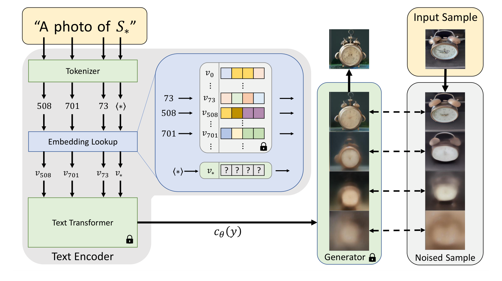</button>
<figcaption><strong>一个特殊词沿文字链路携带素材信息</strong><a href="https://arxiv.org/abs/2208.01618v1">An Image is Worth One Word: Personalizing Text-to-Image Generation using Textual Inversion</a> · Figure 2 · version 2208.01618v1 · PDF p.4 / printed p.4
<button class="original-direct" type="button">Read original size</button>

Original caption &amp; source

Figure 2: Outline of the text-embedding and inversion process. A string containing our placeholder word
is first converted into tokens (i.e. word or sub-word indices in a dictionary). These tokens are converted to
continous vector representations (the “embeddings”, v). Finally, the embedding vectors are transformed into
a single conditioning code cθ(y) which guides the generative model. We optimize the embedding vector v∗
associated with our pseudo-word S∗, using a reconstruction objective.
<a class="source-url" href="https://arxiv.org/pdf/2208.01618v1">https://arxiv.org/pdf/2208.01618v1</a>
</figcaption></figure>

从左往右读，提示词先被分词，再查 embedding，经过文字 Transformer 生成条件，最后进入扩散模型。可训练部分只有新词向量。输入“a photo of S* dog”时，模型不存整张照片，而是把团子的表征挤入原有语言条件空间。优点是文件小、容易组合；代价是容量和表达方式受这个空间限制，局部斑纹可能只被记成相近的类别外观。

<figure id="fig-ti-f10"><button class="paper-image" type="button" aria-label="Zoom: 重建保真与可编辑性之间的曲线">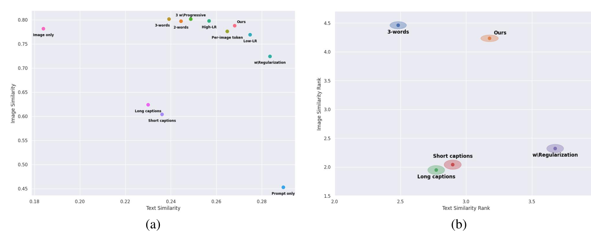</button>
<figcaption><strong>重建保真与可编辑性之间的曲线</strong><a href="https://arxiv.org/abs/2208.01618v1">An Image is Worth One Word: Personalizing Text-to-Image Generation using Textual Inversion</a> · Figure 10 · version 2208.01618v1 · PDF p.13 / printed p.13
<button class="original-direct" type="button">Read original size</button>

Original caption &amp; source

Figure 10: Qualitative evaluation results. (a) CLIP-based evaluations. The single-word model (ours) rep-
resents an appealing point on the distortion-editability curve, and can be moved along it by changing the
learning rate. (b) User study results. These results portray a similar distortion-editability curve, and demon-
strate that the CLIP-based results align with human preference. User study error bars are 95% confidence
intervals.
<a class="source-url" href="https://arxiv.org/pdf/2208.01618v1">https://arxiv.org/pdf/2208.01618v1</a>
</figcaption></figure>

图的左侧是 CLIP 度量，右侧是用户研究；重点看随学习率改变的保真与可编辑性权衡，而非只看最高点。学习过强可以更像输入，却偏离自然词向量分布，使新场景指令难以执行。原文用户研究共 1,200 个回答，误差条为 95% 置信区间；示例图片另有 best-of-16 筛选，不能当随机一次成功率。

<figure id="fig-ti-f12"><button class="paper-image" type="button" aria-label="Zoom: 参考照片数量不是越多越好的一条定律">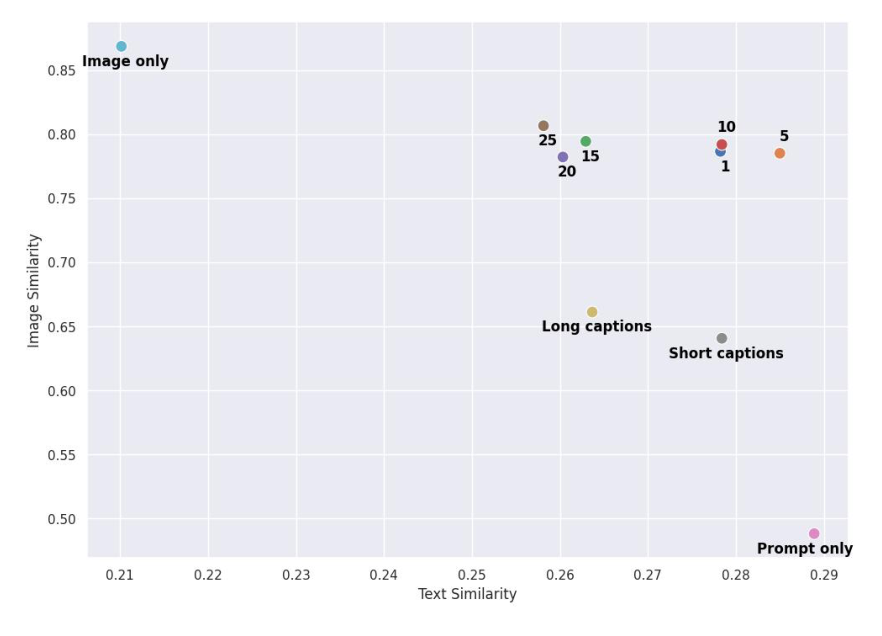</button>
<figcaption><strong>参考照片数量不是越多越好的一条定律</strong><a href="https://arxiv.org/abs/2208.01618v1">An Image is Worth One Word: Personalizing Text-to-Image Generation using Textual Inversion</a> · Figure 12 · version 2208.01618v1 · PDF p.21 / printed p.21
<button class="original-direct" type="button">Read original size</button>

Original caption &amp; source

Figure 12: Quantitative evaluation of the effects of the train-
ing set size. Significant increases to dataset sizes leads to
larger deviation from the real-word distribution. This impacts
editability and offers paltry improvement in reconstruction.
Our approach shows the best results with ∼5 images.
<a class="source-url" href="https://arxiv.org/pdf/2208.01618v1">https://arxiv.org/pdf/2208.01618v1</a>
</figcaption></figure>

横轴是训练集大小，曲线比较重建与编辑表现。这是**一个雕塑**上 1—25 张图的实验，约五张取得较好平衡；不能推出任何人脸／商品的最佳数据量都为五张。若新增照片反复强化同一背景，它也可能增加需要摆脱的关联。真正需要的是素材特征的有效覆盖与变化。

### DreamBooth：同时学习“这一个”和“这一类”

DreamBooth <a href="#source-2">[2]</a> 更新生成器权重，用罕见标识词加正确类别词绑定素材。与只学习词向量相比，它能调整模型如何生成具体主体，但容易把背景、姿态与主体一起学进去。类别先验保持损失让模型同时继续生成一般的狗：

$$
\mathcal L_{\mathrm{DB}}
=\mathcal L_{\mathrm{subject}}
+\lambda\mathcal L_{\mathrm{class}}.
$$

$\mathcal L_{\mathrm{subject}}$ 来自团子照片与专属标识，$\mathcal L_{\mathrm{class}}$ 来自冻结原模型生成的普通狗，$\lambda$ 是两项的相对权重，原论文采用 1。这是目标结构的教学简写；两项实际使用对应扩散重建目标。直觉是既认识团子，又避免以后所有“dog”都变成团子。

<figure id="fig-dreambooth-f3"><button class="paper-image" type="button" aria-label="Zoom: 专属样本与类别先验同时训练">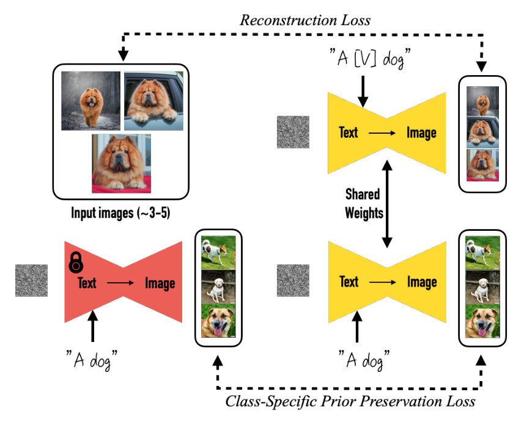</button>
<figcaption><strong>专属样本与类别先验同时训练</strong><a href="https://arxiv.org/abs/2208.12242v2">DreamBooth: Fine Tuning Text-to-Image Diffusion Models for Subject-Driven Generation</a> · Figure 3 · version 2208.12242v2 · PDF p.4 / printed p.4
<button class="original-direct" type="button">Read original size</button>

Original caption &amp; source

Figure 3. Fine-tuning. Given ∼3−5 images of a subject we fine-
tune a text-to-image diffusion model with the input images paired
with a text prompt containing a unique identifier and the name of
the class the subject belongs to (e.g., “A [V] dog”), in parallel, we
apply a class-specific prior preservation loss, which leverages the
semantic prior that the model has on the class and encourages it to
generate diverse instances belong to the subject’s class using the
class name in a text prompt (e.g., “A dog”).
<a class="source-url" href="https://arxiv.org/pdf/2208.12242v2">https://arxiv.org/pdf/2208.12242v2</a>
</figcaption></figure>

图中两支共享更新的生成器：一支输入专属标识与 3—5 张主体照片，一支输入类别词与先验图片。类别支路主要阻止语言漂移和过拟合，不会自动把杯子标签从背景中分离，也不能补齐照片从未出现的背面。

<figure id="fig-dreambooth-t1"><button class="paper-image" type="button" aria-label="Zoom: 同骨干的主体和文字保真比较">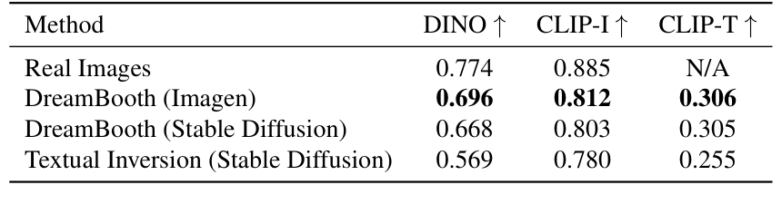</button>
<figcaption><strong>同骨干的主体和文字保真比较</strong><a href="https://arxiv.org/abs/2208.12242v2">DreamBooth: Fine Tuning Text-to-Image Diffusion Models for Subject-Driven Generation</a> · Table 1 · version 2208.12242v2 · PDF p.5 / printed p.5
<button class="original-direct" type="button">Read original size</button>

Original caption &amp; source

Table 1.
Subject fidelity (DINO, CLIP-I) and prompt fidelity
(CLIP-T, CLIP-T-L) quantitative metric comparison.
<a class="source-url" href="https://arxiv.org/pdf/2208.12242v2">https://arxiv.org/pdf/2208.12242v2</a>
</figcaption></figure>

这里 DINO、CLIP-I 衡量图像表征相似，CLIP-T 衡量文字对应，均越高越好。Stable Diffusion 组中，DreamBooth 的 DINO 为 0.668，Textual Inversion 为 0.569；CLIP-T 为 0.305 对 0.255。Imagen 行使用不同骨干，要单独读。原 DreamBench 含 30 个主体、25 个提示词、每提示四图，共 3,000 张／方法；这些数值不是身份识别准确率。

<figure id="fig-dreambooth-f6"><button class="paper-image" type="button" aria-label="Zoom: 先验损失让姿态变化更容易出现">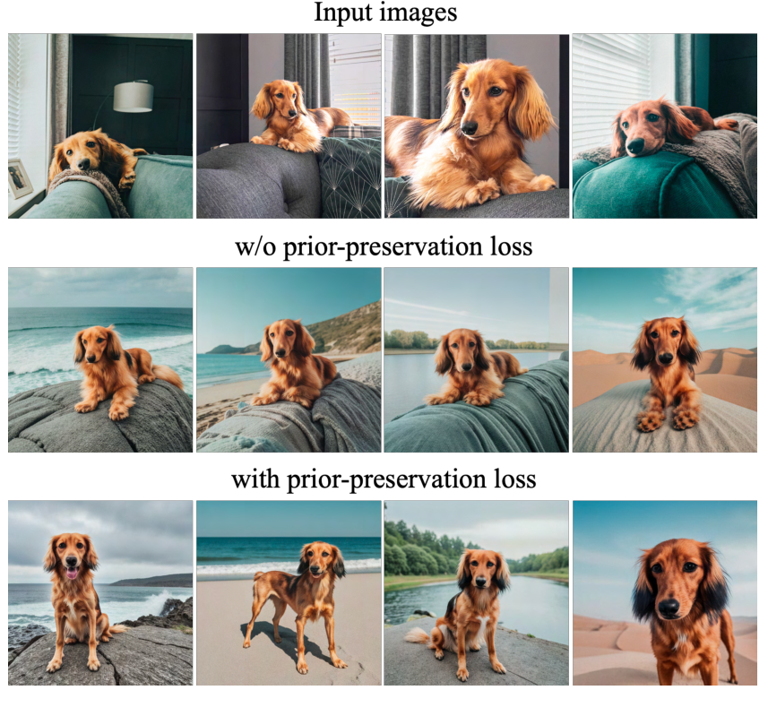</button>
<figcaption><strong>先验损失让姿态变化更容易出现</strong><a href="https://arxiv.org/abs/2208.12242v2">DreamBooth: Fine Tuning Text-to-Image Diffusion Models for Subject-Driven Generation</a> · Figure 6 · version 2208.12242v2 · PDF p.7 / printed p.7
<button class="original-direct" type="button">Read original size</button>

Original caption &amp; source

Figure 6. Encouraging diversity with prior-preservation loss.
Naive fine-tuning can result in overfitting to input image context
and subject appearance (e.g. pose). PPL acts as a regularizer that
alleviates overfitting and encourages diversity, allowing for more
pose variability and appearance diversity.
<a class="source-url" href="https://arxiv.org/pdf/2208.12242v2">https://arxiv.org/pdf/2208.12242v2</a>
</figcaption></figure>

图中同一主体的输出排列让人比较是否总停留在训练姿态。加入先验约束后，姿态多样性提高；对团子广告有用，因为需要跑、坐、转头。但视觉上更多样不意味着每个斑点都更精确。

<figure id="fig-dreambooth-t3"><button class="paper-image" type="button" aria-label="Zoom: 先验保持的收益伴随主体相似度下降">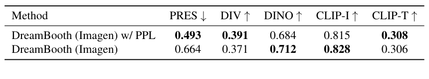</button>
<figcaption><strong>先验保持的收益伴随主体相似度下降</strong><a href="https://arxiv.org/abs/2208.12242v2">DreamBooth: Fine Tuning Text-to-Image Diffusion Models for Subject-Driven Generation</a> · Table 3 · version 2208.12242v2 · PDF p.7 / printed p.7
<button class="original-direct" type="button">Read original size</button>

Original caption &amp; source

Table 3. Prior preservation loss (PPL) ablation displaying a prior
preservation (PRES) metric, diversity metric (DIV) and subject
and prompt fidelity metrics.
<a class="source-url" href="https://arxiv.org/pdf/2208.12242v2">https://arxiv.org/pdf/2208.12242v2</a>
</figcaption></figure>

15 个主体的消融中，PRES 越低越好，从 0.664 降至 0.493；DIV 越高越好，从 0.371 升至 0.391；DINO 从 0.712 降至 0.684。它说明正则化产生真实取舍，不能把“防过拟合”说成所有指标都提高。PRES 是类别漂移相关度量，不是常规分类 accuracy。

<figure id="fig-dreambooth-f9"><button class="paper-image" type="button" aria-label="Zoom: 稀有场景、背景纠缠与训练照复制">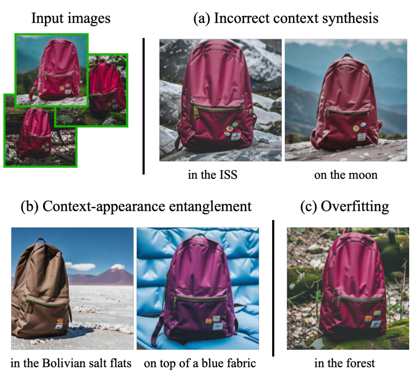</button>
<figcaption><strong>稀有场景、背景纠缠与训练照复制</strong><a href="https://arxiv.org/abs/2208.12242v2">DreamBooth: Fine Tuning Text-to-Image Diffusion Models for Subject-Driven Generation</a> · Figure 9 · version 2208.12242v2 · PDF p.9 / printed p.9
<button class="original-direct" type="button">Read original size</button>

Original caption &amp; source

Figure 9.
Failure modes.
Given a rare prompted context the
model might fail at generating the correct environment (a). It is
possible for context and subject appearance to become entangled
(b). Finally, it is possible for the model to overfit and generate
images similar to the training set, especially if prompts reflect the
original environment of the training set (c).
<a class="source-url" href="https://arxiv.org/pdf/2208.12242v2">https://arxiv.org/pdf/2208.12242v2</a>
</figcaption></figure>

三个失败组分别展示难以生成罕见场景、主体与环境纠缠、输出近似训练图。团子总在草地上拍摄，模型可能把草地视为它的一部分；重加权身份不能单独修复这种训练数据问题。

<figure id="fig-dreambooth-f11"><button class="paper-image" type="button" aria-label="Zoom: CLIP-I 与 DINO 可能对“更像”给出相反判断">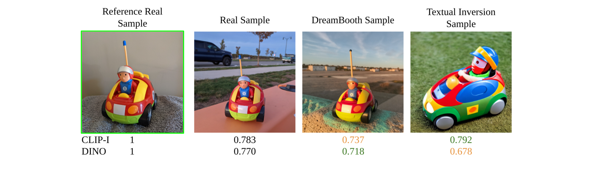</button>
<figcaption><strong>CLIP-I 与 DINO 可能对“更像”给出相反判断</strong><a href="https://arxiv.org/abs/2208.12242v2">DreamBooth: Fine Tuning Text-to-Image Diffusion Models for Subject-Driven Generation</a> · Figure 11 · version 2208.12242v2 · PDF p.15 / printed p.15
<button class="original-direct" type="button">Read original size</button>

Original caption &amp; source

Figure 11. CLIP-I vs. DINO Metrics. The DreamBooth CLIP-I similarity to the reference image is lower than that of the Textual
Inversion sample, even though the DreamBooth subject looks more similar to the reference subject. The DINO metric more closely tracks
human evaluation of subject fidelity here.
<a class="source-url" href="https://arxiv.org/pdf/2208.12242v2">https://arxiv.org/pdf/2208.12242v2</a>
</figcaption></figure>

这个单例中 CLIP-I 更偏向 Textual Inversion：0.792 对 0.737；DINO 则偏向 DreamBooth：0.718 对 0.678。读图要看主体细节与背景语义，而不是挑符合预期的指标。它是一则评测反例，不能据此估计某指标的总体错误率。

### LoRA：改变更新参数化，不改变任务目标

LoRA <a href="#source-3">[3]</a> 最初研究 NLP 参数适配；它是更新权重的方法，不是图像身份损失的替代品。DreamBooth-LoRA 把上面的素材训练目标和下面的低秩更新组合：

$$
W=W_0+\frac{\alpha}{r}BA,\qquad
A\in\mathbb R^{r\times d_{\mathrm{in}}},\quad
B\in\mathbb R^{d_{\mathrm{out}}\times r}.
$$

$W_0$ 是冻结基座，$W$ 是有效权重，$r$ 为秩，$\alpha/r$ 为缩放，$A/B$ 是可训练矩阵。原完整更新需 $d_{\mathrm{out}}d_{\mathrm{in}}$ 个参数，低秩部分需 $r(d_{\mathrm{in}}+d_{\mathrm{out}})$ 个。若输入和输出均为 1,024、秩为 16，一个矩阵从约 105 万更新参数降至 32,768。这个算例只计算该矩阵，不包括优化器状态、其他层与激活。

<figure id="fig-lora-f1"><button class="paper-image" type="button" aria-label="Zoom: 冻结基座旁边增加低秩更新支路">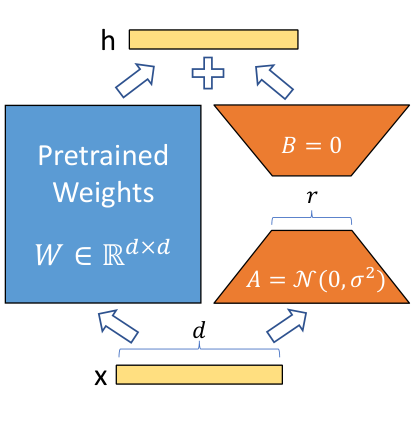</button>
<figcaption><strong>冻结基座旁边增加低秩更新支路</strong><a href="https://arxiv.org/abs/2106.09685v2">LoRA: Low-Rank Adaptation of Large Language Models</a> · Figure 1 · version 2106.09685v2 · PDF p.1 / printed p.1
<button class="original-direct" type="button">Read original size</button>

Original caption &amp; source

Figure 1: Our reparametriza-
tion. We only train A and B.
<a class="source-url" href="https://arxiv.org/pdf/2106.09685v2">https://arxiv.org/pdf/2106.09685v2</a>
</figcaption></figure>

图中原权重与低秩支路相加。离线合并后可以消除额外矩阵乘；动态切换多个 LoRA 时是否合并由实现决定。小文件不意味着训练无显存成本，也不意味着低秩矩阵元素天然稀疏。

<figure id="fig-lora-t6"><button class="paper-image" type="button" aria-label="Zoom: 原 LoRA 的秩消融来自语言任务">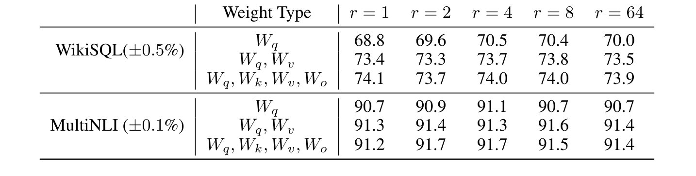</button>
<figcaption><strong>原 LoRA 的秩消融来自语言任务</strong><a href="https://arxiv.org/abs/2106.09685v2">LoRA: Low-Rank Adaptation of Large Language Models</a> · Table 6 · version 2106.09685v2 · PDF p.10 / printed p.10
<button class="original-direct" type="button">Read original size</button>

Original caption &amp; source

Table 6: Validation accuracy on WikiSQL and MultiNLI with different rank r. To our surprise, a
rank as small as one suffices for adapting both Wq and Wv on these datasets while training Wq alone
needs a larger r. We conduct a similar experiment on GPT-2 in Section H.2.
<a class="source-url" href="https://arxiv.org/pdf/2106.09685v2">https://arxiv.org/pdf/2106.09685v2</a>
</figcaption></figure>

表格改变秩和目标投影，在 GPT-3 的 WikiSQL／MNLI 设置中分析效果。它支持“某些适配的有效更新维度可以很小”，不能为每张人脸／每个复杂产品规定 rank=1。视觉任务应独立验证秩、训练层、参考多样性、文字执行和过拟合。

### Custom Diffusion：只改条件到图像的关键接口

Custom Diffusion <a href="#source-4">[4]</a> 进一步减少更新位置：主要训练交叉注意力的 K/V 与新 modifier embedding，冻结 Q 和绝大多数去噪器。K/V 改变“专属词能让图像位置读到什么”，比完整微调更便于存储多种素材。

<figure id="fig-custom-f2"><button class="paper-image" type="button" aria-label="Zoom: 选择性更新与多概念合并">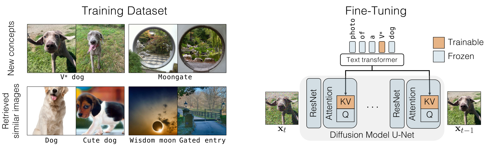</button>
<figcaption><strong>选择性更新与多概念合并</strong><a href="https://arxiv.org/abs/2212.04488v2">Multi-Concept Customization of Text-to-Image Diffusion</a> · Figure 2 · version 2212.04488v2 · PDF p.3 / printed p.3
<button class="original-direct" type="button">Read original size</button>

Original caption &amp; source

Figure 2. Custom Diffusion. Given images of new concepts, we retrieve real images with similar captions as the given concepts and
create the training dataset for fine-tuning, as shown on the left. To represent personal concepts of a general category, we introduce a new
modifier token V∗, used in front of the category name. During training, we optimize key and value projection matrices in the diffusion model
cross-attention layers along with the modifier token. The retrieved real images are used as a regularization dataset during fine-tuning.
<a class="source-url" href="https://arxiv.org/pdf/2212.04488v2">https://arxiv.org/pdf/2212.04488v2</a>
</figcaption></figure>

图中可训练 K/V 是核心；多概念可以共同训练，也可以对已经训练的概念做约束合并。合并要在拟合概念投影的同时保留一般文本投影，依赖线性约束可解；不能把约两秒的**合并**时间算成两秒学会新素材。原方案单概念 250 步、联合 500 步，batch 8，并从 LAION 检索约 200 张正则图。

<figure id="fig-custom-f8"><button class="paper-image" type="button" aria-label="Zoom: 单概念与多概念的图文相似度权衡">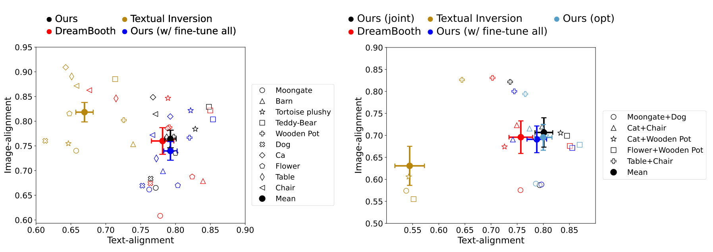</button>
<figcaption><strong>单概念与多概念的图文相似度权衡</strong><a href="https://arxiv.org/abs/2212.04488v2">Multi-Concept Customization of Text-to-Image Diffusion</a> · Figure 8 · version 2212.04488v2 · PDF p.8 / printed p.8
<button class="original-direct" type="button">Read original size</button>

Original caption &amp; source

Figure 8. Text- and image-alignment for single-concept (left) and multi-concept (right) fine-tuning. Compared to DreamBooth, Textual
Inversion, and our w/ fine-tune all baseline, our method lies further along the upper right corner (with less variance). There exists a trade-off
between high similarity to target images vs. text-alignment on new prompts. Keeping in consideration this trade-off, our method is on-par or
better than the baselines. For multi-concept both joint training and optimization based method are better than other baselines.
<a class="source-url" href="https://arxiv.org/pdf/2212.04488v2">https://arxiv.org/pdf/2212.04488v2</a>
</figcaption></figure>

图把文字与图像匹配放在两轴上，带均值与误差；共同生成杯子和狗比单独生成更难。这里图像 CLIP 反映一般表征，不保证杯身文字正确。原文训练计时为作者统一配置下 2×A100 约六分钟对 DreamBooth 4×A100 一小时，不能与 DreamBooth 原文另一设置的五分钟混排行。

<figure id="fig-custom-t3"><button class="paper-image" type="button" aria-label="Zoom: 数据增强与真实正则图分别影响不同指标">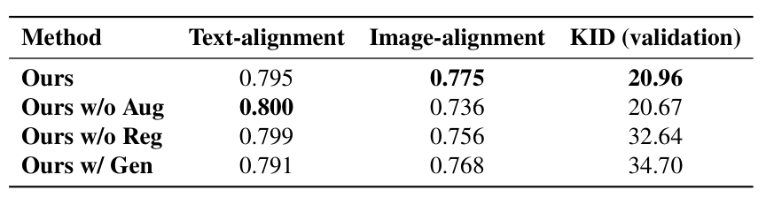</button>
<figcaption><strong>数据增强与真实正则图分别影响不同指标</strong><a href="https://arxiv.org/abs/2212.04488v2">Multi-Concept Customization of Text-to-Image Diffusion</a> · Table 3 · version 2212.04488v2 · PDF p.8 / printed p.8
<button class="original-direct" type="button">Read original size</button>

Original caption &amp; source

Table 3. Ablation Study. No augmentation during training leads to
lower image-alignment. No regularization dataset or using gener-
ated images as regularization produces much worse KID.
<a class="source-url" href="https://arxiv.org/pdf/2212.04488v2">https://arxiv.org/pdf/2212.04488v2</a>
</figcaption></figure>

移除增强后，图像相似度 0.775→0.736；移除正则后，KID 20.96→32.64，表中 KID 放大了 1,000 倍且越低越好。增强包括缩放和有效区域损失，帮助素材脱离固定大小；正则图约束整体分布。没有一项组件单独证明多主体绑定已经解决。

### ZipLoRA：主体 LoRA 与画风 LoRA怎样合并

ZipLoRA <a href="#source-6">[6]</a> 研究另一种纠缠：已有小林的主体 LoRA，也有水彩 LoRA，直接相加时可能丢脸或出现风格图里的物体。它在同一 SDXL 基座上的两个既有 LoRA 之上，学习列方向合并系数，保持各自输出并抑制重叠贡献。

<figure id="fig-zip-f2"><button class="paper-image" type="button" aria-label="Zoom: 训练的是合并系数，而不是重新训练两套 LoRA">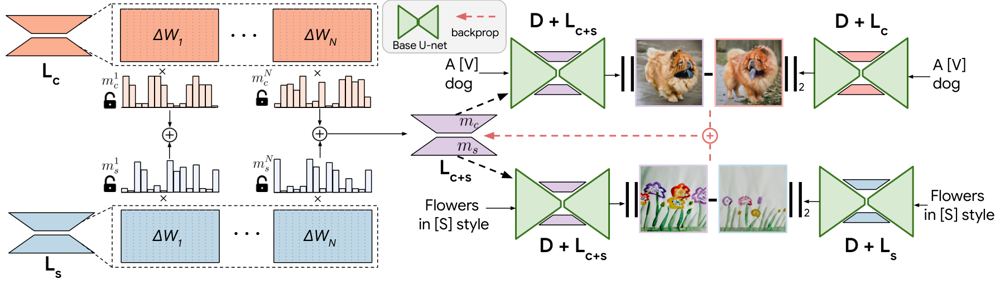</button>
<figcaption><strong>训练的是合并系数，而不是重新训练两套 LoRA</strong><a href="https://arxiv.org/abs/2311.13600v2">ZipLoRA: Any Subject in Any Style by Effectively Merging LoRAs</a> · Figure 2 · version 2311.13600v2 · PDF p.3 / printed p.3
<button class="original-direct" type="button">Read original size</button>

Original caption &amp; source

Figure 2. Overview of ZipLoRA. Our method learns mixing coefficients for each column of ∆Wi for both style and subject LoRAs.
It does so by (1) minimizing the difference between subject/style images generated by the mixed LoRA and original subject/style LoRA
models, while (2) minimizing the cosine similarity between the columns of content and style LoRAs. In essence, the zipped LoRA tries to
conserve the subject and style properties of each individual LoRA, while minimizing signal interference of both LoRAs.
<a class="source-url" href="https://arxiv.org/pdf/2311.13600v2">https://arxiv.org/pdf/2311.13600v2</a>
</figcaption></figure>

图中固定的主体／风格更新矩阵乘上可学习系数再相加。原目标把系数内积的绝对值作为分离项；列缩放并不一般性地旋转原列向量，所以不宜理解为保证几何正交。对广告例子，它试图让水彩改变表现方式，同时保住小林。

<figure id="fig-zip-f3"><button class="paper-image" type="button" aria-label="Zoom: 实际 LoRA 矩阵中的幅值与冲突观察">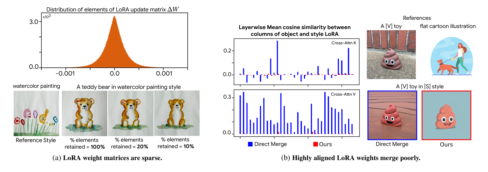</button>
<figcaption><strong>实际 LoRA 矩阵中的幅值与冲突观察</strong><a href="https://arxiv.org/abs/2311.13600v2">ZipLoRA: Any Subject in Any Style by Effectively Merging LoRAs</a> · Figure 3 · version 2311.13600v2 · PDF p.5 / printed p.5
<button class="original-direct" type="button">Read original size</button>

Original caption &amp; source

Figure 3. Key insights of our approach: (a) Most of the elements in ∆W have a magnitude very close to zero, and can be conveniently
thrown away without affecting the generation quality of the fine-tuned model. (b) When LoRA weight columns are highly aligned, a direct
merge obtains subpar results. Instead, our approach minimizes the mean cosine similarity between the columns of the LoRA updates across
the layers.
<a class="source-url" href="https://arxiv.org/pdf/2311.13600v2">https://arxiv.org/pdf/2311.13600v2</a>
</figcaption></figure>

图展示采样矩阵的幅值、对齐与冲突现象。小幅值和相关性来自实验观察；低秩在数学上不推出逐元素稀疏。不能据此随意删除所有小元素或将这项观察推广到任意 LoRA。

<figure id="fig-zip-t12"><button class="paper-image" type="button" aria-label="Zoom: 主体改善，风格相似并未全面领先">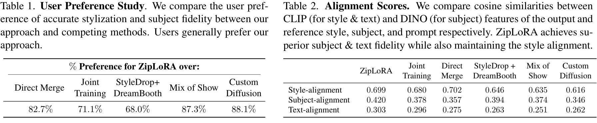</button>
<figcaption><strong>主体改善，风格相似并未全面领先</strong><a href="https://arxiv.org/abs/2311.13600v2">ZipLoRA: Any Subject in Any Style by Effectively Merging LoRAs</a> · Tables 1–2 · version 2311.13600v2 · PDF p.8 / printed p.8
<button class="original-direct" type="button">Read original size</button>

Original caption &amp; source

Table 1. User Preference Study. We compare the user pref-
erence of accurate stylization and subject fidelity between our
approach and competing methods. Users generally prefer our
approach.

Table 2. Alignment Scores. We compare cosine similarities between
CLIP (for style &amp; text) and DINO (for subject) features of the output and
reference style, subject, and prompt respectively. ZipLoRA achieves su-
perior subject &amp; text fidelity while also maintaining the style alignment.
<a class="source-url" href="https://arxiv.org/pdf/2311.13600v2">https://arxiv.org/pdf/2311.13600v2</a>
</figcaption></figure>

四个主体、八种风格的定量与用户结果中，ZipLoRA DINO 0.420 对直接合并 0.357；风格相似 0.699 对 0.702。对直接合并的偏好为 82.7%，每个配对研究 45 人、360 个回答。保留两轴能看清主体收益与风格代价。论文报告合并约 560 秒、21GB；6.5MB 是系数存储，还需要两个源 LoRA 和基座。

<figure id="fig-zip-f8"><button class="paper-image" type="button" aria-label="Zoom: 风格图内容泄漏与主体失真仍会发生">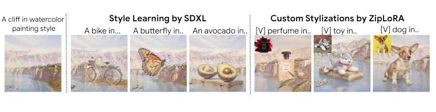</button>
<figcaption><strong>风格图内容泄漏与主体失真仍会发生</strong><a href="https://arxiv.org/abs/2311.13600v2">ZipLoRA: Any Subject in Any Style by Effectively Merging LoRAs</a> · Figure 8 · version 2311.13600v2 · PDF p.9 / printed p.9
<button class="original-direct" type="button">Read original size</button>

Original caption &amp; source

Figure 8.
Failure Cases. For a few styles, ZipLoRA fails to
separate the content of the style reference from its style, resulting
into the leakage of the content (cliff in this case) in stylization
outputs.
<a class="source-url" href="https://arxiv.org/pdf/2311.13600v2">https://arxiv.org/pdf/2311.13600v2</a>
</figcaption></figure>

失败例展示风格强烈时内容被覆盖，或把风格参考里的内容一起带入。它没有把“风格”严格变成纯粹的独立变量。截至调研日未确认作者可运行代码公开，本文不把第三方复现当官方实现。

专属参数路线适合高频重复使用的资产，但需要素材管理：基座、训练图片、caption、更新层、秩与权重强度都属于资产版本。为了让杯身文字绝对正确，后期贴合原始标签往往比要求 LoRA 从 latent 重画更可靠。

## 4. 读参考图：把每个用户的微调摊到共享模型

### BLIP-Diffusion：先把视觉特征对齐到文字条件

BLIP-Diffusion <a href="#source-5">[5]</a> 在专属微调与即时参考之间架桥。冻结视觉编码器，训练带查询向量的 Q-Former 从图片中提取 16 个主体提示，再把它们接到文字编码器之前。第一阶段做视觉语言对齐，第二阶段做主体条件扩散预训练。

<figure id="fig-blip-f2"><button class="paper-image" type="button" aria-label="Zoom: 视觉查询提取主体，再进入文字生成链路">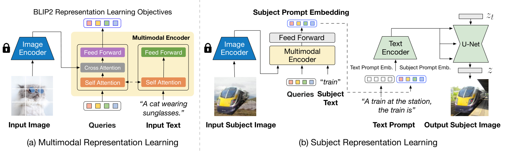</button>
<figcaption><strong>视觉查询提取主体，再进入文字生成链路</strong><a href="https://arxiv.org/abs/2305.14720v2">BLIP-Diffusion: Pre-trained Subject Representation for Controllable Text-to-Image Generation and Editing</a> · Figure 2 · version 2305.14720v2 · PDF p.3 / printed p.3
<button class="original-direct" type="button">Read original size</button>

Original caption &amp; source

Figure 2: Illustration of the two-staged pre-training for BLIP-Diffusion. Left: in the multimodal representation
learning stage, we follow prior work [12] and pretrain BLIP-2 encoder to obtain text-aligned image representation.
Right: in the subject representation learning stage, we synthesize input images by composing subjects with
random background. The BLIP-2 is then tasked to produce subject prompt embedding, which is later used by the
latent diffusion model to generate output subject image. The image encoder remains frozen during pre-training.
<a class="source-url" href="https://arxiv.org/pdf/2305.14720v2">https://arxiv.org/pdf/2305.14720v2</a>
</figcaption></figure>

从输入图经过冻结视觉编码器、Q-Former、投影到文字条件，最后去噪。它并非把照片作为所有像素位置的原样模板；16 个查询形成压缩描述。原文发现 32 个查询可能压过文字，说明参考容量本身也影响编辑自由度。

<figure id="fig-blip-f3"><button class="paper-image" type="button" aria-label="Zoom: 背景随机化切断最容易学到的捷径">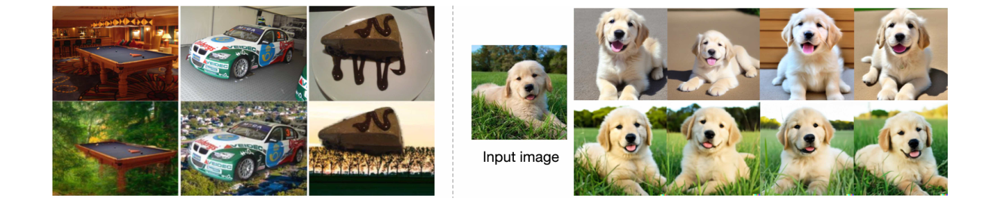</button>
<figcaption><strong>背景随机化切断最容易学到的捷径</strong><a href="https://arxiv.org/abs/2305.14720v2">BLIP-Diffusion: Pre-trained Subject Representation for Controllable Text-to-Image Generation and Editing</a> · Figure 3 · version 2305.14720v2 · PDF p.4 / printed p.4
<button class="original-direct" type="button">Read original size</button>

Original caption &amp; source

Figure 3: Left: example training image pairs, target images (top) and input images (bottom) with random
background. Images are from the OpenImage dataset [22]. Right: comparison between the subject-driven image
generation of our model (top), and image variations from DALLE-2 [4] (bottom). We prompt our model with the
text prompt “a dog&quot; and the subject representation, while feeding the input image into DALLE-2 for variation
generation. Our model learns subject representation with minimal background information encoded, which
enables faithful and flexible control when used together with text prompts.
<a class="source-url" href="https://arxiv.org/pdf/2305.14720v2">https://arxiv.org/pdf/2305.14720v2</a>
</figcaption></figure>

主体抠出后放到不同背景，以目标主体训练。团子不再总绑定草地。第二阶段约 292K OpenImages 非人类主体配 59K 背景，500K 步、16×A100 40GB、六天；这里的“零样本”推理背后有大规模共享训练，且训练主体域不等同于精确人脸身份。

<figure id="fig-blip-t1"><button class="paper-image" type="button" aria-label="Zoom: 零样本与短微调分开评测">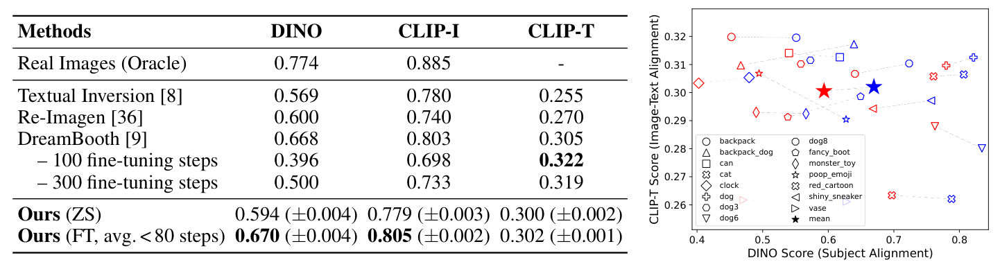</button>
<figcaption><strong>零样本与短微调分开评测</strong><a href="https://arxiv.org/abs/2305.14720v2">BLIP-Diffusion: Pre-trained Subject Representation for Controllable Text-to-Image Generation and Editing</a> · Table 1 · version 2305.14720v2 · PDF p.8 / printed p.8
<button class="original-direct" type="button">Read original size</button>

Original caption &amp; source

Table 1: Left: Quantitative comparisons on DreamBench. We report average metrics and differences across
10 experiment runs with different set of random seeds, in zero-shot (ZS) and fine-tuning (FT) setups. Right:
Alignment metrics in zero-shot (red) and fine-tuning (blue) setups for sample subjects.
<a class="source-url" href="https://arxiv.org/pdf/2305.14720v2">https://arxiv.org/pdf/2305.14720v2</a>
</figcaption></figure>

DreamBench 中零样本 DINO 0.594±0.004、CLIP-T 0.300±0.002；短微调后 DINO 0.670±0.004、CLIP-T 0.302±0.001。原文做十次固定 seed 实验。短微调缓存平均主体表征，冻结文字侧，约 40—120 步、20—40 秒／A100；不能把零样本和微调两组结果混成一次推理的表现。

<figure id="fig-blip-t2"><button class="paper-image" type="button" aria-label="Zoom: 对齐预训练与文字侧训练的消融">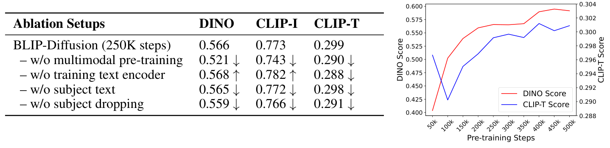</button>
<figcaption><strong>对齐预训练与文字侧训练的消融</strong><a href="https://arxiv.org/abs/2305.14720v2">BLIP-Diffusion: Pre-trained Subject Representation for Controllable Text-to-Image Generation and Editing</a> · Table 2 · version 2305.14720v2 · PDF p.9 / printed p.9
<button class="original-direct" type="button">Read original size</button>

Original caption &amp; source

Table 2: Left: Ablation results. Right: Effect of subject representation learning with varying pre-training steps.
<a class="source-url" href="https://arxiv.org/pdf/2305.14720v2">https://arxiv.org/pdf/2305.14720v2</a>
</figcaption></figure>

消融采用 250K 步而非主结果 500K。去掉对齐预训练，DINO 降至 0.521；预训练时冻结文字编码器则图像指标略增、CLIP-T 0.299→0.288。它再次展示参考重建与文字遵循的拉扯，而非“冻结越多越好”。

<figure id="fig-blip-f10"><button class="paper-image" type="button" aria-label="Zoom: 外观纠缠、提示词失败与空间组合">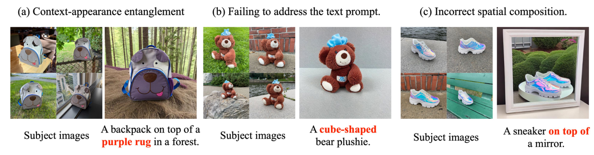</button>
<figcaption><strong>外观纠缠、提示词失败与空间组合</strong><a href="https://arxiv.org/abs/2305.14720v2">BLIP-Diffusion: Pre-trained Subject Representation for Controllable Text-to-Image Generation and Editing</a> · Figure 10 · version 2305.14720v2 · PDF p.12 / printed p.12
<button class="original-direct" type="button">Read original size</button>

Original caption &amp; source

Figure 10: Example failure generations. Subject images used for finetuning are shown on the left.
<a class="source-url" href="https://arxiv.org/pdf/2305.14720v2">https://arxiv.org/pdf/2305.14720v2</a>
</figcaption></figure>

失败组分别关注参考外观被带入、不执行新指令和多个概念的空间关系。Q-Former 能压缩内容，但没有显式回答“团子在小林左边、杯子在她右手”这种地址问题。

### IP-Adapter：图像条件拥有独立的注意力归一化

IP-Adapter <a href="#source-7">[7]</a> 把图像条件从文字条件里分支出来，共享图像查询 Q，但给图片单独的 K/V：

$$
H=
\operatorname{Attn}(Q,K_{\mathrm{text}},V_{\mathrm{text}})
+\lambda\operatorname{Attn}(Q,K_{\mathrm{img}},V_{\mathrm{img}}).
$$

$H$ 是相加后的注意力输出，$\lambda$ 是图像支路强度，其余维度遵从前面的注意力定义。两项分别 softmax，**不同于把文字与图片 token 拼接后共同归一化**。直觉是文字与参考各有读取通道，再决定图像通道加多少。增大 $\lambda$ 通常增强参考影响，也可能妨碍构图变化，不能解释为身份保证。

<figure id="fig-ip-f2"><button class="paper-image" type="button" aria-label="Zoom: 独立图像注意力作为冻结模型的适配器">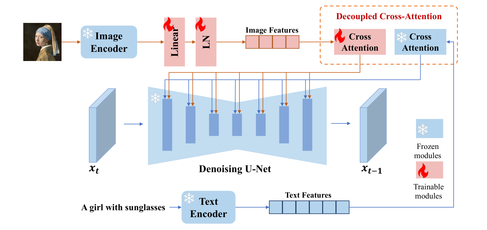</button>
<figcaption><strong>独立图像注意力作为冻结模型的适配器</strong><a href="https://arxiv.org/abs/2308.06721v1">IP-Adapter: Text Compatible Image Prompt Adapter for Text-to-Image Diffusion Models</a> · Figure 2 · version 2308.06721v1 · PDF p.4 / printed p.4
<button class="original-direct" type="button">Read original size</button>

Original caption &amp; source

Figure 2: The overall architecture of our proposed IP-Adapter with decoupled cross-attention strategy. Only the newly
added modules (in red color) are trained while the pretrained text-to-image model is frozen.
<a class="source-url" href="https://arxiv.org/pdf/2308.06721v1">https://arxiv.org/pdf/2308.06721v1</a>
</figcaption></figure>

原模型文字支路冻结，训练图像投影与新的 K/V；原始全局版本把 OpenCLIP ViT-H 图像特征变成四个 token，约 22M 参数。原训练用 10M 图像、1M 步、8×V100。它学的是一般视觉提示能力，尚没有“只保留小林身份、换掉衣服”的专门监督。

<figure id="fig-ip-t1"><button class="paper-image" type="button" aria-label="Zoom: COCO 图文相似证明通用视觉提示能力">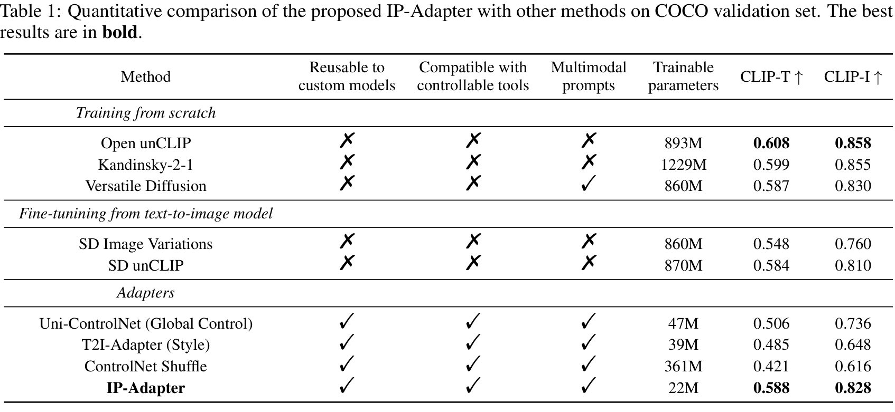</button>
<figcaption><strong>COCO 图文相似证明通用视觉提示能力</strong><a href="https://arxiv.org/abs/2308.06721v1">IP-Adapter: Text Compatible Image Prompt Adapter for Text-to-Image Diffusion Models</a> · Table 1 · version 2308.06721v1 · PDF p.8 / printed p.8
<button class="original-direct" type="button">Read original size</button>

Original caption &amp; source

Table 1: Quantitative comparison of the proposed IP-Adapter with other methods on COCO validation set. The best
results are in bold.
<a class="source-url" href="https://arxiv.org/pdf/2308.06721v1">https://arxiv.org/pdf/2308.06721v1</a>
</figcaption></figure>

原 COCO 验证中 CLIP-I 0.828、CLIP-T 0.588，对照 UniControl 为 0.736、0.506。这个协议关注参考语义和文字结合，不是名人／非名人身份测试，也不能认证商品商标原样保存。

<figure id="fig-ip-f10"><button class="paper-image" type="button" aria-label="Zoom: 独立图像注意力与简单适配器的对照">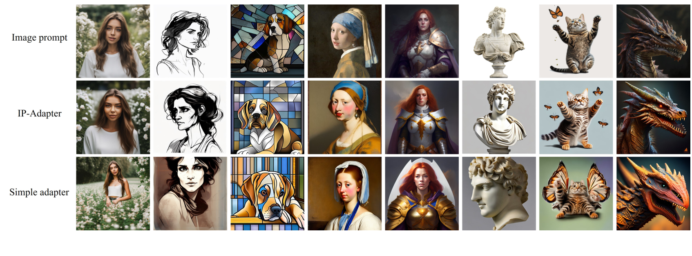</button>
<figcaption><strong>独立图像注意力与简单适配器的对照</strong><a href="https://arxiv.org/abs/2308.06721v1">IP-Adapter: Text Compatible Image Prompt Adapter for Text-to-Image Diffusion Models</a> · Figure 10 · version 2308.06721v1 · PDF p.13 / printed p.13
<button class="original-direct" type="button">Read original size</button>

Original caption &amp; source

Figure 10: Comparison results of our IP-Adapter with simple adapter. The decoupled cross-attention strategy is not
used in the simple adapter.
<a class="source-url" href="https://arxiv.org/pdf/2308.06721v1">https://arxiv.org/pdf/2308.06721v1</a>
</figcaption></figure>

图中 simple adapter 没有独立的图像注意力归一化，对照 IP-Adapter 的解耦支路。比较参考语义是否保留、新文字是否执行，可以理解为什么独立支路更容易控制图文条件；这不是参考强度的数值扫描。即使解耦，图像仍含背景、衣服和身份多种信息；对夜市广告，强参考可能把公园一起带走。

<figure id="fig-ip-f11"><button class="paper-image" type="button" aria-label="Zoom: 全局特征与细粒度特征保留不同细节">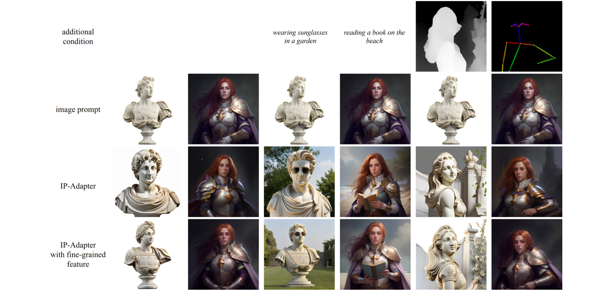</button>
<figcaption><strong>全局特征与细粒度特征保留不同细节</strong><a href="https://arxiv.org/abs/2308.06721v1">IP-Adapter: Text Compatible Image Prompt Adapter for Text-to-Image Diffusion Models</a> · Figure 11 · version 2308.06721v1 · PDF p.13 / printed p.13
<button class="original-direct" type="button">Read original size</button>

Original caption &amp; source

Figure 11: The visual difference of generated samples between the IP-Adapter with global features and the IP-Adapter
with fine-grained features.
<a class="source-url" href="https://arxiv.org/pdf/2308.06721v1">https://arxiv.org/pdf/2308.06721v1</a>
</figcaption></figure>

图的两组输出分别用全局和细粒度视觉特征，比较局部外观和参考细节的差别；上方还列出某些样例的附加空间条件，因此要在同一列内比较。细粒度特征容量更高，也可能增加外观约束。Plus、后来 FaceID 的编码方式与原始四 token 模型不同，不能把现仓库所有变体标为原论文同一结果。与 ControlNet 组合时，图像支路负责外观、空间支路负责姿态，两者也可能冲突。

### PhotoMaker：用多张照片保留身份的不同侧面

PhotoMaker <a href="#source-8">[8]</a> 用图像特征与人类别词融合得到身份 embedding，并把不同参考图的 embedding **堆叠**而非先平均。原论文 V1 以 CLIP 图像特征为主；训练中的共享 LoRA 不是用户自己的 DreamBooth-LoRA。

<figure id="fig-photo-f2"><button class="paper-image" type="button" aria-label="Zoom: 每张照片与类别词融合，形成堆叠身份 token">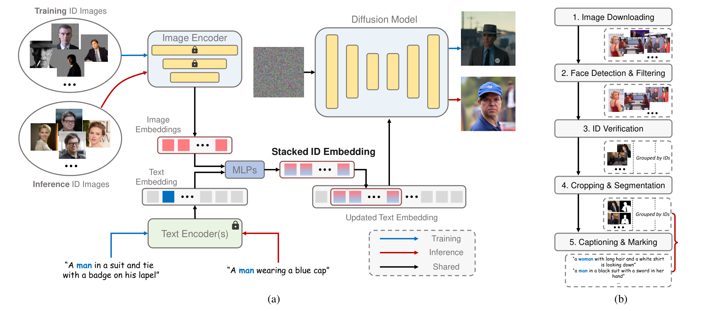</button>
<figcaption><strong>每张照片与类别词融合，形成堆叠身份 token</strong><a href="https://arxiv.org/abs/2312.04461v1">PhotoMaker: Customizing Realistic Human Photos via Stacked ID Embedding</a> · Figure 2 · version 2312.04461v1 · PDF p.4 / printed p.4
<button class="original-direct" type="button">Read original size</button>

Original caption &amp; source

Figure 2. Overviews of the proposed (a) PhotoMaker and (b) ID-oriented data construction pipeline. For the proposed PhotoMaker,
we first obtain the text embedding and image embeddings from text encoder(s) and image encoder, respectively. Then, we extract the
fused embedding by merging the corresponding class embedding (e.g., man and woman) and each image embedding. Next, we concatenate
all fused embeddings along the length dimension to form the stacked ID embedding. Finally, we feed the stacked ID embedding to all
cross-attention layers for adaptively merging the ID content in the diffusion model. Note that although we use images of the same ID with
the masked background during training, we can directly input images of different IDs without background distortion to create a new ID
during inference.
<a class="source-url" href="https://arxiv.org/pdf/2312.04461v1">https://arxiv.org/pdf/2312.04461v1</a>
</figcaption></figure>

图中不同照片各自产生一份融合特征，替换带特殊标记的 man／woman 条件位置。理想化论文表达中，原文字序列长度为 $L$、参考数为 $N$，替换一行后变为 $L+N-1$ 行。小林的正脸、侧脸、不同表情可以同时提供信息。训练还随机化背景、选择与目标不同的同身份照片，减少直接复制捷径。

<figure id="fig-photo-t1"><button class="paper-image" type="button" aria-label="Zoom: 身份、文字、多样性与个性化时间要分开读">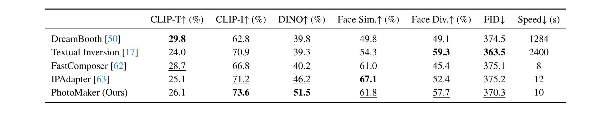</button>
<figcaption><strong>身份、文字、多样性与个性化时间要分开读</strong><a href="https://arxiv.org/abs/2312.04461v1">PhotoMaker: Customizing Realistic Human Photos via Stacked ID Embedding</a> · Table 1 · version 2312.04461v1 · PDF p.7 / printed p.7
<button class="original-direct" type="button">Read original size</button>

Original caption &amp; source

Table 1. Quantitative comparison on the universal recontextualization setting. The metrics used for benchmarking cover the ability to
preserve ID information (i.e., CLIP-I, DINO, and Face Similarity), text consistency (i.e., CLIP-T), diversity of generated faces (i.e., Face
Diversity), and generation quality (i.e., FID). Besides, we define personalized speed as the time it takes to obtain the final personalized
image after feeding the ID condition(s). We measure personalized time on a single NVIDIA Tesla V100 GPU. The best result is shown in
bold, and the second best is underlined.
<a class="source-url" href="https://arxiv.org/pdf/2312.04461v1">https://arxiv.org/pdf/2312.04461v1</a>
</figcaption></figure>

25 个身份、40 个提示、四张结果／提示、四张参考，共 4,000 张／方法。FaceSim 是 FaceNet 余弦乘 100：PhotoMaker 61.8 对 IP-Adapter 67.1；DINO 51.5 对 46.2；CLIP-T 26.1 对 25.1；FaceDiv 57.7 对 52.4。没有单一全面冠军，表内 DreamBooth CLIP-T 29.8 也高于 PhotoMaker，不能照搬正文“最高”的措辞。约十秒／V100 是给定条件到最终图，DreamBooth 1,284 秒含个性化训练，计时边界不同。

<figure id="fig-photo-f7"><button class="paper-image" type="button" aria-label="Zoom: 更多参考增强身份，也可能压低文字自由度">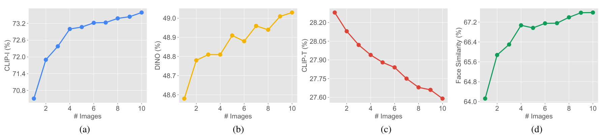</button>
<figcaption><strong>更多参考增强身份，也可能压低文字自由度</strong><a href="https://arxiv.org/abs/2312.04461v1">PhotoMaker: Customizing Realistic Human Photos via Stacked ID Embedding</a> · Figure 7 · version 2312.04461v1 · PDF p.9 / printed p.9
<button class="original-direct" type="button">Read original size</button>

Original caption &amp; source

Figure 7. The impact of the number of input ID images on (a) CLIP-I, (b) DINO, (c) CLIP-T, and (d) Face Similarity, respectively.
<a class="source-url" href="https://arxiv.org/pdf/2312.04461v1">https://arxiv.org/pdf/2312.04461v1</a>
</figcaption></figure>

横轴增加参考数，身份与文字指标出现相反趋势。增加参考意味着更多条件 token，不是免费无副作用的信息扩充；参考质量、重复姿态和文字 token 预算都会影响结果。

<figure id="fig-photo-t2"><button class="paper-image" type="button" aria-label="Zoom: 堆叠比平均保留更多身份变化，但有取舍">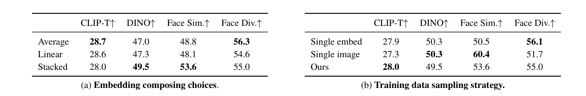</button>
<figcaption><strong>堆叠比平均保留更多身份变化，但有取舍</strong><a href="https://arxiv.org/abs/2312.04461v1">PhotoMaker: Customizing Realistic Human Photos via Stacked ID Embedding</a> · Table 2 · version 2312.04461v1 · PDF p.9 / printed p.9
<button class="original-direct" type="button">Read original size</button>

Original caption &amp; source

Table 2. Ablation studies for the proposed PhotoMaker. The best results are marked in bold.
<a class="source-url" href="https://arxiv.org/pdf/2312.04461v1">https://arxiv.org/pdf/2312.04461v1</a>
</figcaption></figure>

该消融中堆叠 FaceSim 53.6 对平均 48.8，CLIP-T 28.0 对 28.7；使用同一照片做输入和目标时身份更高、面部多样性更低。它支持“不同照片学习同一人”的数据设计，不能把重建训练的高分视为新姿态泛化。

当前官方代码需特别区分版本。冻结 commit `060b4fc…` 的 `model.py` 是 V1，每图输出一个 token；`model_v2.py` 加入 512 维人脸 embedding 与 CLIP，每图输出两个 token。`pipeline.py` 默认 V2，延迟身份合并；当 `start_merge_step=10` 时，零起始索引的前 11 次迭代仍使用普通文字，强身份从第 12 次开始。它先形成布局，再加身份。代码有文字截断和单触发位置限制，多照片不等于多人物绑定。

同一 pipeline 的 token 数设置对 V1 分支存在静态形状兼容疑点，本次未运行 V1 真正复现，不能据此宣布必然报错；实践宜固定匹配的 V2 权重、代码与示例，避免把论文 V1 表格标成 V2 性能。

### InstantID：身份向量与五点几何分别注入

InstantID <a href="#source-9">[9]</a> 用人脸识别编码器提取 512 维身份，以图像注意力传入；另把双眼、鼻子、嘴角五点传入 IdentityNet。IdentityNet 的交叉注意力还读取身份，不只是普通关键点 ControlNet。

<figure id="fig-instantid-f2"><button class="paper-image" type="button" aria-label="Zoom: 识别身份与约束面部位置的双路径">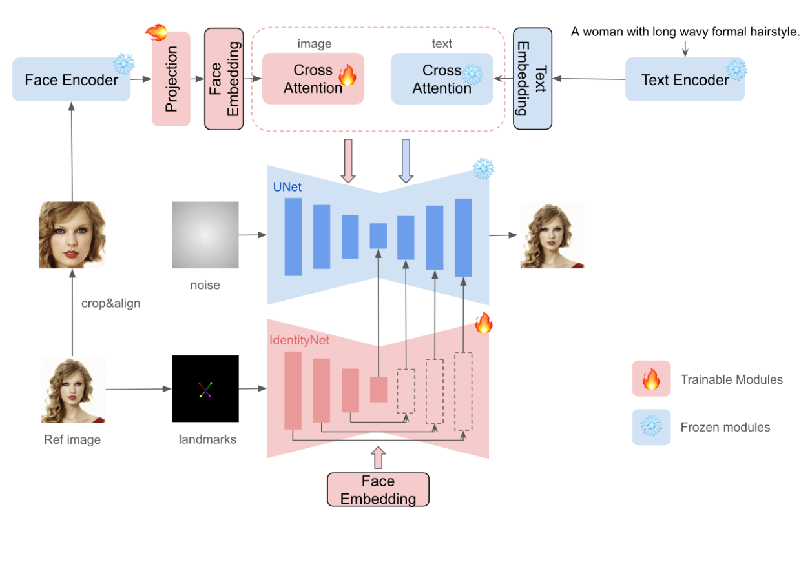</button>
<figcaption><strong>识别身份与约束面部位置的双路径</strong><a href="https://arxiv.org/abs/2401.07519v2">InstantID: Zero-shot Identity-Preserving Generation in Seconds</a> · Figure 2 · version 2401.07519v2 · PDF p.7 / printed p.7
<button class="original-direct" type="button">Read original size</button>

Original caption &amp; source

Fig. 2. The overall pipeline of our proposed InstantID. Our model consists of
three parts to maintain high facial fidelity. First, we adopt a face encoder instead of
CLIP to extract semantic face features and use a trainable projection layer to project
them to the space of text features. We take the projected feature as face embedding.
Then, a lightweight adaptive module with decoupled cross-attention is introduced to
support images as prompts. Finally, we propose IdentityNet to encode complex features
in reference facial images with additional weak spatial control. In IdentityNet, the
generation process is fully guided by face embedding without any textual information.
Only newly added modules are updated, while the pre-trained text-to-image model
remains frozen to ensure flexibility. After training, users can generate ID-preserving
images of any style in high fidelity for free.
<a class="source-url" href="https://arxiv.org/pdf/2401.07519v2">https://arxiv.org/pdf/2401.07519v2</a>
</figcaption></figure>

读图先区分照片中的身份向量与关键点图，再看两路如何进入冻结 SDXL。身份说明“是谁”，关键点说明“脸怎么摆”。它避免每用户微调，但共享训练使用大规模人像和 48×H800；原论文没有可用于全面排名的统一定量表。

<figure id="fig-instantid-f5"><button class="paper-image" type="button" aria-label="Zoom: 不同外观与画风的可行性示例">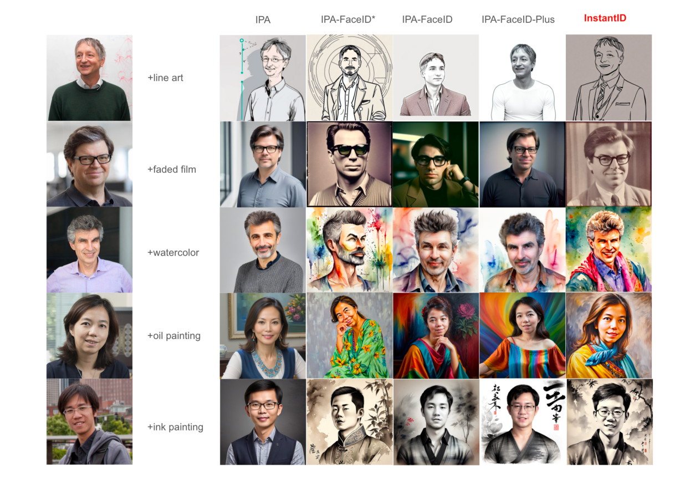</button>
<figcaption><strong>不同外观与画风的可行性示例</strong><a href="https://arxiv.org/abs/2401.07519v2">InstantID: Zero-shot Identity-Preserving Generation in Seconds</a> · Figure 5 · version 2401.07519v2 · PDF p.12 / printed p.12
<button class="original-direct" type="button">Read original size</button>

Original caption &amp; source

Fig. 5. Comparison of InstantID with other methods conditioned on dif-
ferent characters and styles. From left to right are IP-Adapter-SDXL, IP-
Adapter-SDXL-FaceID (* indicates experimental version), IP-Adapter-SD1.5-FaceID,
IP-Adapter-SD1.5-FaceID-Plus. As shown in the figure, we found that the IP-Adapter
that relies on CLIP embedding cannot achieve facial fidelity, and also leads to the
degradation of prompt control to generate styles. IP-Adapter-FaceID introduces face
embedding, which improves face fidelity, but it still cannot achieve high fidelity. IP-
Adapter-FaceID-Plus combines the embedding of face and CLIP, which can achieve
good facial fidelity, but there is a style degradation problem, resulting in the face be-
ing unable to blend into the background style. In contrast, our proposed InstantID is
compatible with various styles while maintaining high fidelity.
<a class="source-url" href="https://arxiv.org/pdf/2401.07519v2">https://arxiv.org/pdf/2401.07519v2</a>
</figcaption></figure>

横向比较输入身份和不同方法的输出，关注五官是否持续可识别以及风格是否执行。这是定性图库，不能将几张精心展示的图换算为成功率；与不同 IP 变体的条件／权重也应一起核对。

<figure id="fig-instantid-f9"><button class="paper-image" type="button" aria-label="Zoom: 身份支路和结构支路各有强度">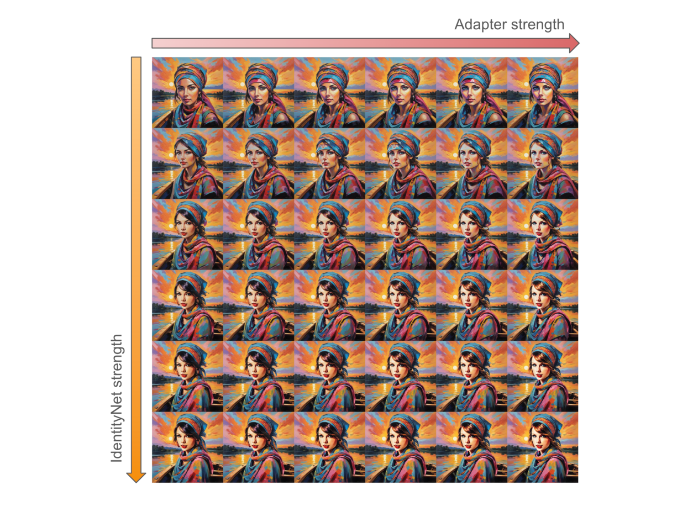</button>
<figcaption><strong>身份支路和结构支路各有强度</strong><a href="https://arxiv.org/abs/2401.07519v2">InstantID: Zero-shot Identity-Preserving Generation in Seconds</a> · Figure 9 · version 2401.07519v2 · PDF p.17 / printed p.17
<button class="original-direct" type="button">Read original size</button>

Original caption &amp; source

Fig. 9. Effect of Image Adapter and IdentityNet. The x-axis and y-axis corre-
spond to the weight strength of Image Adapter and IdentityNet respectively.
<a class="source-url" href="https://arxiv.org/pdf/2401.07519v2">https://arxiv.org/pdf/2401.07519v2</a>
</figcaption></figure>

网格的两个方向分别改变适配器与 IdentityNet 强度。强身份可能压制风格，强几何可能固定表情与朝向。它给出可调的接口，而非一个适合所有场景的万能数值。多人参考在原方法里还可以平均 embedding，平均小林与另一个人会生成混合身份，不能用它代替人物地址。

### PuLID：不仅让脸像，还尽量保留原文本生成行为

PuLID <a href="#source-10">[10]</a> 观察到：加入身份常把布局和风格一起改坏。训练时，它运行一条同图重建路径，以及一条四步 SDXL-Lightning 完整生成轨迹；用相同提示和 seed 比较有身份与无身份输出，约束身份带来的扰动。

<figure id="fig-pulid-f2"><button class="paper-image" type="button" aria-label="Zoom: 训练阶段同时监督身份和完整生成轨迹">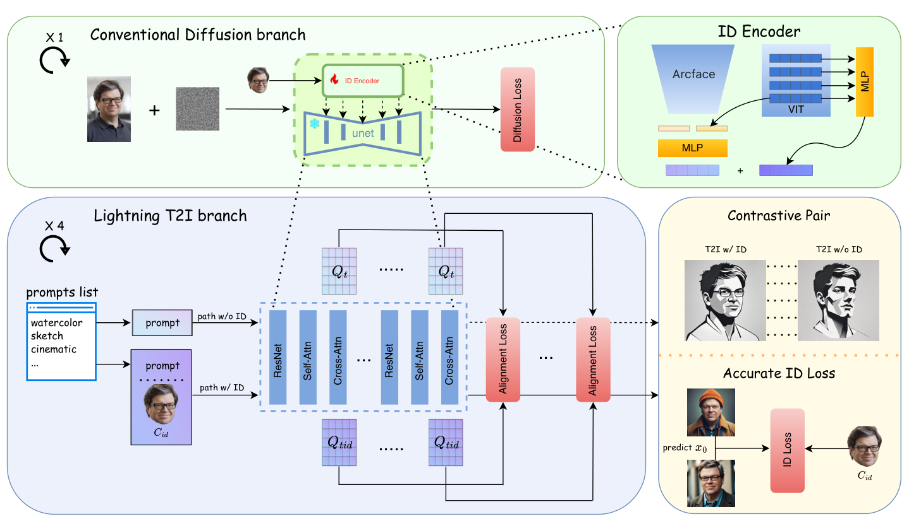</button>
<figcaption><strong>训练阶段同时监督身份和完整生成轨迹</strong><a href="https://arxiv.org/abs/2404.16022v2">PuLID: Pure and Lightning ID Customization via Contrastive Alignment</a> · Figure 2 · version 2404.16022v2 · PDF p.4 / printed p.4
<button class="original-direct" type="button">Read original size</button>

Original caption &amp; source

Figure 2: Overview of PuLID framework. The upper half of the framework illustrates the con-
ventional diffusion training process. The face extracted from the same image is employed as the
ID condition Cid. The lower half of the framework demonstrates the Lightning T2I training branch
introduced in this study. It leverages the recent fast sampling methods to iteratively denoise from pure
noise to high-quality images in a few steps (4 in this paper). In this branch, we construct contrastive
paths with and without ID injection and introduce an alignment loss to instruct the model on how
to insert ID condition without disrupting the original model’s behavior. As this branch can produce
photo-realistic images, it implies that we can achieve a more accurate ID loss for optimization.
<a class="source-url" href="https://arxiv.org/pdf/2404.16022v2">https://arxiv.org/pdf/2404.16022v2</a>
</figcaption></figure>

先看普通重建，再看完整去噪的有／无身份双路径。清晰的生成图更适合计算人脸损失，文字／布局对齐损失压住副作用。这些是共享预训练损失，推理时并不是每一步重新运行优化闭环。

<figure id="fig-pulid-f3"><button class="paper-image" type="button" aria-label="Zoom: 注意力对齐保护文字语义与布局">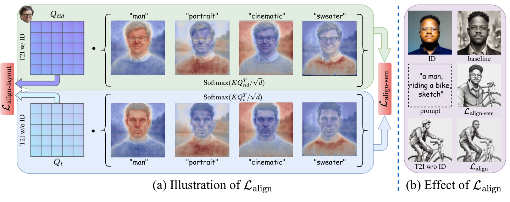</button>
<figcaption><strong>注意力对齐保护文字语义与布局</strong><a href="https://arxiv.org/abs/2404.16022v2">PuLID: Pure and Lightning ID Customization via Contrastive Alignment</a> · Figure 3 · version 2404.16022v2 · PDF p.6 / printed p.6
<button class="original-direct" type="button">Read original size</button>

Original caption &amp; source

Figure 3: Illustration and Effect of the alignment loss.
<a class="source-url" href="https://arxiv.org/pdf/2404.16022v2">https://arxiv.org/pdf/2404.16022v2</a>
</figcaption></figure>

图中通过文字键和图像查询聚合语义响应，并用较弱查询差异约束布局。小林身份可以改变脸部外观，但不应把“牵狗”改成“坐着”。对齐仍是代理约束，没有严格的空间外像素保证。

<figure id="fig-pulid-t1"><button class="paper-image" type="button" aria-label="Zoom: CLIP-I 在这里比较的是有身份与无身份输出">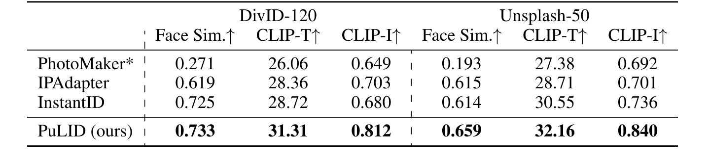</button>
<figcaption><strong>CLIP-I 在这里比较的是有身份与无身份输出</strong><a href="https://arxiv.org/abs/2404.16022v2">PuLID: Pure and Lightning ID Customization via Contrastive Alignment</a> · Table 1 · version 2404.16022v2 · PDF p.8 / printed p.8
<button class="original-direct" type="button">Read original size</button>

Original caption &amp; source

Table 1: Quantitative comparisons. *We observed that PhotoMaker shows limited compatibility
with SDXL-Lightning, hence, we compare its performance on SDXL-base in this table.
<a class="source-url" href="https://arxiv.org/pdf/2404.16022v2">https://arxiv.org/pdf/2404.16022v2</a>
</figcaption></figure>

DivID120／Unsplash50 采用独立 CurricularFace 评身份。特别注意该表 CLIP-I 的两端是**同提示同 seed 的有身份输出和普通文生图输出**，不是生成图与参考人像。带星号的 PhotoMaker 用 SDXL，其他一些行使用 Lightning，不能据此把吞吐和所有质量差异归因于身份模块。

<figure id="fig-pulid-t2"><button class="paper-image" type="button" aria-label="Zoom: 身份监督与对齐监督把结果推向不同方向">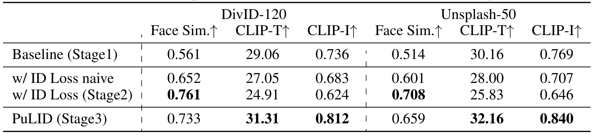</button>
<figcaption><strong>身份监督与对齐监督把结果推向不同方向</strong><a href="https://arxiv.org/abs/2404.16022v2">PuLID: Pure and Lightning ID Customization via Contrastive Alignment</a> · Table 2 · version 2404.16022v2 · PDF p.9 / printed p.9
<button class="original-direct" type="button">Read original size</button>

Original caption &amp; source

Table 2: Quantitative comparisons for ablation studies on ID loss and alignment loss.
<a class="source-url" href="https://arxiv.org/pdf/2404.16022v2">https://arxiv.org/pdf/2404.16022v2</a>
</figcaption></figure>

DivID120 消融中，加入更强身份监督使 ID 0.561→0.761，同时 CLIP-T 29.06→24.91、CLIP-I 0.736→0.624；再加对齐后 ID 0.733、CLIP-T 31.31、CLIP-I 0.812。这是明确的“脸更像但指令受损，再找平衡”的证据。当前官方 FLUX 变体与原 SDXL 表不是同一模型。

### ConsistentID：身份还包括可定位的五官细节

ConsistentID <a href="#source-11">[11]</a> 把整体 FaceIDPlus 特征、面部分割、局部视觉特征与五官描述合并。描述 token 挂到具体面部部件上，并用定位损失约束注意力；推理先形成文字内容，再延迟注入细粒度脸部条件。

<figure id="fig-consistentid-f2"><button class="paper-image" type="button" aria-label="Zoom: 整体身份和局部描述沿两路融合">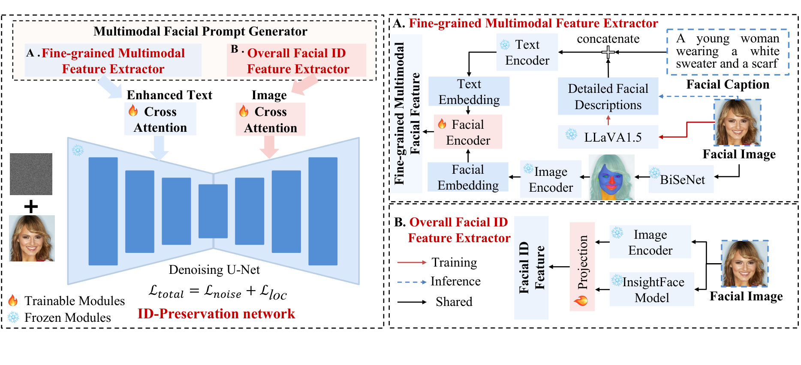</button>
<figcaption><strong>整体身份和局部描述沿两路融合</strong><a href="https://arxiv.org/abs/2404.16771v2">ConsistentID: Portrait Generation with Multimodal Fine-Grained Identity Preserving</a> · Figure 2 · version 2404.16771v2 · PDF p.4 / printed p.4
<button class="original-direct" type="button">Read original size</button>

Original caption &amp; source

Fig. 2: The overall framework of our proposed ConsistentID. The framework comprises two key modules: a multimodal facial ID
generator and a purposefully crafted ID-preservation network. The multimodal facial prompt generator consists of two essential
components: a fine-grained multimodal feature extractor, which focuses on capturing detailed facial information, and a facial ID feature
extractor dedicated to learning facial ID features. On the other hand, the ID-preservation network utilizes both facial textual and visual
prompts, preventing the blending of ID information from different facial regions through the facial attention localization strategy. This
approach ensures the preservation of ID consistency in the facial regions.
<a class="source-url" href="https://arxiv.org/pdf/2404.16771v2">https://arxiv.org/pdf/2404.16771v2</a>
</figcaption></figure>

整体路径维持可识别身份，局部路径补眼、鼻、耳、嘴等细节。它比只给一个人脸向量更有局部信息，但依赖分割与特征提取质量；转头遮挡、夸张卡通等超出常规人脸分布时仍难处理。

<figure id="fig-consistentid-f3"><button class="paper-image" type="button" aria-label="Zoom: 局部 token 的注意力应该集中到对应五官">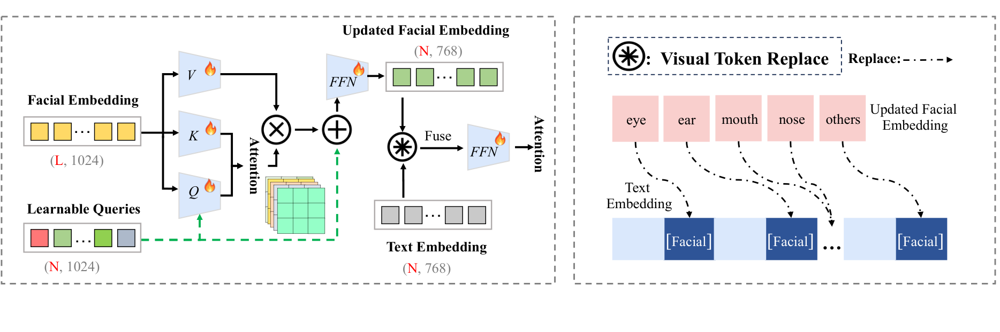</button>
<figcaption><strong>局部 token 的注意力应该集中到对应五官</strong><a href="https://arxiv.org/abs/2404.16771v2">ConsistentID: Portrait Generation with Multimodal Fine-Grained Identity Preserving</a> · Figure 3 · version 2404.16771v2 · PDF p.5 / printed p.5
<button class="original-direct" type="button">Read original size</button>

Original caption &amp; source

Fig. 3: The framework of our facial encoder for generating fine-grained multimodal facial features.
<a class="source-url" href="https://arxiv.org/pdf/2404.16771v2">https://arxiv.org/pdf/2404.16771v2</a>
</figcaption></figure>

图示分割区域与 token 的连接。原公式实际比较区域外与区域内的平均注意力，不能简单称普通 L1 蒙版回归。推理可以采用固定五官描述，不是每张图都必须现场跑 LLaVA。

<figure id="fig-consistentid-t3"><button class="paper-image" type="button" aria-label="Zoom: 高身份分数伴随不同骨干和质量差异"></button>
<figcaption><strong>高身份分数伴随不同骨干和质量差异</strong><a href="https://arxiv.org/abs/2404.16771v2">ConsistentID: Portrait Generation with Multimodal Fine-Grained Identity Preserving</a> · Table 3 · version 2404.16771v2 · PDF p.8 / printed p.8
<button class="original-direct" type="button">Read original size</button>

Original caption &amp; source

TABLE 3: Quantitative comparison of the universal recontextualization setting on the MyStyle test dataset. The benchmark metrics
assessed text consistency (CLIP-T), the preservation of coarse- and fine-grained ID information (CLIP-I, DINO, FaceSIM, and FGIS),
generation quality (FID), and inference efficiency (speed in seconds).
<a class="source-url" href="https://arxiv.org/pdf/2404.16771v2">https://arxiv.org/pdf/2404.16771v2</a>
</figcaption></figure>

作者 MyStyle 测试中 FaceSim 77.2、FGIS 81.4 都是相似度型分数；ConsistentID 用 SD1.5，部分对照用 SDXL。FID 312.4 还差于 InstantID 271.9，越低越好。故此表支持局部身份路线的潜力，不构成同骨干的全面优越性证明。

<figure id="fig-consistentid-t4"><button class="paper-image" type="button" aria-label="Zoom: 局部注意力的消融改善细节表征">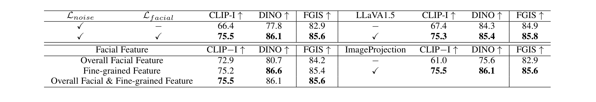</button>
<figcaption><strong>局部注意力的消融改善细节表征</strong><a href="https://arxiv.org/abs/2404.16771v2">ConsistentID: Portrait Generation with Multimodal Fine-Grained Identity Preserving</a> · Table 4 · version 2404.16771v2 · PDF p.9 / printed p.9
<button class="original-direct" type="button">Read original size</button>

Original caption &amp; source

TABLE 4: Ablation study on ID features, loss functions, ImageProjection module, and the usage of LLaVA1.5 in training.
<a class="source-url" href="https://arxiv.org/pdf/2404.16771v2">https://arxiv.org/pdf/2404.16771v2</a>
</figcaption></figure>

对应消融 CLIP-I 66.4→75.5、DINO 77.8→86.1、FGIS 82.9→85.6。需要以表中各组设置为单位比较，不能把另一组 LLaVA 消融拼成同一控制实验。局部相似度上升也没有自动证明商标、狗斑纹或非人角色都能用同一面部机制。

## 5. 从脸到全身、物体和多种素材

### InstantCharacter：非人角色不能只靠人脸识别

InstantCharacter <a href="#source-12">[12]</a> 把角色主体扩展到全身、人类与非人类外观。SigLIP 和 DINOv2 特征结合浅层细节与分块高分辨率信息，用时刻感知 Q-Former 送入 DiT。它需要既有单图重建又有不同姿态／画风的配对数据。

<figure id="fig-character-f2"><button class="paper-image" type="button" aria-label="Zoom: 多层、多块视觉特征与时刻感知查询">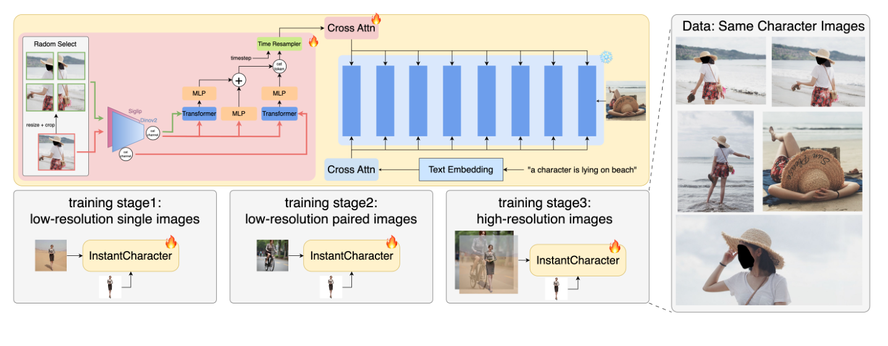</button>
<figcaption><strong>多层、多块视觉特征与时刻感知查询</strong><a href="https://arxiv.org/abs/2504.12395v1">InstantCharacter: Personalize Any Characters with a Scalable Diffusion Transformer Framework</a> · Figure 2 · version 2504.12395v1 · PDF p.3 / printed p.3
<button class="original-direct" type="button">Read original size</button>

Original caption &amp; source

Figure 2: Our framework seamlessly integrates a scalable adapter with a pretrained DiT model.
The adapter consists of multiple stacked transformer encoders that incrementally refine character
representations, enabling effective interaction with the latent space of the DiT. The training process
employs a three-stage progressive strategy, beginning with unpaired low-resolution pretraining and
culminating in paired high-resolution fine-tuning.
<a class="source-url" href="https://arxiv.org/pdf/2504.12395v1">https://arxiv.org/pdf/2504.12395v1</a>
</figcaption></figure>

从参考图到两类编码器，浅层／分块流保留纹理与局部结构，再由查询模块压缩并随去噪时刻调节。早期需要角色结构，后期需要服装与局部细节。团子没有人类 ArcFace embedding，通用视觉与全身角色表征更合适。

<figure id="fig-character-f3"><button class="paper-image" type="button" aria-label="Zoom: 角色类别、姿态与风格的定性比较">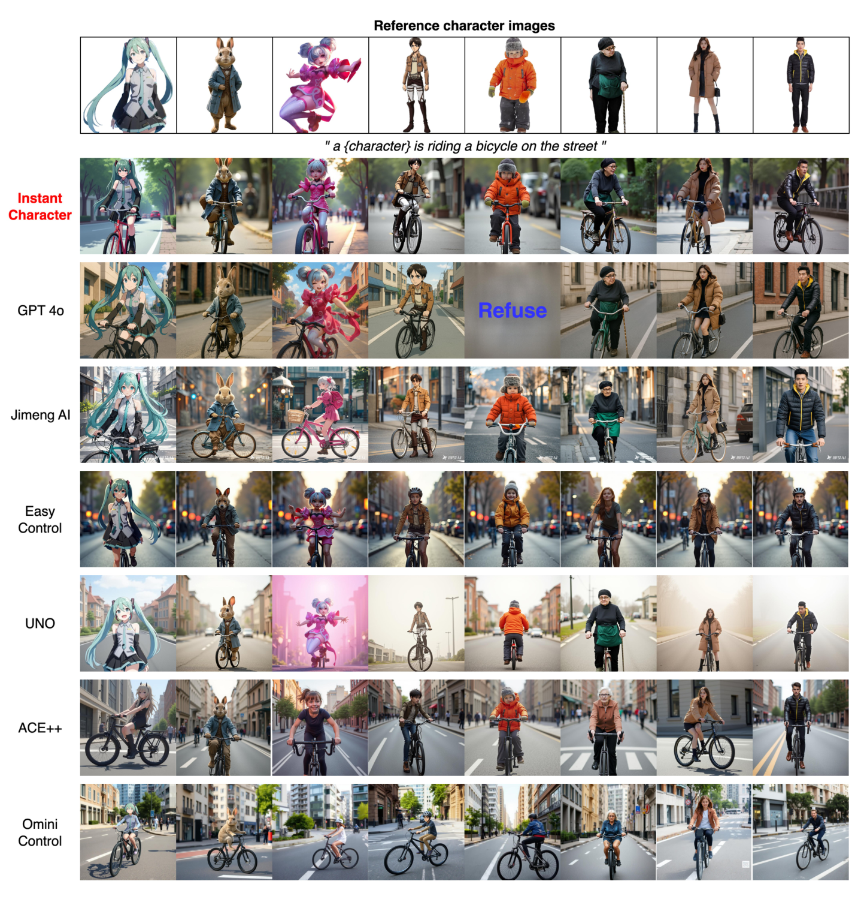</button>
<figcaption><strong>角色类别、姿态与风格的定性比较</strong><a href="https://arxiv.org/abs/2504.12395v1">InstantCharacter: Personalize Any Characters with a Scalable Diffusion Transformer Framework</a> · Figure 3 · version 2504.12395v1 · PDF p.5 / printed p.5
<button class="original-direct" type="button">Read original size</button>

Original caption &amp; source

Figure 3: Qualitative comparison on character personalization. Our method generally demonstrates
the best image fidelity and character consistency while maintaining the desirable textual controllabil-
ity.
<a class="source-url" href="https://arxiv.org/pdf/2504.12395v1">https://arxiv.org/pdf/2504.12395v1</a>
</figcaption></figure>

图中对照真人、动物或虚构形象，检查外形、服装与标识，而非只找人脸。十百万级角色数据与三阶段训练提供能力来源；图库没有随机采样成功率或分组置信区间。

<figure id="fig-character-f5"><button class="paper-image" type="button" aria-label="Zoom: 同一角色在风格变化下的外观保持">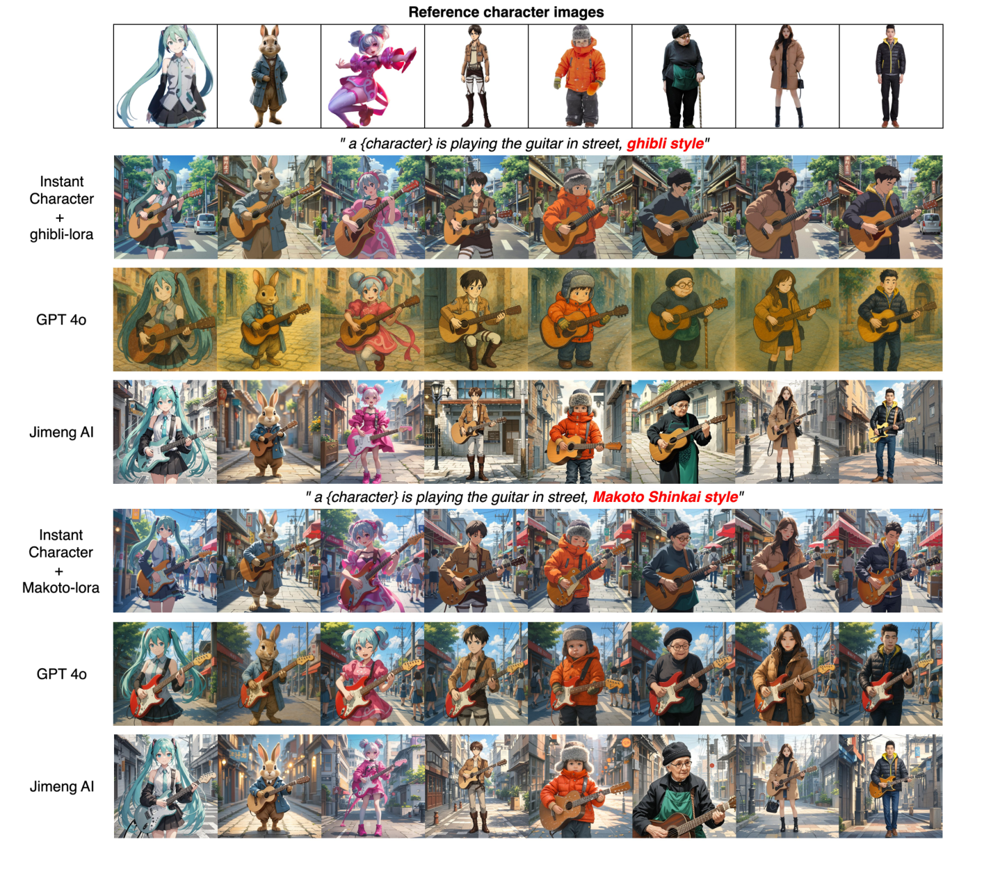</button>
<figcaption><strong>同一角色在风格变化下的外观保持</strong><a href="https://arxiv.org/abs/2504.12395v1">InstantCharacter: Personalize Any Characters with a Scalable Diffusion Transformer Framework</a> · Figure 5 · version 2504.12395v1 · PDF p.7 / printed p.7
<button class="original-direct" type="button">Read original size</button>

Original caption &amp; source

Figure 5: Qualitative comparison on character personalization with different styles.
<a class="source-url" href="https://arxiv.org/pdf/2504.12395v1">https://arxiv.org/pdf/2504.12395v1</a>
</figcaption></figure>

同一角色跨表现方式，展示参考图可迁移的信息。原九页 PDF 没有可核验的定量主表，正文所称另一幅图的“quantitative measurements”实际是定性图库，因此本文只把它作为机制和示例证据，不能确认它在角色保持上排名第一。

### DreamO：把多类参考写入图像 latent，并监督路由

DreamO <a href="#source-13">[13]</a> 面向身份、物体、风格和试衣等多类定制。参考经 FLUX VAE 编码，与目标噪声 token 拼接；不同参考拥有条件索引与空间编码，`ref#i` 指示希望读取哪张参考。它训练 rank 128、约 478M 可训练参数的共享 LoRA，用户推理不必重新训练。

<figure id="fig-dreamo-f2"><button class="paper-image" type="button" aria-label="Zoom: 参考 latent、索引与文字一起进入生成器">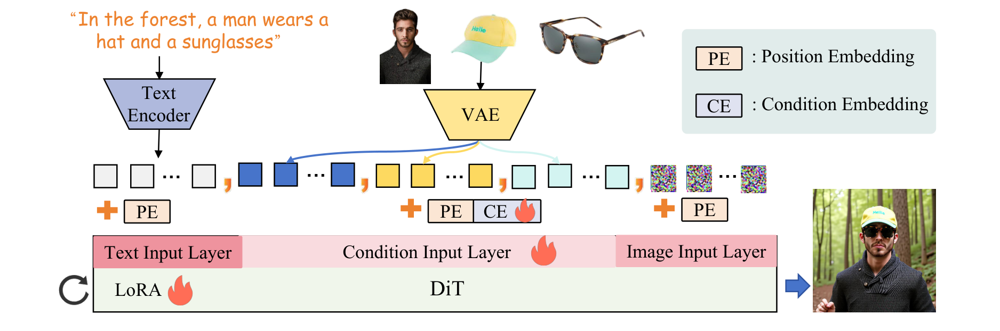</button>
<figcaption><strong>参考 latent、索引与文字一起进入生成器</strong><a href="https://arxiv.org/abs/2504.16915v5">DreamO: A Unified Framework for Image Customization</a> · Figure 2 · version 2504.16915v5 · PDF p.3 / printed p.3
<button class="original-direct" type="button">Read original size</button>

Original caption &amp; source

Fig. 2. Overview of our proposed DreamO, which can uniformly handle commonly used consistency-aware generation control.
<a class="source-url" href="https://arxiv.org/pdf/2504.16915v5">https://arxiv.org/pdf/2504.16915v5</a>
</figcaption></figure>

图中信息不像原 IP-Adapter 只浓缩为四个全局 token，而保留参考空间 latent。索引让第二张参考与第一张可区分；索引本身仍不保证“第二张衣服一定属于小林”，需要后续监督。

<figure id="fig-dreamo-f3"><button class="paper-image" type="button" aria-label="Zoom: 参考到目标区域的路由受到训练约束">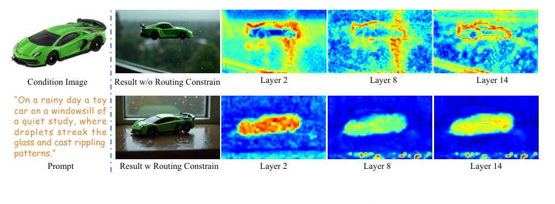</button>
<figcaption><strong>参考到目标区域的路由受到训练约束</strong><a href="https://arxiv.org/abs/2504.16915v5">DreamO: A Unified Framework for Image Customization</a> · Figure 3 · version 2504.16915v5 · PDF p.4 / printed p.4
<button class="original-direct" type="button">Read original size</button>

Original caption &amp; source

Fig. 3. Visualization of cross-attention maps in subject-driven image gen-
eration. The first row shows results from a model trained without routing
constraints, while the second row presents results from a model trained
with routing constraints.
<a class="source-url" href="https://arxiv.org/pdf/2504.16915v5">https://arxiv.org/pdf/2504.16915v5</a>
</figcaption></figure>

图中参考条件 query 与输出 key 的响应被聚合，并监督到目标主体蒙版。对广告例子，杯子参考应影响杯子区域，狗参考应影响狗区域。这个训练信号才给索引语义地址，单纯不同 RoPE 坐标没有同等保证。

<figure id="fig-dreamo-f4"><button class="paper-image" type="button" aria-label="Zoom: 主体、综合任务、质量的分阶段训练">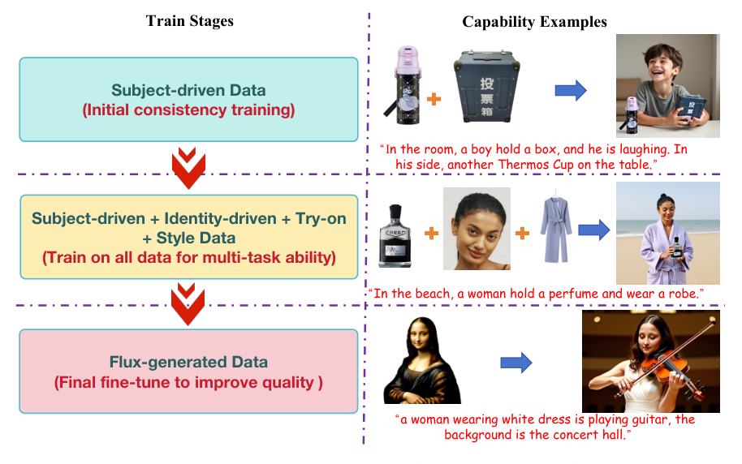</button>
<figcaption><strong>主体、综合任务、质量的分阶段训练</strong><a href="https://arxiv.org/abs/2504.16915v5">DreamO: A Unified Framework for Image Customization</a> · Figure 4 · version 2504.16915v5 · PDF p.4 / printed p.4
<button class="original-direct" type="button">Read original size</button>

Original caption &amp; source

Fig. 4. The progressive training pipeline of our method. Left column shows
the three training stages of our method. Right column shows the generation
capability after the training of each stage.
<a class="source-url" href="https://arxiv.org/pdf/2504.16915v5">https://arxiv.org/pdf/2504.16915v5</a>
</figcaption></figure>

训练先学主体，再扩展任务，最后提升质量；混合了真实／合成身份、风格、试衣数据。后期在自重建样本中丢掉 95% 参考 token，减少复制输入。数据与阶段同时变化，因此不能把最终收益全部归因于某一个路由模块。

<figure id="fig-dreamo-t1"><button class="paper-image" type="button" aria-label="Zoom: 单主体指标采用背景去除后的 DreamBench">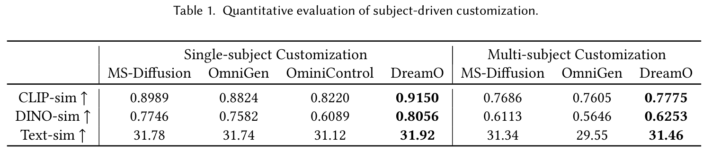</button>
<figcaption><strong>单主体指标采用背景去除后的 DreamBench</strong><a href="https://arxiv.org/abs/2504.16915v5">DreamO: A Unified Framework for Image Customization</a> · Table 1 · version 2504.16915v5 · PDF p.7 / printed p.7
<button class="original-direct" type="button">Read original size</button>

Original caption &amp; source

Table 1. Quantitative evaluation of subject-driven customization.
<a class="source-url" href="https://arxiv.org/pdf/2504.16915v5">https://arxiv.org/pdf/2504.16915v5</a>
</figcaption></figure>

DreamO DINO 0.8056 对 OmniGen 0.7582，文字分数 31.92 对 31.74。这里去除了背景，不是 DreamBooth 原版全图 DINO 的同一协议，不能直接与 0.668 跨表排名。主体蒙版怎样生成也会影响数值。

同表的多主体组使用 20 对主体、25 个提示、四个 seed，DreamO DINO 0.6253 对 OmniGen 0.5646。它测试组合使用参考，仍不等于针对多人的漏人、重复身份和串脸全指标。

<figure id="fig-dreamo-t2"><button class="paper-image" type="button" aria-label="Zoom: 风格特征与文字内容分别评价">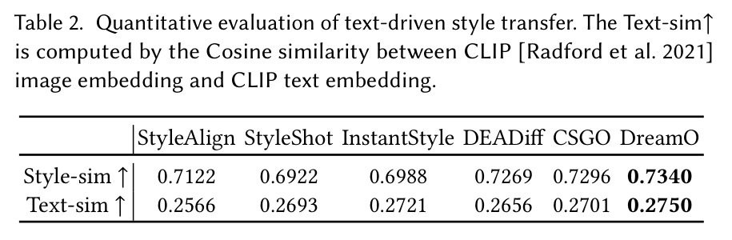</button>
<figcaption><strong>风格特征与文字内容分别评价</strong><a href="https://arxiv.org/abs/2504.16915v5">DreamO: A Unified Framework for Image Customization</a> · Table 2 · version 2504.16915v5 · PDF p.7 / printed p.7
<button class="original-direct" type="button">Read original size</button>

Original caption &amp; source

Table 2. Quantitative evaluation of text-driven style transfer. The Text-sim↑
is computed by the Cosine similarity between CLIP [Radford et al. 2021]
image embedding and CLIP text embedding.
<a class="source-url" href="https://arxiv.org/pdf/2504.16915v5">https://arxiv.org/pdf/2504.16915v5</a>
</figcaption></figure>

249 张风格图、24 个提示、每方法 5,976 张结果，用 CSD 特征余弦评风格、CLIP 图文余弦评文字内容。DreamO 风格 0.7340、文字 0.2750，对 CSGO 0.7296、0.2701。这是作者风格协议，不是多主体身份表；风格参考里的物体是否泄漏仍需逐图检查，不能由平均风格余弦排除。

<figure id="fig-dreamo-t3"><button class="paper-image" type="button" aria-label="Zoom: 人脸参考在独立编码器下的结果">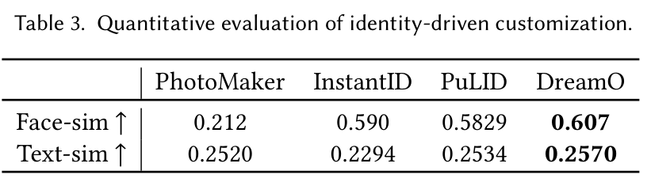</button>
<figcaption><strong>人脸参考在独立编码器下的结果</strong><a href="https://arxiv.org/abs/2504.16915v5">DreamO: A Unified Framework for Image Customization</a> · Table 3 · version 2504.16915v5 · PDF p.7 / printed p.7
<button class="original-direct" type="button">Read original size</button>

Original caption &amp; source

Table 3. Quantitative evaluation of identity-driven customization.
<a class="source-url" href="https://arxiv.org/pdf/2504.16915v5">https://arxiv.org/pdf/2504.16915v5</a>
</figcaption></figure>

Unsplash50、每人九个提示，CurricularFace 0.607 对 PuLID 0.5829，CLIP-T 0.257 对 0.2534。与 PhotoMaker 的 FaceNet、WithAnyone 的 ArcFace 数值不可直接互换。原文 Turbo 的约十秒／1024²没有明确推理 GPU，不能作通用硬件承诺。

<figure id="fig-dreamo-t4"><button class="paper-image" type="button" aria-label="Zoom: 试衣保真与文字遵循也存在取舍"></button>
<figcaption><strong>试衣保真与文字遵循也存在取舍</strong><a href="https://arxiv.org/abs/2504.16915v5">DreamO: A Unified Framework for Image Customization</a> · Table 4 · version 2504.16915v5 · PDF p.7 / printed p.7
<button class="original-direct" type="button">Read original size</button>

Original caption &amp; source

Table 4. Quantitative evaluation of try-on.
<a class="source-url" href="https://arxiv.org/pdf/2504.16915v5">https://arxiv.org/pdf/2504.16915v5</a>
</figcaption></figure>

300 件衣服、每件十个提示中，IMAG 的衣物 CLIP 0.8405 高于 DreamO 0.7613，但文字分数 17.74 低于 30.47。保住衣服纹理和执行新姿态场景仍是两轴；商品素材选择不能只看表中一个最高值。

<figure id="fig-dreamo-t5"><button class="paper-image" type="button" aria-label="Zoom: 去掉路由约束后，多主体保持下降"></button>
<figcaption><strong>去掉路由约束后，多主体保持下降</strong><a href="https://arxiv.org/abs/2504.16915v5">DreamO: A Unified Framework for Image Customization</a> · Table 5 · version 2504.16915v5 · PDF p.7 / printed p.7
<button class="original-direct" type="button">Read original size</button>

Original caption &amp; source

Table 5. Ablation study of different model settings in multi-subject-driven
customization.
<a class="source-url" href="https://arxiv.org/pdf/2504.16915v5">https://arxiv.org/pdf/2504.16915v5</a>
</figcaption></figure>

DINO 0.5540 对完整模型 0.6253，支持区域路由的价值。这个特征指标不直接统计人物一对一对应，尤其需要另测串脸与属性错绑。

<figure id="fig-dreamo-f6"><button class="paper-image" type="button" aria-label="Zoom: 交换 ref 编号会交换被请求的素材"></button>
<figcaption><strong>交换 ref 编号会交换被请求的素材</strong><a href="https://arxiv.org/abs/2504.16915v5">DreamO: A Unified Framework for Image Customization</a> · Figure 6 · version 2504.16915v5 · PDF p.8 / printed p.8
<button class="original-direct" type="button">Read original size</button>

Original caption &amp; source

Fig. 6. The ablation study of the placeholder-to-image routing constraint.
<a class="source-url" href="https://arxiv.org/pdf/2504.16915v5">https://arxiv.org/pdf/2504.16915v5</a>
</figcaption></figure>

看文字中编号与输出主体的变化，可以理解显式寻址的用处。让同一个杯子分别出现在不同角色手里，比“多给两张图片”更需要指令绑定。示例证明接口可用，不能证明所有复杂组合都成功。

### XVerse：参考信息进入 token 对应的调制

XVerse <a href="#source-33">[33]</a> 把参考引导放到 FLUX 的调制路径：文字 token 作为查询从视觉特征提取信息，产生对应 token 的 scale／shift／残差门控偏移。再在 **single-stream blocks，复数**中补充参考 VAE 信息，避免把所有参考细节无选择地塞进所有层。

<figure id="fig-xverse-f2"><button class="paper-image" type="button" aria-label="Zoom: 文字地址、调制偏移与局部细节互补"></button>
<figcaption><strong>文字地址、调制偏移与局部细节互补</strong><a href="https://arxiv.org/abs/2506.21416v1">XVerse: Consistent Multi-Subject Control of Identity and Semantic Attributes via DiT Modulation</a> · Figure 2 · version 2506.21416v1 · PDF p.4 / printed p.4
<button class="original-direct" type="button">Read original size</button>

Original caption &amp; source

Figure 2: Overview of the XVerse framework. The reference images are processed by a T-Mod Re-
sampler and subsequently injected into the per-token modulation adapter. Additionally, to supplement
image details, the VAE-encoded features of the reference image are also utilized as input to the single
block of DiTs.
<a class="source-url" href="https://arxiv.org/pdf/2506.21416v1">https://arxiv.org/pdf/2506.21416v1</a>
</figcaption></figure>

T-Mod 提取与特定词相关的视觉内容，调制影响该词的生成；共享与逐 block 偏移承担不同层级。单流模块中的 VAE 参考补细节，图注“single block”不应误读成仅一个 Transformer block。训练另用区域保持与注意力损失，使未注入参考的一侧尽量保留基座生成行为；这约束的是训练中的预测，不是源图像素原样输出。

<figure id="fig-xverse-t1"><button class="paper-image" type="button" aria-label="Zoom: 单主体、多主体与总平均要分栏读"></button>
<figcaption><strong>单主体、多主体与总平均要分栏读</strong><a href="https://arxiv.org/abs/2506.21416v1">XVerse: Consistent Multi-Subject Control of Identity and Semantic Attributes via DiT Modulation</a> · Table 1 · version 2506.21416v1 · PDF p.8 / printed p.8
<button class="original-direct" type="button">Read original size</button>

Original caption &amp; source

Table 1: Quantitative results of single-subject and multi-subject driven generation on XVerseBench.
<a class="source-url" href="https://arxiv.org/pdf/2506.21416v1">https://arxiv.org/pdf/2506.21416v1</a>
</figcaption></figure>

XVerseBench 包括 300 个提示、单／双／三主体，素材来自人、物体和动物。多主体 ID 66.59、图像 71.48，对 OmniGen2 的 40.81、67.15。**多主体 AVG 是 70.08，Overall 是 73.40**；原正文将后者写成多主体值，本文依原表。不同指标的混合平均不宜跨论文直接排名。

<figure id="fig-xverse-f6"><button class="paper-image" type="button" aria-label="Zoom: VAE 参考恢复调制路径遗漏的细节"></button>
<figcaption><strong>VAE 参考恢复调制路径遗漏的细节</strong><a href="https://arxiv.org/abs/2506.21416v1">XVerse: Consistent Multi-Subject Control of Identity and Semantic Attributes via DiT Modulation</a> · Figure 6 · version 2506.21416v1 · PDF p.9 / printed p.9
<button class="original-direct" type="button">Read original size</button>

Original caption &amp; source

Figure 6: Effect of text-stream modulation resam-
pler and VAE-encoded image features.
<a class="source-url" href="https://arxiv.org/pdf/2506.21416v1">https://arxiv.org/pdf/2506.21416v1</a>
</figcaption></figure>

对照有／无 VAE 路径，服装、局部装饰等高频信息更易保留。它是定性消融，未提供同图相应数值，不能量化为确定百分比提升。

<figure id="fig-xverse-f7"><button class="paper-image" type="button" aria-label="Zoom: 不同主体和姿态的组合"></button>
<figcaption><strong>不同主体和姿态的组合</strong><a href="https://arxiv.org/abs/2506.21416v1">XVerse: Consistent Multi-Subject Control of Identity and Semantic Attributes via DiT Modulation</a> · Figure 7 · version 2506.21416v1 · PDF p.9 / printed p.9
<button class="original-direct" type="button">Read original size</button>

Original caption &amp; source

Figure 7: The control of sementic attributes, such
as cloth, pose, lighting, and style.
<a class="source-url" href="https://arxiv.org/pdf/2506.21416v1">https://arxiv.org/pdf/2506.21416v1</a>
</figcaption></figure>

参考与文字的对应使服装、物体、角色可组合。对杯子和狗这种不同类型地址更清楚；外观相近的人仍需要专门身份监督，而非只靠文本地址。

<figure id="fig-xverse-f10"><button class="paper-image" type="button" aria-label="Zoom: 对未注入参考的区域保持基座生成行为"></button>
<figcaption><strong>对未注入参考的区域保持基座生成行为</strong><a href="https://arxiv.org/abs/2506.21416v1">XVerse: Consistent Multi-Subject Control of Identity and Semantic Attributes via DiT Modulation</a> · Figure 10 · version 2506.21416v1 · PDF p.14 / printed p.14
<button class="original-direct" type="button">Read original size</button>

Original caption &amp; source

Figure 10: Illustration of the region preservation loss.
<a class="source-url" href="https://arxiv.org/pdf/2506.21416v1">https://arxiv.org/pdf/2506.21416v1</a>
</figcaption></figure>

原图把两张训练图放在一起，只给一侧参考注入；另一侧的预测速度与基座文本生成分支对齐。区域损失限制参考影响溢出到无关内容，而不是把源图像素直接粘回来。它依赖训练蒙版与基座预测，不能认证广告背景逐像素不变。后续 UMO 使用相近 benchmark 又加入 IDConf，部分基线得到真实位置框，故低分也不能跨论文无条件复用。

这些工作改变的是“参考怎么被读取”。当一张输出里出现三个人，还必须解决“哪个输出脸属于哪个参考”；下一节会把寻址、身份判别和复制偏置拆开。

## 6. 多人物：既要认对人，也要避免复制与串脸

### UMO：用一对一奖励抑制身份混合

UMO <a href="#source-26">[26]</a> 在已有 UNO／OmniGen2 上做奖励微调。最简单的单身份奖励只要求生成脸接近对应参考；多人时，一张混合脸可能与两个人都相似。多身份奖励先做匈牙利匹配，即在所有可能配对中找相似度总和最大的**一对一**分配，再奖励正确配对、惩罚不对应的身份相似。

<figure id="fig-umo-f3"><button class="paper-image" type="button" aria-label="Zoom: 只保留部分采样的梯度，用清晰输出评身份"></button>
<figcaption><strong>只保留部分采样的梯度，用清晰输出评身份</strong><a href="https://arxiv.org/abs/2509.06818v1">UMO: Scaling Multi-Identity Consistency for Image Customization via Matching Reward</a> · Figure 3 · version 2509.06818v1 · PDF p.5 / printed p.5
<button class="original-direct" type="button">Read original size</button>

Original caption &amp; source

Figure 3 Illustration of the training framework of UMO. UMO’s training process follows ReReFL in Algorithm 1 with
Multi-Identity Matching Reward.
<a class="source-url" href="https://arxiv.org/pdf/2509.06818v1">https://arxiv.org/pdf/2509.06818v1</a>
</figcaption></figure>

图中先无梯度运行采样前缀，再保留选定步的梯度，预测清晰图并计算人脸奖励；常规训练目标约束总体生成质量。这降低反向图成本，却没有免掉前缀的前向计算。作者在两种骨干上使用 rank 512 LoRA、8×A100、总 batch 8、学习率 5e-6，不能把“只反传一步”理解成无成本。

一对一奖励的教学简化可写为：

$$
R=\frac1N\sum_{i=1}^{N}s(g_{\pi(i)},r_i)
-\frac{\gamma}{N(N-1)}
\sum_{i=1}^{N}\sum_{j\ne i}s(g_{\pi(i)},r_j).
$$

$r_i$ 是第 $i$ 个参考身份向量，$g$ 是生成脸向量，$s$ 是余弦相似度，$\pi$ 是一对一匹配，$\gamma$ 是非匹配惩罚强度，假设 $N>1$ 且有足够可检测的脸。第一项让小林像小林，第二项避免她同时像另一个人。这是维度清楚的教学改写，省略原实现的不同人数、奖励权重与损失转换；离散匹配本身不光滑，固定匹配后才通过识别 embedding 反传。

<figure id="fig-umo-f4"><button class="paper-image" type="button" aria-label="Zoom: 不同骨干在不同采样阶段才产生可识别身份"></button>
<figcaption><strong>不同骨干在不同采样阶段才产生可识别身份</strong><a href="https://arxiv.org/abs/2509.06818v1">UMO: Scaling Multi-Identity Consistency for Image Customization via Matching Reward</a> · Figure 4 · version 2509.06818v1 · PDF p.6 / printed p.6
<button class="original-direct" type="button">Read original size</button>

Original caption &amp; source

Figure 4 Single identity reward (SIR) scores of UNO [32] and OmniGen2 [31] with different generation seeds along
denoising steps. The scores become stable after step 5 and 10 respectively. And the results with highest and lowest
reward scores indicating its discriminatory ability.
<a class="source-url" href="https://arxiv.org/pdf/2509.06818v1">https://arxiv.org/pdf/2509.06818v1</a>
</figcaption></figure>

图的轨迹展示身份分数随采样推进趋于稳定，UNO 约五步、OmniGen2 约十步出现更稳定的信号。它支持选择奖励计算区间，不能推广成任何模型五步后都能可靠识别人脸；小脸和遮挡会使反馈失效。

<figure id="fig-umo-t2"><button class="paper-image" type="button" aria-label="Zoom: 在 XVerseBench 多人设置中的身份收益"></button>
<figcaption><strong>在 XVerseBench 多人设置中的身份收益</strong><a href="https://arxiv.org/abs/2509.06818v1">UMO: Scaling Multi-Identity Consistency for Image Customization via Matching Reward</a> · Table 2 · version 2509.06818v1 · PDF p.10 / printed p.10
<button class="original-direct" type="button">Read original size</button>

Original caption &amp; source

Table 2 Quantitative results on task type Multi-Subject from XVerseBench. †: We align ID-Conf score with the value
range of the other metrics.
<a class="source-url" href="https://arxiv.org/pdf/2509.06818v1">https://arxiv.org/pdf/2509.06818v1</a>
</figcaption></figure>

UNO→UMO-UNO 的 IDSim 31.82→69.09、IDConf 61.06→78.06；OmniGen2→UMO-OmniGen2 为 40.81→71.59、62.02→77.74。这里 IDConf 虽叫 confusion，实际越高越好，依据一张参考在生成脸中的最高和次高相似差。若只有一张可检测脸、最高相似为零，处理方式会影响分母；未确认对应公开实现，不能编造边界规则。

<figure id="fig-umo-t3"><button class="paper-image" type="button" aria-label="Zoom: 身份显著增强，综合分数未同步提高"></button>
<figcaption><strong>身份显著增强，综合分数未同步提高</strong><a href="https://arxiv.org/abs/2509.06818v1">UMO: Scaling Multi-Identity Consistency for Image Customization via Matching Reward</a> · Table 3 · version 2509.06818v1 · PDF p.10 / printed p.10
<button class="original-direct" type="button">Read original size</button>

Original caption &amp; source

Table 3 Quantitative results on OmniContext. The Overall score is the geometric mean of Prompt Following (PF)
and Subject Consistency (SC) scores.
<a class="source-url" href="https://arxiv.org/pdf/2509.06818v1">https://arxiv.org/pdf/2509.06818v1</a>
</figcaption></figure>

OmniContext 的 OmniGen2 Overall 7.18→7.16，而 IDSim 3.51→7.07。身份优化是专项进步，不意味着一般多模态生成质量全面提高。不同 benchmark 的 IDSim／IDConf 还使用不同缩放，要读各表单位。

<figure id="fig-umo-t4"><button class="paper-image" type="button" aria-label="Zoom: 同数据监督微调与身份奖励的对照"></button>
<figcaption><strong>同数据监督微调与身份奖励的对照</strong><a href="https://arxiv.org/abs/2509.06818v1">UMO: Scaling Multi-Identity Consistency for Image Customization via Matching Reward</a> · Table 4 · version 2509.06818v1 · PDF p.11 / printed p.11
<button class="original-direct" type="button">Read original size</button>

Original caption &amp; source

Table 4 Ablation study with UNO as the pretrained model on task type Multi-Subject from XVerseBench.
<a class="source-url" href="https://arxiv.org/pdf/2509.06818v1">https://arxiv.org/pdf/2509.06818v1</a>
</figcaption></figure>

同 UNO 数据设置中，SFT 的 IDSim 33.94，单身份奖励 65.16，多身份匹配奖励 69.09；IDConf 为 62.88、65.28、78.06。多身份负项比只拉近正确脸更能缓解混合，但无法替代漏人率和身份重复检查。本篇没有独立复现该奖励训练。

### WithAnyone：参考照很像，也可能是复制捷径

WithAnyone <a href="#source-24">[24]</a> 把身份相似与 **copy-paste 偏置**分开。它用相同人的不同照片做条件与目标，让模型必须改变姿态／表情；再用目标脸对齐的身份损失和大量负身份做对比学习。原文 MultiID-2M 的正文／附录总量口径存在不一致，本文不把一个未闭合的总数当确定训练规模。

<figure id="fig-anyone-f2"><button class="paper-image" type="button" aria-label="Zoom: 为什么“更像参考”不总意味着更好的个性化"></button>
<figcaption><strong>为什么“更像参考”不总意味着更好的个性化</strong><a href="https://arxiv.org/abs/2510.14975v1">WithAnyone: Towards Controllable and ID Consistent Image Generation</a> · Figure 2 · version 2510.14975v1 · PDF p.2 / printed p.2
<button class="original-direct" type="button">Read original size</button>

Original caption &amp; source

Figure 2. Our Observation. Natural variations, such as head pose,
expression, and makeup, may cause more face similarity decrease
than expected. Copying reference image limits models’ ability to
respond to expression and makeup adjustment prompts.
<a class="source-url" href="https://arxiv.org/pdf/2510.14975v1">https://arxiv.org/pdf/2510.14975v1</a>
</figcaption></figure>

对照生成脸是否保留参考姿态与表情，可以看见复制捷径：小林可能每次都像证件照一样正面站立。身份编码器会奖励这种接近，却不测蓝衣、新姿态是否正确。需要同时看同身份的另一个目标照。

<figure id="fig-anyone-f3"><button class="paper-image" type="button" aria-label="Zoom: 收集跨照片同身份数据，再分阶段训练"></button>
<figcaption><strong>收集跨照片同身份数据，再分阶段训练</strong><a href="https://arxiv.org/abs/2510.14975v1">WithAnyone: Towards Controllable and ID Consistent Image Generation</a> · Figure 3 · version 2510.14975v1 · PDF p.3 / printed p.3
<button class="original-direct" type="button">Read original size</button>

Original caption &amp; source

Figure 3. Overview of WithAnyone. It builds on a large-scale dataset, MultiID-2M, constructed through a four-step pipeline: (1) collect
and cluster single-ID data based on identity similarity; (2) gather multi-ID data via targeted searches using desired identity names with
negative keywords for filtering; (3) form image pairs by matching faces between single-ID and multi-ID data; and (4) apply post-processing
for quality control and stylization. Training proceeds in four stages: (1) pre-train on single-ID, multi-ID, and open-domain images with
fixed prompts; (2) train with image-caption supervision; (3) fine-tune with ID-paired data; and (4) perform quality tuning using a curated
high-quality subset.
<a class="source-url" href="https://arxiv.org/pdf/2510.14975v1">https://arxiv.org/pdf/2510.14975v1</a>
</figcaption></figure>

图中数据流程先聚类单身份、搜集多人、匹配参考与群像，再过滤和风格化；训练由重建过渡到跨照片同身份，再混入高质量／风格数据。配对迫使模型从另一张照片还原同一人，减少直接复制姿态；错误聚类和错配也会损害监督。对比学习让正确身份面对错误身份仍可区分，公开源码使用含正项的 InfoNCE，原论文公式存在分母排版疑点。

为说明其直觉，采用标准、明确归一化的教学形式：

$$
\mathcal L_{\mathrm{contrast}}
=-\log\frac{\exp(s(g,t)/\tau)}
{\exp(s(g,t)/\tau)+\sum_{j=1}^{M}\exp(s(g,n_j)/\tau)}.
$$

$g$ 是生成脸，$t$ 是同身份目标脸，$n_j$ 是第 $j$ 个负身份，$\tau>0$ 是温度，$M$ 是负例数；向量归一化后余弦无单位。分母**包含正例**，比值在 0—1 之间。让生成脸不仅“像小林”，而且明显比其他人更像小林。假负例、同一人重复身份或识别器偏差仍会污染监督。

<figure id="fig-anyone-f4"><button class="paper-image" type="button" aria-label="Zoom: 局部身份注入与目标对齐监督"></button>
<figcaption><strong>局部身份注入与目标对齐监督</strong><a href="https://arxiv.org/abs/2510.14975v1">WithAnyone: Towards Controllable and ID Consistent Image Generation</a> · Figure 4 · version 2510.14975v1 · PDF p.4 / printed p.4
<button class="original-direct" type="button">Read original size</button>

Original caption &amp; source

Figure 4. (a) Architecture of WithAnyone: Each reference is encoded by both a face-recognition network and a general image encoder,
yielding identity-discriminative signals and complementary mid-level features. Face embeddings are restricted to attend only to image
tokens within their corresponding face regions. (b) Training Objectives of WithAnyone: In addition to the diffusion loss, we incorporate
an ID contrastive loss and a ground-truth–aligned ID loss, which together provide consistent and accurate identity supervision.
<a class="source-url" href="https://arxiv.org/pdf/2510.14975v1">https://arxiv.org/pdf/2510.14975v1</a>
</figcaption></figure>

架构部分把人脸识别与通用视觉特征融合，人脸支路只影响对应脸区域；目标部分同时使用生成损失、身份对比损失和目标关键点对齐身份损失。对齐使用目标位置裁切预测脸，减少在带噪结果上重新找脸的不稳定，但依赖正确框与可识别的预测。目标照提供的是新姿态下身份，参考照提供输入身份；二者不能只用一个相似度代替。

MultiID-Bench 有 435 个案例，含一至四人，长尾测试身份从训练中排除。生成与目标的相似反映新姿态保持，生成与参考的相似可能含复制成分。联合这两种相似度，才知道模型有没有完成任务。

其角度复制指标的理想化定义为：

$$
\mathrm{CP}
=\frac{\theta(g,t)-\theta(g,r)}
{\max(\theta(t,r),\varepsilon)},
\qquad
\theta(a,b)=\arccos(\operatorname{clip}(\langle a,b\rangle,-1,1)).
$$

$g/t/r$ 为归一化的生成／目标／参考脸向量，$\theta$ 是弧度夹角，$\varepsilon$ 防零分母。当 $g=r$ 时理想 CP 接近 +1，$g=t$ 时接近 −1；近零表示更居中，或可能两边都不像。原代码在参考与目标角度极小时直接返回 0，而非单纯套用这个教学 max 形式；有限精度归一化也使端点近似。**低 CP 必须与较高身份相似一起看。**

<figure id="fig-anyone-t1"><button class="paper-image" type="button" aria-label="Zoom: 单人身份专项与通用生成不是同一排名"></button>
<figcaption><strong>单人身份专项与通用生成不是同一排名</strong><a href="https://arxiv.org/abs/2510.14975v1">WithAnyone: Towards Controllable and ID Consistent Image Generation</a> · Table 1 · version 2510.14975v1 · PDF p.5 / printed p.5
<button class="original-direct" type="button">Read original size</button>

Original caption &amp; source

Table 1. Quantitative comparison on the single-person subset of MultiID-Bench and OmniContext.
,
, and
indicate the first-,
second-, and third-best performance, respectively. For Copy-Paste ranking, only cases with Sim(GT) &gt; 0.40 are considered.
<a class="source-url" href="https://arxiv.org/pdf/2510.14975v1">https://arxiv.org/pdf/2510.14975v1</a>
</figcaption></figure>

单人 SimGT：WithAnyone 0.460，InstantID 0.464；SimRef 为 0.578 对 0.734，CP 0.144 对 0.337。它主要减少参考偏置，没有单人 SimGT 全面最高。OmniContext 单人整体分也低于一些通用模型；不能把专项能力解释为所有任务更强。

<figure id="fig-anyone-f5"><button class="paper-image" type="button" aria-label="Zoom: 身份与复制偏置构成二维质量空间"></button>
<figcaption><strong>身份与复制偏置构成二维质量空间</strong><a href="https://arxiv.org/abs/2510.14975v1">WithAnyone: Towards Controllable and ID Consistent Image Generation</a> · Figure 5 · version 2510.14975v1 · PDF p.6 / printed p.6
<button class="original-direct" type="button">Read original size</button>

Original caption &amp; source

Figure 5. Trade-off between Face Similarity and Copy-paste. Except for WithAnyone, the other models fall roughly on a fitted curve,
illustrating a clear trade-off between face similarity and copy-paste. Upper-right corner is desired.
<a class="source-url" href="https://arxiv.org/pdf/2510.14975v1">https://arxiv.org/pdf/2510.14975v1</a>
</figcaption></figure>

横向看身份相似，纵向看 CP；该图纵轴方向经过反转，较低 CP 在上方。理想是身份强且少复制；单纯追求低 CP 会把身份弱的模型推到错误“优秀”位置。消融的 FFHQ-only 就出现低 CP 但低身份的反例。

<figure id="fig-anyone-t2"><button class="paper-image" type="button" aria-label="Zoom: 多人组合仍要考虑混合与人数"></button>
<figcaption><strong>多人组合仍要考虑混合与人数</strong><a href="https://arxiv.org/abs/2510.14975v1">WithAnyone: Towards Controllable and ID Consistent Image Generation</a> · Table 2 · version 2510.14975v1 · PDF p.6 / printed p.6
<button class="original-direct" type="button">Read original size</button>

Original caption &amp; source

Table 2. Quantitative comparison on the multi-person subset of MultiID-Bench.
,
, and
indicate the first-, second-, and third-best
performance, respectively. For Copy-Paste ranking, only cases with Sim(GT) &gt; 0.35 are considered. GPT exhibits prior knowledge of
identities from TV series in subsets with more than two IDs, leading to abnormally high similarity scores.
<a class="source-url" href="https://arxiv.org/pdf/2510.14975v1">https://arxiv.org/pdf/2510.14975v1</a>
</figcaption></figure>

双人 SimGT 0.405、SimRef 0.551、CP 0.161，混合相关分数 0.079；对 UMO 的 SimGT 0.328 等有专项收益。三／四人某些闭源基线 SimGT 更高，作者同时警告影视身份先验可能影响判断；身份是否真正未见过，需要比“参考从未上传过”更严格的数据界定。

<figure id="fig-anyone-t3"><button class="paper-image" type="button" aria-label="Zoom: 跨照片阶段减少复制，却未使所有指标提高"></button>
<figcaption><strong>跨照片阶段减少复制，却未使所有指标提高</strong><a href="https://arxiv.org/abs/2510.14975v1">WithAnyone: Towards Controllable and ID Consistent Image Generation</a> · Table 3 · version 2510.14975v1 · PDF p.8 / printed p.8
<button class="original-direct" type="button">Read original size</button>

Original caption &amp; source

Table 3. Ablation Study.
indicate the first, second, third
performance respectively. We ablate paired data training (without
stage 2, w/o s2), GT-Aligned landmark ID loss (Self-aligned, S.A.),
extended negative samples in InfoNCE (w/o neg). And model
trained on FFHQ is also compared.
<a class="source-url" href="https://arxiv.org/pdf/2510.14975v1">https://arxiv.org/pdf/2510.14975v1</a>
</figcaption></figure>

移除第三阶段，SimGT 0.406 对完整 0.405，SimRef 0.625 对 0.551，CP 0.239 对 0.161。这更直接支持减少复制偏置，而非身份相似全面提升。去掉扩展负例 CP 更低，但 SimGT 也更低，说明单一 CP 优化会误导。

公开评测代码还带来一个工程边界：检测不到脸或生成／目标／参考人数不同时，CP 返回 `None`；统计函数默认支持 IQR 离群过滤。必须同时报告失败数和过滤配置。三组脸各自做匈牙利匹配不保证三角对应完全一致，当前 CP 计算也未使用所计算的全部目标—参考匹配；在相近身份的群像里宜额外核验人物地址。本次代码阅读不是对 benchmark 的重新跑分。

### WithEveryone：人数、布局与身份都成为结构化约束

WithEveryone <a href="#source-25">[25]</a> 推向五至十人的群像。理解模块先生成身份绑定的布局推理序列，包含脸框、身体框与姿态；渲染模块用它生成图像。训练时再用对应目标框处的脸做布局感知身份损失，减少在高噪声图上反复猜“谁是谁”。

<figure id="fig-everyone-f3"><button class="paper-image" type="button" aria-label="Zoom: 理解、布局、渲染与身份反馈组成完整链路"></button>
<figcaption><strong>理解、布局、渲染与身份反馈组成完整链路</strong><a href="https://arxiv.org/abs/2608.20336v3">WithEveryone: Unified Planning and Identity Grounding for Group Image Generation</a> · Figure 3 · version 2608.20336v3 · PDF p.4 / printed p.4
<button class="original-direct" type="button">Read original size</button>

Original caption &amp; source

Figure 3. Overview of WithEveryone. The model loads selected reference identities as ID tokens, predicts structured Layout CoT, renders a
visual layout condition, and predicts identity representations before generating the target group image. Modality-boundary tokens such as
“BOI” are omitted, and the actual CoT order follows the text.
<a class="source-url" href="https://arxiv.org/pdf/2608.20336v3">https://arxiv.org/pdf/2608.20336v3</a>
</figcaption></figure>

沿输入参考到身份 token，再到结构化布局，最后到图像读取。人名／身份地址与坐标在中间序列里明确，辅助的目标身份预测把隐藏状态映射回身份 embedding。布局同框对齐减少匹配不稳定；但同一框里是否已生成正确可识别的脸，仍取决于噪声、尺寸和渲染能力。

<figure id="fig-everyone-f5"><button class="paper-image" type="button" aria-label="Zoom: 人数增加时，身份保持仍会下降"></button>
<figcaption><strong>人数增加时，身份保持仍会下降</strong><a href="https://arxiv.org/abs/2608.20336v3">WithEveryone: Unified Planning and Identity Grounding for Group Image Generation</a> · Figure 5 · version 2608.20336v3 · PDF p.6 / printed p.6
<button class="original-direct" type="button">Read original size</button>

Original caption &amp; source

Figure 5. Scaling to more references. Lines show mean ArcFace
similarity to the references; distributions are shown for WithEvery-
one and GPT-Image-2.
<a class="source-url" href="https://arxiv.org/pdf/2608.20336v3">https://arxiv.org/pdf/2608.20336v3</a>
</figcaption></figure>

图中五到十人的趋势使用较早的 checkpoint／单编码器设置，不能与新版主表当成同一模型。群像中脸更小、遮挡更多，所以人数与分辨率混杂；不能仅凭这条曲线断言下降完全来自注意力容量。

<figure id="fig-everyone-t1"><button class="paper-image" type="button" aria-label="Zoom: 新版群像主结果：身份、覆盖与重复都要看"></button>
<figcaption><strong>新版群像主结果：身份、覆盖与重复都要看</strong><a href="https://arxiv.org/abs/2608.20336v3">WithEveryone: Unified Planning and Identity Grounding for Group Image Generation</a> · Table 1 · version 2608.20336v3 · PDF p.7 / printed p.7
<button class="original-direct" type="button">Read original size</button>

Original caption &amp; source

Table 1. Quantitative comparison on our 5–10-person benchmark. The benchmark contains 210 examples; means use available valid
scores and metric-specific sample counts. Identity similarities average the three face encoders of the main protocol. Coverage is the fraction
of references whose one-to-one matched generated face reaches a similarity of 0.20, and Dup the fraction that collapse onto a face already
claimed by another identity.
,
, and
mark the first-, second-, and third-best results; for Copy-Paste only the three methods with the
highest Sim(Ref) are ranked, since lower similarity means less copying naturally. WithAnyone and ID-Patch use ground-truth layouts and
are excluded from the Coverage and Dup rankings.
<a class="source-url" href="https://arxiv.org/pdf/2608.20336v3">https://arxiv.org/pdf/2608.20336v3</a>
</figcaption></figure>

v3 主结果为 2K、三个识别器综合，210 个测试场景、身份不重叠；WithEveryone Tgt 0.538、Ref 0.641、CP 0.149、Coverage 0.945、Dup 0.096。GPT-Image-2.5 对应 0.472、0.615、0.197、0.925、0.106。Coverage 检查阈值 0.20 的一对一覆盖，Dup 检查重复身份碰撞。不同模型有效输出数量与各指标分母不同，不能声称配对显著性；一些基线还得到真实布局，不应纳入完全同条件排名。

通用图像与美学指标也有其他领先者：Nano Banana 2 的 CLIP-I／DINO 为 0.860／0.731，高于该模型 0.849／0.724；Seedream 5 Pro 的 HPS 高于它。这里可确认的是作者群像 benchmark 的身份专项进展，不是截至今日全球所有生成质量第一。

<figure id="fig-everyone-t2"><button class="paper-image" type="button" aria-label="Zoom: 布局身份监督和完整系统的消融"></button>
<figcaption><strong>布局身份监督和完整系统的消融</strong><a href="https://arxiv.org/abs/2608.20336v3">WithEveryone: Unified Planning and Identity Grounding for Group Image Generation</a> · Table 2 · version 2608.20336v3 · PDF p.7 / printed p.7
<button class="original-direct" type="button">Read original size</button>

Original caption &amp; source

Table 2. Ablation results. The rows form three incremental
branches from the same base: layout (P1–P3), ID token and Rep-
resentation Forcing (P1, P4, P5), and LG-ID Loss (P1, P6); P7 is
the complete configuration and additionally uses the text-to-layout
corpus.
<a class="source-url" href="https://arxiv.org/pdf/2608.20336v3">https://arxiv.org/pdf/2608.20336v3</a>
</figcaption></figure>

单独加入布局身份监督，Ref 0.339→0.506、Tgt 0.304→0.435，人数与覆盖改善。完整消融同时增加辅助任务和布局训练语料，与主表分辨率／编码器设置不同；只能沿同一表对应行比较，不能将多组件变化全算成某个单独损失的因果贡献。

<figure id="fig-everyone-f7"><button class="paper-image" type="button" aria-label="Zoom: 小脸与群像身份下降的相关关系"></button>
<figcaption><strong>小脸与群像身份下降的相关关系</strong><a href="https://arxiv.org/abs/2608.20336v3">WithEveryone: Unified Planning and Identity Grounding for Group Image Generation</a> · Figure 7 · version 2608.20336v3 · PDF p.9 / printed p.9
<button class="original-direct" type="button">Read original size</button>

Original caption &amp; source

Figure 7. Identity similarity against relative face size. Face size
is measured as a fraction of the image side. Curves are local means
with 95% confidence bands, annotated with the fitted slope. The
grey band spans the mean face size from ten references on its left
edge to five on its right. The lower panel shows the distribution of
relative face size for each group size.
<a class="source-url" href="https://arxiv.org/pdf/2608.20336v3">https://arxiv.org/pdf/2608.20336v3</a>
</figcaption></figure>

图中相对脸部尺度与识别分数、置信带关联。它解释为什么把整张图变成 2K 可能有帮助，但还需固定脸尺寸、人数、遮挡分别消融；识别器对低分辨率的失效本身也会反映到评测。

<figure id="fig-everyone-f15"><button class="paper-image" type="button" aria-label="Zoom: 过高噪声下，固定框也没有可识别脸"></button>
<figcaption><strong>过高噪声下，固定框也没有可识别脸</strong><a href="https://arxiv.org/abs/2608.20336v3">WithEveryone: Unified Planning and Identity Grounding for Group Image Generation</a> · Figure 15 · version 2608.20336v3 · PDF p.19 / printed p.19
<button class="original-direct" type="button">Read original size</button>

Original caption &amp; source

Figure 15. Training-time one-step prediction and its outputs under different sampled timesteps. We use t = 0.85 as the timestep
threshold and compute the LG-ID Loss only when t ≤0.85.
<a class="source-url" href="https://arxiv.org/pdf/2608.20336v3">https://arxiv.org/pdf/2608.20336v3</a>
</figcaption></figure>

高噪声例说明布局监督为什么设有效噪声区间；超过约 0.85 的区域，身份奖励可能失去意义。阈值来自本模型训练现象，不能复制到任何扩散时间参数化。当前官方仓库只有 README 与示例图，未见可运行权重／训练代码，本次不能确认独立复现成熟度。

## 7. 图片编辑：保持结构与保持像素是两件事

前面方法大多生成新图。编辑还要求“原图其他地方尽量别动”。经典方法在采样过程中复用源图的注意力与特征；新模型则直接读源图 latent 和指令。它们常保持结构和语义，但如果原图经 VAE 整体重建，未编辑区也会变化。

<figure id="diagram-editing">
<svg xmlns="http://www.w3.org/2000/svg" viewBox="0 0 900 580" role="img" aria-labelledby="svg-db21ee3b-title svg-db21ee3b-desc">
<title id="svg-db21ee3b-title">经典编辑注意力的差异</title><desc id="svg-db21ee3b-desc">三种方法读取源图的不同信息，目标内容与源图结构需要权衡。</desc>
<defs><marker id="svg-db21ee3b-arrow" markerWidth="8" markerHeight="8" refX="7" refY="4" orient="auto"><path d="M0 0L8 4L0 8" fill="#8292a8"/></marker></defs>

<text x="24" y="36" font-size="23" font-weight="600">编辑中的 Q / K / V：到底交换了什么</text><rect x="24" y="86" width="258" height="116" rx="8" fill="#182230" stroke="#344355"/><rect x="24" y="98" width="3" height="92" fill="#7dc6b2"/><text x="42" y="116" class="label" font-weight="600">Prompt-to-Prompt</text><text x="42" y="142" class="small muted">源交叉注意力地图</text><rect x="334" y="86" width="542" height="116" rx="8" fill="#182230" stroke="#344355"/><rect x="334" y="98" width="3" height="92" fill="#a7b5ee"/><text x="352" y="116" class="label" font-weight="600">保持对象与边界</text><text x="352" y="142" class="small muted">文字→位置对应沿用</text><text x="352" y="165" class="small muted">目标文字 V 提供新内容</text><path d="M284 144H330" class="line"/><rect x="24" y="234" width="258" height="116" rx="8" fill="#182230" stroke="#344355"/><rect x="24" y="246" width="3" height="92" fill="#7dc6b2"/><text x="42" y="264" class="label" font-weight="600">PnP Features</text><text x="42" y="290" class="small muted">源特征＋源 Q/K</text><rect x="334" y="234" width="542" height="116" rx="8" fill="#182230" stroke="#344355"/><rect x="334" y="246" width="3" height="92" fill="#a7b5ee"/><text x="352" y="264" class="label" font-weight="600">保持对象与边界</text><text x="352" y="290" class="small muted">图像内部布局与亲和沿用</text><text x="352" y="313" class="small muted">目标 V 表达新外观</text><path d="M284 292H330" class="line"/><rect x="24" y="382" width="258" height="116" rx="8" fill="#182230" stroke="#344355"/><rect x="24" y="394" width="3" height="92" fill="#7dc6b2"/><text x="42" y="412" class="label" font-weight="600">MasaCtrl</text><text x="42" y="438" class="small muted">目标 Q 查源 K/V</text><rect x="334" y="382" width="542" height="116" rx="8" fill="#182230" stroke="#344355"/><rect x="334" y="394" width="3" height="92" fill="#a7b5ee"/><text x="352" y="412" class="label" font-weight="600">保持对象与边界</text><text x="352" y="438" class="small muted">目标布局读取源图内容</text><text x="352" y="461" class="small muted">时刻与蒙版决定复制程度</text><path d="M284 440H330" class="line"/><text x="24" y="552" class="small muted">保持结构 ≠ 保持每个像素；VAE 反演、采样与文件编码都可能改变区域外。</text></svg>
<figcaption>原创机制图 · 小屏可局部横向滚动；正文提供阅读说明。</figcaption></figure>

原创图将三种交换分开：Prompt-to-Prompt 交换文字—位置关联；PnP 交换源图特征与图像位置亲和；MasaCtrl 让目标位置读取源图的内容值。对换蓝衣这一例子，保持人和狗的布局有帮助，却不一定保住杯身的每个字。若必须严格保留区域外像素，最终合成要直接使用原图区域。

### Prompt-to-Prompt：保存文字与空间位置的对应

Prompt-to-Prompt <a href="#source-16">[16]</a> 在同一噪声下，把原提示的交叉注意力地图用于新提示。替换“红衣”为“蓝衣”时，原衣服 token 对应的位置可以迁移给新 token，而新文字的内容值仍然变化。

<figure id="fig-p2p-f3"><button class="paper-image" type="button" aria-label="Zoom: 交换注意力地图，而不是交换全部文字值"></button>
<figcaption><strong>交换注意力地图，而不是交换全部文字值</strong><a href="https://arxiv.org/abs/2208.01626v1">Prompt-to-Prompt Image Editing with Cross Attention Control</a> · Figure 3 · version 2208.01626v1 · PDF p.4 / printed p.4
<button class="original-direct" type="button">Read original size</button>

Original caption &amp; source

Figure 3: Method overview. Top: visual and textual embedding are fused using cross-attention layers that
produce spatial attention maps for each textual token. Bottom: we control the spatial layout and geometry of
the generated image using the attention maps of a source image. This enables various editing tasks through
editing the textual prompt only. When swapping a word in the prompt, we inject the source image maps
Mt, overriding the target image maps M t∗ , to preserve the spatial layout. Where in the case of adding a new
phrase, we inject only the maps that correspond to the unchanged part of the prompt. Amplify or attenuate
the semantic effect of a word achieved by re-weighting the corresponding attention map.
<a class="source-url" href="https://arxiv.org/pdf/2208.01626v1">https://arxiv.org/pdf/2208.01626v1</a>
</figcaption></figure>

图展示原图与新提示两条采样路径；共享或对齐 token 的地图被注入。相同 seed 只提供共同随机起点，注意力控制才保护位置关系。原核心实验基于 Imagen64，社区 SD 工具属于不同实现，不应混为同一模型证据。

<figure id="fig-p2p-f6"><button class="paper-image" type="button" aria-label="Zoom: 注入时间决定结构保持还是结构冻结"></button>
<figcaption><strong>注入时间决定结构保持还是结构冻结</strong><a href="https://arxiv.org/abs/2208.01626v1">Prompt-to-Prompt Image Editing with Cross Attention Control</a> · Figure 6 · version 2208.01626v1 · PDF p.7 / printed p.7
<button class="original-direct" type="button">Read original size</button>

Original caption &amp; source

Figure 6: Attention injection through a varied number of diffusion steps. On the top, we show the source
image and prompt. In each row, we modify the content of the image by replacing a single word in the text and
injecting the cross-attention maps of the source image ranging from 0% (on the left) to 100% (on the right)
of the diffusion steps. Notice that on one hand, without our method, none of the source image content is
guaranteed to be preserved. On the other hand, injecting the cross-attention throughout all the diffusion steps
may over-constrain the geometry, resulting in low fidelity to the text prompt, e.g., the car (3rd row) becomes
a bicycle with full cross-attention injection.
<a class="source-url" href="https://arxiv.org/pdf/2208.01626v1">https://arxiv.org/pdf/2208.01626v1</a>
</figcaption></figure>

自行车变汽车需要形状变化。全程固定原地图会把汽车压进自行车布局；前期注入、后期释放允许重绘细节。衣色变化通常更局部，搬动物体则要求更大空间自由度，不应使用同一注入计划。

<figure id="fig-p2p-f11"><button class="paper-image" type="button" aria-label="Zoom: 真实图片首先需要可靠反演"></button>
<figcaption><strong>真实图片首先需要可靠反演</strong><a href="https://arxiv.org/abs/2208.01626v1">Prompt-to-Prompt Image Editing with Cross Attention Control</a> · Figure 11 · version 2208.01626v1 · PDF p.11 / printed p.11
<button class="original-direct" type="button">Read original size</button>

Original caption &amp; source

Figure 11: Inversion Failure Cases. Current DDIM-based inversion of real images might result in unsatisfied
reconstructions.
<a class="source-url" href="https://arxiv.org/pdf/2208.01626v1">https://arxiv.org/pdf/2208.01626v1</a>
</figcaption></figure>

原图反演到噪声再重建，反演误差会沿编辑传播。DDIM 反演与源提示不准确时，背景或主体可能在还没修改文字前已经变了；它限制了“只换一个词”的真实性。

<figure id="fig-p2p-f12"><button class="paper-image" type="button" aria-label="Zoom: 从注意力提取蒙版，融合保留未编辑内容"></button>
<figcaption><strong>从注意力提取蒙版，融合保留未编辑内容</strong><a href="https://arxiv.org/abs/2208.01626v1">Prompt-to-Prompt Image Editing with Cross Attention Control</a> · Figure 12 · version 2208.01626v1 · PDF p.12 / printed p.12
<button class="original-direct" type="button">Read original size</button>

Original caption &amp; source

Figure 12: Mask-based editing. Using the attention maps, we preserve the unedited parts of the image when
the inversion distortion is significant. This does not require any user-provided masks, as we extract the spatial
information from the model using our method. Note how the cat’s identity is retained after the editing process.
<a class="source-url" href="https://arxiv.org/pdf/2208.01626v1">https://arxiv.org/pdf/2208.01626v1</a>
</figcaption></figure>

图展示反演有失真时，以注意力提取的蒙版保留未编辑部分，猫的身份因此更易维持。无需用户手画蒙版不等于蒙版精确；粗粒度 token 地图可能漏掉细节或扩大改动区。局部 blend 的正例不能推出所有图像区域外逐像素不变，空间移动与复杂编辑仍有边界，原论文没有统一大规模成功率主表。

### ControlNet：控制姿态／边缘，不直接证明身份

ControlNet <a href="#source-17">[17]</a> 冻结生成骨干，克隆部分网络，输入姿态、深度或边缘等空间条件，并经零初始化卷积把条件支路接回主干。

<figure id="fig-control-f2"><button class="paper-image" type="button" aria-label="Zoom: 零卷积把条件支路从安全的初始状态接入"></button>
<figcaption><strong>零卷积把条件支路从安全的初始状态接入</strong><a href="https://arxiv.org/abs/2302.05543v3">Adding Conditional Control to Text-to-Image Diffusion Models</a> · Figure 2 · version 2302.05543v3 · PDF p.3 / printed p.3
<button class="original-direct" type="button">Read original size</button>

Original caption &amp; source

Figure 2: A neural block takes a feature map x as input and
outputs another feature map y, as shown in (a). To add a
ControlNet to such a block we lock the original block and
create a trainable copy and connect them together using zero
convolution layers, i.e., 1 × 1 convolution with both weight
and bias initialized to zero. Here c is a conditioning vector
that we wish to add to the network, as shown in (b).
<a class="source-url" href="https://arxiv.org/pdf/2302.05543v3">https://arxiv.org/pdf/2302.05543v3</a>
</figcaption></figure>

图中零初始化输出使初始条件贡献为零；训练逐步学会加入信号。复制的是预训练权重，并非随机网络，初期梯度在零输出层与后续层的传播也有先后。它让小林按骨架牵狗，不告诉模型小林具体是谁。

<figure id="fig-control-f3"><button class="paper-image" type="button" aria-label="Zoom: 空间条件连接到多个编码层与中间层"></button>
<figcaption><strong>空间条件连接到多个编码层与中间层</strong><a href="https://arxiv.org/abs/2302.05543v3">Adding Conditional Control to Text-to-Image Diffusion Models</a> · Figure 3 · version 2302.05543v3 · PDF p.4 / printed p.4
<button class="original-direct" type="button">Read original size</button>

Original caption &amp; source

Figure 3: Stable Diffusion’s U-net architecture connected
with a ControlNet on the encoder blocks and middle block.
The locked, gray blocks show the structure of Stable Diffu-
sion V1.5 (or V2.1, as they use the same U-net architecture).
The trainable blue blocks and the white zero convolution
layers are added to build a ControlNet.
<a class="source-url" href="https://arxiv.org/pdf/2302.05543v3">https://arxiv.org/pdf/2302.05543v3</a>
</figcaption></figure>

12 个编码 skip 与中间层接入，使不同尺度都获得结构条件。与 PhotoMaker／IP-Adapter 组合是合理分工，但人脸关键点错误或参考强度太高时，空间与外观仍会冲突。作者 23% 显存、34% 迭代时间增量是训练对照，不是推理开销。

<figure id="fig-control-f8"><button class="paper-image" type="button" aria-label="Zoom: 预训练复制与零卷积对训练稳定性的影响"></button>
<figcaption><strong>预训练复制与零卷积对训练稳定性的影响</strong><a href="https://arxiv.org/abs/2302.05543v3">Adding Conditional Control to Text-to-Image Diffusion Models</a> · Figure 8 · version 2302.05543v3 · PDF p.7 / printed p.7
<button class="original-direct" type="button">Read original size</button>

Original caption &amp; source

Figure 8: Ablative study of different architectures on a sketch condition and different prompt settings. For each setting, we
show a random batch of 6 samples without cherry-picking. Images are at 512 × 512 and best viewed when zoomed in. The
green “conv” blocks on the left are standard convolution layers initialized with Gaussian weights.
<a class="source-url" href="https://arxiv.org/pdf/2302.05543v3">https://arxiv.org/pdf/2302.05543v3</a>
</figcaption></figure>

六个随机样例对比组件，在空提示或相冲突提示下看空间控制能否成立。它是定性消融；不能根据六张图给出条件控制准确率。

<figure id="fig-control-t2"><button class="paper-image" type="button" aria-label="Zoom: 语义重建的 IoU 不等于主体身份"></button>
<figcaption><strong>语义重建的 IoU 不等于主体身份</strong><a href="https://arxiv.org/abs/2302.05543v3">Adding Conditional Control to Text-to-Image Diffusion Models</a> · Table 2 · version 2302.05543v3 · PDF p.7 / printed p.7
<button class="original-direct" type="button">Read original size</button>

Original caption &amp; source

Table 2: Evaluation of semantic segmentation label recon-
struction (ADE20K) with Intersection over Union (IoU ↑).
<a class="source-url" href="https://arxiv.org/pdf/2302.05543v3">https://arxiv.org/pdf/2302.05543v3</a>
</figcaption></figure>

ADE20K 条件重建中，OneFormer IoU：ControlNet 0.35±0.14 对 LDM 0.31±0.09；真实图也只有 0.58±0.10，因为评估器并不完美。它测类别区域和结构，不测小林的脸或杯盖细节。

<figure id="fig-control-t3"><button class="paper-image" type="button" aria-label="Zoom: FID 比较应尊重任务条件"></button>
<figcaption><strong>FID 比较应尊重任务条件</strong><a href="https://arxiv.org/abs/2302.05543v3">Adding Conditional Control to Text-to-Image Diffusion Models</a> · Table 3 · version 2302.05543v3 · PDF p.7 / printed p.7
<button class="original-direct" type="button">Read original size</button>

Original caption &amp; source

Table 3: Evaluation for image generation conditioned by
semantic segmentation. We report FID, CLIP text-image
score, and CLIP aesthetic scores for our method and other
baselines. We also report the performance of Stable Diffu-
sion without segmentation conditions. Methods marked with
“*” are trained from scratch.
<a class="source-url" href="https://arxiv.org/pdf/2302.05543v3">https://arxiv.org/pdf/2302.05543v3</a>
</figcaption></figure>

ControlNet FID 15.27 对条件 LDM 25.35；无条件 SD 6.09 更低，但任务与条件不同。FID 衡量集合分布，不要求生成的这一张保留原图，也不是单图编辑准确率。

### PnP：源图特征保护布局，自注意力亲和保护关系

Plug-and-Play Diffusion Features <a href="#source-19">[19]</a> 先用空提示 DDIM 反演真实图；编辑时复用源图 U-Net 特征和自注意力的 Q/K 亲和，目标自己的 V 仍表达新内容。

<figure id="fig-pnp-f2"><button class="paper-image" type="button" aria-label="Zoom: 反演、源图重建与目标编辑同步运行"></button>
<figcaption><strong>反演、源图重建与目标编辑同步运行</strong><a href="https://arxiv.org/abs/2211.12572v1">Plug-and-Play Diffusion Features for Text-Driven Image-to-Image Translation</a> · Figure 2 · version 2211.12572v1 · PDF p.3 / printed p.3
<button class="original-direct" type="button">Read original size</button>

Original caption &amp; source

Figure 2. Plug-and-play Diffusion Features. (a) Our framework takes as input a guidance image and a text prompt describing the desired
translation; the guidance image is inverted to initial noise xGT , which is then progressively denoised using DDIM sampling. During this
process, we extract (f lt, qlt, klt) – spatial features from the decoder layers and their self-attention, as illustrated in (b). To generate our
text-guided translated image, we fix x∗T = xGT and inject the guidance features (f lt, qlt, klt) at certain layers, as discussed in Sec. 4.
<a class="source-url" href="https://arxiv.org/pdf/2211.12572v1">https://arxiv.org/pdf/2211.12572v1</a>
</figcaption></figure>

源路径提供结构特征和位置关系，目标路径接收新文字。浅层特征与解码器注意力在早期采样注入；太久可能复制外观，太少则失去结构。它比只复用文字地图更能读取真实图的内部几何。

<figure id="fig-pnp-f5"><button class="paper-image" type="button" aria-label="Zoom: 特征与注意力各自不足，组合才有效"></button>
<figcaption><strong>特征与注意力各自不足，组合才有效</strong><a href="https://arxiv.org/abs/2211.12572v1">Plug-and-Play Diffusion Features for Text-Driven Image-to-Image Translation</a> · Figure 5 · version 2211.12572v1 · PDF p.5 / printed p.5
<button class="original-direct" type="button">Read original size</button>

Original caption &amp; source

Figure 5. Ablating features and attention injection. (a) Features
extracted from the guidance image (left) are injected into the gen-
eration process of the translated image (guided by a given text
prompt). While features at intermediate layers (Layer 4) exhibit
localized semantic information (Fig. 3), solely injecting these fea-
tures is insufficient for retaining the guidance structure. Incorpo-
rating deeper (and higher resolution) features leads to better struc-
ture preservation, but results in appearance leakage from the guid-
ance image to the generated one (Layers 4-11). (b) Injecting fea-
tures only at layer 4 and self-attention maps at higher-resolution
layers alleviates this issue. (c) Injecting only self-attention maps
restricts the affinities between the features, yet there is no semantic
association between the guidance features and the generated ones,
resulting in misaligned structure. The result of our final configu-
ration is highlighted in orange.
<a class="source-url" href="https://arxiv.org/pdf/2211.12572v1">https://arxiv.org/pdf/2211.12572v1</a>
</figcaption></figure>

只注入特征可能不能维持关系；只注入注意力可能缺少语义关联；更深特征还容易带走原外观。图支持选择合适层级，而不是“所有层越多越好”。

<figure id="fig-pnp-f9"><button class="paper-image" type="button" aria-label="Zoom: 图文一致和结构保持的 Pareto 关系"></button>
<figcaption><strong>图文一致和结构保持的 Pareto 关系</strong><a href="https://arxiv.org/abs/2211.12572v1">Plug-and-Play Diffusion Features for Text-Driven Image-to-Image Translation</a> · Figure 9 · version 2211.12572v1 · PDF p.9 / printed p.9
<button class="original-direct" type="button">Read original size</button>

Original caption &amp; source

Figure 9. Quantitative evaluation. We measure CLIP cosine similarity (higher is better) and DINO-ViT self-similarity distance (lower is
better) to quantify the fidelity to text and preservation of structure, respectively. We report these metrics on three benchmarks: (a) Wild-TI2I
for which an ablation of our method is included, (b) ImageNet-R-TI2I, and (c) Generated-ImageNet-R-TI2I. Note that we could compare
to P2P only for (b) and (c) due to their prompts restriction. All baselines struggle to achieve both low structure distance and a high CLIP
score. Our method exhibit a better balance between these two ends across all benchmarks.
<a class="source-url" href="https://arxiv.org/pdf/2211.12572v1">https://arxiv.org/pdf/2211.12572v1</a>
</figcaption></figure>

横纵轴分别关注 CLIP-T 与 DINO 自相似矩阵距离；后者是图像内部结构距离，**不是整图 DINO 余弦**。原测试包括 Wild-TI2I 148 对、部分真实图片，以及 ImageNet-R 组；不同基线／提示可对齐条件不同。曲线支持质量—结构取舍，不宜从小图像素读出未经报告的精确排名。

### MasaCtrl：目标查询读取源图的键和值

MasaCtrl <a href="#source-18">[18]</a> 与 PnP 的关键差异是读取源图 **K 与 V**，目标 Q 决定在哪里、读取什么源内容。目标先形成新布局，后在合适层与时刻做互注意力，兼顾内容保持与姿态改变。

<figure id="fig-masa-f3"><button class="paper-image" type="button" aria-label="Zoom: 用目标 query 查源图的内容库"></button>
<figcaption><strong>用目标 query 查源图的内容库</strong><a href="https://arxiv.org/abs/2304.08465v1">MasaCtrl: Tuning-Free Mutual Self-Attention Control for Consistent Image Synthesis and Editing</a> · Figure 3 · version 2304.08465v1 · PDF p.4 / printed p.4
<button class="original-direct" type="button">Read original size</button>

Original caption &amp; source

Figure 3: Pipeline of the proposed MasaCtrl. Our method tries to perform complex non-rigid image editing and synthesize
content-consistent images. The source image is either real or synthesized with source text prompt Ps. During the denoising
process for image synthesis, we convert the self-attention into mutual self-attention to query image contents from source
image Is, so that we can synthesize content-consist images under the modified target prompt P.
<a class="source-url" href="https://arxiv.org/pdf/2304.08465v1">https://arxiv.org/pdf/2304.08465v1</a>
</figcaption></figure>

目标查询与源图键匹配后，得到源图值。对小林转身，它希望源图内容跟着目标布局组织，而不是整张原图照搬。过早读取会固定旧姿态，过晚则可能已经丢掉身份。

<figure id="fig-masa-f5"><button class="paper-image" type="button" aria-label="Zoom: 前景与背景蒙版减少错误内容读取"></button>
<figcaption><strong>前景与背景蒙版减少错误内容读取</strong><a href="https://arxiv.org/abs/2304.08465v1">MasaCtrl: Tuning-Free Mutual Self-Attention Control for Consistent Image Synthesis and Editing</a> · Figure 5 · version 2304.08465v1 · PDF p.6 / printed p.6
<button class="original-direct" type="button">Read original size</button>

Original caption &amp; source

Figure 5: (a) The mutual self-attention control to query
contents from the source image in the decoder part of de-
noising U-Net; and (b) mask extraction strategy from cross-
attention maps.
<a class="source-url" href="https://arxiv.org/pdf/2304.08465v1">https://arxiv.org/pdf/2304.08465v1</a>
</figcaption></figure>

图用交叉注意力生成粗前景区域，将源前景／背景的读取分开。默认 16×16 注意力蒙版不等于高精度分割；杯子的细字或细狗绳未必被精确分离。

<figure id="fig-masa-f12"><button class="paper-image" type="button" aria-label="Zoom: 层和采样起点的敏感性"></button>
<figcaption><strong>层和采样起点的敏感性</strong><a href="https://arxiv.org/abs/2304.08465v1">MasaCtrl: Tuning-Free Mutual Self-Attention Control for Consistent Image Synthesis and Editing</a> · Figure 12 · version 2304.08465v1 · PDF p.10 / printed p.10
<button class="original-direct" type="button">Read original size</button>

Original caption &amp; source

Figure 12: Results of mutual self-attention control in different denoising steps (a) and different U-Net layers (b). We see that
only performing mutual self-attention control after several denoising steps (e.g., step 5), and in the decoder part (e.g., layer
10 ∼15) can preserve the shape and structure information from target prompt P and query contents from the source image
with prompt Ps.
<a class="source-url" href="https://arxiv.org/pdf/2304.08465v1">https://arxiv.org/pdf/2304.08465v1</a>
</figcaption></figure>

图改变介入的层／步骤，展示过早复制与过晚丢内容的取舍。原 SD1.4 使用 50 步 DDIM、CFG 7.5，默认按采样进度选择起点和层；不能把前向循环索引直接当降噪时刻值。与更强空间条件组合时配置还会变化。

<figure id="fig-masa-f13"><button class="paper-image" type="button" aria-label="Zoom: 新布局所需内容在源图中不存在时仍会失败"></button>
<figcaption><strong>新布局所需内容在源图中不存在时仍会失败</strong><a href="https://arxiv.org/abs/2304.08465v1">MasaCtrl: Tuning-Free Mutual Self-Attention Control for Consistent Image Synthesis and Editing</a> · Figure 13 · version 2304.08465v1 · PDF p.11 / printed p.11
<button class="original-direct" type="button">Read original size</button>

Original caption &amp; source

Figure 13: Different types of failure cases.
<a class="source-url" href="https://arxiv.org/pdf/2304.08465v1">https://arxiv.org/pdf/2304.08465v1</a>
</figcaption></figure>

手掌、新姿态细节或细小颜色可能出错。源值读取保存已有信息，不能自动补齐被遮挡的背面与手部；原论文主要定性评价，没有总体成功率表。

## 8. 原生参考编辑：语义理解与像素细节双路径

### FLUX.1 Kontext：干净上下文与待生成图一起建模

Kontext <a href="#source-20">[20]</a> 将源图 VAE token 与目标噪声 token 拼接，通过图像索引和局部位置的 RoPE 区分。RoPE 是旋转位置编码，它保留“哪张图、哪个位置”，不是身份识别器。

<figure id="fig-kontext-f4"><button class="paper-image" type="button" aria-label="Zoom: 同一视觉序列里保留上下文和目标图像"></button>
<figcaption><strong>同一视觉序列里保留上下文和目标图像</strong><a href="https://arxiv.org/abs/2506.15742v2">FLUX.1 Kontext: Flow Matching for In-Context Image Generation and Editing in Latent Space</a> · Figure 4 · version 2506.15742v2 · PDF p.5 / printed p.5
<button class="original-direct" type="button">Read original size</button>

Original caption &amp; source

Figure 4: High-level overview of FLUX.1 Kontext, with input and context image on the left. Details
in Section 3.
<a class="source-url" href="https://arxiv.org/pdf/2506.15742v2">https://arxiv.org/pdf/2506.15742v2</a>
</figcaption></figure>

源图保持为干净条件，目标按流模型去噪；文字与视觉经过双流再单流块交换。原论文／首发重点为单张上下文，架构可扩展不等于全部版本都支持任意多参考。dev 是 12B、蒸馏的编辑模型，max 等服务配置不透明。

其时间参数化需要单独读：

$$
z_t=(1-t)x+t\epsilon,\qquad
v=\epsilon-x,\qquad t:1\rightarrow0.
$$

$x$ 是干净 latent，$\epsilon$ 是噪声，$t$ 从 1 向 0 采样，$v$ 是对应插值的速度。反向积分从噪声得到干净图；这里时间方向与一些其他论文不同，不应复制别人的速度符号。它描述生成路径，不提供上下文像素绝对不变的约束。

<figure id="fig-kontext-t1"><button class="paper-image" type="button" aria-label="Zoom: VAE 重建更好，仍不等于无损"></button>
<figcaption><strong>VAE 重建更好，仍不等于无损</strong><a href="https://arxiv.org/abs/2506.15742v2">FLUX.1 Kontext: Flow Matching for In-Context Image Generation and Editing in Latent Space</a> · Table 1 · version 2506.15742v2 · PDF p.5 / printed p.5
<button class="original-direct" type="button">Read original size</button>

Original caption &amp; source

Table 1: Reconstruction quality comparison across different VAE architectures. All metrics computed
on 4096 ImageNet images. Values are mean ± standard error (rounded). See also Appendix B.
<a class="source-url" href="https://arxiv.org/pdf/2506.15742v2">https://arxiv.org/pdf/2506.15742v2</a>
</figcaption></figure>

4,096 张 ImageNet 图片上，FLUX VAE PSNR 31.1±0.08dB、SSIM 0.896±0.004，SDXL 为 25.9dB、0.748。PSNR／SSIM 衡量重建损失；即使更高，文字细节和区域外像素仍可能变化。API 约 3—5 秒／1024²是平台边界，没有明确推理硬件，不能直接比本地 GPU。

<figure id="fig-kontext-f8"><button class="paper-image" type="button" aria-label="Zoom: 编辑 benchmark 分任务比较，身份是其中一类"></button>
<figcaption><strong>编辑 benchmark 分任务比较，身份是其中一类</strong><a href="https://arxiv.org/abs/2506.15742v2">FLUX.1 Kontext: Flow Matching for In-Context Image Generation and Editing in Latent Space</a> · Figure 8 · version 2506.15742v2 · PDF p.9 / printed p.9
<button class="original-direct" type="button">Read original size</button>

Original caption &amp; source

Figure 8: Image-to-image evaluation on KontextBench. We show evaluation results across six
in-context image generation tasks. FLUX.1 Kontext [pro] consistently ranks among the top performers
across all tasks, achieving the highest scores in Text Editing and Character Preservation.
<a class="source-url" href="https://arxiv.org/pdf/2506.15742v2">https://arxiv.org/pdf/2506.15742v2</a>
</figcaption></figure>

KontextBench 1,026 个编辑对来自 108 张源图，含局部、整体、文字、风格和角色任务。人评与人脸编码器分别测不同部分；同源图重复带来样本相关性。图是当时作者评测，不是 2026 年实时所有版本排行榜。

<figure id="fig-kontext-f12"><button class="paper-image" type="button" aria-label="Zoom: 多轮编辑的身份保持会逐步下降"></button>
<figcaption><strong>多轮编辑的身份保持会逐步下降</strong><a href="https://arxiv.org/abs/2506.15742v2">FLUX.1 Kontext: Flow Matching for In-Context Image Generation and Editing in Latent Space</a> · Figure 12 · version 2506.15742v2 · PDF p.11 / printed p.11
<button class="original-direct" type="button">Read original size</button>

Original caption &amp; source

Figure 12: Iterative editing based on the same starting image with the same prompts and different
models (top: FLUX.1 Kontext, middle: gpt-image-1, bottom: Runway Gen4). Below are face
similarity scores between the edited images and the edited images at different steps. For the last edit
(&quot;Add sunglasses&quot;), a relative drop is expected due to partial exclusion of the face.
<a class="source-url" href="https://arxiv.org/pdf/2506.15742v2">https://arxiv.org/pdf/2506.15742v2</a>
</figcaption></figure>

相匹配的六个编辑任务、五步链中，身份指标随轮次变化，两个模型都可能下降。结果只覆盖有限链长，闭源服务内部计算未知。它支持监测积累漂移，不能证明无限编辑仍保持人物不变。

<figure id="fig-kontext-f15"><button class="paper-image" type="button" aria-label="Zoom: 忽略指令、位置移动失败与累积伪影"></button>
<figcaption><strong>忽略指令、位置移动失败与累积伪影</strong><a href="https://arxiv.org/abs/2506.15742v2">FLUX.1 Kontext: Flow Matching for In-Context Image Generation and Editing in Latent Space</a> · Figure 15 · version 2506.15742v2 · PDF p.13 / printed p.13
<button class="original-direct" type="button">Read original size</button>

Original caption &amp; source

Figure 15: Editing failure cases. Top row: An example for identity degradation: While the center
image shows a good edit, preserving character identity the right one (using a slightly modified prompt)
comes with significant identity loss. Middle row: Scene modification instead of object movement:
the model adds milk foam rather than repositioning the mug. Bottom row: After six iterative edits,
samples can exhibit visible artifacts.
<a class="source-url" href="https://arxiv.org/pdf/2506.15742v2">https://arxiv.org/pdf/2506.15742v2</a>
</figcaption></figure>

原图与请求对照，检查到底改了什么。要求移动物体时模型可能改整个场景；连续编辑六次后细节累积失真。把上一张输出作为下一轮唯一参考，会逐步丢失原资产信息。

### OmniGen2：理解模型的语义与 VAE 的细节分工

OmniGen2 <a href="#source-21">[21]</a> v4 是 2026-04 更新的指令对齐版本，与 2025-06 初版有显著奖励训练增量。冻结 Qwen2.5-VL 3B 主要提供文字语义，4B 扩散 refiner 另读 FLUX VAE 参考 token；只有经 VLM 的视觉语义不足以保住细节。

<figure id="fig-omnigen-f2"><button class="paper-image" type="button" aria-label="Zoom: 语义条件与原图 latent 分别进入扩散生成"></button>
<figcaption><strong>语义条件与原图 latent 分别进入扩散生成</strong><a href="https://arxiv.org/abs/2506.18871v4">OmniGen2: Towards Instruction-Aligned Multimodal Generation</a> · Figure 2 · version 2506.18871v4 · PDF p.4 / printed p.4
<button class="original-direct" type="button">Read original size</button>

Original caption &amp; source

Figure 2. Architecture of OmniGen2. OmniGen2 employs separate transformers for autoregressive and diffusion. Two distinct image
encoders are utilized: ViT encodes images for input into the text transformer, while VAE encodes images for the diffusion transformer.
<a class="source-url" href="https://arxiv.org/pdf/2506.18871v4">https://arxiv.org/pdf/2506.18871v4</a>
</figcaption></figure>

从多模态理解到文字隐藏状态，再到图像 refiner；源图像素信息走独立 VAE 路。对杯身文字，理解“这是一只杯子”与保留小字纹理不是同一信息；双路径提供互补，模型仍可能重新绘制。

<figure id="fig-omnigen-f3"><button class="paper-image" type="button" aria-label="Zoom: 图像索引与空间位置帮助多图交互"></button>
<figcaption><strong>图像索引与空间位置帮助多图交互</strong><a href="https://arxiv.org/abs/2506.18871v4">OmniGen2: Towards Instruction-Aligned Multimodal Generation</a> · Figure 3 · version 2506.18871v4 · PDF p.4 / printed p.4
<button class="original-direct" type="button">Read original size</button>

Original caption &amp; source

Figure 3.  Illustration of Omni-RoPE. Each token in the k-th image is assigned a three-dimensional positional identifier (∆(k)I   , h, w),
where ∆(k)I   denotes the instance identity shared by all tokens within the same image, and (h, w) are the local 2D spatial coordinates
computed from (0, 0). This decomposition enables the model to distinguish different images while preserving local spatial consistency for
tasks such as image editing.
<a class="source-url" href="https://arxiv.org/pdf/2506.18871v4">https://arxiv.org/pdf/2506.18871v4</a>
</figcaption></figure>

OmniRoPE 把图像位置与局部坐标分开，为参考寻址提供基础。它不会自行决定谁穿哪件衣服；仍需要任务数据和指令对齐训练。

<figure id="fig-omnigen-t3"><button class="paper-image" type="button" aria-label="Zoom: 全图相似度不能证明编辑区域外像素保持"></button>
<figcaption><strong>全图相似度不能证明编辑区域外像素保持</strong><a href="https://arxiv.org/abs/2506.18871v4">OmniGen2: Towards Instruction-Aligned Multimodal Generation</a> · Table 3 · version 2506.18871v4 · PDF p.7 / printed p.7
<button class="original-direct" type="button">Read original size</button>

Original caption &amp; source

Table 3. Quantitative comparison on Emu-Edit [81] and GEdit-
Bench-EN [54].
For Emu-Edit, CLIP-I/DINO measure consis-
tency with the source image, while CLIP-Out measures align-
ment with the caption of target image, CLIP-B/32 [71] and DINO-
S/16 [6] are leveraged for feature calculation. For GEdit-Bench,
SC (Semantic Consistency) evaluates instruction following, and
PQ (Perceptual Quality) assesses image naturalness and artifacts.
Higher scores are better for all metrics.
<a class="source-url" href="https://arxiv.org/pdf/2506.18871v4">https://arxiv.org/pdf/2506.18871v4</a>
</figcaption></figure>

表中 CLIP-I 0.896、DINO 0.876 是源／结果全图特征相似。哪怕背景大片不变，杯子标签被改坏也可能高分；哪怕只换衣服却整体亮度漂移，也可能高分。需要后面的蒙版外误差诊断，不能直接把表解释成逐像素保真。

<figure id="fig-omnigen-t4"><button class="paper-image" type="button" aria-label="Zoom: 400 案例的上下文一致性评估"></button>
<figcaption><strong>400 案例的上下文一致性评估</strong><a href="https://arxiv.org/abs/2506.18871v4">OmniGen2: Towards Instruction-Aligned Multimodal Generation</a> · Table 4 · version 2506.18871v4 · PDF p.8 / printed p.8
<button class="original-direct" type="button">Read original size</button>

Original caption &amp; source

Table 4. Overall comparison of existing models on our proposed OmniContext benchmark. ”Char. + Obj.” indicates Character + Object.
<a class="source-url" href="https://arxiv.org/pdf/2506.18871v4">https://arxiv.org/pdf/2506.18871v4</a>
</figcaption></figure>

OmniContext 400 例、八类各 50，GPT-4.1 给提示遵循与主体一致性打分。Overall 中 GPT-4o 8.80、OmniGen2 7.95、Qwen-Image-Edit-2509 7.69，但后者有多个子类领先。总分是逐样本几何合成后再平均，不能只选总平均给每种任务冠名第一。

<figure id="fig-omnigen-t5"><button class="paper-image" type="button" aria-label="Zoom: 奖励目标决定模型往哪种能力移动"></button>
<figcaption><strong>奖励目标决定模型往哪种能力移动</strong><a href="https://arxiv.org/abs/2506.18871v4">OmniGen2: Towards Instruction-Aligned Multimodal Generation</a> · Table 5 · version 2506.18871v4 · PDF p.8 / printed p.8
<button class="original-direct" type="button">Read original size</button>

Original caption &amp; source

Table 5.
Ablation study of multi-task reinforcement learning
strategies. T2I, Edit, and IC tasks are trained for 1500, 700, and
200 steps, respectively.
<a class="source-url" href="https://arxiv.org/pdf/2506.18871v4">https://arxiv.org/pdf/2506.18871v4</a>
</figcaption></figure>

编辑→可验证生成→一致性阶段后，GenEval 0.78→0.95、OmniContext 7.18→7.95、GEdit 6.28→7.21。HPSv3 奖励模型美学较好，却一致性 6.82，低于基线 7.18；它的主体分 6.87 又略高于基线 6.72，因此不应说所有保持指标都崩溃。部署需确认到底加载原模型还是新 RL checkpoint。

### DreamOmni2：抽象属性也是参考素材

DreamOmni2 <a href="#source-22">[22]</a> 将材质、字体、光照等抽象属性纳入参考编辑。它从 FLUX 内部特征混合构建配对，再让 Qwen2.5-VL 7B 按结构改写指令，分别训练生成／编辑 LoRA。

<figure id="fig-omni-f2"><button class="paper-image" type="button" aria-label="Zoom: 合成配对、属性提取与指令改写的链路"></button>
<figcaption><strong>合成配对、属性提取与指令改写的链路</strong><a href="https://arxiv.org/abs/2510.06679v1">DreamOmni2: Multimodal Instruction-based Editing and Generation</a> · Figure 2 · version 2510.06679v1 · PDF p.4 / printed p.4
<button class="original-direct" type="button">Read original size</button>

Original caption &amp; source

Figure 2: The Overview of DreamOmni2’s training data construction. (1) In stage 1, we use a
feature mixing scheme to leverage the base model’s T2I capabilities, creating high-quality data pairs
with concrete objects and abstract attributes. (2) In stage 2, we generate multimodal instruction-
based editing data. Using stage 1 data, we train an extraction model to simulate objects or attributes
in the target image and generate a reference image based on instructions. Additionally, we use an
instruction-based editing model to modify the extracted objects or attributes in the target image to be
different, creating the source image. This generates training pairs from reference and source images
to the target image. (3) In stage 3, we extract objects from stage 2’s source images to create new
reference images, forming training data for generating target images from reference images.
<a class="source-url" href="https://arxiv.org/pdf/2510.06679v1">https://arxiv.org/pdf/2510.06679v1</a>
</figcaption></figure>

图的关键是可训练目标与参考之间“同一个所需概念”，使模型知道铜材质、字体等该迁移到哪里。联合方案不一定是 VLM 到扩散的端到端可微训练，不能只凭 joint 一词得出该结论。索引与位置偏移也依赖具体骨干的接口。

<figure id="fig-omni-t2"><button class="paper-image" type="button" aria-label="Zoom: 205 个编辑案例的自动和人工结果并不完全一致"></button>
<figcaption><strong>205 个编辑案例的自动和人工结果并不完全一致</strong><a href="https://arxiv.org/abs/2510.06679v1">DreamOmni2: Multimodal Instruction-based Editing and Generation</a> · Table 2 · version 2510.06679v1 · PDF p.7 / printed p.7
<button class="original-direct" type="button">Read original size</button>

Original caption &amp; source

Table 2: Quantitative comparison of multimodal instruction-based editing. We use Gemini (Google,
2025a) and Doubao (ByteDance, 2025) to evaluate the success editing ratio of different models on
concrete objects and abstract attributions, respectively. In addition, “Human” refers to professional
engineers assessing the editing success rates of all models.
<a class="source-url" href="https://arxiv.org/pdf/2510.06679v1">https://arxiv.org/pdf/2510.06679v1</a>
</figcaption></figure>

分别看具体对象／抽象属性与不同评估者。DreamOmni2 人工分为 0.6098／0.6829；自动评估在部分列并非最高。不能把某一评估者优势转换为所有人都更认可。

<figure id="fig-omni-t3"><button class="paper-image" type="button" aria-label="Zoom: 生成表的人工列存在未解决的原文异常"></button>
<figcaption><strong>生成表的人工列存在未解决的原文异常</strong><a href="https://arxiv.org/abs/2510.06679v1">DreamOmni2: Multimodal Instruction-based Editing and Generation</a> · Table 3 · version 2510.06679v1 · PDF p.9 / printed p.9
<button class="original-direct" type="button">Read original size</button>

Original caption &amp; source

Table 3: Quantitative comparison of multimodal instruction-based generation.
We use Gem-
ini (Google, 2025a) and Doubao (ByteDance, 2025) to evaluate the success editing ratio on concrete
objects and abstract attributions, respectively. In addition, “Human” refers to professional engineers
assessing the editing success rates of all models.
<a class="source-url" href="https://arxiv.org/pdf/2510.06679v1">https://arxiv.org/pdf/2510.06679v1</a>
</figcaption></figure>

该表称 114 个生成案例，但九个模型的人工列逐行与前一编辑表相同，表注还混用了 editing ratio。原文未解释，本文保留原表并标明：**不依据这组人工列给生成排名**。自动结果可按原表读，但不能补造更正值。

<figure id="fig-omni-t4"><button class="paper-image" type="button" aria-label="Zoom: 改写／选择策略的消融需要按评估器分组"></button>
<figcaption><strong>改写／选择策略的消融需要按评估器分组</strong><a href="https://arxiv.org/abs/2510.06679v1">DreamOmni2: Multimodal Instruction-based Editing and Generation</a> · Table 4 · version 2510.06679v1 · PDF p.9 / printed p.9
<button class="original-direct" type="button">Read original size</button>

Original caption &amp; source

Table 4: The validation of joint training for generation or editing models and VLM.
<a class="source-url" href="https://arxiv.org/pdf/2510.06679v1">https://arxiv.org/pdf/2510.06679v1</a>
</figcaption></figure>

图表比较联合处理与自动选择，收益依具体／抽象任务而异。选择器和重写模型可能承担额外成本，不能把整条链的提升归于扩散 LoRA 单独能力；也不能误把自动评估列当人评。

<figure id="fig-omni-t5"><button class="paper-image" type="button" aria-label="Zoom: 参考索引和位置偏移的组合帮助多图条件"></button>
<figcaption><strong>参考索引和位置偏移的组合帮助多图条件</strong><a href="https://arxiv.org/abs/2510.06679v1">DreamOmni2: Multimodal Instruction-based Editing and Generation</a> · Table 5 · version 2510.06679v1 · PDF p.9 / printed p.9
<button class="original-direct" type="button">Read original size</button>

Original caption &amp; source

Table 5: The validation of different encoding schemes for multiple image inputs.
<a class="source-url" href="https://arxiv.org/pdf/2510.06679v1">https://arxiv.org/pdf/2510.06679v1</a>
</figcaption></figure>

具体编辑分在两项都无时 0.2439、同时采用时 0.6585。它支持本模型中区分参考位置的重要性，不等于所有模型都应使用相同坐标偏移。论文仍为 work in progress，benchmark 可用性要以实际公开项目核验。

### Qwen-Image：文字语义和细字视觉都需要保住

Qwen-Image <a href="#source-23">[23]</a> 原 2025-08 v1 含生成与编辑能力，不能把其表格直接贴到后来 Edit-2509／2511 版本。20B MMDiT、冻结 Qwen2.5-VL 7B 和面向文字重建的 VAE共同工作。

<figure id="fig-qwen-f6"><button class="paper-image" type="button" aria-label="Zoom: 大规模生成器与多模态文字条件"></button>
<figcaption><strong>大规模生成器与多模态文字条件</strong><a href="https://arxiv.org/abs/2508.02324v1">Qwen-Image Technical Report</a> · Figure 6 · version 2508.02324v1 · PDF p.7 / printed p.7
<button class="original-direct" type="button">Read original size</button>

Original caption &amp; source

Figure 6: Overview of the Qwen-Image architecture. It adopts a standard double-stream MMDiT
architecture. The input representations are provided by a frozen Qwen2.5-VL and a VAE encoder. The
model employs RMSNorm (Zhang &amp;Sennrich, 2019) for QK-Norm, while all other normalization layers
use LayerNorm. Additionally, we design a new positional encoding scheme, MSRoPE (Multimodal
Scalable RoPE), to jointly encode positional information for both image and text modalities.
<a class="source-url" href="https://arxiv.org/pdf/2508.02324v1">https://arxiv.org/pdf/2508.02324v1</a>
</figcaption></figure>

图中语义条件和图像 token 在多模态 DiT 交互。训练文本丰富的图像、优化 VAE 解码器，使图片里的字能更好地被表示；参数大不等于任意中文商标零错误。

<figure id="fig-qwen-f14"><button class="paper-image" type="button" aria-label="Zoom: 编辑时 ViT 语义与 VAE 像素形成双路径"></button>
<figcaption><strong>编辑时 ViT 语义与 VAE 像素形成双路径</strong><a href="https://arxiv.org/abs/2508.02324v1">Qwen-Image Technical Report</a> · Figure 14 · version 2508.02324v1 · PDF p.18 / printed p.18
<button class="original-direct" type="button">Read original size</button>

Original caption &amp; source

Figure 14: Overview of the Image Editing (TI2I) task. Left: Illustration of the TI2I task training input
format. The user prompt is “Turn into realistic style” in English. Right: The corresponding modification
to MSRoPE for TI2I, where a new dimension (frame) is introduced to distinguish between the images
before and after editing.
<a class="source-url" href="https://arxiv.org/pdf/2508.02324v1">https://arxiv.org/pdf/2508.02324v1</a>
</figcaption></figure>

ViT／VLM 读原图及指令产生语义，VAE 参考与目标噪声走视觉序列，图像帧位置区分源／目标。小林换蓝衣需要语义理解；杯身字样需要更高保真的像素表征，二者互补。

<figure id="fig-qwen-t2"><button class="paper-image" type="button" aria-label="Zoom: VAE 的文字重建改进与评测条件"></button>
<figcaption><strong>VAE 的文字重建改进与评测条件</strong><a href="https://arxiv.org/abs/2508.02324v1">Qwen-Image Technical Report</a> · Table 2 · version 2508.02324v1 · PDF p.20 / printed p.20
<button class="original-direct" type="button">Read original size</button>

Original caption &amp; source

Table 2: Quantitative Evaluation results of VAE.
<a class="source-url" href="https://arxiv.org/pdf/2508.02324v1">https://arxiv.org/pdf/2508.02324v1</a>
</figcaption></figure>

256² ImageNet 验证 PSNR 33.42dB、SSIM 0.9159；内部文字图集 PSNR 36.63dB、SSIM 0.9839，对 Wan VAE 26.77dB、0.9386。它显示文字域重建优势，内部集不是全公开广泛商标 benchmark，也不是无损编码。

<figure id="fig-qwen-t11"><button class="paper-image" type="button" aria-label="Zoom: 编辑总分应按逐样本协议理解"></button>
<figcaption><strong>编辑总分应按逐样本协议理解</strong><a href="https://arxiv.org/abs/2508.02324v1">Qwen-Image Technical Report</a> · Table 11 · version 2508.02324v1 · PDF p.24 / printed p.24
<button class="original-direct" type="button">Read original size</button>

Original caption &amp; source

Table 11: Comparison of Semantic Consistency (G_SC), Perceptual Quality (G_PQ), and Overall Score
(G_O) on GEdit-Bench. All metrics are evaluated by GPT-4.1. G_O is computed as the geometric mean
of G_SC and G_PQ, averaged over all samples. Note: FLUX.1 Kontext [Pro] underperforms on GEdit-
Bench-CN due to its limited Chinese language capability.
<a class="source-url" href="https://arxiv.org/pdf/2508.02324v1">https://arxiv.org/pdf/2508.02324v1</a>
</figcaption></figure>

GEdit 英文 full 总分 7.56 对 GPT 7.53，中文 7.52 对 7.30。GPT-4.1 逐样本对子分取几何平均再总体平均，不能用“平均主体分×平均质量分”的平方根重算总分。单个小差值没有公开配对置信区间，且这是原版本的作者报告。

<figure id="fig-qwen-f17"><button class="paper-image" type="button" aria-label="Zoom: 逐级放大检查 VAE 的密集文字重建"></button>
<figcaption><strong>逐级放大检查 VAE 的密集文字重建</strong><a href="https://arxiv.org/abs/2508.02324v1">Qwen-Image Technical Report</a> · Figure 17 · version 2508.02324v1 · PDF p.26 / printed p.26
<button class="original-direct" type="button">Read original size</button>

Original caption &amp; source

Figure 17: Visualization of VAE reconstruction. We progressively zoom into the details across three rows
(black, orange, red) to compare how different VAEs reconstruct small text in dense document images.
<a class="source-url" href="https://arxiv.org/pdf/2508.02324v1">https://arxiv.org/pdf/2508.02324v1</a>
</figcaption></figure>

黑、橙、红三个尺度逐级放大同一文档区域，比较不同 VAE 是否丢失密集小字。这是**重建**，不是已执行语义编辑的对照；它说明生成器输入／输出接口的保真上限为什么重要。文字清晰仍可能与原商标字形、字距不完全一致，需 OCR 和局部图形双检查。原论文另一个生成测试中英语 word accuracy 0.8288 低于 GPT 0.8569，不能把重建图库当所有字生成无误的证据。

<figure id="fig-qwen-f27"><button class="paper-image" type="button" aria-label="Zoom: 链式提取、缩放和放回保留精细内容的实例"></button>
<figcaption><strong>链式提取、缩放和放回保留精细内容的实例</strong><a href="https://arxiv.org/abs/2508.02324v1">Qwen-Image Technical Report</a> · Figure 27 · version 2508.02324v1 · PDF p.37 / printed p.37
<button class="original-direct" type="button">Read original size</button>

Original caption &amp; source

Figure 27: Examples of two types of chained editing: extract + zoom-in (top) and placement + zoom-out
(bottom). GPT Image 1 [High] and Qwen-Image correctly understand the extract operation, but only
Qwen-Image accurately captures and magnifies the garment’s texture. In the second case, Qwen-Image
preserves the open-ended stern of the paper boat throughout the entire chained editing process.
<a class="source-url" href="https://arxiv.org/pdf/2508.02324v1">https://arxiv.org/pdf/2508.02324v1</a>
</figcaption></figure>

附录链式编辑把小区域提取、放大处理再放回，可缓解整图里小细节难学的问题。它是操作示例，不是大规模身份／商标一致性成功率；每次重新生成都应回查原始素材。

## 9. 连续图片：共享外观、属性绑定与固定锚点

### ConsiStory：跨图共享主体注意力，保留各自背景

ConsiStory <a href="#source-14">[14]</a> 的输入首先是文字故事，并不要求已有真人参考。每张图自己的 Q 读取自己的全部 K/V，再读取其他图的**主体区域** K/V；背景不跨图共享。这样同一只故事狗跨场景保持，而公园、夜市仍能不同。

<figure id="fig-consistory-f2"><button class="paper-image" type="button" aria-label="Zoom: 主体区域共享，背景留在本图"></button>
<figcaption><strong>主体区域共享，背景留在本图</strong><a href="https://arxiv.org/abs/2402.03286v3">Training-Free Consistent Text-to-Image Generation</a> · Figure 2 · version 2402.03286v3 · PDF p.4 / printed p.52:4
<button class="original-direct" type="button">Read original size</button>

Original caption &amp; source

Fig. 2. Architecture outline (left): Given a set of prompts, at every generation step we localize the subject in each generated image 𝐼𝑖. We utilize the
cross-attention maps up to the current generation step, to create subject masks 𝑀𝑖. Then, we replace the standard self-attention layers in the U-net decoder
with Subject Driven Self-Attention layers that share information between subject instances. We also add Feature Injection for additional refinement. Subject
Driven Self-Attention (right): We extend the self-attention layer so the Query from generated image 𝐼𝑖will also have access to the Keys from all other
images in the batch (𝐼𝑗, where 𝑗≠𝑖), restricted by their subject masks 𝑀𝑗. To enrich diversity we: (1) Weaken the SDSA via dropout and (2) Blend Query
features with vanilla Query features from a non-consistent sampling step, yielding 𝑄∗1.
<a class="source-url" href="https://arxiv.org/pdf/2402.03286v3">https://arxiv.org/pdf/2402.03286v3</a>
</figcaption></figure>

图中掩码决定其他图的哪些 token 可读，原图自己的背景仍能读取。与普通“全部跨图注意力”相比，它更少复制背景；但蒙版依赖当前生成主体，相似多人未必可被准确分开。

<figure id="fig-consistory-f3"><button class="paper-image" type="button" aria-label="Zoom: 稠密特征对应补充局部主体细节"></button>
<figcaption><strong>稠密特征对应补充局部主体细节</strong><a href="https://arxiv.org/abs/2402.03286v3">Training-Free Consistent Text-to-Image Generation</a> · Figure 3 · version 2402.03286v3 · PDF p.4 / printed p.52:4
<button class="original-direct" type="button">Read original size</button>

Original caption &amp; source

Fig. 3. Feature Injection: To further refine the subject’s identity across
images, we introduce a mechanism for blending features within the batch.
We extract a patch correspondence map between each pair of images (Mid-
dle), and then inject features between images based on that map (Right).
<a class="source-url" href="https://arxiv.org/pdf/2402.03286v3">https://arxiv.org/pdf/2402.03286v3</a>
</figcaption></figure>

DIFT 特征建立位置对应，高相似主体 patch 用于融合注意力输出；融合的是中间特征而非直接粘原像素。它帮助团子的纹理跨图出现，但错误对应也会搬错内容。早期额外查询融合和共享 key 丢弃增强布局多样性，推理成本会增加。

<figure id="fig-consistory-f8"><button class="paper-image" type="button" aria-label="Zoom: 背景去除后的故事主体相似与文字分数"></button>
<figcaption><strong>背景去除后的故事主体相似与文字分数</strong><a href="https://arxiv.org/abs/2402.03286v3">Training-Free Consistent Text-to-Image Generation</a> · Figure 8 · version 2402.03286v3 · PDF p.7 / printed p.52:7
<button class="original-direct" type="button">Read original size</button>

Original caption &amp; source

Fig. 8. Subject Consistency VS Textual Similarity: ConsiStory (green)
achieves the optimal balance between Subject Consistency and Textual
Similarity. Encoder-based methods such as ELITE and IP-Adapter often
overfit to visual appearance, while optimization-based methods such as
LoRA-DB and TI do not exhibit high subject consistency as in our method.
𝑑denotes different self-attention dropout values. Error bars are S.E.M.
<a class="source-url" href="https://arxiv.org/pdf/2402.03286v3">https://arxiv.org/pdf/2402.03286v3</a>
</figcaption></figure>

100 组、每组五图的 DreamSim／文字评测，主体相似先去背景。相同姿态可能更容易得高分，作者已承认指标偏置；它不是细粒度人脸身份或逐项属性验证。以一张已生成图训练某些基线，也不同于用户常见的多照参考输入。

<figure id="fig-consistory-f9"><button class="paper-image" type="button" aria-label="Zoom: 人评的两个问题必须分别读取"></button>
<figcaption><strong>人评的两个问题必须分别读取</strong><a href="https://arxiv.org/abs/2402.03286v3">Training-Free Consistent Text-to-Image Generation</a> · Figure 9 · version 2402.03286v3 · PDF p.7 / printed p.52:7
<button class="original-direct" type="button">Read original size</button>

Original caption &amp; source

Fig. 9. User Study results indicate a notable preference among participants
for our generated images both in regards to Subject Consistency (Visual)
and Textual Similarity (Textual).
<a class="source-url" href="https://arxiv.org/pdf/2402.03286v3">https://arxiv.org/pdf/2402.03286v3</a>
</figcaption></figure>

按原图条形标签，视觉一致性相对 IP-Adapter／Textual Inversion／DreamBooth-LoRA 的胜率为 **61%／91%／56%**；文字遵循胜率为 **88%／60%／58%**。共 3,000 个回答。不可按 PDF 文本抽取顺序混配数值，更不能把其中一项胜率叫综合成功率。

<figure id="fig-consistory-f11"><button class="paper-image" type="button" aria-label="Zoom: 主体共享与细节注入的不同作用"></button>
<figcaption><strong>主体共享与细节注入的不同作用</strong><a href="https://arxiv.org/abs/2402.03286v3">Training-Free Consistent Text-to-Image Generation</a> · Figure 11 · version 2402.03286v3 · PDF p.8 / printed p.52:8
<button class="original-direct" type="button">Read original size</button>

Original caption &amp; source

Fig. 11. Component Ablation We ablated several components: Subject-
Driven Self Attention (SDSA), Feature Injection (FI), and our variation enrich-
ing strategies: self-attention dropout and Query-feature blending (Variation).
All ablated cases fail to maintain consistency as our method.
<a class="source-url" href="https://arxiv.org/pdf/2402.03286v3">https://arxiv.org/pdf/2402.03286v3</a>
</figcaption></figure>

看去掉组件后主体、姿态和背景的变化，理解共享注意力形成共同外观，细节对应进一步保持局部特征。作者 H100 到一致首图约 32 秒包含两张 anchor 与新图；IP-Adapter 约八秒从已有共享模型开始，计时与预训练边界不同。

<figure id="fig-consistory-f12"><button class="paper-image" type="button" aria-label="Zoom: 没有主体掩码时背景也被共享"></button>
<figcaption><strong>没有主体掩码时背景也被共享</strong><a href="https://arxiv.org/abs/2402.03286v3">Training-Free Consistent Text-to-Image Generation</a> · Figure 12 · version 2402.03286v3 · PDF p.8 / printed p.52:8
<button class="original-direct" type="button">Read original size</button>

Original caption &amp; source

Fig. 12. Subject Masking: Without the subject mask, there is noticeable
background leakage across images.
<a class="source-url" href="https://arxiv.org/pdf/2402.03286v3">https://arxiv.org/pdf/2402.03286v3</a>
</figcaption></figure>

背景串入其他场景说明掩码为什么必要；复杂对象、风格转换与真实图反演仍有局限。两张锚点缓存使之后新图能读取固定主体，但不保证任何稀有参考主体都能被识别或长期完全不漂移。

### StoryDiffusion：采样其他图片 token 的一致自注意力

StoryDiffusion <a href="#source-15">[15]</a> 不用同样的显式主体掩码，而是在自己 token 之外，采样其他图的 token 用作 K/V，让人物在批次间形成共用外观。图像生成模块可组合 PhotoMaker来读外部人物参考。

<figure id="fig-story-f2"><button class="paper-image" type="button" aria-label="Zoom: 本图 query 读取跨图采样的 token"></button>
<figcaption><strong>本图 query 读取跨图采样的 token</strong><a href="https://arxiv.org/abs/2405.01434v1">StoryDiffusion: Consistent Self-Attention for Long-Range Image and Video Generation</a> · Figure 2 · version 2405.01434v1 · PDF p.5 / printed p.5
<button class="original-direct" type="button">Read original size</button>

Original caption &amp; source

Figure 2: The Pipeline of StoryDiffusion to generating subject-consistent images. To create subject-
consistent images to describe a story, we incorporate our Consistent Self-Attention into the pre-
trained text-to-image diffusion model. We split a story text into several prompts and generate images
using these prompts in a batch. Consistent Self-Attention builds connections among multiple images
in a batch for subject consistency.
<a class="source-url" href="https://arxiv.org/pdf/2405.01434v1">https://arxiv.org/pdf/2405.01434v1</a>
</figcaption></figure>

图像路线的 Consistent Self-Attention，简称 CSA，让每图读取共享内容。视频路线另有运动预测与训练的时间模块，两者要区分：**图像 CSA 无额外权重训练，不等于视频全部免训练。** 引入其他图背景 token 也可能影响布局，采样率需要权衡。

<figure id="fig-story-t1"><button class="paper-image" type="button" aria-label="Zoom: 角色 CLIP 与人脸身份不是一个指标"></button>
<figcaption><strong>角色 CLIP 与人脸身份不是一个指标</strong><a href="https://arxiv.org/abs/2405.01434v1">StoryDiffusion: Consistent Self-Attention for Long-Range Image and Video Generation</a> · Table 1 · version 2405.01434v1 · PDF p.9 / printed p.9
<button class="original-direct" type="button">Read original size</button>

Original caption &amp; source

Table 1: Quantitative comparisons of consistent image generation. Our StoryDiffusion achieves
better text similarity and subject similarity even without any training.
<a class="source-url" href="https://arxiv.org/pdf/2405.01434v1">https://arxiv.org/pdf/2405.01434v1</a>
</figcaption></figure>

作者 SDXL 设置中 Text 0.6586 对 PhotoMaker 0.6541，Character 0.8950 对 0.8924。Character 使用 CLIP 类表征，不是 ArcFace 人脸识别准确率，微小差别也没有给出足够方差用于显著性结论。真实身份来自外部参考模块时，要单独评价它。

<figure id="fig-story-f6"><button class="paper-image" type="button" aria-label="Zoom: 跨图采样率影响共享程度"></button>
<figcaption><strong>跨图采样率影响共享程度</strong><a href="https://arxiv.org/abs/2405.01434v1">StoryDiffusion: Consistent Self-Attention for Long-Range Image and Video Generation</a> · Figure 6 · version 2405.01434v1 · PDF p.11 / printed p.11
<button class="original-direct" type="button">Read original size</button>

Original caption &amp; source

Figure 6: Ablation study. (a) Evaluations of the impact of different sampling rates in Consistent
Self-Attention. (b) We explore the introduction of external control IDs to govern the generation of
characters. Our StoryDiffusion can generate consistent images that conform to the ID images.
<a class="source-url" href="https://arxiv.org/pdf/2405.01434v1">https://arxiv.org/pdf/2405.01434v1</a>
</figcaption></figure>

0.3 的采样率可能不足，0.5—0.9 的图库中角色更稳定。它说明共享量的控制作用，不是任何图片批次统一最佳值。共享太多可能减少场景自由度或带走不该共享的内容。

<figure id="fig-story-t3"><button class="paper-image" type="button" aria-label="Zoom: 用户偏好是特定问题下的回答比例"></button>
<figcaption><strong>用户偏好是特定问题下的回答比例</strong><a href="https://arxiv.org/abs/2405.01434v1">StoryDiffusion: Consistent Self-Attention for Long-Range Image and Video Generation</a> · Table 3 · version 2405.01434v1 · PDF p.11 / printed p.11
<button class="original-direct" type="button">Read original size</button>

Original caption &amp; source

Table 3: User Study on subject-consistent image generation and transition video generation.
<a class="source-url" href="https://arxiv.org/pdf/2405.01434v1">https://arxiv.org/pdf/2405.01434v1</a>
</figcaption></figure>

作者报告对方法偏好 72.8%，PhotoMaker 16.8%、IP-Adapter 10.4%。全研究 30 人×50 问共 1,500 次评分，跨图像与视频，不能假定每个类别各有 1,500。公开仓库根目录 pipeline 是空文件，实际图像注意力应查 `utils/gradio_utils.py`，而非把空壳当算法。

### AttriStory：同一人物还要拿对东西、穿对衣服

AttriStory <a href="#source-30">[30]</a> 研究“角色相似但属性错绑”。小林蓝衣、另一人白衣时，两人都穿蓝衣；白百合与粉裙出现后，花也变成粉色。它把故事拆成正属性对和禁止的交叉属性对，在采样前段优化 latent，使正对注意力重叠、错误对分开。

<figure id="fig-attri-f3"><button class="paper-image" type="button" aria-label="Zoom: 正配对与负配对把关系写清楚"></button>
<figcaption><strong>正配对与负配对把关系写清楚</strong><a href="https://arxiv.org/abs/2605.20777v1">AttriStory: Fine-grained Attribute Realization for Visual Storytelling with Diffusion Models</a> · Figure 3 · version 2605.20777v1 · PDF p.4 / printed p.4
<button class="original-direct" type="button">Read original size</button>

Original caption &amp; source

Figure 3. LLM-driven benchmark generation. The pipeline inputs artistic styles and structured instructions that emphasize explicit, fine-
grained attribute specifications. For each story, the LLM chooses an artistic style and generates character descriptions, scene narratives,
and positive (P +) and negative (P −) attribute-object pairs, producing structured stories enabling attribute realization.
<a class="source-url" href="https://arxiv.org/pdf/2605.20777v1">https://arxiv.org/pdf/2605.20777v1</a>
</figcaption></figure>

图中结构化故事标明哪种颜色属于哪件物体。LLM 生成后仍需要人工核对；错误的故事拆解会变成错误约束。作者数据为 200 个故事、每个五场景、十类风格，场景含二至五对主体关系。

<figure id="fig-attri-f4"><button class="paper-image" type="button" aria-label="Zoom: 在生成时用属性注意力约束更新 latent"></button>
<figcaption><strong>在生成时用属性注意力约束更新 latent</strong><a href="https://arxiv.org/abs/2605.20777v1">AttriStory: Fine-grained Attribute Realization for Visual Storytelling with Diffusion Models</a> · Figure 4 · version 2605.20777v1 · PDF p.5 / printed p.5
<button class="original-direct" type="button">Read original size</button>

Original caption &amp; source

Figure 4. AttriLoss: Targeted IoU loss on cross-attention maps.
Our method optimizes spatial overlap between attention maps of
attribute-object token pairs during early denoising steps. By maximizing IoU for positive pairs (e.g., pink and dress should co-occur) and
minimizing IoU for negative pairs (e.g., pink and lilies should not overlap), we guide the model to correctly localize fine-grained attributes.
<a class="source-url" href="https://arxiv.org/pdf/2605.20777v1">https://arxiv.org/pdf/2605.20777v1</a>
</figcaption></figure>

图中注意力地图变成损失，前 25／50 个去噪迭代更新 latent，再继续采样。它不训练权重，但需要注意力读取、反传与额外优化，不等于普通前向生成成本。

<figure id="fig-attri-f5"><button class="paper-image" type="button" aria-label="Zoom: 正确与错误属性的注意力重叠如何变化"></button>
<figcaption><strong>正确与错误属性的注意力重叠如何变化</strong><a href="https://arxiv.org/abs/2605.20777v1">AttriStory: Fine-grained Attribute Realization for Visual Storytelling with Diffusion Models</a> · Figure 5 · version 2605.20777v1 · PDF p.5 / printed p.5
<button class="original-direct" type="button">Read original size</button>

Original caption &amp; source

Figure 5. Attention maps of ConsiStory and with AttriLoss.
The attention maps of baseline method ConsiStory show ambigu-
ous spatial overlaps where attribute tokens pink and lilies attend
to the same regions resulting in the image with pink roses as well.
Using AttriLoss objective with ConsiStory, the attention maps for
attribute-object pairs sharpen into distinct regions (pink and lilies
don’t overlap), achieving correct spatial localization.
<a class="source-url" href="https://arxiv.org/pdf/2605.20777v1">https://arxiv.org/pdf/2605.20777v1</a>
</figcaption></figure>

观察粉裙与裙子、白花与花的重叠，及不该重叠的交叉组合。原公式的 IoU 写成逐元素地图，没有明确标量归约，本文不把它照抄成精确标量目标。热力图支持定位关联，不证明所有颜色泄漏都来自同一个因果环节。

<figure id="fig-attri-t1"><button class="paper-image" type="button" aria-label="Zoom: 属性 VQA 改善，文字指标有时下降"></button>
<figcaption><strong>属性 VQA 改善，文字指标有时下降</strong><a href="https://arxiv.org/abs/2605.20777v1">AttriStory: Fine-grained Attribute Realization for Visual Storytelling with Diffusion Models</a> · Table 1 · version 2605.20777v1 · PDF p.7 / printed p.7
<button class="original-direct" type="button">Read original size</button>

Original caption &amp; source

Table 1. Quantitative comparison of evaluation metrics on inte-
grating AttriLoss with prior visual storytelling methods.
<a class="source-url" href="https://arxiv.org/pdf/2605.20777v1">https://arxiv.org/pdf/2605.20777v1</a>
</figcaption></figure>

ConsiStory 的 VQA 0.8136→0.8490、CLIP-T 0.3871→0.3909；StoryDiffusion 的 VQA 0.8363→0.8636，但 CLIP-T 0.3912→0.3874。不同基础故事方法有不同取舍。表中 DreamSim 变换与成对方式不完全明确，不能把“越高越好”直接当原始 DreamSim 距离解释。

<figure id="fig-attri-f8"><button class="paper-image" type="button" aria-label="Zoom: 修对颜色和配件，还可能做错动作"></button>
<figcaption><strong>修对颜色和配件，还可能做错动作</strong><a href="https://arxiv.org/abs/2605.20777v1">AttriStory: Fine-grained Attribute Realization for Visual Storytelling with Diffusion Models</a> · Figure 8 · version 2605.20777v1 · PDF p.8 / printed p.8
<button class="original-direct" type="button">Read original size</button>

Original caption &amp; source

Figure 8. Attribute realization across diverse stories using baseline as ConsiStory (top) and with AttriLoss (bottom). Each column
shows a scene in varied artistic styles (Pixar, cartoon, oil painting, photo, watercolor). AttriLoss corrects attribute-object binding failures:
peacock’s red velvet capelet (1), Dr. Barkley’s glasses (2), yellow flag on the raft (3), Luke’s green hoodie (4), Oliver’s green bike (5)
<a class="source-url" href="https://arxiv.org/pdf/2605.20777v1">https://arxiv.org/pdf/2605.20777v1</a>
</figcaption></figure>

图展示眼镜、黄色旗帜、绿色车等得到修复，同时阅读／操控动作仍会错误。属性保持与动作执行需要分别测，单纯保持外观不能完整验证故事。未确认公开可运行代码，本文不宣称额外优化实时可用。

### ELECT：长故事先选好素材锚点，再独立生成每帧

ELECT <a href="#source-31">[31]</a> 面向无外部参考的文字故事。先由 Qwen3-14B 解析人物和参与帧，生成草稿；YOLOE 检测主体、DINOv2 聚类选主簇，从清晰度、检测置信和面积选代表 crop；再用每个主体固定的 IP-Adapter 锚点重新生成所有场景。

<figure id="fig-elect-f1"><button class="paper-image" type="button" aria-label="Zoom: 规划、草稿、检测聚类、选锚点、最终生成"></button>
<figcaption><strong>规划、草稿、检测聚类、选锚点、最终生成</strong><a href="https://arxiv.org/abs/2610.15555v1">ELECT: Settling Identity Before Rendering for Scalable Story Visualization</a> · Figure 1 · version 2610.15555v1 · PDF p.4 / printed p.4
<button class="original-direct" type="button">Read original size</button>

Original caption &amp; source

Figure 1. Overview of ELECT. Stage 1, script construction: an LLM reads the full story and writes a Script, a recurring cast with short
descriptions and a per-frame participant map, establishing cross-frame consistency symbolically. Stage 2, drafting and election: SDXL
drafts each frame from text alone, a detector proposes crops for that frame’s cast, DINOv2 filtering removes misfires, and the best crop per
entity is elected as its canonical anchor. Stage 3, anchored regeneration: each frame is regenerated from scratch using its own text and its
participants’ anchors via IP-Adapter, independently of other frames, so the pass stays parallel and flat in N.
<a class="source-url" href="https://arxiv.org/pdf/2610.15555v1">https://arxiv.org/pdf/2610.15555v1</a>
</figcaption></figure>

每阶段有可见职责：角色规划决定谁出现，聚类排除外观离群 crop，固定锚点避免跨帧递归污染。全故事解析与候选池仍需读取整个故事；只有在每帧人物数有界时，最后生成每帧的条件量才可保持有界，**总成本不可能 O(1)**。

<figure id="fig-elect-t2"><button class="paper-image" type="button" aria-label="Zoom: 一致性提高伴随文字遵循下降"></button>
<figcaption><strong>一致性提高伴随文字遵循下降</strong><a href="https://arxiv.org/abs/2610.15555v1">ELECT: Settling Identity Before Rendering for Scalable Story Visualization</a> · Table 2 · version 2610.15555v1 · PDF p.5 / printed p.5
<button class="original-direct" type="button">Read original size</button>

Original caption &amp; source

Table 2. Effect of anchored conditioning. Pass 0 is ELECT’s own
draft: identical prompts, backbone and seeds, generated indepen-
dently from text with no cross-frame conditioning. The 50-scene
row is the mean over 20 benchmark stories.
<a class="source-url" href="https://arxiv.org/pdf/2610.15555v1">https://arxiv.org/pdf/2610.15555v1</a>
</figcaption></figure>

Story50 中草稿 aCCS 0.7334、CLIP-T 0.352，最终 0.8334、0.3273；1,000 场景为 0.7239／0.318→0.8050／0.306。aCCS 是跨帧实体表征一致性，不是每张人脸身份正确或衣服逐像素相同。固定锚点减少漂移，也可能使文字场景更难变化。

<figure id="fig-elect-t3"><button class="paper-image" type="button" aria-label="Zoom: 端到端时间包含选素材过程"></button>
<figcaption><strong>端到端时间包含选素材过程</strong><a href="https://arxiv.org/abs/2610.15555v1">ELECT: Settling Identity Before Rendering for Scalable Story Visualization</a> · Table 3 · version 2610.15555v1 · PDF p.5 / printed p.5
<button class="original-direct" type="button">Read original size</button>

Original caption &amp; source

Table 3.
Quality and cost at N=1000 scenes (10242, RTX
6000 PRO Blackwell, 96 GB). ConsiStory exceeds VRAM at 32
scenes; its peak is reported at N=16. s/frame is end-to-end wall
clock divided by N, covering every stage each method runs: for
ELECT, Script extraction, the Pass 0 drafts, detection, embedding
and clustering, and the anchored regeneration pass; for Story-Iter,
all ten refinement rounds. Total (h) is this average per story gener-
ation time CLIP-T and aCCS are mean over 5 stories.
<a class="source-url" href="https://arxiv.org/pdf/2610.15555v1">https://arxiv.org/pdf/2610.15555v1</a>
</figcaption></figure>

作者同机 RTX 6000 PRO Blackwell 96GB、1024²、50 步设置，全部阶段平均 **8.30 秒／帧、19.7GB**，1,000 帧约 2.30 小时；StoryDiffusion 4.40 秒／帧更快但长序列一致性不同。不能把 ELECT 说成比所有方法快；表中其他已发表数字与作者重跑数字有分隔线，跨硬件引用也要分开。

<figure id="fig-elect-f2"><button class="paper-image" type="button" aria-label="Zoom: 长故事的平均每帧成本与峰值内存"></button>
<figcaption><strong>长故事的平均每帧成本与峰值内存</strong><a href="https://arxiv.org/abs/2610.15555v1">ELECT: Settling Identity Before Rendering for Scalable Story Visualization</a> · Figure 2 · version 2610.15555v1 · PDF p.6 / printed p.6
<button class="original-direct" type="button">Read original size</button>

Original caption &amp; source

Figure 2. Scaling from 4 to 1000 scenes. Top: amortized cost per
frame. ELECT is constant at 8.3 s/frame while Story-Iter degrades
from 51.8 to 200.1 s/frame, a 24× gap at N=1000 (8.3 s vs. 200 s
end-to-end); the shaded band is the resulting speedup. Bottom:
peak VRAM. ELECT is constant at 19.7 GB, whereas ConsiStory
exceeds the 96 GB device budget at N=32 (cross), while StoryD-
iffusion and DreamStory hold fixed budgets of 66.4 and 32.9 GB.
Baselines limited to short horizons are plotted only over the range
they complete.
<a class="source-url" href="https://arxiv.org/pdf/2610.15555v1">https://arxiv.org/pdf/2610.15555v1</a>
</figcaption></figure>

横轴场景数从四至 1,000；上图平均每帧时间，ELECT 在所测范围约 8.3 秒，下图峰值显存约 19.7GB。部分批次共享方法随图数增加耗尽 96GB，受限基线只画可运行范围。曲线支持作者测试范围的扩展性，不保证任意长故事的总成本常数；规划与候选池仍随故事增长。若检测混簇或锚点不清楚，错误会贯穿所有帧，论文未逐张人工验收 1,000 场景，本次也未获可运行作者代码。

<figure id="fig-elect-t4"><button class="paper-image" type="button" aria-label="Zoom: 参考注入强度随采样变化的取舍"></button>
<figcaption><strong>参考注入强度随采样变化的取舍</strong><a href="https://arxiv.org/abs/2610.15555v1">ELECT: Settling Identity Before Rendering for Scalable Story Visualization</a> · Table 4 · version 2610.15555v1 · PDF p.7 / printed p.7
<button class="original-direct" type="button">Read original size</button>

Original caption &amp; source

Table 4. Anchor strength during regeneration. λent scales the an-
chor token block inside IP-Adapter’s decoupled cross-attention,
either held flat across the 50 sampling steps or swept linearly by
Eq. (3). The two scheduled arms share their endpoints and differ
only in direction. Mean over the story50 stories; everything else
fixed, including Script, drafts, harvest, election and seed. The last
row is the configuration reported throughout.
<a class="source-url" href="https://arxiv.org/pdf/2610.15555v1">https://arxiv.org/pdf/2610.15555v1</a>
</figcaption></figure>

高噪声 0.85→低噪声 0.35 的衰减，aCCS 0.8334、CLIP-T 0.3273；反向增强 0.7850、0.3426。衰减更一致，反向更符合文字，两者没有全指标支配。与强常量 0.85 比，衰减有小幅双向改进，但不能把它推广成统一最优 schedule。

<figure id="fig-elect-t5"><button class="paper-image" type="button" aria-label="Zoom: 过滤坏 crop 比选举规则本身更关键"></button>
<figcaption><strong>过滤坏 crop 比选举规则本身更关键</strong><a href="https://arxiv.org/abs/2610.15555v1">ELECT: Settling Identity Before Rendering for Scalable Story Visualization</a> · Table 5 · version 2610.15555v1 · PDF p.7 / printed p.7
<button class="original-direct" type="button">Read original size</button>

Original caption &amp; source

Table 5.
Where the anchor’s quality comes from:
the rule
that picks one crop per entity, crossed with whether the pool it
picks from has been cluster-filtered. All cells share the pipeline,
prompts, backbone and seeds, and differ only in these two factors.
Random is the mean of three seeds, whose spread is at most 0.009
aCCS. The top-left cell is the reported configuration of Tab. 1.
Mean over the 20 benchmark stories.
<a class="source-url" href="https://arxiv.org/pdf/2610.15555v1">https://arxiv.org/pdf/2610.15555v1</a>
</figcaption></figure>

过滤后最优 crop aCCS 0.8334、过滤后随机 0.8065；未过滤最大值 0.8244、最差 0.7335。错误／模糊 crop 更明显伤害一致性。对工程启发是先验证素材池质量，再调精细选举权重；方法在本组略胜某基线也不能忽略规划器和数据集变化。

## 10. 风格迁移：同一内容，不同表现方式

水彩风格变化可能合法改变脸的颜色和纹理，身份编码器却未必适应。风格与内容要分别量化。ZipLoRA 针对专属权重合并；Stylus <a href="#source-34">[34]</a> 走另一条路径，在生成时优化 latent 与注意力查询，不额外训练权重。

<figure id="fig-stylus-f1"><button class="paper-image" type="button" aria-label="Zoom: 特征空间的梯度怎样通过 Jacobian 返回 latent"></button>
<figcaption><strong>特征空间的梯度怎样通过 Jacobian 返回 latent</strong><a href="https://arxiv.org/abs/2611.14097v1">Stylization as Geodesic Navigation on Diffusion Manifolds</a> · Figure 1 · version 2611.14097v1 · PDF p.5 / printed p.5
<button class="original-direct" type="button">Read original size</button>

Original caption &amp; source

Figure 1: Geometric interpretation of the gradient
computation: the hidden-state map g maps points
from coordinate space X to the manifold M, while
the Jacobian Jg projects the manifold gradient onto
the tangent space of X.
<a class="source-url" href="https://arxiv.org/pdf/2611.14097v1">https://arxiv.org/pdf/2611.14097v1</a>
</figcaption></figure>

图的左侧是坐标空间，右侧是隐藏特征流形，映射 g 把 latent 送到生成器特征；Jacobian 描述小幅坐标变化对特征的影响，反传将能量梯度拉回 latent。它为混合内容与风格提供局部几何直觉，再结合风格 K/V 控制。实际是局部近似，不是求出了保证身份不变的全局最优测地线，也不能只凭几何图把反传梯度叫自然梯度。

其两段弦能量可用原文结构写为：

$$
E(x_m)=\alpha\left[
\delta\|g(x_m)-g(x_c)\|_2^2
+(1-\delta)\|g(x_s)-g(x_m)\|_2^2
\right].
$$

$x_c/x_s$ 是内容／风格 latent，$x_m$ 是待优化混合 latent，$g$ 是固定时刻的生成器隐藏特征，$\delta$ 是内容权重，$\alpha$ 是整体缩放；原默认 $\delta=0.9,\alpha=5$。第一项不希望小林结构改变太多，第二项让表现靠近风格。特征空间的局部近似不等于人类内容相似的精确定义；欧氏反传梯度也不自动等于带逆度量的自然梯度。

<figure id="fig-stylus-f3"><button class="paper-image" type="button" aria-label="Zoom: 内容—风格插值和查询混合是两个控制量"></button>
<figcaption><strong>内容—风格插值和查询混合是两个控制量</strong><a href="https://arxiv.org/abs/2611.14097v1">Stylization as Geodesic Navigation on Diffusion Manifolds</a> · Figure 3 · version 2611.14097v1 · PDF p.8 / printed p.8
<button class="original-direct" type="button">Read original size</button>

Original caption &amp; source

Figure 3: Style interpolation results showing smooth transitions between different artistic styles.
<a class="source-url" href="https://arxiv.org/pdf/2611.14097v1">https://arxiv.org/pdf/2611.14097v1</a>
</figcaption></figure>

左边固定内容与风格，沿 β 从 0.25 至 0.95 改变查询混合，外观更靠近风格；右图横轴 β、蓝轴身份距离随之上升，表示身份保持付出代价。红轴标注内容相似也下降，应按原指标定义读取，不能把它当风格质量单调提高。查询混合后仍做优化，风格键和值固定；这组结果是可调取舍，不是风格越强越好。

<figure id="fig-stylus-t1"><button class="paper-image" type="button" aria-label="Zoom: 身份与内容指标领先，不代表风格指标全胜"></button>
<figcaption><strong>身份与内容指标领先，不代表风格指标全胜</strong><a href="https://arxiv.org/abs/2611.14097v1">Stylization as Geodesic Navigation on Diffusion Manifolds</a> · Table 1 · version 2611.14097v1 · PDF p.7 / printed p.7
<button class="original-direct" type="button">Read original size</button>

Original caption &amp; source

Table 1: The style transfer results with using WikiArt and MetFace datasets as style reference.
<a class="source-url" href="https://arxiv.org/pdf/2611.14097v1">https://arxiv.org/pdf/2611.14097v1</a>
</figcaption></figure>

以 CelebA 人脸和 WikiArt／MetFaces 风格的 512² 小范围评测为准：WikiArt 上 Stylus 身份 loss 0.1237、LPIPS 0.2616，均越低越好；ArtFID 24.4906，却不如 StyleID 24.0963 或 ArtFlow 22.9778。原表 CS 实际越高越好，即使文字叫 content loss 也不能反向读。带星号的额外 ControlNet／IP 版本需另组比较。

<figure id="fig-stylus-t2"><button class="paper-image" type="button" aria-label="Zoom: 完整组件并非每个指标都占优"></button>
<figcaption><strong>完整组件并非每个指标都占优</strong><a href="https://arxiv.org/abs/2611.14097v1">Stylization as Geodesic Navigation on Diffusion Manifolds</a> · Table 2 · version 2611.14097v1 · PDF p.8 / printed p.8
<button class="original-direct" type="button">Read original size</button>

Original caption &amp; source

Table 2: Ablation study results compar-
ing our full method against variants with
key components removed. Experiments
are evaluated with using the MetFace
dataset as style images.
<a class="source-url" href="https://arxiv.org/pdf/2611.14097v1">https://arxiv.org/pdf/2611.14097v1</a>
</figcaption></figure>

移除风格插值，身份 loss 0.1250 对完整 0.1424 更好，ArtFID 26.4807 对 26.6203 略低；完整方案的 LPIPS／CS 更好。它支持多目标平衡，不能写成所有组件都提高所有指标。

<figure id="fig-stylus-t3"><button class="paper-image" type="button" aria-label="Zoom: 秩一局部梯度近似节省计算，收益趋于饱和"></button>
<figcaption><strong>秩一局部梯度近似节省计算，收益趋于饱和</strong><a href="https://arxiv.org/abs/2611.14097v1">Stylization as Geodesic Navigation on Diffusion Manifolds</a> · Table 3 · version 2611.14097v1 · PDF p.16 / printed p.3
<button class="original-direct" type="button">Read original size</button>

Original caption &amp; source

Table 3: Rank-one vs. top-k singular directions (MetFace style references, SD v1.4). k = 1 is the
default setting of Stylus, identical to Table 1.
<a class="source-url" href="https://arxiv.org/pdf/2611.14097v1">https://arxiv.org/pdf/2611.14097v1</a>
</figcaption></figure>

使用幂迭代估计主方向：rank 1 身份 loss 0.1424、9.71 秒，rank 2 为 0.1418、15.4 秒，rank 4 为 0.1416、25.8 秒。近似依赖谱间隙和局部特征，不能保证所有人物／风格都可 rank 1。注意这是附录 PDF 第 16 页、印刷第 3 页。

<figure id="fig-stylus-a3"><button class="paper-image" type="button" aria-label="Zoom: 查询优化实际嵌入哪些生成步骤"></button>
<figcaption><strong>查询优化实际嵌入哪些生成步骤</strong><a href="https://arxiv.org/abs/2611.14097v1">Stylization as Geodesic Navigation on Diffusion Manifolds</a> · Algorithm 3 · version 2611.14097v1 · PDF p.20 / printed p.7
<button class="original-direct" type="button">Read original size</button>

Original caption &amp; source

Algorithm 3 Geodesic-Guided Style Transfer
Require: Content image xc, style image xs, content-style ratio δ, query interpolation ratio β, learning
<a class="source-url" href="https://arxiv.org/pdf/2611.14097v1">https://arxiv.org/pdf/2611.14097v1</a>
</figcaption></figure>

原算法依次构造混合查询、计算特征能量、近似梯度、更新，再读取风格 K/V；不能简化成一次插值。最多十次局部优化，能量变化小于阈值停止，所有 50 步中相关自注意力模块都有额外操作。无权重训练仍需要测试时计算。

<figure id="fig-stylus-t5"><button class="paper-image" type="button" aria-label="Zoom: 测试时优化比普通 StyleID 更慢"></button>
<figcaption><strong>测试时优化比普通 StyleID 更慢</strong><a href="https://arxiv.org/abs/2611.14097v1">Stylization as Geodesic Navigation on Diffusion Manifolds</a> · Table 5 · version 2611.14097v1 · PDF p.22 / printed p.9
<button class="original-direct" type="button">Read original size</button>

Original caption &amp; source

Table 5: Computational comparison on 512×512 images (NVIDIA H800 GPU).
<a class="source-url" href="https://arxiv.org/pdf/2611.14097v1">https://arxiv.org/pdf/2611.14097v1</a>
</figcaption></figure>

作者 H800、512²设置：StyleID 3.97 秒、StyleSSP 6.56 秒、Stylus 9.71 秒。Stylus 约是 StyleID 的 2.45 倍时长；它节省的是相对更高秩优化成本，不能称全面最快。该论文刚于 2026-11 公开，未确认可运行作者代码，外推到商品材质与大分辨率还需验证。

## 11. 多轮编辑：保留原始锚点，并控制反馈成本

一条递归链每次把上一轮的错误当新事实，最后小林脸变了、杯字丢了。更稳的资产系统应保留原始身份／商品锚点与允许修改的状态。Persistent Identity <a href="#source-32">[32]</a> 与闭环参考控制 <a href="#source-29">[29]</a> 分别讨论外部身份层和输出反馈，但证据成熟度不同。

### Persistent Identity：外部身份档案是一种系统设计

PHOTA 论文 <a href="#source-32">[32]</a> 比较模型 LoRA、上下文照片和持久身份档案。系统长期存档案，生成与编辑时继续读取，而非把当前图当全部身份信息。**论文没有公开可重建的内部身份层架构或训练目标**，因此可提炼工程原则，不能断言其黑盒机制已被独立验证。

<figure id="fig-persistent-f1"><button class="paper-image" type="button" aria-label="Zoom: 持久身份层的作者自测收益"></button>
<figcaption><strong>持久身份层的作者自测收益</strong><a href="https://arxiv.org/abs/2609.04151v2">Persistent Identity Preservation in Generative Image Models: A Benchmark and Evaluation System</a> · Figure 1 · version 2609.04151v2 · PDF p.7 / printed p.7
<button class="original-direct" type="button">Read original size</button>

Original caption &amp; source

Figure 1. Mean sid across generation, editing, and restoration for in-context foundation models, open-weight models
with per-subject LoRA, and Phota with persistent identity.
<a class="source-url" href="https://arxiv.org/pdf/2609.04151v2">https://arxiv.org/pdf/2609.04151v2</a>
</figcaption></figure>

图分生成、编辑、修复，ArcFace 余弦为连续分数。PHOTA GPT-2.5 的生成约 0.79 对基础 0.62、编辑 0.81 对 0.69。它是厂商自测，VLM 评估版本／精确采样量没有完全披露；持久档案与基线单参考拥有不同信息预算，不是单变量消融。

<figure id="fig-persistent-f4"><button class="paper-image" type="button" aria-label="Zoom: 小脸也需要原始身份信息"></button>
<figcaption><strong>小脸也需要原始身份信息</strong><a href="https://arxiv.org/abs/2609.04151v2">Persistent Identity Preservation in Generative Image Models: A Benchmark and Evaluation System</a> · Figure 4 · version 2609.04151v2 · PDF p.9 / printed p.9
<button class="original-direct" type="button">Read original size</button>

Original caption &amp; source

Figure 4 shows that identity preservation degrades substantially with decreasing face scale for the base
models. GPT-IMAGE-2, for example, decreases from approximately 0.71 at larger face scales to 0.56 for
small faces, while NB2 decreases from approximately 0.70 to 0.49. In contrast, PHOTA is substantially more
robust to changes in subject scale. PHOTA+GPT2.5 maintains mean sid of approximately 0.81, 0.82, and 0.81
across large, medium, and small faces, respectively, while PHOTA+NB2 achieves approximately 0.79, 0.80,
and 0.77. This behavior is also visible qualitatively in challenging settings with smaller face scales, including
single-step editing (Figure 9 (c)), iterative editing (Figure 10), and multi-subject scenarios (Figure 15), where
PHOTA remains robust in identity preservation.
<a class="source-url" href="https://arxiv.org/pdf/2609.04151v2">https://arxiv.org/pdf/2609.04151v2</a>
</figcaption></figure>

按脸高占整图比例分组，小脸中一些基础模型相似度下降，持久层更稳定。脸尺寸与人数可能混杂，曲线不足以独立归因。这里相似度不是 classification accuracy；没有 impostor 负样本就没有 FP／TN，阈值命中率不能当完整 precision／F1。

<figure id="fig-persistent-f10"><button class="paper-image" type="button" aria-label="Zoom: 四步情侣编辑的身份与局部变化"></button>
<figcaption><strong>四步情侣编辑的身份与局部变化</strong><a href="https://arxiv.org/abs/2609.04151v2">Persistent Identity Preservation in Generative Image Models: A Benchmark and Evaluation System</a> · Figure 10 · version 2609.04151v2 · PDF p.14 / printed p.14
<button class="original-direct" type="button">Read original size</button>

Original caption &amp; source

Figure 10. Qualitative comparison of iterative subject-driven editing over successive editing rounds.
<a class="source-url" href="https://arxiv.org/pdf/2609.04151v2">https://arxiv.org/pdf/2609.04151v2</a>
</figcaption></figure>

逐轮改位置、焦点、裁切和表情，检查两人的脸与编辑指令。持久档案提供额外约束；多人样例不等于群像五至十人的任务，且端点输入方式不完全相同。

<figure id="fig-persistent-f11"><button class="paper-image" type="button" aria-label="Zoom: 即使持久层，多轮身份相似仍会下降"></button>
<figcaption><strong>即使持久层，多轮身份相似仍会下降</strong><a href="https://arxiv.org/abs/2609.04151v2">Persistent Identity Preservation in Generative Image Models: A Benchmark and Evaluation System</a> · Figure 11 · version 2609.04151v2 · PDF p.15 / printed p.15
<button class="original-direct" type="button">Read original size</button>

Original caption &amp; source

Figure 11. Identity preservation over successive editing rounds. Identity similarity decreases as edits accumulate for
most methods, but PHOTA exhibits substantially slower identity drift.
<a class="source-url" href="https://arxiv.org/pdf/2609.04151v2">https://arxiv.org/pdf/2609.04151v2</a>
</figcaption></figure>

四步链中基础模型约 0.71→0.53／0.65→0.50，持久层约 0.79→0.70／0.77→0.67。读趋势和标示精度，不补造更多小数或推到无限轮。应把原始锚点留在每轮评测里，避免最后一张仅像前一张却不再像原人。

<figure id="fig-persistent-f14"><button class="paper-image" type="button" aria-label="Zoom: 一至三人的扩展不是任意群像保证"></button>
<figcaption><strong>一至三人的扩展不是任意群像保证</strong><a href="https://arxiv.org/abs/2609.04151v2">Persistent Identity Preservation in Generative Image Models: A Benchmark and Evaluation System</a> · Figure 14 · version 2609.04151v2 · PDF p.16 / printed p.16
<button class="original-direct" type="button">Read original size</button>

Original caption &amp; source

Figure 14 shows identity similarity as the number of target subjects increases. It progressively degrades
for the baseline methods as more subjects are introduced, with particularly pronounced degradation for
the LORA-based methods. PHOTA maintains substantially more stable identity similarity, suggesting that
persistent identity profiles can be composed across multiple subjects with much less degradation.
<a class="source-url" href="https://arxiv.org/pdf/2609.04151v2">https://arxiv.org/pdf/2609.04151v2</a>
</figcaption></figure>

图按一、二、三人比较；一些服务限制每请求最多三个 LoRA。范围限制决定可比对象，不能与 WithEveryone 的五至十人主表合并。这项工作有 API 指向，但本次没有实际调用身份服务复现厂商结果。

### 闭环参考控制：输出偏了，就调整下一次条件

Closed-loop Reference Consistency <a href="#source-29">[29]</a> 将参考生成视为可测量的系统。参考经编码器得到目标向量，生成后用传感器测偏差，通过带持久偏置的比例／积分／差分控制，更新下一次条件。每次迭代都运行**完整生成轨迹**，并非一个去噪步。

<figure id="fig-closed-f1"><button class="paper-image" type="button" aria-label="Zoom: 参考、生成、测量、误差与条件更新闭环"></button>
<figcaption><strong>参考、生成、测量、误差与条件更新闭环</strong><a href="https://arxiv.org/abs/2607.04691v1">From Open Loop to Closed Loop: A Test-Time Iterative Optimization Framework for Reference-Consistent Image Generation</a> · Figure 1 · version 2607.04691v1 · PDF p.2 / printed p.2
<button class="original-direct" type="button">Read original size</button>

Original caption &amp; source

Fig. 1: Overview of the proposed closed-loop optimization framework. We reformu-
late reference-consistent generation as feedback control over a generative model. The
encoder and sensor are the same pre-trained module F, reused in different roles for
target extraction and feedback measurement. A modified PID controller iteratively
updates the latent control input uk to reduce the generation error. This closed-loop
optimization improves reference consistency over open-loop baselines across ID-, pose-,
and depth-controlled generation.
<a class="source-url" href="https://arxiv.org/pdf/2607.04691v1">https://arxiv.org/pdf/2607.04691v1</a>
</figcaption></figure>

参考锚点持续保留，传感器读取生成脸、姿态或深度，再更新条件。传感器和适配器必须有可兼容的条件空间；对只接受图片和文字的商业 API，未必能直接注入更新后的向量。验证时另用独立识别器，避免优化并评估同一个传感器。

原文持久偏置形式为：

$$
e_k=u^\star-y_k,\qquad
u_{k+1}=u^\star+K_p e_k+
K_i\sum_{n=1}^{k}e_n+K_d(e_k-e_{k-1}).
$$

$u^\star$ 是原始目标条件，$y_k$ 是第 $k$ 次完整生成的测量，$u_{k+1}$ 是下次输入条件；三个增益分别调即时偏差、累计偏差和变化。各向量需同维度／尺度，增益须适配具体传感器，初始以目标条件生成、$e_0=0$。这里基底是 $u^\star$，不是无锚点地对 $u_k$ 不断加误差。生成器随机且非线性，公式本身不构成全 seed 收敛证明。

<figure id="fig-closed-f3"><button class="paper-image" type="button" aria-label="Zoom: 递归输入上轮输出时，闭环减缓身份退化"></button>
<figcaption><strong>递归输入上轮输出时，闭环减缓身份退化</strong><a href="https://arxiv.org/abs/2607.04691v1">From Open Loop to Closed Loop: A Test-Time Iterative Optimization Framework for Reference-Consistent Image Generation</a> · Figure 3 · version 2607.04691v1 · PDF p.10 / printed p.10
<button class="original-direct" type="button">Read original size</button>

Original caption &amp; source

Fig. 3: Recurrent generation experiment. The output of the previous round serves as
the reference for the next. Our closed-loop optimization effectively mitigates identity
degradation across iterations. Facial similarity (↑) are provided below each image.
<a class="source-url" href="https://arxiv.org/pdf/2607.04691v1">https://arxiv.org/pdf/2607.04691v1</a>
</figcaption></figure>

该实验每轮将上轮输出作为下轮参考，闭环优化相对于普通递归减缓了五轮身份退化；它**没有在每轮继续输入第一张原图**。每次闭环内的目标持久保存，不等于跨轮全局原始身份档案，二者要区分。工程上保留第一张锚点是额外设计建议；有限链长不能证明千轮不漂移，传感器只看脸也可能漏掉杯字和背景损坏。

<figure id="fig-closed-f6"><button class="paper-image" type="button" aria-label="Zoom: 平均收敛趋势，不是每个样本单调改善"></button>
<figcaption><strong>平均收敛趋势，不是每个样本单调改善</strong><a href="https://arxiv.org/abs/2607.04691v1">From Open Loop to Closed Loop: A Test-Time Iterative Optimization Framework for Reference-Consistent Image Generation</a> · Figure 6 · version 2607.04691v1 · PDF p.13 / printed p.13
<button class="original-direct" type="button">Read original size</button>

Original caption &amp; source

Fig. 6: Optimization dynamics across three generation tasks: (a) ID-preserving, (b)
pose-controlled, and (c) depth-controlled generation. The plots illustrate the progres-
sion of Facial Similarity (↑), MPJPE (↓), and MAE (↓) over iterations, demonstrating
stable and monotonic convergence across diverse baselines.
<a class="source-url" href="https://arxiv.org/pdf/2607.04691v1">https://arxiv.org/pdf/2607.04691v1</a>
</figcaption></figure>

沿完整生成迭代数读取身份或误差变化。误差条／均值支持总体有收益，不保证每个 seed 都不断改善；强反馈还可能损害文字遵循或质量。闭环可以提供候选与停止策略，不能只用传感器最高分挑输出而忽略任务执行。

<figure id="fig-closed-t2"><button class="paper-image" type="button" aria-label="Zoom: 相同候选预算下仍有收益，但质量指标不全增"></button>
<figcaption><strong>相同候选预算下仍有收益，但质量指标不全增</strong><a href="https://arxiv.org/abs/2607.04691v1">From Open Loop to Closed Loop: A Test-Time Iterative Optimization Framework for Reference-Consistent Image Generation</a> · Table 2 · version 2607.04691v1 · PDF p.13 / printed p.13
<button class="original-direct" type="button">Read original size</button>

Original caption &amp; source

Table 2: Quantitative comparison on ID-preserving generation. Each method group
includes the original open-loop baseline, its best-of-20 variant, and our closed-loop op-
timization (+CL.). Bold indicates the best result within each method. The superscript
gain reports the relative improvement of +CL. over the best-of-20 baseline in Facial
Similarity. [Sim.: Facial Similarity, Q-Al.: Q-Align, Div.: Structure Diversity.]
<a class="source-url" href="https://arxiv.org/pdf/2607.04691v1">https://arxiv.org/pdf/2607.04691v1</a>
</figcaption></figure>

作者用 best-of-20 基线作对照。CelebA300 上 PuLID ID 0.560→0.702，绝对 +0.142、相对 +25.36%；PhotoMaker V2 0.551→0.632，InstantID 0.817→0.878。部分 DINO／质量值略降，不能只报身份一项。Web100 实际收集了 130 个非名人身份，名称不是样本数。

<figure id="fig-closed-t3"><button class="paper-image" type="button" aria-label="Zoom: 姿态与深度反馈各用不同传感器和单位"></button>
<figcaption><strong>姿态与深度反馈各用不同传感器和单位</strong><a href="https://arxiv.org/abs/2607.04691v1">From Open Loop to Closed Loop: A Test-Time Iterative Optimization Framework for Reference-Consistent Image Generation</a> · Table 3 · version 2607.04691v1 · PDF p.14 / printed p.14
<button class="original-direct" type="button">Read original size</button>

Original caption &amp; source

Table 3: Quantitative comparison on pose- and depth-controlled generation. Each
method group includes the original open-loop baseline, its best-of-15 variant, and our
closed-loop optimization (+CL.). Bold indicates the best result within each method
group. The superscript reduction reports the relative error decrease of +CL. over the
best-of-15 baseline for MPJPE and MAE. [Q-Al.: Q-Align.]
<a class="source-url" href="https://arxiv.org/pdf/2607.04691v1">https://arxiv.org/pdf/2607.04691v1</a>
</figcaption></figure>

best-of-15 比较中，ControlNet 姿态 MPJPE 36.521→26.401，单位是图像坐标像素；深度 MAE 15.797→11.295，是估计深度表示单位，不能写成米。人脸、姿态、深度要用不同增益，指标没有可混加的共同物理单位。

<figure id="fig-closed-t4"><button class="paper-image" type="button" aria-label="Zoom: 积分项、比例项与计算预算"></button>
<figcaption><strong>积分项、比例项与计算预算</strong><a href="https://arxiv.org/abs/2607.04691v1">From Open Loop to Closed Loop: A Test-Time Iterative Optimization Framework for Reference-Consistent Image Generation</a> · Table 4 · version 2607.04691v1 · PDF p.14 / printed p.14
<button class="original-direct" type="button">Read original size</button>

Original caption &amp; source

Table 4: Ablation study on different PID component combinations. Blue bold and
bold indicate the best and second-best results, respectively. 95%Gain denotes the
average number of iterations required to reach 95% of the final performance gain.
<a class="source-url" href="https://arxiv.org/pdf/2607.04691v1">https://arxiv.org/pdf/2607.04691v1</a>
</figcaption></figure>

消融完整 ID 0.724 对仅 P 0.694，显示累积误差的作用，但属于该表子集，不能混用上一主表不同 baseline。RTX4090 身份每次约 4.2 秒、峰值约 15GB；20 次约 84 秒是按报告单次时间的教学估算，不是本次实测。更多候选提高机会，却不应以 20 倍时间包装成单次生成性能。

## 12. 怎么测：一个一致性分数远远不够

### DreamBench 与 DreamBench++：保留概念和完成提示分别评

DreamBench 原协议 <a href="#source-2">[2]</a> 关注少样本主体个性化，30 主体包括物体与宠物、25 提示、四输出。DreamBench++ <a href="#source-27">[27]</a> 改为 150 张**单参考**、1,350 个提示，每张九个，涵盖照片、风格和想象场景；它不仅扩数量，还改变了参考预算和任务难度。

<figure id="fig-bench-f3"><button class="paper-image" type="button" aria-label="Zoom: 概念保持 CP 与提示遵循 PF分别打分"></button>
<figcaption><strong>概念保持 CP 与提示遵循 PF分别打分</strong><a href="https://arxiv.org/abs/2406.16855v2">DreamBench++: A Human-Aligned Benchmark for Personalized Image Generation</a> · Figure 3 · version 2406.16855v2 · PDF p.3 / printed p.3
<button class="original-direct" type="button">Read original size</button>

Original caption &amp; source

Figure 3: Overall procedure of prompting GPT-4o for automated evaluation. Human-written
meta-prompts provide task description, scoring criteria, range, and format. GPT-4o then follows
reasoning instructions for self-aligned task summarization and planning. Finally, all prompts and
reasoning outputs are combined with image samples for score generation.
<a class="source-url" href="https://arxiv.org/pdf/2406.16855v2">https://arxiv.org/pdf/2406.16855v2</a>
</figcaption></figure>

评估器按结构说明任务、评分范围和格式，分别给 0—4 分，再归一化。概念关注主体形状、颜色、纹理和身份；提示关注背景、动作、内容完整性。允许的姿态／风格变化不应被概念评估惩罚。绝对评分避免两两排序的成本与顺序偏置，但仍依赖 VLM 的识别能力。

<figure id="fig-bench-f6"><button class="paper-image" type="button" aria-label="Zoom: 全图特征可能看错局部身份"></button>
<figcaption><strong>全图特征可能看错局部身份</strong><a href="https://arxiv.org/abs/2406.16855v2">DreamBench++: A Human-Aligned Benchmark for Personalized Image Generation</a> · Figure 6 · version 2406.16855v2 · PDF p.6 / printed p.6
<button class="original-direct" type="button">Read original size</button>

Original caption &amp; source

Figure 6: Comparison between images of high DINO score and high GPT-4o score. Instances
with high human scores are ticked, and those with low human scores are crossed. DINO tends to
yield high scores to images that preserve overall shape but do not put much weight on color, texture,
and facial features, leading to frequent contradiction with human preference.
<a class="source-url" href="https://arxiv.org/pdf/2406.16855v2">https://arxiv.org/pdf/2406.16855v2</a>
</figcaption></figure>

原例对比 DINO／CLIP 与人类观感。大尺度形状、背景或风格相近，细小脸部或商品装饰却可能错。它与前面的 DreamBooth 指标反例相呼应：指标编码的是某种不变性，而业务可能要求保留恰好被忽略的信息。

<figure id="fig-bench-t2"><button class="paper-image" type="button" aria-label="Zoom: 同一模型的概念与提示轴可能相反"></button>
<figcaption><strong>同一模型的概念与提示轴可能相反</strong><a href="https://arxiv.org/abs/2406.16855v2">DreamBench++: A Human-Aligned Benchmark for Personalized Image Generation</a> · Table 2 · version 2406.16855v2 · PDF p.7 / printed p.7
<button class="original-direct" type="button">Read original size</button>

Original caption &amp; source

Table 2: DREAMBENCH++ leaderboard. Both scores for concept preservation (CP) and prompt
following (PF) are presented and divided by established concept and prompt categories. The models
are ranked by the product of CP and PF scores (CP·PF).
<a class="source-url" href="https://arxiv.org/pdf/2406.16855v2">https://arxiv.org/pdf/2406.16855v2</a>
</figcaption></figure>

作者 SDXL DreamBooth-LoRA 的综合乘积 0.517 对 IP-Plus 0.344，但前者人评 CP／PF 为 0.571／0.821，后者 0.755／0.541。一个更像主体，一个更能完成提示；输入少照、训练步数和骨干要同时读。这个 2024／2025 协议表不能冒充 2026 当前模型排行榜。

<figure id="fig-bench-t4"><button class="paper-image" type="button" aria-label="Zoom: 评估器与人类相关，但相关比例不是准确率"></button>
<figcaption><strong>评估器与人类相关，但相关比例不是准确率</strong><a href="https://arxiv.org/abs/2406.16855v2">DreamBench++: A Human-Aligned Benchmark for Personalized Image Generation</a> · Table 4 · version 2406.16855v2 · PDF p.8 / printed p.8
<button class="original-direct" type="button">Read original size</button>

Original caption &amp; source

Table 4 shows a more rigorous study of human alignment level using the mean Pearson correla-
tion value (Pearson, 1895). The results show that DREAMBENCH++ is a highly human-aligned
benchmark. Notably, DREAMBENCH++ achieves 83.31% and 98.71% evaluation consistency
with human’s evaluation in concept preservation and prompt following capabilities, respectively.
This result is +32.59% and +37.23% higher than traditional DINO and CLIP metrics.
<a class="source-url" href="https://arxiv.org/pdf/2406.16855v2">https://arxiv.org/pdf/2406.16855v2</a>
</figcaption></figure>

表将 GPT—Human Pearson 相关除以 Human—Human 相关，报告 CP 83.31%、PF **98.17%**；正文 98.71%与表不符，本文依表。它不是 accuracy 83%，也不等于 Pearson r=0.83。独立人工标注为七名训练过的评审、每例至少两人，评估器对不同模型／任务的偏差仍需分析。

<figure id="fig-bench-f7"><button class="paper-image" type="button" aria-label="Zoom: 复杂指令与风格转换暴露新难度"></button>
<figcaption><strong>复杂指令与风格转换暴露新难度</strong><a href="https://arxiv.org/abs/2406.16855v2">DreamBench++: A Human-Aligned Benchmark for Personalized Image Generation</a> · Figure 7 · version 2406.16855v2 · PDF p.8 / printed p.8
<button class="original-direct" type="button">Read original size</button>

Original caption &amp; source

Figure 7: Case study of successful and failure case on DREAMBENCH++. The left images are
reference images and the right images are results generated by Emu2, DreamBooth, and TI.
<a class="source-url" href="https://arxiv.org/pdf/2406.16855v2">https://arxiv.org/pdf/2406.16855v2</a>
</figcaption></figure>

看概念、风格、动作是否同时满足，识别漂亮却不正确的输出。评估器思维链并非总改善概念评分；更多推理和更多示例不必然更准。公开 harness 必须冻结 judge 版本、prompt 和采样参数，不能只记模型名字。

### CREval：创造性编辑需要允许改变，也需要保留关键特征

CREval <a href="#source-28">[28]</a> 含超过 800 个指令对，九类创造性任务：角色衍生、材质变化、商业设计等。它将指令执行 IF、视觉一致 VC、视觉质量 VQ 拆成问答，并给影响识别的关键特征更高权重。

<figure id="fig-creval-f2"><button class="paper-image" type="button" aria-label="Zoom: 创造性任务中的合法变化和必须保留的特征"></button>
<figcaption><strong>创造性任务中的合法变化和必须保留的特征</strong><a href="https://arxiv.org/abs/2603.26174v1">CREval: An Automated Interpretable Evaluation for Creative Image Manipulation under Complex Instructions</a> · Figure 2 · version 2603.26174v1 · PDF p.3 / printed p.3
<button class="original-direct" type="button">Read original size</button>

Original caption &amp; source

Figure 2. Comparison with previous benchmark. The CREval-Bench dataset extends existing instruction-based editing benchmarks
by incorporating more complex, creative, and semantically rich instructions. Such design facilitates a comprehensive evaluation of model
performance in handling imaginative and complex instruction editing tasks. In (b), the edited image examples on the right correspond
one-to-one with the image-instruction pairs on the left.
<a class="source-url" href="https://arxiv.org/pdf/2603.26174v1">https://arxiv.org/pdf/2603.26174v1</a>
</figcaption></figure>

把杯子改成陶瓷可能合法改变材质，却必须保留辨识形状；把真人变卡通允许纹理变化，不允许变成另一个人。它区别于严格像素编辑，任务指令决定什么是允许变化。

<figure id="fig-creval-f4"><button class="paper-image" type="button" aria-label="Zoom: 分组问题与关键特征权重构成评分"></button>
<figcaption><strong>分组问题与关键特征权重构成评分</strong><a href="https://arxiv.org/abs/2603.26174v1">CREval: An Automated Interpretable Evaluation for Creative Image Manipulation under Complex Instructions</a> · Figure 4 · version 2603.26174v1 · PDF p.5 / printed p.5
<button class="original-direct" type="button">Read original size</button>

Original caption &amp; source

Figure 4. Overview of CREval. (1) In stage 1, we manually select high-quality images. We then construct several editing instruction
examples and utilize the GPT-4o model for few-shot learning across 9 predefined dimensions, generating dimension consistent editing
instructions and producing image–instruction pairs. (2) In stage 2, we use these image–instruction pairs to construct evaluation tasks.
To reduce bias, we use different MLLMs such as Qwen2.5-VL-72B, to generate evaluation questions for 3 metrics using the Chain-of-
Thought (CoT) method. Each metric contains at least 5 questions, with a total of no fewer than 15 questions per pair, completing the
construction of the CREval-Bench. (3)In Stage 3, we evaluate mainstream image manipulation models using CREval method. A MLLM
model is employed as the evaluator to score each edited image based on evaluation questions. The final performance metric is obtained by
computing a weighted average score across all evaluation metrics.
<a class="source-url" href="https://arxiv.org/pdf/2603.26174v1">https://arxiv.org/pdf/2603.26174v1</a>
</figcaption></figure>

每类至少五个问题，总计至少 15 个；VC 特征按 1／2／3 权重，整体为 0.4IF+0.4VC+0.2VQ。问答让错误更可定位，但问题不是穷尽性的，VLM 也可能漏掉纹理伪影。不同模型生成问题和评分可减少部分自偏置，无法保证无偏。

<figure id="fig-creval-t2"><button class="paper-image" type="button" aria-label="Zoom: 什么都不改，也可能拿到高一致分"></button>
<figcaption><strong>什么都不改，也可能拿到高一致分</strong><a href="https://arxiv.org/abs/2603.26174v1">CREval: An Automated Interpretable Evaluation for Creative Image Manipulation under Complex Instructions</a> · Table 2 · version 2603.26174v1 · PDF p.7 / printed p.7
<button class="original-direct" type="button">Read original size</button>

Original caption &amp; source

Table 2. Evaluation results of mainstream image generation and editing models on CREval-Bench using GPT-4o as the evaluator.
The scores for the three editing types and the overall average are reported across three evaluation metrics: Instruction Following (IF), Visual
Consistency (VC), and Visual Quality (VQ). The best performance among closed-source models is highlighted in red, and the second best
in blue. For open-source models, the top result is shown in bold, and the second best is underlined.
<a class="source-url" href="https://arxiv.org/pdf/2603.26174v1">https://arxiv.org/pdf/2603.26174v1</a>
</figcaption></figure>

UniWorld VC 79.74、IF 48.29 的组合暴露保守不编辑的退化；Qwen-Image-Edit-2509 IF 85.82、VC 68.50、总 79.78，Kontext dev 70.13、73.88、74.81。Qwen 此处是后续具体版本，与原 Qwen-Image 论文分开。Seedream 4 等在该作者协议上更高，不能跨版本宣称通用冠军。

<figure id="fig-creval-t3"><button class="paper-image" type="button" aria-label="Zoom: 人工与自动分数未必数值校准一致"></button>
<figcaption><strong>人工与自动分数未必数值校准一致</strong><a href="https://arxiv.org/abs/2603.26174v1">CREval: An Automated Interpretable Evaluation for Creative Image Manipulation under Complex Instructions</a> · Table 3 · version 2603.26174v1 · PDF p.8 / printed p.8
<button class="original-direct" type="button">Read original size</button>

Original caption &amp; source

Table 3. Human preference verification. Aesthetic Score, VIEScore, and EditScore serve as baselines to evaluate six representative
models (three open-source and three closed-source). CREvalScore_{Qwen3 -VL} and CREvalScore_{ G PT4o} use Qwen3-VL and GPT-4o as
evaluators. Bold denotes the highest score, and underlining indicates the second-highest score.
<a class="source-url" href="https://arxiv.org/pdf/2603.26174v1">https://arxiv.org/pdf/2603.26174v1</a>
</figcaption></figure>

18 名评审、超过 200 个案例的检查中，人工与 VLM 有相近排序或差异，但归一化后的绝对分并不一致。原文未给足以替代校准曲线的相关系数，不能自行补出。引入 thinking 的模型也有一致性上升、指令或总分下降，推理不能替代图像能力验证。

业务验收应至少保存下面这组结果，尤其不能只挑一个分数看：

| 测什么 | 最少要报告 | 常见陷阱 |
| --- | --- | --- |
| 身份 | 参考和目标相似、独立编码器、检测失败数 | 复制参考姿态仍高分；小脸缺失被排除 |
| 多人 | 一对一匹配、人数正确、覆盖、重复、身份混合 | 平均分掩盖漏一个人；给真值框降低难度 |
| 属性 | 人物—衣服、物体—颜色、动作问答 | 整图相似掩盖错绑；问答不够覆盖 |
| 局部编辑 | 允许区域内成功、区域外 MAE／感知误差 | 高相似来自没改；VAE／JPEG全图改动 |
| 商标文字 | 字内容、字序、字体／局部形状、尺寸 | OCR读对不等于 logo 形状对 |
| 长期序列 | 对原锚点和前一帧分别评分、逐轮错误 | 只像上一步，已不像原素材 |
| 成本 | 编码、训练／加载、采样、检测、反馈、候选筛选 | 将训练时间和单次推理混比；只计最后生成 |

人脸余弦、DINO、CLIP、VLM评分都不是天然概率。若实际业务定义了有正负样本的身份匹配阈值，才报告 TP／FP／TN／FN、Precision／Recall／F1；若只有同身份正例，最多报告该阈值命中率和漏检，不应伪造完整分类指标。

## 13. 本次实测：很高的 CLIP／DINO，也可以改坏区域外

为了验证指标究竟测到了什么，我们从 DreamBench++ 实际图片中按固定编号选择八张：动物、真人、物体、风格各两张。每图生成八个确定性版本，共 64 个真实输入：原图、降低亮度、水平翻转、灰度化、中心红块、红块后 JPEG90、扩大的弱混合编辑、RGB/BGR 通道交换。这里没有运行生成器，也没有优化身份，这是一个**实际编码器＋图像 I/O 诊断**。

固定模型为 `openai/clip-vit-base-patch32@3d74acf…` 与 `facebook/dino-vits16@abe3b35…`，CPU FP32、eval/no_grad、四线程，PyTorch 2.15.0、Transformers 4.57.6、macOS ARM64。输入统一 resize 至 512²，这可能改变长宽比；编码器各自预处理到 224²，CLIP 有中心裁剪。版本、输入哈希、预处理和逐图结果保存在下载文件中，指标与某篇论文的更大编码器不能直接比较。

<figure id="diagram-experiment">
<svg xmlns="http://www.w3.org/2000/svg" viewBox="0 0 900 515" role="img" aria-labelledby="svg-d492c3dc-title svg-d492c3dc-desc">
<title id="svg-d492c3dc-title">编码器与像素保真实际诊断</title><desc id="svg-d492c3dc-desc">亮度变化与JPEG会改变区域外像素，即使DINO和CLIP很高。</desc>
<defs><marker id="svg-d492c3dc-arrow" markerWidth="8" markerHeight="8" refX="7" refY="4" orient="auto"><path d="M0 0L8 4L0 8" fill="#8292a8"/></marker></defs>

<text x="24" y="36" font-size="23" font-weight="600">真实输入诊断：高特征相似，不保证像素没变</text><rect x="24" y="92" width="264" height="142" rx="8" fill="#182230" stroke="#344355"/><rect x="24" y="104" width="3" height="118" fill="#e6bf88"/><text x="42" y="122" class="label" font-weight="600">亮度 × 0.7</text><text x="42" y="148" class="small muted">DINO 0.9954 / CLIP 0.9798</text><text x="42" y="171" class="small muted">区域外 99.69% 像素变化</text><rect x="318" y="92" width="264" height="142" rx="8" fill="#182230" stroke="#344355"/><rect x="318" y="104" width="3" height="118" fill="#7dc6b2"/><text x="336" y="122" class="label" font-weight="600">精确红块 → PNG</text><text x="336" y="148" class="small muted">DINO 0.9681 / CLIP 0.9210</text><text x="336" y="171" class="small muted">区域外 0 像素变化</text><rect x="612" y="92" width="264" height="142" rx="8" fill="#182230" stroke="#344355"/><rect x="612" y="104" width="3" height="118" fill="#a7b5ee"/><text x="630" y="122" class="label" font-weight="600">同一红块 → JPEG90</text><text x="630" y="148" class="small muted">DINO 0.9677 / CLIP 0.9128</text><text x="630" y="171" class="small muted">区域外 69.45% 像素变化</text><rect x="24" y="292" width="406" height="143" rx="8" fill="#182230" stroke="#344355"/><rect x="24" y="304" width="3" height="119" fill="#7dc6b2"/><text x="42" y="322" class="label" font-weight="600">特征相似测的是表征</text><text x="42" y="348" class="small muted">编码器可忽略亮度、翻转等变化</text><text x="42" y="371" class="small muted">身份 / 类别 / 风格不是同一表征</text><rect x="468" y="292" width="408" height="143" rx="8" fill="#182230" stroke="#344355"/><rect x="468" y="304" width="3" height="119" fill="#e6bf88"/><text x="486" y="322" class="label" font-weight="600">区域外误差测的是输出链</text><text x="486" y="348" class="small muted">同坐标对齐后比较 RGB 像素</text><text x="486" y="371" class="small muted">输出 JPEG 也能改坏背景</text><text x="24" y="487" class="small muted">8 张 DreamBench++ 实图 × 8 变换，CPU FP32；不是生成模型或身份准确率实验。</text></svg>
<figcaption>原创机制图 · 小屏可局部横向滚动；正文提供阅读说明。</figcaption></figure>

图把特征相似和区域外改变放在一起。降低亮度时，DINO 平均 **0.9954**，但原蒙版外 **99.69%** 像素发生变化；对严格局部编辑来说，这是高相似却低保真。水平翻转也仍有高特征相似，它适合识别“同一物体”，不适合证明坐标完全不变。

定义允许改动的中心 64×64 区域，区域外平均绝对误差为：

$$
\mathrm{MAE}_{\mathrm{out}}
=\frac{1}{3|\Omega|}
\sum_{p\in\Omega}\sum_{c=1}^{3}|I'_{p,c}-I_{p,c}|.
$$

$I/I'$ 是原图／结果的 8 位 RGB 数值，$\Omega$ 是允许区外的像素集合，$|\Omega|=258{,}048$，三个颜色通道参与平均；单位是 0—255 强度值，越低越好。它要求图尺寸和坐标对齐；合法全局风格转换不应以区域外零误差验收。Changed 比例表示区域外至少一个通道变化的像素百分比。

| 确定性变化（八图均值） | CLIP 余弦↑ | DINO 余弦↑ | 区域外 MAE↓ | 区域外 Changed↓ |
| --- | --- | --- | --- | --- |
| 原图 | 1.0000 | 1.0000 | 0.000 | 0.00% |
| 亮度×0.7 | 0.9798 | 0.9954 | 48.504 | 99.69% |
| 水平翻转 | 0.9912 | 0.9946 | 40.224 | 85.43% |
| 灰度化 | 0.9212 | 0.9359 | 18.852 | 79.74% |
| 精确 64² 红块 | 0.9210 | 0.9681 | 0.000 | 0.00% |
| 红块后 JPEG90 | 0.9128 | 0.9677 | 2.052 | 69.45% |
| 红块＋外围弱混合 | 0.9234 | 0.9670 | 0.083 | 1.69% |
| RGB→BGR错误 | 0.9312 | 0.9388 | 31.165 | 79.30% |

精确数组编辑后存 PNG，区域外误差严格为零；同一红块经过 JPEG90，区域外约 69.45% 像素变化，DINO 几乎不变。生成器可能没有再动背景，输出编码也能改变它。RGB/BGR 交换平均相似仍不低，说明数据链路错误同样不能只靠语义分排查。

<figure id="experiment-live_subject-animal-00-original"><button class="paper-image" type="button" aria-label="Zoom: live_subject-animal-00 Original"></button><figcaption>Original</figcaption></figure>
<figure id="experiment-live_subject-animal-00-brightness_0.7"><button class="paper-image" type="button" aria-label="Zoom: live_subject-animal-00 Brightness × 0.7"></button><figcaption>Brightness × 0.7</figcaption></figure>
<figure id="experiment-live_subject-animal-00-64px_red_patch"><button class="paper-image" type="button" aria-label="Zoom: live_subject-animal-00 Exact local edit"></button><figcaption>Exact local edit</figcaption></figure>
<figure id="experiment-live_subject-animal-00-red_patch_JPEG90"><button class="paper-image" type="button" aria-label="Zoom: live_subject-animal-00 Edit + JPEG90"></button><figcaption>Edit + JPEG90</figcaption></figure>

<figure id="experiment-live_subject-human-00-original"><button class="paper-image" type="button" aria-label="Zoom: live_subject-human-00 Original"></button><figcaption>Original</figcaption></figure>
<figure id="experiment-live_subject-human-00-brightness_0.7"><button class="paper-image" type="button" aria-label="Zoom: live_subject-human-00 Brightness × 0.7"></button><figcaption>Brightness × 0.7</figcaption></figure>
<figure id="experiment-live_subject-human-00-64px_red_patch"><button class="paper-image" type="button" aria-label="Zoom: live_subject-human-00 Exact local edit"></button><figcaption>Exact local edit</figcaption></figure>
<figure id="experiment-live_subject-human-00-red_patch_JPEG90"><button class="paper-image" type="button" aria-label="Zoom: live_subject-human-00 Edit + JPEG90"></button><figcaption>Edit + JPEG90</figcaption></figure>

<figure id="experiment-object-00-original"><button class="paper-image" type="button" aria-label="Zoom: object-00 Original"></button><figcaption>Original</figcaption></figure>
<figure id="experiment-object-00-brightness_0.7"><button class="paper-image" type="button" aria-label="Zoom: object-00 Brightness × 0.7"></button><figcaption>Brightness × 0.7</figcaption></figure>
<figure id="experiment-object-00-64px_red_patch"><button class="paper-image" type="button" aria-label="Zoom: object-00 Exact local edit"></button><figcaption>Exact local edit</figcaption></figure>
<figure id="experiment-object-00-red_patch_JPEG90"><button class="paper-image" type="button" aria-label="Zoom: object-00 Edit + JPEG90"></button><figcaption>Edit + JPEG90</figcaption></figure>

<figure id="experiment-style-00-original"><button class="paper-image" type="button" aria-label="Zoom: style-00 Original"></button><figcaption>Original</figcaption></figure>
<figure id="experiment-style-00-brightness_0.7"><button class="paper-image" type="button" aria-label="Zoom: style-00 Brightness × 0.7"></button><figcaption>Brightness × 0.7</figcaption></figure>
<figure id="experiment-style-00-64px_red_patch"><button class="paper-image" type="button" aria-label="Zoom: style-00 Exact local edit"></button><figcaption>Exact local edit</figcaption></figure>
<figure id="experiment-style-00-red_patch_JPEG90"><button class="paper-image" type="button" aria-label="Zoom: style-00 Edit + JPEG90"></button><figcaption>Edit + JPEG90</figcaption></figure>

原图对照展示四个代表输入及其变换，点击可按原尺寸核验。红块不是语义主体蒙版，只是已知控制区域；JPEG 的连带误差在正常观看下可能不明显，却能由逐像素计算发现。八张图不是总体统计样本，本文不据此宣布哪一个编码器更优，或推算身份识别率。

需要严格像素保存时，可以把生成结果只合成到允许区域：

$$
I_{\mathrm{final}}=M\odot I_{\mathrm{generated}}+(1-M)\odot I_{\mathrm{original}}.
$$

$M$ 是与图像同坐标的编辑蒙版，$\odot$ 是逐元素乘。若 $M$ 在区域外**严格为零**，输出采用同一 RGB 数值并无损编码，那里逐像素等于原图。这是代数保证，不是模型能力保证；羽化边缘若超出原蒙版，允许区也随之扩展。尺寸变换、色彩空间转换和有损输出要另验，编辑边界与新内容的接缝仍需处理。

下载 [实际结果 JSON](assets/results.json)、[完整逐图对照 A](assets/variants-0.png)、[逐图对照 B](assets/variants-4.png)、[实验脚本](assets/experiment.py) 和 [复现说明](assets/experiment-README.md)。完整网址分别为 `https://howieyin.github.io/surveys/image-asset-consistency/assets/results.json`、`https://howieyin.github.io/surveys/image-asset-consistency/assets/experiment.py`、`https://howieyin.github.io/surveys/image-asset-consistency/assets/experiment-README.md`。

## 14. 工程实现：先固定资产版本，再检查完整调用链

实际路线选择要同时考虑素材类型、复用频率和改动范围：

| 场景 | 可作为起点的路线 | 必须另验 |
| --- | --- | --- |
| 高频使用的专属人物／产品 | DreamBooth-LoRA、Custom Diffusion | 训练数据背景纠缠、基座兼容、过拟合、商品细字 |
| 少量人物照，快速生成新场景 | PhotoMaker V2、InstantID、PuLID | 版本匹配、人脸权重、姿态复制、画风与指令 |
| 非人角色／完整角色形象 | InstantCharacter、DreamO、XVerse | 非人类细节、服装与配件、背面不可见部分 |
| 原图局部／语义编辑 | Kontext、Qwen-Image-Edit、OmniGen2 | 原图重建、允许区域外误差、商标和坐标 |
| 多人物群像 | 专门绑定与身份损失路线 | 漏人、身份重复、参考预算、脸部像素数 |
| 文字故事长序列 | ConsiStory／StoryDiffusion、固定锚点流程 | 背景泄漏、属性错绑、全故事规划成本 |
| 长期编辑 | 每轮原始锚点＋状态、必要时闭环候选 | 反馈只测了什么、迭代成本、停止准则 |

这里是研究与试验入口，不是承诺完整商业产品稳定可用。WithEveryone、ELECT、Stylus 和若干新论文截至调研日未见可运行作者模型／代码；PHOTA 内部层也未公开。可核验的专项结果与可部署的项目是不同成熟度。

**资产注册**至少包含：基座版本、素材原图、人物／物体标识、参考顺序、可变属性、必须保留属性、训练或编码版本。每次推理保存完整 prompt、seed、sampler、步数、指导系数、参考强度、延迟注入配置和输出编码方式。两个完全相同的 seed 只保证同一伪随机条件，不保证不同模型／版本／执行路径的结果一致。

**调用链**按图片解码→色彩和坐标预处理→人脸／主体检测→参考编码→token／latent寻址→生成→反馈／筛选→最终合成→文件编码逐段观察。人物串脸先核对参考顺序和输出匹配；局部保真失败先比较生成前的 VAE 重建；颜色错误核对 RGB/BGR；延迟身份失效核对循环索引；多图截断核对文字长度和每图 token 数。每一步的形状、dtype、坐标和来源都应该有可追踪记录。

下面冻结的官方项目链接用于查实现；其中 diffusers 是维护实现，不是早期论文原实验代码。选择文件按实际仓库树核对，保留 commit 和 SHA256。本次仅做静态机制／默认值／评测阅读，**没有把下载代码等同于跑通完整模型**。

<h3>TencentARC/PhotoMaker</h3>
Frozen commit <code>060b4fcb10b76a4554edf565d6106b7e36c968f0</code> · accessed 2026-11-20

<a href="https://github.com/TencentARC/PhotoMaker/blob/060b4fcb10b76a4554edf565d6106b7e36c968f0/photomaker/model.py">photomaker/model.py</a>, <a href="https://github.com/TencentARC/PhotoMaker/blob/060b4fcb10b76a4554edf565d6106b7e36c968f0/photomaker/model_v2.py">photomaker/model_v2.py</a>, <a href="https://github.com/TencentARC/PhotoMaker/blob/060b4fcb10b76a4554edf565d6106b7e36c968f0/photomaker/pipeline.py">photomaker/pipeline.py</a>, <a href="https://github.com/TencentARC/PhotoMaker/blob/060b4fcb10b76a4554edf565d6106b7e36c968f0/README_pmv2.md">README_pmv2.md</a>, <a href="https://github.com/TencentARC/PhotoMaker/blob/060b4fcb10b76a4554edf565d6106b7e36c968f0/LICENSE">LICENSE</a>
<a class="source-url" href="https://github.com/TencentARC/PhotoMaker/tree/060b4fcb10b76a4554edf565d6106b7e36c968f0">https://github.com/TencentARC/PhotoMaker/tree/060b4fcb10b76a4554edf565d6106b7e36c968f0</a>

<h3>tencent-ailab/IP-Adapter</h3>
Frozen commit <code>62e4af9d0c1ac7d5f8dd386a0ccf2211346af1a2</code> · accessed 2026-11-20

<a href="https://github.com/tencent-ailab/IP-Adapter/blob/62e4af9d0c1ac7d5f8dd386a0ccf2211346af1a2/ip_adapter/attention_processor.py">ip_adapter/attention_processor.py</a>, <a href="https://github.com/tencent-ailab/IP-Adapter/blob/62e4af9d0c1ac7d5f8dd386a0ccf2211346af1a2/ip_adapter/ip_adapter.py">ip_adapter/ip_adapter.py</a>, <a href="https://github.com/tencent-ailab/IP-Adapter/blob/62e4af9d0c1ac7d5f8dd386a0ccf2211346af1a2/LICENSE">LICENSE</a>
<a class="source-url" href="https://github.com/tencent-ailab/IP-Adapter/tree/62e4af9d0c1ac7d5f8dd386a0ccf2211346af1a2">https://github.com/tencent-ailab/IP-Adapter/tree/62e4af9d0c1ac7d5f8dd386a0ccf2211346af1a2</a>

<h3>InstantID/InstantID</h3>
Frozen commit <code>2145b67f9607da6234702063692330185f374486</code> · accessed 2026-11-20

<a href="https://github.com/InstantID/InstantID/blob/2145b67f9607da6234702063692330185f374486/pipeline_stable_diffusion_xl_instantid.py">pipeline_stable_diffusion_xl_instantid.py</a>, <a href="https://github.com/InstantID/InstantID/blob/2145b67f9607da6234702063692330185f374486/ip_adapter/attention_processor.py">ip_adapter/attention_processor.py</a>, <a href="https://github.com/InstantID/InstantID/blob/2145b67f9607da6234702063692330185f374486/LICENSE">LICENSE</a>
<a class="source-url" href="https://github.com/InstantID/InstantID/tree/2145b67f9607da6234702063692330185f374486">https://github.com/InstantID/InstantID/tree/2145b67f9607da6234702063692330185f374486</a>

<h3>ToTheBeginning/PuLID</h3>
Frozen commit <code>1aa2fc7df4bf51080df39f355f9abdc1cbfefbaa</code> · accessed 2026-11-20

<a href="https://github.com/ToTheBeginning/PuLID/blob/1aa2fc7df4bf51080df39f355f9abdc1cbfefbaa/pulid/encoders.py">pulid/encoders.py</a>, <a href="https://github.com/ToTheBeginning/PuLID/blob/1aa2fc7df4bf51080df39f355f9abdc1cbfefbaa/pulid/attention_processor.py">pulid/attention_processor.py</a>, <a href="https://github.com/ToTheBeginning/PuLID/blob/1aa2fc7df4bf51080df39f355f9abdc1cbfefbaa/pulid/pipeline_flux.py">pulid/pipeline_flux.py</a>, <a href="https://github.com/ToTheBeginning/PuLID/blob/1aa2fc7df4bf51080df39f355f9abdc1cbfefbaa/LICENSE">LICENSE</a>
<a class="source-url" href="https://github.com/ToTheBeginning/PuLID/tree/1aa2fc7df4bf51080df39f355f9abdc1cbfefbaa">https://github.com/ToTheBeginning/PuLID/tree/1aa2fc7df4bf51080df39f355f9abdc1cbfefbaa</a>

<h3>Tencent-Hunyuan/InstantCharacter</h3>
Frozen commit <code>5f5c49a98ba15eb75caf70e60787156c6ae619b0</code> · accessed 2026-11-20

<a href="https://github.com/Tencent-Hunyuan/InstantCharacter/blob/5f5c49a98ba15eb75caf70e60787156c6ae619b0/models/attn_processor.py">models/attn_processor.py</a>, <a href="https://github.com/Tencent-Hunyuan/InstantCharacter/blob/5f5c49a98ba15eb75caf70e60787156c6ae619b0/pipeline.py">pipeline.py</a>
<a class="source-url" href="https://github.com/Tencent-Hunyuan/InstantCharacter/tree/5f5c49a98ba15eb75caf70e60787156c6ae619b0">https://github.com/Tencent-Hunyuan/InstantCharacter/tree/5f5c49a98ba15eb75caf70e60787156c6ae619b0</a>

<h3>bytedance/DreamO</h3>
Frozen commit <code>461e35ba6b068f42ca53b43f289b3d91b7f911cd</code> · accessed 2026-11-20

<a href="https://github.com/bytedance/DreamO/blob/461e35ba6b068f42ca53b43f289b3d91b7f911cd/dreamo/dreamo_pipeline.py">dreamo/dreamo_pipeline.py</a>, <a href="https://github.com/bytedance/DreamO/blob/461e35ba6b068f42ca53b43f289b3d91b7f911cd/dreamo/transformer.py">dreamo/transformer.py</a>, <a href="https://github.com/bytedance/DreamO/blob/461e35ba6b068f42ca53b43f289b3d91b7f911cd/LICENSE">LICENSE</a>
<a class="source-url" href="https://github.com/bytedance/DreamO/tree/461e35ba6b068f42ca53b43f289b3d91b7f911cd">https://github.com/bytedance/DreamO/tree/461e35ba6b068f42ca53b43f289b3d91b7f911cd</a>

<h3>NVlabs/consistory</h3>
Frozen commit <code>8158d411980d9d97140a170607a314039bdadd6f</code> · accessed 2026-11-20

<a href="https://github.com/NVlabs/consistory/blob/8158d411980d9d97140a170607a314039bdadd6f/attention_processor.py">attention_processor.py</a>, <a href="https://github.com/NVlabs/consistory/blob/8158d411980d9d97140a170607a314039bdadd6f/consistory_cache.py">consistory_cache.py</a>, <a href="https://github.com/NVlabs/consistory/blob/8158d411980d9d97140a170607a314039bdadd6f/consistory_pipeline.py">consistory_pipeline.py</a>, <a href="https://github.com/NVlabs/consistory/blob/8158d411980d9d97140a170607a314039bdadd6f/LICENSE">LICENSE</a>
<a class="source-url" href="https://github.com/NVlabs/consistory/tree/8158d411980d9d97140a170607a314039bdadd6f">https://github.com/NVlabs/consistory/tree/8158d411980d9d97140a170607a314039bdadd6f</a>

<h3>HVision-NKU/StoryDiffusion</h3>
Frozen commit <code>8de45e424887766fdd84dc917436ff8605f00149</code> · accessed 2026-11-20

<a href="https://github.com/HVision-NKU/StoryDiffusion/blob/8de45e424887766fdd84dc917436ff8605f00149/utils/gradio_utils.py">utils/gradio_utils.py</a>, <a href="https://github.com/HVision-NKU/StoryDiffusion/blob/8de45e424887766fdd84dc917436ff8605f00149/storydiffusionpipeline.py">storydiffusionpipeline.py</a>, <a href="https://github.com/HVision-NKU/StoryDiffusion/blob/8de45e424887766fdd84dc917436ff8605f00149/LICENSE">LICENSE</a>
<a class="source-url" href="https://github.com/HVision-NKU/StoryDiffusion/tree/8de45e424887766fdd84dc917436ff8605f00149">https://github.com/HVision-NKU/StoryDiffusion/tree/8de45e424887766fdd84dc917436ff8605f00149</a>

<h3>google/prompt-to-prompt</h3>
Frozen commit <code>9c472e44aa1b607da59fea94820f7be9480ec545</code> · accessed 2026-11-20

<a href="https://github.com/google/prompt-to-prompt/blob/9c472e44aa1b607da59fea94820f7be9480ec545/ptp_utils.py">ptp_utils.py</a>, <a href="https://github.com/google/prompt-to-prompt/blob/9c472e44aa1b607da59fea94820f7be9480ec545/seq_aligner.py">seq_aligner.py</a>, <a href="https://github.com/google/prompt-to-prompt/blob/9c472e44aa1b607da59fea94820f7be9480ec545/LICENSE">LICENSE</a>
<a class="source-url" href="https://github.com/google/prompt-to-prompt/tree/9c472e44aa1b607da59fea94820f7be9480ec545">https://github.com/google/prompt-to-prompt/tree/9c472e44aa1b607da59fea94820f7be9480ec545</a>

<h3>TencentARC/MasaCtrl</h3>
Frozen commit <code>d0ba16bb7c12125b509e374b000ee61065bb8149</code> · accessed 2026-11-20

<a href="https://github.com/TencentARC/MasaCtrl/blob/d0ba16bb7c12125b509e374b000ee61065bb8149/masactrl/masactrl.py">masactrl/masactrl.py</a>, <a href="https://github.com/TencentARC/MasaCtrl/blob/d0ba16bb7c12125b509e374b000ee61065bb8149/LICENSE">LICENSE</a>
<a class="source-url" href="https://github.com/TencentARC/MasaCtrl/tree/d0ba16bb7c12125b509e374b000ee61065bb8149">https://github.com/TencentARC/MasaCtrl/tree/d0ba16bb7c12125b509e374b000ee61065bb8149</a>

<h3>MichalGeyer/plug-and-play</h3>
Frozen commit <code>4e7f703df5f5746011127f058e07ece415564910</code> · accessed 2026-11-20

<a href="https://github.com/MichalGeyer/plug-and-play/blob/4e7f703df5f5746011127f058e07ece415564910/pnp_utils.py">pnp_utils.py</a>, <a href="https://github.com/MichalGeyer/plug-and-play/blob/4e7f703df5f5746011127f058e07ece415564910/run_pnp.py">run_pnp.py</a>
<a class="source-url" href="https://github.com/MichalGeyer/plug-and-play/tree/4e7f703df5f5746011127f058e07ece415564910">https://github.com/MichalGeyer/plug-and-play/tree/4e7f703df5f5746011127f058e07ece415564910</a>

<h3>black-forest-labs/flux</h3>
Frozen commit <code>802fb4713906133fcbd0d8dc5351620ca4773036</code> · accessed 2026-11-20

<a href="https://github.com/black-forest-labs/flux/blob/802fb4713906133fcbd0d8dc5351620ca4773036/src/flux/sampling.py">src/flux/sampling.py</a>, <a href="https://github.com/black-forest-labs/flux/blob/802fb4713906133fcbd0d8dc5351620ca4773036/src/flux/cli_kontext.py">src/flux/cli_kontext.py</a>, <a href="https://github.com/black-forest-labs/flux/blob/802fb4713906133fcbd0d8dc5351620ca4773036/model_licenses/LICENSE-FLUX1-dev">model_licenses/LICENSE-FLUX1-dev</a>
<a class="source-url" href="https://github.com/black-forest-labs/flux/tree/802fb4713906133fcbd0d8dc5351620ca4773036">https://github.com/black-forest-labs/flux/tree/802fb4713906133fcbd0d8dc5351620ca4773036</a>

<h3>JIA-Lab-research/DreamOmni2</h3>
Frozen commit <code>b0b98e03bfc95c2bf0f27a5f9ca33d9b16a525b5</code> · accessed 2026-11-20

<a href="https://github.com/JIA-Lab-research/DreamOmni2/blob/b0b98e03bfc95c2bf0f27a5f9ca33d9b16a525b5/dreamomni2/pipeline_dreamomni2.py">dreamomni2/pipeline_dreamomni2.py</a>, <a href="https://github.com/JIA-Lab-research/DreamOmni2/blob/b0b98e03bfc95c2bf0f27a5f9ca33d9b16a525b5/inference_edit.py">inference_edit.py</a>, <a href="https://github.com/JIA-Lab-research/DreamOmni2/blob/b0b98e03bfc95c2bf0f27a5f9ca33d9b16a525b5/LICENSE">LICENSE</a>
<a class="source-url" href="https://github.com/JIA-Lab-research/DreamOmni2/tree/b0b98e03bfc95c2bf0f27a5f9ca33d9b16a525b5">https://github.com/JIA-Lab-research/DreamOmni2/tree/b0b98e03bfc95c2bf0f27a5f9ca33d9b16a525b5</a>

<h3>VectorSpaceLab/OmniGen2</h3>
Frozen commit <code>18e6f9d5271b517fcb32e999f10df943ae9b8f20</code> · accessed 2026-11-20

<a href="https://github.com/VectorSpaceLab/OmniGen2/blob/18e6f9d5271b517fcb32e999f10df943ae9b8f20/OmniGen2-RL/omnigen2/grpo/reward_client_edit.py">OmniGen2-RL/omnigen2/grpo/reward_client_edit.py</a>, <a href="https://github.com/VectorSpaceLab/OmniGen2/blob/18e6f9d5271b517fcb32e999f10df943ae9b8f20/OmniGen2-RL/omnigen2/pipelines/omnigen2/pipeline_omnigen2.py">OmniGen2-RL/omnigen2/pipelines/omnigen2/pipeline_omnigen2.py</a>, <a href="https://github.com/VectorSpaceLab/OmniGen2/blob/18e6f9d5271b517fcb32e999f10df943ae9b8f20/LICENSE">LICENSE</a>
<a class="source-url" href="https://github.com/VectorSpaceLab/OmniGen2/tree/18e6f9d5271b517fcb32e999f10df943ae9b8f20">https://github.com/VectorSpaceLab/OmniGen2/tree/18e6f9d5271b517fcb32e999f10df943ae9b8f20</a>

<h3>QwenLM/Qwen-Image</h3>
Frozen commit <code>6b5e1f5cec987d404be5ac6657db3b9aacb56a89</code> · accessed 2026-11-20

<a href="https://github.com/QwenLM/Qwen-Image/blob/6b5e1f5cec987d404be5ac6657db3b9aacb56a89/src/examples/edit_demo.py">src/examples/edit_demo.py</a>, <a href="https://github.com/QwenLM/Qwen-Image/blob/6b5e1f5cec987d404be5ac6657db3b9aacb56a89/LICENSE">LICENSE</a>
<a class="source-url" href="https://github.com/QwenLM/Qwen-Image/tree/6b5e1f5cec987d404be5ac6657db3b9aacb56a89">https://github.com/QwenLM/Qwen-Image/tree/6b5e1f5cec987d404be5ac6657db3b9aacb56a89</a>

<h3>Doby-Xu/WithAnyone</h3>
Frozen commit <code>135163e06d0ea6a0059963e43b916ce10aee4658</code> · accessed 2026-11-20

<a href="https://github.com/Doby-Xu/WithAnyone/blob/135163e06d0ea6a0059963e43b916ce10aee4658/withanyone/id_loss.py">withanyone/id_loss.py</a>, <a href="https://github.com/Doby-Xu/WithAnyone/blob/135163e06d0ea6a0059963e43b916ce10aee4658/withanyone/flux/pipeline.py">withanyone/flux/pipeline.py</a>, <a href="https://github.com/Doby-Xu/WithAnyone/blob/135163e06d0ea6a0059963e43b916ce10aee4658/MultiID-Bench/eval.py">MultiID-Bench/eval.py</a>, <a href="https://github.com/Doby-Xu/WithAnyone/blob/135163e06d0ea6a0059963e43b916ce10aee4658/MultiID-2M/LICENSE.md">MultiID-2M/LICENSE.md</a>, <a href="https://github.com/Doby-Xu/WithAnyone/blob/135163e06d0ea6a0059963e43b916ce10aee4658/LICENSE">LICENSE</a>, <a href="https://github.com/Doby-Xu/WithAnyone/blob/135163e06d0ea6a0059963e43b916ce10aee4658/MultiID-Bench/metrics/arcface_metric.py">MultiID-Bench/metrics/arcface_metric.py</a>
<a class="source-url" href="https://github.com/Doby-Xu/WithAnyone/tree/135163e06d0ea6a0059963e43b916ce10aee4658">https://github.com/Doby-Xu/WithAnyone/tree/135163e06d0ea6a0059963e43b916ce10aee4658</a>

<h3>yuangpeng/dreambench_plus</h3>
Frozen commit <code>66ca27e52b5e7daa350bdb92ac8c60d4a9339c5e</code> · accessed 2026-11-20

<a href="https://github.com/yuangpeng/dreambench_plus/blob/66ca27e52b5e7daa350bdb92ac8c60d4a9339c5e/dreambench_plus/eval_clip_and_dino.py">dreambench_plus/eval_clip_and_dino.py</a>, <a href="https://github.com/yuangpeng/dreambench_plus/blob/66ca27e52b5e7daa350bdb92ac8c60d4a9339c5e/dreambench_plus/eval_concept_preservation.py">dreambench_plus/eval_concept_preservation.py</a>, <a href="https://github.com/yuangpeng/dreambench_plus/blob/66ca27e52b5e7daa350bdb92ac8c60d4a9339c5e/dreambench_plus/dreambench_plus_dataset.py">dreambench_plus/dreambench_plus_dataset.py</a>, <a href="https://github.com/yuangpeng/dreambench_plus/blob/66ca27e52b5e7daa350bdb92ac8c60d4a9339c5e/LICENSE">LICENSE</a>
<a class="source-url" href="https://github.com/yuangpeng/dreambench_plus/tree/66ca27e52b5e7daa350bdb92ac8c60d4a9339c5e">https://github.com/yuangpeng/dreambench_plus/tree/66ca27e52b5e7daa350bdb92ac8c60d4a9339c5e</a>

<h3>ChonghuinanWang/CREval</h3>
Frozen commit <code>2b0568efad5e043ca02904e80f5d9cea3bdedaf3</code> · accessed 2026-11-20

<a href="https://github.com/ChonghuinanWang/CREval/blob/2b0568efad5e043ca02904e80f5d9cea3bdedaf3/code/answer_with_gpt4o.py">code/answer_with_gpt4o.py</a>, <a href="https://github.com/ChonghuinanWang/CREval/blob/2b0568efad5e043ca02904e80f5d9cea3bdedaf3/code/avg.py">code/avg.py</a>, <a href="https://github.com/ChonghuinanWang/CREval/blob/2b0568efad5e043ca02904e80f5d9cea3bdedaf3/LICENSE">LICENSE</a>
<a class="source-url" href="https://github.com/ChonghuinanWang/CREval/tree/2b0568efad5e043ca02904e80f5d9cea3bdedaf3">https://github.com/ChonghuinanWang/CREval/tree/2b0568efad5e043ca02904e80f5d9cea3bdedaf3</a>

<h3>zzdrill/From-Open-Loop-to-Closed-Loop</h3>
Frozen commit <code>10d16cbb4a6563ecc361a140615d739f5966c596</code> · accessed 2026-11-20

<a href="https://github.com/zzdrill/From-Open-Loop-to-Closed-Loop/blob/10d16cbb4a6563ecc361a140615d739f5966c596/Portrait/pid_photomaker.py">Portrait/pid_photomaker.py</a>, <a href="https://github.com/zzdrill/From-Open-Loop-to-Closed-Loop/blob/10d16cbb4a6563ecc361a140615d739f5966c596/Portrait/pid_instantid.py">Portrait/pid_instantid.py</a>, <a href="https://github.com/zzdrill/From-Open-Loop-to-Closed-Loop/blob/10d16cbb4a6563ecc361a140615d739f5966c596/Spatial/pid_pose.py">Spatial/pid_pose.py</a>
<a class="source-url" href="https://github.com/zzdrill/From-Open-Loop-to-Closed-Loop/tree/10d16cbb4a6563ecc361a140615d739f5966c596">https://github.com/zzdrill/From-Open-Loop-to-Closed-Loop/tree/10d16cbb4a6563ecc361a140615d739f5966c596</a>

<h3>huggingface/diffusers</h3>
Frozen commit <code>e24786a5d347439a2847be74c4a61405426fbb42</code> · accessed 2026-11-20

<a href="https://github.com/huggingface/diffusers/blob/e24786a5d347439a2847be74c4a61405426fbb42/examples/textual_inversion/textual_inversion.py">examples/textual_inversion/textual_inversion.py</a>, <a href="https://github.com/huggingface/diffusers/blob/e24786a5d347439a2847be74c4a61405426fbb42/examples/dreambooth/train_dreambooth.py">examples/dreambooth/train_dreambooth.py</a>, <a href="https://github.com/huggingface/diffusers/blob/e24786a5d347439a2847be74c4a61405426fbb42/examples/custom_diffusion/train_custom_diffusion.py">examples/custom_diffusion/train_custom_diffusion.py</a>, <a href="https://github.com/huggingface/diffusers/blob/e24786a5d347439a2847be74c4a61405426fbb42/src/diffusers/pipelines/qwenimage/pipeline_qwenimage_edit_plus.py">src/diffusers/pipelines/qwenimage/pipeline_qwenimage_edit_plus.py</a>, <a href="https://github.com/huggingface/diffusers/blob/e24786a5d347439a2847be74c4a61405426fbb42/src/diffusers/models/transformers/transformer_qwenimage.py">src/diffusers/models/transformers/transformer_qwenimage.py</a>, <a href="https://github.com/huggingface/diffusers/blob/e24786a5d347439a2847be74c4a61405426fbb42/LICENSE">LICENSE</a>
<a class="source-url" href="https://github.com/huggingface/diffusers/tree/e24786a5d347439a2847be74c4a61405426fbb42">https://github.com/huggingface/diffusers/tree/e24786a5d347439a2847be74c4a61405426fbb42</a>

部署资料不能只记代码许可证。PhotoMaker V2／InstantID 的相关人脸识别权重有单独限制，InstantID 模型说明也有研究用途条款；FLUX dev 及衍生模型要核对模型许可证。基座、适配器、识别器和数据的授权条件可能不同。此处是项目原说明的工程约束，不是对用户应用的法律认定。

一个有效的验证闭环是：先在固定参考／prompt 网格上跑正常任务，再主动换参考顺序、遮挡一张脸、缩小脸框、制造 token 截断、交换颜色通道和更换输出格式。恢复配置后，不只检查“不崩溃”，还要检查身份、区域坐标、属性和文字回到原基线。这样才能区分模型本身的取舍与链路调用错误。

## 15. 截止日期内的前沿、剩余瓶颈与学习路线

截至 **2026-11-20**，本文可核验的是各论文明确版本与各自 benchmark 的代表结果。尚无覆盖真人、非人角色、产品商标、属性绑定、长期编辑，同时统一参考预算、输出分辨率与候选次数的可靠综合排名。因此这里不宣称一个全领域当前 SOTA。

| 变化 | 已有证据 | 尚需验证 |
| --- | --- | --- |
| 专属微调→共享参考模块 | BLIP、PhotoMaker、InstantID、PuLID降低每用户训练需求 | 新域、低质照片、非人主体、识别权重可部署性 |
| 单主体→明确寻址与身份判别 | DreamO／XVerse 路由；UMO／WithAnyone 多身份目标 | 相似脸、漏检、小脸、真实框辅助是否公平 |
| 群像→结构化身份布局 | WithEveryone 五至十人作者测试 | 公开复现、同分辨率和同有效分母、大规模属性验收 |
| 原生编辑→语义＋细节双路径 | Kontext／OmniGen2／Qwen 的参考 latent | 局部像素、商标、源图反演与长期积累 |
| 批次共享→固定长期锚点 | ConsiStory缓存、ELECT选锚点、持久身份概念 | 锚点错误传播、任意角色、全故事计算与状态 |
| 单次生成→输出反馈 | 闭环参考控制在同候选预算下提高专项分 | 多指标约束、传感器偏差、实际成本与稳定停止 |

对未来路线，以下是**基于证据的研究判断**，不是已实现承诺。

第一，参考信息需要可审计的地址：不只是“image 1”，还要有人物身份、身体位置、衣物关系和可变属性。XVerse／DreamO 已显示路由价值，WithEveryone 将地址推进到结构化布局；接下来应在相似多人、遮挡和动作关系上测错绑率，固定参考预算而非只看总体相似。

第二，训练应分清同身份变化与复制。PhotoMaker 的不同输入／目标照片、WithAnyone 的配对和对比损失提供证据。关键困难是高质量跨姿态标注与版权可用数据；验证应同时提高新目标相似、降低复制偏置、保住指令，而非只降低 CP。

第三，长期资产应分离“原始身份”和“当前状态”。小林可以累计换衣、换场景，但脸和杯子商标仍有原始锚点。固定锚点能缓解递归污染，闭环可补纠偏；问题是传感器只看到部分属性，反馈容易让输出追逐识别分。有效验证需要逐轮身份、属性、局部误差及总成本，保留失败轨迹。

第四，严格保真需要生成与确定性操作协作。语义生成适合创造新内容，坐标合成和原素材贴合适合保留商标、字形与区域外像素。本次真实编码器诊断说明两者验收量不同。难点是新旧内容接缝、透视与遮挡；应明确允许区和变换，不能把高 CLIP 当保真替代物。

学习可以按三步推进。先沿 Textual Inversion→DreamBooth→LoRA 理解素材写入与正则化，亲自观察过拟合和背景纠缠；再沿 IP-Adapter→PhotoMaker／InstantID→PuLID 理解参考接口、身份与布局取舍；最后结合 DreamO／XVerse、多人目标和原生编辑，建立独立评测。故事与风格可分别进入 ConsiStory／AttriStory／ELECT 和 ZipLoRA／Stylus 分支。

阅读时始终追问三件事：**到底保留了什么信息，允许变化的内容是否真的变化了，证据是否测到了这两者。** 这样才能从“看起来是一套素材”走向可解释、可验证、可复用的资产流程。

## 16. 原始论文与完整来源

下面列出全文使用的 34 篇原始研究、采用版本与首次公开时间；最新版本时间不能代替首次提出时间。各图同时提供 PDF 页序、印刷页码和原 caption。代码来源在上一节冻结项目中，实验数据／模型原始链接见复现说明。

<h3>[1] An Image is Worth One Word: Personalizing Text-to-Image Generation using Textual Inversion</h3>
Original paper · version 2208.01618v1 · first public Tue, 2 Aug 2022 17:50:36 UTC · accessed 2026-11-20
<a class="source-url" href="https://arxiv.org/abs/2208.01618v1">https://arxiv.org/abs/2208.01618v1</a>
<a class="source-url" href="https://arxiv.org/pdf/2208.01618v1">https://arxiv.org/pdf/2208.01618v1</a>

Frozen source identity

PDF SHA256 <code>21c1c7c4842f2e559888dbf432ad2345e6a87ce10a6f90398ddfa2562fa70b3f</code>

<h3>[2] DreamBooth: Fine Tuning Text-to-Image Diffusion Models for Subject-Driven Generation</h3>
Original paper · version 2208.12242v2 · first public Thu, 25 Aug 2022 17:45:49 UTC · accessed 2026-11-20
<a class="source-url" href="https://arxiv.org/abs/2208.12242v2">https://arxiv.org/abs/2208.12242v2</a>
<a class="source-url" href="https://arxiv.org/pdf/2208.12242v2">https://arxiv.org/pdf/2208.12242v2</a>

Frozen source identity

PDF SHA256 <code>fe33f0d2f768b83a094113bf2862db4d048c5a61ddf6b0283ae7c1b8f6f7d27c</code>

<h3>[3] LoRA: Low-Rank Adaptation of Large Language Models</h3>
Original paper · version 2106.09685v2 · first public Thu, 17 Jun 2021 17:37:18 UTC · accessed 2026-11-20
<a class="source-url" href="https://arxiv.org/abs/2106.09685v2">https://arxiv.org/abs/2106.09685v2</a>
<a class="source-url" href="https://arxiv.org/pdf/2106.09685v2">https://arxiv.org/pdf/2106.09685v2</a>

Frozen source identity

PDF SHA256 <code>e9a0d3128767db616085dc0f4e6e455e672e89af823e8ed1282793682787395a</code>

<h3>[4] Multi-Concept Customization of Text-to-Image Diffusion</h3>
Original paper · version 2212.04488v2 · first public Thu, 8 Dec 2022 18:57:02 UTC · accessed 2026-11-20
<a class="source-url" href="https://arxiv.org/abs/2212.04488v2">https://arxiv.org/abs/2212.04488v2</a>
<a class="source-url" href="https://arxiv.org/pdf/2212.04488v2">https://arxiv.org/pdf/2212.04488v2</a>

Frozen source identity

PDF SHA256 <code>fd9162a8713608ee681847c2c427ce3e38c0c127a6fdc5880b7448389034667b</code>

<h3>[5] BLIP-Diffusion: Pre-trained Subject Representation for Controllable Text-to-Image Generation and Editing</h3>
Original paper · version 2305.14720v2 · first public Wed, 24 May 2023 04:51:04 UTC · accessed 2026-11-20
<a class="source-url" href="https://arxiv.org/abs/2305.14720v2">https://arxiv.org/abs/2305.14720v2</a>
<a class="source-url" href="https://arxiv.org/pdf/2305.14720v2">https://arxiv.org/pdf/2305.14720v2</a>

Frozen source identity

PDF SHA256 <code>95b4e0b4d92253ed54c68a7182108b89dc859ed26d18fb0f0e9db91e29d385d6</code>

<h3>[6] ZipLoRA: Any Subject in Any Style by Effectively Merging LoRAs</h3>
Original paper · version 2311.13600v2 · first public Wed, 22 Nov 2023 18:59:36 UTC · accessed 2026-11-20
<a class="source-url" href="https://arxiv.org/abs/2311.13600v2">https://arxiv.org/abs/2311.13600v2</a>
<a class="source-url" href="https://arxiv.org/pdf/2311.13600v2">https://arxiv.org/pdf/2311.13600v2</a>

Frozen source identity

PDF SHA256 <code>4ba189781711aa01ff4ac0f59c5fdaf79eceb35bdfc8f43a4daf28fc5792c046</code>

<h3>[7] IP-Adapter: Text Compatible Image Prompt Adapter for Text-to-Image Diffusion Models</h3>
Original paper · version 2308.06721v1 · first public Sun, 13 Aug 2023 08:34:51 UTC · accessed 2026-11-20
<a class="source-url" href="https://arxiv.org/abs/2308.06721v1">https://arxiv.org/abs/2308.06721v1</a>
<a class="source-url" href="https://arxiv.org/pdf/2308.06721v1">https://arxiv.org/pdf/2308.06721v1</a>

Frozen source identity

PDF SHA256 <code>00fd877e8d1c28d7f050f2a71c00b4dfe5f9d385c94b8144ad040d66e2abf727</code>

<h3>[8] PhotoMaker: Customizing Realistic Human Photos via Stacked ID Embedding</h3>
Original paper · version 2312.04461v1 · first public Thu, 7 Dec 2023 17:32:29 UTC · accessed 2026-11-20
<a class="source-url" href="https://arxiv.org/abs/2312.04461v1">https://arxiv.org/abs/2312.04461v1</a>
<a class="source-url" href="https://arxiv.org/pdf/2312.04461v1">https://arxiv.org/pdf/2312.04461v1</a>

Frozen source identity

PDF SHA256 <code>f2fb0e530def282ff027d0919f4f37b091e97436daa4158fa17ef6f91bb82738</code>

<h3>[9] InstantID: Zero-shot Identity-Preserving Generation in Seconds</h3>
Original paper · version 2401.07519v2 · first public Mon, 15 Jan 2024 07:50:18 UTC · accessed 2026-11-20
<a class="source-url" href="https://arxiv.org/abs/2401.07519v2">https://arxiv.org/abs/2401.07519v2</a>
<a class="source-url" href="https://arxiv.org/pdf/2401.07519v2">https://arxiv.org/pdf/2401.07519v2</a>

Frozen source identity

PDF SHA256 <code>3820fa6cb42d8cb855025ba4f62b2ce05dab3a0cc7ac14af0693dd813e79c5db</code>

<h3>[10] PuLID: Pure and Lightning ID Customization via Contrastive Alignment</h3>
Original paper · version 2404.16022v2 · first public Wed, 24 Apr 2024 17:55:33 UTC · accessed 2026-11-20
<a class="source-url" href="https://arxiv.org/abs/2404.16022v2">https://arxiv.org/abs/2404.16022v2</a>
<a class="source-url" href="https://arxiv.org/pdf/2404.16022v2">https://arxiv.org/pdf/2404.16022v2</a>

Frozen source identity

PDF SHA256 <code>cbf7f1cafb4a8decd4138576467ac98537c22f8db64046daf3925cda83eb5ce9</code>

<h3>[11] ConsistentID: Portrait Generation with Multimodal Fine-Grained Identity Preserving</h3>
Original paper · version 2404.16771v2 · first public Thu, 25 Apr 2024 17:23:43 UTC · accessed 2026-11-20
<a class="source-url" href="https://arxiv.org/abs/2404.16771v2">https://arxiv.org/abs/2404.16771v2</a>
<a class="source-url" href="https://arxiv.org/pdf/2404.16771v2">https://arxiv.org/pdf/2404.16771v2</a>

Frozen source identity

PDF SHA256 <code>8035f85adfb7aea0ec9eef20909819dd1b55a560a6f6f7e95288fbba64838104</code>

<h3>[12] InstantCharacter: Personalize Any Characters with a Scalable Diffusion Transformer Framework</h3>
Original paper · version 2504.12395v1 · first public Wed, 16 Apr 2025 18:01:59 UTC · accessed 2026-11-20
<a class="source-url" href="https://arxiv.org/abs/2504.12395v1">https://arxiv.org/abs/2504.12395v1</a>
<a class="source-url" href="https://arxiv.org/pdf/2504.12395v1">https://arxiv.org/pdf/2504.12395v1</a>

Frozen source identity

PDF SHA256 <code>a282e56dce4bc2b64b2279db69fa340ca59db68683785f93f1736e8e13e438ff</code>

<h3>[13] DreamO: A Unified Framework for Image Customization</h3>
Original paper · version 2504.16915v5 · first public Wed, 23 Apr 2025 17:41:44 UTC · accessed 2026-11-20
<a class="source-url" href="https://arxiv.org/abs/2504.16915v5">https://arxiv.org/abs/2504.16915v5</a>
<a class="source-url" href="https://arxiv.org/pdf/2504.16915v5">https://arxiv.org/pdf/2504.16915v5</a>

Frozen source identity

PDF SHA256 <code>eadb2df1bbe33431c3099e2394c8ec1c86b9f2cd1b2f474683770a3995573042</code>

<h3>[14] Training-Free Consistent Text-to-Image Generation</h3>
Original paper · version 2402.03286v3 · first public Mon, 5 Feb 2024 18:42:34 UTC · accessed 2026-11-20
<a class="source-url" href="https://arxiv.org/abs/2402.03286v3">https://arxiv.org/abs/2402.03286v3</a>
<a class="source-url" href="https://arxiv.org/pdf/2402.03286v3">https://arxiv.org/pdf/2402.03286v3</a>

Frozen source identity

PDF SHA256 <code>190053ad2fc041f0464d22547a8904bbb6e6f7b87b7a141d923ec941809ab7b1</code>

<h3>[15] StoryDiffusion: Consistent Self-Attention for Long-Range Image and Video Generation</h3>
Original paper · version 2405.01434v1 · first public Thu, 2 May 2024 16:25:16 UTC · accessed 2026-11-20
<a class="source-url" href="https://arxiv.org/abs/2405.01434v1">https://arxiv.org/abs/2405.01434v1</a>
<a class="source-url" href="https://arxiv.org/pdf/2405.01434v1">https://arxiv.org/pdf/2405.01434v1</a>

Frozen source identity

PDF SHA256 <code>08e33f41766b94d5a73bf049ba8666cf45c618921f2de4df34b1fba854bb27ef</code>

<h3>[16] Prompt-to-Prompt Image Editing with Cross Attention Control</h3>
Original paper · version 2208.01626v1 · first public Tue, 2 Aug 2022 17:55:41 UTC · accessed 2026-11-20
<a class="source-url" href="https://arxiv.org/abs/2208.01626v1">https://arxiv.org/abs/2208.01626v1</a>
<a class="source-url" href="https://arxiv.org/pdf/2208.01626v1">https://arxiv.org/pdf/2208.01626v1</a>

Frozen source identity

PDF SHA256 <code>7497a79ed190960d69f1d9c3d1cc7fa67754c48bf0dd0233df0851cc43889514</code>

<h3>[17] Adding Conditional Control to Text-to-Image Diffusion Models</h3>
Original paper · version 2302.05543v3 · first public Fri, 10 Feb 2023 23:12:37 UTC · accessed 2026-11-20
<a class="source-url" href="https://arxiv.org/abs/2302.05543v3">https://arxiv.org/abs/2302.05543v3</a>
<a class="source-url" href="https://arxiv.org/pdf/2302.05543v3">https://arxiv.org/pdf/2302.05543v3</a>

Frozen source identity

PDF SHA256 <code>1539c841018cea52b7f0d4a108e6e698d2a5ba2a26c0a665df81d5da79f88170</code>

<h3>[18] MasaCtrl: Tuning-Free Mutual Self-Attention Control for Consistent Image Synthesis and Editing</h3>
Original paper · version 2304.08465v1 · first public Mon, 17 Apr 2023 17:42:19 UTC · accessed 2026-11-20
<a class="source-url" href="https://arxiv.org/abs/2304.08465v1">https://arxiv.org/abs/2304.08465v1</a>
<a class="source-url" href="https://arxiv.org/pdf/2304.08465v1">https://arxiv.org/pdf/2304.08465v1</a>

Frozen source identity

PDF SHA256 <code>2c959d650c277d75e00276159ca167024f5a26b82a838cc0a356f78a6d72c531</code>

<h3>[19] Plug-and-Play Diffusion Features for Text-Driven Image-to-Image Translation</h3>
Original paper · version 2211.12572v1 · first public Tue, 22 Nov 2022 20:39:18 UTC · accessed 2026-11-20
<a class="source-url" href="https://arxiv.org/abs/2211.12572v1">https://arxiv.org/abs/2211.12572v1</a>
<a class="source-url" href="https://arxiv.org/pdf/2211.12572v1">https://arxiv.org/pdf/2211.12572v1</a>

Frozen source identity

PDF SHA256 <code>716fb8d3cbbb8a95c367d209838afcd8ec1689e031a3ad1402396b93a4b1dba3</code>

<h3>[20] FLUX.1 Kontext: Flow Matching for In-Context Image Generation and Editing in Latent Space</h3>
Original paper · version 2506.15742v2 · first public Tue, 17 Jun 2025 20:18:23 UTC · accessed 2026-11-20
<a class="source-url" href="https://arxiv.org/abs/2506.15742v2">https://arxiv.org/abs/2506.15742v2</a>
<a class="source-url" href="https://arxiv.org/pdf/2506.15742v2">https://arxiv.org/pdf/2506.15742v2</a>

Frozen source identity

PDF SHA256 <code>86c8acc1ca714fa463f02315d849a81b5d746c4da4ecb50743b9d672311f916b</code>

<h3>[21] OmniGen2: Towards Instruction-Aligned Multimodal Generation</h3>
Original paper · version 2506.18871v4 · first public Mon, 23 Jun 2025 17:38:54 UTC · accessed 2026-11-20
<a class="source-url" href="https://arxiv.org/abs/2506.18871v4">https://arxiv.org/abs/2506.18871v4</a>
<a class="source-url" href="https://arxiv.org/pdf/2506.18871v4">https://arxiv.org/pdf/2506.18871v4</a>

Frozen source identity

PDF SHA256 <code>68d230cb647c4ff5c888c8c4ab43f0d7db9c34b536532269f3747c689d224b34</code>

<h3>[22] DreamOmni2: Multimodal Instruction-based Editing and Generation</h3>
Original paper · version 2510.06679v1 · first public Wed, 8 Oct 2025 06:07:14 UTC · accessed 2026-11-20
<a class="source-url" href="https://arxiv.org/abs/2510.06679v1">https://arxiv.org/abs/2510.06679v1</a>
<a class="source-url" href="https://arxiv.org/pdf/2510.06679v1">https://arxiv.org/pdf/2510.06679v1</a>

Frozen source identity

PDF SHA256 <code>db0914ce189b4606105baa5d89935b593ca15493e15cbf79483c6ada6421acdf</code>

<h3>[23] Qwen-Image Technical Report</h3>
Original paper · version 2508.02324v1 · first public Mon, 4 Aug 2025 11:49:20 UTC · accessed 2026-11-20
<a class="source-url" href="https://arxiv.org/abs/2508.02324v1">https://arxiv.org/abs/2508.02324v1</a>
<a class="source-url" href="https://arxiv.org/pdf/2508.02324v1">https://arxiv.org/pdf/2508.02324v1</a>

Frozen source identity

PDF SHA256 <code>16538964f7c446ec1fe422d0c7293b7ff7d7f009bc3788a116b20456607779bf</code>

<h3>[24] WithAnyone: Towards Controllable and ID Consistent Image Generation</h3>
Original paper · version 2510.14975v1 · first public Thu, 16 Oct 2025 17:59:54 UTC · accessed 2026-11-20
<a class="source-url" href="https://arxiv.org/abs/2510.14975v1">https://arxiv.org/abs/2510.14975v1</a>
<a class="source-url" href="https://arxiv.org/pdf/2510.14975v1">https://arxiv.org/pdf/2510.14975v1</a>

Frozen source identity

PDF SHA256 <code>699529ae4cdc7b135228abf12782a6a6677c0120c773ab5aaa5eaf136dca5868</code>

<h3>[25] WithEveryone: Unified Planning and Identity Grounding for Group Image Generation</h3>
Original paper · version 2608.20336v3 · first public Thu, 20 Aug 2026 17:59:53 UTC · accessed 2026-11-20
<a class="source-url" href="https://arxiv.org/abs/2608.20336v3">https://arxiv.org/abs/2608.20336v3</a>
<a class="source-url" href="https://arxiv.org/pdf/2608.20336v3">https://arxiv.org/pdf/2608.20336v3</a>

Frozen source identity

PDF SHA256 <code>1d837af9624cd0ffa6d14d72629c56466d15118fe9166f9d61ef389da0438cd2</code>

<h3>[26] UMO: Scaling Multi-Identity Consistency for Image Customization via Matching Reward</h3>
Original paper · version 2509.06818v1 · first public Mon, 8 Sep 2025 15:54:55 UTC · accessed 2026-11-20
<a class="source-url" href="https://arxiv.org/abs/2509.06818v1">https://arxiv.org/abs/2509.06818v1</a>
<a class="source-url" href="https://arxiv.org/pdf/2509.06818v1">https://arxiv.org/pdf/2509.06818v1</a>

Frozen source identity

PDF SHA256 <code>3211d93111a3ddd6ecc25356b224f5753eb80ea2bb6eae31f6b995db4dc1286a</code>

<h3>[27] DreamBench++: A Human-Aligned Benchmark for Personalized Image Generation</h3>
Original paper · version 2406.16855v2 · first public Mon, 24 Jun 2024 17:58:47 UTC · accessed 2026-11-20
<a class="source-url" href="https://arxiv.org/abs/2406.16855v2">https://arxiv.org/abs/2406.16855v2</a>
<a class="source-url" href="https://arxiv.org/pdf/2406.16855v2">https://arxiv.org/pdf/2406.16855v2</a>

Frozen source identity

PDF SHA256 <code>0d0dec283a473ffa027841204b6a1d72b6fbf44fa38c63a0cb7cbcbcfe00334f</code>

<h3>[28] CREval: An Automated Interpretable Evaluation for Creative Image Manipulation under Complex Instructions</h3>
Original paper · version 2603.26174v1 · first public Fri, 27 Mar 2026 08:42:09 UTC · accessed 2026-11-20
<a class="source-url" href="https://arxiv.org/abs/2603.26174v1">https://arxiv.org/abs/2603.26174v1</a>
<a class="source-url" href="https://arxiv.org/pdf/2603.26174v1">https://arxiv.org/pdf/2603.26174v1</a>

Frozen source identity

PDF SHA256 <code>dd3304ade537ab932f3911fefa97b60cef135990c7caf59ab4bcef128a262029</code>

<h3>[29] From Open Loop to Closed Loop: A Test-Time Iterative Optimization Framework for Reference-Consistent Image Generation</h3>
Original paper · version 2607.04691v1 · first public Mon, 6 Jul 2026 05:36:30 UTC · accessed 2026-11-20
<a class="source-url" href="https://arxiv.org/abs/2607.04691v1">https://arxiv.org/abs/2607.04691v1</a>
<a class="source-url" href="https://arxiv.org/pdf/2607.04691v1">https://arxiv.org/pdf/2607.04691v1</a>

Frozen source identity

PDF SHA256 <code>50db139eb3a6db7ca7b06df63c6f439865accadc532630d203db8d289a837522</code>

<h3>[30] AttriStory: Fine-grained Attribute Realization for Visual Storytelling with Diffusion Models</h3>
Original paper · version 2605.20777v1 · first public Wed, 20 May 2026 06:17:53 UTC · accessed 2026-11-20
<a class="source-url" href="https://arxiv.org/abs/2605.20777v1">https://arxiv.org/abs/2605.20777v1</a>
<a class="source-url" href="https://arxiv.org/pdf/2605.20777v1">https://arxiv.org/pdf/2605.20777v1</a>

Frozen source identity

PDF SHA256 <code>5c203d6deecb0c339dc45418fc9a4bbab147b1f15b87d3c2a38567363b2c3849</code>

<h3>[31] ELECT: Settling Identity Before Rendering for Scalable Story Visualization</h3>
Original paper · version 2610.15555v1 · first public Sun, 11 Oct 2026 11:57:18 UTC · accessed 2026-11-20
<a class="source-url" href="https://arxiv.org/abs/2610.15555v1">https://arxiv.org/abs/2610.15555v1</a>
<a class="source-url" href="https://arxiv.org/pdf/2610.15555v1">https://arxiv.org/pdf/2610.15555v1</a>

Frozen source identity

PDF SHA256 <code>a763518ccebee3974471a3f4ef1e9e6dc2887e4780a5c84475d57b366c4a9f79</code>

<h3>[32] Persistent Identity Preservation in Generative Image Models: A Benchmark and Evaluation System</h3>
Original paper · version 2609.04151v2 · first public Thu, 3 Sep 2026 17:44:25 UTC · accessed 2026-11-20
<a class="source-url" href="https://arxiv.org/abs/2609.04151v2">https://arxiv.org/abs/2609.04151v2</a>
<a class="source-url" href="https://arxiv.org/pdf/2609.04151v2">https://arxiv.org/pdf/2609.04151v2</a>

Frozen source identity

PDF SHA256 <code>e826f7a2609e3701731ef86f3f0a7e534253130ca5e23d4c59ac4c706d2fcd4a</code>

<h3>[33] XVerse: Consistent Multi-Subject Control of Identity and Semantic Attributes via DiT Modulation</h3>
Original paper · version 2506.21416v1 · first public Thu, 26 Jun 2025 16:04:16 UTC · accessed 2026-11-20
<a class="source-url" href="https://arxiv.org/abs/2506.21416v1">https://arxiv.org/abs/2506.21416v1</a>
<a class="source-url" href="https://arxiv.org/pdf/2506.21416v1">https://arxiv.org/pdf/2506.21416v1</a>

Frozen source identity

PDF SHA256 <code>c31e837dbfe8bbf5eea230f925094f19782327567d65e5c59295661295420fce</code>

<h3>[34] Stylization as Geodesic Navigation on Diffusion Manifolds</h3>
Original paper · version 2611.14097v1 · first public Mon, 9 Nov 2026 15:36:42 UTC · accessed 2026-11-20
<a class="source-url" href="https://arxiv.org/abs/2611.14097v1">https://arxiv.org/abs/2611.14097v1</a>
<a class="source-url" href="https://arxiv.org/pdf/2611.14097v1">https://arxiv.org/pdf/2611.14097v1</a>

Frozen source identity

PDF SHA256 <code>9687774c6128f4e21909b93545c4a38c2cef04a0bf8a82d45139731110949935</code>

