# LLM 的 PTQ 量化：从 INT8 到 2 bit，精度、误差补偿与真实推理

给一个已经训练好的语言模型，怎样让它用更少的内存生成接近原模型的答案？Post-Training Quantization（PTQ，训练后量化）的输入是现成 checkpoint，输出是低精度权重、必要的标定参数，以及能够正确读取这些数据的推理实现。真正要保持的不是每个浮点数，而是模型在实际输入上的行为。

本文追溯 2022—2026 年的 29 篇代表工作，沿着**误差该由谁承担、优化什么目标、低位宽怎样真正执行**三条线展开。覆盖权重、激活和 KV cache；包含校准阶段的参数优化，但不把从头训练的低位宽模型混入 PTQ。调研截止 **2026-11-19**。148 张论文原图、表格和算法截图保留技术图形，英文长图注另存于折叠的来源信息，逐图提供中文解读。

## 1. 先看发展主线：从少存几个 bit，到改变误差的形状

<figure id="diagram-timeline">
<svg xmlns="http://www.w3.org/2000/svg" viewBox="0 0 900 804" role="img" aria-labelledby="svg-188de0f7-title svg-188de0f7-desc">
<title id="svg-188de0f7-title">LLM PTQ发展总览</title><desc id="svg-188de0f7-desc">2022到2026三条并行路线：异常与坐标、表示与取整、目标与真实执行，年份依首次公开日期。</desc>
<defs><marker id="svg-188de0f7-arrow" markerWidth="8" markerHeight="8" refX="7" refY="4" orient="auto"><path d="M0 0L8 4L0 8" fill="#8292a8"/></marker></defs>

<text x="24" y="34" font-size="22" font-weight="600">LLM PTQ：误差由谁承担，目标怎样改变，内核怎样执行</text><text x="142" y="68" class="small">异常值与坐标</text><text x="393" y="68" class="small">低位表示与取整</text><text x="644" y="68" class="small">目标与执行链</text><text x="24" y="118" class="year">2022</text><rect x="142" y="88" width="232" height="110" rx="8" fill="#182230" stroke="#344355"/><rect x="142" y="100" width="3" height="86" fill="#7dc6b2"/><text x="160" y="118" class="label" font-weight="600">分开 / 搬走异常</text><text x="160" y="144" class="small muted">LLM.int8()：FP16 例外</text><text x="160" y="167" class="small muted">SmoothQuant：W/A 尺度</text><rect x="393" y="88" width="232" height="110" rx="8" fill="#182230" stroke="#344355"/><rect x="393" y="100" width="3" height="86" fill="#a7b5ee"/><text x="411" y="118" class="label" font-weight="600">输入相关的误差补偿</text><text x="411" y="144" class="small muted">GPTQ：Hessian 代理</text><text x="411" y="167" class="small muted">剩余权重接住取整误差</text><rect x="644" y="88" width="232" height="110" rx="8" fill="#182230" stroke="#344355"/><rect x="644" y="100" width="3" height="86" fill="#e6bf88"/><text x="662" y="118" class="label" font-weight="600">从独立 RTN 到重建</text><text x="662" y="144" class="small muted">标定输入决定误差代价</text><text x="662" y="167" class="small muted">离线量化 ≠ 在线加速</text><path d="M258 201V217" class="line"/><path d="M509 201V217" class="line"/><path d="M760 201V217" class="line"/><text x="24" y="250" class="year">2023</text><rect x="142" y="220" width="232" height="110" rx="8" fill="#182230" stroke="#344355"/><rect x="142" y="232" width="3" height="86" fill="#7dc6b2"/><text x="160" y="250" class="label" font-weight="600">激活感知 / 可学习</text><text x="160" y="276" class="small muted">AWQ：保护重要通道</text><text x="160" y="299" class="small muted">OmniQuant：LET / LWC</text><rect x="393" y="220" width="232" height="110" rx="8" fill="#182230" stroke="#344355"/><rect x="393" y="232" width="3" height="86" fill="#a7b5ee"/><text x="411" y="250" class="label" font-weight="600">例外与非均匀网格</text><text x="411" y="276" class="small muted">SpQR / SqueezeLLM</text><text x="411" y="299" class="small muted">QuIP / SignRound</text><rect x="644" y="220" width="232" height="110" rx="8" fill="#182230" stroke="#344355"/><rect x="644" y="232" width="3" height="86" fill="#e6bf88"/><text x="662" y="250" class="label" font-weight="600">质量与真实存储分开</text><text x="662" y="276" class="small muted">scale / codebook / sparse</text><text x="662" y="299" class="small muted">校准优化参数与成本</text><path d="M258 333V349" class="line"/><path d="M509 333V349" class="line"/><path d="M760 333V349" class="line"/><text x="24" y="382" class="year">2024</text><rect x="142" y="352" width="232" height="110" rx="8" fill="#182230" stroke="#344355"/><rect x="142" y="364" width="3" height="86" fill="#7dc6b2"/><text x="160" y="382" class="label" font-weight="600">旋转进入完整网络</text><text x="160" y="408" class="small muted">QuaRot / Spin / Flat</text><text x="160" y="431" class="small muted">RMSNorm / gate 接缝</text><rect x="393" y="352" width="232" height="110" rx="8" fill="#182230" stroke="#344355"/><rect x="393" y="364" width="3" height="86" fill="#a7b5ee"/><text x="411" y="382" class="label" font-weight="600">向量 / 状态联合编码</text><text x="411" y="408" class="small muted">AQLM / QuIP# / QTIP</text><text x="411" y="431" class="small muted">少 bit 也需专用解码</text><rect x="644" y="352" width="232" height="110" rx="8" fill="#182230" stroke="#344355"/><rect x="644" y="364" width="3" height="86" fill="#e6bf88"/><text x="662" y="382" class="label" font-weight="600">缓存与服务共设计</text><text x="662" y="408" class="small muted">KIVI / KVQuant 的 K/V</text><text x="662" y="431" class="small muted">QServe：W4A8KV4 内核</text><path d="M258 465V481" class="line"/><path d="M509 465V481" class="line"/><path d="M760 465V481" class="line"/><text x="24" y="514" class="year">2025</text><rect x="142" y="484" width="232" height="110" rx="8" fill="#182230" stroke="#344355"/><rect x="142" y="496" width="3" height="86" fill="#7dc6b2"/><text x="160" y="514" class="label" font-weight="600">无校准权重统计</text><text x="160" y="540" class="small muted">SINQ：双尺度</text><text x="160" y="563" class="small muted">不能保证所有业务分布</text><rect x="393" y="484" width="232" height="110" rx="8" fill="#182230" stroke="#344355"/><rect x="393" y="496" width="3" height="86" fill="#a7b5ee"/><text x="411" y="514" class="label" font-weight="600">FP4 / 混合预算</text><text x="411" y="540" class="small muted">Four Over Six：4/6 尺度</text><text x="411" y="563" class="small muted">SignRoundV2：位宽分配</text><rect x="644" y="484" width="232" height="110" rx="8" fill="#182230" stroke="#344355"/><rect x="644" y="496" width="3" height="86" fill="#e6bf88"/><text x="662" y="514" class="label" font-weight="600">纠正输入 / 内积失配</text><text x="662" y="540" class="small muted">GPTAQ：teacher 目标</text><text x="662" y="563" class="small muted">TurboQuant：在线向量</text><path d="M258 597V613" class="line"/><path d="M509 597V613" class="line"/><path d="M760 597V613" class="line"/><text x="24" y="646" class="year">2026</text><rect x="142" y="616" width="232" height="110" rx="8" fill="#182230" stroke="#344355"/><rect x="142" y="628" width="3" height="86" fill="#7dc6b2"/><text x="160" y="646" class="label" font-weight="600">层间独立旋转</text><text x="160" y="672" class="small muted">ReSpin：低秩连接</text><text x="160" y="695" class="small muted">自由度换训练与在线成本</text><rect x="393" y="616" width="232" height="110" rx="8" fill="#182230" stroke="#344355"/><rect x="393" y="628" width="3" height="86" fill="#a7b5ee"/><text x="411" y="646" class="label" font-weight="600">网格 / 元数据再优化</text><text x="411" y="672" class="small muted">Schur：组内联合搜索</text><text x="411" y="695" class="small muted">SAGE：scale 与 lookup</text><rect x="644" y="616" width="232" height="110" rx="8" fill="#182230" stroke="#344355"/><rect x="644" y="628" width="3" height="86" fill="#e6bf88"/><text x="662" y="646" class="label" font-weight="600">目标可靠性 / 动态反馈</text><text x="662" y="672" class="small muted">CoreQ：可达失配</text><text x="662" y="695" class="small muted">G²PTQ / REAL-Q：梯度</text><path d="M376 669H389" class="line"/><path d="M627 669H640" class="line"/><text x="24" y="778" class="small muted">按首次公开年份组织，可组合而非逐代替代；TurboQuant 正式发表为 ICLR 2026。截止 2026-11-19。</text></svg>
<figcaption>原创机制图 · 小屏可局部横向滚动，保留完整关系与标签。</figcaption></figure>

总览按三条并行路线阅读。左列解决“少数通道很难量化”：LLM.int8() 将异常维度分出来，SmoothQuant/AWQ 在权重与激活之间分配尺度，QuaRot/SpinQuant/FlatQuant 进一步改变坐标系。中列解决“逐个四舍五入不够好”：GPTQ 让未量化权重补偿已发生的误差，稀疏例外、非均匀码本和联合向量编码提高极低位宽的表达效率。右列解决“局部误差小，整模型仍变差”：从量化前缀输入失配到端到端梯度，目标开始接近最后的预测分布。

图中的横向连接意味着可以组合。例如旋转后的权重仍可以用 GPTQ 或 GPTAQ 取整，NVFP4 仍需要合适的块尺度，KV 量化仍需要注意 attention 的误差传播。它们没有构成一个“新论文完全淘汰旧论文”的序列。2024 年的重要转变是把坐标变换和量化内核放到完整 Transformer 中考虑；2025—2026 年的转变是明确承认校准目标、输入分布和最终任务之间存在距离。

贯穿全文的例子是一层 Linear：有一个输入通道经常出现数值 50，其余通道约为 1。若所有输入共享尺度，量化格点为了容纳 50 会变得很粗。可以给这个通道单独高精度计算，可以缩小输入并放大对应权重，也可以把它的能量旋转到多个坐标。无论选哪种方法，最终都要检查输出如何变、后续层怎样放大变化、推理内核多做了什么。

## 2. 位宽、粒度和算术路径：先把“W4”说完整

### 2.1 一个整数代表一个区间，不是浮点数截掉尾巴

下面是常用仿射量化的定义，而非特指某篇论文：

$$
q=\operatorname{clip}\left(\operatorname{round}(x/s)+z,q_{\min},q_{\max}\right),\qquad
\hat x=s(q-z).
$$

$x$ 是原浮点值，$q$ 是存储的整数码，$\hat x$ 是重建值；$s>0$ 是尺度，单位与 $x$ 相同；$z$ 是整数零点；$q_{\min},q_{\max}$ 是码值边界。round 的半格点处理也属于协议，可能是 ties-to-even 或别的规则。clip 截断范围外的数据。对称量化通常取 $z=0$，但窄范围 INT4 的 $[-7,7]$ 与完整有符号码域 $[-8,7]$ 并不等价。

例如取 $s=0.1,z=0$，0.23 重建成 0.2，0.26 重建成 0.3。把尺度改为 1 后，两者都可能变成 0。**降低位宽同时减少可用格点；扩大动态范围又会增大格点间距。**异常值使两者冲突。零点允许格点中心偏移，不能凭空增加格点数。

Per-tensor 让整矩阵共享尺度；per-channel 对某一轴独立设尺度；group-wise 再把一个通道沿输入维分段。本文将 PyTorch Linear 权重约定为“输出行 × 输入列”，所以 weight per-channel 通常指每个输出行。其他库的“channel”可能指不同物理轴，必须核对 shape 和 axis，而不能只看配置名称。

### 2.2 W4A16、W4A8、W4A4KV4 是不同计算合同

W/A/KV 分别代表权重、激活、缓存的数值精度。W4A16 常把 4-bit 权重在寄存器中解码成 FP16/BF16，与浮点激活相乘；W4A8 可以先把权重解码成 INT8，再用 INT8 Tensor Core；W4A4 需要相应低位宽算术或专门实现。某些论文只做 fake quantization：先量化再反量化，实际矩阵乘仍是浮点。这能测数值质量，不能证明真实低位宽速度。

INT32/FP32 accumulation、输出 requantization、norm/softmax 精度、是否保留高精度 head，以及 KV 最近窗口的格式，都影响结果。因此“4-bit 模型”至少要同时报告：数据类型、量化轴、group size、例外比例、累加精度、在线变换和可执行内核。

### 2.3 名义位宽与实际字节

对一个有 $P$ 个权重、每 $g$ 个权重共享元数据的均匀格式，以下是存储账本的教学写法：

$$
B_{\mathrm{total}}=\frac{Pb}{8}+\frac{P}{g}\frac{b_s+b_z}{8}
+B_{\mathrm{exceptions}}+B_{\mathrm{codebooks}}+B_{\mathrm{padding}}.
$$

$B_{\mathrm{total}}$ 单位为 bytes；$b$ 是每个权重码的 bit 数；$b_s,b_z$ 是每组 scale/zero 的 bit 数；其余项分别是稀疏例外及索引、码本、对齐填充字节。假设 $P$ 可被 $g$ 整除，且分组规则统一；真实账本应逐矩阵相加。没有零点的格式令 $b_z=0$，不能机械沿用别人的元数据开销。

例如 W4g128、每组 FP16 scale、无零点，名义权重 4 bit，摊销后至少 4.125 bit/weight。再加一个 FP16 zero 就是 4.25 bit。向量码本或 1% 高精度例外另算。推理峰值内存还包含激活、KV、workspace、双缓冲和 allocator，不能用权重文件大小替代。

<figure id="diagram-precision">
<svg xmlns="http://www.w3.org/2000/svg" viewBox="0 0 900 550" role="img" aria-labelledby="svg-bdc9acb4-title svg-bdc9acb4-desc">
<title id="svg-bdc9acb4-title">量化数据与执行链</title><desc id="svg-bdc9acb4-desc">区分浮点参考、量化与反量化数值验证以及打包加载解码和低位内核运行，错误轴和布局会损坏输出。</desc>
<defs><marker id="svg-bdc9acb4-arrow" markerWidth="8" markerHeight="8" refX="7" refY="4" orient="auto"><path d="M0 0L8 4L0 8" fill="#8292a8"/></marker></defs>

<text x="24" y="36" font-size="22" font-weight="600">从 checkpoint 到输出：同一组码，也可能被错误解释</text><rect x="24" y="88" width="264" height="130" rx="8" fill="#182230" stroke="#344355"/><rect x="24" y="100" width="3" height="106" fill="#7dc6b2"/><text x="42" y="118" class="label" font-weight="600">浮点参考</text><text x="42" y="144" class="small muted">原始 W / 输入 X</text><text x="42" y="167" class="small muted">固定 tokenizer / context</text><path d="M290 153H314" class="line"/><rect x="318" y="88" width="264" height="130" rx="8" fill="#182230" stroke="#344355"/><rect x="318" y="100" width="3" height="106" fill="#a7b5ee"/><text x="336" y="118" class="label" font-weight="600">量化算法</text><text x="336" y="144" class="small muted">codes + scale + zero</text><text x="336" y="167" class="small muted">axis / group / round</text><path d="M584 153H608" class="line"/><rect x="612" y="88" width="264" height="130" rx="8" fill="#182230" stroke="#344355"/><rect x="612" y="100" width="3" height="106" fill="#7dc6b2"/><text x="630" y="118" class="label" font-weight="600">Q/DQ 参考</text><text x="630" y="144" class="small muted">反量化为 FP32 再乘</text><text x="630" y="167" class="small muted">质量证据，不是低位速度</text><path d="M450 220V274H155V309" class="line"/><rect x="24" y="312" width="264" height="145" rx="8" fill="#182230" stroke="#344355"/><rect x="24" y="324" width="3" height="121" fill="#e6bf88"/><text x="42" y="342" class="label" font-weight="600">Pack → Load → Unpack</text><text x="42" y="368" class="small muted">nibble / stride / tile reorder</text><text x="42" y="391" class="small muted">码、scale 与版本共同绑定</text><path d="M290 384H314" class="line"/><rect x="318" y="312" width="264" height="145" rx="8" fill="#182230" stroke="#344355"/><rect x="318" y="324" width="3" height="121" fill="#a7b5ee"/><text x="336" y="342" class="label" font-weight="600">真正 GEMM / attention</text><text x="336" y="368" class="small muted">低位数据读取 / 累加</text><text x="336" y="391" class="small muted">在线变换 / KV flush</text><path d="M584 384H608" class="line"/><rect x="612" y="312" width="264" height="145" rx="8" fill="#182230" stroke="#344355"/><rect x="612" y="324" width="3" height="121" fill="#a7b5ee"/><text x="630" y="342" class="label" font-weight="600">最终 logits / 生成</text><text x="630" y="368" class="small muted">PPL / KL / 任务独立测</text><text x="630" y="391" class="small muted">TTFT / TPOT / peak memory</text><text x="24" y="521" class="small muted">W4A16 常解码为浮点；W4A8 可以恢复 INT8 再用整数 Tensor Core。本文实跑上方 Q/DQ 与布局注入。</text></svg>
<figcaption>原创机制图 · 小屏可局部横向滚动，保留完整关系与标签。</figcaption></figure>

这张图从浮点权重一路走到模型输出：左侧的 Quant→Dequant 可以单独验证算法误差；中间 Pack→Load→Unpack 是真实部署多出来的数据解释链；右侧才是 GEMM、attention 和最终 logits。即使同一组整数码没有变，误用转置、nibble 顺序或 group 索引也会完全改变输出。后文的实际注入实验就在中间这条链上制造错误。

## 3. 为什么“权重误差小”不足以代表模型好

设 $W\in\mathbb R^{m\times d}$ 是权重，$X\in\mathbb R^{d\times n}$ 是校准输入，每列对应一个 token，输出 $Y=WX\in\mathbb R^{m\times n}$。忽略 bias 且输入固定时，有：

$$
\mathcal L_{\mathrm{layer}}
=\|(\hat W-W)X\|_F^2
=\operatorname{tr}\!\left((\hat W-W)H(\hat W-W)^\top\right),
\qquad H=XX^\top.
$$

$\hat W$ 是重建后的低精度权重；$\|\cdot\|_F$ 是全矩阵平方和开根号；$\operatorname{tr}$ 取对角线之和；$H\in\mathbb R^{d\times d}$ 是输入二阶统计。若损失没有前置 $1/2$，其关于单行权重的 Hessian 是 $2XX^\top$。实现中的归一化常数可不同，不能把 Cholesky 因子直接当成完整逆矩阵。

直觉是：经常很大的输入通道会放大对应权重误差；两个高度相关的通道还能相互补偿。如果 $x_1=x_2$，一项权重增加 0.1、另一项减少 0.1，输出可以不变。普通 weight MSE 看不到这点。GPTQ 的“二阶”主要来自这个固定输入的重建目标，**不是全模型语言损失的精确 Hessian**。

但 $X$ 通常只是少量文本上的局部输入，后续非线性会继续传播误差，量化前面的层也会改变当前 $X$。所以本节只建立一个可求解的代理问题。贯穿全文的核心问题是：怎样在可负担的校准成本下，让这个代理更接近真实目标。

后文会反复出现几个工具。**Cholesky/LDL 分解**把对称正定矩阵拆成三角矩阵，使“求逆并补偿”能转成稳定的逐步求解；LDL 另显式保留对角因子。**Hadamard 变换**用归一化的正负一矩阵混合坐标，可以用快速加减实现；它保持能量，却改变峰值所在位置。**Fisher 信息**根据模型概率对参数的敏感程度度量误差，实际使用的对角或聚合版本仍是近似。**码本**是一组可重建值或向量，低位索引只说明选哪一个；**trellis**则给连续索引增加允许转移的约束。下面分别把这些工具放回真实的量化数据流中解释。

## 4. INT8 起点：分离异常值，或把异常值搬到另一侧

### 4.1 LLM.int8()：异常维度确实走高精度分支

LLM.int8() <a href="#source-1">[1]</a> 观察到一些大模型的激活异常不是随机孤立点，而会集中在特定特征维度。普通 INT8 量化需要用大尺度容纳它们，导致其余数值失真。方法把这些输入维度及对应权重切出来，少量高精度乘法处理异常部分，其余部分走 vector-wise INT8。

<figure id="fig-int8-01">
<button class="paper-image" type="button" aria-label="Zoom: LLM.int8() 原图：两个乘法分支怎样重新相加">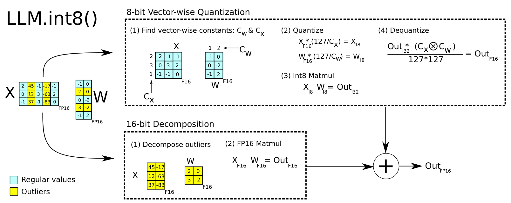</button>
<figcaption><strong>LLM.int8() 原图：两个乘法分支怎样重新相加</strong><a href="https://arxiv.org/abs/2208.07339v2" target="_blank" rel="noopener">LLM.int8(): 8-bit Matrix Multiplication for Transformers at Scale</a> · Figure 2 · version 2208.07339v2 · PDF p.3 / printed p.3
<button class="original-direct" type="button">Read original size</button>

Original caption &amp; source

Figure 2: Schematic of LLM.int8(). Given 16-bit floating-point inputs Xf16 and weights Wf16, the
features and weights are decomposed into sub-matrices of large magnitude features and other values.
The outlier feature matrices are multiplied in 16-bit. All other values are multiplied in 8-bit. We
perform 8-bit vector-wise multiplication by scaling by row and column-wise absolute maximum of
Cx and Cw and then quantizing the outputs to Int8. The Int32 matrix multiplication outputs Outi32
are dequantization by the outer product of the normalization constants Cx ⊗Cw. Finally, both outlier
and regular outputs are accumulated in 16-bit floating point outputs.
<a class="source-url" href="https://arxiv.org/pdf/2208.07339v2">https://arxiv.org/pdf/2208.07339v2</a>
</figcaption></figure>

Figure 2 沿左到右读：原矩阵按特征维度划分，而不是挑出几个独立元素。异常子矩阵走 FP16；普通输入按行、普通权重按列归一化，执行 INT8 乘法、INT32 累加，再用行列尺度的外积恢复输出。两路结果相加才得到完整输出。对“一个通道经常为 50”的例子，整个相关维度都能受到保护。代价是检测、分拆以及高精度分支；图没有承诺所有硬件都比原 FP16 快。

<figure id="fig-int8-02">
<button class="paper-image" type="button" aria-label="Zoom: LLM.int8() 原表：模型变大后普通 INT8 为什么失效">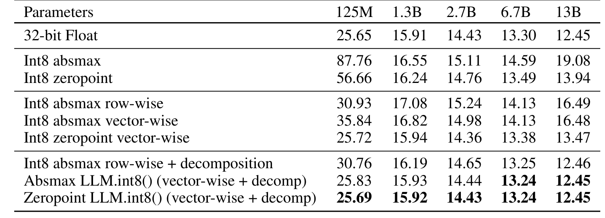</button>
<figcaption><strong>LLM.int8() 原表：模型变大后普通 INT8 为什么失效</strong><a href="https://arxiv.org/abs/2208.07339v2" target="_blank" rel="noopener">LLM.int8(): 8-bit Matrix Multiplication for Transformers at Scale</a> · Table 1 · version 2208.07339v2 · PDF p.6 / printed p.6
<button class="original-direct" type="button">Read original size</button>

Original caption &amp; source

Table 1: C4 validation perplexities of quantization methods for different transformer sizes ranging
from 125M to 13B parameters. We see that absmax, row-wise, zeropoint, and vector-wise quantization
leads to significant performance degradation as we scale, particularly at the 13B mark where 8-bit
13B perplexity is worse than 8-bit 6.7B perplexity. If we use LLM.int8(), we recover full perplexity
as we scale. Zeropoint quantization shows an advantage due to asymmetric quantization but is no
longer advantageous when used with mixed-precision decomposition.
<a class="source-url" href="https://arxiv.org/pdf/2208.07339v2">https://arxiv.org/pdf/2208.07339v2</a>
</figcaption></figure>

Table 1 横轴是模型规模，单元格是C4 perplexity（PPL，越低越好）；各行比较32-bit Float参考、不同归一化以及混合精度分解。13B列中FP32为12.45，absmax为19.08，absmax vector-wise为16.48，absmax LLM.int8()回到12.45。zeropoint vector-wise另为13.47，不能串行或串列读取。这说明只把尺度划细仍未完全解决该组模型的系统性异常，而分支保护有效；它不表示INT8对所有后续模型都能无损。

<figure id="fig-int8-03">
<button class="paper-image" type="button" aria-label="Zoom: LLM.int8() 原图：异常通道的规模效应与能力相关性">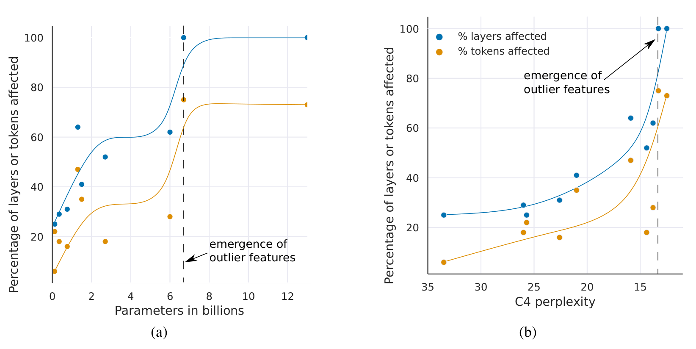</button>
<figcaption><strong>LLM.int8() 原图：异常通道的规模效应与能力相关性</strong><a href="https://arxiv.org/abs/2208.07339v2" target="_blank" rel="noopener">LLM.int8(): 8-bit Matrix Multiplication for Transformers at Scale</a> · Figure 3 · version 2208.07339v2 · PDF p.7 / printed p.7
<button class="original-direct" type="button">Read original size</button>

Original caption &amp; source

Figure 3: Percentage of layers and all sequence dimensions affected by large magnitude outlier
features across the transformer by (a) model size or (b) C4 perplexity. Lines are B-spline interpolations
of 4 and 9 linear segments for (a) and (b). Once the phase shift occurs, outliers are present in all layers
and in about 75% of all sequence dimensions. While (a) suggest a sudden phase shift in parameter
size, (b) suggests a gradual exponential phase shift as perplexity decreases. The stark shift in (a)
co-occurs with the sudden degradation of performance in quantization methods.
<a class="source-url" href="https://arxiv.org/pdf/2208.07339v2">https://arxiv.org/pdf/2208.07339v2</a>
</figcaption></figure>

Figure 3 左图以参数规模为横轴，右图以 C4 PPL 为横轴，纵轴统计受异常特征影响的层和序列位置比例。研究中的突变约出现在 6.7B 附近，之后异常跨越更多层和位置；右图又显示与语言质量的连续关系。曲线是论文指定的样条插值。这个阈值来自所研究模型，不能把它推广成“所有 7B 模型必然出现同样异常”的定律。

### 4.2 SmoothQuant：让激活容易量化，权重承担更大的范围

SmoothQuant <a href="#source-3">[3]</a> 面向 W8A8。权重比在线激活容易离线处理，因此在乘法的 reduction 维上使用对角尺度。用本文矩阵约定：

$$
WX=(WD)(D^{-1}X),\qquad
D=\operatorname{diag}(s_1,\ldots,s_d),\quad
s_j=\frac{a_j^\alpha}{w_j^{1-\alpha}}.
$$

$D\in\mathbb R^{d\times d}$ 可逆，$a_j$ 是校准输入第 $j$ 维的最大绝对值，$w_j$ 是对应权重输入列的最大绝对值；$\alpha\in[0,1]$ 控制迁移强度。实际实现会对零尺度加下界。假设浮点变换精确，等式保持输出；量化后两边误差不同。$s_j$ 越大，输入越小而权重越大。$\alpha$ 不能只追求激活最平：它同时影响权重误差。

<figure id="fig-smooth-01">
<button class="paper-image" type="button" aria-label="Zoom: SmoothQuant 原图：困难从激活转移到权重">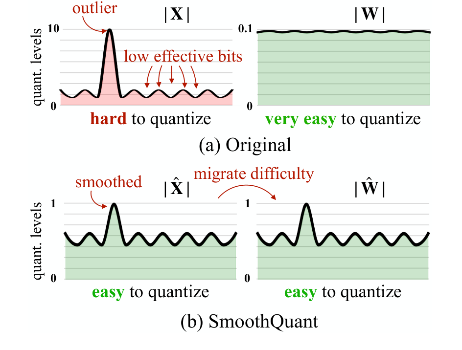</button>
<figcaption><strong>SmoothQuant 原图：困难从激活转移到权重</strong><a href="https://arxiv.org/abs/2211.10438v7" target="_blank" rel="noopener">SmoothQuant: Accurate and Efficient Post-Training Quantization for Large Language Models</a> · Figure 2 · version 2211.10438v7 · PDF p.2 / printed page unnumbered
<button class="original-direct" type="button">Read original size</button>

Original caption &amp; source

Figure 2: SmoothQuant’s intuition: the activation X is hard
to quantize because outliers stretch the quantization range,
leaving few effective bits for most values. We migrate the
scale variance from activations to weights W during offline
to reduce the quantization difficulty of activations. The
smoothed activation ˆX and the adjusted weight ˆ
W are both
easy to quantize.
<a class="source-url" href="https://arxiv.org/pdf/2211.10438v7">https://arxiv.org/pdf/2211.10438v7</a>
</figcaption></figure>

Figure 2 比较变换前后的输入、权重分布与结果。异常输入列被缩小，权重对应方向被放大，两者乘积在量化前不变。图不是把异常删除了，而是换了更易执行的量化位置。对输入 50、权重 0.02 的例子，输入缩为 5、权重放为 0.2，浮点乘积仍为 1。

<figure id="fig-smooth-02">
<button class="paper-image" type="button" aria-label="Zoom: SmoothQuant 原图：token、channel 与 tensor 尺度为何影响内核">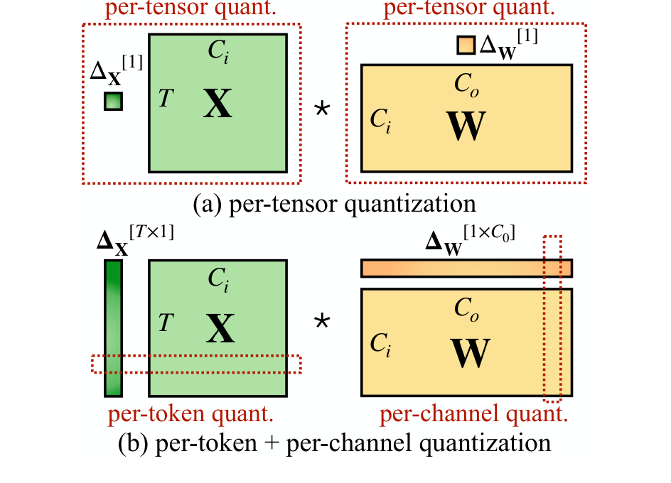</button>
<figcaption><strong>SmoothQuant 原图：token、channel 与 tensor 尺度为何影响内核</strong><a href="https://arxiv.org/abs/2211.10438v7" target="_blank" rel="noopener">SmoothQuant: Accurate and Efficient Post-Training Quantization for Large Language Models</a> · Figure 3 · version 2211.10438v7 · PDF p.3 / printed page unnumbered
<button class="original-direct" type="button">Read original size</button>

Original caption &amp; source

Figure 3: Definition of per-tensor, per-token, and per-
channel quantization. Per-tensor quantization is the most
efficient to implement. For vector-wise quantization to ef-
ficiently utilize the INT8 GEMM kernels, we can only use
scaling factors from the outer dimensions (i.e., token di-
mension T and out channel dimension Co) but not inner
dimension (i.e., in channel dimension Ci).
<a class="source-url" href="https://arxiv.org/pdf/2211.10438v7">https://arxiv.org/pdf/2211.10438v7</a>
</figcaption></figure>

Figure 3 用矩阵轴说明 per-tensor、per-token、per-channel 的区别。输出行或列上的尺度通常可以在 GEMM 之后恢复；沿求和的 channel 逐元素设尺度则不能直接移出普通整数 GEMM。SmoothQuant 的意义是先离线迁移 channel 差异，使激活可以使用更硬件友好的粒度。这里的“粒度”是算术接口的一部分，不能与权重文件压缩率分开理解。

<figure id="fig-smooth-03">
<button class="paper-image" type="button" aria-label="Zoom: SmoothQuant 原图：OPT-13B 中平滑前后的异常峰值">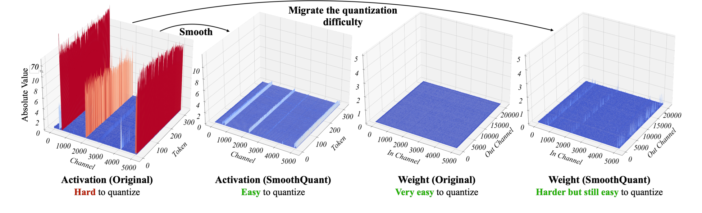</button>
<figcaption><strong>SmoothQuant 原图：OPT-13B 中平滑前后的异常峰值</strong><a href="https://arxiv.org/abs/2211.10438v7" target="_blank" rel="noopener">SmoothQuant: Accurate and Efficient Post-Training Quantization for Large Language Models</a> · Figure 4 · version 2211.10438v7 · PDF p.4 / printed page unnumbered
<button class="original-direct" type="button">Read original size</button>

Original caption &amp; source

Figure 4: Magnitude of the input activations and weights of a linear layer in OPT-13B before and after SmoothQuant.
Observations: (1) there are a few channels in the original activation map whose magnitudes are very large (greater than 70);
(2) the variance in one activation channel is small; (3) the original weight distribution is flat and uniform. SmoothQuant
migrates the outlier channels from activation to weight. In the end, the outliers in the activation are greatly smoothed while
the weight is still pretty smooth and flat.
<a class="source-url" href="https://arxiv.org/pdf/2211.10438v7">https://arxiv.org/pdf/2211.10438v7</a>
</figcaption></figure>

Figure 4 展示 OPT-13B 的激活和权重：平滑前激活有超过 70 的尖峰，平滑后范围更均衡，而权重反而更不均衡。对比对象和图例给出了迁移前后位置。它直接支撑“转移难度”而不是“同时使所有矩阵更平”；若只截取激活那半边，就会漏掉代价。

<figure id="fig-smooth-04">
<button class="paper-image" type="button" aria-label="Zoom: SmoothQuant 原表：W8A8 的质量要按配置分别看">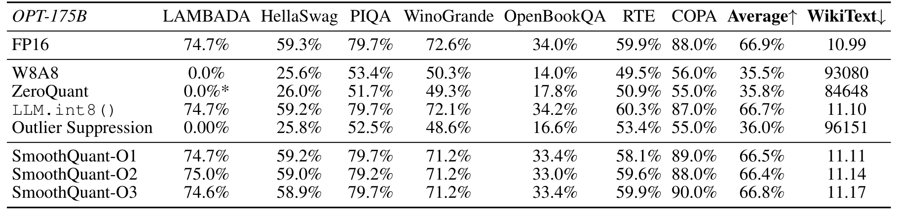</button>
<figcaption><strong>SmoothQuant 原表：W8A8 的质量要按配置分别看</strong><a href="https://arxiv.org/abs/2211.10438v7" target="_blank" rel="noopener">SmoothQuant: Accurate and Efficient Post-Training Quantization for Large Language Models</a> · Table 3 · version 2211.10438v7 · PDF p.6 / printed page unnumbered
<button class="original-direct" type="button">Read original size</button>

Original caption &amp; source

Table 3: SmoothQuant maintains the accuracy of OPT-175B model after INT8 quantization, even with the most aggressive
and most efficient O3 setting (Table 2). We extensively benchmark the performance on 7 zero-shot benchmarks (by reporting
the average accuracy) and 1 language modeling benchmark (perplexity). *For ZeroQuant, we also tried leaving the input
activation of self-attention in FP16 and quantizing the rest to INT8, which is their solution to the GPT-NeoX-20B. But this
does not solve the accuracy degradation of OPT-175B.
<a class="source-url" href="https://arxiv.org/pdf/2211.10438v7">https://arxiv.org/pdf/2211.10438v7</a>
</figcaption></figure>

Table 3 在 OPT-175B 上列出LAMBADA、HellaSwag、PIQA、WinoGrande、OpenBookQA、RTE、COPA七项任务，并报告WikiText PPL。FP16平均66.9%、PPL10.99；较激进的O3为66.8%、11.17。不要混入同页Table4另一套四任务平均71.6/71.1。O1/O2/O3的尺度策略和开销不同，不能挑O1精度配O3速度；本表不是TTFT/TPOT表。

<figure id="fig-smooth-05">
<button class="paper-image" type="button" aria-label="Zoom: SmoothQuant 原表：后续模型家族中的 W8A8">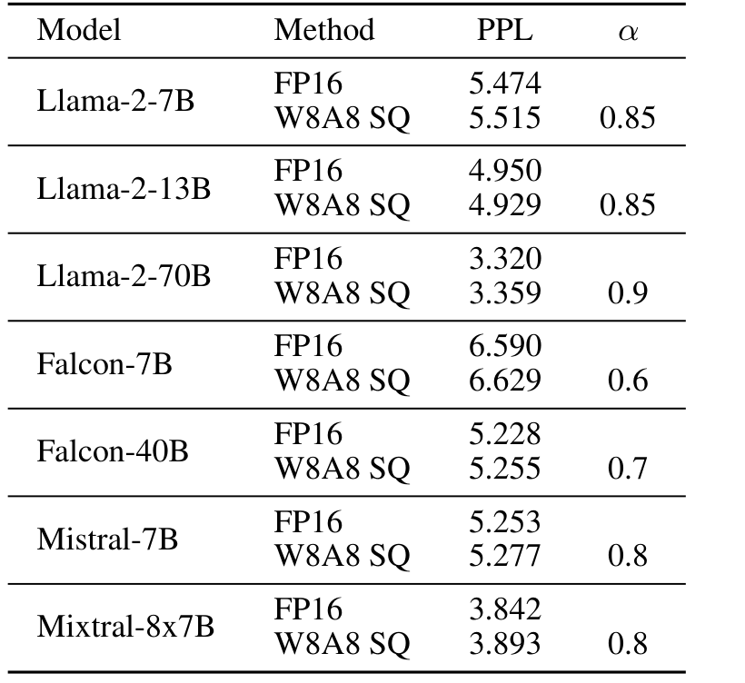</button>
<figcaption><strong>SmoothQuant 原表：后续模型家族中的 W8A8</strong><a href="https://arxiv.org/abs/2211.10438v7" target="_blank" rel="noopener">SmoothQuant: Accurate and Efficient Post-Training Quantization for Large Language Models</a> · Table 7 · version 2211.10438v7 · PDF p.7 / printed page unnumbered
<button class="original-direct" type="button">Read original size</button>

Original caption &amp; source

Table 7: SmoothQuant can enable lossless W8A8 quan-
tization for Llama-2 (Touvron et al., 2023b), Falcon (Al-
mazrouei et al., 2023), Mistral (Jiang et al., 2023), and
Mixtral (Jiang et al., 2024) models. Results are perplexities
on the WikiText-2 dataset with a sequence length of 2048.
We used per-token activation quantization and per-channel
weight quantization for SmoothQuant.
<a class="source-url" href="https://arxiv.org/pdf/2211.10438v7">https://arxiv.org/pdf/2211.10438v7</a>
</figcaption></figure>

Table 7 扩展到 Llama-2、Mistral、Mixtral 等模型，比较 FP16 与 W8A8 的 PPL。横向应在同一模型列内比较，不能将不同 tokenizer、checkpoint 的绝对 PPL 排名。它说明尺度迁移可延伸到更多架构；MoE、GQA 和不同 block 的融合位置仍需独立实现，本表没有给这些模型统一的 GPU 加速比。

这一阶段完成了一个关键分工：LLM.int8() 保留显式高精度异常计算，SmoothQuant 努力让主体进入统一 INT8 矩阵乘。前者的例外处理与后者的等价迁移，是后续低位宽研究反复使用的两种思路。

## 5. 权重量化主线：补偿误差、保护重要通道、学习取整

### 5.1 GPTQ：已经取整的误差，由尚未取整的权重接住

GPTQ <a href="#source-2">[2]</a> 将大矩阵的逐权重量化变成按列推进的局部重建求解。量化当前列时，利用输入相关性更新剩余列，使整体输出误差尽量小。与每次独立 RTN（round-to-nearest）相比，它允许另一个相关通道承担补偿。

对单个输出行，在当前尚自由的坐标集合上，用固定重建二次型可以得到如下教学形式：

$$
\delta w_F
=-\frac{w_j-\hat w_j}{[H_F^{-1}]_{jj}}
[H_F^{-1}]_{:,j}.
$$

$F$ 是未锁定坐标集合；$w_j$ 是本轮补偿后的当前值，$\hat w_j$ 是选定量化格点；$H_F$ 是这些坐标上的正则化曲率；$\delta w_F$ 是连续补偿向量。这是固定一个坐标后最小二次损失的解，需 $H_F$ 可逆。当前坐标的更新为 $\hat w_j-w_j$，其他坐标按相关性跟着变。真实 GPTQ 用逆 Hessian 的上三角 Cholesky 因子及分块延迟更新高效实现，不能把代码中的 `Hinv` 变量逐项当成本式的 $H_F^{-1}$。

<figure id="fig-gptq-01">
<button class="paper-image" type="button" aria-label="Zoom: GPTQ 原图：为什么 RTN 与误差补偿会拉开差距">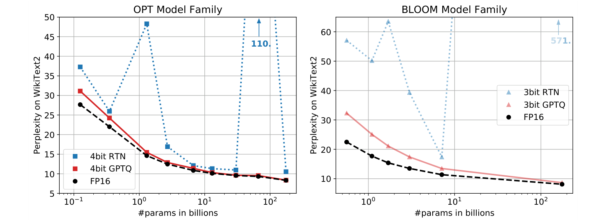</button>
<figcaption><strong>GPTQ 原图：为什么 RTN 与误差补偿会拉开差距</strong><a href="https://arxiv.org/abs/2210.17323v2" target="_blank" rel="noopener">GPTQ: Accurate Post-Training Quantization for Generative Pre-trained Transformers</a> · Figure 1 · version 2210.17323v2 · PDF p.2 / printed p.2
<button class="original-direct" type="button">Read original size</button>

Original caption &amp; source

Figure 1: Quantizing OPT models to 4 and BLOOM models to 3 bit precision, comparing GPTQ
with the FP16 baseline and round-to-nearest (RTN) (Yao et al., 2022; Dettmers et al., 2022).
<a class="source-url" href="https://arxiv.org/pdf/2210.17323v2">https://arxiv.org/pdf/2210.17323v2</a>
</figcaption></figure>

Figure 1 左侧是 OPT W4，右侧是 BLOOM W3，横轴模型规模、纵轴 WikiText2 PPL。RTN 在部分大模型明显恶化，GPTQ 更接近 FP16；两侧位宽不同，说明模型家族和位宽共同决定稳定性。它支持“同样位宽下补偿有价值”，并不支持“3 bit 对所有模型都安全”。

<figure id="fig-gptq-02">
<button class="paper-image" type="button" aria-label="Zoom: GPTQ 原图：列块、Cholesky 与延迟误差传播">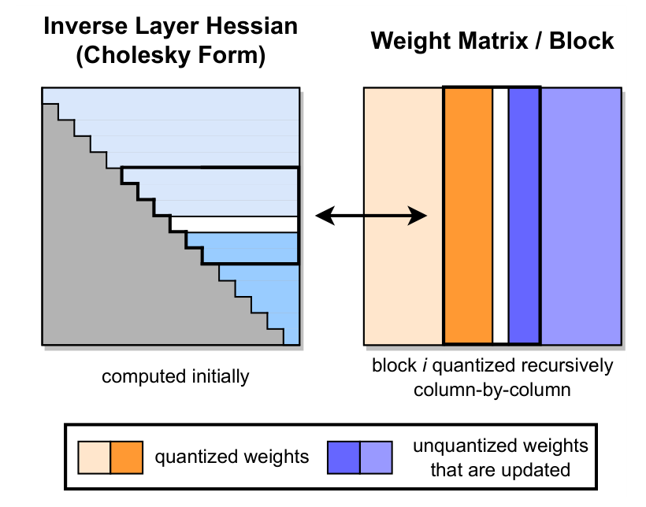</button>
<figcaption><strong>GPTQ 原图：列块、Cholesky 与延迟误差传播</strong><a href="https://arxiv.org/abs/2210.17323v2" target="_blank" rel="noopener">GPTQ: Accurate Post-Training Quantization for Generative Pre-trained Transformers</a> · Figure 2 · version 2210.17323v2 · PDF p.4 / printed p.4
<button class="original-direct" type="button">Read original size</button>

Original caption &amp; source

Figure 2: GPTQ quantization procedure. Blocks
of consecutive columns (bolded) are quantized at
a given step, using the inverse Hessian informa-
tion stored in the Cholesky decomposition, and
the remaining weights (blue) are updated at the
end of the step. The quantization procedure is
applied recursively inside each block: the white
middle column is currently being quantized.
<a class="source-url" href="https://arxiv.org/pdf/2210.17323v2">https://arxiv.org/pdf/2210.17323v2</a>
</figcaption></figure>

Figure 2 白色列正在量化，粗线区分连续列块，蓝色区是后续权重。块内每列立刻收到误差补偿；块外更新积累后通过一次矩阵乘完成。这样减少小规模操作和反复访存。这里 block size 是算法调度参数，group size 是共享量化尺度的范围，二者即使都设 128，也不是同一个概念。

<figure id="fig-gptq-03">
<button class="paper-image" type="button" aria-label="Zoom: GPTQ 原表：OPT 的 W4 改善与低位宽失效边界">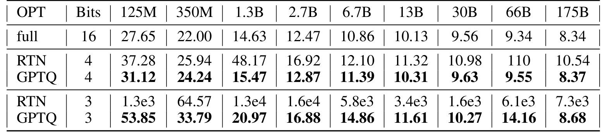</button>
<figcaption><strong>GPTQ 原表：OPT 的 W4 改善与低位宽失效边界</strong><a href="https://arxiv.org/abs/2210.17323v2" target="_blank" rel="noopener">GPTQ: Accurate Post-Training Quantization for Generative Pre-trained Transformers</a> · Table 3 · version 2210.17323v2 · PDF p.7 / printed p.7
<button class="original-direct" type="button">Read original size</button>

Original caption &amp; source

Table 3: OPT perplexity results on WikiText2.
<a class="source-url" href="https://arxiv.org/pdf/2210.17323v2">https://arxiv.org/pdf/2210.17323v2</a>
</figcaption></figure>

Table 3 按 OPT 模型规模列出 WikiText2 PPL。175B 上 FP16 为 8.34、RTN W4 为 10.54、GPTQ W4 为 8.37，差距相当小；低位宽行同时提醒效果并非无限延伸。校准使用 128 个随机 C4 片段，每个 2048 token；测试按原文的 2048-token 片段计算。本文后面的 70M/256-token 实验采用另一协议，数值不能直接对照。

<figure id="fig-gptq-04">
<button class="paper-image" type="button" aria-label="Zoom: GPTQ 原表：数小时指的是离线量化">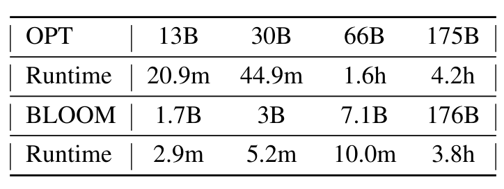</button>
<figcaption><strong>GPTQ 原表：数小时指的是离线量化</strong><a href="https://arxiv.org/abs/2210.17323v2" target="_blank" rel="noopener">GPTQ: Accurate Post-Training Quantization for Generative Pre-trained Transformers</a> · Table 2 · version 2210.17323v2 · PDF p.7 / printed p.7
<button class="original-direct" type="button">Read original size</button>

Original caption &amp; source

Table 2: GPTQ runtime for full quantization
of the 4 largest OPT and BLOOM models.
<a class="source-url" href="https://arxiv.org/pdf/2210.17323v2">https://arxiv.org/pdf/2210.17323v2</a>
</figcaption></figure>

Table 2 是单张 A100 80GB 上的整模型量化时间，OPT-175B 约 4.2 GPU-hours，BLOOM-176B 约 3.8。纵向增长主要反映离线 Hessian 统计、分解和求解。这里不是生成一段文字所需时间，也不是单 token 延迟。它体现 GPTQ 把大模型压缩成本降到可执行水平，但压缩后是否快仍由另一个 kernel 决定。

### 5.2 AWQ：依据激活保护通道，最终仍统一存低位宽

AWQ（Activation-aware Weight Quantization）<a href="#source-4">[4]</a> 的出发点是：少量权重对应的输入很重要，保护它们比均匀对待所有数值更有效。论文用“保留 1% FP16”证明重要性，但最终采用激活感知的通道尺度搜索，使重要部分在**统一低位宽权重**中得到较小相对误差。把 AWQ 描述成“固定 1% 权重 FP16、其余 INT4”会误解其部署形式。

<figure id="fig-awq-01">
<button class="paper-image" type="button" aria-label="Zoom: AWQ 原图：FP16 保护实验与最终尺度保护的区别">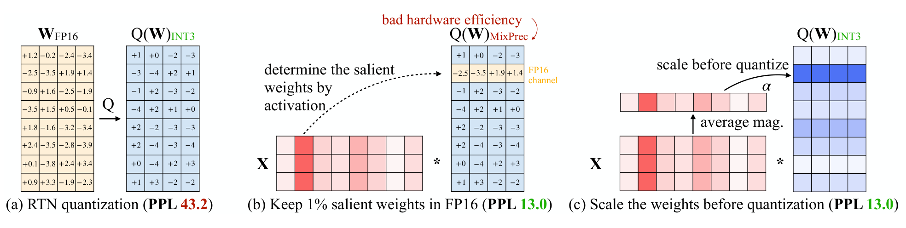</button>
<figcaption><strong>AWQ 原图：FP16 保护实验与最终尺度保护的区别</strong><a href="https://arxiv.org/abs/2306.00978v6" target="_blank" rel="noopener">AWQ: Activation-aware Weight Quantization for LLM Compression and Acceleration</a> · Figure 2 · version 2306.00978v6 · PDF p.3 / printed page unnumbered
<button class="original-direct" type="button">Read original size</button>

Original caption &amp; source

Figure 2. We observe that we can find 1% of the salient weights in LLMs based on the activation distribution (middle). Keeping the salient
weights in FP16 can significantly improve the quantized performance (PPL from 43.2 (left) to 13.0 (middle)), but the mixed-precision
format is not hardware-efficient. We follow the activation-awareness principle and propose AWQ (right). AWQ performs per-channel
scaling to protect the salient weights and reduce quantization error. We measure the perplexity of OPT-6.7B under INT3-g128 quantization.
<a class="source-url" href="https://arxiv.org/pdf/2306.00978v6">https://arxiv.org/pdf/2306.00978v6</a>
</figcaption></figure>

Figure 2 从 RTN、保留显著权重 FP16，到显著通道 scaling，展示三种结果。FP16 分支回答“选对重要部分有没有用”；scaling 回答“能否不引入混合精度例外也达到类似效果”。放大重要权重、相应缩小输入，改变它们在格点中的位置。所有通道仍受共同量化尺度影响，因此放大不是越多越好。

<figure id="fig-awq-02">
<button class="paper-image" type="button" aria-label="Zoom: AWQ 原表：按激活选重要权重，比随机保护更有效">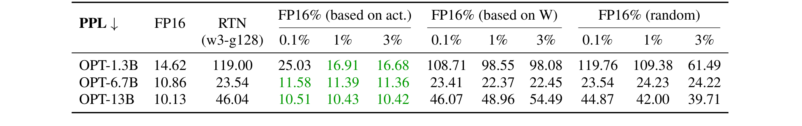</button>
<figcaption><strong>AWQ 原表：按激活选重要权重，比随机保护更有效</strong><a href="https://arxiv.org/abs/2306.00978v6" target="_blank" rel="noopener">AWQ: Activation-aware Weight Quantization for LLM Compression and Acceleration</a> · Table 1 · version 2306.00978v6 · PDF p.4 / printed page unnumbered
<button class="original-direct" type="button">Read original size</button>

Original caption &amp; source

Table 1. Keeping a small fraction of weights (0.1%-1%) in FP16 significantly improves the performance of the quantized models over
round-to-nearest (RTN). It is only effective when we select the important weights in FP16 by looking at activation distribution instead of
weight distribution. We highlight results with a decent perplexity in green. We used INT3 quantization with a group size of 128 and
measured the WikiText perplexity (↓).
<a class="source-url" href="https://arxiv.org/pdf/2306.00978v6">https://arxiv.org/pdf/2306.00978v6</a>
</figcaption></figure>

Table 1 在 OPT-6.7B 的低位宽实验中控制保护比例，比较随机选、按权重大小选、按激活显著性选。只有把权重误差与真实输入联系起来，少量保护才更有效。表中的保留 FP16 仍是机制诊断，不能据此推断最终 packed AWQ 文件里必有 FP16 稀疏矩阵。

<figure id="fig-awq-03">
<button class="paper-image" type="button" aria-label="Zoom: AWQ 原表：把重要通道放大两倍，不代表四倍更好">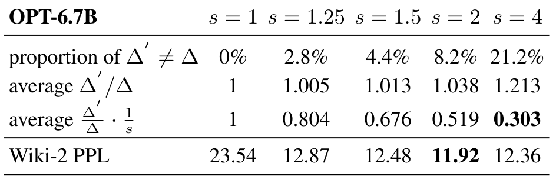</button>
<figcaption><strong>AWQ 原表：把重要通道放大两倍，不代表四倍更好</strong><a href="https://arxiv.org/abs/2306.00978v6" target="_blank" rel="noopener">AWQ: Activation-aware Weight Quantization for LLM Compression and Acceleration</a> · Table 2 · version 2306.00978v6 · PDF p.4 / printed page unnumbered
<button class="original-direct" type="button">Read original size</button>

Original caption &amp; source

Table 2. Statistics when multiplying the 1% salient channels by
s &gt; 1. Scaling up the salient channels significantly improves
the perplexity (23.54 to 11.92). As s goes larger, the percentage
of changed ∆increases, and the error reduction rate for salient
channels also increases. However, the best perplexity is achieved
at s = 2, since further increasing s will increase the quantization
error for non-salient channels.
<a class="source-url" href="https://arxiv.org/pdf/2306.00978v6">https://arxiv.org/pdf/2306.00978v6</a>
</figcaption></figure>

Table 2 的控制变量是 scaling factor。OPT-6.7B 中，保护 1% 通道、$s=2$ 时 PPL 从 23.54 改善到 11.92，$s=4$ 却变为 12.36。原因是同组共享尺度变大，未保护部分的间距也可能变粗。这个简单消融说明 AWQ 需要搜索折中，不能只依据最大激活写一个无限放大的规则。

<figure id="fig-awq-04">
<button class="paper-image" type="button" aria-label="Zoom: AWQ 原表：显著性保护与统一量化可以接近">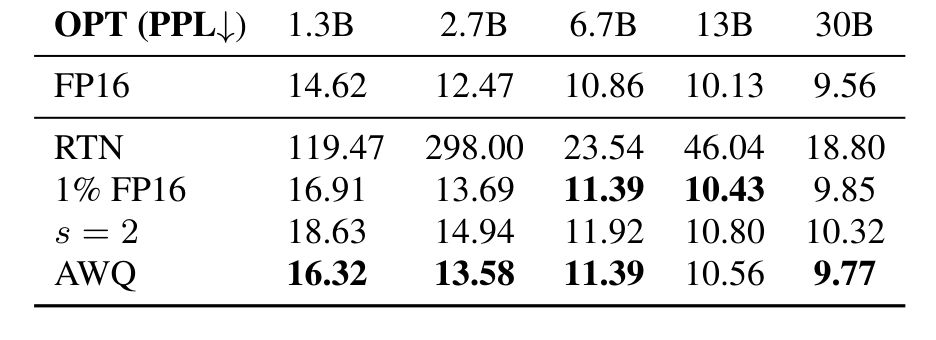</button>
<figcaption><strong>AWQ 原表：显著性保护与统一量化可以接近</strong><a href="https://arxiv.org/abs/2306.00978v6" target="_blank" rel="noopener">AWQ: Activation-aware Weight Quantization for LLM Compression and Acceleration</a> · Table 3 · version 2306.00978v6 · PDF p.4 / printed page unnumbered
<button class="original-direct" type="button">Read original size</button>

Original caption &amp; source

Table 3. AWQ protects salient weights and reduces quantization
error by using a scaling-based method. It consistently outperforms
Round-to-nearest quantization (RTN) and achieves comparable
performance as mixed-precision (1% FP16) while being more
hardware-friendly. We use 3-bit quantization with group size 128.
<a class="source-url" href="https://arxiv.org/pdf/2306.00978v6">https://arxiv.org/pdf/2306.00978v6</a>
</figcaption></figure>

Table 3 比较W3g128：OPT-13B RTN为46.04，1% FP16保护为10.43，AWQ为10.56，接近保护实验。三行在相同模型、分组条件下讨论，AWQ并非每个例子都优于mixed-precision保护，也不代表必定超过任何配置的GPTQ。主要结论是无需固定FP16例外也能保护重要通道；校准搜索和融合仍是前置成本。

<figure id="fig-awq-05">
<button class="paper-image" type="button" aria-label="Zoom: AWQ 原图：单 token decode 为什么在等内存">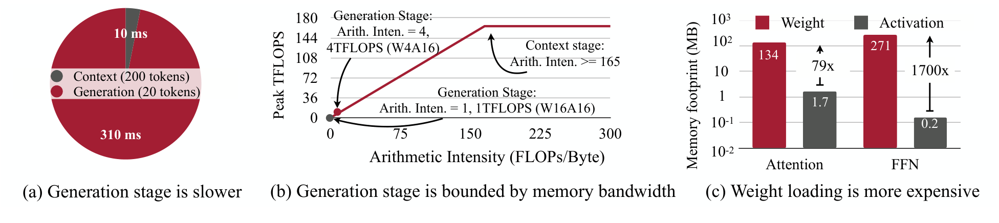</button>
<figcaption><strong>AWQ 原图：单 token decode 为什么在等内存</strong><a href="https://arxiv.org/abs/2306.00978v6" target="_blank" rel="noopener">AWQ: Activation-aware Weight Quantization for LLM Compression and Acceleration</a> · Figure 3 · version 2306.00978v6 · PDF p.5 / printed page unnumbered
<button class="original-direct" type="button">Read original size</button>

Original caption &amp; source

Figure 3. Bottleneck analysis for Llama-2-7B on NVIDIA RTX 4090. Left: In on-device LLM applications, generation stage is much
slower than the context stage. Middle: The generation stage is memory bound and has low arithmetic intensity. W4A16 quantization can
effectively improve the arithmetic intensity by 4×. Right: The amount of weight access is orders of magnitude larger than the amount of
activation access. Thus, weight-only quantization is more effective for on-device LLMs.
<a class="source-url" href="https://arxiv.org/pdf/2306.00978v6">https://arxiv.org/pdf/2306.00978v6</a>
</figcaption></figure>

Figure 3 对 RTX 4090 上 Llama-2-7B 的生成过程分析算术强度和带宽。权重在单 token 时被少量复用，即使 GPU 算力很强，也可能等权重读取。W4A16 减少权重流量有机会加速；prefill 或大 batch 的权重复用不同，不能从这张图推出所有阶段都有相同收益。

<figure id="fig-awq-06">
<button class="paper-image" type="button" aria-label="Zoom: AWQ 原图：ARM NEON 需要的 bit 排列不是文件中的自然顺序">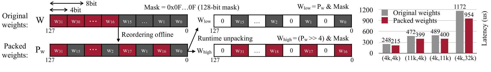</button>
<figcaption><strong>AWQ 原图：ARM NEON 需要的 bit 排列不是文件中的自然顺序</strong><a href="https://arxiv.org/abs/2306.00978v6" target="_blank" rel="noopener">AWQ: Activation-aware Weight Quantization for LLM Compression and Acceleration</a> · Figure 4 · version 2306.00978v6 · PDF p.6 / printed page unnumbered
<button class="original-direct" type="button">Read original size</button>

Original caption &amp; source

Figure 4. SIMD-aware weight packing for ARM NEON with 128-bit SIMD units. Original weights are reordered and packed to align
with the bit width so that the weights can be unpacked into bytes at runtime using AND and shift bitwise operations with a 128-bit mask.
<a class="source-url" href="https://arxiv.org/pdf/2306.00978v6">https://arxiv.org/pdf/2306.00978v6</a>
</figcaption></figure>

Figure 4 展示实际 ARM NEON 的 packing/reorder。不同位置的低位码被安排到向量寄存器能高效解码的位置，再与 scale 配合。它把“两个 INT4 能放一个 byte”推进到“加载后哪些 lane 得到哪些码”。如果只会简单 nibble 打包而不遵循目标内核约定，模型文件虽小，也可能多做转换或读错权重。

<figure id="fig-awq-07">
<button class="paper-image" type="button" aria-label="Zoom: AWQ 原表：同一算法跨模型仍有残余误差">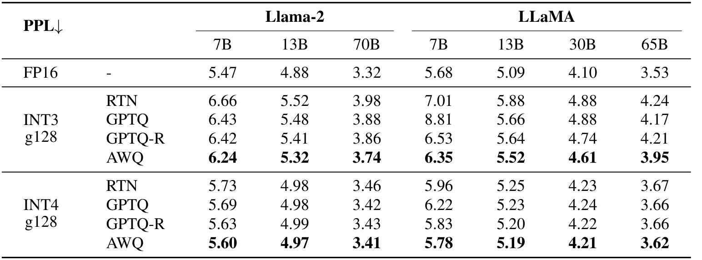</button>
<figcaption><strong>AWQ 原表：同一算法跨模型仍有残余误差</strong><a href="https://arxiv.org/abs/2306.00978v6" target="_blank" rel="noopener">AWQ: Activation-aware Weight Quantization for LLM Compression and Acceleration</a> · Table 4 · version 2306.00978v6 · PDF p.7 / printed page unnumbered
<button class="original-direct" type="button">Read original size</button>

Original caption &amp; source

Table 4. AWQ improves over round-to-nearest quantization (RTN) for different model sizes and different bit-precisions. It consistently
achieves better perplexity than GPTQ (w/ and w/o reordering) on LLaMA &amp; Llama-2 models.
<a class="source-url" href="https://arxiv.org/pdf/2306.00978v6">https://arxiv.org/pdf/2306.00978v6</a>
</figcaption></figure>

Table 4 比较多模型的W3/W4和g128配置。例如Llama-2-7B的FP16 PPL为5.47，AWQ W4g128为5.60。应分别看位宽、模型、分组列；某个设置接近基线，不意味着极低位宽或新模型照搬尺度即可成功。最终推理由TinyChat等配套内核兑现，算法和格式必须匹配。

### 5.3 OmniQuant：让 clipping 与等价变换可学习

OmniQuant <a href="#source-5">[5]</a> 不满足于手工最大值尺度。它在小校准集上学习 clipping（LWC）和等价变换（LET），冻结原始 pretrained 权重，在 Transformer block 内优化量化相关参数。PTQ 允许这类短期优化；“需要梯度”不自动等于重新训练整个模型。

<figure id="fig-omni-01">
<button class="paper-image" type="button" aria-label="Zoom: OmniQuant 原图：学习哪些参数，保留哪些权重">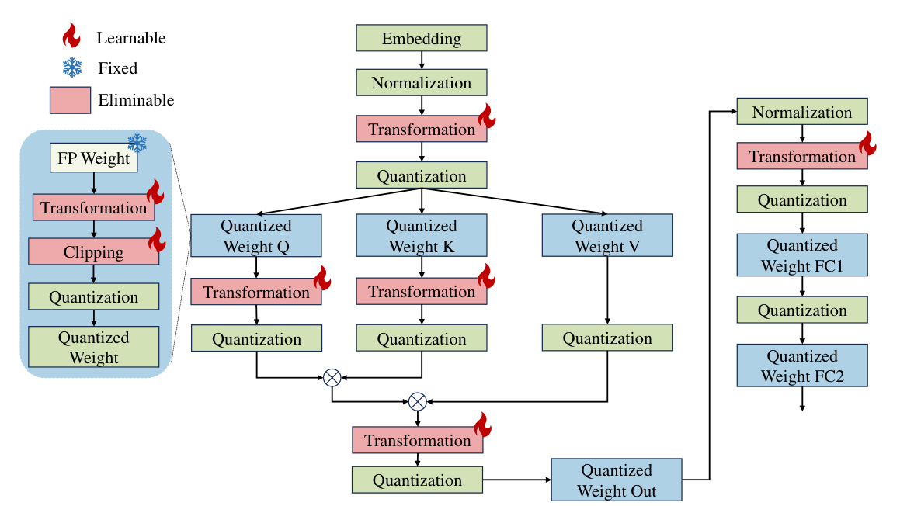</button>
<figcaption><strong>OmniQuant 原图：学习哪些参数，保留哪些权重</strong><a href="https://arxiv.org/abs/2308.13137v3" target="_blank" rel="noopener">OmniQuant: Omnidirectionally Calibrated Quantization for Large Language Models</a> · Figure 3 · version 2308.13137v3 · PDF p.4 / printed p.4
<button class="original-direct" type="button">Read original size</button>

Original caption &amp; source

Figure 3: Details of OmniQuant in a transformer block. Note that all learnable parameters can be
eliminated after quantization.
<a class="source-url" href="https://arxiv.org/pdf/2308.13137v3">https://arxiv.org/pdf/2308.13137v3</a>
</figcaption></figure>

Figure 3 沿 attention 与 FFN 流程标出尺度、偏移、Q/K 变换和 clipping。激活/权重先经过等价重参数化，再进入 Quant→Dequant。冻结的是原权重，更新的是影响量化误差的参数。shift 还需要对应 bias 或结构变更，Q/K 的变化要保持点积；不是所有箭头都能跨越 norm、softmax 或非线性自由融合。

<figure id="fig-omni-02">
<button class="paper-image" type="button" aria-label="Zoom: OmniQuant 原表：学会 clipping 之后仍需分组与足够位宽">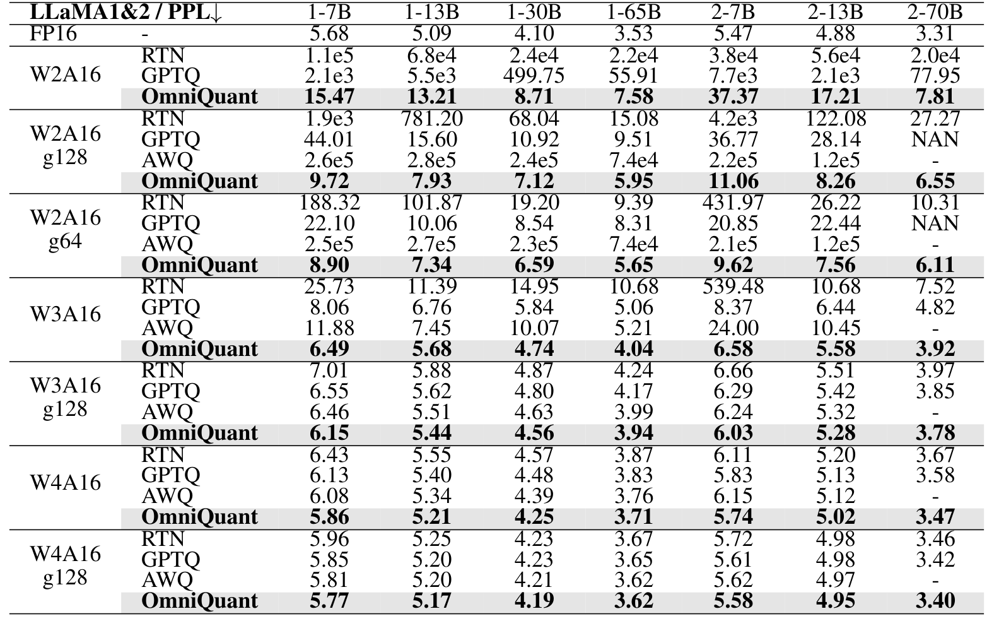</button>
<figcaption><strong>OmniQuant 原表：学会 clipping 之后仍需分组与足够位宽</strong><a href="https://arxiv.org/abs/2308.13137v3" target="_blank" rel="noopener">OmniQuant: Omnidirectionally Calibrated Quantization for Large Language Models</a> · Table 1 · version 2308.13137v3 · PDF p.7 / printed p.7
<button class="original-direct" type="button">Read original size</button>

Original caption &amp; source

Table 1: Weight-only quantization Results of LLaMA-1 and LLaMA-2 Models. We report
WikiText2 perplexity in this table, C4 perplexity can be found in Table A19 in Appendix.
<a class="source-url" href="https://arxiv.org/pdf/2308.13137v3">https://arxiv.org/pdf/2308.13137v3</a>
</figcaption></figure>

Table 1 在 weight-only 条件下分开 W2、W3、W4，以及 per-channel/group 设置。最难的 W2 行能检验 learned clipping 的价值，也暴露残余差距。读表时须固定模型和 group size；使用更细粒度的额外 scale，会改变实际存储预算。这里的 PPL 改善来自校准优化，不是更快整数 GEMM 的证据。

<figure id="fig-omni-03">
<button class="paper-image" type="button" aria-label="Zoom: OmniQuant 原表：同时量化激活比只量化权重更难">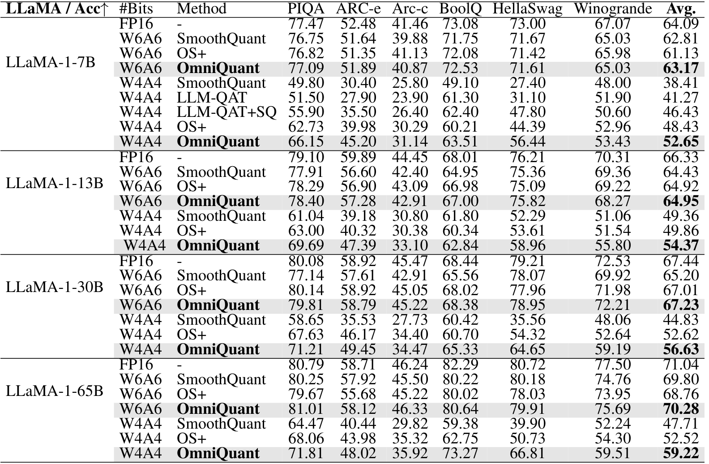</button>
<figcaption><strong>OmniQuant 原表：同时量化激活比只量化权重更难</strong><a href="https://arxiv.org/abs/2308.13137v3" target="_blank" rel="noopener">OmniQuant: Omnidirectionally Calibrated Quantization for Large Language Models</a> · Table 2 · version 2308.13137v3 · PDF p.8 / printed p.8
<button class="original-direct" type="button">Read original size</button>

Original caption &amp; source

Table 2: Weight-activation quantization results of LLaMA Models. This table reports the accu-
racy of 6 zero-shot tasks. Perplexity results can be found in Table A23 &amp; A24 at Appendix.
<a class="source-url" href="https://arxiv.org/pdf/2308.13137v3">https://arxiv.org/pdf/2308.13137v3</a>
</figcaption></figure>

Table 2 比较 W4A4 至 W6A6 的六项任务准确率。两边都量化时，权重扰动与动态激活截断叠加，不能把 weight-only 的结果移到 W4A4。各任务变化不同，平均分只压缩了这些差异。LET/LWC 缓解失真，但增加校准参数、迭代和模型适配工作。

<figure id="fig-omni-04">
<button class="paper-image" type="button" aria-label="Zoom: OmniQuant 原表：weight memory 与 running memory 是两列">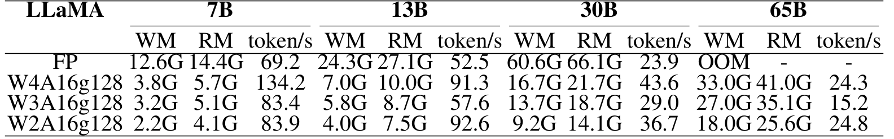</button>
<figcaption><strong>OmniQuant 原表：weight memory 与 running memory 是两列</strong><a href="https://arxiv.org/abs/2308.13137v3" target="_blank" rel="noopener">OmniQuant: Omnidirectionally Calibrated Quantization for Large Language Models</a> · Table 3 · version 2308.13137v3 · PDF p.9 / printed p.9
<button class="original-direct" type="button">Read original size</button>

Original caption &amp; source

Table 3: Deployment of weight-only quantization through MLC-LLM. We report the memory size
of quantized weights (denoted as ‘WM’) and the running memory (denoted as ‘RM’) and speed in
NVIDIA A100-80G.
<a class="source-url" href="https://arxiv.org/pdf/2308.13137v3">https://arxiv.org/pdf/2308.13137v3</a>
</figcaption></figure>

Table 3 在MLC-LLM、A100 80GB、生成512token的实现中报告Llama-7B：FP16权重12.6GB、运行14.4GB、69.2token/s；W4g128为3.8GB、5.7GB、134.2token/s；W3g128为3.2GB、5.1GB、83.4token/s。W3更小却明显比W4慢，原文指出当时INT3支持不够优化。它说明压缩率与速度不是同一个轴。

### 5.4 SignRound：优化“向哪边取整”

SignRound <a href="#source-14">[14]</a> 用有符号梯度优化 rounding/clipping 变量。前向仍经过量化和反量化，比较 frozen block 输出；反向用近似梯度把离散取整问题变成可搜索的问题。它避免完整权重重训，但不是零校准成本的 RTN。

<figure id="fig-signround-01">
<button class="paper-image" type="button" aria-label="Zoom: SignRound 原图：梯度更新取整变量，而非从头训练模型">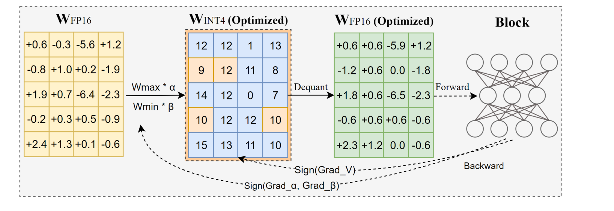</button>
<figcaption><strong>SignRound 原图：梯度更新取整变量，而非从头训练模型</strong><a href="https://arxiv.org/abs/2309.05516v5" target="_blank" rel="noopener">Optimize Weight Rounding via Signed Gradient Descent for the Quantization of LLMs</a> · Figure 1 · version 2309.05516v5 · PDF p.3 / printed page unnumbered
<button class="original-direct" type="button">Read original size</button>

Original caption &amp; source

Figure 1: An illustration of SignRound. Unlike the direct rounding in RTN, SignRound performs signed gradient
descent to fine-tune the rounding and weight clipping through block-wise output reconstruction. After lightweight
forward and backward steps, WINT4 has been well optimized. Note that Quant and Dequant are two standard
operations for quantization and dequantization respectively.
<a class="source-url" href="https://arxiv.org/pdf/2309.05516v5">https://arxiv.org/pdf/2309.05516v5</a>
</figcaption></figure>

Figure 1 的前向 Quant→Dequant→block 产生输出误差；反向箭头将符号梯度传给量化相关变量。可把一项 0.26 想成不再固定取 0.3，而是在校准目标下尝试另一格点，以换取组合误差更小。这个变化允许多个权重一起偏离最近值，收益依赖 block 重建能否泛化。

<figure id="fig-signround-02">
<button class="paper-image" type="button" aria-label="Zoom: SignRound 原表：默认配置与最佳搜索配置要分开">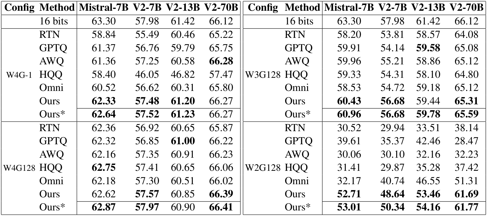</button>
<figcaption><strong>SignRound 原表：默认配置与最佳搜索配置要分开</strong><a href="https://arxiv.org/abs/2309.05516v5" target="_blank" rel="noopener">Optimize Weight Rounding via Signed Gradient Descent for the Quantization of LLMs</a> · Table 1 · version 2309.05516v5 · PDF p.5 / printed page unnumbered
<button class="original-direct" type="button">Read original size</button>

Original caption &amp; source

Table 1: Average accuracies (↑) across 11 tasks, as detailed in Section 4.1, for LLaMA and Mistral models at
W2-W4. ’Our*’ denotes the highest accuracy achieved among the 8 hyperparameter choices, outlined in Section
4.2, whereas for the 70B model, we tested only a few options.
<a class="source-url" href="https://arxiv.org/pdf/2309.05516v5">https://arxiv.org/pdf/2309.05516v5</a>
</figcaption></figure>

Table 1 比较 Mistral、Llama-2 的 W2/W3/W4 和不同 group size，报告 11-task mean。Ours* 是多个超参数候选的最佳结果，部分大模型使用较少候选。它不仅换了算法，也花了更多搜索预算；不能以星号行质量配默认行校准成本。

<figure id="fig-signround-03">
<button class="paper-image" type="button" aria-label="Zoom: SignRound 原表：平均分背后的任务差异">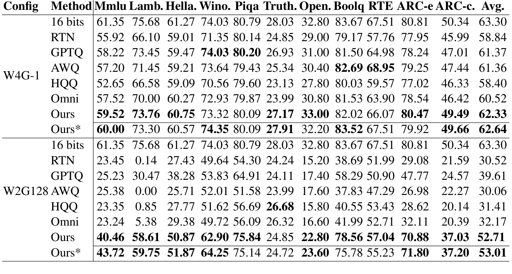</button>
<figcaption><strong>SignRound 原表：平均分背后的任务差异</strong><a href="https://arxiv.org/abs/2309.05516v5" target="_blank" rel="noopener">Optimize Weight Rounding via Signed Gradient Descent for the Quantization of LLMs</a> · Table 2 · version 2309.05516v5 · PDF p.5 / printed page unnumbered
<button class="original-direct" type="button">Read original size</button>

Original caption &amp; source

Table 2: Detailed accuracies(↑) across 11 tasks(0-shot) of Mistral models at W4G-1 and W2G128. ’Our*’ denotes
the highest accuracy achieved among the 8 hyperparameter choices, outlined in Section 4.2. Appendix C provides
more detailed data.
<a class="source-url" href="https://arxiv.org/pdf/2309.05516v5">https://arxiv.org/pdf/2309.05516v5</a>
</figcaption></figure>

Table 2 列出单项 zero-shot 分数。Mistral W2g128 的平均准确率 GPTQ 为 39.61，Ours 为 52.71，Ours* 为 53.01，FP16 为 63.30。优化取整大幅缓解 W2 失真，但仍留下能力差距。这里百分数是任务平均准确率，不是与浮点输出逐样本一致率。

### 5.5 SignRoundV2：低位宽还需要校准数据与位宽分配

SignRoundV2 <a href="#source-28">[28]</a> 将 rounding 配合样本过滤、初始化改进和模型敏感度驱动的混合位宽。问题从“每个数取哪一格”扩展为“哪些层值得多付 bit，哪些样本给出有效梯度”。2.5-bit 是方案的平均预算，不是一个可以直接乘法的统一数据类型。

<figure id="fig-signroundv2-01">
<button class="paper-image" type="button" aria-label="Zoom: SignRoundV2 原图：质量、校准时间和方案生成时间是三个量">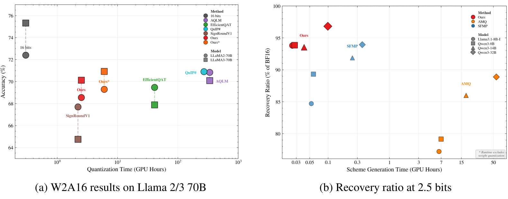</button>
<figcaption><strong>SignRoundV2 原图：质量、校准时间和方案生成时间是三个量</strong><a href="https://arxiv.org/abs/2512.04746v2" target="_blank" rel="noopener">SignRoundV2: Toward Closing the Performance Gap in Extremely Low-Bit Post-Training Quantization for LLMs</a> · Figure 1 · version 2512.04746v2 · PDF p.2 / printed p.2
<button class="original-direct" type="button">Read original size</button>

Original caption &amp; source

Figure 1: Left: results on pure 2 bits (W2A16) for Llama 2/3 70B. Right: recovery ratio for adaptive
bit assignments at 2.5 bits across four models.
<a class="source-url" href="https://arxiv.org/pdf/2512.04746v2">https://arxiv.org/pdf/2512.04746v2</a>
</figcaption></figure>

Figure 1 一部分比较 W2 准确率与 GPU-hours，另一部分展示 adaptive 2.5-bit 的恢复及 scheme generation 时间。后者不包含完整权重量化。图中较优位置意味着在该预算下更好的折中，不能把方案生成的短时间叫作整模型完成时间。

<figure id="fig-signroundv2-02">
<button class="paper-image" type="button" aria-label="Zoom: SignRoundV2 原图：层敏感度随数值类型变化">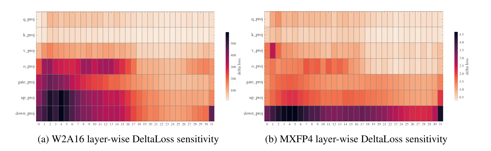</button>
<figcaption><strong>SignRoundV2 原图：层敏感度随数值类型变化</strong><a href="https://arxiv.org/abs/2512.04746v2" target="_blank" rel="noopener">SignRoundV2: Toward Closing the Performance Gap in Extremely Low-Bit Post-Training Quantization for LLMs</a> · Figure 2 · version 2512.04746v2 · PDF p.4 / printed p.4
<button class="original-direct" type="button">Read original size</button>

Original caption &amp; source

Figure 2: Layer-wise DeltaLoss sensitivity of Llama-3.1-8B-Instruct under W2A16 and MXFP4.
<a class="source-url" href="https://arxiv.org/pdf/2512.04746v2">https://arxiv.org/pdf/2512.04746v2</a>
</figcaption></figure>

Figure 2 以层和模块为轴画出 DeltaLoss，比较 W2 与 MXFP4。颜色代表该部分量化造成的代理损失变化。相同层在两种格式下未必同样敏感，所以“头尾全部保留高精度”是粗略启发而非通则。混合位宽应该按目标格式和实际校准测量。

<figure id="fig-signroundv2-03">
<button class="paper-image" type="button" aria-label="Zoom: SignRoundV2 原表：均匀 W2 和自适应 2.5 bit 的距离">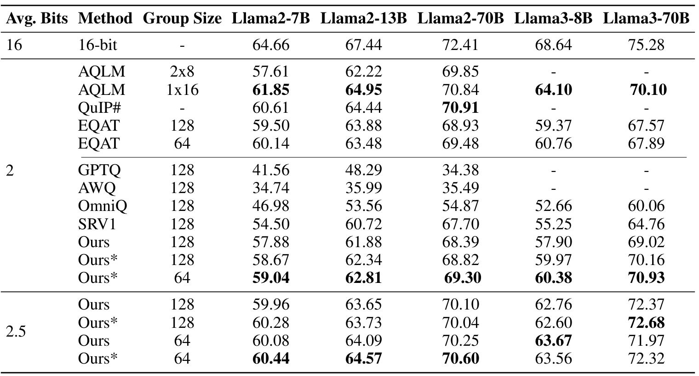</button>
<figcaption><strong>SignRoundV2 原表：均匀 W2 和自适应 2.5 bit 的距离</strong><a href="https://arxiv.org/abs/2512.04746v2" target="_blank" rel="noopener">SignRoundV2: Toward Closing the Performance Gap in Extremely Low-Bit Post-Training Quantization for LLMs</a> · Table 1 · version 2512.04746v2 · PDF p.7 / printed p.7
<button class="original-direct" type="button">Read original size</button>

Original caption &amp; source

Table 1: Average accuracies across five tasks (Section 4.2) using W2A16 at 2 bits and mixed W2A16
and W4A16G128 at 2.5 bits. “G” denotes the group size, and “Avg. Bits” denotes the average
per-weight bit-width. Ours* indicates our improved recipe (Section 3.5). “-” denotes missing data
from the original work.
<a class="source-url" href="https://arxiv.org/pdf/2512.04746v2">https://arxiv.org/pdf/2512.04746v2</a>
</figcaption></figure>

Table 1 把 pure W2 与混合预算分开，星号又涉及过滤、初始化或 group64 等改进。Llama-3-70B 的一项 W2 结果为 70.93，FP16 为 75.28；即便已显著缩小差距，也不能称逐样本无损。读者应先固定方案，再看 baseline 和平均任务集合。

<figure id="fig-signroundv2-04">
<button class="paper-image" type="button" aria-label="Zoom: SignRoundV2 原表：恢复率不是答案一致率">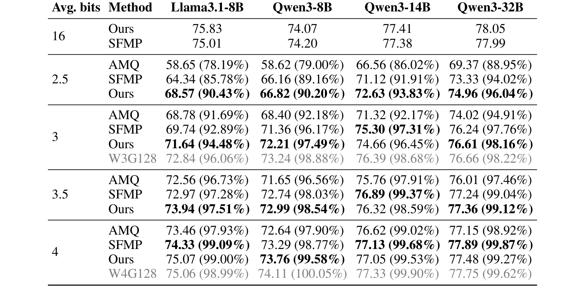</button>
<figcaption><strong>SignRoundV2 原表：恢复率不是答案一致率</strong><a href="https://arxiv.org/abs/2512.04746v2" target="_blank" rel="noopener">SignRoundV2: Toward Closing the Performance Gap in Extremely Low-Bit Post-Training Quantization for LLMs</a> · Table 2 · version 2512.04746v2 · PDF p.8 / printed p.8
<button class="original-direct" type="button">Read original size</button>

Original caption &amp; source

Table 2: Comparison of mixed-bit algorithms. Average accuracy (acc_norm preferred) and recovery
rate across six tasks (see Appendix B for details). Gray rows: uniform 3-bit and 4-bit baselines quan-
tized with SignRoundV2. Note: Ours employs hardware-friendly per-tensor mixed-bit granularity,
avoiding per-group granularity overhead in SFMP.
<a class="source-url" href="https://arxiv.org/pdf/2512.04746v2">https://arxiv.org/pdf/2512.04746v2</a>
</figcaption></figure>

Table 2 汇总六项任务，优先使用 acc_norm 的协议，不同原模型有各自的 16-bit baseline。所谓 recovery ratio 是量化模型平均准确率相对原模型的比例；量化后可能错对交换，比例高并不保证每个原本正确的问题仍正确。跨论文的 acc 与 acc_norm 也不能直接混用。

<figure id="fig-signroundv2-05">
<button class="paper-image" type="button" aria-label="Zoom: SignRoundV2 原表：过滤与初始化分别贡献多少">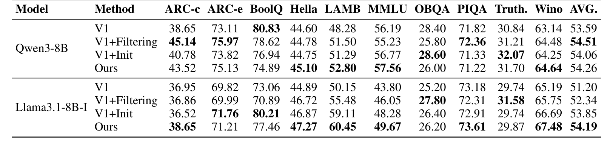</button>
<figcaption><strong>SignRoundV2 原表：过滤与初始化分别贡献多少</strong><a href="https://arxiv.org/abs/2512.04746v2" target="_blank" rel="noopener">SignRoundV2: Toward Closing the Performance Gap in Extremely Low-Bit Post-Training Quantization for LLMs</a> · Table 4 · version 2512.04746v2 · PDF p.9 / printed p.9
<button class="original-direct" type="button">Read original size</button>

Original caption &amp; source

Table 4: Ablation studies of loss filtering and pre-tuning initialization at W2A16G64.
<a class="source-url" href="https://arxiv.org/pdf/2512.04746v2">https://arxiv.org/pdf/2512.04746v2</a>
</figcaption></figure>

Table 4 在十项单任务中做组件消融。先比较只有一个改动的行，再看组合，才能判断是哪项贡献，而不是把所有提升归给 rounding。数据过滤改变校准分布，可能改善此组任务，也可能漏掉部署中的罕见语言、长文本或代码。

<figure id="fig-signroundv2-06">
<button class="paper-image" type="button" aria-label="Zoom: SignRoundV2 原表：更佳配方需要更多 GPU-hours">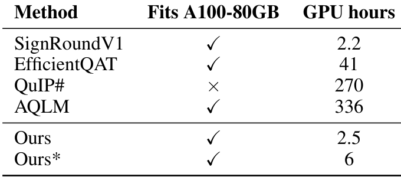</button>
<figcaption><strong>SignRoundV2 原表：更佳配方需要更多 GPU-hours</strong><a href="https://arxiv.org/abs/2512.04746v2" target="_blank" rel="noopener">SignRoundV2: Toward Closing the Performance Gap in Extremely Low-Bit Post-Training Quantization for LLMs</a> · Table 5 · version 2512.04746v2 · PDF p.9 / printed p.9
<button class="original-direct" type="button">Read original size</button>

Original caption &amp; source

Table 5: Runtime Cost Comparison for
Llama2-70B
<a class="source-url" href="https://arxiv.org/pdf/2512.04746v2">https://arxiv.org/pdf/2512.04746v2</a>
</figcaption></figure>

Table 5 报告离线校准成本，例如 Llama-2-70B 的默认约 2.5 GPU-hours，改进配置约 6，SignRoundV1 约 2.2。时间反映校准 recipe 的交换关系；与文章里其他 kernel 的 token/s 无法相除。是否值得采用，要看一次离线成本能在多少次部署和请求上摊销。

## 6. 极低位宽的表示：例外、非均匀格点与联合编码

从 W4 到 W2，可用码值再次减少四倍，简单均匀网格往往无法兼顾尾部和主体。以下路线首先改变表示能力：把困难权重单独保存，或让多个权重联合选择向量。它们并不都能直接接入标准 INT4/INT8 Tensor Core。

### 6.1 SpQR：稠密低位权重，加少量敏感例外

SpQR <a href="#source-6">[6]</a> 以类似 GPTQ 的输出重建敏感度识别困难权重，将主体量化，少量例外保持高精度。敏感度衡量“量化这项对输出多伤”，与单纯绝对值大不是一回事。它同时压缩 scales/zeros，降低细分组元数据的成本。

<figure id="fig-spqr-01">
<button class="paper-image" type="button" aria-label="Zoom: SpQR 原图：敏感权重可能散在矩阵各处">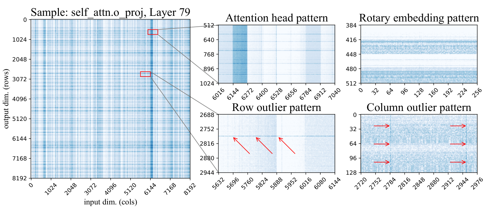</button>
<figcaption><strong>SpQR 原图：敏感权重可能散在矩阵各处</strong><a href="https://arxiv.org/abs/2306.03078v1" target="_blank" rel="noopener">SpQR: A Sparse-Quantized Representation for Near-Lossless LLM Weight Compression</a> · Figure 2 · version 2306.03078v1 · PDF p.5 / printed p.5
<button class="original-direct" type="button">Read original size</button>

Original caption &amp; source

Figure 2: Weight log-sensitivities from the last attention layer of LLaMA-65B. Dark-blue shades
indicate higher sensitivity. The image on the left is a high-level view, resized to 1:32 scale with
max-pooling. The two images in the middle are zoomed in from the main figure. The two images on
the right are taken from other weight matrices.
<a class="source-url" href="https://arxiv.org/pdf/2306.03078v1">https://arxiv.org/pdf/2306.03078v1</a>
</figcaption></figure>

Figure 2 左侧来自 Llama-65B 最后 attention 的 sensitivity，整体图用 1:32 max pooling，中间两幅是局部放大，右侧两幅来自其他权重矩阵。颜色表示对数敏感度，深蓝区域表示更高敏感度，不应把整体热图的一个像素当一个权重。不同面板显示 attention head、RoPE、行和列等结构，也说明非结构化保护需要保存稀疏索引。

<figure id="fig-spqr-02">
<button class="paper-image" type="button" aria-label="Zoom: SpQR 原表：平均 bits 已经不同于整数标签">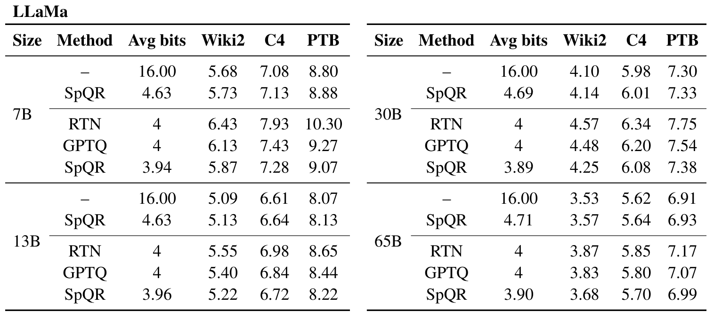</button>
<figcaption><strong>SpQR 原表：平均 bits 已经不同于整数标签</strong><a href="https://arxiv.org/abs/2306.03078v1" target="_blank" rel="noopener">SpQR: A Sparse-Quantized Representation for Near-Lossless LLM Weight Compression</a> · Table 1 · version 2306.03078v1 · PDF p.9 / printed p.9
<button class="original-direct" type="button">Read original size</button>

Original caption &amp; source

Table 1: Perplexity on WikiText2 [MXBS16], C4 [RSR+20] and Penn Treebank [MKM+94]
for SpQR and round-to-nearest (RTN) and GPTQ baselines with LLaMa. We can see that SpQR
reaches performances within 1% of the perplexity with less than 4.71 bits per parameter. We also
see that for 4-bits per parameter SpQR significantly improves on GPTQ with an improvement
as large as the improvement from RTN to GPTQ.
<a class="source-url" href="https://arxiv.org/pdf/2306.03078v1">https://arxiv.org/pdf/2306.03078v1</a>
</figcaption></figure>

Table 1 按模型给出实际平均位宽，能看到3.89、3.90至4.71等非整数预算。Llama-65B的4.71-bit行Wiki PPL3.57，FP16为3.53；更低3.90-bit行是3.68。接近基线的代价包括例外与二级元数据；不能把这些行叫“纯W4无额外开销”，group/稀疏设置还需结合原文配置。

<figure id="fig-spqr-03">
<button class="paper-image" type="button" aria-label="Zoom: SpQR 原表：二级量化参数、zero point与输入排序的消融">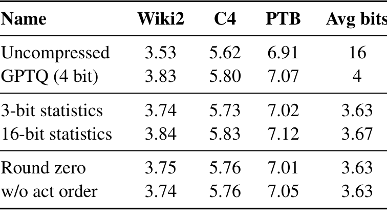</button>
<figcaption><strong>SpQR 原表：二级量化参数、zero point与输入排序的消融</strong><a href="https://arxiv.org/abs/2306.03078v1" target="_blank" rel="noopener">SpQR: A Sparse-Quantized Representation for Near-Lossless LLM Weight Compression</a> · Table 3 · version 2306.03078v1 · PDF p.10 / printed p.10
<button class="original-direct" type="button">Read original size</button>

Original caption &amp; source

Table 3: Perplexity for LLaMA-65B model.
<a class="source-url" href="https://arxiv.org/pdf/2306.03078v1">https://arxiv.org/pdf/2306.03078v1</a>
</figcaption></figure>

Table 3 固定 Llama-65B，比较量化参数用3-bit或16-bit统计、将zero point取整、移除activation ordering。3-bit统计行的Wiki PPL为3.74、平均3.63bit，16-bit统计为3.84、3.67bit；细组参数再量化可以以较少预算获得更好重建。后两行检查小的实现改动，而不是改变例外比例。这里必须同时读元数据预算与PPL，不能把统计参数位宽误当稠密权重位宽。

<figure id="fig-spqr-04">
<button class="paper-image" type="button" aria-label="Zoom: SpQR 原图：相同例外率下，非结构化保护比整行保护更有效">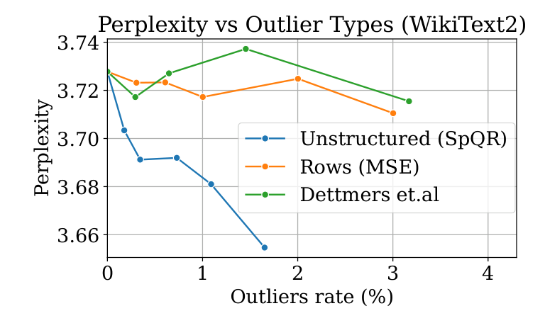</button>
<figcaption><strong>SpQR 原图：相同例外率下，非结构化保护比整行保护更有效</strong><a href="https://arxiv.org/abs/2306.03078v1" target="_blank" rel="noopener">SpQR: A Sparse-Quantized Representation for Near-Lossless LLM Weight Compression</a> · Figure 4 · version 2306.03078v1 · PDF p.10 / printed p.10
<button class="original-direct" type="button">Read original size</button>

Original caption &amp; source

Figure 4: Different outlier types, LLaMA-65B.
<a class="source-url" href="https://arxiv.org/pdf/2306.03078v1">https://arxiv.org/pdf/2306.03078v1</a>
</figcaption></figure>

Figure 4 横轴是outlier rate，纵轴是Llama-65B Wiki PPL，比较SpQR非结构化例外、按MSE选整行，以及Dettmers等人的例外策略。基底均为3-bit SpQR，非结构化例外以更少保护量降低PPL；按整行保存会连带保护许多不敏感权重。原文比较还考虑不同例外的存储成本。它是一张质量—例外率曲线，不能解释成两张权重热图，也没有给出各稀疏格式的相同延迟保证。

### 6.2 SqueezeLLM：把格点放在敏感值附近

SqueezeLLM <a href="#source-7">[7]</a> 采用非均匀量化，利用校准数据上的梯度统计构造 Fisher 敏感度近似，再做敏感度加权 k-means。它还分出数值异常和敏感例外。其假设是用对角 Fisher 忽略跨权重耦合，使问题可以有效计算。

$$
\min_{\{c_k\},\,a_i}\sum_i f_i(w_i-c_{a_i})^2.
$$

$w_i$ 是一个权重值，$c_k$ 是第 $k$ 个可重建中心，$a_i$ 是它的码本索引，$f_i\ge0$ 是该权重的 Fisher 对角敏感度。式子是论文加权聚类目标的写法，所有项在同一权重单位下比较。敏感点的 $f_i$ 大，就更能把中心拉向自己；它不是端到端损失的完整 Hessian。

<figure id="fig-squeeze-01">
<button class="paper-image" type="button" aria-label="Zoom: SqueezeLLM 原图：非均匀码本与稀疏例外怎样配合">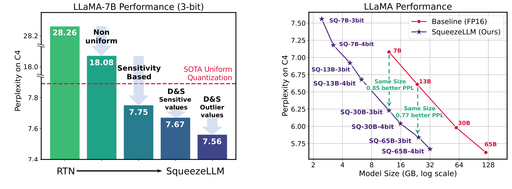</button>
<figcaption><strong>SqueezeLLM 原图：非均匀码本与稀疏例外怎样配合</strong><a href="https://arxiv.org/abs/2306.07629v4" target="_blank" rel="noopener">SqueezeLLM: Dense-and-Sparse Quantization</a> · Figure 1 · version 2306.07629v4 · PDF p.2 / printed page unnumbered
<button class="original-direct" type="button">Read original size</button>

Original caption &amp; source

Figure 1. (Left) SqueezeLLM incorporates two key approaches: (i) sensitivity-based non-uniform quantization (Sec. 4.1), where quantiza-
tion bins are allocated closer to sensitive values, and (ii) the Dense-and-Sparse decomposition (Sec. 4.2), which retains both sensitive
values and outlier values as full-precision sparse format. When applied to LLaMA-7B with 3-bit quantization, our method outperforms
the state-of-the-art methods (Frantar et al., 2022; Lin et al., 2023) by a large perplexity margin of over 0.3 on the C4 benchmark. (Right)
By applying our methods to LLaMA models of varying sizes, we can achieve improved trade-offs between perplexity and model size.
<a class="source-url" href="https://arxiv.org/pdf/2306.07629v4">https://arxiv.org/pdf/2306.07629v4</a>
</figcaption></figure>

Figure 1 左侧在Llama-7B W3中依次比较组件，C4 PPL从RTN28.26、普通非均匀18.08，到敏感度加权7.75，再加入敏感例外/异常例外成为7.67/7.56。右侧画不同模型的PPL—内存折中。左图是消融柱形图，展示单纯非均匀格点仍不够、敏感度是关键；右图的预算还包含码本与稀疏索引，不能只数索引宽度，也不能把C4读成WikiText2。

<figure id="fig-squeeze-02">
<button class="paper-image" type="button" aria-label="Zoom: SqueezeLLM 原图：均匀格点与敏感度加权格点">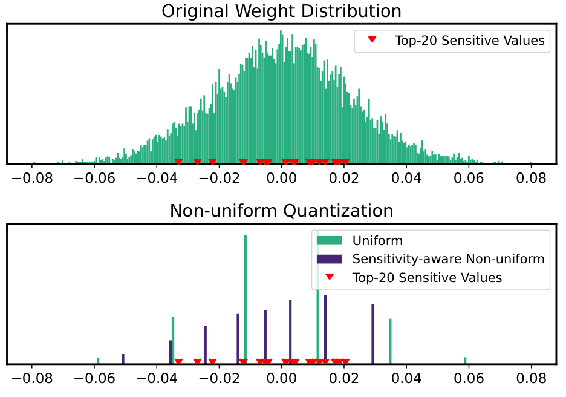</button>
<figcaption><strong>SqueezeLLM 原图：均匀格点与敏感度加权格点</strong><a href="https://arxiv.org/abs/2306.07629v4" target="_blank" rel="noopener">SqueezeLLM: Dense-and-Sparse Quantization</a> · Figure 3 · version 2306.07629v4 · PDF p.4 / printed page unnumbered
<button class="original-direct" type="button">Read original size</button>

Original caption &amp; source

Figure 3. (Top) The weight distribution of one output channel in
LLaMA-7B. The top-20 sensitive values are marked in red. (Bot-
tom) Weight distributions after 3-bit quantization using uniform
and sensitivity-based non-uniform quantization. In the latter case,
the quantized values are clustered around the sensitive values.
<a class="source-url" href="https://arxiv.org/pdf/2306.07629v4">https://arxiv.org/pdf/2306.07629v4</a>
</figcaption></figure>

Figure 3 上方是一个输出channel的原权重分布，红色三角标出top-20敏感值；下方对照uniform与sensitivity-aware non-uniform格点。加权中心更靠近重要红点，为少见但敏感的值减少误差。这区别于只照顾出现频率的普通聚类，但本图没有另画普通k-means的第三条量化曲线，不能把方法直觉当成图中已有的实验。

<figure id="fig-squeeze-03">
<button class="paper-image" type="button" aria-label="Zoom: SqueezeLLM 原图：大范围权重拆成稠密主体与稀疏尾部">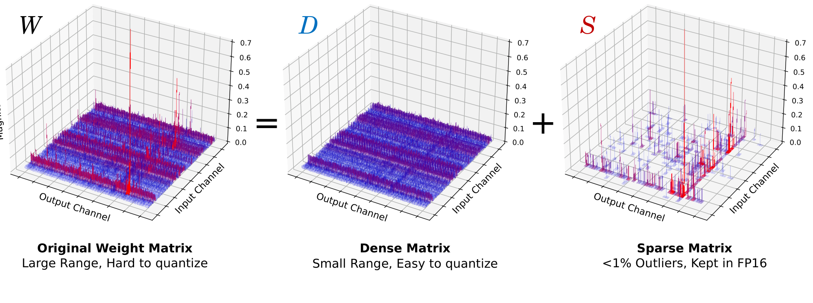</button>
<figcaption><strong>SqueezeLLM 原图：大范围权重拆成稠密主体与稀疏尾部</strong><a href="https://arxiv.org/abs/2306.07629v4" target="_blank" rel="noopener">SqueezeLLM: Dense-and-Sparse Quantization</a> · Figure 4 · version 2306.07629v4 · PDF p.5 / printed page unnumbered
<button class="original-direct" type="button">Read original size</button>

Original caption &amp; source

Figure 4. The illustration of the Dense-and-Sparse decomposition. The left figure plots the magnitude of a weight matrix (W) in the
LLaMA 65B model, which contains a few outliers. These outliers contribute to the large range of values in the original weight matrix
which significantly degrades the quantization performance. This matrix, however, can be decomposed into a sparse matrix S (Right) that
contains the outliers and the remaining dense matrix D (Middle). The dense matrix D then exhibits a significantly smaller range, making
accurate quantization much easier. The sparse matrix S can be kept in full precision with minimal memory and runtime overhead.
<a class="source-url" href="https://arxiv.org/pdf/2306.07629v4">https://arxiv.org/pdf/2306.07629v4</a>
</figcaption></figure>

Figure 4 依次展示原权重W、去掉异常值后的稠密D和保存异常值的稀疏S，满足W=D+S。左侧少量数值尾部拉大范围，中间主体范围缩小，右侧少量例外保持高精度。图直接画的是数值异常分解；前文的敏感例外是方法另一个选择依据。稀疏分支仍需要索引与实际计算，本图不能证明任意例外比例都提高速度。

<figure id="fig-squeeze-04">
<button class="paper-image" type="button" aria-label="Zoom: SqueezeLLM 原表：0% 与 0.45% sparse 不是相同模型预算">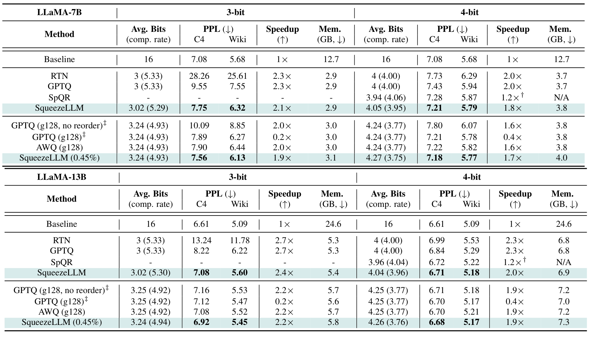</button>
<figcaption><strong>SqueezeLLM 原表：0% 与 0.45% sparse 不是相同模型预算</strong><a href="https://arxiv.org/abs/2306.07629v4" target="_blank" rel="noopener">SqueezeLLM: Dense-and-Sparse Quantization</a> · Table 1 · version 2306.07629v4 · PDF p.7 / printed page unnumbered
<button class="original-direct" type="button">Read original size</button>

Original caption &amp; source

Table 1. Perplexity comparison of LLaMA models quantized into 3 and 4 bits using different methods including RTN, GPTQ, AWQ and
SpQR on C4 and WikiText-2. We compare the performance of different methodologies by grouping them based on their model sizes. In
the first group, we compare dense-only SqueezeLLM with non-grouped GPTQ. In the second group, we compare SqueezeLLM with a
sparsity level of 0.45% to GPTQ and AWQ with a group size of 128. For comparison, we add speedup and peak memory usage numbers,
which we provide more details in Tab. H.13. Further results for LLaMA-30/65B can be found in Tab. H.13, and results on other models
including LLaMA-2 7/13/70B are provided in Appendix H.1.
<a class="source-url" href="https://arxiv.org/pdf/2306.07629v4">https://arxiv.org/pdf/2306.07629v4</a>
</figcaption></figure>

Table 1 对 Llama-7B/13B 分开 dense-only 与 0.45% sparse，列出 W3/W4 的平均位宽及 PPL。稀疏例外改善精度同时增加存储，必须在相同 actual bits 或内存条件下比较。模型大小变化也会改变质量，不能把更大的低位模型与较小浮点模型只按 PPL 判断算法。

<figure id="fig-squeeze-05">
<button class="paper-image" type="button" aria-label="Zoom: SqueezeLLM 原表：查表内核的真实生成代价">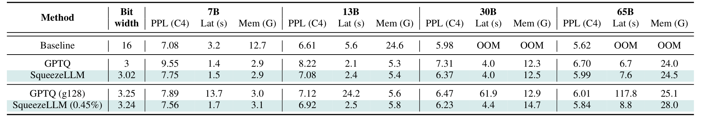</button>
<figcaption><strong>SqueezeLLM 原表：查表内核的真实生成代价</strong><a href="https://arxiv.org/abs/2306.07629v4" target="_blank" rel="noopener">SqueezeLLM: Dense-and-Sparse Quantization</a> · Table 3 · version 2306.07629v4 · PDF p.9 / printed page unnumbered
<button class="original-direct" type="button">Read original size</button>

Original caption &amp; source

Table 3. Latency (s) and peak memory usage (GB) of 3-bit LLaMA when generating 128 tokens on an A6000 GPU. The table compares
the FP16 baseline, non-grouped and grouped GPTQ with activation ordering, and SqueezeLLM with different sparsity levels. For
comparison, we include bitwidth and perplexity on the C4 benchmark. See Tab. G.11 for additional results on generating 1024 tokens, and
see Tab. G.12 for additional benchmarking results on an A100 GPU.
<a class="source-url" href="https://arxiv.org/pdf/2306.07629v4">https://arxiv.org/pdf/2306.07629v4</a>
</figcaption></figure>

Table 3 是A6000、单batch、生成128token的延迟与峰值显存。7B FP16为3.2s/12.7GB，W3 dense为1.5s/2.9GB，加入0.45% sparse为1.7s/3.1GB。表中GPTQ g128虽只略增元数据，却达到13.7s；作者分析其activation-order重排妨碍合并访存。结果说明格式与LUT内核必须共同设计，sparse分支也付额外代价。这是整段生成时间，不能直接当单次GEMM延迟。

### 6.3 QuIP：先消除坐标集中，再做二阶取整

QuIP <a href="#source-8">[8]</a> 把 weights 和重建曲率变得更“非相干”：避免少数坐标支配权重或协方差特征向量。随机正交预处理配合二阶自适应 rounding，让 W2 更稳定。保证针对一定假设下的重建代理，不是“任意语言模型 2 bit 无损”的定理。

<figure id="fig-quip-01">
<button class="paper-image" type="button" aria-label="Zoom: QuIP 原图组：谱与坐标集中为何妨碍低位宽">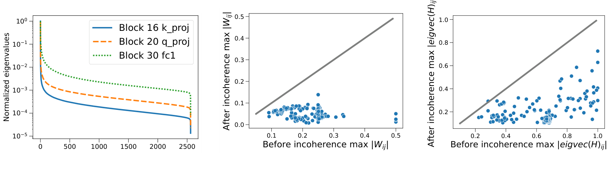</button>
<figcaption><strong>QuIP 原图组：谱与坐标集中为何妨碍低位宽</strong><a href="https://arxiv.org/abs/2307.13304v2" target="_blank" rel="noopener">QuIP: 2-Bit Quantization of Large Language Models With Guarantees</a> · Figure 1 / Figure 2 / Figure 3 · version 2307.13304v2 · PDF p.4 / printed p.4
<button class="original-direct" type="button">Read original size</button>

Original caption &amp; source

Figure 1: eig(H) from OPT-2.7b.

Figure 2: Max |Wij| before
and after incoherence process-
ing on OPT-2.7b.

Figure 3: Max |Qij| before
and after incoherence process-
ing, with Q the eigenvectors of
H on OPT-2.7b.
<a class="source-url" href="https://arxiv.org/pdf/2307.13304v2">https://arxiv.org/pdf/2307.13304v2</a>
</figcaption></figure>

Figures 1–3 分别展示输入协方差的偏斜谱、权重或特征向量最大值，以及预处理后的变化。大特征值说明错误方向的代价不同；集中坐标又会使少数格点承担很大动态范围。预处理降低坐标尖峰，但不消除特征值本身。图支撑的是条件改善，不是让 Hessian 变成单位阵。

<figure id="fig-quip-02">
<button class="paper-image" type="button" aria-label="Zoom: QuIP 原图：W2 的可用性随着模型规模变化">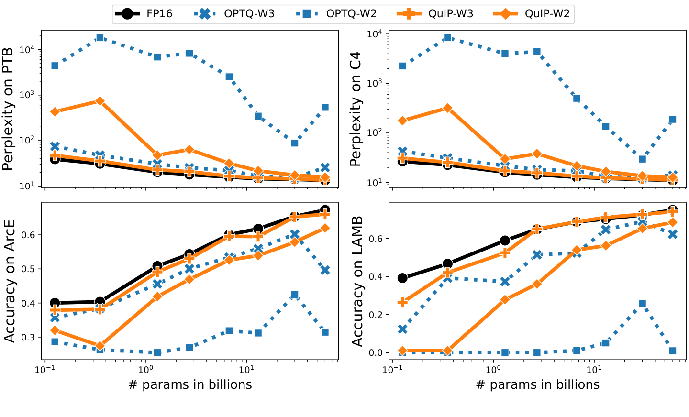</button>
<figcaption><strong>QuIP 原图：W2 的可用性随着模型规模变化</strong><a href="https://arxiv.org/abs/2307.13304v2" target="_blank" rel="noopener">QuIP: 2-Bit Quantization of Large Language Models With Guarantees</a> · Figure 5 · version 2307.13304v2 · PDF p.9 / printed p.9
<button class="original-direct" type="button">Read original size</button>

Original caption &amp; source

Figure 5: Quantizing OPT models up to 66B parameters. Our method QuIP is the first PTQ procedure
to achieve good quantization at 2 bits per weight, across a variety of model sizes and evaluation tasks.
<a class="source-url" href="https://arxiv.org/pdf/2307.13304v2">https://arxiv.org/pdf/2307.13304v2</a>
</figcaption></figure>

Figure 5 在 OPT 家族中比较量化质量随规模的变化。横轴模型规模，纵轴语言建模指标；QuIP 与未作预处理的 OPTQ 拉开距离。更大模型有时能承受更多压缩，但图不是证明“扩大模型总优于增加位宽”，因为内存、吞吐和绝对参数数目也变化。

<figure id="fig-quip-03">
<button class="paper-image" type="button" aria-label="Zoom: QuIP 原表：2 bit 改善巨大，距离浮点仍明显">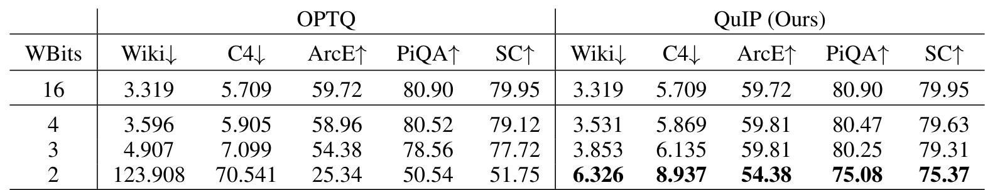</button>
<figcaption><strong>QuIP 原表：2 bit 改善巨大，距离浮点仍明显</strong><a href="https://arxiv.org/abs/2307.13304v2" target="_blank" rel="noopener">QuIP: 2-Bit Quantization of Large Language Models With Guarantees</a> · Table 1 · version 2307.13304v2 · PDF p.9 / printed p.9
<button class="original-direct" type="button">Read original size</button>

Original caption &amp; source

Table 1: Quantizing Llama 2 70B with QuIP and OPTQ, and evaluating on language generation and
zeroshot tasks. Our incoherence processing enables a step function change in quantization at 2 bits.
<a class="source-url" href="https://arxiv.org/pdf/2307.13304v2">https://arxiv.org/pdf/2307.13304v2</a>
</figcaption></figure>

Table 1 的 Llama-2-70B W2 中，未处理 OPTQ 的 Wiki/C4 为 123.908/70.541，QuIP 为 6.326/8.937，FP16 为 3.319/5.709。这一对比既展示预处理的重要性，也显示剩余质量差距。两个数据集必须分别读，不能用 Wiki 的差值描述 C4。

<figure id="fig-quip-04">
<button class="paper-image" type="button" aria-label="Zoom: QuIP 原表：收益来自预处理与求解器的组合">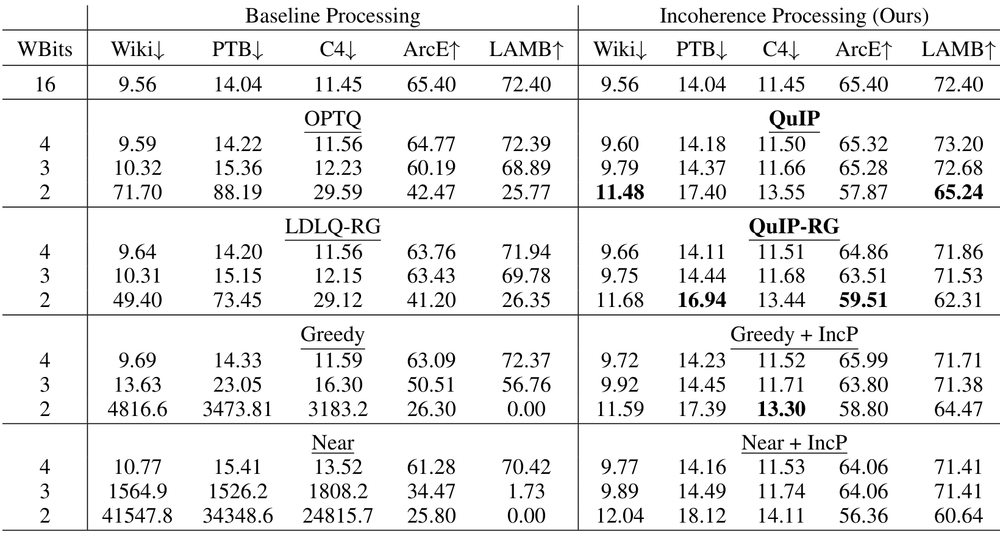</button>
<figcaption><strong>QuIP 原表：收益来自预处理与求解器的组合</strong><a href="https://arxiv.org/abs/2307.13304v2" target="_blank" rel="noopener">QuIP: 2-Bit Quantization of Large Language Models With Guarantees</a> · Table 2 · version 2307.13304v2 · PDF p.9 / printed p.9
<button class="original-direct" type="button">Read original size</button>

Original caption &amp; source

Table 2: Quantizing OPT-30b with various quantization and processing methods, and evaluating on
language generation and zeroshot tasks. Our incoherence processing enables a step function change
in quantization at 2 bits, across all rounding methods.
<a class="source-url" href="https://arxiv.org/pdf/2307.13304v2">https://arxiv.org/pdf/2307.13304v2</a>
</figcaption></figure>

Table 2 固定 OPT-30B，比较多种 rounding 算法在有/无 incoherence 下的结果。若多个求解器都获益，不能把提升完全归给其中一个 rounding 规则。代价是预处理、统计和额外格式/运行时支持；理论条件与真实模型质量仍需通过实验连接。

### 6.4 QuIP#：Hadamard 加 E8 格点，让八个权重共同编码

QuIP# <a href="#source-9">[9]</a> 用随机 Hadamard 实现高效非相干化，再使用 E8 系列 lattice codebook。单个 2-bit 标量只有很少选择，但八维向量可以在相同摊销预算下选择更合适的联合格点。论文还包含不同 fine-tuning recipe，不能把所有结果归为无梯度校准。

<figure id="fig-quipsharp-01">
<button class="paper-image" type="button" aria-label="Zoom: QuIP# 原图：随机旋转与八维码本">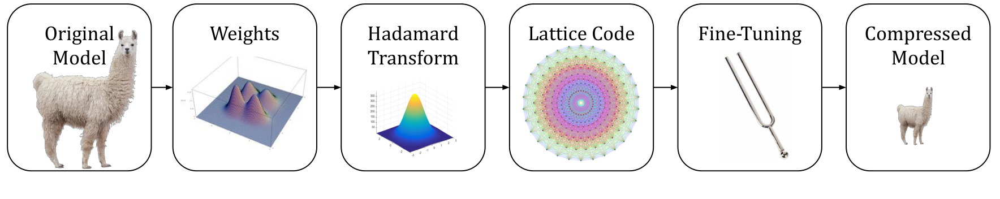</button>
<figcaption><strong>QuIP# 原图：随机旋转与八维码本</strong><a href="https://arxiv.org/abs/2402.04396v2" target="_blank" rel="noopener">QuIP#: Even Better LLM Quantization with Hadamard Incoherence and Lattice Codebooks</a> · Figure 2 · version 2402.04396v2 · PDF p.2 / printed page unnumbered
<button class="original-direct" type="button">Read original size</button>

Original caption &amp; source

Figure 2. QuIP# performs incoherence processing with a Randomized Hadamard Transform and uses lattice codebooks to achieve state-
of-the-art quantized models.
<a class="source-url" href="https://arxiv.org/pdf/2402.04396v2">https://arxiv.org/pdf/2402.04396v2</a>
</figcaption></figure>

Figure 2 将权重先旋转，再以八个元素为组搜索 lattice code，保存索引和尺度，执行时恢复向量。Hadamard 和随机符号使坐标更均衡；E8 让误差形状更贴合多维分布。它不是把八个权重分别做独立整数 round，也不是普通 INT2 Tensor Core 能直接解释的格式。

<figure id="fig-quipsharp-02">
<button class="paper-image" type="button" aria-label="Zoom: QuIP# 原图：高斯向量 MSE 与语言模型指标的边界">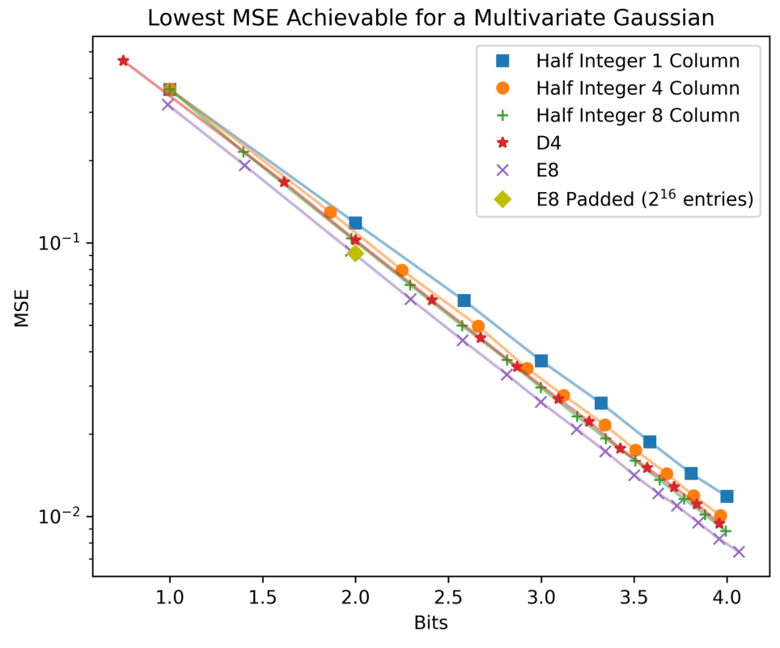</button>
<figcaption><strong>QuIP# 原图：高斯向量 MSE 与语言模型指标的边界</strong><a href="https://arxiv.org/abs/2402.04396v2" target="_blank" rel="noopener">QuIP#: Even Better LLM Quantization with Hadamard Incoherence and Lattice Codebooks</a> · Figure 3 · version 2402.04396v2 · PDF p.6 / printed page unnumbered
<button class="original-direct" type="button">Read original size</button>

Original caption &amp; source

Figure 3. Minimum achievable elementwise MSE of quantizing a
Gaussian to various codebooks. E8-based codebooks outperform
other presented codebooks due to the underlying packing density
and high dimensionality of E8.
<a class="source-url" href="https://arxiv.org/pdf/2402.04396v2">https://arxiv.org/pdf/2402.04396v2</a>
</figcaption></figure>

Figure 3 横轴码率、纵轴多维标准高斯量化 MSE，比较 lattice 与标量网格。联合编码的优势来自更多维度的空间填充。实验对象是向量分布，不是 WikiText2；它解释格式设计的直觉，不能直接换算成最终准确率提升。

<figure id="fig-quipsharp-03">
<button class="paper-image" type="button" aria-label="Zoom: QuIP# 原表：PPL、上下文与微调配方">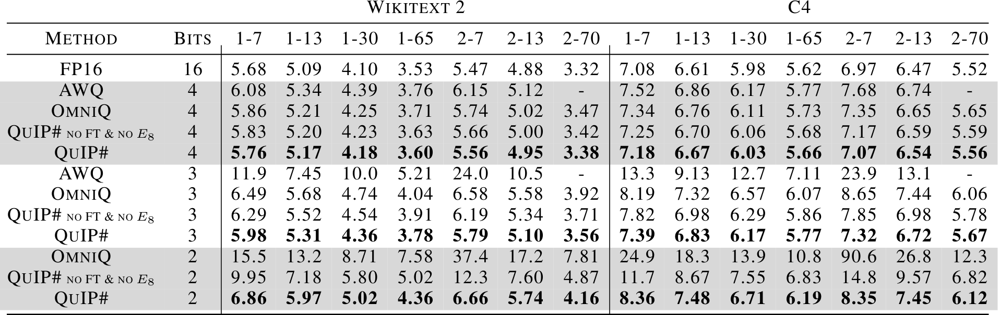</button>
<figcaption><strong>QuIP# 原表：PPL、上下文与微调配方</strong><a href="https://arxiv.org/abs/2402.04396v2" target="_blank" rel="noopener">QuIP#: Even Better LLM Quantization with Hadamard Incoherence and Lattice Codebooks</a> · Table 2 · version 2402.04396v2 · PDF p.8 / printed page unnumbered
<button class="original-direct" type="button">Read original size</button>

Original caption &amp; source

Table 2. Llama 1 &amp; 2 Wikitext2 and C4 perplexity (↓), context length 2048.
<a class="source-url" href="https://arxiv.org/pdf/2402.04396v2">https://arxiv.org/pdf/2402.04396v2</a>
</figcaption></figure>

Table 2 报告 WikiText2/C4，context 为 2048，并区分位宽和 tuning 设置。相同 nominal bit 的行若用了更多 fine-tuning，已交换额外数据和计算。需读完整配置，再问码本带来多少收益；码本与 scale 摊销也使 actual bits 不完全等于标签。

<figure id="fig-quipsharp-04">
<button class="paper-image" type="button" aria-label="Zoom: QuIP# 原表：zero-shot acc 不能与 acc_norm 混排">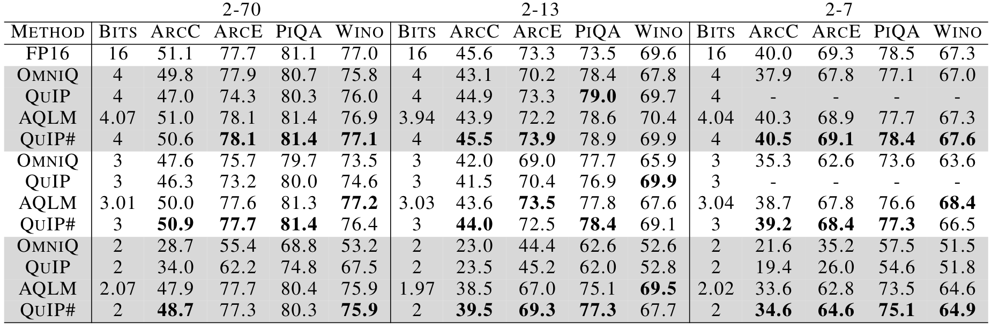</button>
<figcaption><strong>QuIP# 原表：zero-shot acc 不能与 acc_norm 混排</strong><a href="https://arxiv.org/abs/2402.04396v2" target="_blank" rel="noopener">QuIP#: Even Better LLM Quantization with Hadamard Incoherence and Lattice Codebooks</a> · Table 3 · version 2402.04396v2 · PDF p.8 / printed page unnumbered
<button class="original-direct" type="button">Read original size</button>

Original caption &amp; source

Table 3. Zeroshot Accuracy (acc in LM Eval, not acc_norm), Llama 2.
<a class="source-url" href="https://arxiv.org/pdf/2402.04396v2">https://arxiv.org/pdf/2402.04396v2</a>
</figcaption></figure>

Table 3 展示单任务与平均 zero-shot accuracy，采用 acc 而非一律长度归一化的 acc_norm。它补充 PPL 之外的能力证据。个别任务接近原模型不保证所有题目一致，后续极低位宽研究使用不同任务均值时尤其要避免直接排名。

### 6.5 AQLM：多个向量码本的和

AQLM <a href="#source-29">[29]</a> 的 additive quantization 将一组权重写成多个码本向量相加，再乘行尺度。它允许离散码选择与连续码本、尺度联合优化，也包含 block/output fine-tuning。极低位宽来自索引摊销，而非给每个浮点数单独两个 bit。

$$
\hat w_{\mathrm{group}}=s\sum_{r=1}^{M}C_r[c_r].
$$

$\hat w_{\mathrm{group}}\in\mathbb R^g$ 是一个长度 $g$ 的权重组，$C_r$ 是第 $r$ 个向量码本，$c_r$ 是该组索引，$M$ 是码本个数，$s$ 为行尺度。若 $g=8,M=2$，两个索引各 8 bit，总 16 bit 选择一组八维向量，即名义 2 bit/weight；码本和尺度额外存储。加法恢复的是向量，不是整数数值相加。

<figure id="fig-aqlm-01">
<button class="paper-image" type="button" aria-label="Zoom: AQLM 原图：两个索引怎样代表一组权重">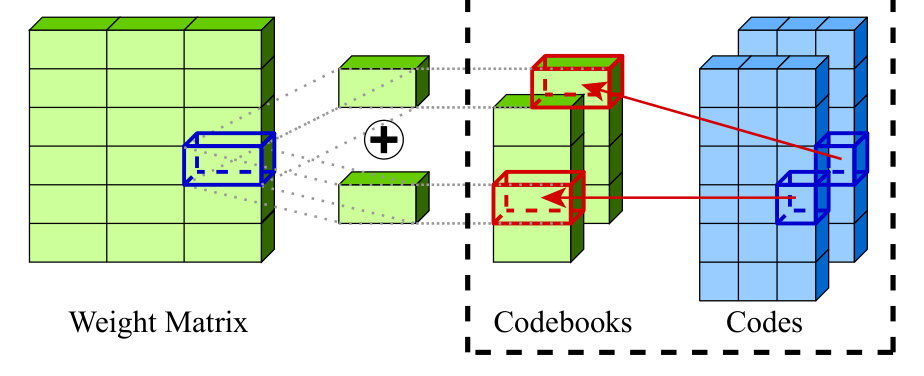</button>
<figcaption><strong>AQLM 原图：两个索引怎样代表一组权重</strong><a href="https://arxiv.org/abs/2401.06118v4" target="_blank" rel="noopener">Extreme Compression of Large Language Models via Additive Quantization</a> · Figure 2 · version 2401.06118v4 · PDF p.4 / printed page unnumbered
<button class="original-direct" type="button">Read original size</button>

Original caption &amp; source

Figure 2: Groups of weights are represented by a sum of
codes selected from codebooks by corresponding indices.
<a class="source-url" href="https://arxiv.org/pdf/2401.06118v4">https://arxiv.org/pdf/2401.06118v4</a>
</figcaption></figure>

Figure 2 从权重组出发，分别查询多个向量中心并求和。对于八个元素，两个索引可描述组合形状，码本被许多组共享。它提高表示效率，也增加查表与优化难度；共享码本小模型中摊销较少，实际 bits 可能更高。

<figure id="fig-aqlm-02">
<button class="paper-image" type="button" aria-label="Zoom: AQLM 原图：压缩矩阵的索引、向量码本与逐行尺度"></button>
<figcaption><strong>AQLM 原图：压缩矩阵的索引、向量码本与逐行尺度</strong><a href="https://arxiv.org/abs/2401.06118v4" target="_blank" rel="noopener">Extreme Compression of Large Language Models via Additive Quantization</a> · Figure 3 · version 2401.06118v4 · PDF p.6 / printed page unnumbered
<button class="original-direct" type="button">Read original size</button>

Original caption &amp; source

Figure 3: AQLM compressed weight format. Horizontal and vertical axes are input features and output units, respectively.
Depth represents the codebook index. Reconstruction procedure, from left to right: i) compressed weight codes ii) zoom-in
one weight group, each code is an index in its respective codebook iii) select codes from each codebook iv) add up codes as
in (2) v) multiply by scales (one scale per output dimension).
<a class="source-url" href="https://arxiv.org/pdf/2401.06118v4">https://arxiv.org/pdf/2401.06118v4</a>
</figcaption></figure>

Figure 3 横轴是输入features、纵轴是输出units、深度是码本编号。沿左到右看：压缩矩阵保存组索引，放大一组后依次从各码本取向量、相加、最后乘该输出行的scale。它展示执行时怎样恢复权重，不是优化算法流程图。离线算法另外交替做离散搜索和连续码本/尺度更新；两类变量的预算与微调范围仍需记录。

<figure id="fig-aqlm-03">
<button class="paper-image" type="button" aria-label="Zoom: AQLM 原表：极低位宽需要报告实际预算"></button>
<figcaption><strong>AQLM 原表：极低位宽需要报告实际预算</strong><a href="https://arxiv.org/abs/2401.06118v4" target="_blank" rel="noopener">Extreme Compression of Large Language Models via Additive Quantization</a> · Table 1 · version 2401.06118v4 · PDF p.7 / printed page unnumbered
<button class="original-direct" type="button">Read original size</button>

Original caption &amp; source

Table 1: Evaluation of quantized LLAMA 2 models for 2-2.8 bits per parameter, with an extra section for higher bitwidth.
We report perplexity on WikiText-2 (Merity et al., 2016) &amp; C4 (Raffel et al., 2020) and accuracy for zero-shot tasks. The
Average accuracy is the mean of 5 zero-shot tasks. Primary metrics are Wiki2 (PPL), C4 (PPL) and Average accuracy.
<a class="source-url" href="https://arxiv.org/pdf/2401.06118v4">https://arxiv.org/pdf/2401.06118v4</a>
</figcaption></figure>

Table 1 的 Llama-2-70B 约 2.07-bit 行，Wiki/C4 为 3.94/5.72，五项任务平均 68.75；FP16 为 3.12/4.97/70.17。这是在论文自身协议内的压缩折中，不能与别处 FP16=3.32 的 Wiki 直接比较；不同评价代码和切片已可能改变 baseline。

<figure id="fig-aqlm-04">
<button class="paper-image" type="button" aria-label="Zoom: AQLM 原表：提高索引预算与优化预算的贡献"></button>
<figcaption><strong>AQLM 原表：提高索引预算与优化预算的贡献</strong><a href="https://arxiv.org/abs/2401.06118v4" target="_blank" rel="noopener">Extreme Compression of Large Language Models via Additive Quantization</a> · Table 2 · version 2401.06118v4 · PDF p.7 / printed page unnumbered
<button class="original-direct" type="button">Read original size</button>

Original caption &amp; source

Table 2: Evaluation of quantized LLAMA 2 models for 3-3.1 bits per parameter, with the same metrics as in Table 1.
<a class="source-url" href="https://arxiv.org/pdf/2401.06118v4">https://arxiv.org/pdf/2401.06118v4</a>
</figcaption></figure>

Table 2 比较更高码率及不同 recipe 的结果。更多 code bits 扩大可选组合，fine-tuning 又进一步改变中心与模型误差。只看最终分数会把表示收益和优化收益混在一起；部署还需要 AQLM 专用解码/GEMV，并非换一个标准 INT2 dtype 即可。

### 6.6 QTIP：把相邻向量的索引相关性也利用起来

QTIP <a href="#source-13">[13]</a> 使用 trellis（网格状态图）量化。连续状态共享重叠 bit，选择一条路径意味着连续多组权重受到关联编码；incoherence 改善输入分布，路径搜索决定低码率下如何选重建向量。

<figure id="fig-qtip-01">
<button class="paper-image" type="button" aria-label="Zoom: QTIP 原图：状态重叠怎样降低索引成本"></button>
<figcaption><strong>QTIP 原图：状态重叠怎样降低索引成本</strong><a href="https://arxiv.org/abs/2406.11235v4" target="_blank" rel="noopener">QTIP: Quantization with Trellises and Incoherence Processing</a> · Figure 2 · version 2406.11235v4 · PDF p.5 / printed p.5
<button class="original-direct" type="button">Read original size</button>

Original caption &amp; source

Figure 2: A bitshift trellis code with L = 2, k = 1, V = 1. Nodes 0, 1, 2, and 3 have code values 0.5,
0.1, 0.8, and 0.3, respectively. Each node can only transition to the 2kV = 2 nodes that share their
top L −kV = 1 bit with its bottom L −kV = 1 bit. In this example, ˆS can be stored as 0010110.
<a class="source-url" href="https://arxiv.org/pdf/2406.11235v4">https://arxiv.org/pdf/2406.11235v4</a>
</figcaption></figure>

Figure 2 的 $L=2,k=1,V=1$ 示例有四个状态，箭头只允许满足 bitshift 重叠的转移。示例串 0010110 逐步确定状态和重建值。不是每步可独立跳到任意码字，路径约束换取共享存储。真实 kernel 要高效恢复状态和码字，否则码率优势会被 lookup 代价吃掉。

<figure id="fig-qtip-02">
<button class="paper-image" type="button" aria-label="Zoom: QTIP 原表：纯计算码本的 no-FT 条件"></button>
<figcaption><strong>QTIP 原表：纯计算码本的 no-FT 条件</strong><a href="https://arxiv.org/abs/2406.11235v4" target="_blank" rel="noopener">QTIP: Quantization with Trellises and Incoherence Processing</a> · Table 3 · version 2406.11235v4 · PDF p.8 / printed p.8
<button class="original-direct" type="button">Read original size</button>

Original caption &amp; source

Table 3: Wikitext2 and C4 perplexity (↓), ctx. 4096, QTIP with pure-computed codes. Even without
fine-tuning, pure-computed QTIP outperforms QuIP# and AQLM, both of which use fine-tuning, at
almost all models sizes.
<a class="source-url" href="https://arxiv.org/pdf/2406.11235v4">https://arxiv.org/pdf/2406.11235v4</a>
</figcaption></figure>

Table 3 报告 computed codes、无 fine-tuning、context 4096 的质量。它适合回答“仅 trellis 表示和预处理能做到什么”。4096 与前面许多 2048 协议不同，不应拿绝对 PPL 直接排序；码本生成方式也影响存储和运行时计算。

<figure id="fig-qtip-03">
<button class="paper-image" type="button" aria-label="Zoom: QTIP 原表：带宽 roofline 不是实测吞吐本身"></button>
<figcaption><strong>QTIP 原表：带宽 roofline 不是实测吞吐本身</strong><a href="https://arxiv.org/abs/2406.11235v4" target="_blank" rel="noopener">QTIP: Quantization with Trellises and Incoherence Processing</a> · Table 4 · version 2406.11235v4 · PDF p.8 / printed p.8
<button class="original-direct" type="button">Read original size</button>

Original caption &amp; source

Table 4: Batch size 1 decoding throughput
on a RTX6000 Ada (960GB/s mem. BW).
<a class="source-url" href="https://arxiv.org/pdf/2406.11235v4">https://arxiv.org/pdf/2406.11235v4</a>
</figcaption></figure>

Table 4 在RTX6000 Ada、960GB/s、batch1中给实测decode吞吐。Llama-2-7B FP16为55.9token/s，QTIP W2为188；70B FP16为OOM，QTIP为23.5。不能把理论memory roofline或另一版本数字混入此表。位宽降低有利带宽，但decode还包括状态恢复、查表等；模型尺寸、kernel和码本局部性决定最终吞吐。

<figure id="fig-qtip-04">
<button class="paper-image" type="button" aria-label="Zoom: QTIP 原表：hybrid codes 与 tuning 带来另一个预算"></button>
<figcaption><strong>QTIP 原表：hybrid codes 与 tuning 带来另一个预算</strong><a href="https://arxiv.org/abs/2406.11235v4" target="_blank" rel="noopener">QTIP: Quantization with Trellises and Incoherence Processing</a> · Table 5 · version 2406.11235v4 · PDF p.9 / printed p.9
<button class="original-direct" type="button">Read original size</button>

Original caption &amp; source

Table 5: Wikitext2 and C4 perplexity (↓), QTIP with the hybrid-computed code. QTIP enables high-
dimensional quantization and outperforms state-of-the-art vector quantization approaches.
<a class="source-url" href="https://arxiv.org/pdf/2406.11235v4">https://arxiv.org/pdf/2406.11235v4</a>
</figcaption></figure>

Table 5 的 hybrid codes 允许不同的可学习部分和 overhead。它与 Table 3 的 no-FT 不是同一个实验合同。评价时应分别记录压缩字节、离线搜索/优化成本、decode 实现；不能以 hybrid 最好精度配 pure-computed 最小成本。

### 6.7 SAGE-PTQ：scale 变少之后，lookup 账本不能消失

SAGE-PTQ <a href="#source-27">[27]</a> 针对近 binary 压缩的元数据问题：传统细分组共享尺度少，但每组都要存 scale。它用显著性划分，给主体做图引导的聚类分组，每个簇共用尺度，另用 bit-packed lookup 指明组身份。原文存在对 AWQ 的不准确描述；本文沿用已核验的 AWQ 最终统一低位宽解释。

<figure id="fig-sage-01">
<button class="paper-image" type="button" aria-label="Zoom: SAGE-PTQ 原图：按分布分组，如何找到每个权重的尺度"></button>
<figcaption><strong>SAGE-PTQ 原图：按分布分组，如何找到每个权重的尺度</strong><a href="https://arxiv.org/abs/2606.05429v1" target="_blank" rel="noopener">Minimizing the Hidden Cost of Scales: Graph-Guided Ultra-Low-Bit Quantization for Large Language Models</a> · Figure 1 · version 2606.05429v1 · PDF p.2 / printed p.2
<button class="original-direct" type="button">Read original size</button>

Original caption &amp; source

Figure 1: Illustration of the SAGE-PTQ quantization pipeline. The framework input is the weight
matrix and outputs quantized matrix with minimal scale overhead and minimal lookup metadata
<a class="source-url" href="https://arxiv.org/pdf/2606.05429v1">https://arxiv.org/pdf/2606.05429v1</a>
</figcaption></figure>

Figure 1 从权重进入 salient/unsalient 分支，经过图建模、分组、二值或更高位码、packing 和 lookup 输出。谱聚类依据近邻图的相似性决定主体分组，显著部分使用单独尺度和更高 precision。非连续簇减少 scale 数，却需要恢复每个位置的组身份；mask/lookup 不是可省略的信息。

<figure id="fig-sage-02">
<button class="paper-image" type="button" aria-label="Zoom: SAGE-PTQ 原表：OPT 的 first-layer 例外与 lookup 设置"></button>
<figcaption><strong>SAGE-PTQ 原表：OPT 的 first-layer 例外与 lookup 设置</strong><a href="https://arxiv.org/abs/2606.05429v1" target="_blank" rel="noopener">Minimizing the Hidden Cost of Scales: Graph-Guided Ultra-Low-Bit Quantization for Large Language Models</a> · Table 1 · version 2606.05429v1 · PDF p.7 / printed p.7
<button class="original-direct" type="button">Read original size</button>

Original caption &amp; source

Table 1: Perplexity results on WikiText2 for the OPT family. We compare FP16 baselines, 3-bit PTQ
methods (GPTQ, AWQ), sub-2-bit methods (GPTQ-2bit, PB-LLM (10%), BiLLM), and SAGE-PTQ.
SAGE-PTQ consistently achieves competitive or lower perplexity.
<a class="source-url" href="https://arxiv.org/pdf/2606.05429v1">https://arxiv.org/pdf/2606.05429v1</a>
</figcaption></figure>

Table 1 的 OPT 设置对异常较重的第一层 salient weights 使用 4 bit，后续显著部分使用 2 bit，比较 lookup 3/4-bit 条件。约 1.07 weight bits 与 0.009 scaling bits 是分项，不是完整 host+device+disk 总预算。表给出 WikiText2 PPL，不能把较小 device weight payload 叫做无例外 binary 模型。

<figure id="fig-sage-03">
<button class="paper-image" type="button" aria-label="Zoom: SAGE-PTQ 原表：1% 四位显著权重形成 1.03 的平均值"></button>
<figcaption><strong>SAGE-PTQ 原表：1% 四位显著权重形成 1.03 的平均值</strong><a href="https://arxiv.org/abs/2606.05429v1" target="_blank" rel="noopener">Minimizing the Hidden Cost of Scales: Graph-Guided Ultra-Low-Bit Quantization for Large Language Models</a> · Table 2 · version 2606.05429v1 · PDF p.7 / printed p.7
<button class="original-direct" type="button">Read original size</button>

Original caption &amp; source

Table 2: WikiText2 perplexity results of GPTQ, PB-LLM (10%), BiLLM and SAGE-PTQ on
LLaMA-1-2-3, SAGE-PTQ consistently achieves lower perplexity. *: LLaMA has a (7B,65B)
variants; LLaMA-2 has (7B,70B) variants and LLaMA-3 has a (8B,70B) variants.
<a class="source-url" href="https://arxiv.org/pdf/2606.05429v1">https://arxiv.org/pdf/2606.05429v1</a>
</figcaption></figure>

Table 2 在部分 Llama 小于 30B 的设置中，1% 显著权重为 4 bit，主体为 1 bit，得到约 1.03 weight bits 和 0.004 scale bits。Llama-3-8B 表项接近 6.74 的 Wiki PPL，但它含高位例外和动态组信息。更大模型及其他家族的显著比例、precision 不同，不能把该数字用于全部行。

<figure id="fig-sage-04">
<button class="paper-image" type="button" aria-label="Zoom: SAGE-PTQ 原图：device 内存和 disk 存储用了不同浮点基线"></button>
<figcaption><strong>SAGE-PTQ 原图：device 内存和 disk 存储用了不同浮点基线</strong><a href="https://arxiv.org/abs/2606.05429v1" target="_blank" rel="noopener">Minimizing the Hidden Cost of Scales: Graph-Guided Ultra-Low-Bit Quantization for Large Language Models</a> · Figure 2 · version 2606.05429v1 · PDF p.8 / printed p.8
<button class="original-direct" type="button">Read original size</button>

Original caption &amp; source

Figure 2: Memory footprint of SAGE-PTQ versus BiLLM
and ful-precision for LLaMA and OPT models. SAGE-
PTQ outperforms BiLLM by using 50% less GPU memory
during inference while also reduces idle mode storage.
<a class="source-url" href="https://arxiv.org/pdf/2606.05429v1">https://arxiv.org/pdf/2606.05429v1</a>
</figcaption></figure>

Figure 2 分开 inference memory 与 idle disk storage：原文前者对 FP16，后者对 FP32，并将 lookup metadata 放到 host、按层加载。因此比率分母不同，不能把两组柱子直接合并。lookup 离开 GPU 不意味着总内存或 I/O 为零；需额外统计 host 占用、传输和瞬时解码缓冲。

<figure id="fig-sage-05">
<button class="paper-image" type="button" aria-label="Zoom: SAGE-PTQ 原表：layer I/O、解码与token latency分开"></button>
<figcaption><strong>SAGE-PTQ 原表：layer I/O、解码与token latency分开</strong><a href="https://arxiv.org/abs/2606.05429v1" target="_blank" rel="noopener">Minimizing the Hidden Cost of Scales: Graph-Guided Ultra-Low-Bit Quantization for Large Language Models</a> · Table 5 · version 2606.05429v1 · PDF p.9 / printed p.9
<button class="original-direct" type="button">Read original size</button>

Original caption &amp; source

Table 5: Inference latency breakdown for SAGE-
PTQ and unquantized LLaMA-2-70B.
<a class="source-url" href="https://arxiv.org/pdf/2606.05429v1">https://arxiv.org/pdf/2606.05429v1</a>
</figcaption></figure>

Table5在Llama-2-70B比较latency：FP16 layer I/O47.07ms、token latency972.1ms；SAGE为10.46ms、band dequant75.52ms、token latency646.3ms。原文以单张L40路径报告。I/O减少不等于全部时间等比减少，解码又引入工作；lookup仍在host，账本与传输边界要保留。本表是作者运行结果，本文未复现。

<figure id="fig-sage-06">
<button class="paper-image" type="button" aria-label="Zoom: SAGE-PTQ 原图：分组与自适应显著阈值分别有贡献"></button>
<figcaption><strong>SAGE-PTQ 原图：分组与自适应显著阈值分别有贡献</strong><a href="https://arxiv.org/abs/2606.05429v1" target="_blank" rel="noopener">Minimizing the Hidden Cost of Scales: Graph-Guided Ultra-Low-Bit Quantization for Large Language Models</a> · Figure 3 · version 2606.05429v1 · PDF p.9 / printed p.9
<button class="original-direct" type="button">Read original size</button>

Original caption &amp; source

Figure 3: Ablation results of SAGE-PTQ
on OPT 6.7B, LLaMA 7B, and DeepSeek
7B. Full pipeline achieves best perplexity.
<a class="source-url" href="https://arxiv.org/pdf/2606.05429v1">https://arxiv.org/pdf/2606.05429v1</a>
</figcaption></figure>

Figure 3 对 OPT-6.7B、Llama-7B、DeepSeek-7B 做组件消融，纵轴 PPL，移除 grouping 或 adaptive saliency 都可能恶化。其作用是排除“收益只来自给一部分权重多 bit”的解释。但各模型分布不同，改善幅度不能统一写成所有模型固定倍数。

<figure id="fig-sage-07">
<button class="paper-image" type="button" aria-label="Zoom: SAGE-PTQ 原图：NLUT 是每条 lookup 的 bit 宽"></button>
<figcaption><strong>SAGE-PTQ 原图：NLUT 是每条 lookup 的 bit 宽</strong><a href="https://arxiv.org/abs/2606.05429v1" target="_blank" rel="noopener">Minimizing the Hidden Cost of Scales: Graph-Guided Ultra-Low-Bit Quantization for Large Language Models</a> · Figure 4 · version 2606.05429v1 · PDF p.9 / printed p.9
<button class="original-direct" type="button">Read original size</button>

Original caption &amp; source

Figure 4: OPT models perplexity on WikiText2
and C4 under different lookup sizes. A 4-bit
lookup balances performance-storage trade-off.
<a class="source-url" href="https://arxiv.org/pdf/2606.05429v1">https://arxiv.org/pdf/2606.05429v1</a>
</figcaption></figure>

Figure 4 改变 lookup bit budget，允许更多组，比较 Wiki/C4。$N_{\mathrm{LUT}}=4$ 表示每条索引四个 bit，通常可编码至多十六个身份，不是只有四个 lookup entries。更细分组改善尺度拟合，之后收益趋于饱和；如何缩减索引恢复成本仍是部署问题。未找到可核验的作者公开实现，因此本文将其定位为原论文证据，未宣称实际复现其 kernel。

## 7. 旋转与仿射变换：改变坐标系，也要保持完整网络

### 7.1 为什么旋转能缓解异常，却不能随便穿过非线性

对正交矩阵 $Q\in\mathbb R^{d\times d}$，$Q^\top Q=I$，有：

$$
WX=(WQ^\top)(QX),\qquad
\|Qx\|_2=\|x\|_2.
$$

$x\in\mathbb R^d$ 是一个 token 的输入；$I$ 是单位阵。旋转保持欧氏能量，却重新分配各坐标上的峰值。二维教学例子中 $(10,0)$ 可以变成约 $(7.07,7.07)$：最大值降低，但能量仍为 100。这个式子只讨论一个线性乘法；没有说逐元素 SiLU 与任意 $Q$ 可交换。

Transformer 的 RMSNorm 在吸收逐维 affine gain 后，其基于长度的归一化可与正交变换兼容；残差相加要求两路在相同坐标系；gated FFN 中 SiLU 与逐元素乘积必须先在原位置完成，再插入在线变换。RoPE 又是随位置变化的旋转，不能默认为任意通道尺度都能穿过去。

<figure id="diagram-rotation">
<svg xmlns="http://www.w3.org/2000/svg" viewBox="0 0 900 550" role="img" aria-labelledby="svg-1caa35bd-title svg-1caa35bd-desc">
<title id="svg-1caa35bd-title">旋转的融合边界</title><desc id="svg-1caa35bd-desc">线性等价、统一残差基底、非线性后的在线Hadamard与层间不同基底的连接开销。</desc>
<defs><marker id="svg-1caa35bd-arrow" markerWidth="8" markerHeight="8" refX="7" refY="4" orient="auto"><path d="M0 0L8 4L0 8" fill="#8292a8"/></marker></defs>

<text x="24" y="36" font-size="22" font-weight="600">合法旋转位置：线性可融合，非线性接缝要保留</text><rect x="24" y="88" width="264" height="154" rx="8" fill="#182230" stroke="#344355"/><rect x="24" y="100" width="3" height="130" fill="#7dc6b2"/><text x="42" y="118" class="label" font-weight="600">残差流：共同基底 Q</text><text x="42" y="144" class="small muted">先吸收 RMSNorm gain</text><text x="42" y="167" class="small muted">两条残差处于同一基底</text><text x="42" y="190" class="small muted">相邻 Linear 离线吸收 Q</text><rect x="318" y="88" width="264" height="154" rx="8" fill="#182230" stroke="#344355"/><rect x="318" y="100" width="3" height="130" fill="#a7b5ee"/><text x="336" y="118" class="label" font-weight="600">单个 Linear 的等价</text><text x="336" y="144" class="small muted">x → Qx，W → WQᵀ</text><text x="336" y="167" class="small muted">WQᵀQx = Wx</text><text x="336" y="190" class="small muted">量化后不再保证精确等价</text><rect x="612" y="88" width="264" height="154" rx="8" fill="#182230" stroke="#344355"/><rect x="612" y="100" width="3" height="130" fill="#e6bf88"/><text x="630" y="118" class="label" font-weight="600">范数不变，峰值改变</text><text x="630" y="144" class="small muted">(10, 0) → (7.07, 7.07)</text><text x="630" y="167" class="small muted">能量约 100，最大值降低</text><text x="630" y="190" class="small muted">没有删除 outlier 的能量</text><rect x="24" y="310" width="264" height="148" rx="8" fill="#182230" stroke="#344355"/><rect x="24" y="322" width="3" height="124" fill="#e6bf88"/><text x="42" y="340" class="label" font-weight="600">FFN nonlinear / gate</text><text x="42" y="366" class="small muted">SiLU(gate) × up</text><text x="42" y="389" class="small muted">不能任意把 Q 穿过去</text><text x="42" y="412" class="small muted">先完成逐元素运算</text><rect x="318" y="310" width="264" height="148" rx="8" fill="#182230" stroke="#344355"/><rect x="318" y="322" width="3" height="124" fill="#a7b5ee"/><text x="336" y="340" class="label" font-weight="600">在线 Hadamard</text><text x="336" y="366" class="small muted">乘积后插入 H</text><text x="336" y="389" class="small muted">down 权重吸收 Hᵀ</text><text x="336" y="412" class="small muted">加减、读写和 launch 计费</text><rect x="612" y="310" width="264" height="148" rx="8" fill="#182230" stroke="#344355"/><rect x="612" y="322" width="3" height="124" fill="#7dc6b2"/><text x="630" y="340" class="label" font-weight="600">层间不同基底</text><text x="630" y="366" class="small muted">上一层 Q₁ → 下一层 Q₂</text><text x="630" y="389" class="small muted">残差需 connector</text><text x="630" y="412" class="small muted">ReSpin：低秩近似有误差</text><path d="M290 384H314" class="line"/><path d="M584 384H608" class="line"/><text x="24" y="522" class="small muted">示意三个接缝，不是完整 Transformer 图；attention head / RoPE 需按论文指定位置另行处理。</text></svg>
<figcaption>原创机制图 · 小屏可局部横向滚动，保留完整关系与标签。</figcaption></figure>

机制图专门把“可离线融合”和“必须在线执行”分开。左侧残差使用共同旋转基底，前后 Linear 吸收相应矩阵；中间的 nonlinear/gate 保留位置，在乘积之后、down-projection 之前成对插入 Hadamard。右侧若相邻层各有不同基底，就多出残差连接变换。理解这些接缝，比记住一个“rotation-free”口号更重要。

### 7.2 QuaRot：完整网络的 W4A4KV4

QuaRot <a href="#source-10">[10]</a> 将非相干思路从 weight-only 扩展到整个网络。随机 Hadamard 与可融合权重旋转配合在线 Hadamard，降低残差、FFN 和 attention 数据的坐标尖峰，使权重、激活、缓存都可进入 4-bit 方案。

<figure id="fig-quarot-01">
<button class="paper-image" type="button" aria-label="Zoom: QuaRot 原图：同一 FFN 激活的坐标峰值改变"></button>
<figcaption><strong>QuaRot 原图：同一 FFN 激活的坐标峰值改变</strong><a href="https://arxiv.org/abs/2404.00456v2" target="_blank" rel="noopener">QuaRot: Outlier-Free 4-Bit Inference in Rotated LLMs</a> · Figure 1 · version 2404.00456v2 · PDF p.2 / printed p.2
<button class="original-direct" type="button">Read original size</button>

Original caption &amp; source

Figure 1: The distributions of activations at the input to the FFN block in LLAMA2-7B model, in the
tenth layer. Left: using the default configuration as downloaded from Hugging Face. Right: after
processing using QuaRot. The processed distribution has no outliers, leading to superior quantization.
<a class="source-url" href="https://arxiv.org/pdf/2404.00456v2">https://arxiv.org/pdf/2404.00456v2</a>
</figcaption></figure>

Figure 1 比较 Llama-2-7B 第十个 FFN 的激活分布。旋转前少数维度有大峰，旋转后幅度更均衡；样本与层固定，变的是表示。它解释为何统一低精度更容易，不证明所有 token、所有模型都没有异常，更不说明在线 Hadamard 没有代价。

<figure id="fig-quarot-02">
<button class="paper-image" type="button" aria-label="Zoom: QuaRot 原图：RMSNorm、残差和 gate 的合法旋转位置"></button>
<figcaption><strong>QuaRot 原图：RMSNorm、残差和 gate 的合法旋转位置</strong><a href="https://arxiv.org/abs/2404.00456v2" target="_blank" rel="noopener">QuaRot: Outlier-Free 4-Bit Inference in Rotated LLMs</a> · Figure 3 · version 2404.00456v2 · PDF p.5 / printed p.5
<button class="original-direct" type="button">Read original size</button>

Original caption &amp; source

Figure 3: QuaRot applied to a LLaMa-style FFN. The RMSNorm scaling (α) has been absorbed
into the weight matrices ((α) is a diagonal matrix with RMSNorm parameters). The hidden state
X has been rotated by Q, which is canceled out by the absorption of Q⊤into the first two weight
matrices. All weights are stored in INT4, and all activations immediately before the weights are
also quantized to INT4. The result of the matmul between the INT4 weights and activations on a
TensorCore is INT32, which we immediately cast (and scale) to FP16 which is the default precision
of the model. Whilst the signal is still in FP16, we perform a single on-the-fly Hadamard transform
before quantizing and computing a (modified) down-proj, which results in a rotated output YQ.
<a class="source-url" href="https://arxiv.org/pdf/2404.00456v2">https://arxiv.org/pdf/2404.00456v2</a>
</figcaption></figure>

Figure 3 的关键是每个矩阵位于哪里。RMSNorm gain 被吸收到相邻权重，残差流保持同一 $Q$；FFN gated 非线性之后的 Hadamard 在线执行，down-projection 对应权重吸收配对变换；attention 的 head 和 KV 另有指定操作。不能把这张图简化成“每层输入随便乘 Q，所有 Q 都离线融合”。

<figure id="fig-quarot-03">
<button class="paper-image" type="button" aria-label="Zoom: QuaRot 原表：4-bit 全链路仍有量化误差"></button>
<figcaption><strong>QuaRot 原表：4-bit 全链路仍有量化误差</strong><a href="https://arxiv.org/abs/2404.00456v2" target="_blank" rel="noopener">QuaRot: Outlier-Free 4-Bit Inference in Rotated LLMs</a> · Table 1 · version 2404.00456v2 · PDF p.8 / printed p.8
<button class="original-direct" type="button">Read original size</button>

Original caption &amp; source

Table 1: WikiText-2 perplexity results on 4-bit quantization of LLAMA-2 models with 2048 sequence
length. We extract the results for SmoothQuant and OmniQuant results of [Shao et al., 2023]. 128G
shows the group-wise quantization with group size 128.Here, we quantize all weights, activations,
and caches in 4-bits in QuaRot.
<a class="source-url" href="https://arxiv.org/pdf/2404.00456v2">https://arxiv.org/pdf/2404.00456v2</a>
</figcaption></figure>

Table 1 在 context2048 下比较 W4A4KV4 的 Wiki PPL。Llama-2-70B 由 FP16 3.32 变为 3.79，更细 g128 配置约 3.61。旋转大幅减轻极低激活精度困难，但并非完全无损；group 元数据和具体权重量化器也改变结果。

<figure id="fig-quarot-04">
<button class="paper-image" type="button" aria-label="Zoom: QuaRot 原表：语言建模与六任务准确率共同验证"></button>
<figcaption><strong>QuaRot 原表：语言建模与六任务准确率共同验证</strong><a href="https://arxiv.org/abs/2404.00456v2" target="_blank" rel="noopener">QuaRot: Outlier-Free 4-Bit Inference in Rotated LLMs</a> · Table 2 · version 2404.00456v2 · PDF p.8 / printed p.8
<button class="original-direct" type="button">Read original size</button>

Original caption &amp; source

Table 2: Zero-shot accuracy of LLAMA-2 models with 4-bit (A4W4KV4) QuaRot on PIQA (PQ),
WinoGrande (WG), HellaSwag (HS), Arc-Easy (A-e), Arc-Challenge (A-c), and LAMBADA (LA).
<a class="source-url" href="https://arxiv.org/pdf/2404.00456v2">https://arxiv.org/pdf/2404.00456v2</a>
</figcaption></figure>

Table 2 给出六项任务和平均分。横向看同一模型的单项变化，才知道平均数是否掩盖某任务较大下降。W4A4KV4 的误差同时来自多个位置，不能单独归给权重 INT4；可与只量化其中一部分的消融一起理解。

<figure id="fig-quarot-05">
<button class="paper-image" type="button" aria-label="Zoom: QuaRot 原图：单个 Transformer block 的速度与显存"></button>
<figcaption><strong>QuaRot 原图：单个 Transformer block 的速度与显存</strong><a href="https://arxiv.org/abs/2404.00456v2" target="_blank" rel="noopener">QuaRot: Outlier-Free 4-Bit Inference in Rotated LLMs</a> · Figure 4 · version 2404.00456v2 · PDF p.8 / printed p.8
<button class="original-direct" type="button">Read original size</button>

Original caption &amp; source

Figure 4: Performance of the QuaRot kernel on a single transformer block of LLAMA-2 models
using NVIDIA RTX 3090 GPU. Left: For the speedup results, we evaluate using sequence length
2048 with different batch sizes. Right: Peak memory saving during decoding of 50 tokens with
different prefill sequence lengths using batch size 16.
<a class="source-url" href="https://arxiv.org/pdf/2404.00456v2">https://arxiv.org/pdf/2404.00456v2</a>
</figcaption></figure>

Figure 4 在 RTX3090 上测**单个 block**：prefill 使用 2K sequence 并改变 batch；decode 在 batch16、生成50 token条件下改变 context，比较峰值显存。它验证局部算术与缓存路径，不能叫作整模型 TTFT。整体速度还包含 embedding/head、跨层调度、kernel launch 和未量化操作。

### 7.3 SpinQuant：不是所有随机旋转都一样好

SpinQuant <a href="#source-11">[11]</a> 发现等价的不同旋转在量化后结果不同，因此在校准集上学习旋转，用保持正交性的优化约束寻找更合适的基底。它保留可融合和在线变换的架构，同时增加旋转优化成本。

<figure id="fig-spin-01">
<button class="paper-image" type="button" aria-label="Zoom: SpinQuant 原图：可融合旋转与在线旋转各在何处"></button>
<figcaption><strong>SpinQuant 原图：可融合旋转与在线旋转各在何处</strong><a href="https://arxiv.org/abs/2405.16406v4" target="_blank" rel="noopener">SpinQuant: LLM quantization with learned rotations</a> · Figure 1 · version 2405.16406v4 · PDF p.2 / printed p.2
<button class="original-direct" type="button">Read original size</button>

Original caption &amp; source

Figure 1: Overall diagram of rotation. (a) The residual stream can be rotated in the transformer network,
resulting in numerically equivalent floating point networks before and after rotation. The rotated activations
exhibit fewer outliers and are easier to quantize. (b) &amp; (c) The rotation matrix can be integrated with the
corresponding weight matrices and we further define R2, R3, and R4 for reducing outliers inside the block.
<a class="source-url" href="https://arxiv.org/pdf/2405.16406v4">https://arxiv.org/pdf/2405.16406v4</a>
</figcaption></figure>

Figure 1 标出 residual rotation、weight fusion 及不能直接融合的操作附近在线 rotation。相同变换在浮点路径上等价，但进入量化网格后可能不同。图给出了数据流接口；“学习的旋转”并非增加一个任意 Linear 然后让模型自己适应。

<figure id="fig-spin-02">
<button class="paper-image" type="button" aria-label="Zoom: SpinQuant 原图：旋转选择改变W4A4任务准确率"></button>
<figcaption><strong>SpinQuant 原图：旋转选择改变W4A4任务准确率</strong><a href="https://arxiv.org/abs/2405.16406v4" target="_blank" rel="noopener">SpinQuant: LLM quantization with learned rotations</a> · Figure 4 · version 2405.16406v4 · PDF p.4 / printed p.4
<button class="original-direct" type="button">Read original size</button>

Original caption &amp; source

Figure 4: The performance distributions of W4A4 quantized LLaMA-2 7B under different random rotations,
using network-level parameterization (Sec. 3.1). We compare the distributions using random floating-point
rotations, random Hadamard matrices, and optimized rotation matrices with Cayley optimization (Sec. 3.2).
Despite that Hadamard matrices mostly perform better than random rotations, both random groups demonstrate
large variance. In contrast, by optimizing the rotation matrix with Cayley optimization (i.e., SpinQuant), the
performance is improved significantly and the variance becomes much smaller.
<a class="source-url" href="https://arxiv.org/pdf/2405.16406v4">https://arxiv.org/pdf/2405.16406v4</a>
</figcaption></figure>

Figure 4 横轴是Random、Hadamard、Cayley optimized三类旋转，纵轴是Llama-2-7B W4A4的平均zero-shot reasoning accuracy。小提琴宽度描述多次选择的分布，随机旋转方差较大，Hadamard更好，学习旋转进一步提高准确率；纵轴不是Wiki PPL。这说明坐标系是有价值的优化变量，单个random seed不能代表稳定性，校准结果仍受数据和初始化影响。

<figure id="fig-spin-03">
<button class="paper-image" type="button" aria-label="Zoom: SpinQuant 原表：权重、激活、KV 设置要逐行读取"></button>
<figcaption><strong>SpinQuant 原表：权重、激活、KV 设置要逐行读取</strong><a href="https://arxiv.org/abs/2405.16406v4" target="_blank" rel="noopener">SpinQuant: LLM quantization with learned rotations</a> · Table 1 · version 2405.16406v4 · PDF p.7 / printed p.7
<button class="original-direct" type="button">Read original size</button>

Original caption &amp; source

Table 1: Comparison of the perplexity score on WikiText2 and averaged accuracy on eight Zero-shot Common
Sense Reasoning tasks. Results for SmoothQuant (Xiao et al., 2022), LLM-QAT (Liu et al., 2023c), GPTQ (Fran-
tar et al., 2022) were obtained using their publicly released codebase. While OmniQuant (Shao et al., 2023),
AWQ (Lin et al., 2023), and QuIP# (Tseng et al., 2024) results were quoted from their papers. Full results are in
the Appendix.
<a class="source-url" href="https://arxiv.org/pdf/2405.16406v4">https://arxiv.org/pdf/2405.16406v4</a>
</figcaption></figure>

Table 1 同时列 W/A/KV 的不同方案。本文冻结的SpinQuant v4中，Llama-3-8B 的 FP16 八任务平均为 69.6，带online Hadamard的Spin W4A4KV4为65.5，Wiki PPL约7.3对比6.1。不能拿某个KV16行的精度解释KV4的部署，也不能把其他论文采用另一任务/实现协议的74.3等baseline混到此表。

<figure id="fig-spin-04">
<button class="paper-image" type="button" aria-label="Zoom: SpinQuant 原表：学习旋转的收益与校准成本"></button>
<figcaption><strong>SpinQuant 原表：学习旋转的收益与校准成本</strong><a href="https://arxiv.org/abs/2405.16406v4" target="_blank" rel="noopener">SpinQuant: LLM quantization with learned rotations</a> · Table 2 · version 2405.16406v4 · PDF p.8 / printed p.8
<button class="original-direct" type="button">Read original size</button>

Original caption &amp; source

Table 2: Compared to Hadamard rotation, SpinQuant learned rotation consistently outperform by a significant
margin. Results are averaged accuracy on eight Zero-shot CommonSense Reasoning tasks.
<a class="source-url" href="https://arxiv.org/pdf/2405.16406v4">https://arxiv.org/pdf/2405.16406v4</a>
</figcaption></figure>

Table 2 控制 random Hadamard 与 learned rotation，并列八任务结果。学习提高量化后的可用性，但用了梯度和额外迭代。那些可融合到权重的旋转不增加对应在线算子，非融合位置仍会执行；“离线优化”和“运行时免费”需要分项描述。

### 7.4 FlatQuant：正交之外，用可逆仿射变换换更平的分布

FlatQuant <a href="#source-12">[12]</a> 放宽为可逆的 affine 变换，结合尺度、clipping 与 Kronecker 分解。它希望不仅分散峰值，还改善激活/权重整体形状；非正交变换不保持范数，可能引入条件数问题，所以前后逆变换与学习约束都很重要。

<figure id="fig-flat-01">
<button class="paper-image" type="button" aria-label="Zoom: FlatQuant 原图：P 与逆变换、离线融合与在线计算"></button>
<figcaption><strong>FlatQuant 原图：P 与逆变换、离线融合与在线计算</strong><a href="https://arxiv.org/abs/2410.09426v4" target="_blank" rel="noopener">FlatQuant: Flatness Matters for LLM Quantization</a> · Figure 3 · version 2410.09426v4 · PDF p.4 / printed page unnumbered
<button class="original-direct" type="button">Read original size</button>

Original caption &amp; source

Figure 3: The overall framework of FLATQUANT. (a): necessary notations of FLATQUANT; (b): the integration of
FLATQUANT with a conventional LLaMA layer, where merged parameters are grouped in red, online transformation and
quantization functions in blue, and merged scaling vectors in green; (c): the exemplary view of FLATQUANT applied for the
down-projection layer, where the scaling vector diag(c) over ˜X is merged to Wu in practice.
<a class="source-url" href="https://arxiv.org/pdf/2410.09426v4">https://arxiv.org/pdf/2410.09426v4</a>
</figcaption></figure>

Figure 3 用成对 $P/P^{-1}$ 保持未量化计算，红色表示可融合部分，蓝色表示在线部分，Kronecker 将大矩阵表示为小矩阵乘积。与单纯对角 scaling 相比，它能混合坐标；与正交 rotation 相比，它更灵活，但求逆稳定性、在线 MAC 和 kernel 融合都进入成本。

<figure id="fig-flat-02">
<button class="paper-image" type="button" aria-label="Zoom: FlatQuant 原表：同一协议内比较 W4A4"></button>
<figcaption><strong>FlatQuant 原表：同一协议内比较 W4A4</strong><a href="https://arxiv.org/abs/2410.09426v4" target="_blank" rel="noopener">FlatQuant: Flatness Matters for LLM Quantization</a> · Table 1 · version 2410.09426v4 · PDF p.6 / printed page unnumbered
<button class="original-direct" type="button">Read original size</button>

Original caption &amp; source

Table 1: WikiText-2 and C4 perplexity of 4-bit weight &amp; acitvation quantized LLaMA models.
<a class="source-url" href="https://arxiv.org/pdf/2410.09426v4">https://arxiv.org/pdf/2410.09426v4</a>
</figcaption></figure>

Table1的Llama-3-8B Wiki PPL，FP16为6.14；使用GPTQ的QuaRot8.16、SpinQuant7.39、FlatQuant6.90；FlatQuant使用RTN则为6.98。须把weight quantizer一并读入，不能把RTN的6.98和GPTQ同行当成完全相同配置。FlatQuant在128×2048 WikiText2片段上训练15epochs、batch4，不是零迭代预处理。

<figure id="fig-flat-03">
<button class="paper-image" type="button" aria-label="Zoom: FlatQuant 原图：prefill 与 decode 的加速曲线不同"></button>
<figcaption><strong>FlatQuant 原图：prefill 与 decode 的加速曲线不同</strong><a href="https://arxiv.org/abs/2410.09426v4" target="_blank" rel="noopener">FlatQuant: Flatness Matters for LLM Quantization</a> · Figure 4 · version 2410.09426v4 · PDF p.8 / printed page unnumbered
<button class="original-direct" type="button">Read original size</button>

Original caption &amp; source

Figure 4: Prefill and decoding speedup of LLaMA-2-7B model across different batch sizes. We decode 256 tokens after the
prefill on a sequence length of 2048.
<a class="source-url" href="https://arxiv.org/pdf/2410.09426v4">https://arxiv.org/pdf/2410.09426v4</a>
</figcaption></figure>

Figure 4 在 RTX3090、Llama-2-7B、输入2048/输出256 的条件下随 batch 测 prefill/decode。融合方案在 batch64 报告最高约2.30×/1.76×。这是整模型该协议的加速比，与 QuaRot 的单 block 数字不能直接排名。batch 增加改变权重复用、算术强度和 online transform 摊销。

<figure id="fig-flat-04">
<button class="paper-image" type="button" aria-label="Zoom: FlatQuant 原图：Kronecker 分解不是越均衡就无条件最优"></button>
<figcaption><strong>FlatQuant 原图：Kronecker 分解不是越均衡就无条件最优</strong><a href="https://arxiv.org/abs/2410.09426v4" target="_blank" rel="noopener">FlatQuant: Flatness Matters for LLM Quantization</a> · Figure 5 · version 2410.09426v4 · PDF p.8 / printed page unnumbered
<button class="original-direct" type="button">Read original size</button>

Original caption &amp; source

Figure 5: Prefill speedup and WikiText2 PPL results of
different decomposed matrix sizes on LLaMA-2-7B model.
We decompose the hidden dimension 4096 into n1 × n2
and range n1 from 1 to 2048, where n1 = 1 amounts to
maintaining a full-size transformation matrix. More details
can be found in Appendix C.6.
<a class="source-url" href="https://arxiv.org/pdf/2410.09426v4">https://arxiv.org/pdf/2410.09426v4</a>
</figcaption></figure>

Figure 5 改变 $n_1\times n_2$ 的分解，比较质量和速度。它们乘积固定为原维度，但小矩阵形状改变 tile、shared memory 和变换表达。图显示需同时考虑 PPL 与 kernel 性能；只按理论 FLOPs 选分解可能漏掉硬件边界。

<figure id="fig-flat-05">
<button class="paper-image" type="button" aria-label="Zoom: FlatQuant 原图：逐项加入在线变换，看累计prefill加速"></button>
<figcaption><strong>FlatQuant 原图：逐项加入在线变换，看累计prefill加速</strong><a href="https://arxiv.org/abs/2410.09426v4" target="_blank" rel="noopener">FlatQuant: Flatness Matters for LLM Quantization</a> · Figure 6 · version 2410.09426v4 · PDF p.8 / printed page unnumbered
<button class="original-direct" type="button">Read original size</button>

Original caption &amp; source

Figure 6: Prefill speedup of LLaMA-2-7B on a sequence
length of 2048 under a batch size of 64 after applying differ-
ent online transformations. We incorporate different online
transformations sequentially to gauge their impact on the
final speedup. Each point on the x-axis indicates adding a
new online transformation.
<a class="source-url" href="https://arxiv.org/pdf/2410.09426v4">https://arxiv.org/pdf/2410.09426v4</a>
</figcaption></figure>

Figure 6 在Llama-2-7B、输入2048、batch64的prefill中，沿横轴依次加入新的online transformation，纵轴是累计speedup。每个点保留前面已加入的变换，因此可以观察哪个接缝显著侵蚀收益，以及融合实现怎样减轻损失。图不是CUDA Graph与原始实现的独立延迟表，也不是decode曲线。在线矩阵仍在执行，融合主要减少中间读写和调度开销。

<figure id="fig-flat-06">
<button class="paper-image" type="button" aria-label="Zoom: FlatQuant 原表：哪些组件改善 Llama-3-8B"></button>
<figcaption><strong>FlatQuant 原表：哪些组件改善 Llama-3-8B</strong><a href="https://arxiv.org/abs/2410.09426v4" target="_blank" rel="noopener">FlatQuant: Flatness Matters for LLM Quantization</a> · Table 3 · version 2410.09426v4 · PDF p.8 / printed page unnumbered
<button class="original-direct" type="button">Read original size</button>

Original caption &amp; source

Table 3: Ablation study of FLATQUANT’s main components
on LLaMA-3-8B.
<a class="source-url" href="https://arxiv.org/pdf/2410.09426v4">https://arxiv.org/pdf/2410.09426v4</a>
</figcaption></figure>

Table 3 分别消融变换、尺度、clipping 等。应从固定配置只移除一个因素的行读起，判断收益来源和相互作用。各组件最终都影响可量化分布，不能因一个局部曲线平坦就宣布可以删除；推理路径也需重新验证。

### 7.5 ReSpinQuant：每层更自由，残差连接就要付桥接成本

ReSpinQuant <a href="#source-23">[23]</a> 允许层间使用不同旋转基底，以提高局部适配能力。问题是 residual stream 必须从上一层基底进入下一层基底，因此多出 connector；方法把接近单位阵的连接近似为低秩更新，减小在线代价。

<figure id="fig-respin-01">
<button class="paper-image" type="button" aria-label="Zoom: ReSpinQuant 原图：不同基底之间的 residual connector"></button>
<figcaption><strong>ReSpinQuant 原图：不同基底之间的 residual connector</strong><a href="https://arxiv.org/abs/2604.11080v2" target="_blank" rel="noopener">ReSpinQuant: Efficient Layer-Wise LLM Quantization via Subspace Residual Rotation Approximation</a> · Figure 2 · version 2604.11080v2 · PDF p.4 / printed page unnumbered
<button class="original-direct" type="button">Read original size</button>

Original caption &amp; source

Figure 2. Overview of the ReSpinQuant architecture. Unlike global rotation methods that enforce a shared basis, ReSpinQuant assigns
distinct learnable orthogonal matrices (Ri
1, Ri
2, etc.) to each layer i to maximize outlier suppression. (1) Offline Weight Fusion: To
ensure offline weight integration, rotation matrices are mathematically absorbed into the weight matrices at inference phase (dashed
red boxes, “Merged and Quantized Weights”), leaving the main computation unchanged. (2) Subspace Residual Approximation: The
resulting basis mismatch in residual connections is resolved using our proposed Subspace Residual Rotation Approximation (dash-dot
blue boxes, “Merge and Approximate”). This replaces the expensive dense basis transition with a low-rank correction, reducing alignment
complexity from O(D2) to O(D) while maintaining high model expressivity.
<a class="source-url" href="https://arxiv.org/pdf/2604.11080v2">https://arxiv.org/pdf/2604.11080v2</a>
</figcaption></figure>

Figure 2 中相邻层独立学习的旋转由 $R_1^\top R_2$ 等连接矩阵衔接（具体转置随向量约定变化）。论文将它近似为 identity 加低秩项，而非精确删除。局部自由度提高，同时引入近似误差和额外计算；只有连接足够可压缩时折中才合理。

<figure id="fig-respin-02">
<button class="paper-image" type="button" aria-label="Zoom: ReSpinQuant 原图：局部矩阵接近 Hadamard，不等于全网低秩定理"></button>
<figcaption><strong>ReSpinQuant 原图：局部矩阵接近 Hadamard，不等于全网低秩定理</strong><a href="https://arxiv.org/abs/2604.11080v2" target="_blank" rel="noopener">ReSpinQuant: Efficient Layer-Wise LLM Quantization via Subspace Residual Rotation Approximation</a> · Figure 3 · version 2604.11080v2 · PDF p.5 / printed page unnumbered
<button class="original-direct" type="button">Read original size</button>

Original caption &amp; source

Figure 3. Visualization of the trained rotation matrices optimized by Cayley optimizer. We display the sub-blocks [:4, :4] of two
rotation matrices (R1, R2 ∈R4096×4096) of Llama-3 8B layer 16, and their relative transformation (R⊤
1 R2) after training. Despite
optimization, the matrices deviate minimally from the Hadamard initialization. Crucially, the relative transformation R⊤
1 R2 remains
sparse and diagonally dominant, motivating the use of our residual subspace approximation.
<a class="source-url" href="https://arxiv.org/pdf/2604.11080v2">https://arxiv.org/pdf/2604.11080v2</a>
</figcaption></figure>

Figure 3 展示选定矩阵的前4×4区域及乘积，学习矩阵接近 Hadamard，连接接近 identity。它是观察到的结构示例，不证明所有层、所有训练运行都有相同秩。实际低秩截断仍要通过下游 PPL/任务验证。

<figure id="fig-respin-03">
<button class="paper-image" type="button" aria-label="Zoom: ReSpinQuant 原表：W3A3 的收益与残余能力差距"></button>
<figcaption><strong>ReSpinQuant 原表：W3A3 的收益与残余能力差距</strong><a href="https://arxiv.org/abs/2604.11080v2" target="_blank" rel="noopener">ReSpinQuant: Efficient Layer-Wise LLM Quantization via Subspace Residual Rotation Approximation</a> · Table 1 · version 2604.11080v2 · PDF p.7 / printed page unnumbered
<button class="original-direct" type="button">Read original size</button>

Original caption &amp; source

Table 1. Main results on LLaMA-2, LLaMA-3, and LLaMA-3.2 families. We report Perplexity (PPL) on WikiText-2 and Zero-shot
Accuracy (Avg.). ReSpinQuant consistently outperforms the global rotation baseline (SpinQuant) and matches or exceeds the layer-wise
baseline across diverse model scales.
<a class="source-url" href="https://arxiv.org/pdf/2604.11080v2">https://arxiv.org/pdf/2604.11080v2</a>
</figcaption></figure>

Table 1 的 Llama-3-8B W3A3，SpinQuant Wiki PPL/九任务平均为15.07/48.77，ReSpinQuant 为13.09/50.74。改善来自更自由的层基底及连接近似的组合，不能把 W3A3 结果说成 W4A4。W3 的能力差距仍明显，局部优化没有让所有任务恢复。

<figure id="fig-respin-04">
<button class="paper-image" type="button" aria-label="Zoom: ReSpinQuant 原表：训练参数、在线参数和 MAC 分开统计"></button>
<figcaption><strong>ReSpinQuant 原表：训练参数、在线参数和 MAC 分开统计</strong><a href="https://arxiv.org/abs/2604.11080v2" target="_blank" rel="noopener">ReSpinQuant: Efficient Layer-Wise LLM Quantization via Subspace Residual Rotation Approximation</a> · Table 2 · version 2604.11080v2 · PDF p.7 / printed page unnumbered
<button class="original-direct" type="button">Read original size</button>

Original caption &amp; source

Table 2. Comparison of learnable parameters (training vs. online) and multiply-accumulate operations (MACs) for rotation-
based quantization methods on Llama3-8B model. ReSpinQuant maximizes learnable parameters during training (O(L · D2)) for high
expressivity, but most are fused into weights, leaving only low-rank subspace residual rotation parameters for online inference.
<a class="source-url" href="https://arxiv.org/pdf/2604.11080v2">https://arxiv.org/pdf/2604.11080v2</a>
</figcaption></figure>

Table2报告ReSpin训练参数约1091.0M、在线8.4M、附加MAC32.3M；Spin训练约17.3M、在线参数列为“-”，附加MAC15.4M。不能把MAC当参数，也不能漏掉训练参数的小数位量级。训练与部署分母不同，这是从“每层更自由旋转”走到“复杂连接”的实际代价。

<figure id="fig-respin-05">
<button class="paper-image" type="button" aria-label="Zoom: ReSpinQuant 原表：单 batch 的 TTFT 与 TTIT"></button>
<figcaption><strong>ReSpinQuant 原表：单 batch 的 TTFT 与 TTIT</strong><a href="https://arxiv.org/abs/2604.11080v2" target="_blank" rel="noopener">ReSpinQuant: Efficient Layer-Wise LLM Quantization via Subspace Residual Rotation Approximation</a> · Table 3 · version 2604.11080v2 · PDF p.8 / printed page unnumbered
<button class="original-direct" type="button">Read original size</button>

Original caption &amp; source

Table 3. End-to-end latency comparison on LLaMA-3 8B
(W4A4). Measured on an NVIDIA H100 GPU with a sequence
length of T = 2048. We report Time to First Token (TTFT) which
measures the prefill latency, and Time to Iterative Token (TTIT)
representing the decoding latency. ReSpinQuant (rank r = 32)
demonstrates comparable inference speed to the globally-rotated
SpinQuant baseline across all batch sizes.
<a class="source-url" href="https://arxiv.org/pdf/2604.11080v2">https://arxiv.org/pdf/2604.11080v2</a>
</figcaption></figure>

Table 3 在 H100、输入2048、batch1 条件下，ReSpin TTFT394.75ms/TTIT123.45ms，Spin389.20/120.38ms。TTIT 是论文的迭代间时间口径，需沿用定义；这些值不能与 RTX3090 或 batched serving tok/s 比较。精度更好并不保证更快。

原文说明该时延测量没有专用4-bit算术优化，所以它主要检验旋转连接开销，不能作为native W4A4 kernel吞吐的证据。

<figure id="fig-respin-06">
<button class="paper-image" type="button" aria-label="Zoom: ReSpinQuant 原表：rank 增大改善重建，同时增加成本"></button>
<figcaption><strong>ReSpinQuant 原表：rank 增大改善重建，同时增加成本</strong><a href="https://arxiv.org/abs/2604.11080v2" target="_blank" rel="noopener">ReSpinQuant: Efficient Layer-Wise LLM Quantization via Subspace Residual Rotation Approximation</a> · Table 5 · version 2604.11080v2 · PDF p.8 / printed page unnumbered
<button class="original-direct" type="button">Read original size</button>

Original caption &amp; source

Table 5. Ablation study on approximation rank r using LLaMA-
3-8B (W3A3). Performance consistently improves as the rank
increases. We select r = 32 as the default setting, as it achieves a
favorable trade-off between accuracy and parameter efficiency.
<a class="source-url" href="https://arxiv.org/pdf/2604.11080v2">https://arxiv.org/pdf/2604.11080v2</a>
</figcaption></figure>

Table 5 改变低秩连接 rank：rank32 的 Wiki PPL13.09，rank4096 约12.52；更大 rank 接近更完整连接，却减少压缩优势。任务平均在部分中间 rank 还可能不单调。没有统一“最佳 rank”，需用实际质量与时延共同选择。检索只找到明确声明为独立实现的代码，未将它当作作者官方复现。

## 8. KV cache：Key 和 Value 的误差不能同样处理

权重大小固定，KV cache 随上下文和 batch 增长。对普通缓存每层保存 K/V、每个 KV head 维度 $d_h$ 的 decoder，存储近似为：

$$
B_{\mathrm{KV}}=2L\,B\,T\,h_{\mathrm{KV}}\,d_h\,\frac{b_{\mathrm{KV}}}{8}.
$$

$L$ 是层数，$B$ 是 batch，$T$ 是已缓存 token 数，$h_{\mathrm{KV}}$ 是 KV head 数，$d_h$ 是每 head 维数；$b_{\mathrm{KV}}$ 是每元素 bits。2 来自 K 和 V。假设所有层维度相同、全历史保留，不含 scales、residual FP window 和 padding。GQA 应用 KV head 而非 query head；SWA、跨层共享或压缩 latent cache 要按实际结构改写。

在一个 head 内，用列向量约定，缓存 $K,V\in\mathbb R^{d_h\times T}$，当前 $q\in\mathbb R^{d_h}$：

$$
p=\operatorname{softmax}(K^\top q/\sqrt{d_h}),\qquad o=Vp.
$$

$p\in\mathbb R^T$ 是历史 token 权重，$o\in\mathbb R^{d_h}$ 是输出，$1/\sqrt{d_h}$ 是 attention 缩放；省略因果 mask，因为当前 decode token 只访问有效历史。Key 的误差先影响 softmax 选择谁，Value 的误差在已有注意力权重下影响加权结果。因此 K/V 的最佳量化轴和敏感方向可以不同。

### 8.1 KIVI：Key 按 channel，Value 按 token，再保留最近窗口

KIVI <a href="#source-15">[15]</a> 依据缓存结构采用非对称方案：Key 有较固定的异常 channel，Value 的重要性随 token 改变。它使用 key per-channel、value per-token，并保留最近一段高精度 residual cache，使新增 token 不必立刻凑成量化组。

<figure id="fig-kivi-01">
<button class="paper-image" type="button" aria-label="Zoom: KIVI 原图：K 的异常沿通道，V 没有相同规律"></button>
<figcaption><strong>KIVI 原图：K 的异常沿通道，V 没有相同规律</strong><a href="https://arxiv.org/abs/2402.02750v2" target="_blank" rel="noopener">KIVI: A Tuning-Free Asymmetric 2bit Quantization for KV Cache</a> · Figure 2 · version 2402.02750v2 · PDF p.4 / printed page unnumbered
<button class="original-direct" type="button">Read original size</button>

Original caption &amp; source

Figure 2: Magnitude of key and value cache for Llama-2-13B and Falcon-7B. We observe (1) for key cache, there are a few
channels whose magnitudes are very large. (2) for value cache, there is no obvious outlier pattern.
<a class="source-url" href="https://arxiv.org/pdf/2402.02750v2">https://arxiv.org/pdf/2402.02750v2</a>
</figcaption></figure>

Figure 2 展示 Llama-2/Falcon 不同层的 K/V 数值图。K 的亮带较沿 channel 延伸，V 的模式不同；图支撑不同量化轴。它是所研究层的观察，而非所有模型都必然遵守。attention 输出还依赖 query 与概率，单凭最大值热图不足以确定最终精度。

<figure id="fig-kivi-02">
<button class="paper-image" type="button" aria-label="Zoom: KIVI 原表：Value 自身误差小，也可能 attention 输出差"></button>
<figcaption><strong>KIVI 原表：Value 自身误差小，也可能 attention 输出差</strong><a href="https://arxiv.org/abs/2402.02750v2" target="_blank" rel="noopener">KIVI: A Tuning-Free Asymmetric 2bit Quantization for KV Cache</a> · Table 2 · version 2402.02750v2 · PDF p.4 / printed page unnumbered
<button class="original-direct" type="button">Read original size</button>

Original caption &amp; source

Table 2: The relative error statistics averaged over all layers
and all heads
<a class="source-url" href="https://arxiv.org/pdf/2402.02750v2">https://arxiv.org/pdf/2402.02750v2</a>
</figcaption></figure>

Table 2 对比 channel/token 量化的原矩阵误差和输出误差。Value 的直接相对误差 channel3.73、token4.57，但 attention-output 项反而 token3.55、channel49.89；Key 的 attention error channel9.6、token47.00。数值沿用论文定义，不额外加百分号。它具体说明代理误差与真正作用位置不一致。

<figure id="fig-kivi-03">
<button class="paper-image" type="button" aria-label="Zoom: KIVI 原图：最近浮点窗口如何按组 flush"></button>
<figcaption><strong>KIVI 原图：最近浮点窗口如何按组 flush</strong><a href="https://arxiv.org/abs/2402.02750v2" target="_blank" rel="noopener">KIVI: A Tuning-Free Asymmetric 2bit Quantization for KV Cache</a> · Figure 3 · version 2402.02750v2 · PDF p.5 / printed page unnumbered
<button class="original-direct" type="button">Read original size</button>

Original caption &amp; source

Figure 3: The overview of KIVI algorithm. For ease of illustration, we omit the value cache and attention output parts. The
detailed pseudo-code is provided in Algorithm 1. Here “Q_Matmul” is the mix-precision matrix multiplication which fuses
the dequantization with matrix multiplication at the tiling level.
<a class="source-url" href="https://arxiv.org/pdf/2402.02750v2">https://arxiv.org/pdf/2402.02750v2</a>
</figcaption></figure>

Figure 3 左侧已有低位Key缓存，右侧新增高精度片段；Key以时间组沿channel量化，QMatmul在tile内融合反量化与乘法，再与浮点残余部分合并。原图为简洁省略Value与最终输出；完整算法对Value按token的feature group处理。最近窗口影响平均bits、质量及峰值内存，flush边界和组长度必须一致，不能把省略的Value路径当成不需要维护。

<figure id="fig-kivi-04">
<button class="paper-image" type="button" aria-label="Zoom: KIVI 原表：全 token fake2 与保留 FP residual 不同"></button>
<figcaption><strong>KIVI 原表：全 token fake2 与保留 FP residual 不同</strong><a href="https://arxiv.org/abs/2402.02750v2" target="_blank" rel="noopener">KIVI: A Tuning-Free Asymmetric 2bit Quantization for KV Cache</a> · Table 3 · version 2402.02750v2 · PDF p.8 / printed page unnumbered
<button class="original-direct" type="button">Read original size</button>

Original caption &amp; source

Table 3: Performance comparison between 16bit, 4-bit per-
token quantization, four fake 2bit KV cache quantization
similar to those in Table 1, KIVI-2 (2bit) / KIVI-4 (4bit)
across various models. We emphasize that unlike KIVI,
which preserves a small portion of full precision key cache
XKr and value cache XVr, all tokens in fake KV cache
quantization are quantized for a fair comparison. C stands
for per-channel quantization and T stands for per-token
quantization.
<a class="source-url" href="https://arxiv.org/pdf/2402.02750v2">https://arxiv.org/pdf/2402.02750v2</a>
</figcaption></figure>

Table 3 报告语言建模及相关任务，区分所有缓存直接 fake2-bit 与 KIVI2 的残余高精度部分。不能把两者都简称“纯2-bit cache”。context 变长后 FP window 摊销比例下降，但短 context 时开销更明显。

<figure id="fig-kivi-05">
<button class="paper-image" type="button" aria-label="Zoom: KIVI 原图：缓存容量释放后，更大batch提升总吞吐"></button>
<figcaption><strong>KIVI 原图：缓存容量释放后，更大batch提升总吞吐</strong><a href="https://arxiv.org/abs/2402.02750v2" target="_blank" rel="noopener">KIVI: A Tuning-Free Asymmetric 2bit Quantization for KV Cache</a> · Figure 5 · version 2402.02750v2 · PDF p.8 / printed page unnumbered
<button class="original-direct" type="button">Read original size</button>

Original caption &amp; source

Figure 5: Memory usage and throughput comparison be-
tween 2bit KIVI and 16bit baseline. KIVI can achieve
higher throughput by enabling a larger batch size.
<a class="source-url" href="https://arxiv.org/pdf/2402.02750v2">https://arxiv.org/pdf/2402.02750v2</a>
</figcaption></figure>

Figure 5 在单张A100 80GB、Llama-2-7B中以batch为横轴，分别画memory与throughput，比较residual length32/128与FP16，OOM标记显示容量边界。KIVI减少KV占用后能容纳更大batch，因而提高token总吞吐；图不是随context改变的单请求时延曲线。要判断TPOT仍需固定请求条件，计入quantize/pack与attention内核成本；这组系统曲线也不验证长文本理解能力。

### 8.2 KVQuant：pre-RoPE Key、敏感度和稀疏异常

KVQuant <a href="#source-16">[16]</a> 将 Key 的量化移到 RoPE 前的更稳定通道空间，结合非均匀、敏感度相关量化及稀疏高精度异常。相应 attention 实现必须正确处理位置旋转，不能只把 checkpoint 的 KV dtype 改掉。

<figure id="fig-kvquant-01">
<button class="paper-image" type="button" aria-label="Zoom: KVQuant 原图：RoPE 前后 Key 的通道结构变化"></button>
<figcaption><strong>KVQuant 原图：RoPE 前后 Key 的通道结构变化</strong><a href="https://arxiv.org/abs/2401.18079v6" target="_blank" rel="noopener">KVQuant: Towards 10 Million Context Length LLM Inference with KV Cache Quantization</a> · Figure 2 · version 2401.18079v6 · PDF p.4 / printed p.4
<button class="original-direct" type="button">Read original size</button>

Original caption &amp; source

Figure 2: Example distributions of the activation values for Keys pre-RoPE, Keys post-RoPE, and
Values for LLaMA-7B on a sample with 2K sequence length from Wikitext-2. We observe several
patterns: (i) Keys pre-RoPE exhibit clear outliers in specific channels across different tokens; (ii) after
applying RoPE, the distribution becomes less structured and there are less consistent magnitudes for
outlier channels (this is expected, as RoPE applies a rotation operation between pairs of channels);
and (iii) Values exhibit no fixed outlier pattern with outlier values across channels and tokens.
<a class="source-url" href="https://arxiv.org/pdf/2401.18079v6">https://arxiv.org/pdf/2401.18079v6</a>
</figcaption></figure>

Figure 2 对照 pre-RoPE keys、post-RoPE keys 与 values。位置旋转改变 key 坐标的异常模式，pre-RoPE 更适合固定 channel 统计。存前旋转 key 不表示 attention 省略 RoPE；query-key 内积仍要体现各 token 的相对位置。

<figure id="fig-kvquant-02">
<button class="paper-image" type="button" aria-label="Zoom: KVQuant 原表：128K 的内存估计不等于模型支持128K"></button>
<figcaption><strong>KVQuant 原表：128K 的内存估计不等于模型支持128K</strong><a href="https://arxiv.org/abs/2401.18079v6" target="_blank" rel="noopener">KVQuant: Towards 10 Million Context Length LLM Inference with KV Cache Quantization</a> · Table 1 · version 2401.18079v6 · PDF p.7 / printed p.7
<button class="original-direct" type="button">Read original size</button>

Original caption &amp; source

Table 1: Evaluation of our method for different models using the perplexity (PPL) on Wikitext-2.
KVQuant results are using pre-RoPE per-channel quantization for Keys. KV cache sizes are estimated
assuming a sequence length of 128K (ignoring context length limits for the models). Note that
ATOM and FlexGen use 4-bit quantization with group sizes of 128 and 64 with uniform quantization,
respectively, and we extend their methods to 3-bit and 2-bit quantization. We leverage Attention
Sink-Aware quantization for all bit widths. We used post-RoPE quantization for all baseline methods
since it achieves higher accuracy when quantizing Keys per-token as shown in Appendix P. Table 18
in Appendix O demonstrates a full evaluation on all LLaMA, Llama-2, Llama-3, and Mistral models.
<a class="source-url" href="https://arxiv.org/pdf/2401.18079v6">https://arxiv.org/pdf/2401.18079v6</a>
</figcaption></figure>

Table 1 用16×2048 WikiText2 train 片段校准，并给 PPL 与128K 缓存估计。Llama-7B 的3-bit+1%异常 PPL5.75 对比 FP16 5.68，KV约13.3GB 对比64GB。内存估计忽略原架构上下文限制，不能证明这个 checkpoint 在128K 有可靠语义能力，更不能把标题10-million-context当作实测理解长度。

<figure id="fig-kvquant-03">
<button class="paper-image" type="button" aria-label="Zoom: KVQuant 原图：支持长上下文的模型中看 PPL 与缓存预算"></button>
<figcaption><strong>KVQuant 原图：支持长上下文的模型中看 PPL 与缓存预算</strong><a href="https://arxiv.org/abs/2401.18079v6" target="_blank" rel="noopener">KVQuant: Towards 10 Million Context Length LLM Inference with KV Cache Quantization</a> · Figure 3 · version 2401.18079v6 · PDF p.8 / printed p.8
<button class="original-direct" type="button">Read original size</button>

Original caption &amp; source

Figure 3: Perplexity results for the LLaMA-2-7B-32K model <a href="#source-5">[5]</a> as well as the Llama-2-70B-32K
LongLoRA model <a href="#source-6">[6]</a> on the Wikitext-2 dataset, evaluated using different sequence lengths.
<a class="source-url" href="https://arxiv.org/pdf/2401.18079v6">https://arxiv.org/pdf/2401.18079v6</a>
</figcaption></figure>

Figure 3 使用长上下文模型，横轴 context，纵轴 PPL，比较不同 cache precisions；固定32K时给出3.7/4.8/6.8等内存缩减。缓存越小可以容纳更长文本，但不同 precision 的质量并不由存储公式保证。PPL 和可运行长度需分别验证。

<figure id="fig-kvquant-04">
<button class="paper-image" type="button" aria-label="Zoom: KVQuant 原表：Passkey 看的是稀疏检索能力"></button>
<figcaption><strong>KVQuant 原表：Passkey 看的是稀疏检索能力</strong><a href="https://arxiv.org/abs/2401.18079v6" target="_blank" rel="noopener">KVQuant: Towards 10 Million Context Length LLM Inference with KV Cache Quantization</a> · Table 2 · version 2401.18079v6 · PDF p.8 / printed p.8
<button class="original-direct" type="button">Read original size</button>

Original caption &amp; source

Table 2: Passkey retrieval results across different context lengths for the LLaMA-2-7B-32K model
(uptrained for long sequence lengths using positional interpolation <a href="#source-5">[5]</a>) as well as the Llama-2-
70B-32K LongLoRA model <a href="#source-6">[6]</a>. The values reported are the success rate for retrieving the passkey,
computed over 50 samples. We also include comparisons with KIVI for reference, using the 2-bit
configuration with group size of 32 and 128-element fp16 residual <a href="#source-26">[26]</a>. Average bit widths are
estimated for each approach assuming 32K context length. Note that the open-source code for running
KIVI with LLaMA does not support grouped-query attention, so we did not include comparisons with
KIVI for Llama-2-70B-32K.
<a class="source-url" href="https://arxiv.org/pdf/2401.18079v6">https://arxiv.org/pdf/2401.18079v6</a>
</figcaption></figure>

Table 2 在2K–32K、50个样本中测 passkey，实际平均 bits 2.33–4.35 已含例外；70B 一项2-bit设置在32K检索得分约0.74。它显示低位缓存在长检索里也会失误。passkey 只测试找出某个嵌入答案，不覆盖多跳推理、代码或摘要。

<figure id="fig-kvquant-05">
<button class="paper-image" type="button" aria-label="Zoom: KVQuant 原表：LongBench 比较要同时看 actual bits"></button>
<figcaption><strong>KVQuant 原表：LongBench 比较要同时看 actual bits</strong><a href="https://arxiv.org/abs/2401.18079v6" target="_blank" rel="noopener">KVQuant: Towards 10 Million Context Length LLM Inference with KV Cache Quantization</a> · Table 3 · version 2401.18079v6 · PDF p.9 / printed p.9
<button class="original-direct" type="button">Read original size</button>

Original caption &amp; source

Table 3: LongBench evaluation for the LLaMA-2-7B-32K model using KVQuant-3bit-1%. Com-
parisons with KIVI are included for reference, using the configuration with group size of 32 and
128-element fp16 residual <a href="#source-26">[26]</a>. Average bit widths are estimated for each approach assuming 12.2K
context length, which was the average number of tokens across all tasks.
<a class="source-url" href="https://arxiv.org/pdf/2401.18079v6">https://arxiv.org/pdf/2401.18079v6</a>
</figcaption></figure>

Table 3 在 LongBench 中，KIVI约3.17 average bits、mean30.04；KVQuant约3.33 bits、mean31.21，FP16为31.96。后者用了略高预算，不能称完全等存储比较。不同任务列揭示长文本 QA、总结等受损程度，均值不是统一语言能力。

### 8.3 TurboQuant：向量 MSE 之外，还要控制内积偏差

TurboQuant <a href="#source-21">[21]</a> 将在线向量量化分为 MSE 版本与 product 版本。随机旋转把坐标分布变得更可预测，用预设标量码本编码；为内积任务再用一位随机投影 residual correction（QJL）控制偏差。这区别于直接对 KV 每组 min/max 的仿射整数方案。

<figure id="fig-turbo-01">
<button class="paper-image" type="button" aria-label="Zoom: TurboQuant 原算法：归一化、旋转、码本索引与重建"></button>
<figcaption><strong>TurboQuant 原算法：归一化、旋转、码本索引与重建</strong><a href="https://arxiv.org/abs/2504.19874" target="_blank" rel="noopener">TurboQuant: Online Vector Quantization with Near-optimal Distortion Rate</a> · Algorithm 1 · version ICLR2026 · PDF p.5 / printed p.5
<button class="original-direct" type="button">Read original size</button>

Original caption &amp; source

Algorithm 1 TURBOQUANTmse: optimized for MSE
<a class="source-url" href="https://proceedings.iclr.cc/paper_files/paper/2026/file/5c802ef38ab6e366c2ea06eee554c088-Paper-Conference.pdf">https://proceedings.iclr.cc/paper_files/paper/2026/file/5c802ef38ab6e366c2ea06eee554c088-Paper-Conference.pdf</a>
</figcaption></figure>

Algorithm 1 在单位向量假设下先旋转方向，再逐坐标选最近MSE码字；重建时取回码字并乘逆旋转。原算法没有画额外norm步骤，论文在前文说明一般向量需另存浮点L2 norm并恢复尺度。norm是重建信息，不能悄悄省掉；随机变换和预设码本免去逐组scale搜索，但transform、norm与index仍有实际成本，“无校准”不等于“无在线操作”。

<figure id="fig-turbo-06">
<button class="paper-image" type="button" aria-label="Zoom: TurboQuant 原算法：一位 residual correction 为什么用于内积"></button>
<figcaption><strong>TurboQuant 原算法：一位 residual correction 为什么用于内积</strong><a href="https://arxiv.org/abs/2504.19874" target="_blank" rel="noopener">TurboQuant: Online Vector Quantization with Near-optimal Distortion Rate</a> · Algorithm 2 · version ICLR2026 · PDF p.6 / printed p.6
<button class="original-direct" type="button">Read original size</button>

Original caption &amp; source

Algorithm 2 TURBOQUANTprod: optimized for inner product
<a class="source-url" href="https://proceedings.iclr.cc/paper_files/paper/2026/file/5c802ef38ab6e366c2ea06eee554c088-Paper-Conference.pdf">https://proceedings.iclr.cc/paper_files/paper/2026/file/5c802ef38ab6e366c2ea06eee554c088-Paper-Conference.pdf</a>
</figcaption></figure>

Algorithm 2 将码预算分为$b-1$位的MSE表示和1位投影残差：先计算原方向与MSE重建的残差$r$，保存sign$(Sr)$以及残差norm；解码将缩放后的投影补偿加回基础向量。查询与重建向量的内积因此减少系统偏差，不只是再降低逐坐标MSE。除了每维bit预算，残差norm也要存储。随机无偏结论依赖论文随机化与估计条件，单次查询仍有方差。

<figure id="fig-turbo-02">
<button class="paper-image" type="button" aria-label="Zoom: TurboQuant 原图：低 MSE 不必然意味着无内积偏差"></button>
<figcaption><strong>TurboQuant 原图：低 MSE 不必然意味着无内积偏差</strong><a href="https://arxiv.org/abs/2504.19874" target="_blank" rel="noopener">TurboQuant: Online Vector Quantization with Near-optimal Distortion Rate</a> · Figure 1 · version ICLR2026 · PDF p.7 / printed p.7
<button class="original-direct" type="button">Read original size</button>

Original caption &amp; source

Figure 1: Distribution of Inner Product error for TURBOQUANTprod and TURBOQUANTmse.
<a class="source-url" href="https://proceedings.iclr.cc/paper_files/paper/2026/file/5c802ef38ab6e366c2ea06eee554c088-Paper-Conference.pdf">https://proceedings.iclr.cc/paper_files/paper/2026/file/5c802ef38ab6e366c2ea06eee554c088-Paper-Conference.pdf</a>
</figcaption></figure>

Figure 1 比较 inner-product error 分布。prod 方案误差更以零为中心，MSE-only 可能有偏。图回答的是量化向量与查询的乘积统计，并非完整 LLM 准确率。若 attention logits 偏差经过 softmax 放大，就需要这种不同目标；Value 是否使用同样校正要按算法配置看。

<figure id="fig-turbo-03">
<button class="paper-image" type="button" aria-label="Zoom: TurboQuant 原图：误差曲线与QK内核加速分开看"></button>
<figcaption><strong>TurboQuant 原图：误差曲线与QK内核加速分开看</strong><a href="https://arxiv.org/abs/2504.19874" target="_blank" rel="noopener">TurboQuant: Online Vector Quantization with Near-optimal Distortion Rate</a> · Figure 2 · version ICLR2026 · PDF p.8 / printed p.8
<button class="original-direct" type="button">Read original size</button>

Original caption &amp; source

Figure 2: (a) Inner-product error, (b) mean squared error (MSE) versus theoretical bounds, and (c)
speedup factors for QK⊤computation in the KV-cache at different bit-widths. Speedup is measured
relative to the PyTorch einsum baseline.
<a class="source-url" href="https://proceedings.iclr.cc/paper_files/paper/2026/file/5c802ef38ab6e366c2ea06eee554c088-Paper-Conference.pdf">https://proceedings.iclr.cc/paper_files/paper/2026/file/5c802ef38ab6e366c2ea06eee554c088-Paper-Conference.pdf</a>
</figcaption></figure>

Figure 2 一侧是 error 随 bit 的曲线，另一侧是 $QK^\top$ 速度，基线包含 PyTorch einsum。它测试内积组件，不是端到端 decode。官方2026年3月博客所称 H100约8倍，也是 attention-logit kernel 相对 FP32 Key 路径，不能直接称整个 LLM 快8倍。

<figure id="fig-turbo-04">
<button class="paper-image" type="button" aria-label="Zoom: TurboQuant 原图：4K–104K 的 needle-score 证据"></button>
<figcaption><strong>TurboQuant 原图：4K–104K 的 needle-score 证据</strong><a href="https://arxiv.org/abs/2504.19874" target="_blank" rel="noopener">TurboQuant: Online Vector Quantization with Near-optimal Distortion Rate</a> · Figure 3 · version ICLR2026 · PDF p.8 / printed p.8
<button class="original-direct" type="button">Read original size</button>

Original caption &amp; source

Figure 3: Evaluation of Llama-3.1-8B-Instruct on the “Needle-In-A-Haystack” test, where
a model must retrieve a hidden sentence from long-context sequences. While some methods struggle
with recall, TURBOQUANT, despite being more than 4× quantized, achieves the same exact perfor-
mance as the uncompressed baseline.
<a class="source-url" href="https://proceedings.iclr.cc/paper_files/paper/2026/file/5c802ef38ab6e366c2ea06eee554c088-Paper-Conference.pdf">https://proceedings.iclr.cc/paper_files/paper/2026/file/5c802ef38ab6e366c2ea06eee554c088-Paper-Conference.pdf</a>
</figcaption></figure>

Figure 3 以长度和 needle depth 为轴，在 Llama-3.1-8B-Instruct 上比较检索成功率，浮点 baseline和Turbo约0.997。它是跨位置、跨长度的具体长检索证据，远强于仅理论容量；但仍不等价于所有长上下文 reasoning、全部模型或全部 bit 设置。

<figure id="fig-turbo-05">
<button class="paper-image" type="button" aria-label="Zoom: TurboQuant 原表：论文3.5-bit 与宣传3-bit要分开"></button>
<figcaption><strong>TurboQuant 原表：论文3.5-bit 与宣传3-bit要分开</strong><a href="https://arxiv.org/abs/2504.19874" target="_blank" rel="noopener">TurboQuant: Online Vector Quantization with Near-optimal Distortion Rate</a> · Table 1 · version ICLR2026 · PDF p.9 / printed p.9
<button class="original-direct" type="button">Read original size</button>

Original caption &amp; source

Table 1: LongBench-V1 Bai et al. (2023) results of various KV cache compression methods on
Llama-3.1-8B-Instruct.
<a class="source-url" href="https://proceedings.iclr.cc/paper_files/paper/2026/file/5c802ef38ab6e366c2ea06eee554c088-Paper-Conference.pdf">https://proceedings.iclr.cc/paper_files/paper/2026/file/5c802ef38ab6e366c2ea06eee554c088-Paper-Conference.pdf</a>
</figcaption></figure>

Table 1 的 LongBench V1，Llama-3.1-8B 3.5-bit mean50.06 与 FP16 50.06 相同，2.5-bit为49.74；Ministral-7B 的2.5-bit为49.62 对比49.89。正式 ICLR2026版本是本文数字与截图依据。表内均值相同不能推出逐题一致，也不能将3.5bit结果不加说明写成3bit。长期生成、难 reasoning 与多模型条件仍需分别评价。

## 9. QServe：算法和数据布局一起设计，才有 W4A8KV4 服务

QServe <a href="#source-17">[17]</a> 把权重 INT4、激活 INT8、缓存 INT4 组合成 serving 系统。QoQ（quantization of quantization）先用保护范围的 INT8，再做便于整数恢复的 group INT4；SmoothAttention、weight reorder 和特制 GEMM/attention 内核降低解码成本。它选择 W4A8 而非盲目把所有数据降为4bit。

<figure id="fig-qserve-01">
<button class="paper-image" type="button" aria-label="Zoom: QServe 原图：反量化发生在哪种计算单元"></button>
<figcaption><strong>QServe 原图：反量化发生在哪种计算单元</strong><a href="https://arxiv.org/abs/2405.04532v3" target="_blank" rel="noopener">QServe: W4A8KV4 Quantization and System Co-design for Efficient LLM Serving</a> · Figure 5 · version 2405.04532v3 · PDF p.5 / printed page unnumbered
<button class="original-direct" type="button">Read original size</button>

Original caption &amp; source

Figure 5. Quantized GEMM on GPUs: W8A8 is fast because its main loop only contains tensor core operations and all dequanti-
zation operations are present in the epilogue. Atom-W4A4 and TensorRT-LLM-W4A16 suffer from significant partial sum or weight
dequantization overhead in the main loop. Thanks to the two-level progressive quantiation algorithm, QServe-W4A8 reduces main loop
dequantization overhead by introducing register-level parallelism.
<a class="source-url" href="https://arxiv.org/pdf/2405.04532v3">https://arxiv.org/pdf/2405.04532v3</a>
</figcaption></figure>

Figure 5 对比 W8A8、W4A16、W4A4 与 QoQ 的路径，用 Tensor Core/CUDA Core 区分主要工作。若内循环反复执行复杂浮点反量化，省下的带宽可能被 CUDA Core 开销抵消。QoQ 想让 INT4 更快恢复到 INT8，再用成熟整数 Tensor Core。

<figure id="fig-qserve-02">
<button class="paper-image" type="button" aria-label="Zoom: QServe 原图：为什么第一阶段用[-119,119]"></button>
<figcaption><strong>QServe 原图：为什么第一阶段用[-119,119]</strong><a href="https://arxiv.org/abs/2405.04532v3" target="_blank" rel="noopener">QServe: W4A8KV4 Quantization and System Co-design for Efficient LLM Serving</a> · Figure 6 · version 2405.04532v3 · PDF p.5 / printed page unnumbered
<button class="original-direct" type="button">Read original size</button>

Original caption &amp; source

Figure 6. Progressive Group Quantization first employs per-channel INT8 quantization with protective range [-119, 119], followed by
per-group INT4 quantization, so that the dequantized intermediate values remain within the INT8 range for computation.
<a class="source-url" href="https://arxiv.org/pdf/2405.04532v3">https://arxiv.org/pdf/2405.04532v3</a>
</figcaption></figure>

Figure 6 的 protective INT8 range 为 $[-119,119]$，随后 group INT4 配 integer-friendly scale/zero 恢复。保护范围留出安全余量，不能把它替换成普通最大$127$规则再声称完全实现 QoQ。双层量化元数据和对应算术必须同时遵守。

<figure id="fig-qserve-03">
<button class="paper-image" type="button" aria-label="Zoom: QServe 原图：SmoothAttention 在 RoPE 后处理 Key"></button>
<figcaption><strong>QServe 原图：SmoothAttention 在 RoPE 后处理 Key</strong><a href="https://arxiv.org/abs/2405.04532v3" target="_blank" rel="noopener">QServe: W4A8KV4 Quantization and System Co-design for Efficient LLM Serving</a> · Figure 7 · version 2405.04532v3 · PDF p.6 / printed page unnumbered
<button class="original-direct" type="button">Read original size</button>

Original caption &amp; source

Figure 7. SmoothAttention effectively smooths the outliers in
Keys. Values doesn’t suffer from outliers.
<a class="source-url" href="https://arxiv.org/pdf/2405.04532v3">https://arxiv.org/pdf/2405.04532v3</a>
</figcaption></figure>

Figure 7 用后旋转 Key 的通道统计平滑 Q/K 点积，使 KV4 更稳定。它与 KVQuant 的 pre-RoPE 位置不同。图中前后尺度需要保持正确配对，不能让任意 diagonal scale 跨越 RoPE 而继续假设等价。

<figure id="fig-qserve-04">
<button class="paper-image" type="button" aria-label="Zoom: QServe 原图：并非所有算子都以4bit执行"></button>
<figcaption><strong>QServe 原图：并非所有算子都以4bit执行</strong><a href="https://arxiv.org/abs/2405.04532v3" target="_blank" rel="noopener">QServe: W4A8KV4 Quantization and System Co-design for Efficient LLM Serving</a> · Figure 11 · version 2405.04532v3 · PDF p.8 / printed page unnumbered
<button class="original-direct" type="button">Read original size</button>

Original caption &amp; source

Figure 11. QServe’s precision mapping for an FP16 in, FP16
out LLM block. All GEMM operators take in W4A8 inputs and
produce FP16 outputs. Activation quantization happens in nor-
malization and activation layers.
<a class="source-url" href="https://arxiv.org/pdf/2405.04532v3">https://arxiv.org/pdf/2405.04532v3</a>
</figcaption></figure>

Figure 11 标出 W4A8KV4 的 precision map：权重和cache4bit、激活8bit，norm/softmax/residual等仍为FP16路径。整体方案合理的地方恰是把难或收益小的操作保留较高精度；“全4bit推理”不是其合同。

<figure id="fig-qserve-05">
<button class="paper-image" type="button" aria-label="Zoom: QServe 原图：ldmatrix 的寄存器归属决定离线 reorder"></button>
<figcaption><strong>QServe 原图：ldmatrix 的寄存器归属决定离线 reorder</strong><a href="https://arxiv.org/abs/2405.04532v3" target="_blank" rel="noopener">QServe: W4A8KV4 Quantization and System Co-design for Efficient LLM Serving</a> · Figure 12 · version 2405.04532v3 · PDF p.8 / printed page unnumbered
<button class="original-direct" type="button">Read original size</button>

Original caption &amp; source

Figure 12. QServe applies compute-aware weight reoder to min-
imize the pointer arithmetics in W4A8 GEMM main loop.
<a class="source-url" href="https://arxiv.org/pdf/2405.04532v3">https://arxiv.org/pdf/2405.04532v3</a>
</figcaption></figure>

Figure 12 对照 nibble packing 与矩阵 tile 加载后各线程 fragment 的所有权。普通顺序与 `ldmatrix` 布局并不直接匹配，离线 reorder 使运行时少做 shuffle 和转换。布局不是附带优化，它决定每个线程到底乘到了哪个权重；布局错误会造成真正数值损坏。

<figure id="fig-qserve-06">
<button class="paper-image" type="button" aria-label="Zoom: QServe 原表：KV4 内核如果写得不好，可以比KV8慢"></button>
<figcaption><strong>QServe 原表：KV4 内核如果写得不好，可以比KV8慢</strong><a href="https://arxiv.org/abs/2405.04532v3" target="_blank" rel="noopener">QServe: W4A8KV4 Quantization and System Co-design for Efficient LLM Serving</a> · Table 1 · version 2405.04532v3 · PDF p.10 / printed page unnumbered
<button class="original-direct" type="button">Read original size</button>

Original caption &amp; source

Table 1. A naive KV4 attention implementation is 1.7× faster on
L40S than TRT-LLM-KV8, but is 1.1-1.2× slower on A100 due to
earlier CUDA core roofline turning point.
<a class="source-url" href="https://arxiv.org/pdf/2405.04532v3">https://arxiv.org/pdf/2405.04532v3</a>
</figcaption></figure>

Table 1 在指定 attention benchmark 中，1024条件下 KV8 为0.42ms，naive KV4为0.48ms，优化 KV4为0.28ms。这里的模型/shape条件需沿表内设置理解，它明确反驳“bit少一半就一定更快”。多出的 unpack 与尺度恢复决定能否兑现 bandwidth saving。

<figure id="fig-qserve-07">
<button class="paper-image" type="button" aria-label="Zoom: QServe 原表：QoQ 的质量与校准脚注"></button>
<figcaption><strong>QServe 原表：QoQ 的质量与校准脚注</strong><a href="https://arxiv.org/abs/2405.04532v3" target="_blank" rel="noopener">QServe: W4A8KV4 Quantization and System Co-design for Efficient LLM Serving</a> · Table 2 · version 2405.04532v3 · PDF p.11 / printed page unnumbered
<button class="original-direct" type="button">Read original size</button>

Original caption &amp; source

Table 2. WikiText2 perplexity with 2048 sequence length. The lower is the better.

* Grayed results use Wikitext2 as calibaration dataset.
† QuaRot and Atom apply group quantization to activations as well.
<a class="source-url" href="https://arxiv.org/pdf/2405.04532v3">https://arxiv.org/pdf/2405.04532v3</a>
</figcaption></figure>

Table 2 的 g128 Llama-3-8B Wiki PPL6.70，对比FP16 6.14；灰色行和 dagger 注明校准或激活 grouping 的差别。应先核对这些标记，再比较 quality。同样W4A8标签可能有不同 group quantizer 与数据来源，不能把最优行视为任意设置结果。

<figure id="fig-qserve-08">
<button class="paper-image" type="button" aria-label="Zoom: QServe 原图：不同模型与GPU的batched generation吞吐"></button>
<figcaption><strong>QServe 原图：不同模型与GPU的batched generation吞吐</strong><a href="https://arxiv.org/abs/2405.04532v3" target="_blank" rel="noopener">QServe: W4A8KV4 Quantization and System Co-design for Efficient LLM Serving</a> · Figure 15 · version 2405.04532v3 · PDF p.11 / printed page unnumbered
<button class="original-direct" type="button">Read original size</button>

Original caption &amp; source

Figure 15. QServe significantly outperforms existing large language model (LLM) serving frameworks in batched generation tasks across
different LLMs, ranging from 7B to 72B models. It achieves an average speedup of 2.36× over the state-of-the-art LLM serving system,
TensorRT-LLM v0.9.0, on the L40S GPU, and it is also 1.68× faster on the A100 GPU. All experiments were conducted under the same
device memory budget (i.e. 80GB on A100 and 48GB on L40S). We omit the geometric mean speedup of Atom since it only supports
Llama2-7B. For absolute values, see Table 4.
<a class="source-url" href="https://arxiv.org/pdf/2405.04532v3">https://arxiv.org/pdf/2405.04532v3</a>
</figcaption></figure>

Figure 15 在input1024/output512条件下比较不同serving系统，横轴是模型，两个面板分别为A100/L40S，纵轴是归一化总吞吐，TensorRT-LLM W8A8为1。柱子对应各系统可达的batched吞吐，绝对值见Table4；它没有画batch扫描曲线。吞吐包括多个请求共享权重，不能转换成单请求TPOT，显存可容纳更多batch也是收益来源之一。

<figure id="fig-qserve-09">
<button class="paper-image" type="button" aria-label="Zoom: QServe 原表：与最佳列出基线比较，倍数会变"></button>
<figcaption><strong>QServe 原表：与最佳列出基线比较，倍数会变</strong><a href="https://arxiv.org/abs/2405.04532v3" target="_blank" rel="noopener">QServe: W4A8KV4 Quantization and System Co-design for Efficient LLM Serving</a> · Table 4 · version 2405.04532v3 · PDF p.13 / printed page unnumbered
<button class="original-direct" type="button">Read original size</button>

Original caption &amp; source

Table 4. The absolute token generation throughput of QServe and TensorRT-LLM in Fig. 15. *: we calculate the speedup over highest
achieveable throughput from TensorRT-LLM across all three precision configurations. Our QServe system achieves competitive throughput
on L40S GPU compared to TensorRT-LLM on A100, effectively reducing the dollar cost of LLM serving by 3×. Unit: tokens/second.
<a class="source-url" href="https://arxiv.org/pdf/2405.04532v3">https://arxiv.org/pdf/2405.04532v3</a>
</figcaption></figure>

Table 4 的 L40S、Llama-2-70B，QServe为286tok/s，最好列出基线119，约2.40×；A100为419对358，约1.17×。若选择较慢基线会得到更大倍数，但不能把它写成“相对所有系统都快6倍”。当前仓库名称已转向 `mit-han-lab/omniserve`，论文结果与后来系统增加的功能分开。

## 10. 校准失配：后面的层，看到的输入已经不是原输入

### 10.1 GPTAQ：对齐 teacher 输出，而非量化前缀自身的输出

GPTAQ <a href="#source-18">[18]</a> 是 arXiv2504.02692 当前v3标题，早期名为GPTQv2。它关注已经量化的前缀如何改变后续输入。以 $X_q$ 表示量化前缀输入，$X_f$ 表示浮点 teacher 输入，两种目标分别是：

$$
\mathcal L_{\mathrm{same}}=\|(\hat W-W)X_q\|_F^2,\qquad
\mathcal L_{\mathrm{asym}}=\|\hat WX_q-WX_f\|_F^2.
$$

$X_q,X_f\in\mathbb R^{d\times n}$ 来自同一校准 token 在两条路径上的激活，$W,\hat W\in\mathbb R^{m\times d}$。same 只要求当前量化层模仿“原权重作用于已失真的输入”；asym 要恢复浮点路径的输出。若 $X_q=X_f$ 两者一致；否则目标多出上游误差项。这里的 asymmetric 是**输入与目标来自不同路径**，与整数 quantizer 的非零 zero point 无关。

<figure id="diagram-mismatch">
<svg xmlns="http://www.w3.org/2000/svg" viewBox="0 0 900 625" role="img" aria-labelledby="svg-beb560f9-title svg-beb560f9-desc">
<title id="svg-beb560f9-title">校准前缀的失配</title><desc id="svg-beb560f9-desc">同一校准token通过teacher和量化前缀产生不同输入，非对称目标恢复teacher而同输入目标可能延续偏差。</desc>
<defs><marker id="svg-beb560f9-arrow" markerWidth="8" markerHeight="8" refX="7" refY="4" orient="auto"><path d="M0 0L8 4L0 8" fill="#8292a8"/></marker></defs>

<text x="24" y="36" font-size="22" font-weight="600">相同 token，两份输入：teacher 的目标该由谁恢复？</text><rect x="24" y="91" width="264" height="121" rx="8" fill="#182230" stroke="#344355"/><rect x="24" y="103" width="3" height="97" fill="#7dc6b2"/><text x="42" y="121" class="label" font-weight="600">浮点前缀</text><text x="42" y="147" class="small muted">原 checkpoint</text><text x="42" y="170" class="small muted">得到 Xf</text><rect x="318" y="91" width="264" height="121" rx="8" fill="#182230" stroke="#344355"/><rect x="318" y="103" width="3" height="97" fill="#7dc6b2"/><text x="336" y="121" class="label" font-weight="600">原浮点当前层</text><text x="336" y="147" class="small muted">W × Xf</text><text x="336" y="170" class="small muted">teacher 输出 Yf</text><rect x="612" y="91" width="264" height="121" rx="8" fill="#182230" stroke="#344355"/><rect x="612" y="103" width="3" height="97" fill="#a7b5ee"/><text x="630" y="121" class="label" font-weight="600">GPTAQ 对齐目标</text><text x="630" y="147" class="small muted">ŴXq 应接近 WXf</text><text x="630" y="170" class="small muted">尝试纠正前缀偏差</text><rect x="24" y="302" width="264" height="121" rx="8" fill="#182230" stroke="#344355"/><rect x="24" y="314" width="3" height="97" fill="#e6bf88"/><text x="42" y="332" class="label" font-weight="600">已量化前缀</text><text x="42" y="358" class="small muted">同一批校准 token</text><text x="42" y="381" class="small muted">得到不同输入 Xq</text><rect x="318" y="302" width="264" height="121" rx="8" fill="#182230" stroke="#344355"/><rect x="318" y="314" width="3" height="97" fill="#a7b5ee"/><text x="336" y="332" class="label" font-weight="600">量化当前层</text><text x="336" y="358" class="small muted">Ŵ × Xq</text><text x="336" y="381" class="small muted">student 输出 Yq</text><rect x="612" y="302" width="264" height="121" rx="8" fill="#182230" stroke="#344355"/><rect x="612" y="314" width="3" height="97" fill="#e6bf88"/><text x="630" y="332" class="label" font-weight="600">same-input 目标</text><text x="630" y="358" class="small muted">仅对齐 W × Xq</text><text x="630" y="381" class="small muted">可能延续已有漂移</text><path d="M290 151H314" class="line"/><path d="M584 151H608" class="line"/><path d="M290 363H314" class="line"/><path d="M584 363H608" class="line"/><path d="M450 300V216" class="line"/><rect x="24" y="490" width="852" height="105" rx="8" fill="#182230" stroke="#344355"/><rect x="24" y="502" width="3" height="81" fill="#7dc6b2"/><text x="42" y="520" class="label" font-weight="600">CoreQ：纠正强度也要校准</text><text x="42" y="546" class="small muted">把观测失配分为可达 S 与不可达 E；不可达残差大时降低校正强度。</text><text x="42" y="569" class="small muted">G²PTQ / REAL-Q 进一步问梯度目标与刷新时机，但需要额外反馈成本。</text></svg>
<figcaption>原创机制图 · 小屏可局部横向滚动，保留完整关系与标签。</figcaption></figure>

图中上方 teacher保持浮点前缀，下方 student逐层量化。同一token到第八层时可能产生两份不同输入。如果把原权重也喂下方输入，当地重建损失很小仍可能延续前缀偏差；对齐上方输出才在尝试纠正漂移。但这一层未必有能力在少量样本上可靠恢复所有误差，CoreQ 正是在这个接缝上继续改进。

<figure id="fig-gptqv2-01">
<button class="paper-image" type="button" aria-label="Zoom: GPTAQ 原图：输入对称与校准非对称"></button>
<figcaption><strong>GPTAQ 原图：输入对称与校准非对称</strong><a href="https://arxiv.org/abs/2504.02692v3" target="_blank" rel="noopener">GPTAQ: Efficient Finetuning-Free Quantization for Asymmetric Calibration</a> · Figure 1 · version 2504.02692v3 · PDF p.1 / printed page unnumbered
<button class="original-direct" type="button">Read original size</button>

Original caption &amp; source

Figure 1. Calibration pipeline in the symmetric way (GPTQ) and
the asymmetric way (GPTAQ).
<a class="source-url" href="https://arxiv.org/pdf/2504.02692v3">https://arxiv.org/pdf/2504.02692v3</a>
</figcaption></figure>

Figure 1 直接对照 $X$ 与 teacher $\tilde X$，显示当前层量化之前已有输入差异。它区分“对相同输入重建原层”和“从quantized-prefix输入恢复teacher输出”。如果把这两种对称性与整数signed/unsigned混在一起，就无法理解方法真正补偿的东西。

<figure id="fig-gptqv2-02">
<button class="paper-image" type="button" aria-label="Zoom: GPTAQ 原图：跨层激活 MAE 的积累"></button>
<figcaption><strong>GPTAQ 原图：跨层激活 MAE 的积累</strong><a href="https://arxiv.org/abs/2504.02692v3" target="_blank" rel="noopener">GPTAQ: Efficient Finetuning-Free Quantization for Asymmetric Calibration</a> · Figure 2 · version 2504.02692v3 · PDF p.3 / printed page unnumbered
<button class="original-direct" type="button">Read original size</button>

Original caption &amp; source

Figure 2. Visualization of input activation MAE loss (| eX −X|)
when calibrating LLaMA3-8B using GPTQ and GPTAQ.
<a class="source-url" href="https://arxiv.org/pdf/2504.02692v3">https://arxiv.org/pdf/2504.02692v3</a>
</figcaption></figure>

Figure 2 在Llama-3-8B上以block/channel为轴比较input activation MAE。GPTAQ减少后续激活偏差，说明校准目标更能抑制传播。热图是局部激活差，不是最终准确率；其颜色不能直接换成PPL百分点。

<figure id="fig-gptqv2-03">
<button class="paper-image" type="button" aria-label="Zoom: GPTAQ 原图：把前缀失配加入高效补偿"></button>
<figcaption><strong>GPTAQ 原图：把前缀失配加入高效补偿</strong><a href="https://arxiv.org/abs/2504.02692v3" target="_blank" rel="noopener">GPTAQ: Efficient Finetuning-Free Quantization for Asymmetric Calibration</a> · Figure 3 · version 2504.02692v3 · PDF p.4 / printed page unnumbered
<button class="original-direct" type="button">Read original size</button>

Original caption &amp; source

Figure 3. Computing paradigm of the second term for residual
output error in q = 2 iteration. The inverse Hessian matrix is fac-
torized by Cholesky Decomposition, furthermore, ∆Xq,:X⊤H−1
is fused to the q-th row of matrix P, which can be computed in
parallel. Dimensions are in the bottom left corner of each matrix.
<a class="source-url" href="https://arxiv.org/pdf/2504.02692v3">https://arxiv.org/pdf/2504.02692v3</a>
</figcaption></figure>

Figure 3 将失配残差加入求解，配合融合、Cholesky与批量更新，使当前列量化时不仅补偿取整误差，也处理输入差异。实现要维护teacher和quantized两套输入及交叉统计，成本多于只存$XX^\top$；“finetuning-free”指不做权重梯度微调，不是没有统计和求解。

<figure id="fig-gptqv2-04">
<button class="paper-image" type="button" aria-label="Zoom: GPTAQ 原表：旋转与非对称校准可以组合"></button>
<figcaption><strong>GPTAQ 原表：旋转与非对称校准可以组合</strong><a href="https://arxiv.org/abs/2504.02692v3" target="_blank" rel="noopener">GPTAQ: Efficient Finetuning-Free Quantization for Asymmetric Calibration</a> · Table 2 · version 2504.02692v3 · PDF p.7 / printed page unnumbered
<button class="original-direct" type="button">Read original size</button>

Original caption &amp; source

Table 2. 4-bit quantization results of LLaMA2/3 Models. We report GPU hours to run quantization (including processing time with
rotation, which is not modified by our method), Wikitext2 perplexity and zero-shot reasoning tasks performance.
<a class="source-url" href="https://arxiv.org/pdf/2504.02692v3">https://arxiv.org/pdf/2504.02692v3</a>
</figcaption></figure>

Table 2 的W4A4+rotation中，Llama-3-8B QuaRot+GPTQ Wiki7.80，换GPTAQ约7.36；Spin7.26变7.19。表分开FT-free与GPU-hours，所以比较时要保留相应旋转优化预算。失配校正是可组合模块，不是取代所有坐标变换。

<figure id="fig-gptqv2-05">
<button class="paper-image" type="button" aria-label="Zoom: GPTAQ 原表：group128的多指标效果"></button>
<figcaption><strong>GPTAQ 原表：group128的多指标效果</strong><a href="https://arxiv.org/abs/2504.02692v3" target="_blank" rel="noopener">GPTAQ: Efficient Finetuning-Free Quantization for Asymmetric Calibration</a> · Table 3 · version 2504.02692v3 · PDF p.8 / printed page unnumbered
<button class="original-direct" type="button">Read original size</button>

Original caption &amp; source

Table 3. 3-bit per-group weight symmetric quantization results of LLaMA2/3 Models. We report perplexity on Wikitext2 and C4 and the
reasoning accuracy on 8 datasets. We use 128 examples from the C4 datasets (Raffel et al., 2020) to calibrate the model.
<a class="source-url" href="https://arxiv.org/pdf/2504.02692v3">https://arxiv.org/pdf/2504.02692v3</a>
</figcaption></figure>

Table3在C4、128个校准片段的W3g128设置下，Llama-3-8B-Instruct Wiki9.04→8.86，C4为14.01→13.84，八任务均分62.5→63.8。三类指标方向一致增强证据，但校准C4与测试C4存在同域关系；泛化到长中文代码仍需另外检查。

### 10.2 CoreQ：可纠正的失配与不可纠正残差分开

CoreQ <a href="#source-22">[22]</a> 当前v3发表于2026-11-18，早期标题是Regularized Calibration with Successive Rounding。它发现teacher full correction也会过拟合：观察到的失配，有些落在当前输入能表达的空间，有些当前权重根本无法重建。盲目全部修正，会把有限校准集的估计噪声固化下来。

论文以 reachable component $S$ 与不可达残差 $E$ 的能量决定校正强度；把原文符号换成易辨认的写法：

$$
\alpha_{\mathrm{corr}}=\frac{\|S\|_F^2}{\|S\|_F^2+\|E\|_F^2},\qquad 0\le\alpha_{\mathrm{corr}}\le1.
$$

$S,E\in\mathbb R^{m\times n}$ 是在校准输入空间中分解的输出失配，单位相同、几何分解正交；$S$ 可由当前连续权重调整解释，$E$ 是剩余部分。分母为0时实现需采用安全约定。若不可达残差大，$\alpha$变小；这是一种可计算的可靠性折中，不是从真实测试集求得的最优系数。

<figure id="fig-regularized-01">
<button class="paper-image" type="button" aria-label="Zoom: CoreQ 原图：为什么全部纠正不一定可靠"></button>
<figcaption><strong>CoreQ 原图：为什么全部纠正不一定可靠</strong><a href="https://arxiv.org/abs/2602.05902v3" target="_blank" rel="noopener">CoreQ: Mismatch-Corrected Successive Rounding for LLM Quantization</a> · Figure 1 · version 2602.05902v3 · PDF p.3 / printed p.3
<button class="original-direct" type="button">Read original size</button>

Original caption &amp; source

Figure 1: Overview of CoreQ. (a) Sequential layer-wise quantization creates the mismatch between the full-
precision and partially quantized activations. (b) CoreQ computes αcorr to scale the mismatch correction
according to the component reproducible by changing the current layer’s weights. (c) The resulting corrected
target induces a triangular least-squares rounding problem, efficiently solved by CoreQ or K-CoreQ.
<a class="source-url" href="https://arxiv.org/pdf/2602.05902v3">https://arxiv.org/pdf/2602.05902v3</a>
</figcaption></figure>

Figure 1 画出原目标、可达子空间、观测失配和残差，再用部分校正进入triangular rounding。它回答“当前层到底能改多少”。不是给所有层固定0.5，也不是保证$\alpha=1$永远错；可靠的可达失配占比高时系数会接近1。

<figure id="fig-regularized-02">
<button class="paper-image" type="button" aria-label="Zoom: CoreQ 原图：不同深度与模块的校正强度"></button>
<figcaption><strong>CoreQ 原图：不同深度与模块的校正强度</strong><a href="https://arxiv.org/abs/2602.05902v3" target="_blank" rel="noopener">CoreQ: Mismatch-Corrected Successive Rounding for LLM Quantization</a> · Figure 2 · version 2602.05902v3 · PDF p.4 / printed p.4
<button class="original-direct" type="button">Read original size</button>

Original caption &amp; source

Figure 2: (Top) Fixed-α baselines use globally chosen correction coefficient on LLaMA-3-8B. CoreQ uses a
per-layer αcorr and matches or improves upon the best fixed α across granularities and datasets. (Bottom) αcorr
varies substantially across layer types and depths, with similar patterns across LLaMA model variants. This
supports using layer-dependent correction coefficients. Additional observations are in Appendix C.1.
<a class="source-url" href="https://arxiv.org/pdf/2602.05902v3">https://arxiv.org/pdf/2602.05902v3</a>
</figcaption></figure>

Figure 2 一部分画$\alpha$随层/type变化，另一部分看验证指标对校正强度的非单调响应。深层漂移更大，不意味着总该纠正更多；可达性和噪声同样重要。图支撑层自适应，而非只按层序号线性设系数。

<figure id="fig-regularized-03">
<button class="paper-image" type="button" aria-label="Zoom: CoreQ 原表：均值、方差与group size同时变化"></button>
<figcaption><strong>CoreQ 原表：均值、方差与group size同时变化</strong><a href="https://arxiv.org/abs/2602.05902v3" target="_blank" rel="noopener">CoreQ: Mismatch-Corrected Successive Rounding for LLM Quantization</a> · Table 1 · version 2602.05902v3 · PDF p.6 / printed p.6
<button class="original-direct" type="button">Read original size</button>

Original caption &amp; source

Table 1: 3-bit symmetric WOQ for LLaMA-2/3 models. We report Wiki2/C4 perplexity (↓), average zero-shot
accuracy (↑), and quantization time under per-channel and per-group (g = 128) granularity, averaged over 5
random seeds. Bold entries are the best result and values within one standard deviation of the best in each setting.
GuidedQ is omitted for per-group setting following the official implementation.
<a class="source-url" href="https://arxiv.org/pdf/2602.05902v3">https://arxiv.org/pdf/2602.05902v3</a>
</figcaption></figure>

Table 1 的W3 weight-only设置按五个seed报告均值/标准差和quantization seconds。Llama-3-8B per-channel GPTAQ33.47±12.40，8-CoreQ15.85±1.29；g128中GPTAQ9.07±0.33，CoreQ8.42±0.16。更细分组已缓解难度，校正收益随之变化；不能将channel大差距当成g128同样收益。

<figure id="fig-regularized-04">
<button class="paper-image" type="button" aria-label="Zoom: CoreQ 原表：激活与KV量化后，当前权重可修的部分更少"></button>
<figcaption><strong>CoreQ 原表：激活与KV量化后，当前权重可修的部分更少</strong><a href="https://arxiv.org/abs/2602.05902v3" target="_blank" rel="noopener">CoreQ: Mismatch-Corrected Successive Rounding for LLM Quantization</a> · Table 4 · version 2602.05902v3 · PDF p.7 / printed p.7
<button class="original-direct" type="button">Read original size</button>

Original caption &amp; source

Table 4: Weight–activation–KV-cache quantization. We report Wiki2 perplexity and quantization time for
W4A4KV4 and W4A4KV16. Best results and values within one standard deviation of the best are highlighted.
OmniQuant is omitted for L3-8B due to perplexity above 100.
<a class="source-url" href="https://arxiv.org/pdf/2602.05902v3">https://arxiv.org/pdf/2602.05902v3</a>
</figcaption></figure>

Table 4 比较W4A4KV4/KV16及QuaRot/Spin组合，并列校准时间。激活和缓存的在线误差难完全靠当前权重吸收，因此收益和系数会变化。不同KV精度须单独读，不能把纯weight-only的优势平移过去。

<figure id="fig-regularized-05">
<button class="paper-image" type="button" aria-label="Zoom: CoreQ 原图：beam更宽能改善离散搜索，但要花时间"></button>
<figcaption><strong>CoreQ 原图：beam更宽能改善离散搜索，但要花时间</strong><a href="https://arxiv.org/abs/2602.05902v3" target="_blank" rel="noopener">CoreQ: Mismatch-Corrected Successive Rounding for LLM Quantization</a> · Figure 4 · version 2602.05902v3 · PDF p.9 / printed p.9
<button class="original-direct" type="button">Read original size</button>

Original caption &amp; source

Figure 4: Effect of beam width K on quantization quality for 3-bit per-channel LLaMA-2-7B. Left, middle:
WikiText-2 and C4 perplexity across correction strengths α ∈{0, 0.25, 0.5, 0.75, 1} and αcorr. αcorr outper-
forms every fixed α at every K, while increasing K reduces perplexity. Right: reduction of the triangular
rounding objective under α = 0.
<a class="source-url" href="https://arxiv.org/pdf/2602.05902v3">https://arxiv.org/pdf/2602.05902v3</a>
</figcaption></figure>

Figure 4 对比beam width、代理目标和PPL。CoreQ把Cholesky二次型转成从后往前的successive rounding；K-CoreQ保留每行多个候选，减少贪心失误。更多候选可以优化搜索，却不保证无限泛化，也不免费。它把目标修正与求解器改进分开，便于判断收益来源。

### 10.3 SchurQuant：让仍连续的后缀先接住误差，再联合优化一组

SchurQuant <a href="#source-24">[24]</a> 指出独立逐坐标选码和固定scale可能不够。它先消去尚未量化的连续后缀，得到当前组的有效曲率，再交替refit组内网格参数与离散codes。原文无编号架构插图，以下使用其Algorithm1和技术表格，并补充原创机制图。

对分块曲率，消去连续变量后得到标准Schur complement：

$$
H=\begin{pmatrix}A&B\\B^\top&C\end{pmatrix},\qquad
S=A-BC^{-1}B^\top.
$$

$A\in\mathbb R^{g\times g}$ 是当前组曲率，$C\in\mathbb R^{r\times r}$ 是尚可连续调整的后缀曲率，$B\in\mathbb R^{g\times r}$ 是两者耦合，$S$ 是组的有效曲率。需$C$正定或做适当正则。直觉是：后缀还能抵消的那部分代价，不应全部压到当前组头上。最终后缀也要量化，所以这仍是过程中的局部代理。

<figure id="diagram-schur">
<svg xmlns="http://www.w3.org/2000/svg" viewBox="0 0 900 525" role="img" aria-labelledby="svg-5400dbff-title svg-5400dbff-desc">
<title id="svg-5400dbff-title">Schur组优化的直觉</title><desc id="svg-5400dbff-desc">在标准二次型中固定当前组，消去连续后缀得到Schur曲率，组内网格和离散码还需要交替优化。</desc>
<defs><marker id="svg-5400dbff-arrow" markerWidth="8" markerHeight="8" refX="7" refY="4" orient="auto"><path d="M0 0L8 4L0 8" fill="#8292a8"/></marker></defs>

<text x="24" y="36" font-size="22" font-weight="600">Schur：先让连续后缀响应，再评价当前组的选码</text><rect x="24" y="100" width="264" height="163" rx="8" fill="#182230" stroke="#344355"/><rect x="24" y="112" width="3" height="139" fill="#7dc6b2"/><text x="42" y="130" class="label" font-weight="600">1. 当前组候选</text><text x="42" y="156" class="small muted">组内误差 u，曲率 A</text><text x="42" y="179" class="small muted">后缀误差 v，曲率 C</text><text x="42" y="202" class="small muted">耦合项 2uᵀBv</text><path d="M290 181H314" class="line"/><rect x="318" y="100" width="264" height="163" rx="8" fill="#182230" stroke="#344355"/><rect x="318" y="112" width="3" height="139" fill="#a7b5ee"/><text x="336" y="130" class="label" font-weight="600">2. 消去自由后缀</text><text x="336" y="156" class="small muted">固定 u，连续优化 v</text><text x="336" y="179" class="small muted">v* = −C⁻¹Bᵀu</text><text x="336" y="202" class="small muted">后缀还能接住部分误差</text><path d="M584 181H608" class="line"/><rect x="612" y="100" width="264" height="163" rx="8" fill="#182230" stroke="#344355"/><rect x="612" y="112" width="3" height="139" fill="#e6bf88"/><text x="630" y="130" class="label" font-weight="600">3. 比较剩余代价</text><text x="630" y="156" class="small muted">uᵀ(A − BC⁻¹Bᵀ)u</text><text x="630" y="179" class="small muted">不是直接使用 uᵀAu</text><text x="630" y="202" class="small muted">C 须可逆或正则化</text><rect x="24" y="345" width="405" height="145" rx="8" fill="#182230" stroke="#344355"/><rect x="24" y="357" width="3" height="121" fill="#7dc6b2"/><text x="42" y="375" class="label" font-weight="600">SchurQuant 的组内循环</text><text x="42" y="401" class="small muted">有效曲率下 refit scale / offset</text><text x="42" y="424" class="small muted">再细化离散 codes，有限次迭代</text><text x="42" y="447" class="small muted">不是单次闭式解全部低位权重</text><rect x="470" y="345" width="406" height="145" rx="8" fill="#182230" stroke="#344355"/><rect x="470" y="357" width="3" height="121" fill="#e6bf88"/><text x="488" y="375" class="label" font-weight="600">局部最优仍有边界</text><text x="488" y="401" class="small muted">后缀最终也会量化</text><text x="488" y="424" class="small muted">同输入重建 ≠ teacher 保真</text><text x="488" y="447" class="small muted">更低层损失可能更差 PPL</text></svg>
<figcaption>原创机制图 · 小屏可局部横向滚动，保留完整关系与标签。</figcaption></figure>

图中先固定当前组候选，再让连续后缀最佳响应，最后比较剩余代价。第二步中的“减去可补偿部分”对应$BC^{-1}B^\top$。它不等于删除后缀，也不是求全模型最优；第三步还需要refit scale/offset和坐标codes，使组内网格跟着离散选择改变。

<figure id="fig-schur-01">
<button class="paper-image" type="button" aria-label="Zoom: SchurQuant 原算法：Schur曲率、网格refit与离散细化"></button>
<figcaption><strong>SchurQuant 原算法：Schur曲率、网格refit与离散细化</strong><a href="https://arxiv.org/abs/2608.15567v1" target="_blank" rel="noopener">SchurQuant: Groupwise Discrete Optimization for Layer-Wise LLM Quantization</a> · Algorithm 1 · version 2608.15567v1 · PDF p.7 / printed p.7
<button class="original-direct" type="button">Read original size</button>

Original caption &amp; source

Algorithm 1 SCHUROPT for a single linear layer
<a class="source-url" href="https://arxiv.org/pdf/2608.15567v1">https://arxiv.org/pdf/2608.15567v1</a>
</figcaption></figure>

Algorithm1以组推进，在有效曲率下更新网格参数及codes，并做有限次refinement。group是共享量化参数的范围，连续后缀提供最佳补偿基准。代价是更复杂迭代，最终结果还依赖目标选择与初始化；不能把一次闭式Schur计算当作全部算法。

<figure id="fig-schur-02">
<button class="paper-image" type="button" aria-label="Zoom: SchurQuant 原表：W2避免崩溃，不代表恢复浮点"></button>
<figcaption><strong>SchurQuant 原表：W2避免崩溃，不代表恢复浮点</strong><a href="https://arxiv.org/abs/2608.15567v1" target="_blank" rel="noopener">SchurQuant: Groupwise Discrete Optimization for Layer-Wise LLM Quantization</a> · Table 1 · version 2608.15567v1 · PDF p.9 / printed p.9
<button class="original-direct" type="button">Read original size</button>

Original caption &amp; source

Table 1: WikiText-2 test perplexity (lower is better). FP16 is the full-precision reference and SchQ
denotes SCHURQUANT. For each model and bit-width, the best quantized result is bold.
<a class="source-url" href="https://arxiv.org/pdf/2608.15567v1">https://arxiv.org/pdf/2608.15567v1</a>
</figcaption></figure>

Table1的Qwen3-0.6B W2，GPTQ Wiki PPL12027.65，SchurQuant74.72，FP16为20.96。相对巨大改善与绝对大差距同时成立。主要价值是更低位宽下减少失败，不能把“比崩溃基线好很多”写成near-lossless。

<figure id="fig-schur-03">
<button class="paper-image" type="button" aria-label="Zoom: SchurQuant 原表：六任务均值要按模型与位宽看"></button>
<figcaption><strong>SchurQuant 原表：六任务均值要按模型与位宽看</strong><a href="https://arxiv.org/abs/2608.15567v1" target="_blank" rel="noopener">SchurQuant: Groupwise Discrete Optimization for Layer-Wise LLM Quantization</a> · Table 2 · version 2608.15567v1 · PDF p.9 / printed p.9
<button class="original-direct" type="button">Read original size</button>

Original caption &amp; source

Table 2: Mean zero-shot accuracy (%; higher is better) across the six evaluated tasks. For each model
and bit-width, the best quantized result is bold.
<a class="source-url" href="https://arxiv.org/pdf/2608.15567v1">https://arxiv.org/pdf/2608.15567v1</a>
</figcaption></figure>

Table2给出六项任务平均，最下方Mean再对八个模型求均值：W2 Schur50.83对GPTQ39.25，W4为67.54对66.86。这些数值不能归给某一个Qwen模型。位宽较高时差距更小，也不是每个模型每项都赢。PPL与任务均值共同显示条件性优势。

<figure id="fig-schur-04">
<button class="paper-image" type="button" aria-label="Zoom: SchurQuant 原表：Schur目标与refit分别控制"></button>
<figcaption><strong>SchurQuant 原表：Schur目标与refit分别控制</strong><a href="https://arxiv.org/abs/2608.15567v1" target="_blank" rel="noopener">SchurQuant: Groupwise Discrete Optimization for Layer-Wise LLM Quantization</a> · Table 3 · version 2608.15567v1 · PDF p.10 / printed p.10
<button class="original-direct" type="button">Read original size</button>

Original caption &amp; source

Table 3: Controlled optimizer ablation on Qwen3-4B at 2 bits. ∆L is the normalized layer-0 Q/K/V
local-loss increase in percent.
<a class="source-url" href="https://arxiv.org/pdf/2608.15567v1">https://arxiv.org/pdf/2608.15567v1</a>
</figcaption></figure>

Table3固定Qwen3-4B，比raw/Schur曲率以及fixed/refit网格。若只更改曲率或只refit，变化不同，说明收益来自联合设计。它有助于排除“仅多跑几次round”的解释；需控制初始化和优化器才能公平归因。

<figure id="fig-schur-05">
<button class="paper-image" type="button" aria-label="Zoom: SchurQuant 原表：局部self-reconstruction更小，最终指标可能更差"></button>
<figcaption><strong>SchurQuant 原表：局部self-reconstruction更小，最终指标可能更差</strong><a href="https://arxiv.org/abs/2608.15567v1" target="_blank" rel="noopener">SchurQuant: Groupwise Discrete Optimization for Layer-Wise LLM Quantization</a> · Table 4 · version 2608.15567v1 · PDF p.10 / printed p.10
<button class="original-direct" type="button">Read original size</button>

Original caption &amp; source

Table 4: Objective ablation on Qwen3-4B. Mean is six-task zero-shot accuracy (%).
<a class="source-url" href="https://arxiv.org/pdf/2608.15567v1">https://arxiv.org/pdf/2608.15567v1</a>
</figcaption></figure>

Table4比较不同校准目标。某些W3/W4设置，self-reconstruction层损失更低，却最终PPL或任务不如其他目标。这个负结果与本文实际实验相呼应：更强局部solver无法自动修复目标错配。论文自己保留这条边界，综述也不能只选赢家表。

<figure id="fig-schur-06">
<button class="paper-image" type="button" aria-label="Zoom: SchurQuant 原表：增加refinement轮数的边际收益"></button>
<figcaption><strong>SchurQuant 原表：增加refinement轮数的边际收益</strong><a href="https://arxiv.org/abs/2608.15567v1" target="_blank" rel="noopener">SchurQuant: Groupwise Discrete Optimization for Layer-Wise LLM Quantization</a> · Table 5 · version 2608.15567v1 · PDF p.10 / printed p.10
<button class="original-direct" type="button">Read original size</button>

Original caption &amp; source

Table 5: WikiText-2 perplexity versus refinement count R for 2-bit Llama2-7B under the fixed GPTQ
objective. R = 0 uses only min–max initialization.
<a class="source-url" href="https://arxiv.org/pdf/2608.15567v1">https://arxiv.org/pdf/2608.15567v1</a>
</figcaption></figure>

Table5在Llama-2-7B W2、固定GPTQ目标下改变refinement次数$R$，报告Wiki PPL；$R=0$只做min–max初始化。它显示多轮细化的质量变化，未直接报告运行秒数，因此只能据迭代次数判断增加了搜索工作，不能从表中编造校准延迟。未核验到作者公开仓库，本文不将它写成已验证部署方案。

## 11. 从局部重建到全局保真：梯度来自哪里，多久刷新一次

PTQ常在“预训练已收敛，所以一阶梯度近零”的假设下只留二阶项。但校准数据小、模型经过后训练、前缀已经量化时，这个假设未必成立。对所选择的可微校准目标，局部Taylor写法为：

$$
\Delta\mathcal L\approx g^\top\delta w+\frac12\delta w^\top H\delta w.
$$

$\delta w$ 是当前权重扰动向量，$g$ 是该**目标**对权重的梯度，$H$ 是它的曲率近似；式子仅在足够小且光滑的邻域内近似。$g$属于block MSE、Fisher surrogate或最终KL，含义不同，不能统一叫“完整语言模型梯度”。省掉第一项等价于假设当前位置对目标已经驻点；离散跳到远格点还会破坏局部近似。

### 11.1 G²PTQ：精确block梯度、分组曲率与trust region

G²PTQ <a href="#source-25">[25]</a> 在block-wise全精度监督下同时使用一阶、二阶信息。中间Transformer block使用MSE，最后block使用KL；在每个Transformer block前通过该block反向传播刷新统计。星号方案再按四阶段true-sequential刷新。它追求更接近整模型保真，但不意味着每列都重新做完整模型反向。

<figure id="fig-g2ptq-05">
<button class="paper-image" type="button" aria-label="Zoom: G²PTQ 原算法：梯度补偿并不是调大damping"></button>
<figcaption><strong>G²PTQ 原算法：梯度补偿并不是调大damping</strong><a href="https://arxiv.org/abs/2609.31009v1" target="_blank" rel="noopener">G²PTQ: Improving LLM Post-Training Quantization with Generalized Gradient Compensation</a> · Algorithm 1 · version 2609.31009v1 · PDF p.6 / printed p.6
<button class="original-direct" type="button">Read original size</button>

Original caption &amp; source

Algorithm 1: G2PTQ quantization for one linear layer
<a class="source-url" href="https://arxiv.org/pdf/2609.31009v1">https://arxiv.org/pdf/2609.31009v1</a>
</figcaption></figure>

Algorithm1输入weight、gradient、分组Hessian和row-wise trust-region系数$\beta$，量化列块时同时更新取整误差和梯度相关状态。$\beta$控制梯度步幅，避免$H^{-1}$放大导致爆炸；damping改变曲率可逆性，两者作用不同。真正计算gradient及搜索threshold都属于校准成本。

<figure id="fig-g2ptq-01">
<button class="paper-image" type="button" aria-label="Zoom: G²PTQ 原图：更多校准样本不保证单调改善"></button>
<figcaption><strong>G²PTQ 原图：更多校准样本不保证单调改善</strong><a href="https://arxiv.org/abs/2609.31009v1" target="_blank" rel="noopener">G²PTQ: Improving LLM Post-Training Quantization with Generalized Gradient Compensation</a> · Figure 1 · version 2609.31009v1 · PDF p.24 / printed p.24
<button class="original-direct" type="button">Read original size</button>

Original caption &amp; source

Figure 1: Ablation study on the calibration set size for G2PTQ (left) and GPTQ (right). Experiments
are conducted using 3-bit weight quantization on the Qwen3-0.6B model.
<a class="source-url" href="https://arxiv.org/pdf/2609.31009v1">https://arxiv.org/pdf/2609.31009v1</a>
</figcaption></figure>

附录Figure1在Qwen3-0.6B W3中改变128–2048校准样本，比较KL和QA。样本更多改变统计、目标和优化轨迹，曲线不必单调。不能据此认为大校准集没用，而应区分数据覆盖、梯度质量与过拟合；这里横轴是样本数，不是每个样本token长度。

<figure id="fig-g2ptq-02">
<button class="paper-image" type="button" aria-label="Zoom: G²PTQ 原表：三种位宽、三种指标与星号策略"></button>
<figcaption><strong>G²PTQ 原表：三种位宽、三种指标与星号策略</strong><a href="https://arxiv.org/abs/2609.31009v1" target="_blank" rel="noopener">G²PTQ: Improving LLM Post-Training Quantization with Generalized Gradient Compensation</a> · Table 1 · version 2609.31009v1 · PDF p.8 / printed p.8
<button class="original-direct" type="button">Read original size</button>

Original caption &amp; source

Table 1: Weight-only quantization results across different model families. KL, PPL, and QA metrics
are reported as averages. Results for more models are provided in Appendix E.3.
<a class="source-url" href="https://arxiv.org/pdf/2609.31009v1">https://arxiv.org/pdf/2609.31009v1</a>
</figcaption></figure>

Table1跨模型比较W2/W3/W4，每格含KL、PPL与七项commonsense QA平均。星号代表更频繁信息刷新，不是同一预算的别名。较小KL意味着更接近teacher分布，较低PPL意味着更符合测试文本，二者常相关但不是同一目标。

<figure id="fig-g2ptq-03">
<button class="paper-image" type="button" aria-label="Zoom: G²PTQ 原表：W4A4中星号不必总优"></button>
<figcaption><strong>G²PTQ 原表：W4A4中星号不必总优</strong><a href="https://arxiv.org/abs/2609.31009v1" target="_blank" rel="noopener">G²PTQ: Improving LLM Post-Training Quantization with Generalized Gradient Compensation</a> · Table 2 · version 2609.31009v1 · PDF p.8 / printed p.8
<button class="original-direct" type="button">Read original size</button>

Original caption &amp; source

Table 2: 4-bit weight-activation quantization re-
sults. KL, PPL, and QA metrics are reported as
averages. Results for more models are provided
in Appendix E.4.
<a class="source-url" href="https://arxiv.org/pdf/2609.31009v1">https://arxiv.org/pdf/2609.31009v1</a>
</figcaption></figure>

Table2中Llama-3-70B W4A4，GPTAQ KL/PPL/QA约0.373/4.27/68.38，G²约0.277/3.79/72.94；该行星号变体反而没有全面更好。信息刷新更细增加成本，并非必然优于较粗方案。比较须固定rotation、clipping、activation ordering等共同设置。

<figure id="fig-g2ptq-04">
<button class="paper-image" type="button" aria-label="Zoom: G²PTQ 原表：MoE的4-bit也有独立条件"></button>
<figcaption><strong>G²PTQ 原表：MoE的4-bit也有独立条件</strong><a href="https://arxiv.org/abs/2609.31009v1" target="_blank" rel="noopener">G²PTQ: Improving LLM Post-Training Quantization with Generalized Gradient Compensation</a> · Table 3 · version 2609.31009v1 · PDF p.8 / printed p.8
<button class="original-direct" type="button">Read original size</button>

Original caption &amp; source

Table 3: 4-bit weight-only quantization results
on MoE models. KL, PPL, and QA metrics are
reported as averages. Results for more bit-widths
are provided in Appendix E.5
<a class="source-url" href="https://arxiv.org/pdf/2609.31009v1">https://arxiv.org/pdf/2609.31009v1</a>
</figcaption></figure>

Table3将方法扩到MoE。应读具体模型名、权重/激活设置与active/total参数，而不能把dense的总参数或每token访问量直接套用。每个expert实际被校准数据访问的频率又不同，少访问专家的曲率和梯度可靠性仍是问题；本文未运行这些MoE量化。

### 11.2 REAL-Q：列块锁定之后，立即更新剩余连续权重

REAL-Q <a href="#source-26">[26]</a> 用聚合的mean-field full Fisher 保留输出channel耦合，以动态Block-GD校正剩余连续权重。这里“block”在更新时指Linear的**列块**，不是整个Transformer block；另有Transformer层面的loss sliding window缓和目标切换。

<figure id="fig-realq-01">
<button class="paper-image" type="button" aria-label="Zoom: REAL-Q 原图：headline比较的是KL而非PPL"></button>
<figcaption><strong>REAL-Q 原图：headline比较的是KL而非PPL</strong><a href="https://arxiv.org/abs/2609.00049v2" target="_blank" rel="noopener">REAL-Q: E2E LLM Quantization via Dynamic Gradient Descent</a> · Figure 1 · version 2609.00049v2 · PDF p.3 / printed p.3
<button class="original-direct" type="button">Read original size</button>

Original caption &amp; source

Figure 1: Headline result. KL divergence (×10−2, lower is better) on WikiText-2 (W4A16, per-row).
REAL-Q substantially outperforms GuidedQuant, the strongest prior baseline, with exact relative
reductions annotated per model. Full seven-model results are in Appendix D.2.
<a class="source-url" href="https://arxiv.org/pdf/2609.00049v2">https://arxiv.org/pdf/2609.00049v2</a>
</figcaption></figure>

Figure1报告不同模型的KL，单位标记为$\times10^{-2}$。若把11.9读成11.9nats而非0.119，量级会错百倍。它展示teacher保真，不可换成任务accuracy下降比例。准确理解纵轴比只看柱子谁最短更重要。

<figure id="fig-realq-02">
<button class="paper-image" type="button" aria-label="Zoom: REAL-Q 原图：量化一个列块后，马上修剩余权重"></button>
<figcaption><strong>REAL-Q 原图：量化一个列块后，马上修剩余权重</strong><a href="https://arxiv.org/abs/2609.00049v2" target="_blank" rel="noopener">REAL-Q: E2E LLM Quantization via Dynamic Gradient Descent</a> · Figure 2 · version 2609.00049v2 · PDF p.5 / printed p.5
<button class="original-direct" type="button">Read original size</button>

Original caption &amp; source

Figure 2: Comparison of static analytical quantization and REAL-Q. In prior static methods (e.g.,
standard GPTQ or GuidedQuant), a fixed Hessian approximation is used throughout, allowing
quantization errors to accumulate unchecked across column blocks (red). In REAL-Q, a dynamic
Block-GD step is applied immediately after each block, actively correcting accumulated structural
errors and keeping the end-to-end reconstruction loss tightly bounded (green).
<a class="source-url" href="https://arxiv.org/pdf/2609.00049v2">https://arxiv.org/pdf/2609.00049v2</a>
</figcaption></figure>

Figure2红色表示静态求解误差积累，绿色为每个离散列块完成后立即Block-GD。已量化codes锁定，Adam更新尚连续的后缀，从当前状态重新取得反馈。它避免等整层结束才处理漂移，也增加梯度计算和优化步；不属于零成本、完全无参数更新的RTN。

<figure id="fig-realq-03">
<button class="paper-image" type="button" aria-label="Zoom: REAL-Q 原表：PPL优于BF16也不代表最忠实"></button>
<figcaption><strong>REAL-Q 原表：PPL优于BF16也不代表最忠实</strong><a href="https://arxiv.org/abs/2609.00049v2" target="_blank" rel="noopener">REAL-Q: E2E LLM Quantization via Dynamic Gradient Descent</a> · Table 1 · version 2609.00049v2 · PDF p.7 / printed p.7
<button class="original-direct" type="button">Read original size</button>

Original caption &amp; source

Table 1: W4A16 (per-row weight quantization) on four representative models. KL (×10−2) and PPL
are evaluated on WikiText-2. Downstream columns report zero-shot accuracy (%) on ten tasks and
their average. KL is the primary fidelity metric; for post-trained Qwen3 models the bf16 reference
is not at the PPL/accuracy optimum, so PPL or downstream-accuracy fluctuations relative to bf16 do
not by themselves indicate quality (see §6.1 and Appendix D.1).
<a class="source-url" href="https://arxiv.org/pdf/2609.00049v2">https://arxiv.org/pdf/2609.00049v2</a>
</figcaption></figure>

Table1的Qwen3-1.7B，一组GuidedQuant KL11.9、REAL-Q6.07（均为$\times10^{-2}$）；Wiki PPL17.72→16.54，而BF16约16.73。量化模型PPL偶尔更低，只表示对这份文本更合适，不能叫“信息损失为负”；后训练模型并不一定处于该数据集NLL最小点，KL仍衡量对teacher的偏离。

<figure id="fig-realq-04">
<button class="paper-image" type="button" aria-label="Zoom: REAL-Q 原表：W2g128及更激进全链路设置"></button>
<figcaption><strong>REAL-Q 原表：W2g128及更激进全链路设置</strong><a href="https://arxiv.org/abs/2609.00049v2" target="_blank" rel="noopener">REAL-Q: E2E LLM Quantization via Dynamic Gradient Descent</a> · Table 2 · version 2609.00049v2 · PDF p.8 / printed p.8
<button class="original-direct" type="button">Read original size</button>

Original caption &amp; source

Table 2: Low-bit weight-only quantization on Qwen3-8B. Group size 128, calibration sequence length
2048, 256 calibration samples. KL (×10−2) and PPL are evaluated on WikiText-2. Downstream
columns report zero-shot accuracy (%) on ten tasks and their average.
<a class="source-url" href="https://arxiv.org/pdf/2609.00049v2">https://arxiv.org/pdf/2609.00049v2</a>
</figcaption></figure>

Table2的Qwen3-8B W2g128，REAL-Q KL49.9$\times10^{-2}$、PPL14.94、十任务平均49.28；GPTQ约62.6/17.21/41.06。所有方法共享QuaRot；W4A16按row无group，低位和WxA4KV4才用g128。默认W4校准2048个WikiText2样本，70B及低位设置因成本降为256，不能混称同预算。

<figure id="fig-realq-05">
<button class="paper-image" type="button" aria-label="Zoom: REAL-Q 原图：surrogate梯度与真正KL梯度的夹角"></button>
<figcaption><strong>REAL-Q 原图：surrogate梯度与真正KL梯度的夹角</strong><a href="https://arxiv.org/abs/2609.00049v2" target="_blank" rel="noopener">REAL-Q: E2E LLM Quantization via Dynamic Gradient Descent</a> · Figure 3 · version 2609.00049v2 · PDF p.9 / printed p.9
<button class="original-direct" type="button">Read original size</button>

Original caption &amp; source

Figure 3: Mean cosine similarity between each surrogate’s gradient and the true end-to-end KL
gradient on Qwen3-0.6B (W4A16). REAL-Q’s full Fisher (blue) remains consistently aligned with
the true gradient, whereas the saliency-guided MSE (GuidedQuant, orange) and module MSE (GPTQ
/ GPTAQ, grey) sit near zero alignment.
<a class="source-url" href="https://arxiv.org/pdf/2609.00049v2">https://arxiv.org/pdf/2609.00049v2</a>
</figcaption></figure>

Figure3在Qwen3-0.6B W4A16中分all modules/attention/FFN，纵轴是surrogate gradient与true end-to-end KL gradient的平均cosine。full Fisher方案对齐更好，diagonal Fisher或普通MSE接近0。它给出了机制证据，而非把“Fisher”一词当作保证；mean-field聚合仍是近似，Adam的经验改善也不能直接等同于简单SGD理论下降条件。

这两项工作把“PTQ只是一遍无梯度转换”的边界推开了。分类更有用的方式是记录：预训练数据是否重用、原模型哪些连续参数被更新、离散码是否锁定、目标怎样取得、校准预算是多少。只贴PTQ/QAT标签，读者反而看不到真实成本。

## 12. 无校准权重与FP4：新的格式也有新的失败位置

### 12.1 SINQ：从权重结构推测输入尺度

SINQ <a href="#source-19">[19]</a> 用Sinkhorn-inspired行列标准差归一化和dual scaling，在无需激活校准数据时改善低位权重。其经验依据是部分模型中weight-column标准差的倒数能预测平均输入幅度。它是相关性与简化训练模型支持的启发，不是任何checkpoint的必然身份。

<figure id="fig-sinq-01">
<button class="paper-image" type="button" aria-label="Zoom: SINQ 原图：双尺度如何在行列之间分配误差"></button>
<figcaption><strong>SINQ 原图：双尺度如何在行列之间分配误差</strong><a href="https://arxiv.org/abs/2509.22944v4" target="_blank" rel="noopener">SINQ: Sinkhorn-Normalized Quantization for Calibration-Free Low-Precision LLM Weights</a> · Figure 1 · version 2509.22944v4 · PDF p.2 / printed page unnumbered
<button class="original-direct" type="button">Read original size</button>

Original caption &amp; source

Figure 1. If we have scales along both dimensions of a matrix that is to be quantized, we can trade off the impact of outliers between
rows and columns, which is impossible in single-scale quantization. Left: Conceptual illustration of error distributions with single or
dual-scaling. Right: Example on small matrix.
<a class="source-url" href="https://arxiv.org/pdf/2509.22944v4">https://arxiv.org/pdf/2509.22944v4</a>
</figcaption></figure>

Figure1对照single scale与dual scale。单边尺度受一个outlier牵制，双尺度可在行/列之间分配范围，避免只是把异常从一列搬成整行更差。尺度会成为附加参数，在线可以作用于输入，或在结构允许时吸收进前序层。

<figure id="fig-sinq-02">
<button class="paper-image" type="button" aria-label="Zoom: SINQ 原图：pseudo-activation-awareness的证据边界"></button>
<figcaption><strong>SINQ 原图：pseudo-activation-awareness的证据边界</strong><a href="https://arxiv.org/abs/2509.22944v4" target="_blank" rel="noopener">SINQ: Sinkhorn-Normalized Quantization for Calibration-Free Low-Precision LLM Weights</a> · Figure 2 · version 2509.22944v4 · PDF p.3 / printed page unnumbered
<button class="original-direct" type="button">Read original size</button>

Original caption &amp; source

Figure 2. (a) In LLMs (here: Qwen3-1.7B) the reciprocal column-wise weight std. dev. is a good predictor of the average input magnitude
(in terms of R2-value), indicating a pseudo-activation-awareness. For comparison, the correlation when one vector is shuffled as a first
baseline (that should be exceeded) and the cross-dataset correlation of average input magnitudes as a second baseline, Chinese wiki vs.
Python code, as a plausible upper bound. (b) In a simplified setting (a single layer model), Adam training yields a simple relation between
weight std. dev. (per column) and input scales. The underlying reason is that weight updates depend on the outer product of incoming
inputs and gradients. (c) Directly scaling weights with their column-wise std. dev. creates more outliers row-wise, evidenced by increased
kurtosis. SINQ successfully avoids this increase, while still scaling columns with a correlate of input scales.
<a class="source-url" href="https://arxiv.org/pdf/2509.22944v4">https://arxiv.org/pdf/2509.22944v4</a>
</figcaption></figure>

Figure2a在Qwen3-1.7B中比较weight std倒数与平均输入幅度的$R^2$，有shuffle和跨数据集correlation基线；b给简化单层Adam训练观察，c看row kurtosis。图表明权重含有训练分布信息，单独column归一化又可能恶化row outliers。真实部署分布和训练域不同，这个相关性不能取代必要的质量验证。

<figure id="fig-sinq-03">
<button class="paper-image" type="button" aria-label="Zoom: SINQ 原表：uncalibrated W4与实际memory"></button>
<figcaption><strong>SINQ 原表：uncalibrated W4与实际memory</strong><a href="https://arxiv.org/abs/2509.22944v4" target="_blank" rel="noopener">SINQ: Sinkhorn-Normalized Quantization for Calibration-Free Low-Precision LLM Weights</a> · Table 1 · version 2509.22944v4 · PDF p.5 / printed page unnumbered
<button class="original-direct" type="button">Read original size</button>

Original caption &amp; source

Table 1. Weight-only uncalibrated uniform PTQ on Qwen3 models with 3-bit and 4-bit quantization,
reporting perplexity and actual memory usage (GB). Lower is better for all metrics. The best result for
a given setting is marked in bold.
<a class="source-url" href="https://arxiv.org/pdf/2509.22944v4">https://arxiv.org/pdf/2509.22944v4</a>
</figcaption></figure>

Table1默认g64、batch8、dual-scale+shift。Qwen3-1.7B W4 Wiki RTN18.74、SINQ17.14、BF16为16.67，相应memory约1.42GB；表说明包括activations。它是在原文自实现baseline下的同协议比较；memory列不能直接当checkpoint文件大小。

<figure id="fig-sinq-04">
<button class="paper-image" type="button" aria-label="Zoom: SINQ 原图：Pareto中同时改变模型尺寸和格式"></button>
<figcaption><strong>SINQ 原图：Pareto中同时改变模型尺寸和格式</strong><a href="https://arxiv.org/abs/2509.22944v4" target="_blank" rel="noopener">SINQ: Sinkhorn-Normalized Quantization for Calibration-Free Low-Precision LLM Weights</a> · Figure 4 · version 2509.22944v4 · PDF p.6 / printed page unnumbered
<button class="original-direct" type="button">Read original size</button>

Original caption &amp; source

Figure 4. Pareto plot in terms of memory vs. WikiText2 perplexity for Qwen3-0.6B to 32B for different uncalibrated quantization methods.
(a) compares different 4-bit methods (including FP4, INT4, and NF4 where available). The maximum distance from the 4-bit pareto front
of our method is &lt; 0.01ppl. Note that the difference to the baseline is small. (b) allows bit widths of 4, 6, 8. For 8-bit quantization we
inlcude LLM.int8() from (Dettmers et al., 2022) as a reference method. Both plots include the BF16 model as a baseline. For these
plots we allow group sizes 64 and 128 for all methods.
<a class="source-url" href="https://arxiv.org/pdf/2509.22944v4">https://arxiv.org/pdf/2509.22944v4</a>
</figcaption></figure>

Figure4以memory和PPL画Qwen不同尺寸/precision的Pareto frontier。低位大模型可能在同内存下优于较小BF16模型，但这同时改变模型参数数目。应区分“同checkpoint少损失”与“固定memory选最好模型”两种问题；也还需考虑算力、TTFT和总权重访问。

<figure id="fig-sinq-05">
<button class="paper-image" type="button" aria-label="Zoom: SINQ 原图：辅助变量精度与shift的内存—质量消融"></button>
<figcaption><strong>SINQ 原图：辅助变量精度与shift的内存—质量消融</strong><a href="https://arxiv.org/abs/2509.22944v4" target="_blank" rel="noopener">SINQ: Sinkhorn-Normalized Quantization for Calibration-Free Low-Precision LLM Weights</a> · Figure 5 · version 2509.22944v4 · PDF p.6 / printed page unnumbered
<button class="original-direct" type="button">Read original size</button>

Original caption &amp; source

Figure 5. Ablation experiments in the form of memory-perplexity
Pareto-fronts across the Qwen3 family. (a) Auxiliary variable
precision (b) Using or not using shifts.
<a class="source-url" href="https://arxiv.org/pdf/2509.22944v4">https://arxiv.org/pdf/2509.22944v4</a>
</figcaption></figure>

Figure5在Qwen家族中画memory—PPL Pareto，左面板改变辅助变量的精度，右面板比较使用或移除shift。减少辅助参数字节会改变实际预算，shift也影响网格中心；应在固定模型/预算附近读距离，而非只看最左点。另在方法的部署变体中，no-overhead版本把输入尺度吸收进前序层，Q/K/V或gate/up共享输入会限制尺度自由度；ASINQ引入AWQ校准，不能仍叫完全无校准。这些变体不都是本图的坐标曲线。

### 12.2 NVFP4与MXFP4：FP4值相同，scale格式不同

FP4 E2M1的非负可表示数为：

$$
\{0,\;0.5,\;1,\;1.5,\;2,\;3,\;4,\;6\}.
$$

E2M1是1sign+2exponent+1mantissa的4-bit浮点编码；负值由符号位对应，零编码也占位。与均匀INT4不同，间距从0.5变到1再到2。元素范围大，但接近5的值会在4与6之间遭较大误差。

官方格式资料<a href="#source-D1">[D1]</a>给出NVFP4通常每16元素一个FP8 E4M3 scale，再有tensor-wide FP32 scale；MXFP4每32元素共享power-of-two E8M0 scale。不能将它们写成“同一种FP4的两个名字”。Scale的精度决定能否做Four Over Six所需的1.5倍调整；power-of-two格式并不能精确表示这个比例。

### 12.3 Four Over Six：不总把块最大值映射到6

Four Over Six <a href="#source-20">[20]</a> 对每个块分别尝试最大值映射到4与6，比较重建误差选择方案。它降低near-maximal值的损失，输出仍可用NVFP4格式。论文含pretraining实验，本文只用其PTQ证据，不把训练曲线混成现成checkpoint量化结果。

<figure id="fig-fouroversix-01">
<button class="paper-image" type="button" aria-label="Zoom: Four Over Six 原图：4与6之间缺少一个格点"></button>
<figcaption><strong>Four Over Six 原图：4与6之间缺少一个格点</strong><a href="https://arxiv.org/abs/2512.02010v5" target="_blank" rel="noopener">Four Over Six: More Accurate NVFP4 Quantization with Adaptive Block Scaling</a> · Figure 1 · version 2512.02010v5 · PDF p.2 / printed p.2
<button class="original-direct" type="button">Read original size</button>

Original caption &amp; source

Figure 1: In standard NVFP4 quantization (left), using the full range of FP4 values from 0 to 6 means
that it is impossible to represent values between 66.6% and 100% of the magnitude of the largest
value in a block. By instead scaling some blocks to a maximum value of 4, it becomes possible to
represent values that are 75% of the largest value in a block, reducing worst-case quantization error
for large values.

(a) Quantization error relative to the largest value in a
block of values quantized to NVFP4 when the largest
value in the block is scaled to six.
(b) Quantization error relative to the largest value in
the block when the block’s largest value is instead
scaled to four.
<a class="source-url" href="https://arxiv.org/pdf/2512.02010v5">https://arxiv.org/pdf/2512.02010v5</a>
</figcaption></figure>

Figure1两侧按块最大值归一化，画相对误差。映射到6时，最大值约75%的点落在4/6间；映射到4后，它可能对应3而精确表示。最大值映射较小没有增加FP4码数，只改变哪些区域有较好分辨率，其他值可能更差。

<figure id="fig-fouroversix-02">
<button class="paper-image" type="button" aria-label="Zoom: Four Over Six 原表：30为何会重建成26"></button>
<figcaption><strong>Four Over Six 原表：30为何会重建成26</strong><a href="https://arxiv.org/abs/2512.02010v5" target="_blank" rel="noopener">Four Over Six: More Accurate NVFP4 Quantization with Adaptive Block Scaling</a> · Table 1 · version 2512.02010v5 · PDF p.2 / printed p.2
<button class="original-direct" type="button">Read original size</button>

Original caption &amp; source

Table 1: NVFP4 quantization using Equation 3
with the block’s largest value scaled to M = 4
and M = 6. Blocks such as this one, often those
with values close to 75% of the block’s largest
value, may be represented with less error when
scaled to 4. See Table 2 for details.
<a class="source-url" href="https://arxiv.org/pdf/2512.02010v5">https://arxiv.org/pdf/2512.02010v5</a>
</figcaption></figure>

Table1用[10,20,30,40]做实际NVFP4示例。M=6时FP8尺度舍入成6.5，重建约[9.75,19.5,26,39]，MSE4.33；M=4时scale10，重建准确、MSE0。不能仅按理想scale40/6算，因为scale也经过FP8量化；这个例子不是证明所有块用4都好。

<figure id="fig-fouroversix-03">
<button class="paper-image" type="button" aria-label="Zoom: Four Over Six 原图：FP4数值误差与FP8 scale误差分开"></button>
<figcaption><strong>Four Over Six 原图：FP4数值误差与FP8 scale误差分开</strong><a href="https://arxiv.org/abs/2512.02010v5" target="_blank" rel="noopener">Four Over Six: More Accurate NVFP4 Quantization with Adaptive Block Scaling</a> · Figure 2 · version 2512.02010v5 · PDF p.4 / printed p.4
<button class="original-direct" type="button">Read original size</button>

Original caption &amp; source

Figure 2: Simulated NVFP4 quantization with Llama-3.1-8B evaluated on WikiText-2 word perplexity.
To improve NVFP4 performance, we find that we should focus on improving the representation of
specific values in each block.

(a) Scale Factor Quantization Error has Min-
imal Effects on Performance. NVFP4 quanti-
zation alongside simulated versions of NVFP4
where either values ( ¯X) or scale factors (∆) are
kept in high precision (HP). Error from scale fac-
tors contributes relatively little to performance
loss, but if values are stored in high precision,
performance can recover completely.
(b) NVFP4 Error Comes from Rounding Near-Maximal
Values. Simulated quantization where only values with a
magnitude ≥x are quantized to NVFP4. x = 0, where all
values are kept in high precision, is equivalent to BF16, and
x = 6 is equivalent to NVFP4. The steeper slope x = 5
indicates that error on values quantized around 5, where
FP4 has no representable values, are primarily responsible
for NVFP4’s poor performance.
<a class="source-url" href="https://arxiv.org/pdf/2512.02010v5">https://arxiv.org/pdf/2512.02010v5</a>
</figcaption></figure>

Figure2在模拟Llama-3.1-8B路径中分别将scale或values保留高精度，比较下游质量；另一面板按幅值threshold只量化部分值。该设置里FP4数值误差尤其near-maximal值贡献大，scale误差相对小。它支持针对这些值改进，不支持任何格式里scale精度都不重要。

<figure id="fig-fouroversix-04">
<button class="paper-image" type="button" aria-label="Zoom: Four Over Six 原表：所有块都用4反而更差"></button>
<figcaption><strong>Four Over Six 原表：所有块都用4反而更差</strong><a href="https://arxiv.org/abs/2512.02010v5" target="_blank" rel="noopener">Four Over Six: More Accurate NVFP4 Quantization with Adaptive Block Scaling</a> · Table 3 · version 2512.02010v5 · PDF p.6 / printed p.6
<button class="original-direct" type="button">Read original size</button>

Original caption &amp; source

Table 3: Scaling Blocks to 4 Is Not Always Better. WikiText-2 word perplexity for models quantized
with W4A4 PTQ. MXFP4 and baseline NVFP4 quantization (M = 6) suffer from performance
degradation. Scaling all blocks with M = 4 further degrades overall performance.
<a class="source-url" href="https://arxiv.org/pdf/2512.02010v5">https://arxiv.org/pdf/2512.02010v5</a>
</figcaption></figure>

Table3是W4A4的WikiText2 **word PPL**，与常见token PPL口径不同。Llama3-8B BF16为7.54，NVFP4 M=6为8.43，M=4为8.63；Qwen3-1.7B为21.06、23.06、24.43。两模型均说明不能只把最大值规则全局改成4。表中的MXFP4还有不同block/scale格式，比较反映多项格式差异。

<figure id="fig-fouroversix-05">
<button class="paper-image" type="button" aria-label="Zoom: Four Over Six 原表：局部MSE选scale也可能恶化最终PPL"></button>
<figcaption><strong>Four Over Six 原表：局部MSE选scale也可能恶化最终PPL</strong><a href="https://arxiv.org/abs/2512.02010v5" target="_blank" rel="noopener">Four Over Six: More Accurate NVFP4 Quantization with Adaptive Block Scaling</a> · Table 4 · version 2512.02010v5 · PDF p.6 / printed p.6
<button class="original-direct" type="button">Read original size</button>

Original caption &amp; source

Table 4: Selecting Block Scales Using MSE Works Best Overall. After a block is quantized to
NVFP4 with N = 4 and N = 6, there are several ways to pick which quantized version is better. We
find that using mean squared quantization error generally works best.
<a class="source-url" href="https://arxiv.org/pdf/2512.02010v5">https://arxiv.org/pdf/2512.02010v5</a>
</figcaption></figure>

Table4比较adaptive MSE、L1、abs-max。Llama3-8B MSE由8.43到8.30，但Qwen3-1.7B由23.06变23.60，C4也有例外；MSE规则是总体较好，不是逐模型保证。算法还把global scale计算中的FP8上界从448调整到256，给4方案留出可表示的1.5倍尺度空间，不能只加一个if分支而漏掉这项。

<figure id="fig-fouroversix-06">
<button class="paper-image" type="button" aria-label="Zoom: Four Over Six 原表：与AWQ、SmoothQuant、GPTQ组合不能统一说全赢"></button>
<figcaption><strong>Four Over Six 原表：与AWQ、SmoothQuant、GPTQ组合不能统一说全赢</strong><a href="https://arxiv.org/abs/2512.02010v5" target="_blank" rel="noopener">Four Over Six: More Accurate NVFP4 Quantization with Adaptive Block Scaling</a> · Table 5 · version 2512.02010v5 · PDF p.8 / printed p.8
<button class="original-direct" type="button">Read original size</button>

Original caption &amp; source

Table 5: 4/6 Can Improve the Performance of Existing PTQ Methods. We find that 4/6 uniformly
improves perplexity metrics when combined with AWQ and SmoothQuant, and can also improve the
performance of RTN (round-to-nearest) quantization and GPTQ in most cases.
<a class="source-url" href="https://arxiv.org/pdf/2512.02010v5">https://arxiv.org/pdf/2512.02010v5</a>
</figcaption></figure>

Table5继续报告word PPL。AWQ+4/6在列出的Wiki/C4模型中改善，例如Llama3-8B8.33→8.24，Qwen3-1.7B22.20→21.67。GPTQ组合却在一些模型变差，Qwen3-1.7B21.48→22.70。原文指出该FP-Quant路径的GPTQ优化未完全纳入新scale规则；算法组合必须重新适配，不能只在加载后替换quantizer。

<figure id="fig-fouroversix-07">
<button class="paper-image" type="button" aria-label="Zoom: Four Over Six 原表：任务均分提高，不代表每项都提高"></button>
<figcaption><strong>Four Over Six 原表：任务均分提高，不代表每项都提高</strong><a href="https://arxiv.org/abs/2512.02010v5" target="_blank" rel="noopener">Four Over Six: More Accurate NVFP4 Quantization with Adaptive Block Scaling</a> · Table 6 · version 2512.02010v5 · PDF p.9 / printed p.9
<button class="original-direct" type="button">Read original size</button>

Original caption &amp; source

Table 6: Downstream task performance of Llama-3.2-1B and Llama-3.1-8B when quantized using
various PTQ methods and 4/6. 4/6 improves average task performance in nearly all cases.
<a class="source-url" href="https://arxiv.org/pdf/2512.02010v5">https://arxiv.org/pdf/2512.02010v5</a>
</figcaption></figure>

Table6在Llama-3.2-1B/Llama-3.1-8B测BoolQ、ARC-E/C、HellaSwag，后三项用normalized accuracy。8B AWQ mean72.2→73.1，但BoolQ81.3→80.4；1B RTN mean52.3→51.9又是反例。平均改善与个别任务退化同时存在。硬件方面它依赖Blackwell相关转换/乘法支持；本文未在该设备实测。

这条路线提示一个新的转折：细block scale已经能照顾最大outlier，误差可能集中在“接近最大值、但处于稀疏格点间”的数值。沿用INT4时代只消除最大异常的策略不一定最合适。下一步应按真实格式定位误差，而不是仅按bit数猜测。

## 13. 怎样评测：PPL、KL、任务质量和性能各回答一件事

### 13.1 PPL看测试文本，KL看原模型

对真实文本的 $N$ 个有效目标token，语言建模定义为：

$$
\mathrm{NLL}=-\frac1N\sum_{t=1}^{N}\log p_\theta(x_t\mid x_{<t}),\qquad
\mathrm{PPL}=\exp(\mathrm{NLL}).
$$

$p_\theta$ 是模型给真实next token的概率，$x_{<t}$ 是可见前缀；自然对数使NLL单位为nats/token，PPL无量纲、越低越好。实际context切片、跨窗口历史、是否计首token、BOS/EOS、文本清洗和tokenizer决定分母。PPL≈10可理解为平均不确定度相当于约十个等可能选择，但真实词表与概率分布远复杂于此。

若teacher给分布$p_t$、量化模型给$\hat p_t$，则：

$$
\mathrm{KL}=\frac1N\sum_{t=1}^{N}\sum_{v=1}^{V}
p_t(v)\log\frac{p_t(v)}{\hat p_t(v)}.
$$

$V$ 是词表大小，$N$ 是比较位置数；$p_t,\hat p_t$ 是同一token上下文、同一temperature下的完整概率分布，KL单位为nats/token。KL=0表示这些位置的分布一致，方向是teacher→quantized；另一方向不同。PPL只关心真实token的概率，KL还看其他候选。因此量化后PPL偶尔更低，也可能仍更远离teacher。

### 13.2 数据集与校准输入的选择

| 资源 | 在PTQ里回答的问题 | 需要固定的条件 |
| --- | --- | --- |
| [WikiText2](https://huggingface.co/datasets/Salesforce/wikitext) | 小规模语言建模、校准与回归 | raw/processed版本，split，join规则，tokenizer，context，token/word PPL |
| [C4](https://huggingface.co/datasets/allenai/c4) | 网页文本分布上的语言建模与校准 | language/shard，train/validation，抽样seed、样本数和长度 |
| [lm-evaluation-harness](https://github.com/EleutherAI/lm-evaluation-harness) | PIQA、ARC、HellaSwag、BoolQ等任务 | task版本，zero/few-shot，acc/acc_norm，答案评分，均值任务集合 |
| [LongBench](https://github.com/THUDM/LongBench) | 长QA、摘要、检索等多任务 | V1/V2，模型模板，长度裁剪，生成与计分规则 |
| [MMLU](https://github.com/hendrycks/test) | 多学科选择题能力 | few-shot，选项评分，subject权重；不能与MMLU-Pro混称 |
| [GSM8K](https://github.com/openai/grade-school-math) | 数学推理结果 | CoT prompt，shots，采样，答案提取与exact match |

这些是官方资源入口，而不是本次全部实跑的数据集。本文实际实验只使用固定版本WikiText2；论文自己的任务集合见对应原表与原文。早期GPTQ用128×2048的C4，FlatQuant用128×2048的WikiText2、多epoch优化，REAL-Q部分设置用2048个Wiki样本。**样本数量、token长度、迭代次数是三个独立变量**，不能把它们合成一个“用了128校准数据”。

工程校准集应覆盖真实业务：中文/英文、代码、数字、结构化输出、长短prompt、图像输入对应的文本与视觉token分布（若是VLM）。扩大数据量能改善覆盖，但不会自动修复错误轴、错误模板或失配目标。校准与测试split必须分开；超参数反复按测试PPL挑选，已不再是干净泛化评价。

### 13.3 任务平均分、答案flip与混淆矩阵

Accuracy衡量题答对多少，acc_norm通常对选项长度等评分因素归一化，具体以harness实现为准。两者不是换个名称。平均六任务和平均十一任务也不是同一指标。长检索得分高，不能补偿数学推理证据缺失。

对浮点与量化模型的同一批题，可以另外统计：两者都对、浮点对而量化错、浮点错而量化对、两者都错，并报告答案flip。量化Accuracy与浮点相同，仍可能大量错对交换。若业务是二分类，则进一步保存TP/FP/TN/FN，计算Precision、Recall、F1；通用next-token PPL没有这些二分类统计，本次也不虚构它们。

### 13.4 性能测量要拆prefill、decode与在线变换

| 指标 | 实际含义 | 常见误用 |
| --- | --- | --- |
| TTFT | 请求进入测量边界到首个输出token | 排队、tokenization或冷加载是否包含不说明 |
| TPOT / ITL | 首token之后的每token时间或间隔 | 与batch总吞吐的倒数混淆 |
| Prefill latency | 处理输入prompt的时间 | 拿单block加速当整模型TTFT |
| Throughput | 多请求或多token总完成率 | 未固定batch、并发、输入输出长度、GPU数 |
| Peak memory | 峰值实际使用内存 | 只报weight payload，漏KV/workspace/host lookup |
| Calibration time | 离线生成量化模型的成本 | 当成部署推理延迟 |

同一模型、同GPU、同batch/context/output长度、同kernel版本、同精度协议才有强可比性。内核启动、Hadamard/affine、Q/DQ、cache pack、residual窗口flush都应纳入端到端。报告温启动与冷启动、同步位置、重复数和尾延迟；否则一个平均数很容易掩盖真正业务瓶颈。

## 14. 本次实际实验：更细粒度有效，更低局部误差却可能更差

### 14.1 冻结模型、数据与执行范围

本次实际运行 **EleutherAI/pythia-70m-deduped**，revision `e93a9faa9c77e5d09219f6c868bfc7a1bd65593c`，共70,426,624参数。量化其6个Transformer block的24个Linear，合计18,874,368权重；embedding、head、norm、bias、activations、KV保持FP32。模型和原始数据均真实下载、冻结版本。

WikiText2 raw数据revision为 `b08601e04326c79dfdd32d625aee71d232d685c3`。原始行用两个换行连接；前2048 train tokens划为8个不重叠256窗口作校准，前4096 test tokens划为16个同长窗口作评价。每窗独立前缀，位置从窗口开始，不人为补BOS；首位置只作输入，每窗计255个next-token targets，合计4080。没有chat template、没有清洗；这不是完整WikiText2 benchmark。

macOS/Apple Silicon MPS，PyTorch2.9.1、Transformers4.57.6、FP32 eager。所有量化权重都**反量化回FP32后执行**，因此这里测算法与数值链路，不测低位kernel速度。Pythia小模型也不能替代Llama/Qwen大模型结果。它适合把多个混杂因素固定后观察错误来自哪里。

### 14.2 真实数值结果

| 配置 | 测试NLL，nats/token | PPL | 权重relative L2 | activation-energy代理relative L2 |
| --- | ---: | ---: | ---: | ---: |
| FP32 | 4.409169 | 82.201 | 0 | 0 |
| W8 per-tensor | 5.248855 | 190.348 | 0.036817 | 0.015105 |
| W4 per-tensor | 25.027510 | 7.4013×10¹⁰ | 0.410789 | 0.182131 |
| W4 per-output-row | 5.015089 | 150.670 | 0.132745 | 0.077574 |
| W4 group128 RTN | 4.835655 | 125.921 | 0.113572 | 0.066414 |
| W4 group128 calibrated clipping | 4.890648 | 133.040 | 0.107072 | 0.050379 |

relative L2是误差范数除以参考范数，无量纲；代理使用浮点校准输入每通道平均平方作对角权重，忽略通道之间协方差。INT4使用窄范围$[-7,7]$、INT8使用$[-127,127]$、ties-to-even、无zero point。它既不是GPTQ，也不是AWQ复现。

第一条观察是**相同W4，尺度粒度会改变结果数量级**。per-tensor被大值支配，测试NLL急升；改为output-row和group128大幅改善。W8 per-tensor仍明显退化，说明八位并不自动安全；本例W4group128的125.921甚至低于W8per-tensor的190.348。它说明位宽与粒度共同决定质量，不能推广成W4一般优于W8。

第二条观察更关键：clipping在每组候选1.0/0.99/0.97/0.95/0.90/0.85/0.80中最小化对角激活代理；代理relativeL2从0.066414降到0.050379，weight error也下降，测试PPL却从125.921变133.040。**代理拟合改善与整模型语言质量恶化同时发生。**它与SchurQuant、Four Over Six的反例一起说明：即使solver做对了，也不能省掉独立测试。

<figure id="diagram-experiment">
<svg xmlns="http://www.w3.org/2000/svg" viewBox="0 0 900 650" role="img" aria-labelledby="svg-52ef4370-title svg-52ef4370-desc">
<title id="svg-52ef4370-title">Pythia真实PTQ诊断</title><desc id="svg-52ef4370-desc">真实Pythia实验按NLL画粒度差异，并显示校准代理改善而PPL恶化和存储布局错误造成实际输出损害。</desc>
<defs><marker id="svg-52ef4370-arrow" markerWidth="8" markerHeight="8" refX="7" refY="4" orient="auto"><path d="M0 0L8 4L0 8" fill="#8292a8"/></marker></defs>

<text x="24" y="36" font-size="22" font-weight="600">实际 Pythia-70M：粒度有效，局部目标并不保证测试质量</text><text x="24" y="73" class="small muted">真实 WikiText2 前 4096 test tokens / 4080 targets；FP32 Q/DQ，非低位速度测试。</text><text x="24" y="119" class="label">固定 W4：测试 NLL，越低越好（nats/token）</text><text x="24" y="175" class="small">FP32</text><rect x="145" y="153" width="97.34" height="30" rx="3" fill="#7dc6b2"/><text x="252.34" y="175" class="small">4.409</text><text x="24" y="229" class="small">W4 tensor</text><rect x="145" y="207" width="552.53" height="30" rx="3" fill="#e6bf88"/><text x="707.53" y="229" class="small">25.028</text><text x="24" y="283" class="small">W4 row</text><rect x="145" y="261" width="110.72" height="30" rx="3" fill="#a7b5ee"/><text x="265.72" y="283" class="small">5.015</text><text x="24" y="337" class="small">W4 g128</text><rect x="145" y="315" width="106.76" height="30" rx="3" fill="#a7b5ee"/><text x="261.76" y="337" class="small">4.836</text><rect x="24" y="415" width="405" height="157" rx="8" fill="#182230" stroke="#344355"/><rect x="24" y="427" width="3" height="133" fill="#e6bf88"/><text x="42" y="445" class="label" font-weight="600">固定 g128：proxy ↓，PPL ↑</text><text x="42" y="471" class="small muted">RTN：proxy 0.066414 / PPL 125.921</text><text x="42" y="494" class="small muted">clip：proxy 0.050379 / PPL 133.040</text><text x="42" y="517" class="small muted">只改善校准代理仍可能失去泛化</text><rect x="470" y="415" width="406" height="157" rx="8" fill="#182230" stroke="#344355"/><rect x="470" y="427" width="3" height="133" fill="#a7b5ee"/><text x="488" y="445" class="label" font-weight="600">真实权重 / 激活的存储注入</text><text x="488" y="471" class="small muted">正确解码：0 code mismatch</text><text x="488" y="494" class="small muted">offset 错误：output rel L2 0.408</text><text x="488" y="517" class="small muted">layout 错误：output rel L2 1.342</text><text x="24" y="621" class="small muted">恢复原权重：NLL 与 sample logits 精确回归；实验不是 AWQ/GPTQ 或 HTP benchmark。</text></svg>
<figcaption>原创机制图 · 小屏可局部横向滚动，保留完整关系与标签。</figcaption></figure>

图把两种结论并排：左侧固定W4只改粒度，NLL明显改善；右侧固定g128只加校准clipping，局部代理改善但测试NLL变差。用NLL而非只画PPL，可避免指数爆炸使其余柱子挤成一条线。图里的数字来自上述真实运行，不是教学造数。

此外，前32个位置的raw-logit relativeL2只有约0.003203→0.002197，也随clipping改善，却仍未预测全测试PPL方向。Raw logits的共同偏置和少量位置分母会掩盖softmax后概率变化，不能把这个spot值当成全语料保真。实际评价应保存log-softmax/KL、有效targets及分层误差。

### 14.3 恢复原权重，再主动注入存储和布局错误

完成各设置后恢复全部原权重，NLL精确回到4.409169215782016，所保存sample logits最大绝对差为0。另在CPU上独立测前两个窗口、510targets，FP32 NLL4.157271、W8 per-tensor4.976832，复现退化方向；这个小分母不能与完整MPS PPL直接相减。

再取真实QKV权重子矩阵32×128，用每row对称INT4、两码一byte存储：原FP32 payload16384bytes，packed2048bytes，另有32个scale，不能忘记。这里把有符号码$q$编码为$q+8$，低/高nibble依次放偶/奇列。Offset8只是存储编码，**不是仿射量化zero point**。

| 注入条件 | code roundtrip | 相对正确解码权重L2 | 真实激活输出relative L2 |
| --- | ---: | ---: | ---: |
| 正确offset、正确layout | 0码不一致 | 0 | 0 |
| 把解码offset8误写成7 | 错误解码 | 0.417179 | 0.407755 |
| 转置存储再按原shape解释 | 错误布局 | 1.417313 | 1.341529 |

输出以原模型真实校准激活切片执行。错误layout损害明显大于普通量化噪声，说明“模型变差”不能先归因于小模型能力。应先查整数码、scale、axis、stride、转置和加载链是否一致。该实验是真实模型权重/激活上的CPU打包注入，不是QNN/HTP真机验证。

复现材料：[实验脚本](assets/experiment.py)、[完整结果](assets/results.json)、[版本与运行步骤](assets/README.md)、[固定依赖](assets/requirements.txt)、[输入下载与hash校验](assets/prepare_inputs.py)、[模型文件清单](assets/model-files.json)、[模型身份](assets/model-meta.json)、[数据文件清单](assets/dataset-files.json)、[数据身份](assets/dataset-meta.json)。把这些文件放在同一目录，按README准备inputs后运行；完整结果保留每层权重误差、zero fraction、环境和token hash，此处只摘录核心值。

## 15. 代码与端侧部署：谁量化、谁加载、谁真正相乘

### 15.1 从源码查链路，而不是只读README

本次冻结24个公开仓库、85个文件，关注算法入口、统计/校准、量化参数、packed格式和forward dispatch。冻结源码只证明这个commit的逻辑，不等于复现整篇论文benchmark。

| 路线 | 具体代码入口与观察 | 部署含义 |
| --- | --- | --- |
| GPTQ | `add_batch → fasterquant`，处理Linear/Conv1D轴、dead channel、damping、Cholesky、Err批量更新 | 算法输出重建权重，不自动等于packed kernel；block/group分开 |
| AWQ | `auto_scale.py` 搜索比例、Quant→Dequant比较输出、恢复原state；`quantizer.py`另有真实量化 | 尺度搜索、合法融合、格式导出是三个步骤 |
| SmoothQuant | `smooth.py` 对norm gain除scale、后续Linear输入列乘scale；`fake_quant.py`做模拟 | 保持轴一致；假量化不能证明整数速度 |
| OmniQuant | `omniquant.py` block校准；`quantizer.py`管理scale、clip等 | 冻结原权重与更新校准参数要分清 |
| SignRound/V2 | `sign_sgd.py`使用gradient sign；quantizer与V2路径另有初始化/配方 | 当前AutoRound同时包含多种算法，不能都叫原始SignRound |
| GPTAQ | `fp_inps`与`inps`分开推进，缓存teacher输入、累积`dXXT`，再校正 | teacher/student激活不能混用；当前仓库名已变 |
| CoreQ | `coreq.py`计算signal/total energy、clamp系数、`W_ref`；`coreq_beam.py`另管候选 | coefficient闭式选择与beam搜索预算分开 |
| G²PTQ | `g2ptq_utils.py`显式接收gradients/saliencies/H；torch/Triton补偿后端 | exact-gradient与approx-gradient ablation不同，不只是damping |
| Rotation/affine | QuaRot先fuse norm，按q/k/v、o、MLP方向吸收旋转；FlatQuant分train/eval变换 | 不能仅拿一个Q左乘所有权重；online路径必须计成本 |
| SpQR/SqueezeLLM | SpQR敏感例外+二级元数据；Squeeze `nuq.py`读取gradient文件并传`sample_weight`给k-means | sparse index、centroid和scale同样属于artifact |
| QuIP/QuIP#/AQLM/QTIP | LDL/trellis/codebook路径；AQLM训练用重建weight的`F.linear`，QTIP按mode/has_kernel派发 | 优化期浮点forward与部署特制kernel不是同一性能证据 |
| KV量化 | KIVI `llama_kivi.py`append/flush，Key转置后pack、Value沿token处理；KVQuant有Transformers fork | position、GQA head、cache tuple/shape与量化axis必须一致 |
| QServe | `W4A8OF16LinearDynamicInputScale`按channel/group调用不同backend，scale/zero分层 | 导出字段和native kernel调用构成同一合同 |
| FP4/SINQ | Four Over Six有fake FP4、真实pack及Triton；SINQ还有ASINQ与pre-SINQ→GGUF流程 | fake与native、calibration-free与AWQ组合分别说明 |

例如KIVI当前源码中非flash分支曾对KV head分组作特定assert，flash分支又使用`repeat_kv`，因此适配GQA时要沿真正dispatch路径核查，而不是看到一个函数存在就认定全部模型已支持。当前源码与论文时间可能相差多年；复现原表应锁定对应版本，而不能把后来新增功能反向归给原论文。

AutoGPTQ旧仓库已archived，维护中的GPTQModel作为独立实现核验；不能把两者维护状态混为一谈。ReSpin找到的独立实现不冒充作者官方；SchurQuant、SAGE、REAL-Q在本次检索范围未定位到可核验作者公开代码。TurboQuant理论/论文实验与网上各类非官方实现也分开。

### 15.2 CPU/GPU与QNN/HTP：格式可表示，不等于图能高效执行

对QNN/HTP部署，首先读取具体SDK、设备、算子和图编译的支持矩阵。GPU论文的W4A4KV4、NVFP4或lattice codebook不能直接视为QNN已有相同kernel。普通W8A8/W8A16也要核对quantization axis、per-channel/per-tensor、accumulator和requantization规则，检查graph partition与CPU fallback。

导出链建议保留四个可对照状态：原checkpoint浮点、PTQ后的浮点Q/DQ、导出模型在主机上的参考执行、设备实际执行。每层比较激活/权重/layout、Q/DQ边界、attention logits和最终概率。当导出前质量好而设备差时，优先追转换、量化粒度、轴、算子实现和数据搬运；不能只怪checkpoint能力。

LLM Linear主要是batch/sequence/hidden轴，VLM视觉encoder还涉及NCHW/NHWC。转置后原per-channel scale是否仍绑定正确物理轴、reshape是否把group切碎、RoPE前后cache是不是同一种数据、prefill首token与decode首token是否共享一致logit处理，都需要核对。Scale/zero、权重码、axis、layout、pack version应由同一artifact绑定。

Runtime可将这些细节收口于Native C++，JNI保持薄层，业务方继续使用原SDK接口。做模型热切换、异步加载或多模型串联时，缓冲区所有权和完成事件也要清楚：新模型不能读取旧scale，旧callback不能宣布新graph已ready。部署正确性不仅是quantizer函数，也是实际调用链和生命周期。

性能验证使用常驻runner，分离一次初始化/graph finalize、每请求prefill、每token decode和cache维护。记录TTFT、TPOT、p50/p95、温度与功耗；HTP侧用dma-buf/ION统计，CPU侧结合RSS/VmHWM，避免只统计用户态权重buffer。本文没有该设备实测，所以没有给出任何HTP加速倍数。

### 15.3 冻结实现与源码链接

以下按仓库提供具体commit和本次查看文件。点击可直接定位不可变版本；完整网址同时保留。它们是源码证据索引，真正运行过的实验仅限上一节Pythia诊断。

<h3>Vahe1994/AQLM</h3>

本次查看算法、格式或 dispatch 的选定源码；未复现该仓库完整大模型 benchmark。

Frozen commit: <code>e79a896ed6656fe4ed06193d42d004e7d0bbdbb2</code> · accessed 2026-11-19
<a class="source-url" href="https://github.com/Vahe1994/AQLM/tree/e79a896ed6656fe4ed06193d42d004e7d0bbdbb2">https://github.com/Vahe1994/AQLM/tree/e79a896ed6656fe4ed06193d42d004e7d0bbdbb2</a><ul><li><a class="source-url" href="https://github.com/Vahe1994/AQLM/blob/e79a896ed6656fe4ed06193d42d004e7d0bbdbb2/README.md">README.md</a></li><li><a class="source-url" href="https://github.com/Vahe1994/AQLM/blob/e79a896ed6656fe4ed06193d42d004e7d0bbdbb2/src/aq.py">src/aq.py</a></li><li><a class="source-url" href="https://github.com/Vahe1994/AQLM/blob/e79a896ed6656fe4ed06193d42d004e7d0bbdbb2/src/beam_search_l2.py">src/beam_search_l2.py</a></li></ul>

<h3>mit-han-lab/llm-awq</h3>

本次查看算法、格式或 dispatch 的选定源码；未复现该仓库完整大模型 benchmark。

Frozen commit: <code>d6e797a42b9ef7778de8ee2352116e0f48a78d61</code> · accessed 2026-11-19
<a class="source-url" href="https://github.com/mit-han-lab/llm-awq/tree/d6e797a42b9ef7778de8ee2352116e0f48a78d61">https://github.com/mit-han-lab/llm-awq/tree/d6e797a42b9ef7778de8ee2352116e0f48a78d61</a><ul><li><a class="source-url" href="https://github.com/mit-han-lab/llm-awq/blob/d6e797a42b9ef7778de8ee2352116e0f48a78d61/README.md">README.md</a></li><li><a class="source-url" href="https://github.com/mit-han-lab/llm-awq/blob/d6e797a42b9ef7778de8ee2352116e0f48a78d61/awq/quantize/auto_scale.py">awq/quantize/auto_scale.py</a></li><li><a class="source-url" href="https://github.com/mit-han-lab/llm-awq/blob/d6e797a42b9ef7778de8ee2352116e0f48a78d61/awq/quantize/quantizer.py">awq/quantize/quantizer.py</a></li></ul>

<h3>ModelCloud/GPTQModel</h3>

本次查看算法、格式或 dispatch 的选定源码；未复现该仓库完整大模型 benchmark。

Frozen commit: <code>2c8717e1a96f49de689a687d3221c7be4340053a</code> · accessed 2026-11-19
<a class="source-url" href="https://github.com/ModelCloud/GPTQModel/tree/2c8717e1a96f49de689a687d3221c7be4340053a">https://github.com/ModelCloud/GPTQModel/tree/2c8717e1a96f49de689a687d3221c7be4340053a</a><ul><li><a class="source-url" href="https://github.com/ModelCloud/GPTQModel/blob/2c8717e1a96f49de689a687d3221c7be4340053a/README.md">README.md</a></li><li><a class="source-url" href="https://github.com/ModelCloud/GPTQModel/blob/2c8717e1a96f49de689a687d3221c7be4340053a/gptqmodel/quantization/config.py">gptqmodel/quantization/config.py</a></li><li><a class="source-url" href="https://github.com/ModelCloud/GPTQModel/blob/2c8717e1a96f49de689a687d3221c7be4340053a/gptqmodel/quantization/gptq.py">gptqmodel/quantization/gptq.py</a></li></ul>

<h3>ruikangliu/FlatQuant</h3>

本次查看算法、格式或 dispatch 的选定源码；未复现该仓库完整大模型 benchmark。

Frozen commit: <code>9d88ffcb7d2c6bda59fb5c44dad36adc101aadb1</code> · accessed 2026-11-19
<a class="source-url" href="https://github.com/ruikangliu/FlatQuant/tree/9d88ffcb7d2c6bda59fb5c44dad36adc101aadb1">https://github.com/ruikangliu/FlatQuant/tree/9d88ffcb7d2c6bda59fb5c44dad36adc101aadb1</a><ul><li><a class="source-url" href="https://github.com/ruikangliu/FlatQuant/blob/9d88ffcb7d2c6bda59fb5c44dad36adc101aadb1/README.md">README.md</a></li><li><a class="source-url" href="https://github.com/ruikangliu/FlatQuant/blob/9d88ffcb7d2c6bda59fb5c44dad36adc101aadb1/flatquant/flat_linear.py">flatquant/flat_linear.py</a></li><li><a class="source-url" href="https://github.com/ruikangliu/FlatQuant/blob/9d88ffcb7d2c6bda59fb5c44dad36adc101aadb1/flatquant/flat_utils.py">flatquant/flat_utils.py</a></li></ul>

<h3>mit-han-lab/fouroversix</h3>

本次查看算法、格式或 dispatch 的选定源码；未复现该仓库完整大模型 benchmark。

Frozen commit: <code>dadfad6901d473a734fe71e0b082e70ee993e23a</code> · accessed 2026-11-19
<a class="source-url" href="https://github.com/mit-han-lab/fouroversix/tree/dadfad6901d473a734fe71e0b082e70ee993e23a">https://github.com/mit-han-lab/fouroversix/tree/dadfad6901d473a734fe71e0b082e70ee993e23a</a><ul><li><a class="source-url" href="https://github.com/mit-han-lab/fouroversix/blob/dadfad6901d473a734fe71e0b082e70ee993e23a/README.md">README.md</a></li><li><a class="source-url" href="https://github.com/mit-han-lab/fouroversix/blob/dadfad6901d473a734fe71e0b082e70ee993e23a/scripts/ptq_hf/evaluators/smoothquant.py">scripts/ptq_hf/evaluators/smoothquant.py</a></li><li><a class="source-url" href="https://github.com/mit-han-lab/fouroversix/blob/dadfad6901d473a734fe71e0b082e70ee993e23a/scripts/ptq_hf/evaluators/spinquant.py">scripts/ptq_hf/evaluators/spinquant.py</a></li><li><a class="source-url" href="https://github.com/mit-han-lab/fouroversix/blob/dadfad6901d473a734fe71e0b082e70ee993e23a/scripts/speedtest/quantize.py">scripts/speedtest/quantize.py</a></li><li><a class="source-url" href="https://github.com/mit-han-lab/fouroversix/blob/dadfad6901d473a734fe71e0b082e70ee993e23a/src/fouroversix/quantize/pytorch/fp4.py">src/fouroversix/quantize/pytorch/fp4.py</a></li><li><a class="source-url" href="https://github.com/mit-han-lab/fouroversix/blob/dadfad6901d473a734fe71e0b082e70ee993e23a/src/fouroversix/kernels/triton/quantize.py">src/fouroversix/kernels/triton/quantize.py</a></li></ul>

<h3>G2PTQ/G2PTQ</h3>

本次查看算法、格式或 dispatch 的选定源码；未复现该仓库完整大模型 benchmark。

Frozen commit: <code>4cae20597cb4bc66c8699adb67b7ff001514c932</code> · accessed 2026-11-19
<a class="source-url" href="https://github.com/G2PTQ/G2PTQ/tree/4cae20597cb4bc66c8699adb67b7ff001514c932">https://github.com/G2PTQ/G2PTQ/tree/4cae20597cb4bc66c8699adb67b7ff001514c932</a><ul><li><a class="source-url" href="https://github.com/G2PTQ/G2PTQ/blob/4cae20597cb4bc66c8699adb67b7ff001514c932/README.md">README.md</a></li><li><a class="source-url" href="https://github.com/G2PTQ/G2PTQ/blob/4cae20597cb4bc66c8699adb67b7ff001514c932/gptq_utils/common_utils.py">gptq_utils/common_utils.py</a></li><li><a class="source-url" href="https://github.com/G2PTQ/G2PTQ/blob/4cae20597cb4bc66c8699adb67b7ff001514c932/gptq_utils/g2ptq_utils.py">gptq_utils/g2ptq_utils.py</a></li><li><a class="source-url" href="https://github.com/G2PTQ/G2PTQ/blob/4cae20597cb4bc66c8699adb67b7ff001514c932/gptq_utils/gptaq_utils.py">gptq_utils/gptaq_utils.py</a></li></ul>

<h3>IST-DASLab/gptq</h3>

本次查看算法、格式或 dispatch 的选定源码；未复现该仓库完整大模型 benchmark。

Frozen commit: <code>2d65066eeb06a5c9ff5184d8cebdf33662c67faf</code> · accessed 2026-11-19
<a class="source-url" href="https://github.com/IST-DASLab/gptq/tree/2d65066eeb06a5c9ff5184d8cebdf33662c67faf">https://github.com/IST-DASLab/gptq/tree/2d65066eeb06a5c9ff5184d8cebdf33662c67faf</a><ul><li><a class="source-url" href="https://github.com/IST-DASLab/gptq/blob/2d65066eeb06a5c9ff5184d8cebdf33662c67faf/README.md">README.md</a></li><li><a class="source-url" href="https://github.com/IST-DASLab/gptq/blob/2d65066eeb06a5c9ff5184d8cebdf33662c67faf/gptq.py">gptq.py</a></li><li><a class="source-url" href="https://github.com/IST-DASLab/gptq/blob/2d65066eeb06a5c9ff5184d8cebdf33662c67faf/quant.py">quant.py</a></li></ul>

<h3>Intelligent-Computing-Lab-Panda/GPTAQ</h3>

本次查看算法、格式或 dispatch 的选定源码；未复现该仓库完整大模型 benchmark。

Frozen commit: <code>d6bd2e41e9abc8f22a76d6ea789c450b6c143ced</code> · accessed 2026-11-19
<a class="source-url" href="https://github.com/Intelligent-Computing-Lab-Panda/GPTAQ/tree/d6bd2e41e9abc8f22a76d6ea789c450b6c143ced">https://github.com/Intelligent-Computing-Lab-Panda/GPTAQ/tree/d6bd2e41e9abc8f22a76d6ea789c450b6c143ced</a><ul><li><a class="source-url" href="https://github.com/Intelligent-Computing-Lab-Panda/GPTAQ/blob/d6bd2e41e9abc8f22a76d6ea789c450b6c143ced/README.md">README.md</a></li><li><a class="source-url" href="https://github.com/Intelligent-Computing-Lab-Panda/GPTAQ/blob/d6bd2e41e9abc8f22a76d6ea789c450b6c143ced/fake_quant/gptaq_utils.py">fake_quant/gptaq_utils.py</a></li><li><a class="source-url" href="https://github.com/Intelligent-Computing-Lab-Panda/GPTAQ/blob/d6bd2e41e9abc8f22a76d6ea789c450b6c143ced/fake_quant/gptq_utils.py">fake_quant/gptq_utils.py</a></li></ul>

<h3>bitsandbytes-foundation/bitsandbytes</h3>

本次查看算法、格式或 dispatch 的选定源码；未复现该仓库完整大模型 benchmark。

Frozen commit: <code>a616886cacf86701514f0cb1d6be760f967481c0</code> · accessed 2026-11-19
<a class="source-url" href="https://github.com/bitsandbytes-foundation/bitsandbytes/tree/a616886cacf86701514f0cb1d6be760f967481c0">https://github.com/bitsandbytes-foundation/bitsandbytes/tree/a616886cacf86701514f0cb1d6be760f967481c0</a><ul><li><a class="source-url" href="https://github.com/bitsandbytes-foundation/bitsandbytes/blob/a616886cacf86701514f0cb1d6be760f967481c0/README.md">README.md</a></li><li><a class="source-url" href="https://github.com/bitsandbytes-foundation/bitsandbytes/blob/a616886cacf86701514f0cb1d6be760f967481c0/bitsandbytes/autograd/_functions.py">bitsandbytes/autograd/_functions.py</a></li><li><a class="source-url" href="https://github.com/bitsandbytes-foundation/bitsandbytes/blob/a616886cacf86701514f0cb1d6be760f967481c0/bitsandbytes/nn/modules.py">bitsandbytes/nn/modules.py</a></li></ul>

<h3>jy-yuan/KIVI</h3>

本次查看算法、格式或 dispatch 的选定源码；未复现该仓库完整大模型 benchmark。

Frozen commit: <code>876b4d2d08e3b1d5f70d0969c299d8c7c42ddfb6</code> · accessed 2026-11-19
<a class="source-url" href="https://github.com/jy-yuan/KIVI/tree/876b4d2d08e3b1d5f70d0969c299d8c7c42ddfb6">https://github.com/jy-yuan/KIVI/tree/876b4d2d08e3b1d5f70d0969c299d8c7c42ddfb6</a><ul><li><a class="source-url" href="https://github.com/jy-yuan/KIVI/blob/876b4d2d08e3b1d5f70d0969c299d8c7c42ddfb6/README.md">README.md</a></li><li><a class="source-url" href="https://github.com/jy-yuan/KIVI/blob/876b4d2d08e3b1d5f70d0969c299d8c7c42ddfb6/models/llama_kivi.py">models/llama_kivi.py</a></li><li><a class="source-url" href="https://github.com/jy-yuan/KIVI/blob/876b4d2d08e3b1d5f70d0969c299d8c7c42ddfb6/quant/new_pack.py">quant/new_pack.py</a></li></ul>

<h3>SqueezeAILab/KVQuant</h3>

本次查看算法、格式或 dispatch 的选定源码；未复现该仓库完整大模型 benchmark。

Frozen commit: <code>57a238357f0ffe50084670fcd5781c9848f80ea2</code> · accessed 2026-11-19
<a class="source-url" href="https://github.com/SqueezeAILab/KVQuant/tree/57a238357f0ffe50084670fcd5781c9848f80ea2">https://github.com/SqueezeAILab/KVQuant/tree/57a238357f0ffe50084670fcd5781c9848f80ea2</a><ul><li><a class="source-url" href="https://github.com/SqueezeAILab/KVQuant/blob/57a238357f0ffe50084670fcd5781c9848f80ea2/README.md">README.md</a></li><li><a class="source-url" href="https://github.com/SqueezeAILab/KVQuant/blob/57a238357f0ffe50084670fcd5781c9848f80ea2/deployment/kvquant/simquant_module_quantizer.py">deployment/kvquant/simquant_module_quantizer.py</a></li><li><a class="source-url" href="https://github.com/SqueezeAILab/KVQuant/blob/57a238357f0ffe50084670fcd5781c9848f80ea2/deployment/transformers/src/transformers/models/llama/modeling_llama.py">deployment/transformers/src/transformers/models/llama/modeling_llama.py</a></li></ul>

<h3>OpenGVLab/OmniQuant</h3>

本次查看算法、格式或 dispatch 的选定源码；未复现该仓库完整大模型 benchmark。

Frozen commit: <code>feffe8ea87d80f7bb57b6e25e7cff9dc950fcc14</code> · accessed 2026-11-19
<a class="source-url" href="https://github.com/OpenGVLab/OmniQuant/tree/feffe8ea87d80f7bb57b6e25e7cff9dc950fcc14">https://github.com/OpenGVLab/OmniQuant/tree/feffe8ea87d80f7bb57b6e25e7cff9dc950fcc14</a><ul><li><a class="source-url" href="https://github.com/OpenGVLab/OmniQuant/blob/feffe8ea87d80f7bb57b6e25e7cff9dc950fcc14/README.md">README.md</a></li><li><a class="source-url" href="https://github.com/OpenGVLab/OmniQuant/blob/feffe8ea87d80f7bb57b6e25e7cff9dc950fcc14/quantize/omniquant.py">quantize/omniquant.py</a></li><li><a class="source-url" href="https://github.com/OpenGVLab/OmniQuant/blob/feffe8ea87d80f7bb57b6e25e7cff9dc950fcc14/quantize/quantizer.py">quantize/quantizer.py</a></li></ul>

<h3>mit-han-lab/omniserve</h3>

本次查看算法、格式或 dispatch 的选定源码；未复现该仓库完整大模型 benchmark。

Frozen commit: <code>02b2925aa6fa3b92b06316a1524b7f38922cd9c8</code> · accessed 2026-11-19
<a class="source-url" href="https://github.com/mit-han-lab/omniserve/tree/02b2925aa6fa3b92b06316a1524b7f38922cd9c8">https://github.com/mit-han-lab/omniserve/tree/02b2925aa6fa3b92b06316a1524b7f38922cd9c8</a><ul><li><a class="source-url" href="https://github.com/mit-han-lab/omniserve/blob/02b2925aa6fa3b92b06316a1524b7f38922cd9c8/README.md">README.md</a></li><li><a class="source-url" href="https://github.com/mit-han-lab/omniserve/blob/02b2925aa6fa3b92b06316a1524b7f38922cd9c8/omniserve/modeling/layers/quantized_linear/__init__.py">omniserve/modeling/layers/quantized_linear/__init__.py</a></li><li><a class="source-url" href="https://github.com/mit-han-lab/omniserve/blob/02b2925aa6fa3b92b06316a1524b7f38922cd9c8/omniserve/modeling/layers/quantized_linear/w4a8_linear.py">omniserve/modeling/layers/quantized_linear/w4a8_linear.py</a></li><li><a class="source-url" href="https://github.com/mit-han-lab/omniserve/blob/02b2925aa6fa3b92b06316a1524b7f38922cd9c8/omniserve/modeling/layers/quantized_linear/w4a8_moe_linear.py">omniserve/modeling/layers/quantized_linear/w4a8_moe_linear.py</a></li></ul>

<h3>Cornell-RelaxML/qtip</h3>

本次查看算法、格式或 dispatch 的选定源码；未复现该仓库完整大模型 benchmark。

Frozen commit: <code>e90c6688c8dfae326a3a81b5eb032db7c6680ec0</code> · accessed 2026-11-19
<a class="source-url" href="https://github.com/Cornell-RelaxML/qtip/tree/e90c6688c8dfae326a3a81b5eb032db7c6680ec0">https://github.com/Cornell-RelaxML/qtip/tree/e90c6688c8dfae326a3a81b5eb032db7c6680ec0</a><ul><li><a class="source-url" href="https://github.com/Cornell-RelaxML/qtip/blob/e90c6688c8dfae326a3a81b5eb032db7c6680ec0/README.md">README.md</a></li><li><a class="source-url" href="https://github.com/Cornell-RelaxML/qtip/blob/e90c6688c8dfae326a3a81b5eb032db7c6680ec0/lib/linear/quantized_linear.py">lib/linear/quantized_linear.py</a></li></ul>

<h3>spcl/QuaRot</h3>

本次查看算法、格式或 dispatch 的选定源码；未复现该仓库完整大模型 benchmark。

Frozen commit: <code>5008669b08c1f11f9b64d52d16fddd47ca754c5a</code> · accessed 2026-11-19
<a class="source-url" href="https://github.com/spcl/QuaRot/tree/5008669b08c1f11f9b64d52d16fddd47ca754c5a">https://github.com/spcl/QuaRot/tree/5008669b08c1f11f9b64d52d16fddd47ca754c5a</a><ul><li><a class="source-url" href="https://github.com/spcl/QuaRot/blob/5008669b08c1f11f9b64d52d16fddd47ca754c5a/README.md">README.md</a></li><li><a class="source-url" href="https://github.com/spcl/QuaRot/blob/5008669b08c1f11f9b64d52d16fddd47ca754c5a/fake_quant/gptq_utils.py">fake_quant/gptq_utils.py</a></li><li><a class="source-url" href="https://github.com/spcl/QuaRot/blob/5008669b08c1f11f9b64d52d16fddd47ca754c5a/fake_quant/rotation_utils.py">fake_quant/rotation_utils.py</a></li></ul>

<h3>Cornell-RelaxML/QuIP</h3>

本次查看算法、格式或 dispatch 的选定源码；未复现该仓库完整大模型 benchmark。

Frozen commit: <code>ac92cfc7a22f6100009e2caf53bb72257d3f3184</code> · accessed 2026-11-19
<a class="source-url" href="https://github.com/Cornell-RelaxML/QuIP/tree/ac92cfc7a22f6100009e2caf53bb72257d3f3184">https://github.com/Cornell-RelaxML/QuIP/tree/ac92cfc7a22f6100009e2caf53bb72257d3f3184</a><ul><li><a class="source-url" href="https://github.com/Cornell-RelaxML/QuIP/blob/ac92cfc7a22f6100009e2caf53bb72257d3f3184/README.md">README.md</a></li><li><a class="source-url" href="https://github.com/Cornell-RelaxML/QuIP/blob/ac92cfc7a22f6100009e2caf53bb72257d3f3184/optq_ldlq_equiv.py">optq_ldlq_equiv.py</a></li><li><a class="source-url" href="https://github.com/Cornell-RelaxML/QuIP/blob/ac92cfc7a22f6100009e2caf53bb72257d3f3184/quant.py">quant.py</a></li></ul>

<h3>Cornell-RelaxML/quip-sharp</h3>

本次查看算法、格式或 dispatch 的选定源码；未复现该仓库完整大模型 benchmark。

Frozen commit: <code>1d8f873e9a2a8b86b12bb1064c312c5689b77d98</code> · accessed 2026-11-19
<a class="source-url" href="https://github.com/Cornell-RelaxML/quip-sharp/tree/1d8f873e9a2a8b86b12bb1064c312c5689b77d98">https://github.com/Cornell-RelaxML/quip-sharp/tree/1d8f873e9a2a8b86b12bb1064c312c5689b77d98</a><ul><li><a class="source-url" href="https://github.com/Cornell-RelaxML/quip-sharp/blob/1d8f873e9a2a8b86b12bb1064c312c5689b77d98/README.md">README.md</a></li><li><a class="source-url" href="https://github.com/Cornell-RelaxML/quip-sharp/blob/1d8f873e9a2a8b86b12bb1064c312c5689b77d98/lib/algo/quip.py">lib/algo/quip.py</a></li><li><a class="source-url" href="https://github.com/Cornell-RelaxML/quip-sharp/blob/1d8f873e9a2a8b86b12bb1064c312c5689b77d98/lib/codebook/latticee8_padded12.py">lib/codebook/latticee8_padded12.py</a></li><li><a class="source-url" href="https://github.com/Cornell-RelaxML/quip-sharp/blob/1d8f873e9a2a8b86b12bb1064c312c5689b77d98/lib/codebook/latticee8_padded12_rvq3bit.py">lib/codebook/latticee8_padded12_rvq3bit.py</a></li></ul>

<h3>seohyeon-cha/CoreQ</h3>

本次查看算法、格式或 dispatch 的选定源码；未复现该仓库完整大模型 benchmark。

Frozen commit: <code>2f6250ace820417d20205afd9cf8e6758ddfdfad</code> · accessed 2026-11-19
<a class="source-url" href="https://github.com/seohyeon-cha/CoreQ/tree/2f6250ace820417d20205afd9cf8e6758ddfdfad">https://github.com/seohyeon-cha/CoreQ/tree/2f6250ace820417d20205afd9cf8e6758ddfdfad</a><ul><li><a class="source-url" href="https://github.com/seohyeon-cha/CoreQ/blob/2f6250ace820417d20205afd9cf8e6758ddfdfad/README.md">README.md</a></li><li><a class="source-url" href="https://github.com/seohyeon-cha/CoreQ/blob/2f6250ace820417d20205afd9cf8e6758ddfdfad/algorithms/coreq.py">algorithms/coreq.py</a></li><li><a class="source-url" href="https://github.com/seohyeon-cha/CoreQ/blob/2f6250ace820417d20205afd9cf8e6758ddfdfad/algorithms/coreq_beam.py">algorithms/coreq_beam.py</a></li><li><a class="source-url" href="https://github.com/seohyeon-cha/CoreQ/blob/2f6250ace820417d20205afd9cf8e6758ddfdfad/algorithms/guidedquant.py">algorithms/guidedquant.py</a></li></ul>

<h3>intel/auto-round</h3>

本次查看算法、格式或 dispatch 的选定源码；未复现该仓库完整大模型 benchmark。

Frozen commit: <code>1586bc6f64b4702981ff249810971c347fdc67ad</code> · accessed 2026-11-19
<a class="source-url" href="https://github.com/intel/auto-round/tree/1586bc6f64b4702981ff249810971c347fdc67ad">https://github.com/intel/auto-round/tree/1586bc6f64b4702981ff249810971c347fdc67ad</a><ul><li><a class="source-url" href="https://github.com/intel/auto-round/blob/1586bc6f64b4702981ff249810971c347fdc67ad/README.md">README.md</a></li><li><a class="source-url" href="https://github.com/intel/auto-round/blob/1586bc6f64b4702981ff249810971c347fdc67ad/auto_round/algorithms/quantization/adam_round/__init__.py">auto_round/algorithms/quantization/adam_round/__init__.py</a></li><li><a class="source-url" href="https://github.com/intel/auto-round/blob/1586bc6f64b4702981ff249810971c347fdc67ad/auto_round/algorithms/quantization/adam_round/adam.py">auto_round/algorithms/quantization/adam_round/adam.py</a></li><li><a class="source-url" href="https://github.com/intel/auto-round/blob/1586bc6f64b4702981ff249810971c347fdc67ad/auto_round/algorithms/quantization/sign_round/__init__.py">auto_round/algorithms/quantization/sign_round/__init__.py</a></li><li><a class="source-url" href="https://github.com/intel/auto-round/blob/1586bc6f64b4702981ff249810971c347fdc67ad/docs/calibration_acc.md">docs/calibration_acc.md</a></li><li><a class="source-url" href="https://github.com/intel/auto-round/blob/1586bc6f64b4702981ff249810971c347fdc67ad/docs/algorithm_combinations.md">docs/algorithm_combinations.md</a></li><li><a class="source-url" href="https://github.com/intel/auto-round/blob/1586bc6f64b4702981ff249810971c347fdc67ad/auto_round/algorithms/quantization/sign_round/quantizer.py">auto_round/algorithms/quantization/sign_round/quantizer.py</a></li><li><a class="source-url" href="https://github.com/intel/auto-round/blob/1586bc6f64b4702981ff249810971c347fdc67ad/auto_round/algorithms/quantization/sign_round/sign_sgd.py">auto_round/algorithms/quantization/sign_round/sign_sgd.py</a></li><li><a class="source-url" href="https://github.com/intel/auto-round/blob/1586bc6f64b4702981ff249810971c347fdc67ad/auto_round/algorithms/quantization/sign_roundv2/quantizer.py">auto_round/algorithms/quantization/sign_roundv2/quantizer.py</a></li></ul>

<h3>huawei-csl/SINQ</h3>

本次查看算法、格式或 dispatch 的选定源码；未复现该仓库完整大模型 benchmark。

Frozen commit: <code>42ca83edf8fe1afc48c40fca6acc973c5d2bb59f</code> · accessed 2026-11-19
<a class="source-url" href="https://github.com/huawei-csl/SINQ/tree/42ca83edf8fe1afc48c40fca6acc973c5d2bb59f">https://github.com/huawei-csl/SINQ/tree/42ca83edf8fe1afc48c40fca6acc973c5d2bb59f</a><ul><li><a class="source-url" href="https://github.com/huawei-csl/SINQ/blob/42ca83edf8fe1afc48c40fca6acc973c5d2bb59f/README.md">README.md</a></li><li><a class="source-url" href="https://github.com/huawei-csl/SINQ/blob/42ca83edf8fe1afc48c40fca6acc973c5d2bb59f/presinq_models_generation/convert_hf_dataset_to_txt.py">presinq_models_generation/convert_hf_dataset_to_txt.py</a></li><li><a class="source-url" href="https://github.com/huawei-csl/SINQ/blob/42ca83edf8fe1afc48c40fca6acc973c5d2bb59f/presinq_models_generation/presinq_awq.py">presinq_models_generation/presinq_awq.py</a></li><li><a class="source-url" href="https://github.com/huawei-csl/SINQ/blob/42ca83edf8fe1afc48c40fca6acc973c5d2bb59f/presinq_models_generation/presinq_gguf.py">presinq_models_generation/presinq_gguf.py</a></li></ul>

<h3>mit-han-lab/smoothquant</h3>

本次查看算法、格式或 dispatch 的选定源码；未复现该仓库完整大模型 benchmark。

Frozen commit: <code>c61476d728e42ae0d8a35e7e78494edcac3237b5</code> · accessed 2026-11-19
<a class="source-url" href="https://github.com/mit-han-lab/smoothquant/tree/c61476d728e42ae0d8a35e7e78494edcac3237b5">https://github.com/mit-han-lab/smoothquant/tree/c61476d728e42ae0d8a35e7e78494edcac3237b5</a><ul><li><a class="source-url" href="https://github.com/mit-han-lab/smoothquant/blob/c61476d728e42ae0d8a35e7e78494edcac3237b5/README.md">README.md</a></li><li><a class="source-url" href="https://github.com/mit-han-lab/smoothquant/blob/c61476d728e42ae0d8a35e7e78494edcac3237b5/smoothquant/fake_quant.py">smoothquant/fake_quant.py</a></li><li><a class="source-url" href="https://github.com/mit-han-lab/smoothquant/blob/c61476d728e42ae0d8a35e7e78494edcac3237b5/smoothquant/smooth.py">smoothquant/smooth.py</a></li></ul>

<h3>facebookresearch/SpinQuant</h3>

本次查看算法、格式或 dispatch 的选定源码；未复现该仓库完整大模型 benchmark。

Frozen commit: <code>8f47aa3f00e8662caf1a484153920a07e5281c3a</code> · accessed 2026-11-19
<a class="source-url" href="https://github.com/facebookresearch/SpinQuant/tree/8f47aa3f00e8662caf1a484153920a07e5281c3a">https://github.com/facebookresearch/SpinQuant/tree/8f47aa3f00e8662caf1a484153920a07e5281c3a</a><ul><li><a class="source-url" href="https://github.com/facebookresearch/SpinQuant/blob/8f47aa3f00e8662caf1a484153920a07e5281c3a/README.md">README.md</a></li><li><a class="source-url" href="https://github.com/facebookresearch/SpinQuant/blob/8f47aa3f00e8662caf1a484153920a07e5281c3a/optimize_rotation.py">optimize_rotation.py</a></li></ul>

<h3>Vahe1994/SpQR</h3>

本次查看算法、格式或 dispatch 的选定源码；未复现该仓库完整大模型 benchmark。

Frozen commit: <code>543d10e56f921e5eeb10d5f0aaaccd30b6662d0e</code> · accessed 2026-11-19
<a class="source-url" href="https://github.com/Vahe1994/SpQR/tree/543d10e56f921e5eeb10d5f0aaaccd30b6662d0e">https://github.com/Vahe1994/SpQR/tree/543d10e56f921e5eeb10d5f0aaaccd30b6662d0e</a><ul><li><a class="source-url" href="https://github.com/Vahe1994/SpQR/blob/543d10e56f921e5eeb10d5f0aaaccd30b6662d0e/README.md">README.md</a></li><li><a class="source-url" href="https://github.com/Vahe1994/SpQR/blob/543d10e56f921e5eeb10d5f0aaaccd30b6662d0e/quant_groups.py">quant_groups.py</a></li><li><a class="source-url" href="https://github.com/Vahe1994/SpQR/blob/543d10e56f921e5eeb10d5f0aaaccd30b6662d0e/spqr_engine.py">spqr_engine.py</a></li></ul>

<h3>SqueezeAILab/SqueezeLLM</h3>

本次查看算法、格式或 dispatch 的选定源码；未复现该仓库完整大模型 benchmark。

Frozen commit: <code>a5fd71f353bf569feb7b55737c1c1493e78e8f31</code> · accessed 2026-11-19
<a class="source-url" href="https://github.com/SqueezeAILab/SqueezeLLM/tree/a5fd71f353bf569feb7b55737c1c1493e78e8f31">https://github.com/SqueezeAILab/SqueezeLLM/tree/a5fd71f353bf569feb7b55737c1c1493e78e8f31</a><ul><li><a class="source-url" href="https://github.com/SqueezeAILab/SqueezeLLM/blob/a5fd71f353bf569feb7b55737c1c1493e78e8f31/README.md">README.md</a></li><li><a class="source-url" href="https://github.com/SqueezeAILab/SqueezeLLM/blob/a5fd71f353bf569feb7b55737c1c1493e78e8f31/quantization/chunk_models.py">quantization/chunk_models.py</a></li><li><a class="source-url" href="https://github.com/SqueezeAILab/SqueezeLLM/blob/a5fd71f353bf569feb7b55737c1c1493e78e8f31/quantization/generate_outlier_config.py">quantization/generate_outlier_config.py</a></li><li><a class="source-url" href="https://github.com/SqueezeAILab/SqueezeLLM/blob/a5fd71f353bf569feb7b55737c1c1493e78e8f31/quantization/nuq.py">quantization/nuq.py</a></li></ul>

## 16. 跨路线选择与当前前沿：先固定约束，再问哪种方法领先

### 16.1 瓶颈与解决机制一一对应

| 具体瓶颈 | 代表方案 | 改动了什么 | 尚未解决的代价 |
| --- | --- | --- | --- |
| 激活少数维度很大 | LLM.int8()、SmoothQuant | 高精度分支或尺度迁移 | 分支、量化粒度、激活在线成本 |
| 相同bit下RTN伤输出 | GPTQ、AWQ、SignRound | 协方差补偿、重要通道、取整优化 | 小校准集代理与泛化 |
| W2格点太少 | SpQR、Squeeze、QuIP#/AQLM/QTIP | 例外、非均匀或联合向量编码 | 索引/码本、kernel、校准优化 |
| W4A4全网络异常 | QuaRot、Spin、Flat、ReSpin | 变换坐标和分布 | nonlinear接缝、在线变换、残差桥接 |
| 长context缓存膨胀 | KIVI、KVQuant、TurboQuant | K/V轴、pre-RoPE、内积校正 | 语义质量、在线pack、FP窗口 |
| 低位格式解码太慢 | QServe | QoQ、tile reorder、attention/GEMM共设计 | 特定硬件支持、接口兼容 |
| quantized-prefix已漂移 | GPTAQ、CoreQ | 非对称teacher目标、可靠性校正 | 可达性与有限样本估计 |
| 局部目标不够忠实 | G²PTQ、REAL-Q | 一阶+二阶、刷新反馈、Fisher结构 | 反向/优化成本和近似失效 |
| 无法取得校准数据 | SINQ | 从权重统计估计尺度 | 训练/业务域差异、共享scale |
| FP4 near-max值失真 | Four Over Six | 按块选择4/6尺度 | scale格式、组合适配、反例 |

选择时先问存储、质量还是吞吐最紧。如果单batch decode受权重带宽限制，成熟W4A16 kernel通常值得先建立基线；若大batch/prefill更计算密集，W4A8、W8A8或硬件支持的FP4可能更合适。若主要瓶颈是长context KV，就不能只压权重。若部署格式固定，优先在该格式内改进校准目标，比选一个硬件无法执行的最好PPL更可落地。

### 16.2 截至2026-11-19可以核验的代表结果

本文没有将异构论文拼成“最新PTQ总排行榜”。可以给出的是带范围的领先证据：GPTAQ/CoreQ在原文相同配置下改善prefix mismatch；G²PTQ/REAL-Q在自身统一baseline里降低KL并改善若干任务；Four Over Six在NVFP4下展示块尺度改进，但有明确失败组合；QServe在特定serving负载中提供真实吞吐；TurboQuant在正式论文的3.5/2.5-bit条件下提供长任务结果。

例如CoreQ发布版本距截止仅一天，仍是新近作者证据；SchurQuant、SAGE、REAL-Q缺乏本次可核验作者部署代码；这些不应与成熟kernel生态画等号。所有“最好”都要注明模型、精度、粒度、上下文、任务与校准预算。只有在共同协议、共同代码和共同硬件上重复验证，才能建立可用于选型的SOTA判断。

### 16.3 真正值得继续验证的方向

**目标与solver共同设计。** SchurQuant的更强离散求解、CoreQ的可靠目标、REAL-Q的动态反馈解决的是不同缺口。可研究它们的组合，但先要验证目标是否改善独立测试，而不是只看校准loss下降；同时报告数据/反向/beam预算。

**精度分配看任务和格式。** SignRoundV2的敏感度随dtype变化，FP4的near-max误差也与INT4不同。混合位宽可能更有效，但需要kernel支持、真实bytes与相同预算比较。未来验证应同时测中文、代码、数学、长context，不以一个综合平均掩盖失败。

**低位缓存与位置处理。** KIVI、KVQuant、TurboQuant从不同位置保护attention误差。应测长序列多轮生成、GQA/SWA/共享KV结构、回收与跨请求边界；容量公式无法证明这些路径正确，更无法证明检索以外的语义能力。

**跨硬件格式与转换可信度。** 对NPU、CPU/GPU混合和VLM，误差可能来自格式迁移而非算法。一个能绑定codes、scale、axis、layout和version的artifact，以及主机→设备逐层数值对照，比直接宣布通用4bit加速更有价值。

**把尾部失败纳入保真。** 低KL、好PPL和任务均值仍可能漏掉罕见输出、长数字、结构化格式和安全边界。应保存逐样本错对交换、概率漂移和失败类型，结合生成稳定性与设备异常恢复。这里是验证建议，没有未经测量的未来性能数字。

## 17. 阅读与复现路径

先从第2—3节弄清量化格点、axis和层重建目标，再看LLM.int8()/SmoothQuant如何处理激活异常。接着用GPTQ理解补偿，用AWQ理解重要性与scale搜索，再看SignRound如何改取整。如果目标是W2，进入SpQR/Squeeze与向量码本；如果目标是W4A4，进入QuaRot/Spin/Flat及残差接缝。

长context读KIVI、KVQuant和TurboQuant，并对照attention数据流；做server throughput读QServe，关注解码在哪里执行。校准效果不稳定时，先区分teacher与quantized-prefix输入，再读GPTAQ/CoreQ；若要用梯度逼近最终保真，读G²PTQ/REAL-Q的目标来源和刷新边界。FP4路线则从官方scale格式和Four Over Six反例开始。

可补充阅读本站[旋转量化实验](../../lab/rotation-quantization.html)、[KIVI基础解释](../../foundations/kivi-kv-cache-quantization.html)、[GPTQ精读](../../papers/gptq/)。这些既有文章用于继续学习，本文的原论文证据和实际诊断仍保留在当前综述中。

对实际模型，先建立可恢复的浮点基线，再做一种清楚定义的RTN，锁定tokenizer/context/targets，检查每层axis与scale，比较模型PPL/KL/任务，最后才引入packed kernel和设备链路。每次只改变一个可识别因素；错误注入后恢复原始输出，才说明链路边界被验证。

## 18. 原论文与资源

来源以冻结的原论文版本为准；首次公开日期与当前使用版本分开。正文引用号对应下列条目，图像附PDF页序、原图表编号和完整链接。2026新工作按截至调研日可获得的作者证据处理，不将预印本直接等同独立复现。

<h3><a href="#source-1">[1]</a> · LLM.int8(): 8-bit Matrix Multiplication for Transformers at Scale</h3>

Original paper · version: <code>2208.07339v2</code> · first public 2022/08/15 · accessed 2026-11-19

<a class="source-url" href="https://arxiv.org/abs/2208.07339v2">https://arxiv.org/abs/2208.07339v2</a>
<a class="source-url" href="https://arxiv.org/pdf/2208.07339v2">https://arxiv.org/pdf/2208.07339v2</a>

Frozen source identity

PDF SHA256: <code>40da3ce2d38eb3baa8b638cab093bd048178205c1eb4d0671e79c108f72906bf</code>

<h3><a href="#source-2">[2]</a> · GPTQ: Accurate Post-Training Quantization for Generative Pre-trained Transformers</h3>

Original paper · version: <code>2210.17323v2</code> · first public 2022/10/31 · accessed 2026-11-19

<a class="source-url" href="https://arxiv.org/abs/2210.17323v2">https://arxiv.org/abs/2210.17323v2</a>
<a class="source-url" href="https://arxiv.org/pdf/2210.17323v2">https://arxiv.org/pdf/2210.17323v2</a>

Frozen source identity

PDF SHA256: <code>35e339171cd48bbf8dda246bd018b11aa33a5cda0c4a1587cdae574208f56396</code>

<h3><a href="#source-3">[3]</a> · SmoothQuant: Accurate and Efficient Post-Training Quantization for Large Language Models</h3>

Original paper · version: <code>2211.10438v7</code> · first public 2022/11/18 · accessed 2026-11-19

<a class="source-url" href="https://arxiv.org/abs/2211.10438v7">https://arxiv.org/abs/2211.10438v7</a>
<a class="source-url" href="https://arxiv.org/pdf/2211.10438v7">https://arxiv.org/pdf/2211.10438v7</a>

Frozen source identity

PDF SHA256: <code>d17856490ff664a99f8d08fe76eabd83219ed048cd1bc18ce3d0571e71056ff8</code>

<h3><a href="#source-4">[4]</a> · AWQ: Activation-aware Weight Quantization for LLM Compression and Acceleration</h3>

Original paper · version: <code>2306.00978v6</code> · first public 2023/06/01 · accessed 2026-11-19

<a class="source-url" href="https://arxiv.org/abs/2306.00978v6">https://arxiv.org/abs/2306.00978v6</a>
<a class="source-url" href="https://arxiv.org/pdf/2306.00978v6">https://arxiv.org/pdf/2306.00978v6</a>

Frozen source identity

PDF SHA256: <code>6e35c8fe7af1f18a5c48dd2524629d859a2013a91d4b3666b554705287a17764</code>

<h3><a href="#source-5">[5]</a> · OmniQuant: Omnidirectionally Calibrated Quantization for Large Language Models</h3>

Original paper · version: <code>2308.13137v3</code> · first public 2023/08/25 · accessed 2026-11-19

<a class="source-url" href="https://arxiv.org/abs/2308.13137v3">https://arxiv.org/abs/2308.13137v3</a>
<a class="source-url" href="https://arxiv.org/pdf/2308.13137v3">https://arxiv.org/pdf/2308.13137v3</a>

Frozen source identity

PDF SHA256: <code>8aa575f85ffb4da0a4bcfd4143c2c3ddbd4805cbdac4d39448c9960d5a29036f</code>

<h3><a href="#source-6">[6]</a> · SpQR: A Sparse-Quantized Representation for Near-Lossless LLM Weight Compression</h3>

Original paper · version: <code>2306.03078v1</code> · first public 2023/06/05 · accessed 2026-11-19

<a class="source-url" href="https://arxiv.org/abs/2306.03078v1">https://arxiv.org/abs/2306.03078v1</a>
<a class="source-url" href="https://arxiv.org/pdf/2306.03078v1">https://arxiv.org/pdf/2306.03078v1</a>

Frozen source identity

PDF SHA256: <code>904667ab9efa016eff78411a59e1c7cb03bb96897762e154cb88c09d5a03a73a</code>

<h3><a href="#source-7">[7]</a> · SqueezeLLM: Dense-and-Sparse Quantization</h3>

Original paper · version: <code>2306.07629v4</code> · first public 2023/06/13 · accessed 2026-11-19

<a class="source-url" href="https://arxiv.org/abs/2306.07629v4">https://arxiv.org/abs/2306.07629v4</a>
<a class="source-url" href="https://arxiv.org/pdf/2306.07629v4">https://arxiv.org/pdf/2306.07629v4</a>

Frozen source identity

PDF SHA256: <code>9781d343dbe73e5353f5500d0e0732006c941bf3fdcd0d70cbc59f89622ec821</code>

<h3><a href="#source-8">[8]</a> · QuIP: 2-Bit Quantization of Large Language Models With Guarantees</h3>

Original paper · version: <code>2307.13304v2</code> · first public 2023/07/25 · accessed 2026-11-19

<a class="source-url" href="https://arxiv.org/abs/2307.13304v2">https://arxiv.org/abs/2307.13304v2</a>
<a class="source-url" href="https://arxiv.org/pdf/2307.13304v2">https://arxiv.org/pdf/2307.13304v2</a>

Frozen source identity

PDF SHA256: <code>782982b03b97f6437df021d122ed15779454318032888db38d24b038e2062d93</code>

<h3><a href="#source-9">[9]</a> · QuIP#: Even Better LLM Quantization with Hadamard Incoherence and Lattice Codebooks</h3>

Original paper · version: <code>2402.04396v2</code> · first public 2024/02/06 · accessed 2026-11-19

<a class="source-url" href="https://arxiv.org/abs/2402.04396v2">https://arxiv.org/abs/2402.04396v2</a>
<a class="source-url" href="https://arxiv.org/pdf/2402.04396v2">https://arxiv.org/pdf/2402.04396v2</a>

Frozen source identity

PDF SHA256: <code>2a5c4c103ba31f4a889344d95059c40e96841761e725500829f00b5a16c3d825</code>

<h3><a href="#source-10">[10]</a> · QuaRot: Outlier-Free 4-Bit Inference in Rotated LLMs</h3>

Original paper · version: <code>2404.00456v2</code> · first public 2024/03/30 · accessed 2026-11-19

<a class="source-url" href="https://arxiv.org/abs/2404.00456v2">https://arxiv.org/abs/2404.00456v2</a>
<a class="source-url" href="https://arxiv.org/pdf/2404.00456v2">https://arxiv.org/pdf/2404.00456v2</a>

Frozen source identity

PDF SHA256: <code>f611888c63ef63a5c0232e2c8416619f0c9ace08d0e05692731da82791202e3e</code>

<h3><a href="#source-11">[11]</a> · SpinQuant: LLM quantization with learned rotations</h3>

Original paper · version: <code>2405.16406v4</code> · first public 2024/05/26 · accessed 2026-11-19

<a class="source-url" href="https://arxiv.org/abs/2405.16406v4">https://arxiv.org/abs/2405.16406v4</a>
<a class="source-url" href="https://arxiv.org/pdf/2405.16406v4">https://arxiv.org/pdf/2405.16406v4</a>

Frozen source identity

PDF SHA256: <code>fe437770d7c981eae9e028eacaa5c772ed0add900ed9dec54c10cfce6dfd86c3</code>

<h3><a href="#source-12">[12]</a> · FlatQuant: Flatness Matters for LLM Quantization</h3>

Original paper · version: <code>2410.09426v4</code> · first public 2024/10/12 · accessed 2026-11-19

<a class="source-url" href="https://arxiv.org/abs/2410.09426v4">https://arxiv.org/abs/2410.09426v4</a>
<a class="source-url" href="https://arxiv.org/pdf/2410.09426v4">https://arxiv.org/pdf/2410.09426v4</a>

Frozen source identity

PDF SHA256: <code>06a3ac8f82c56c55c86b3fe8800bbab08a68058fb088fffc05d78efa03da9a68</code>

<h3><a href="#source-13">[13]</a> · QTIP: Quantization with Trellises and Incoherence Processing</h3>

Original paper · version: <code>2406.11235v4</code> · first public 2024/06/17 · accessed 2026-11-19

<a class="source-url" href="https://arxiv.org/abs/2406.11235v4">https://arxiv.org/abs/2406.11235v4</a>
<a class="source-url" href="https://arxiv.org/pdf/2406.11235v4">https://arxiv.org/pdf/2406.11235v4</a>

Frozen source identity

PDF SHA256: <code>ba94913ba62f355e0427a33556970dcf8abaab2b2f11c97614d672fc86cd5a8d</code>

<h3><a href="#source-14">[14]</a> · Optimize Weight Rounding via Signed Gradient Descent for the Quantization of LLMs</h3>

Original paper · version: <code>2309.05516v5</code> · first public 2023/09/11 · accessed 2026-11-19

<a class="source-url" href="https://arxiv.org/abs/2309.05516v5">https://arxiv.org/abs/2309.05516v5</a>
<a class="source-url" href="https://arxiv.org/pdf/2309.05516v5">https://arxiv.org/pdf/2309.05516v5</a>

Frozen source identity

PDF SHA256: <code>c2d0cb643c7c7a3cc4cf56cbed75d415c0bb51f4ac92d0aec80d536cc2100e5c</code>

<h3><a href="#source-15">[15]</a> · KIVI: A Tuning-Free Asymmetric 2bit Quantization for KV Cache</h3>

Original paper · version: <code>2402.02750v2</code> · first public 2024/02/05 · accessed 2026-11-19

<a class="source-url" href="https://arxiv.org/abs/2402.02750v2">https://arxiv.org/abs/2402.02750v2</a>
<a class="source-url" href="https://arxiv.org/pdf/2402.02750v2">https://arxiv.org/pdf/2402.02750v2</a>

Frozen source identity

PDF SHA256: <code>df31ef32d71bfb280c533c5db8220cadf5ef42076bf45d82ba4c8da8e50ea5f4</code>

<h3><a href="#source-16">[16]</a> · KVQuant: Towards 10 Million Context Length LLM Inference with KV Cache Quantization</h3>

Original paper · version: <code>2401.18079v6</code> · first public 2024/01/31 · accessed 2026-11-19

<a class="source-url" href="https://arxiv.org/abs/2401.18079v6">https://arxiv.org/abs/2401.18079v6</a>
<a class="source-url" href="https://arxiv.org/pdf/2401.18079v6">https://arxiv.org/pdf/2401.18079v6</a>

Frozen source identity

PDF SHA256: <code>7ca1001fee6be5013d40ebf00e81df3bb677c90f1feb5c78b413cba64589ecfc</code>

<h3><a href="#source-17">[17]</a> · QServe: W4A8KV4 Quantization and System Co-design for Efficient LLM Serving</h3>

Original paper · version: <code>2405.04532v3</code> · first public 2024/05/07 · accessed 2026-11-19

<a class="source-url" href="https://arxiv.org/abs/2405.04532v3">https://arxiv.org/abs/2405.04532v3</a>
<a class="source-url" href="https://arxiv.org/pdf/2405.04532v3">https://arxiv.org/pdf/2405.04532v3</a>

Frozen source identity

PDF SHA256: <code>2e8ff61b02bd6a0f0a4a55f94b1c77095905bfb53b77d3a324df43d789a7286d</code>

<h3><a href="#source-18">[18]</a> · GPTAQ: Efficient Finetuning-Free Quantization for Asymmetric Calibration</h3>

Original paper · version: <code>2504.02692v3</code> · first public 2025/04/03 · accessed 2026-11-19

<a class="source-url" href="https://arxiv.org/abs/2504.02692v3">https://arxiv.org/abs/2504.02692v3</a>
<a class="source-url" href="https://arxiv.org/pdf/2504.02692v3">https://arxiv.org/pdf/2504.02692v3</a>

Frozen source identity

PDF SHA256: <code>dae6845fbfde2022206882800d17cc3b4ad7bc12534d3f413d29081dca55922a</code>

<h3><a href="#source-19">[19]</a> · SINQ: Sinkhorn-Normalized Quantization for Calibration-Free Low-Precision LLM Weights</h3>

Original paper · version: <code>2509.22944v4</code> · first public 2025/09/26 · accessed 2026-11-19

<a class="source-url" href="https://arxiv.org/abs/2509.22944v4">https://arxiv.org/abs/2509.22944v4</a>
<a class="source-url" href="https://arxiv.org/pdf/2509.22944v4">https://arxiv.org/pdf/2509.22944v4</a>

Frozen source identity

PDF SHA256: <code>d88baf31abd0c97b13232aff7af13de2ca3de7da46ae6e4b3f35fcdfb34e385c</code>

<h3><a href="#source-20">[20]</a> · Four Over Six: More Accurate NVFP4 Quantization with Adaptive Block Scaling</h3>

Original paper · version: <code>2512.02010v5</code> · first public 2025/12/01 · accessed 2026-11-19

<a class="source-url" href="https://arxiv.org/abs/2512.02010v5">https://arxiv.org/abs/2512.02010v5</a>
<a class="source-url" href="https://arxiv.org/pdf/2512.02010v5">https://arxiv.org/pdf/2512.02010v5</a>

Frozen source identity

PDF SHA256: <code>f6f898f0dce0049d37c6e37d0d6cab606d48cf3697e5cefdbe9604cfdfc0efa9</code>

<h3><a href="#source-21">[21]</a> · TurboQuant: Online Vector Quantization with Near-optimal Distortion Rate</h3>

Original paper · version: <code>ICLR2026</code> · first public 2025/04/28 · accessed 2026-11-19

<a class="source-url" href="https://arxiv.org/abs/2504.19874">https://arxiv.org/abs/2504.19874</a>
<a class="source-url" href="https://proceedings.iclr.cc/paper_files/paper/2026/file/5c802ef38ab6e366c2ea06eee554c088-Paper-Conference.pdf">https://proceedings.iclr.cc/paper_files/paper/2026/file/5c802ef38ab6e366c2ea06eee554c088-Paper-Conference.pdf</a>

Frozen source identity

PDF SHA256: <code>546a55df7db7d218de61538a20443fdd3f5c280599eec28d6a52ecd0a888884b</code>

<h3><a href="#source-22">[22]</a> · CoreQ: Mismatch-Corrected Successive Rounding for LLM Quantization</h3>

Original paper · version: <code>2602.05902v3</code> · first public 2026/02/05 · accessed 2026-11-19

<a class="source-url" href="https://arxiv.org/abs/2602.05902v3">https://arxiv.org/abs/2602.05902v3</a>
<a class="source-url" href="https://arxiv.org/pdf/2602.05902v3">https://arxiv.org/pdf/2602.05902v3</a>

Frozen source identity

PDF SHA256: <code>d166400f66457bc2e73afe1958906948c7ad56f8e34d1285fb6bd6eea508e1fc</code>

<h3><a href="#source-23">[23]</a> · ReSpinQuant: Efficient Layer-Wise LLM Quantization via Subspace Residual Rotation Approximation</h3>

Original paper · version: <code>2604.11080v2</code> · first public 2026/04/13 · accessed 2026-11-19

<a class="source-url" href="https://arxiv.org/abs/2604.11080v2">https://arxiv.org/abs/2604.11080v2</a>
<a class="source-url" href="https://arxiv.org/pdf/2604.11080v2">https://arxiv.org/pdf/2604.11080v2</a>

Frozen source identity

PDF SHA256: <code>02cb6e7bd2b0a24d71f7b91bf6696284a9aa2e44827732ba8b925f1dd7ce06a0</code>

<h3><a href="#source-24">[24]</a> · SchurQuant: Groupwise Discrete Optimization for Layer-Wise LLM Quantization</h3>

Original paper · version: <code>2608.15567v1</code> · first public 2026/08/16 · accessed 2026-11-19

<a class="source-url" href="https://arxiv.org/abs/2608.15567v1">https://arxiv.org/abs/2608.15567v1</a>
<a class="source-url" href="https://arxiv.org/pdf/2608.15567v1">https://arxiv.org/pdf/2608.15567v1</a>

Frozen source identity

PDF SHA256: <code>42b59b5ba7f9f1f6877516217b50edf7f74b88d1fef6f4c1c358736847edad87</code>

<h3><a href="#source-25">[25]</a> · G²PTQ: Improving LLM Post-Training Quantization with Generalized Gradient Compensation</h3>

Original paper · version: <code>2609.31009v1</code> · first public 2026/09/25 · accessed 2026-11-19

<a class="source-url" href="https://arxiv.org/abs/2609.31009v1">https://arxiv.org/abs/2609.31009v1</a>
<a class="source-url" href="https://arxiv.org/pdf/2609.31009v1">https://arxiv.org/pdf/2609.31009v1</a>

Frozen source identity

PDF SHA256: <code>f10dba17b2c7962c2307eb50e0dab9179c9872c7c6db0401250acd18702b5a84</code>

<h3><a href="#source-26">[26]</a> · REAL-Q: E2E LLM Quantization via Dynamic Gradient Descent</h3>

Original paper · version: <code>2609.00049v2</code> · first public 2026/08/30 · accessed 2026-11-19

<a class="source-url" href="https://arxiv.org/abs/2609.00049v2">https://arxiv.org/abs/2609.00049v2</a>
<a class="source-url" href="https://arxiv.org/pdf/2609.00049v2">https://arxiv.org/pdf/2609.00049v2</a>

Frozen source identity

PDF SHA256: <code>38e90b7a4331173c8a2f02eb3ea2c6f6fde644a5237f00c241cafa191817efe7</code>

<h3><a href="#source-27">[27]</a> · Minimizing the Hidden Cost of Scales: Graph-Guided Ultra-Low-Bit Quantization for Large Language Models</h3>

Original paper · version: <code>2606.05429v1</code> · first public 2026/06/03 · accessed 2026-11-19

<a class="source-url" href="https://arxiv.org/abs/2606.05429v1">https://arxiv.org/abs/2606.05429v1</a>
<a class="source-url" href="https://arxiv.org/pdf/2606.05429v1">https://arxiv.org/pdf/2606.05429v1</a>

Frozen source identity

PDF SHA256: <code>40dbb43714cf164c0477b73918d6cc9e3c4889f8df433645729a26f076cd0a5d</code>

<h3><a href="#source-28">[28]</a> · SignRoundV2: Toward Closing the Performance Gap in Extremely Low-Bit Post-Training Quantization for LLMs</h3>

Original paper · version: <code>2512.04746v2</code> · first public 2025/12/04 · accessed 2026-11-19

<a class="source-url" href="https://arxiv.org/abs/2512.04746v2">https://arxiv.org/abs/2512.04746v2</a>
<a class="source-url" href="https://arxiv.org/pdf/2512.04746v2">https://arxiv.org/pdf/2512.04746v2</a>

Frozen source identity

PDF SHA256: <code>396d6d95d718f6a22655748bafb75d9ff920a4be706023ceb678f45bcc2681cd</code>

<h3><a href="#source-29">[29]</a> · Extreme Compression of Large Language Models via Additive Quantization</h3>

Original paper · version: <code>2401.06118v4</code> · first public 2024/01/11 · accessed 2026-11-19

<a class="source-url" href="https://arxiv.org/abs/2401.06118v4">https://arxiv.org/abs/2401.06118v4</a>
<a class="source-url" href="https://arxiv.org/pdf/2401.06118v4">https://arxiv.org/pdf/2401.06118v4</a>

Frozen source identity

PDF SHA256: <code>41f0da86fb91478587ab70136b3101f79820c223244cb055bb962cc7c31347f4</code>

<h3><a href="#source-D1">[D1]</a> · Transformer Engine FP8 / FP4 primer</h3>
official datatype implementation documentation · c2b5a322fc0220770171b9dc6b9b922cb3ddcbdd · accessed 2026-11-19
<a class="source-url" href="https://github.com/NVIDIA/TransformerEngine/blob/c2b5a322fc0220770171b9dc6b9b922cb3ddcbdd/docs/examples/fp8_primer.ipynb">https://github.com/NVIDIA/TransformerEngine/blob/c2b5a322fc0220770171b9dc6b9b922cb3ddcbdd/docs/examples/fp8_primer.ipynb</a>

<h3><a href="#source-D2">[D2]</a> · TurboQuant: Redefining AI efficiency with extreme compression</h3>
official announcement · 2026-03-24 · accessed 2026-11-19
<a class="source-url" href="https://research.google/blog/turboquant-redefining-ai-efficiency-with-extreme-compression/">https://research.google/blog/turboquant-redefining-ai-efficiency-with-extreme-compression/</a>

<h3><a href="#source-D3">[D3]</a> · WikiText2 raw dataset</h3>
dataset · b08601e04326c79dfdd32d625aee71d232d685c3 · accessed 2026-11-19
<a class="source-url" href="https://huggingface.co/datasets/Salesforce/wikitext">https://huggingface.co/datasets/Salesforce/wikitext</a>

<h3><a href="#source-D4">[D4]</a> · EleutherAI Pythia-70m-deduped</h3>
official model · e93a9faa9c77e5d09219f6c868bfc7a1bd65593c · accessed 2026-11-19
<a class="source-url" href="https://huggingface.co/EleutherAI/pythia-70m-deduped">https://huggingface.co/EleutherAI/pythia-70m-deduped</a>

