# LLM 的 QAT 量化：让训练适应低位表示，从替代梯度到真实部署

本文讨论把**已有自回归语言模型**变成可部署低位模型的量化感知训练（Quantization-Aware Training，QAT）：训练前向使用部署时的量化表示，训练更新则通过浮点影子参数、替代梯度或离散搜索完成。核心问题是：怎样让模型学会在粗网格上工作，同时控制训练预算，并保证导出的模型仍执行训练时学到的计算。

研究覆盖截至 **2026-11-19** 首次公开的可核验资料，追溯 2013 年替代梯度思想，重点覆盖 2023—2026 年 LLM QAT。BitNet 与 QuEST 等原生低位预训练另设边界章节。本文与 [LLM PTQ 综述](../llm-ptq/)互补：PTQ 篇重点解释冻结模型如何选码、补偿误差和运行；本篇重点解释可训练自由度、训练目标与最终低位前向路径。这里的定量结论分别标明“论文报告”与“本次实测”。

<figure id="diagram-timeline">
<svg xmlns="http://www.w3.org/2000/svg" viewBox="0 0 900 804" role="img" aria-labelledby="svg-2feb1bf1-title svg-2feb1bf1-desc">
<title id="svg-2feb1bf1-title">QAT 技术发展总览</title><desc id="svg-2feb1bf1-desc">三条并行主线从基础梯度估计、参数高效训练和蒸馏走向离散优化、格点表示和FP4部署闭环。</desc>
<defs><marker id="svg-2feb1bf1-arrow" markerWidth="8" markerHeight="8" refX="7" refY="4" orient="auto"><path d="M0 0L8 4L0 8" fill="#8292a8"/></marker></defs>

<text x="24" y="34" font-size="22" font-weight="600">LLM QAT：谁学习误差，怎样更新码，怎样保持部署一致</text><text x="142" y="68" class="small">训练自由度与预算</text><text x="393" y="68" class="small">离散表示与更新</text><text x="644" y="68" class="small">语言行为与执行</text><text x="24" y="118" class="year">2013–20</text><rect x="142" y="88" width="232" height="110" rx="8" fill="#182230" stroke="#344355"/><rect x="142" y="100" width="3" height="86" fill="#7dc6b2"/><text x="160" y="118" class="label" font-weight="600">基础工具</text><text x="160" y="144" class="small muted">STE：影子权重</text><text x="160" y="167" class="small muted">PACT / LSQ：阈值与尺度</text><path d="M258 201V217" class="line"/><rect x="393" y="88" width="232" height="110" rx="8" fill="#182230" stroke="#344355"/><rect x="393" y="100" width="3" height="86" fill="#a7b5ee"/><text x="411" y="118" class="label" font-weight="600">离散前向 / 替代反向</text><text x="411" y="144" class="small muted">硬 round 不可普通求导</text><text x="411" y="167" class="small muted">基础实验主要为视觉</text><path d="M509 201V217" class="line"/><rect x="644" y="88" width="232" height="110" rx="8" fill="#182230" stroke="#344355"/><rect x="644" y="100" width="3" height="86" fill="#e6bf88"/><text x="662" y="118" class="label" font-weight="600">训练图对齐整数图</text><text x="662" y="144" class="small muted">Jacob：量化 / 累加 / 缩放</text><text x="662" y="167" class="small muted">8 bit mobile vision</text><path d="M760 201V217" class="line"/><text x="24" y="250" class="year">2023</text><rect x="142" y="220" width="232" height="110" rx="8" fill="#182230" stroke="#344355"/><rect x="142" y="232" width="3" height="86" fill="#7dc6b2"/><text x="160" y="250" class="label" font-weight="600">少状态任务适配</text><text x="160" y="276" class="small muted">PEQA：冻结 codes</text><text x="160" y="299" class="small muted">QLoRA / QA-LoRA：合并边界</text><path d="M258 333V349" class="line"/><rect x="393" y="220" width="232" height="110" rx="8" fill="#182230" stroke="#344355"/><rect x="393" y="232" width="3" height="86" fill="#a7b5ee"/><text x="411" y="250" class="label" font-weight="600">权重与网格共同学习</text><text x="411" y="276" class="small muted">参数与表示不是同一个轴</text><text x="411" y="299" class="small muted">不是 PTQ 永远不优化</text><path d="M509 333V349" class="line"/><rect x="644" y="220" width="232" height="110" rx="8" fill="#182230" stroke="#344355"/><rect x="644" y="232" width="3" height="86" fill="#e6bf88"/><text x="662" y="250" class="label" font-weight="600">LLM 量化感知蒸馏</text><text x="662" y="276" class="small muted">LLM-QAT：W / A / KV</text><text x="662" y="299" class="small muted">教师文本与 token 概率</text><path d="M760 333V349" class="line"/><text x="24" y="382" class="year">2024</text><rect x="142" y="352" width="232" height="110" rx="8" fill="#182230" stroke="#344355"/><rect x="142" y="364" width="3" height="86" fill="#7dc6b2"/><text x="160" y="382" class="label" font-weight="600">分阶段与低秩 QAT</text><text x="160" y="408" class="small muted">L4Q / LR-QAT：量化前合并</text><text x="160" y="431" class="small muted">EfficientQAT：block → global</text><path d="M258 465V481" class="line"/><rect x="393" y="352" width="232" height="110" rx="8" fill="#182230" stroke="#344355"/><rect x="393" y="364" width="3" height="86" fill="#a7b5ee"/><text x="411" y="382" class="label" font-weight="600">连续 / 离散交替</text><text x="411" y="408" class="small muted">PV：共享值与 assignments</text><text x="411" y="431" class="small muted">OneBit / Ternary：极低位</text><path d="M509 465V481" class="line"/><rect x="644" y="352" width="232" height="110" rx="8" fill="#182230" stroke="#344355"/><rect x="644" y="364" width="3" height="86" fill="#e6bf88"/><text x="662" y="382" class="label" font-weight="600">蒸馏更关注误差形状</text><text x="662" y="408" class="small muted">BitDistiller：置信度</text><text x="662" y="431" class="small muted">EdgeQAT → Squat 版本演进</text><path d="M760 465V481" class="line"/><text x="24" y="514" class="year">2025</text><rect x="142" y="484" width="232" height="110" rx="8" fill="#182230" stroke="#344355"/><rect x="142" y="496" width="3" height="86" fill="#7dc6b2"/><text x="160" y="514" class="label" font-weight="600">位宽与 token 共选</text><text x="160" y="540" class="small muted">ParetoQ：训练预算</text><text x="160" y="563" class="small muted">MatQuant：嵌套位宽</text><path d="M258 597V613" class="line"/><rect x="393" y="484" width="232" height="110" rx="8" fill="#182230" stroke="#344355"/><rect x="393" y="496" width="3" height="86" fill="#a7b5ee"/><text x="411" y="514" class="label" font-weight="600">日程 / 低状态优化</text><text x="411" y="540" class="small muted">PARQ：视觉近端基础</text><text x="411" y="563" class="small muted">ZeroQAT：零阶前向估计</text><path d="M509 597V613" class="line"/><rect x="644" y="484" width="232" height="110" rx="8" fill="#182230" stroke="#344355"/><rect x="644" y="496" width="3" height="86" fill="#e6bf88"/><text x="662" y="514" class="label" font-weight="600">原生预训练另设边界</text><text x="662" y="540" class="small muted">BitNet 2B4T / QuEST</text><text x="662" y="563" class="small muted">不等于 checkpoint 转换</text><path d="M760 597V613" class="line"/><text x="24" y="646" class="year">2026</text><rect x="142" y="616" width="232" height="110" rx="8" fill="#182230" stroke="#344355"/><rect x="142" y="628" width="3" height="86" fill="#7dc6b2"/><text x="160" y="646" class="label" font-weight="600">状态 / 敏感度再设计</text><text x="160" y="672" class="small muted">WinQ / JacQuant</text><text x="160" y="695" class="small muted">QUASAR：loss-aware 重建</text><rect x="393" y="616" width="232" height="110" rx="8" fill="#182230" stroke="#344355"/><rect x="393" y="628" width="3" height="86" fill="#a7b5ee"/><text x="411" y="646" class="label" font-weight="600">格点 / 渐进低位</text><text x="411" y="672" class="small muted">LC-QAT / E8-QAT</text><text x="411" y="695" class="small muted">Bit-by-Bit：日程与拆分</text><rect x="644" y="616" width="232" height="110" rx="8" fill="#182230" stroke="#344355"/><rect x="644" y="628" width="3" height="86" fill="#e6bf88"/><text x="662" y="646" class="label" font-weight="600">实际 FP4 反馈闭环</text><text x="662" y="672" class="small muted">QATFactory / TRACE</text><text x="662" y="695" class="small muted">Bolt：限定条件的 QAD</text><text x="24" y="778" class="small muted">按首次公开日期组织；箭头表示问题继承，可组合而非逐代淘汰。证据截止 2026-11-19。</text></svg>
<figcaption>原创机制图 · 小屏可局部横向滚动，保留完整关系与标签。</figcaption></figure>

从左至右读三条并行路线：**谁承担误差**，从训练所有权重变为训练尺度、低秩更新或码本；**怎样更新离散表示**，从恒等替代梯度扩展到连续／离散交替和敏感度代理；**怎样保持执行一致**，从模拟整数误差发展到 FP4 导出、真实 rollout 与训练反馈闭环。箭头表达问题的继承和组合，不表示后者已经淘汰前者。2013—2020 年的基础工作并非 LLM 实验；2026 年论文也不自动构成统一 SOTA。

## 1. 从一个线性层理解 QAT 的任务

贯穿全文的例子是把一个聊天模型的投影权重压到每个值约 3 bit，保持激活为 16 bit。给定 prompt，模型仍须根据前面的 token 预测下一个 token；改变的是投影层读到的权重，而不是 tokenizer 或语言建模任务。训练数据可以是真实文本、指令样本，也可以由原模型生成；监督信号可以是正确下一个 token、教师概率或层输出。

量化把连续权重放进有限网格。设一层采用列向量约定，输入 $x\in\mathbb R^{d_{\rm in}}$，权重 $W\in\mathbb R^{d_{\rm out}\times d_{\rm in}}$，输出 $y=Wx$。下面是教学用的均匀仿射量化；不同论文的零点命名可能不同。

$$
q_i=\operatorname{clip}\left(\operatorname{round}(w_i/s)+z,\ q_{\min},q_{\max}\right),\qquad
\widehat w_i=s(q_i-z).
$$

$w_i$ 是权重标量，$q_i$ 是整数码，$s>0$ 是与权重同单位的量化步长，$z$ 是整数零点；上下界定义可用整数码。反量化值 $\widehat w_i$ 仍与原权重同单位。每个张量、输出通道或输入维度上的一组权重可以共用一个尺度；这三个粒度不可混用。以对称 W3 的窄范围 $[-3,3]$、$s=0.1$ 为例，$0.26$ 被映射到码 $3$、反量化为 $0.3$，$0.8$ 也被截断到 $0.3$。网格太宽会舍入粗糙，太窄会截断极端值。

QAT 前向使用 $\widehat W$ 计算任务损失，更新的却可能是影子权重 $W$。影子权重的小变化会暂时落在同一码格内，积累后跨过边界。这也解释了训练 checkpoint 为什么仍可能非常大：低位前向不意味着影子参数、梯度和优化器矩都是低位的。

<figure id="diagram-training">
<svg xmlns="http://www.w3.org/2000/svg" viewBox="0 0 900 555" role="img" aria-labelledby="svg-641e2280-title svg-641e2280-desc">
<title id="svg-641e2280-title">QAT前向与反向</title><desc id="svg-641e2280-desc">影子权重经硬量化重建用于前向，任务梯度通过STE或尺度估计器回传，训练状态仍通常高精度。</desc>
<defs><marker id="svg-641e2280-arrow" markerWidth="8" markerHeight="8" refX="7" refY="4" orient="auto"><path d="M0 0L8 4L0 8" fill="#8292a8"/></marker></defs>

<text x="24" y="36" font-size="22" font-weight="600">前向看真实台阶，反向用明确的代理更新影子状态</text><rect x="24" y="95" width="264" height="145" rx="8" fill="#182230" stroke="#344355"/><rect x="24" y="107" width="3" height="121" fill="#7dc6b2"/><text x="42" y="125" class="label" font-weight="600">影子权重 W</text><text x="42" y="151" class="small muted">连续、通常 FP32 / BF16</text><text x="42" y="174" class="small muted">保留 optimizer / gradient</text><rect x="318" y="95" width="264" height="145" rx="8" fill="#182230" stroke="#344355"/><rect x="318" y="107" width="3" height="121" fill="#a7b5ee"/><text x="336" y="125" class="label" font-weight="600">Quantize → Dequantize</text><text x="336" y="151" class="small muted">w=0.26，s=0.1 → code 3</text><text x="336" y="174" class="small muted">重建为 0.3，前向有误差</text><rect x="612" y="95" width="264" height="145" rx="8" fill="#182230" stroke="#344355"/><rect x="612" y="107" width="3" height="121" fill="#e6bf88"/><text x="630" y="125" class="label" font-weight="600">语言任务 loss</text><text x="630" y="151" class="small muted">Linear → attention → logits</text><text x="630" y="174" class="small muted">CE 或教师 KL</text><path d="M290 165H314" class="line"/><path d="M584 165H608" class="line"/><rect x="24" y="331" width="405" height="146" rx="8" fill="#182230" stroke="#344355"/><rect x="24" y="343" width="3" height="122" fill="#a7b5ee"/><text x="42" y="361" class="label" font-weight="600">替代反向回到 W</text><text x="42" y="387" class="small muted">STE 可复制梯度或限制饱和区</text><text x="42" y="410" class="small muted">不宣称硬 round 的真导数非零</text><text x="42" y="433" class="small muted">更新跨过边界才改变 code</text><rect x="470" y="331" width="406" height="146" rx="8" fill="#182230" stroke="#344355"/><rect x="470" y="343" width="3" height="122" fill="#e6bf88"/><text x="488" y="361" class="label" font-weight="600">尺度 / clipping 可另行学习</text><text x="488" y="387" class="small muted">LSQ 为 s 设计替代梯度</text><text x="488" y="410" class="small muted">冻结 codes 只调 s：自由度受限</text><text x="488" y="433" class="small muted">最终 export 必须保留相同规则</text><path d="M744 243V289H226V327" class="line"/><path d="M226 328V244" class="line"/><text x="24" y="523" class="small muted">本文实测 full-QAT 使用恒等 STE 和 detached absmax scale；不是 LSQ 或命名论文的复现。</text></svg>
<figcaption>原创机制图 · 小屏可局部横向滚动，保留完整关系与标签。</figcaption></figure>

图的上方是一轮训练：浮点影子参数先生成 codes 和尺度，再反量化进入投影；下方解释梯度如何回到影子权重或尺度。冻结导出时，再打包 codes、记录尺度和布局，由实际内核解码、乘法和累加。训练与导出应在量化轴、码范围、舍入、LoRA 合并、动态激活尺度和融合位置上对应。用浮点 GEMM 模拟量化可检验质量，但不能据此测出低位内核的 TPOT。

### 四种经常混在一起的设置

| 设置 | 主要更新对象 | 前向和最终模型 | 主要预算 |
| --- | --- | --- | --- |
| PTQ／校准优化 | 冻结 checkpoint，优化网格、取整或变换 | 常以层重建为目标；也可能使用梯度 | 标定数据、离线搜索与重建 |
| 量化基座上的任务微调 | 冻结低位基座，更新浮点 adapter | 基座解码与 adapter 相加；合并后的再量化需另测 | adapter 状态、反向激活 |
| 已有 checkpoint 的 QAT／QAD | 更新影子权重、尺度、adapter 或码本 | 训练任务明确经过目标量化前向；QAD 是量化感知蒸馏 | 训练数据、教师、影子状态与更新次数 |
| 原生低位预训练 | 从初始化开始适应低位算子 | 网络结构和训练日程一起设计 | 原始预训练 token 与算力 |

这不是按“是否执行 optimizer.step”划分。部分 PTQ 方法确实优化参数，部分 QAT 只更新极少尺度。要辨别一项工作，应同时问：**从什么 checkpoint 出发、优化哪个目标、哪些状态可训练、前向模拟了什么、最后导出了什么**。

## 2. 调研范围与阅读方法

沿基础量化训练、LLM 蒸馏、参数高效 QAT、离散优化、训练预算和部署闭环检索，回查原论文附录、首次提交历史及冻结源码。正文讲解 34 项工作、35 个 PDF 版本：EdgeQAT 2024 初版与 2025 改名后的 Squat 分别展示，按同一研究工作的演进计数。排除只研究 PTQ 的 HBLLM、主要研究稀疏结构的工作和仅改进码流打包的工作；完整多模态 QAT 不在本篇，Bolt 只用于说明量化蒸馏与内存边界。

所有论文原图按明确 PDF 版本裁剪，保留图内标签、坐标、单位和子图，**图外英文 caption 放入 “Original caption & source”**，中文讲解单独书写。完整网址、PDF 页序与印刷页码可在每张图下核对。表格也属于原文技术截图；原文没有与贡献对应的示意图时，用算法或技术表格承载证据，不伪造 Figure。

阅读可分三遍：先看总览、任务、三条路线和本文实测；再沿一个部署目标阅读，例如 W3A16 的已有 checkpoint；最后回看原表和冻结源码。论文原表中的模型、位宽、训练数据、任务平均方式属于结论本身，不能只摘一个最大的提升百分比。

## 3. 基础：离散前向为什么还能训练

硬舍入函数几乎处处导数为零，在跳变处通常导数不存在。直接按真实导数反传，绝大部分影子权重不会获得有用更新。Straight-Through Estimator（STE，直通估计器）人为规定一个反向规则。最简单的教学形式是：

$$
\frac{\partial L}{\partial W}\approx
\frac{\partial L}{\partial \widehat W},\qquad
\frac{\partial \widehat W}{\partial W}\approx I.
$$

$L$ 为标量任务损失，两个梯度均与 $W$ 同形；$I$ 表示逐元素复制梯度，不是说量化在数学上等于恒等映射。常用实现会在截断范围外屏蔽梯度，或改用平滑形状。前向必须仍包含部署误差；只把 round 改成平滑函数、最终突然硬量化，也会产生训练与部署差异。

### 2013：STE 的来源是离散神经元训练，不是 LLM 压缩

Bengio 等研究条件计算中的随机／离散门控：前向需要真正的开关，反向又希望得到可学习信号。他们比较无偏但高方差的估计、平滑近似和直接传播梯度的启发式。这里引用它是解释 STE 的思想来源，原文实验是 MNIST 条件网络，不能据此声称“LLM QAT 已于 2013 年证明有效”。<a href="#source-1">[1]</a>

<figure id="fig-ste-01">
<button class="paper-image" type="button" aria-label="Zoom: 离散门控：前向保留开关，反向需要估计">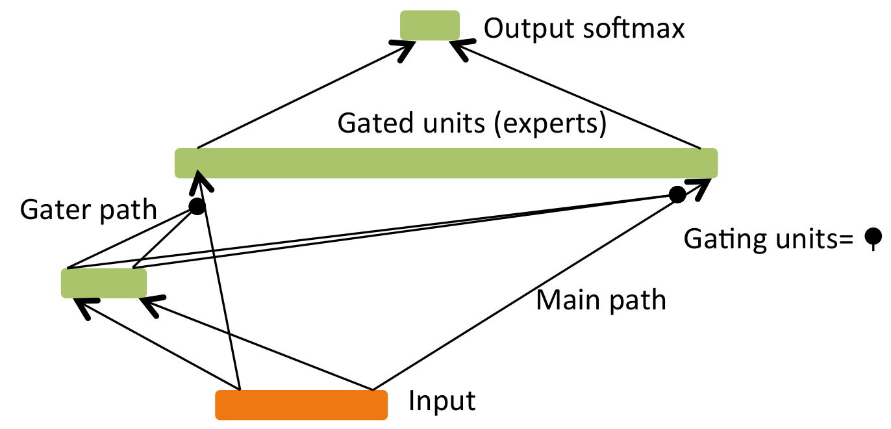</button>
<figcaption><strong>离散门控：前向保留开关，反向需要估计</strong><a href="https://arxiv.org/abs/1308.3432v1" target="_blank" rel="noopener">Estimating or Propagating Gradients Through Stochastic Neurons for Conditional Computation</a> · Figure 1 · version 1308.3432v1 · PDF p.8 / printed p.8
<button class="original-direct" type="button">Read original size</button>

Original caption &amp; source

Figure 1: Conditional computation architecture: gater path on the left produces sparse outputs hi
which are multiplied elementwise by the expert outputs, hidden units Hi.
<a class="source-url" href="https://arxiv.org/pdf/1308.3432v1">https://arxiv.org/pdf/1308.3432v1</a>
</figcaption></figure>

左边 gater 产生稀疏门值，右边 expert 产生隐藏输出，两者逐元素相乘后进入上层。沿箭头读一个样本：输入同时决定专家内容和是否放行，关掉的门使对应输出消失。图在回答如何真正获得条件计算；它与量化的连接是离散决策阻断普通梯度。把门值换成权重码只是后来的类比，专家架构并不是本文 LLM 量化架构。

<figure id="fig-ste-02">
<button class="paper-image" type="button" aria-label="Zoom: 梯度估计的早期证据与任务边界">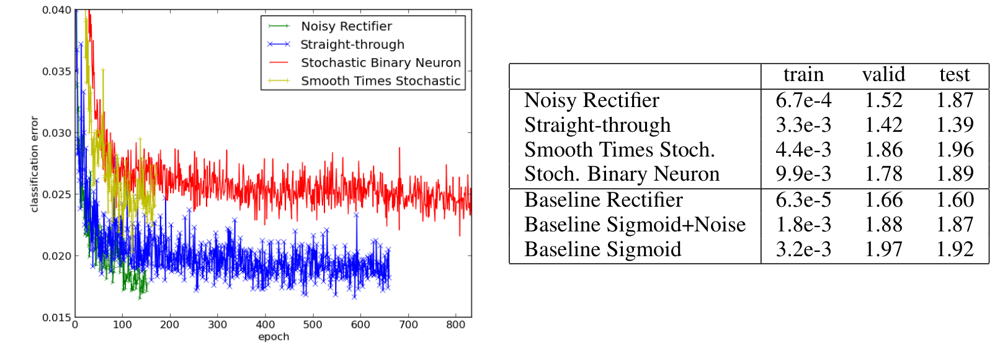</button>
<figcaption><strong>梯度估计的早期证据与任务边界</strong><a href="https://arxiv.org/abs/1308.3432v1" target="_blank" rel="noopener">Estimating or Propagating Gradients Through Stochastic Neurons for Conditional Computation</a> · Figure 2 · version 1308.3432v1 · PDF p.8 / printed p.8
<button class="original-direct" type="button">Read original size</button>

Original caption &amp; source

Figure 2: Left: Learning curves for the various stochastic approaches applied to the MNIST dataset. The
y-axis indicates classification error on the validation set. Right: Comparison of training criteria and valid/test
classification error (%) for stochastic (top) and baseline (bottom) gaters.
<a class="source-url" href="https://arxiv.org/pdf/1308.3432v1">https://arxiv.org/pdf/1308.3432v1</a>
</figcaption></figure>

左图横轴为训练进程，纵轴为验证分类错误，线条对应不同随机估计策略；右表比较训练指标和 valid／test 错误率。观察要同时看收敛速度和泛化，而不是只挑训练损失最低者。它说明离散前向可以配不同训练估计器；实验依赖 MNIST 与具体门控网络，不能外推到语言 PPL 或低位 GEMM 速度。

### 2017 首次公开、2018 发表：把训练模拟与整数算子对齐

Jacob 等把量化定义为仿射整数表示，并显式设计 8 bit 输入、权重，32 bit 累加、bias 与 requantization。训练仍用 FP32，插入模拟量化节点以接近整数执行。重要转折是把“训练时见过误差”和“部署算子语义”放进同一设计，而非只优化权重文件大小。<a href="#source-2">[2]</a>

<figure id="fig-jacob-01">
<button class="paper-image" type="button" aria-label="Zoom: 整数推理与浮点模拟训练的三面板对照">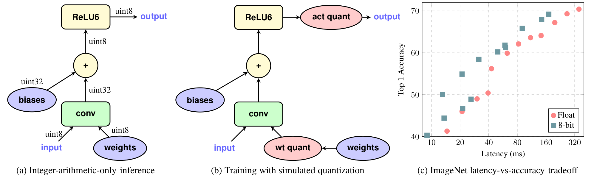</button>
<figcaption><strong>整数推理与浮点模拟训练的三面板对照</strong><a href="https://arxiv.org/abs/1712.05877v1" target="_blank" rel="noopener">Quantization and Training of Neural Networks for Efficient Integer-Arithmetic-Only Inference</a> · Figure 1.1 · version 1712.05877v1 · PDF p.2 / printed page unnumbered
<button class="original-direct" type="button">Read original size</button>

Original caption &amp; source

Figure 1.1: Integer-arithmetic-only quantization. a) Integer-arithmetic-only inference of a convolution layer. The input and output
are represented as 8-bit integers according to equation 1. The convolution involves 8-bit integer operands and a 32-bit integer accumulator.
The bias addition involves only 32-bit integers (section 2.4). The ReLU6 nonlinearity only involves 8-bit integer arithmetic. b) Training
with simulated quantization of the convolution layer. All variables and computations are carried out using 32-bit floating-point arithmetic.
Weight quantization (“wt quant”) and activation quantization (“act quant”) nodes are injected into the computation graph to simulate the
effects of quantization of the variables (section 3). The resultant graph approximates the integer-arithmetic-only computation graph in panel
a), while being trainable using conventional optimization algorithms for floating point models. c) Our quantization scheme benefits from
the fast integer-arithmetic circuits in common CPUs to deliver an improved latency-vs-accuracy tradeoff (section 4). The figure compares
integer quantized MobileNets [10] against floating point baselines on ImageNet [3] using Qualcomm Snapdragon 835 LITTLE cores.
<a class="source-url" href="https://arxiv.org/pdf/1712.05877v1">https://arxiv.org/pdf/1712.05877v1</a>
</figcaption></figure>

a 面板从 8 bit 输入／权重进入卷积、32 bit 累加与 bias，再回到 8 bit 输出；b 面板在浮点训练图里插入 wt quant 与 act quant；c 面板用 Snapdragon 835 LITTLE 核的 MobileNet ImageNet 延迟／精度比较验证代价。颜色和箭头区分数值表示与计算接口。对应本文投影层，模拟图必须包括输出再缩放；仅把权重 round 一次不等于完整整数路径。

原图的硬件证据是视觉网络和这款 CPU；不能把曲线读成 Transformer 的 TTFT 提升，也不能假设 HTP 内核采用同一累加和 requantization。它提供的是部署对齐原则，而非本篇 LLM 实测。

### 学习截断与步长：网格也是模型的一部分

PACT 和 LSQ 分别回答截断范围与步长能否由损失学习。PACT 原设置是非负激活，不能直接照搬到有正负异常值的 Transformer。LSQ 给量化尺度一个替代导数，并按尺度所管的元素数量归一化，避免尺度梯度随 tensor 大小失控。<a href="#source-3">[3]</a><a href="#source-4">[4]</a>

$$
\widehat v=s\,\operatorname{round}\bigl(\operatorname{clip}(v/s,-Q_N,Q_P)\bigr),\qquad
\frac{\partial \widehat v}{\partial s}\approx
\begin{cases}
-Q_N,&v/s<-Q_N,\\
\operatorname{round}(v/s)-v/s,&-Q_N\le v/s\le Q_P,\\
Q_P,&v/s>Q_P.
\end{cases}
$$

这是 LSQ 形式的解释性改写，$v$ 是权重或激活标量，$Q_N,Q_P$ 为正的码范围幅值，$s$ 为步长。格内导数看舍入残差；饱和区导数提醒尺度移动边界。它依赖对 round 的替代反向，不是真实硬导数。LSQ 的尺度梯度再乘 $g=1/\sqrt{NQ_P}$；$N$ 是共享该尺度的元素数。以 $v/s=2.6$ 为例，格内项为 $0.4$；任务梯度的符号决定增减尺度，不能仅凭这个数字认定扩大网格总会改善任务。

### PACT：截断值不必由最大激活固定

非负激活少 bit 量化时，保住最大的几个值会拉大步长，损害更常见的值。PACT 将 ReLU 的上界设为可学习参数，量化误差与任务损失共同决定范围，通常还加正则防止阈值无限增大。它把 clipping 变成训练自由度，但原实验是视觉网络，LLM 的有符号、逐 token 异常值需要重新设计。<a href="#source-3">[3]</a>

<figure id="fig-pact-01">
<button class="paper-image" type="button" aria-label="Zoom: 截断与量化如何影响训练和验证">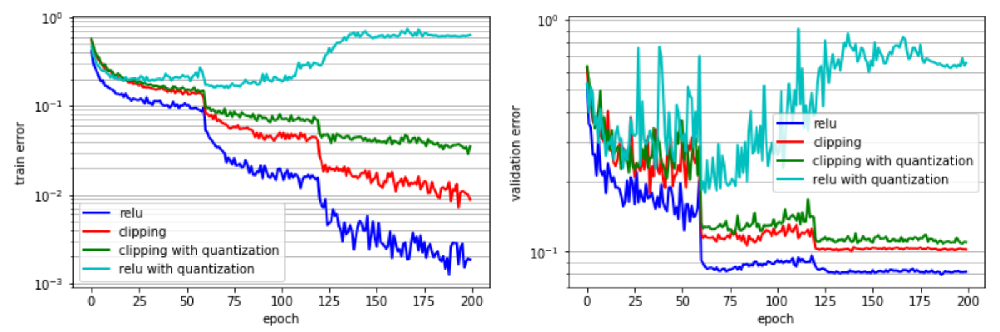</button>
<figcaption><strong>截断与量化如何影响训练和验证</strong><a href="https://arxiv.org/abs/1805.06085v2" target="_blank" rel="noopener">PACT: Parameterized Clipping Activation for Quantized Neural Networks</a> · Figure 1 · version 1805.06085v2 · PDF p.3 / printed p.3
<button class="original-direct" type="button">Read original size</button>

Original caption &amp; source

Figure 1: (a) Training error, (b) Validation error across epochs for different activation functions (relu
and clipping) with and without quantization for the ResNet20 model using the CIFAR10 dataset
<a class="source-url" href="https://arxiv.org/pdf/1805.06085v2">https://arxiv.org/pdf/1805.06085v2</a>
</figcaption></figure>

左右子图分别是 ResNet20／CIFAR10 的训练与验证错误，横轴 epochs，曲线区分 ReLU、clipping 及是否量化。先比较相同网络的量化／不量化对照，再看 clipping 是否恢复误差。它支持合适截断能缓解有限网格带来的损失；不能把训练曲线接近当成所有验证数据都恢复，更不能将这些分类误差换成 LLM PPL。

<figure id="fig-pact-02">
<button class="paper-image" type="button" aria-label="Zoom: 阈值太大和太小都可能损失任务信息">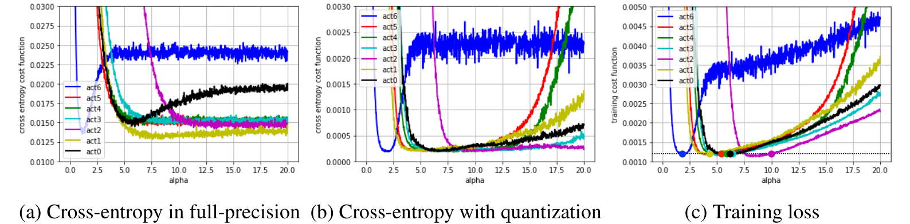</button>
<figcaption><strong>阈值太大和太小都可能损失任务信息</strong><a href="https://arxiv.org/abs/1805.06085v2" target="_blank" rel="noopener">PACT: Parameterized Clipping Activation for Quantized Neural Networks</a> · Figure 3 · version 1805.06085v2 · PDF p.5 / printed p.5
<button class="original-direct" type="button">Read original size</button>

Original caption &amp; source

Figure 3: Cross-entropy vs α for SVHN image classification.
<a class="source-url" href="https://arxiv.org/pdf/1805.06085v2">https://arxiv.org/pdf/1805.06085v2</a>
</figcaption></figure>

三个子图横轴均为截断参数 α，颜色为 act0–act6 的不同激活层；a 的纵轴是全精度交叉熵，b 是量化后的交叉熵，c 是加入 α 正则后的总训练损失。a 中 α 增大后不少层趋于平台；b 多了范围过宽造成的量化损失，小 α 又可能过度截断；c 的正则改变平台和上升趋势，使优化更容易获得继续更新的信号，圆点标出该实验的最优 α。

类比把 $0.8$ 截到 $0.3$ 与把大量小值舍入到零，最佳范围由任务和所在层决定，不等于 absmax。不能把 a、b、c 的纵轴数值直接横比成同一个损失：c 还含正则，a 没有量化前向。原实验是 SVHN，迁移到有正负异常值的 LLM 激活必须重新验证。

### LSQ：尺度也有自己的替代梯度

LSQ 把量化步长作为可训练参数。普通 STE 主要让权重跨格，LSQ 还通过格内舍入残差和饱和边界改变网格；再按共享尺度的元素数归一化尺度梯度。这为后来可学习 scale 的 LLM QAT 提供基础，原论文主要验证低位视觉网络。<a href="#source-4">[4]</a>

<figure id="fig-lsq-01">
<button class="paper-image" type="button" aria-label="Zoom: 权重与激活各自量化，再进入低位层">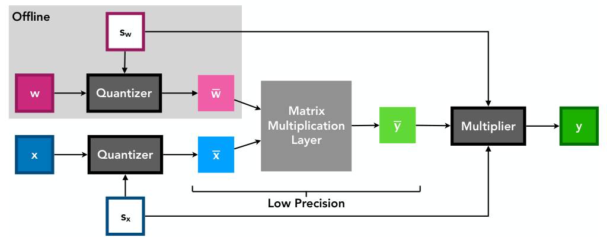</button>
<figcaption><strong>权重与激活各自量化，再进入低位层</strong><a href="https://arxiv.org/abs/1902.08153v3" target="_blank" rel="noopener">Learned Step Size Quantization</a> · Figure 1 · version 1902.08153v3 · PDF p.3 / printed p.3
<button class="original-direct" type="button">Read original size</button>

Original caption &amp; source

Figure 1: Computation of a low precision convolution or fully connected layer, as envisioned here.
<a class="source-url" href="https://arxiv.org/pdf/1902.08153v3">https://arxiv.org/pdf/1902.08153v3</a>
</figcaption></figure>

沿计算流看，输入激活和权重分别映射到各自整数码，矩阵乘积用两者尺度恢复输出；需要时输出再量化供下一层使用。不是所有 tensor 共用一个尺度。对本文 W3A16 投影，激活量化接口可关闭，但权重尺度和最终乘法语义仍要对应。图是算子愿景，不是证明训练时所有梯度也低位。

<figure id="fig-lsq-02">
<button class="paper-image" type="button" aria-label="Zoom: 台阶前向与尺度反向是两件事">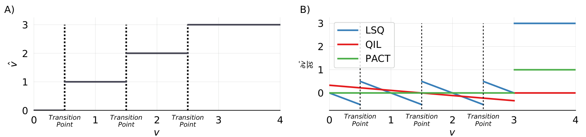</button>
<figcaption><strong>台阶前向与尺度反向是两件事</strong><a href="https://arxiv.org/abs/1902.08153v3" target="_blank" rel="noopener">Learned Step Size Quantization</a> · Figure 2 · version 1902.08153v3 · PDF p.4 / printed p.4
<button class="original-direct" type="button">Read original size</button>

Original caption &amp; source

Figure 2: Given s = 1, QN = 0, QP = 3, A) quantizer output and B) gradients of the quantizer
output with respect to step size, s, for LSQ, or a related parameter controlling the width of the
quantized domain (equal to s(QP + QN)) for QIL (Jung et al., 2018) and PACT (Choi et al., 2018b).
The gradient employed by LSQ is sensitive to the distance between v and each transition point,
whereas the gradient employed by QIL (Jung et al., 2018) is sensitive only to the distance from
quantizer clip points, and the gradient employed by PACT (Choi et al., 2018b) is zero everywhere
below the clip point. Here, we demonstrate that networks trained with the LSQ gradient reach higher
accuracy than those trained with the QIL or PACT gradients in prior work.
<a class="source-url" href="https://arxiv.org/pdf/1902.08153v3">https://arxiv.org/pdf/1902.08153v3</a>
</figcaption></figure>

A 面板在固定 s=1、码范围 0…3 下画台阶输出；B 面板画 LSQ 与范围参数方法的反向规则，纵轴为输出对尺度／范围参数的梯度。LSQ 在格内随舍入残差变化，饱和区给边界更新信号。以 2.6 落到 3 为例，反向会感知它距边界的位置；台阶自身仍不可普通求导。各曲线参数口径不同，不能把纵轴幅值直接当统一性能排名。

## 4. 蒸馏路线：保护的是语言行为，而不只是权重距离

把每个权重的均方误差压小，不保证模型对 token 的分布接近原模型。多个层的微小偏差会影响注意力和后续激活，甚至改变生成轨迹。Quantization-Aware Distillation（QAD）使用教师在同一前缀下的预测指导低位学生。通用教学目标为：

$$
L=(1-\lambda)L_{\rm CE}
+\lambda T^2\frac{1}{N}\sum_{t=1}^{N}
\operatorname{KL}\bigl(p_{\rm teacher}^{(T)}(\cdot\mid x_{<t})
\ \|\ p_{\rm student}^{(T)}(\cdot\mid x_{<t})\bigr).
$$

$N$ 为有效预测 token 数，$\lambda\in[0,1]$ 为损失混合权重，$T>0$ 为 softmax 温度；$p^{(T)}$ 是按温度重新归一化后的完整词表分布。交叉熵 $L_{\rm CE}$ 使用文本标签，KL 的方向为教师到学生，$T^2$ 是常见的梯度尺度补偿。这个式子是跨论文的说明模板，各论文不一定混合这两项或使用这个方向。教师分布中“北京 0.6、上海 0.3”提供的相近候选关系比只给“北京”更多；它也可能复制教师偏差，并带来 logits 存储或额外前向开销。

### LLM-QAT：教师生成数据，联合考虑 W／A／KV

LLM-QAT 从已有 LLaMA 初始化学生，使用教师生成文本和预测分布进行量化感知蒸馏。“Data-Free”指不取回原始训练数据，并不指不使用 token 或免费生成数据；随机首 token、确定性开头与随机后续的混合采样用来兼顾可信度和多样性。权重按通道、激活按 token，KV 也可量化。<a href="#source-5">[5]</a>

<figure id="fig-llmqat-01">
<button class="paper-image" type="button" aria-label="Zoom: 量化节点沿 Transformer 数据流布置">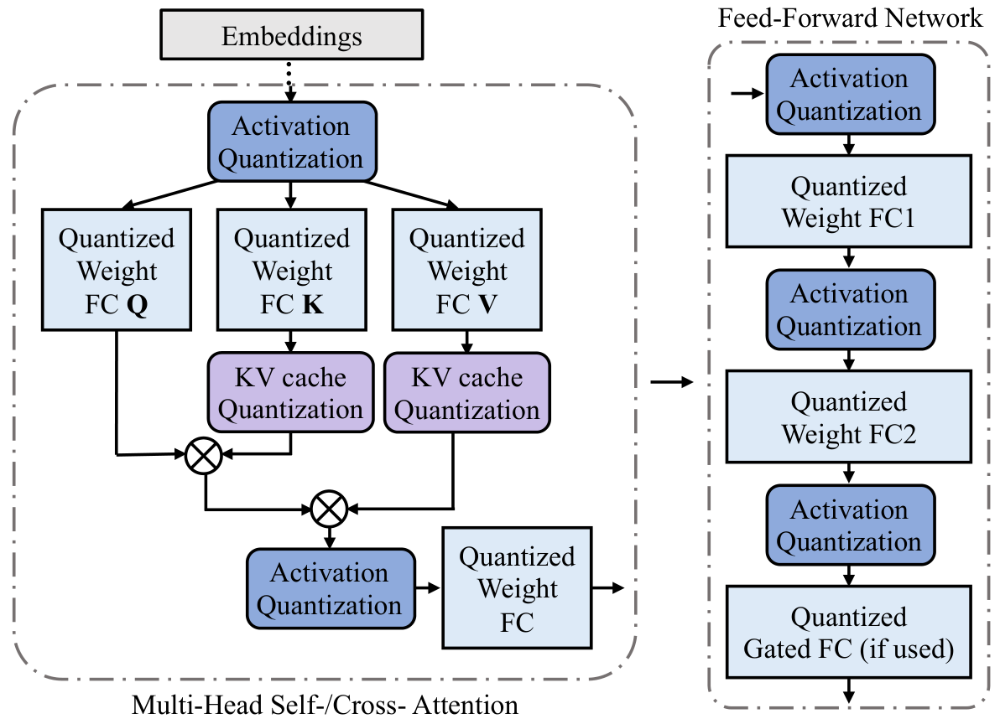</button>
<figcaption><strong>量化节点沿 Transformer 数据流布置</strong><a href="https://arxiv.org/abs/2305.17888v1" target="_blank" rel="noopener">LLM-QAT: Data-Free Quantization Aware Training for Large Language Models</a> · Figure 2 · version 2305.17888v1 · PDF p.3 / printed p.3
<button class="original-direct" type="button">Read original size</button>

Original caption &amp; source

Figure 2: Overview of the quantized transformer in LLM-QAT. We quantize all the weights and input
activations in fully-connected linear layers. The KV cache is also quantized if specified.
<a class="source-url" href="https://arxiv.org/pdf/2305.17888v1">https://arxiv.org/pdf/2305.17888v1</a>
</figcaption></figure>

从输入到 Q／K／V 投影、attention 输出和 FFN 依次读图；weight 节点控制各 Linear 权重，activation 节点控制输入，KV 分支记录缓存的量化位置。它回答误差在哪里发生。本文 W3A16 只模拟其中权重接口，不能称复现这张完整 W／A／KV 图；对 KV 的处理还会改变长上下文内存和注意力误差。

<figure id="fig-llmqat-02">
<button class="paper-image" type="button" aria-label="Zoom: 为什么权重、激活和缓存采用不同轴">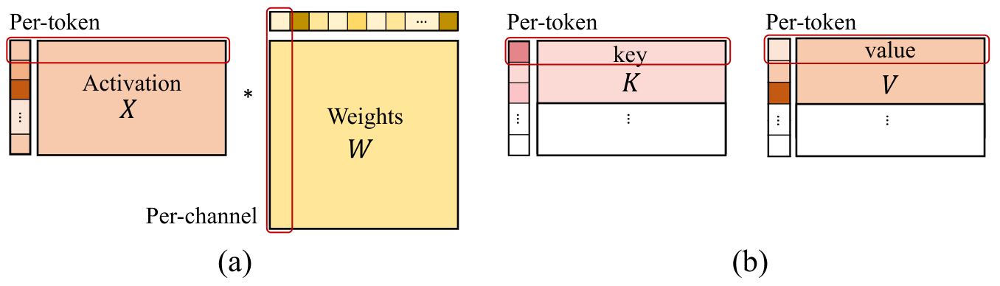</button>
<figcaption><strong>为什么权重、激活和缓存采用不同轴</strong><a href="https://arxiv.org/abs/2305.17888v1" target="_blank" rel="noopener">LLM-QAT: Data-Free Quantization Aware Training for Large Language Models</a> · Figure 3 · version 2305.17888v1 · PDF p.4 / printed p.4
<button class="original-direct" type="button">Read original size</button>

Original caption &amp; source

Figure 3: Illustration of (a) per-channel weight quantization and per-token activation quantization (b)
per-token quantization for KV cache. The KV cache is updated by appending the current key and
value to it. Thus we adopt per-token quantization for both key and value.
<a class="source-url" href="https://arxiv.org/pdf/2305.17888v1">https://arxiv.org/pdf/2305.17888v1</a>
</figcaption></figure>

a 面板把固定权重按通道分组，把动态输入按 token 分组；b 面板把新的 K／V token 追加到历史缓存，每个 token 的尺度随记录一起保存。红／色块和矩阵轴表示共享尺度的范围。示例中同一个 token 的各隐藏维度共享尺度，而不是一个通道跨整段历史共享；这个早期选择不代表后来所有 KV 量化都应如此。

<figure id="fig-llmqat-03">
<button class="paper-image" type="button" aria-label="Zoom: 完整常识任务表：恢复与剩余差距并存">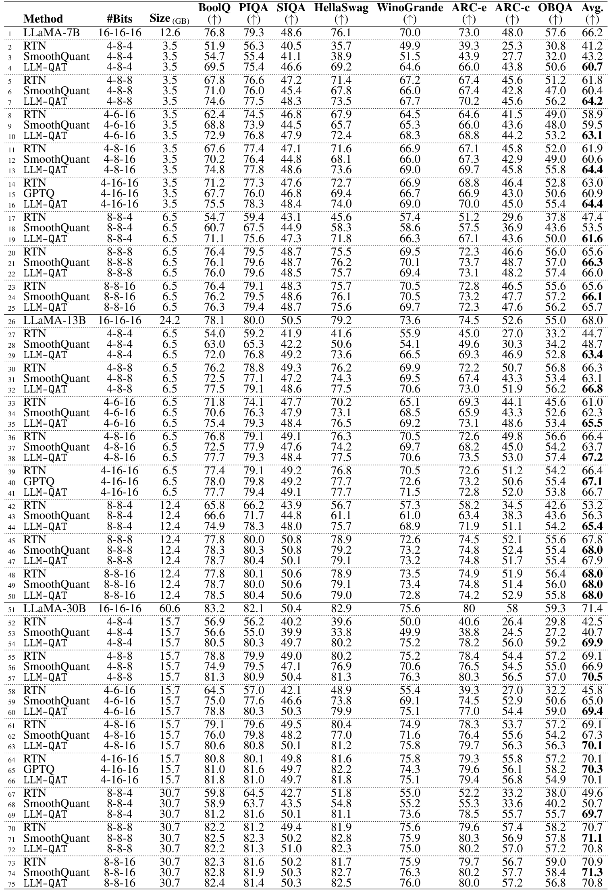</button>
<figcaption><strong>完整常识任务表：恢复与剩余差距并存</strong><a href="https://arxiv.org/abs/2305.17888v1" target="_blank" rel="noopener">LLM-QAT: Data-Free Quantization Aware Training for Large Language Models</a> · Table 1 · version 2305.17888v1 · PDF p.6 / printed p.6
<button class="original-direct" type="button">Read original size</button>

Original caption &amp; source

Table 1: Zero-shot performance on Common Sense Reasoning tasks.
<a class="source-url" href="https://arxiv.org/pdf/2305.17888v1">https://arxiv.org/pdf/2305.17888v1</a>
</figcaption></figure>

先选同一个 LLaMA 模型块，再固定三元位宽 W-A-KV，比对各任务和 Avg。LLaMA-7B 的 4-8-4 行由 RTN 41.2% 提高到 QAT 60.7%，FP16 为 66.2%；8-8-8 的增量则明显较小。表明 QAT 在误差较大条件下更有价值，不说明任意 bit 都值得训练。Size 列主要描述模型存储，不是完整运行峰值；Avg 也不是合并所有题目的准确率。

<figure id="fig-llmqat-04">
<button class="paper-image" type="button" aria-label="Zoom: 量化规则本身也需要消融">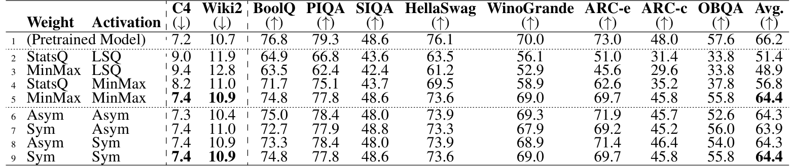</button>
<figcaption><strong>量化规则本身也需要消融</strong><a href="https://arxiv.org/abs/2305.17888v1" target="_blank" rel="noopener">LLM-QAT: Data-Free Quantization Aware Training for Large Language Models</a> · Table 4 · version 2305.17888v1 · PDF p.8 / printed p.8
<button class="original-direct" type="button">Read original size</button>

Original caption &amp; source

Table 4: Ablation study on the effects of the quantization methods on LLaMA-7B model. The
quantization level is set to 4-bit weight and 8-bit activation.
<a class="source-url" href="https://arxiv.org/pdf/2305.17888v1">https://arxiv.org/pdf/2305.17888v1</a>
</figcaption></figure>

表固定 LLaMA-7B、W4A8，改变量化方法并比较能力，目的是辨别恢复来自训练还是适合 LLM 的量化器。按行检查权重／激活规则，再读最终指标，不能把方法组合变化当作只改变一个因素。它为通道／token 选择提供实验支持；其他模型规模、KV 精度或业务分布仍需独立对照。

### EdgeQAT 初版：按 token 重要性指导边缘小模型

2024 初版研究轻量语言模型，把分布熵和 attention 特征纳入蒸馏：让低位模型保留重要 token 的行为，同时减少分布坍缩。它的目标规模和 BLiMP 语言现象评测不同于 7B 模型的常识任务；论文标题中的 acceleration 还需回到具体边缘实现。<a href="#source-12">[12]</a>

<figure id="fig-edge2024-01">
<button class="paper-image" type="button" aria-label="Zoom: 自适应蒸馏：重要性、熵与 attention 三条约束">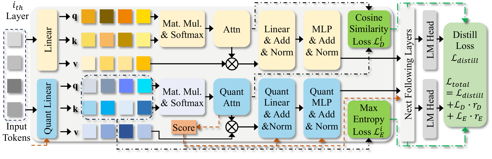</button>
<figcaption><strong>自适应蒸馏：重要性、熵与 attention 三条约束</strong><a href="https://arxiv.org/abs/2402.10787v1" target="_blank" rel="noopener">EdgeQAT: Entropy and Distribution Guided Quantization-Aware Training for the Acceleration of Lightweight LLMs on the Edge</a> · Figure 4 · version 2402.10787v1 · PDF p.5 / printed p.5
<button class="original-direct" type="button">Read original size</button>

Original caption &amp; source

Figure 4: Overall distillation pipeline. Token adaptive QAT based on the token importance score (colored in red)
with maximum entropy loss and attention map cosine similarity loss (both colored in green).
<a class="source-url" href="https://arxiv.org/pdf/2402.10787v1">https://arxiv.org/pdf/2402.10787v1</a>
</figcaption></figure>

图中红色为 token 重要性路径，绿色为最大熵和 attention map 余弦损失。教师／学生接收文本后，一条分支对齐输出，另两条保护分布和注意力结构。对“北京”的例子，并非只迫使 argmax 相同，还控制不确定性和 token 间关系。图没有给出每条损失的普适系数，也不能证明注意力相似就等于全部语义恢复。

<figure id="fig-edge2024-02">
<button class="paper-image" type="button" aria-label="Zoom: 小模型语言现象的原始测试条件">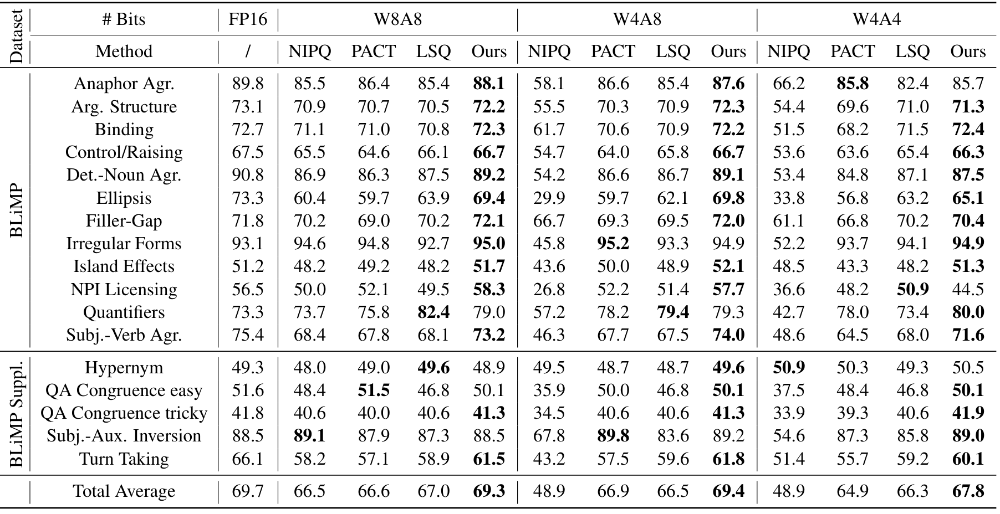</button>
<figcaption><strong>小模型语言现象的原始测试条件</strong><a href="https://arxiv.org/abs/2402.10787v1" target="_blank" rel="noopener">EdgeQAT: Entropy and Distribution Guided Quantization-Aware Training for the Acceleration of Lightweight LLMs on the Edge</a> · Table 1 · version 2402.10787v1 · PDF p.6 / printed p.6
<button class="original-direct" type="button">Read original size</button>

Original caption &amp; source

Table 1: LLaMA-58M quantization results on the BLiMP dataset, including the BLiMP Supplement.
<a class="source-url" href="https://arxiv.org/pdf/2402.10787v1">https://arxiv.org/pdf/2402.10787v1</a>
</figcaption></figure>

按 LLaMA-58M、位宽与方法读行，列为 BLiMP 及 Supplement 的语言判断项目。BLiMP 基于语法正确／不正确的句对，考察模型概率是否偏向正确句，与开放式聊天成功率不同。该表支持对应小模型量化质量的恢复；模型规模和 task protocol 限制了与 LLM-QAT 的直接比较。

### Squat 修订版：同一工作的新版本与边缘评测

同一 arXiv 在 2025 v2 改名为 Squat。这里把版本演进单独展示，不算第二项独立发明。修订版仍通过 token 重要性、熵与 attention 约束指导小模型，补充损失消融和 Raspberry Pi 5 上的质量／执行取舍。<a href="#source-13">[13]</a>

<figure id="fig-edge-01">
<button class="paper-image" type="button" aria-label="Zoom: 修订后的蒸馏接口与旧版连续性">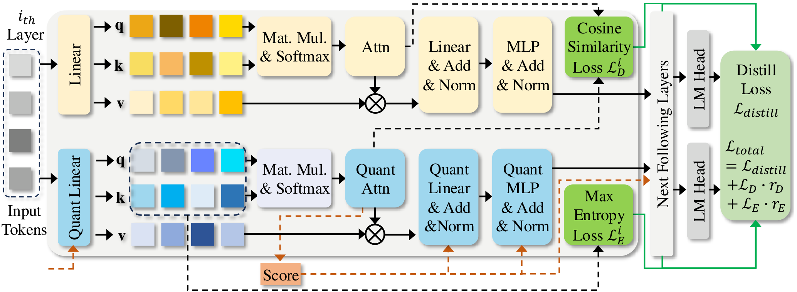</button>
<figcaption><strong>修订后的蒸馏接口与旧版连续性</strong><a href="https://arxiv.org/abs/2402.10787v2" target="_blank" rel="noopener">Squat: Quant Small Language Models on the Edge</a> · Figure 4 · version 2402.10787v2 · PDF p.4 / printed page unnumbered
<button class="original-direct" type="button">Read original size</button>

Original caption &amp; source

Figure 4: Adaptive distillation pipeline based on token importance score (colored in red), with maximum entropy loss and
attention map cosine similarity loss (both colored in green).
<a class="source-url" href="https://arxiv.org/pdf/2402.10787v2">https://arxiv.org/pdf/2402.10787v2</a>
</figcaption></figure>

红色重要性权重调节 token 级蒸馏，绿色约束分别作用于预测分布和 attention map。沿教师到学生的监督箭头，可看到它保护的不只是分类答案。与 v1 对照应按各自 PDF 版本读取，而不能把这张图配到旧版表格后声称同一实验。实现中还需核对权重归一化、温度和损失系数。

<figure id="fig-edge-02">
<button class="paper-image" type="button" aria-label="Zoom: 损失消融限定了每个组件的作用">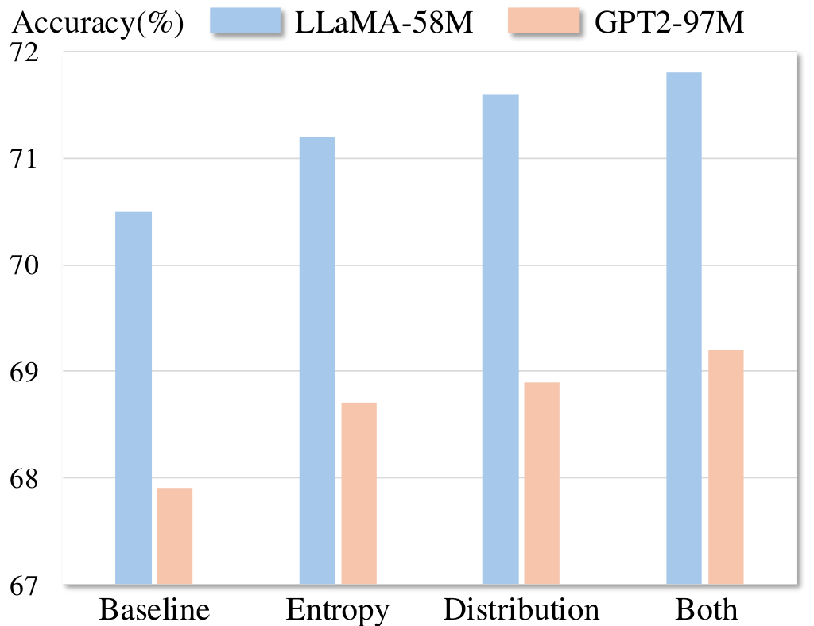</button>
<figcaption><strong>损失消融限定了每个组件的作用</strong><a href="https://arxiv.org/abs/2402.10787v2" target="_blank" rel="noopener">Squat: Quant Small Language Models on the Edge</a> · Figure 7 · version 2402.10787v2 · PDF p.8 / printed page unnumbered
<button class="original-direct" type="button">Read original size</button>

Original caption &amp; source

Figure 7: Loss ablation with average accuracy of LLaMA-58M
and GPT2-97M on BLiMP Main dataset in W4A4.
<a class="source-url" href="https://arxiv.org/pdf/2402.10787v2">https://arxiv.org/pdf/2402.10787v2</a>
</figcaption></figure>

图比较 W4A4 下 LLaMA-58M 和 GPT2-97M 在 BLiMP Main 的平均准确率；每个组合添加或去掉特定损失。先固定模型再比较组合，观察单一损失和联合损失的关系。它检验这些约束是否真正有增量，但不是证明每项损失在所有模型都单调有效，也未覆盖长文生成和复杂推理。

<figure id="fig-edge-03">
<button class="paper-image" type="button" aria-label="Zoom: 混合精度收益要同时读质量与边缘成本">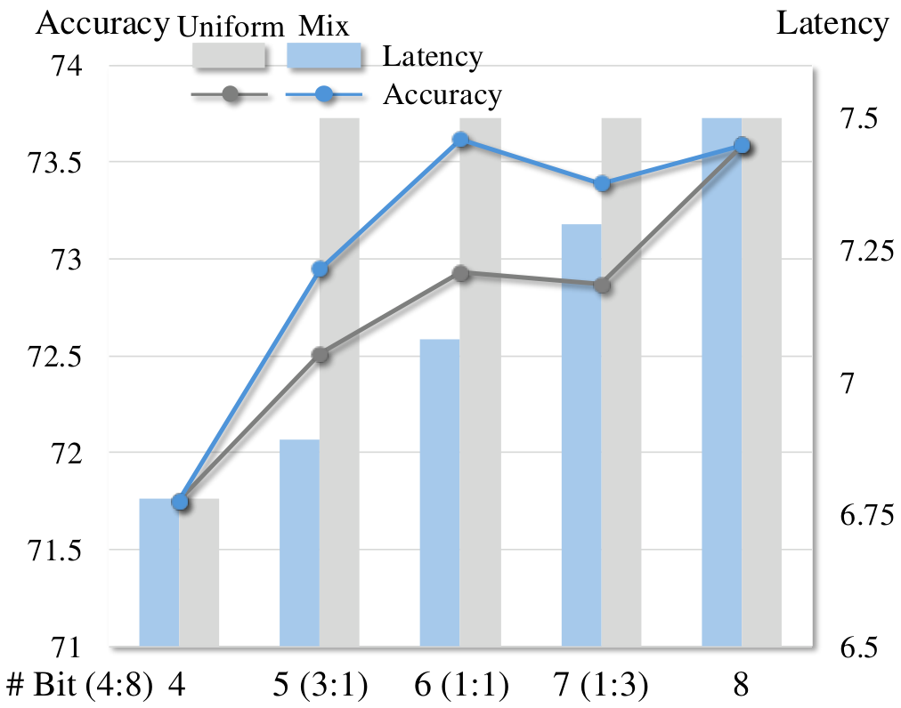</button>
<figcaption><strong>混合精度收益要同时读质量与边缘成本</strong><a href="https://arxiv.org/abs/2402.10787v2" target="_blank" rel="noopener">Squat: Quant Small Language Models on the Edge</a> · Figure 8 · version 2402.10787v2 · PDF p.8 / printed page unnumbered
<button class="original-direct" type="button">Read original size</button>

Original caption &amp; source

Figure 8: Mixed and uniform quantization results of LLaMA-
58M on the BLiMP Main dataset with Rapberry Pi 5.
<a class="source-url" href="https://arxiv.org/pdf/2402.10787v2">https://arxiv.org/pdf/2402.10787v2</a>
</figcaption></figure>

图在 Raspberry Pi 5 条件下比较 LLaMA-58M 的 mixed／uniform quantization 与 BLiMP Main。不同点改变的不只是名义 bit，还有精度分配；读质量轴与执行轴后才能判断取舍。保留重要层较高位可能比统一低位划算，但仍要报告尺度和浮点算子。这里的端侧结果不能移植成手机 HTP 的加速承诺。

### BitDistiller：亚 4 bit 网格与置信度感知蒸馏共同设计

BitDistiller 从已有模型出发，先用非对称量化和 clipping 更贴近权重分布，再用置信度感知的 KL 蒸馏。学生可能漏掉教师概率质量，也可能把概率放到教师认为不合适的位置，两种 KL 方向的敏感性不同，CAKLD 按教师置信度调节这类取舍。<a href="#source-14">[14]</a>

<figure id="fig-distill-01">
<button class="paper-image" type="button" aria-label="Zoom: 自蒸馏同时面对网格误差与概率误差">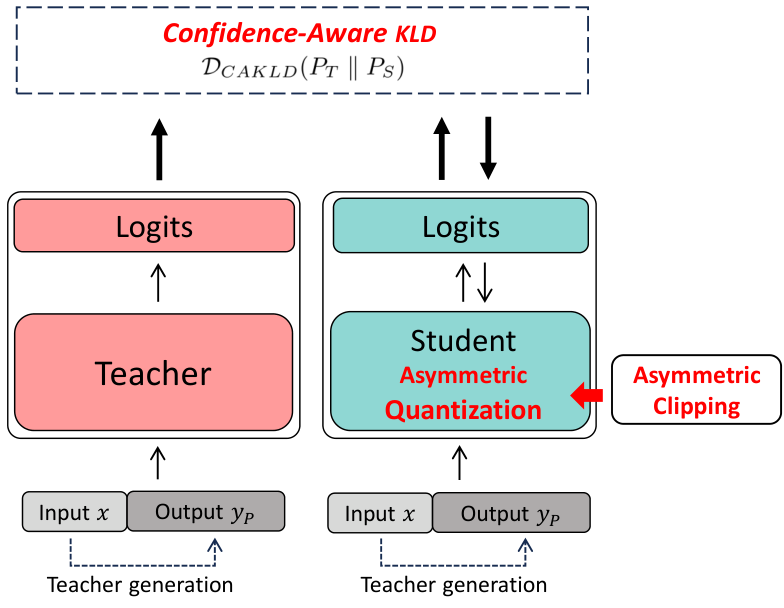</button>
<figcaption><strong>自蒸馏同时面对网格误差与概率误差</strong><a href="https://arxiv.org/abs/2402.10631v1" target="_blank" rel="noopener">BitDistiller: Unleashing the Potential of Sub-4-Bit LLMs via Self-Distillation</a> · Figure 2 · version 2402.10631v1 · PDF p.3 / printed page unnumbered
<button class="original-direct" type="button">Read original size</button>

Original caption &amp; source

Figure 2: Depiction of the QAT-based KD framework
of BitDistiller.
<a class="source-url" href="https://arxiv.org/pdf/2402.10631v1">https://arxiv.org/pdf/2402.10631v1</a>
</figcaption></figure>

教师保持高精度，学生经过 quantizer 前向，再把预测分布交给 KD 损失；图内区分初始化、量化和训练阶段。对“北京／上海”的例子，软分布监督保护候选关系，但还需量化器提供足够格点。这里“自”指同一来源的教师／学生，不是学生完全不用额外监督；训练教师和 logits 开销仍存在。

<figure id="fig-distill-02">
<button class="paper-image" type="button" aria-label="Zoom: 同一通道的非对称分布为何影响 3 bit 网格">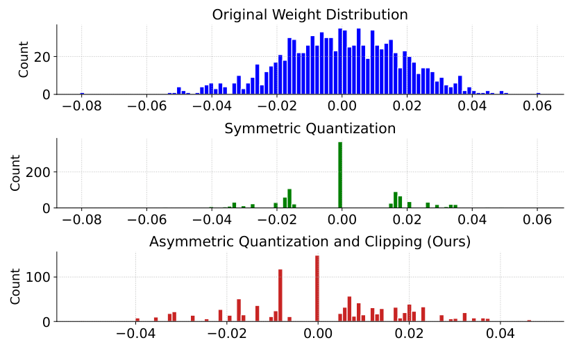</button>
<figcaption><strong>同一通道的非对称分布为何影响 3 bit 网格</strong><a href="https://arxiv.org/abs/2402.10631v1" target="_blank" rel="noopener">BitDistiller: Unleashing the Potential of Sub-4-Bit LLMs via Self-Distillation</a> · Figure 3 · version 2402.10631v1 · PDF p.4 / printed page unnumbered
<button class="original-direct" type="button">Read original size</button>

Original caption &amp; source

Figure 3: (Top) The original weight distribution of a
single output channel in the final down projection layer
of LLaMA-2-7B. (Middle&amp;Bottom) The weight dis-
tribution after symmetric quantization and asymmetric
quantization and clipping, both using 3-bit quantization
with the group size of 128.
<a class="source-url" href="https://arxiv.org/pdf/2402.10631v1">https://arxiv.org/pdf/2402.10631v1</a>
</figcaption></figure>

上方是 LLaMA-2-7B 最后 down projection 某输出通道的原始权重；中下分别是 g128 的对称与非对称／clipping 结果。横轴权重值，纵向显示分布密度或频数。偏斜分布中，对称网格把部分码浪费在少见区间；调整偏移和范围可给常见值更细分辨率。这只是所选通道，不足以证明全模型都同样偏斜。

<figure id="fig-distill-03">
<button class="paper-image" type="button" aria-label="Zoom: 2／3 bit 主表须同时看文本与任务">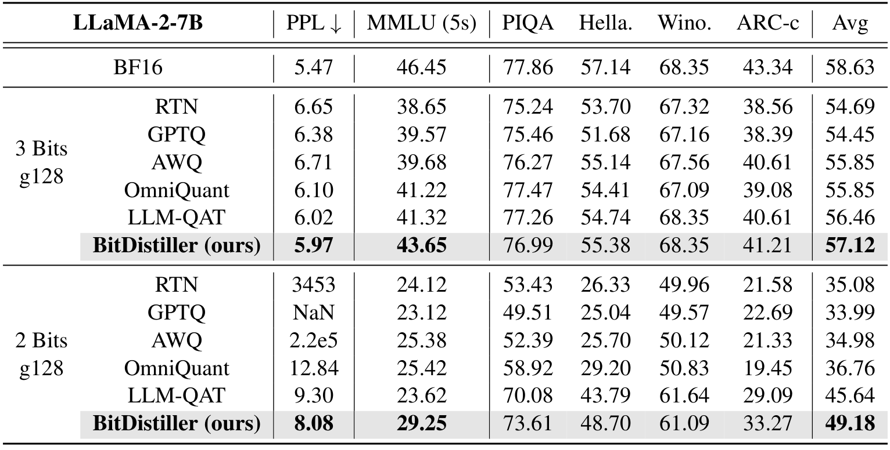</button>
<figcaption><strong>2／3 bit 主表须同时看文本与任务</strong><a href="https://arxiv.org/abs/2402.10631v1" target="_blank" rel="noopener">BitDistiller: Unleashing the Potential of Sub-4-Bit LLMs via Self-Distillation</a> · Table 1 · version 2402.10631v1 · PDF p.6 / printed page unnumbered
<button class="original-direct" type="button">Read original size</button>

Original caption &amp; source

Table 1: General language task results of BitDistiller versus established PTQ and QAT methods on LLaMA-2-7B
Model. Our method achieves leading performance in both 3-bit and 2-bit quantization.
<a class="source-url" href="https://arxiv.org/pdf/2402.10631v1">https://arxiv.org/pdf/2402.10631v1</a>
</figcaption></figure>

固定 LLaMA-2-7B，按 weight bit 与 group 配置比较 PPL 和零样本任务。表支持 BitDistiller 在其协议中的低位质量优势；不能把 quoted baseline 的训练预算或 activation 精度默认成完全一致。PPL 改善与常识平均同时出现更有说服力，但仍不包含真实低位推理延迟。

<figure id="fig-distill-04">
<button class="paper-image" type="button" aria-label="Zoom: CAKLD 与 TSLD 的目标差异是否有实测增量">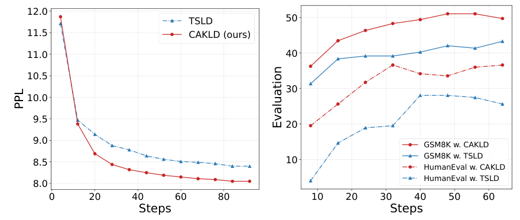</button>
<figcaption><strong>CAKLD 与 TSLD 的目标差异是否有实测增量</strong><a href="https://arxiv.org/abs/2402.10631v1" target="_blank" rel="noopener">BitDistiller: Unleashing the Potential of Sub-4-Bit LLMs via Self-Distillation</a> · Figure 7 · version 2402.10631v1 · PDF p.8 / printed page unnumbered
<button class="original-direct" type="button">Read original size</button>

Original caption &amp; source

Figure 7: Comparison of TSLD and CAKLD on per-
plexity (left) and reasoning tasks performance (right).
<a class="source-url" href="https://arxiv.org/pdf/2402.10631v1">https://arxiv.org/pdf/2402.10631v1</a>
</figcaption></figure>

左右面板分别比较困惑度与 reasoning task 性能，纵轴方向不同，PPL 越低越好、准确率越高越好。固定模型与精度读两个蒸馏目标的变化，观察收益是否跨指标一致。它支持这一训练设置下目标选择重要；不能推断教师置信度在分布外也校准良好，更不能只看右图忽略文本损失。

### OneBit：二值主矩阵之外，行列尺度承接信息

直接 sign 丢掉所有幅值。OneBit 用输入与输出方向的可学习尺度包围 ±1 权重，再借助蒸馏适配已有模型，相当于由很便宜的主码加少量浮点自由度重建投影。训练预算和归一化接口影响质量，不能把“1 bit 主矩阵”写成“整个网络只有 1 bit”。<a href="#source-15">[15]</a>

<figure id="fig-onebit-01">
<button class="paper-image" type="button" aria-label="Zoom: 二值矩阵、输入尺度和输出尺度的分工">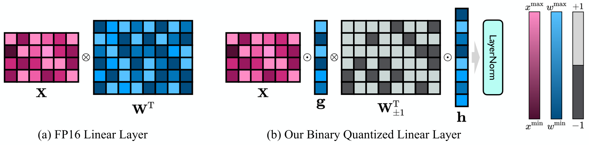</button>
<figcaption><strong>二值矩阵、输入尺度和输出尺度的分工</strong><a href="https://arxiv.org/abs/2402.11295v6" target="_blank" rel="noopener">OneBit: Towards Extremely Low-bit Large Language Models</a> · Figure 2 · version 2402.11295v6 · PDF p.4 / printed p.4
<button class="original-direct" type="button">Read original size</button>

Original caption &amp; source

Figure 2: The main idea of our method OneBit. The left is the original FP16 Linear Layer, in
which both the activation X and the weight matrix W are in FP16 format. The right is our proposed
architecture. Only value vectors g and h are in FP16 format, and the weight matrix consists of ±1
instead, which can be represented in INT1.
<a class="source-url" href="https://arxiv.org/pdf/2402.11295v6">https://arxiv.org/pdf/2402.11295v6</a>
</figcaption></figure>

左面 FP16 Linear 直接计算 XW，右面先由向量 g 缩放输入、经过 ±1 矩阵，再由 h 缩放输出。向量保存幅值结构，二值码保存符号组合。把一个行列位置从 0.26 改成 sign 后，g／h 能共同恢复部分大小，却不是为每个权重提供独立实数；这就是参数节省与表达限制的来源。

冻结代码还有 Linear 后的 LayerNorm 和形状化 sign 反向。BitLinearInf 虽然打包 bits，却解包到浮点后调用 F.linear；图中潜在算术节省不是该 Python 路径的原生二值加速证据。

<figure id="fig-onebit-02">
<button class="paper-image" type="button" aria-label="Zoom: 蒸馏预算是 1 bit 质量的重要条件">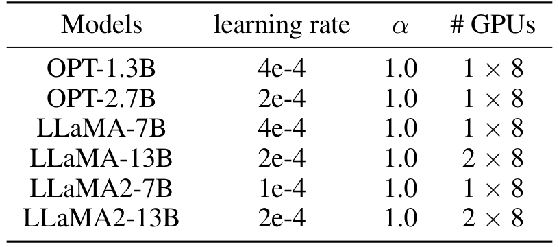</button>
<figcaption><strong>蒸馏预算是 1 bit 质量的重要条件</strong><a href="https://arxiv.org/abs/2402.11295v6" target="_blank" rel="noopener">OneBit: Towards Extremely Low-bit Large Language Models</a> · Table 1 · version 2402.11295v6 · PDF p.6 / printed p.6
<button class="original-direct" type="button">Read original size</button>

Original caption &amp; source

Table 1: Training details of knowledge distillation.
<a class="source-url" href="https://arxiv.org/pdf/2402.11295v6">https://arxiv.org/pdf/2402.11295v6</a>
</figcaption></figure>

原表的四列是模型、learning rate、α 和 GPU 数，不包含数据阶段或总训练 token。学习率按模型设为 1e−4～4e−4，α 列均为 1.0；7B 等行使用 `1×8` GPU，13B 部分行使用 `2×8`。它说明作者针对模型采用不同训练配置，GPU 数本身不能推导墙钟或 GPU-hours。

总 token、数据与蒸馏日程应到论文实验设置读取，再与后面的主表对应。不能把蒸馏学生与只做一次 RTN 的结果解释为仅量化器不同。对已有 checkpoint 转换，成本是额外训练而非从头预训练，但仍不是免费获得二值能力。

<figure id="fig-onebit-03">
<button class="paper-image" type="button" aria-label="Zoom: 模型大小与 PPL：选点方式改变比较">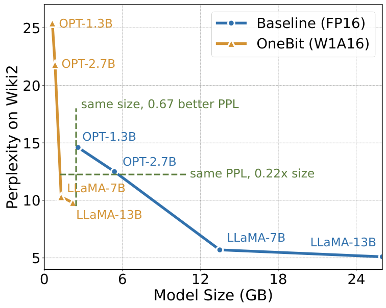</button>
<figcaption><strong>模型大小与 PPL：选点方式改变比较</strong><a href="https://arxiv.org/abs/2402.11295v6" target="_blank" rel="noopener">OneBit: Towards Extremely Low-bit Large Language Models</a> · Figure 4 · version 2402.11295v6 · PDF p.9 / printed p.9
<button class="original-direct" type="button">Read original size</button>

Original caption &amp; source

Figure 4: Tradeoff between size and PPL.
<a class="source-url" href="https://arxiv.org/pdf/2402.11295v6">https://arxiv.org/pdf/2402.11295v6</a>
</figcaption></figure>

横轴为存储大小，纵轴为 PPL，点或曲线对应不同压缩方法／模型。越左越小、越低文本预测越好；同模型比较与同字节比较是两种读法。二值矩阵可能允许部署更大模型，但额外 scale、未量化层和运行状态不能忽略。图不包含 matched-batch TPOT，因而不能从 size 直接推速度。

<figure id="fig-onebit-04">
<button class="paper-image" type="button" aria-label="Zoom: 主结果揭示压缩收益和剩余质量差距">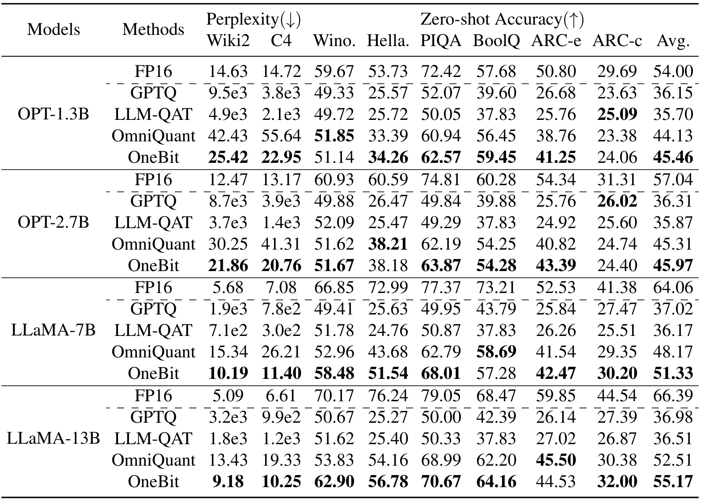</button>
<figcaption><strong>主结果揭示压缩收益和剩余质量差距</strong><a href="https://arxiv.org/abs/2402.11295v6" target="_blank" rel="noopener">OneBit: Towards Extremely Low-bit Large Language Models</a> · Table 2 · version 2402.11295v6 · PDF p.7 / printed p.7
<button class="original-direct" type="button">Read original size</button>

Original caption &amp; source

Table 2: Main results of evaluation experiment. We report the perplexity and zero-shot accuracy.
“FP16” is the transformer with FP16 parameters and we refer to it as the upper-bound of all the
methods. The best score is bolded.
<a class="source-url" href="https://arxiv.org/pdf/2402.11295v6">https://arxiv.org/pdf/2402.11295v6</a>
</figcaption></figure>

按同一模型块比较 FP16、低位方法、PPL 和各零样本任务。FP16 在文中作为参考上界，不是数学保证；某个任务偶尔更高也不代表整体能力超过教师。极低位结果应联同训练表和行列尺度结构阅读，不能与原生 BitNet 的训练 token 无条件对照。

### TernaryLLM：三值不只是增加一个零，特征也需要保护

TernaryLLM 从已有模型构造三值权重，用更适合偏斜分布的幅值／偏移设计和特征蒸馏，缓解极低位造成的语义损失。目标是 checkpoint 转换，与 b1.58 从头学习三值结构不同。2024 首次公开、本文使用 2026 v2，不把更新日期当作发明时间。<a href="#source-16">[16]</a>

<figure id="fig-ternary-01">
<button class="paper-image" type="button" aria-label="Zoom: 量化损失沿特征幅值、通道和词语关系显现">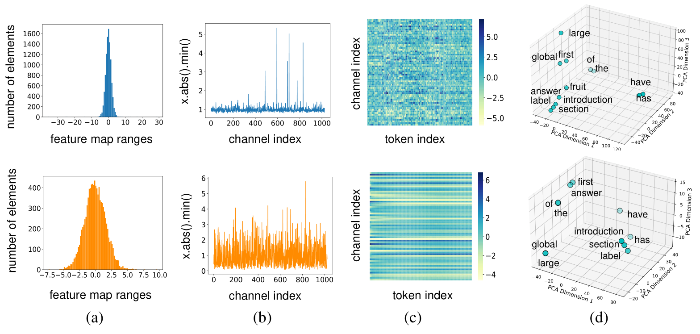</button>
<figcaption><strong>量化损失沿特征幅值、通道和词语关系显现</strong><a href="https://arxiv.org/abs/2406.07177v2" target="_blank" rel="noopener">TernaryLLM: Ternarized Large Language Model</a> · Figure 1 · version 2406.07177v2 · PDF p.3 / printed p.3
<button class="original-direct" type="button">Read original size</button>

Original caption &amp; source

Figure 1: An example of the features in the 23rd decoder layer to illustrate the problems incurred by
extreme low-bit quantization. The first and second lines correspond to the float-point and quantized
models, respectively. Extreme low-bit quantization leads to severe information loss in pretrained
LLMs, including a narrowed feature representation range (Figure 1 (a)), loss of prominence in
dominant channels (Figure 1 (b)), and disruption of the semantic clustering of related words (Figure 1
(c) and (d)).
<a class="source-url" href="https://arxiv.org/pdf/2406.07177v2">https://arxiv.org/pdf/2406.07177v2</a>
</figcaption></figure>

上排为浮点、下排为低位，子图分别看特征范围、主导通道和相关词聚类。极低位缩窄范围、削弱突出通道并打乱局部语义结构，说明仅检查 weight MSE 会漏掉网络行为。示例来自第 23 decoder 层，可说明存在这种失真；可视化投影和选词不能证明所有语义关系的因果变化。

<figure id="fig-ternary-02">
<button class="paper-image" type="button" aria-label="Zoom: 非零均值与单侧异常值不能靠零中心三值自动解决">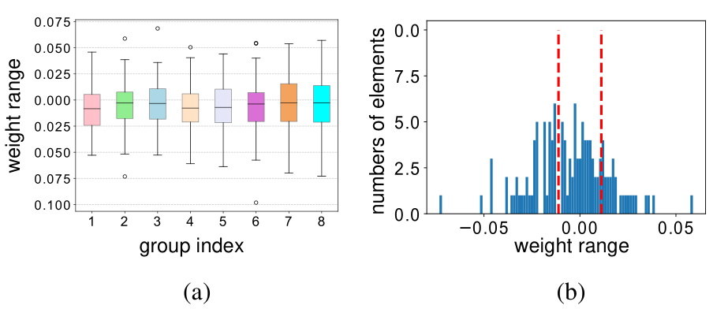</button>
<figcaption><strong>非零均值与单侧异常值不能靠零中心三值自动解决</strong><a href="https://arxiv.org/abs/2406.07177v2" target="_blank" rel="noopener">TernaryLLM: Ternarized Large Language Model</a> · Figure 2 · version 2406.07177v2 · PDF p.4 / printed p.4
<button class="original-direct" type="button">Read original size</button>

Original caption &amp; source

Figure 2: The weights in certain groups display noticeable
asymmetric outliers and a non-zero mean distribution.
<a class="source-url" href="https://arxiv.org/pdf/2406.07177v2">https://arxiv.org/pdf/2406.07177v2</a>
</figcaption></figure>

横轴为特定组的权重值，分布显示非零均值和偏向一侧的异常值。三值网格若机械中心对称，可能把有限级别放错区间；学习分布相关参数给出更多适配自由度。图说明一些组需要这类处理，不代表可以由一个全局尺度修复每个层，也不意味着附加参数没有存储成本。

<figure id="fig-ternary-03">
<button class="paper-image" type="button" aria-label="Zoom: LLaMA-3-8B 权重-only 主表">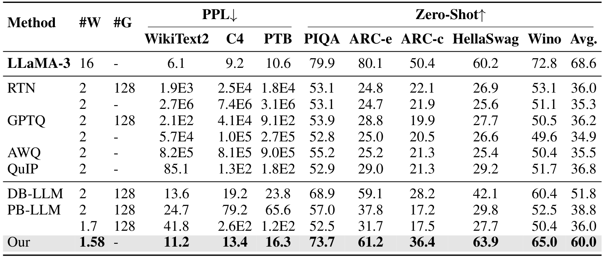</button>
<figcaption><strong>LLaMA-3-8B 权重-only 主表</strong><a href="https://arxiv.org/abs/2406.07177v2" target="_blank" rel="noopener">TernaryLLM: Ternarized Large Language Model</a> · Table 1 · version 2406.07177v2 · PDF p.7 / printed p.7
<button class="original-direct" type="button">Read original size</button>

Original caption &amp; source

Table 1: Evaluation results of weight-only quantization on the LLaMA-3-8B model. #W indicates
weight bits, #G indicates group size, and “-” denotes per-channel quantization.
<a class="source-url" href="https://arxiv.org/pdf/2406.07177v2">https://arxiv.org/pdf/2406.07177v2</a>
</figcaption></figure>

`#W` 列为权重 bit，`#G` 为 group size，“−”为 per-channel；先固定这两项再看 PPL 和任务。三值与 2 bit 的表示、group 元数据和训练预算不完全相同，不能只按 bit 标题挑最优。表提供 checkpoint 转换的结果证据，不是 W1A1 原生训练或整机内存峰值。

<figure id="fig-ternary-04">
<button class="paper-image" type="button" aria-label="Zoom: 余弦蒸馏为何比 MSE 更少受异常特征支配">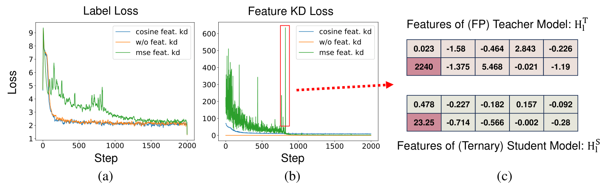</button>
<figcaption><strong>余弦蒸馏为何比 MSE 更少受异常特征支配</strong><a href="https://arxiv.org/abs/2406.07177v2" target="_blank" rel="noopener">TernaryLLM: Ternarized Large Language Model</a> · Figure 3 · version 2406.07177v2 · PDF p.5 / printed p.5
<button class="original-direct" type="button">Read original size</button>

Original caption &amp; source

Figure 3: Feature knowledge distillation results for LLaMA-1-7B. Cosine similarity is less sensitive
to outliers in features compared to MSE. (a) Ground truth loss of the training. (b) Feature knowledge
distillation loss of the training. (c) The reasons for severe oscillations in MSE distillation.
<a class="source-url" href="https://arxiv.org/pdf/2406.07177v2">https://arxiv.org/pdf/2406.07177v2</a>
</figcaption></figure>

a／b 面板分别是 ground-truth loss 与特征蒸馏损失，c 面板解释 MSE 的剧烈波动。平方误差对大幅值特征高度敏感，余弦更关注方向，适用于图中异常值引起的震荡。代价是弱化幅值信息；不能因此认定方向相似即可保证 logits 一致，仍须回到 PPL 与下游任务验证。

这条路线从保护通用语言行为，发展到按层熵、预测置信度和分布形状安排误差。获得的是在既有 checkpoint 上恢复低位模型行为的能力；代价是教师计算、数据生成、更多损失超参数，以及极低位结构中额外浮点缩放与归一化算子。低位模型是否真能更快，仍取决于这些算子与实际内核。

## 5. 参数高效路线：减少训练状态，同时保持可导出的单一路径

全参数 QAT 为大量影子权重保存梯度和 Adam 状态。低秩更新用两个小矩阵表示权重变化：$A\in\mathbb R^{r\times d_{\rm in}}$、$B\in\mathbb R^{d_{\rm out}\times r}$，$r$ 为远小于输入输出维度的秩。关键不是“用了 LoRA”，而是它在量化之前还是之后。

$$
y_{\rm separate}=Q_{\rm dq}(W_0)x+\alpha BAx,\qquad
y_{\rm merged}=Q_{\rm dq}(W_0+\alpha BA)x.
$$

$W_0$ 是冻结基座，$\alpha$ 为无量纲缩放，$Q_{\rm dq}$ 表示量化再反量化。第一式是两条分支，第二式将更新合并后再量化；二者一般不相等，因为量化不线性。以网格 $s=0.1$、$w_0=0.24$、更新 $0.04$ 为例，分支结果权重为 $0.24$，合并后量化为 $0.3$。若训练依赖那 $0.04$ 的浮点补偿，导出时突然改成单一低位矩阵，就改变了学到的函数。

<figure id="diagram-merge">
<svg xmlns="http://www.w3.org/2000/svg" viewBox="0 0 900 525" role="img" aria-labelledby="svg-ddb6399b-title svg-ddb6399b-desc">
<title id="svg-ddb6399b-title">LoRA量化与合并顺序</title><desc id="svg-ddb6399b-desc">三种低秩更新接口及0.24加0.04的实例，表明量化非线性使独立旁路与合并后量化不等价。</desc>
<defs><marker id="svg-ddb6399b-arrow" markerWidth="8" markerHeight="8" refX="7" refY="4" orient="auto"><path d="M0 0L8 4L0 8" fill="#8292a8"/></marker></defs>

<text x="24" y="36" font-size="22" font-weight="600">LoRA 在量化之前还是之后，决定最终学到哪个函数</text><rect x="24" y="96" width="264" height="176" rx="8" fill="#182230" stroke="#344355"/><rect x="24" y="108" width="3" height="152" fill="#7dc6b2"/><text x="42" y="126" class="label" font-weight="600">独立 adapter</text><text x="42" y="152" class="small muted">Q/DQ(W₀)x + αBAx</text><text x="42" y="175" class="small muted">浮点旁路可补量化误差</text><text x="42" y="198" class="small muted">QLoRA：冻结低位基座</text><text x="42" y="221" class="small muted">合并后再 PTQ 需重新验证</text><rect x="318" y="96" width="264" height="176" rx="8" fill="#182230" stroke="#344355"/><rect x="318" y="108" width="3" height="152" fill="#a7b5ee"/><text x="336" y="126" class="label" font-weight="600">合并后量化</text><text x="336" y="152" class="small muted">Q/DQ(W₀ + αBA)x</text><text x="336" y="175" class="small muted">每次训练就面对目标网格</text><text x="336" y="198" class="small muted">L4Q / LR-QAT 等路线</text><text x="336" y="221" class="small muted">冻结后不保留独立旁路</text><rect x="612" y="96" width="264" height="176" rx="8" fill="#182230" stroke="#344355"/><rect x="612" y="108" width="3" height="152" fill="#e6bf88"/><text x="630" y="126" class="label" font-weight="600">组结构兼容量化参数</text><text x="630" y="152" class="small muted">QA-LoRA：组内共享更新</text><text x="630" y="175" class="small muted">吸收到量化偏置</text><text x="630" y="198" class="small muted">减少新增取整步骤</text><text x="630" y="221" class="small muted">代价：LoRA 结构受限</text><rect x="24" y="359" width="852" height="128" rx="8" fill="#182230" stroke="#344355"/><rect x="24" y="371" width="3" height="104" fill="#a7b5ee"/><text x="42" y="389" class="label" font-weight="600">标量例子：s = 0.1，w₀ = 0.24，Δw = 0.04</text><text x="42" y="415" class="small muted">独立路径：Q/DQ(0.24) + 0.04 = 0.24；合并路径：Q/DQ(0.28) = 0.3。</text><text x="42" y="438" class="small muted">二者一般不相等；rank、scale、zero 与合并系数必须一起导出。</text></svg>
<figcaption>原创机制图 · 小屏可局部横向滚动，保留完整关系与标签。</figcaption></figure>

图比较冻结低位基座上的独立 adapter、合并后再量化，以及 QA-LoRA 的组结构约束。第二条在每轮训练就让合并值面对目标网格；第三条通过限制更新结构，使更新能吸收到量化偏置。两者用不同自由度换取可导出性。仍需检查最终尺度精度、量化轴和 adapter 系数，而不是只验证权重形状相同。

### QLoRA：低位基座上的高效微调，是重要边界

QLoRA 用冻结 4 bit 基座、NF4、双重量化和 paged optimizer 降低微调资源，梯度穿过解码后的基座进入 LoRA。它解决“微调时不必保存所有基座 optimizer 状态”，不自动保证合并成一个新低位矩阵后精度不变。本文因这个边界纳入，而不把它等同于训练合并后量化器的 QAT。<a href="#source-7">[7]</a>

<figure id="fig-qlora-01">
<button class="paper-image" type="button" aria-label="Zoom: 冻结基座与可训练 adapter 的内存分工">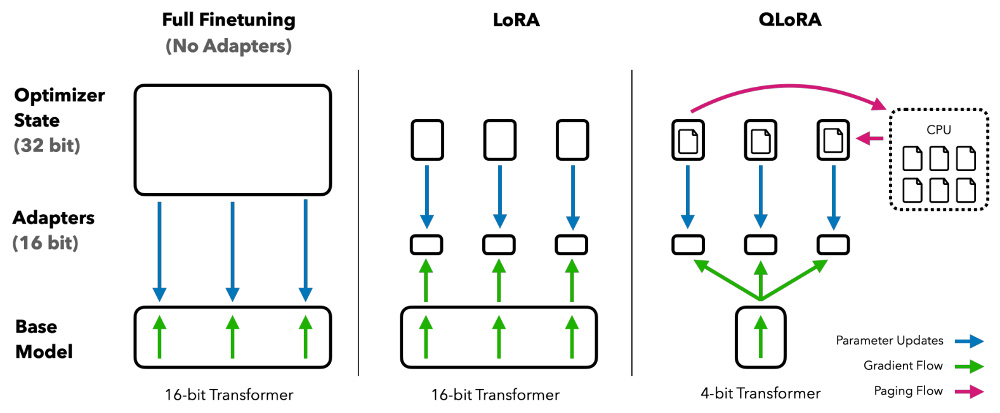</button>
<figcaption><strong>冻结基座与可训练 adapter 的内存分工</strong><a href="https://arxiv.org/abs/2305.14314v1" target="_blank" rel="noopener">QLoRA: Efficient Finetuning of Quantized LLMs</a> · Figure 1 · version 2305.14314v1 · PDF p.3 / printed p.3
<button class="original-direct" type="button">Read original size</button>

Original caption &amp; source

Figure 1: Different finetuning methods and their memory requirements. QLORA improves over LoRA by
quantizing the transformer model to 4-bit precision and using paged optimizers to handle memory spikes.
<a class="source-url" href="https://arxiv.org/pdf/2305.14314v1">https://arxiv.org/pdf/2305.14314v1</a>
</figcaption></figure>

从 full fine-tuning 到 LoRA 再到 QLoRA，看哪些参数、梯度和 optimizer 状态仍存在。4 bit 主要减少冻结基座存储，反向计算和 adapter 仍有较高精度；paged optimizer 缓和瞬时内存压力。对本文两式，QLoRA 主要对应独立分支；导出时再量化其合并权重属于新的误差步骤，不能由此图跳过验证。

<figure id="fig-qlora-02">
<button class="paper-image" type="button" aria-label="Zoom: NF4 微调结果的协议范围">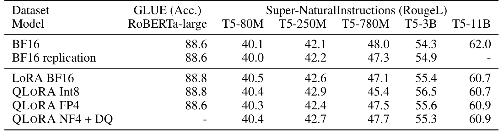</button>
<figcaption><strong>NF4 微调结果的协议范围</strong><a href="https://arxiv.org/abs/2305.14314v1" target="_blank" rel="noopener">QLoRA: Efficient Finetuning of Quantized LLMs</a> · Table 3 · version 2305.14314v1 · PDF p.7 / printed p.7
<button class="original-direct" type="button">Read original size</button>

Original caption &amp; source

Table 3: Experiments comparing 16-bit BrainFloat (BF16), 8-bit Integer (Int8), 4-bit Float (FP4), and 4-
bit NormalFloat (NF4) on GLUE and Super-NaturalInstructions. QLORA replicates 16-bit LoRA and full-
finetuning.
<a class="source-url" href="https://arxiv.org/pdf/2305.14314v1">https://arxiv.org/pdf/2305.14314v1</a>
</figcaption></figure>

表比较 BF16、INT8、FP4、NF4，在 GLUE 和 Super-NaturalInstructions 的微调协议下检验能力。NF4 是针对权重分布的非均匀码本，不等于硬件 NVFP4。表支持冻结低位基座可以进行有效任务适配；它不是证明单一 INT4 merged checkpoint 与 FP16 完全一致，也不包含本文 W3 实验。

### PEQA：冻结整数码，只学习尺度

PEQA 先压缩权重，再训练少量尺度，以较低内存完成任务适配。整数 assignments 固定，尺度改变同通道权重的整体幅值，所以它比全权重训练节省 optimizer 状态，也更受表达空间限制。本文实测的 frozen-code g128 与它有机制联系，但粒度和配置不同，不能标成论文复现。<a href="#source-6">[6]</a>

<figure id="fig-peqa-01">
<button class="paper-image" type="button" aria-label="Zoom: 内存与 PPL 必须连同模型规模和可训练参数读">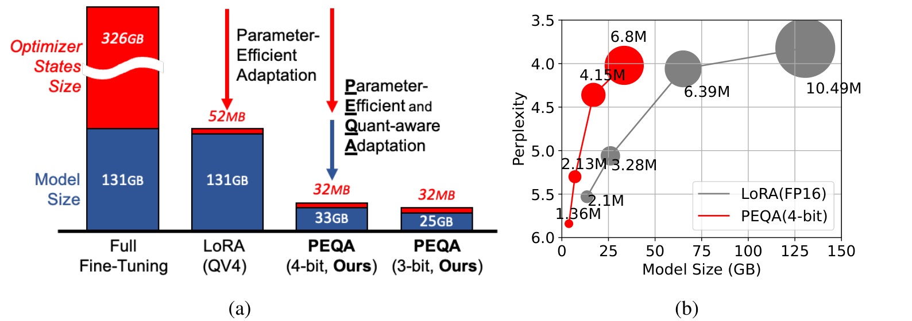</button>
<figcaption><strong>内存与 PPL 必须连同模型规模和可训练参数读</strong><a href="https://arxiv.org/abs/2305.14152v2" target="_blank" rel="noopener">Memory-Efficient Fine-Tuning of Compressed Large Language Models via sub-4-bit Integer Quantization</a> · Figure 2 · version 2305.14152v2 · PDF p.4 / printed p.4
<button class="original-direct" type="button">Read original size</button>

Original caption &amp; source

Figure 2: (a) DRAM usage comparison of LLaMA-65B on various tuning methods and (b) perplexity
over model size when tuning LLaMA models with LoRA and PEQA on Wikitext2 dataset. The size
of a circle indicates the number of trainable parameters. For instance, the LLaMA-65B model with
LoRA has a size of 131GB and 10.49M trainable parameters. Otherwise, LLaMA-65B with 4-bit
PEQA has a model size of 33GB and 6.8M trainable parameters.
<a class="source-url" href="https://arxiv.org/pdf/2305.14152v2">https://arxiv.org/pdf/2305.14152v2</a>
</figcaption></figure>

a 面板比较 LLaMA-65B 不同微调内存，b 面板把模型存储与 WikiText2 PPL 关联，圆大小代表可训练参数。图中的 LoRA 与 4 bit PEQA 同时改变基座存储和训练自由度；例如 caption 给出约 131GB 与 33GB 的模型量级。圆更小不是质量保证，图上存储量也不能默认等于完整运行峰值。

<figure id="fig-peqa-02">
<button class="paper-image" type="button" aria-label="Zoom: 尺度适配与先微调后 PTQ 的原始对照">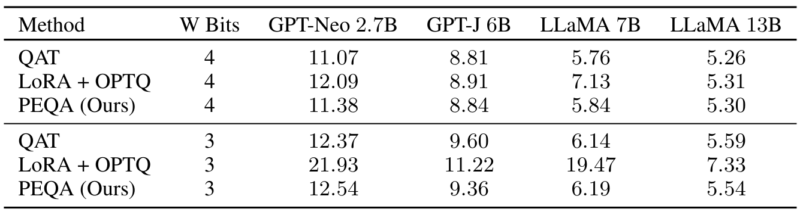</button>
<figcaption><strong>尺度适配与先微调后 PTQ 的原始对照</strong><a href="https://arxiv.org/abs/2305.14152v2" target="_blank" rel="noopener">Memory-Efficient Fine-Tuning of Compressed Large Language Models via sub-4-bit Integer Quantization</a> · Table 2 · version 2305.14152v2 · PDF p.6 / printed p.6
<button class="original-direct" type="button">Read original size</button>

Original caption &amp; source

Table 2: To empirically confirm the validity of PEQA’s approach, we compare the perplexity (PPL)
of fine-tuned LLMs through QAT, PEFT+PTQ, and PEQA on Wikitext2 [51] for GPT-Neo 2.7B,
GPT-J 6B, LLaMA 7B, and LLaMA 13B. Weights are quantized into either 3-bit or 4-bit per channel,
without a group size [28, 49]. LoRA configuration is set to QV4. The lower PPL, the better.
<a class="source-url" href="https://arxiv.org/pdf/2305.14152v2">https://arxiv.org/pdf/2305.14152v2</a>
</figcaption></figure>

表在 GPT-Neo、GPT-J 和 LLaMA 上比较 QAT、PEFT+PTQ、PEQA，固定 3／4 bit per-channel、无 group size；LoRA 为 QV4 配置。它回答有限尺度是否足以恢复部分质量。模型家族、bit 和微调目标决定结果，不能外推“冻结码总优于全参数”；与本次 g128 教学对照也不可直接比 PPL。

### QA-LoRA：限制低秩结构，让更新可吸收到量化偏置

QA-LoRA 针对独立 adapter 合并后还要 PTQ 的问题，把输入按量化组聚合，并令低秩更新的输入维度匹配组数。组内共享更新可吸收到量化偏置，避免最后新增一次独立取整。获得单一路径的代价是 LoRA 结构受限，浮点偏置等 metadata 仍需完整保存。<a href="#source-8">[8]</a>

<figure id="fig-qalora-01">
<button class="paper-image" type="button" aria-label="Zoom: 微调与推理两阶段的自由度对照">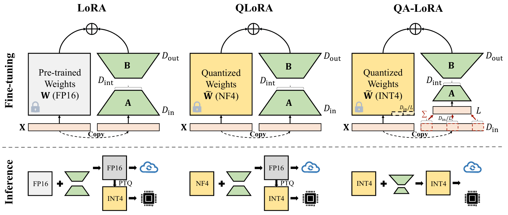</button>
<figcaption><strong>微调与推理两阶段的自由度对照</strong><a href="https://arxiv.org/abs/2309.14717v2" target="_blank" rel="noopener">QA-LoRA: Quantization-Aware Low-Rank Adaptation of Large Language Models</a> · Figure 2 · version 2309.14717v2 · PDF p.4 / printed p.4
<button class="original-direct" type="button">Read original size</button>

Original caption &amp; source

Figure 2: An illustration of the goal of QA-LoRA. Compared to prior adaptation methods, LoRA and
QLoRA, our approach is computationally efficient in both the fine-tuning and inference stages. More
importantly, it does not suffer an accuracy loss because post-training quantization is not required.
We display INT4 quantization in the figure, but QA-LoRA is generalized to INT3 and INT2.
<a class="source-url" href="https://arxiv.org/pdf/2309.14717v2">https://arxiv.org/pdf/2309.14717v2</a>
</figcaption></figure>

图从 LoRA／QLoRA 走向 QA-LoRA，重点是训练完成后是否还需要重新量化合并权重。组结构让更新与量化参数兼容，而非声称量化是线性算子。对 0.24+0.04 的例子，它通过设计可融合更新避免第二次取整损失；代价是不能任意给每个输入维度独立低秩补偿。

<figure id="fig-qalora-02">
<button class="paper-image" type="button" aria-label="Zoom: MMLU 的 shot、数据和最终表示要同时固定">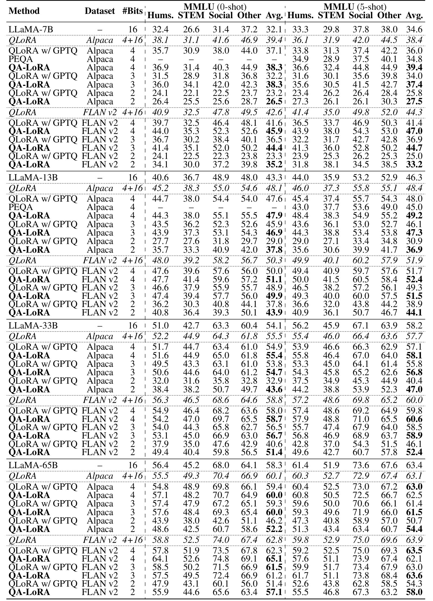</button>
<figcaption><strong>MMLU 的 shot、数据和最终表示要同时固定</strong><a href="https://arxiv.org/abs/2309.14717v2" target="_blank" rel="noopener">QA-LoRA: Quantization-Aware Low-Rank Adaptation of Large Language Models</a> · Table 1 · version 2309.14717v2 · PDF p.7 / printed p.7
<button class="original-direct" type="button">Read original size</button>

Original caption &amp; source

Table 1: 0-shot and 5-shot accuracy (%) on the Massive Multitask Language Understanding
(MMLU) dataset (Hendrycks et al., 2021). Each block is based on the same foundation model
specified at the first row. We organize all results using the fine-tuning dataset (Alpaca or Flan-v2)
and the bit width of quantization. The bit width of ‘4 + 16’ refers to the original QLoRA where the
final version for inference is in FP16.
<a class="source-url" href="https://arxiv.org/pdf/2309.14717v2">https://arxiv.org/pdf/2309.14717v2</a>
</figcaption></figure>

表按 foundation model 分块，分别列 Alpaca／Flan-v2、bit、0-shot 与 5-shot MMLU。标记“4+16”描述比较中的 QLoRA 高低精度组合／最终表示，不能误写成纯 4 bit 单路径。QA-LoRA 的可融合性与任务结果需要共同判断；训练数据不同的两行不是纯算法消融，MMLU 也不代替实际代码或工具任务。

### L4Q：自由低秩更新与网格参数协同优化

L4Q 让非受限 LoRA 更新进入量化前向，同时训练网格参数，以兼顾任务适配和最终 fully-quantized weights。它解决 QA-LoRA 结构受限与独立分支导出失配之间的取舍。这里使用 v6 的机制和资源表，首次公开仍为 2024 年；本次没有确认到可用官方完整源码。<a href="#source-9">[9]</a>

<figure id="fig-l4q-01">
<button class="paper-image" type="button" aria-label="Zoom: 四种训练／推理组合，关键是量化位置">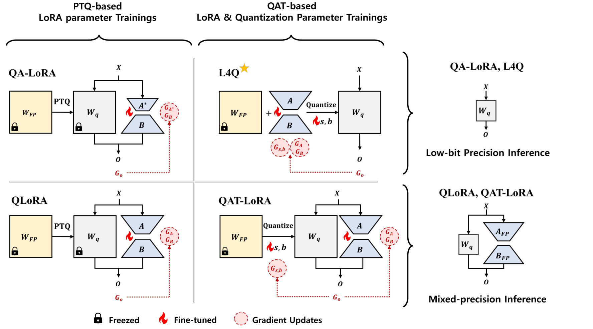</button>
<figcaption><strong>四种训练／推理组合，关键是量化位置</strong><a href="https://arxiv.org/abs/2402.04902v6" target="_blank" rel="noopener">L4Q: Parameter Efficient Quantization-Aware Fine-Tuning on Large Language Models</a> · Figure 2 · version 2402.04902v6 · PDF p.4 / printed page unnumbered
<button class="original-direct" type="button">Read original size</button>

Original caption &amp; source

Figure 2: A categorization of training scheme and inference strategy of QA-LoRA, QLoRA, QAT-LoRA, and
L4Q. Compared to QA-LoRA, L4Q utilizes higher optimization ability with non-constrained LoRA parameters and
quantization parameters. Additionally, compared to QLoRA and QAT-LoRA, L4Q exploit fully-quantized weights
rather than the mixed-precision weights during inference and perform a solid co-optimization of parameters.
<a class="source-url" href="https://arxiv.org/pdf/2402.04902v6">https://arxiv.org/pdf/2402.04902v6</a>
</figcaption></figure>

依次比较 QA-LoRA、QLoRA、QAT-LoRA 与 L4Q。量化节点在加法前后的位置决定 adapter 是否以浮点旁路补偿误差；L4Q 合并权重再面对网格，并共同学习量化参数。它提供更自由的更新，仍只在低秩子空间内训练；“fully-quantized weights”也不表示所有激活、scale、norm 和 optimizer 都低位。

<figure id="fig-l4q-02">
<button class="paper-image" type="button" aria-label="Zoom: 微调内存节省的模型与设备条件">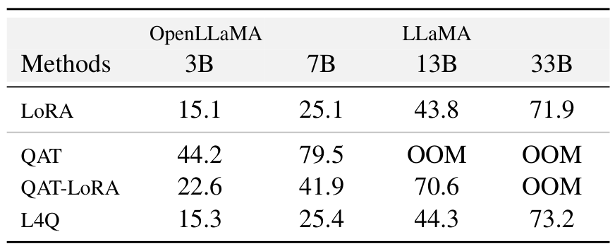</button>
<figcaption><strong>微调内存节省的模型与设备条件</strong><a href="https://arxiv.org/abs/2402.04902v6" target="_blank" rel="noopener">L4Q: Parameter Efficient Quantization-Aware Fine-Tuning on Large Language Models</a> · Table 1 · version 2402.04902v6 · PDF p.7 / printed page unnumbered
<button class="original-direct" type="button">Read original size</button>

Original caption &amp; source

Table 1: Memory cost (GB) for fine-tuning LLMs on
NVIDIA A100 GPU. (OOM: Out of Memory)
<a class="source-url" href="https://arxiv.org/pdf/2402.04902v6">https://arxiv.org/pdf/2402.04902v6</a>
</figcaption></figure>

原表单位为 GB，在 NVIDIA A100 上比较不同模型和微调方案，OOM 表示该设置不可运行。读列时要连同训练序列、batch 和 checkpointing 条件，而不是把 OOM 当作算法本身永远不可用。它证实参数高效路线可扩大可训练模型范围；没有给目标手机运行时的峰值或推理加速。

### LR-QAT：量化域中的低秩更新，冻结基座保留分数信息

LR-QAT 对缩放后的基座 downcast，叠加低秩更新后才取整，使 adapter 参与码选择而不成为推理旁路。Qb.(8−b) 定点基座保留整数码之外的分数信息；若只保留 INT3 丢掉这部分，论文观察到 3 bit 质量失效，可通过特定初始化部分修复。减少状态来自冻结基座与低秩训练，不是免费的表达空间。<a href="#source-10">[10]</a>

<figure id="fig-lrqat-01">
<button class="paper-image" type="button" aria-label="Zoom: 低秩更新进入 quantizer，内存账本拆开计算">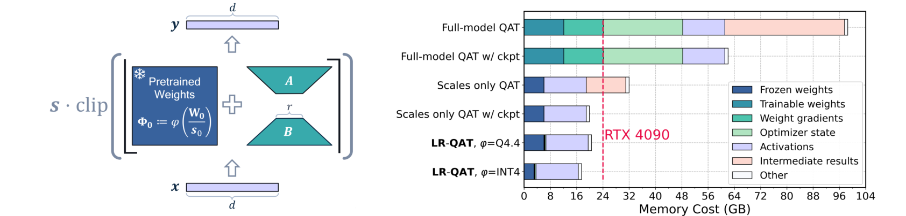</button>
<figcaption><strong>低秩更新进入 quantizer，内存账本拆开计算</strong><a href="https://arxiv.org/abs/2406.06385v3" target="_blank" rel="noopener">Low-Rank Quantization-Aware Training for LLMs</a> · Figure 1 · version 2406.06385v3 · PDF p.2 / printed p.2
<button class="original-direct" type="button">Read original size</button>

Original caption &amp; source

Figure 1: Left: A schematic illustration of our proposed LR-QAT. x and y denote the input and the
output of the linear layer. Right: Memory requirements for training with various QAT techniques
on LLaMA-2 7B, assuming batch size 1, sequence length 1024, r = 32, and BF16 compute
data type. ‘Intermediate results’ refer to the results of some intermediate computations, e.g. after
rounding/clipping in (3), which are saved in memory for the backward pass.
<a class="source-url" href="https://arxiv.org/pdf/2406.06385v3">https://arxiv.org/pdf/2406.06385v3</a>
</figcaption></figure>

左面沿 x→量化矩阵→y 读，尺度与 A／B 更新控制最终码；右面区分冻结状态、可训练状态、optimizer 和 intermediate results。条件为 LLaMA-2-7B、batch 1、长度 1024、r32、BF16。intermediate 包含为反向保存的取整／截断中间量，因此仅算 adapter 参数无法预测峰值。

<figure id="fig-lrqat-02">
<button class="paper-image" type="button" aria-label="Zoom: 五随机种子的同 checkpoint 质量／资源对照">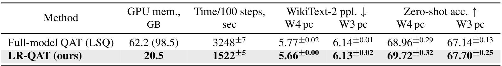</button>
<figcaption><strong>五随机种子的同 checkpoint 质量／资源对照</strong><a href="https://arxiv.org/abs/2406.06385v3" target="_blank" rel="noopener">Low-Rank Quantization-Aware Training for LLMs</a> · Table 3 · version 2406.06385v3 · PDF p.8 / printed p.8
<button class="original-direct" type="button">Read original size</button>

Original caption &amp; source

Table 3: A comparison of the proposed method (φ = Q4.4) with the full-model QAT on LLaMA-2
7B with W4 and W3 per-channel quantization. We report mean and standard deviation over 5 runs
with different random seeds. We also report the maximum GPU memory with (without) gradient
checkpointing and the runtime on a Nvidia A100 80GB GPU.
<a class="source-url" href="https://arxiv.org/pdf/2406.06385v3">https://arxiv.org/pdf/2406.06385v3</a>
</figcaption></figure>

表在 W4／W3 per-channel 固定模型，报告 mean±standard deviation。W3 PPL full QAT 为 6.14±0.01、LR-QAT 6.13±0.02；memory 62.2GB 是 checkpointing 条件，括号 98.5GB 为不使用它，LR-QAT 20.5GB。每 100 steps 为 3248±7 与 1522±5 秒。它比单次结果更能说明稳定性，但没有证明其他模型、group 或内核同样受益。

### EfficientQAT：先逐块学充分参数，再全局调少量尺度

Block-AP 一次训练一个 Transformer block 的权重、尺度与零点，减小同时驻留的反向图；E2E-QP 在已经量化的全网络上更新少量量化参数，默认只调 scale。前者恢复局部可量化性，后者处理传播到完整网络的误差。两阶段都使用训练数据，不应当作无预算校准。<a href="#source-11">[11]</a>

<figure id="fig-efficient-01">
<button class="paper-image" type="button" aria-label="Zoom: 全量自由度与全局传播分两个阶段承担">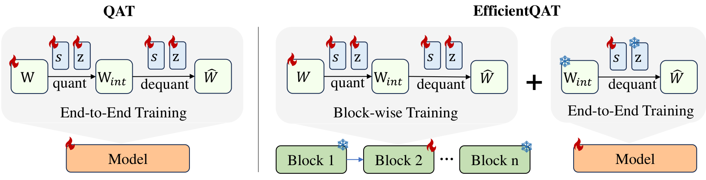</button>
<figcaption><strong>全量自由度与全局传播分两个阶段承担</strong><a href="https://arxiv.org/abs/2407.11062v3" target="_blank" rel="noopener">EfficientQAT: Efficient Quantization-Aware Training for Large Language Models</a> · Figure 2 · version 2407.11062v3 · PDF p.4 / printed page unnumbered
<button class="original-direct" type="button">Read original size</button>

Original caption &amp; source

Figure 2: The overall pipeline of naive QAT and proposed EfficientQAT. EfficientQAT introduces two novel
processes: Block-wise Training of All Parameters (Block-AP) and End-to-End Training of Quantization Parameters
(E2E-QP).
<a class="source-url" href="https://arxiv.org/pdf/2407.11062v3">https://arxiv.org/pdf/2407.11062v3</a>
</figcaption></figure>

上方 naive QAT 同时保留全网络训练状态；下方 Block-AP 逐块重建，再由 E2E-QP 全局调参数。按箭头看每阶段输入是浮点／量化前缀的哪一份激活，避免把不同目标混成一次普通微调。对本文小投影例子，先修一个块，再检查后续输出；局部误差下降不保证最终 PPL 已最好。

<figure id="fig-efficient-02">
<button class="paper-image" type="button" aria-label="Zoom: 五任务宏平均主表，不同模型块分别比较">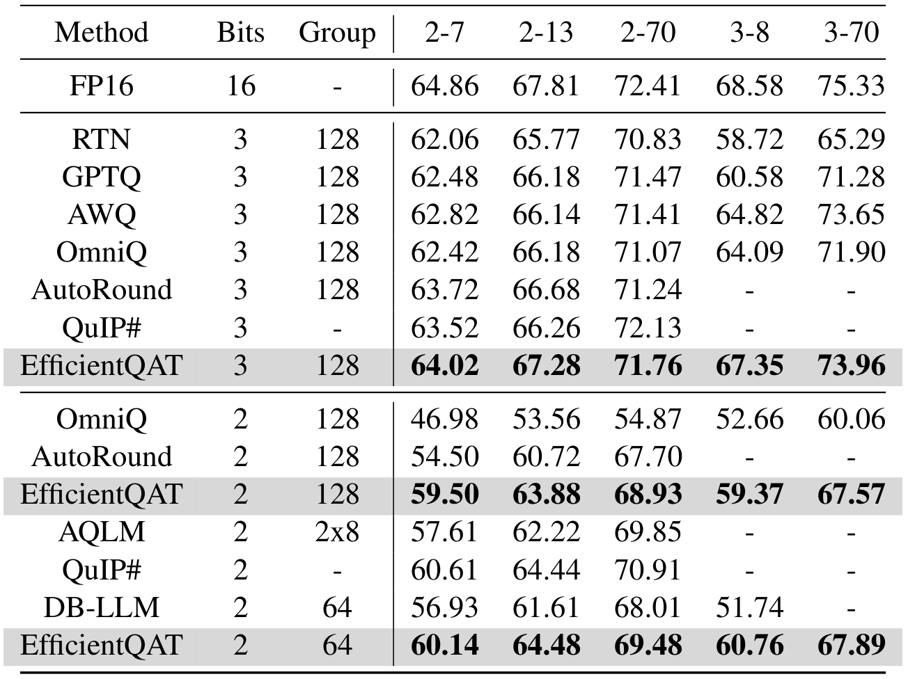</button>
<figcaption><strong>五任务宏平均主表，不同模型块分别比较</strong><a href="https://arxiv.org/abs/2407.11062v3" target="_blank" rel="noopener">EfficientQAT: Efficient Quantization-Aware Training for Large Language Models</a> · Table 1 · version 2407.11062v3 · PDF p.6 / printed page unnumbered
<button class="original-direct" type="button">Read original size</button>

Original caption &amp; source

Table 1: Llama 2 &amp; 3 average zero-shot accuracy on 5 common-sense reasoning tasks (↑). &quot;-&quot; indicates the result is
unreachable in the public papers.
<a class="source-url" href="https://arxiv.org/pdf/2407.11062v3">https://arxiv.org/pdf/2407.11062v3</a>
</figcaption></figure>

表按 Llama 2／3、规模、bit／group 比较平均零样本准确率；“−”是原公开论文无法取得结果，不是零分。同块同精度行可观察方法取舍，跨块则混入模型知识与容量。宏平均给每项任务相同权重；训练来源和 quoted baseline 仍是比较边界。

<figure id="fig-efficient-06">
<button class="paper-image" type="button" aria-label="Zoom: 两阶段的增量可由组件消融核对">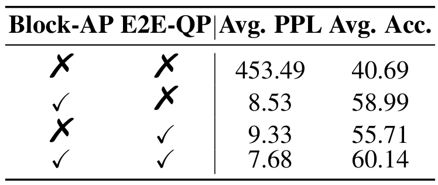</button>
<figcaption><strong>两阶段的增量可由组件消融核对</strong><a href="https://arxiv.org/abs/2407.11062v3" target="_blank" rel="noopener">EfficientQAT: Efficient Quantization-Aware Training for Large Language Models</a> · Table 4 · version 2407.11062v3 · PDF p.8 / printed page unnumbered
<button class="original-direct" type="button">Read original size</button>

Original caption &amp; source

Table 4: Effectiveness of each component on Llama-2-
7B w2g64 quantization.
<a class="source-url" href="https://arxiv.org/pdf/2407.11062v3">https://arxiv.org/pdf/2407.11062v3</a>
</figcaption></figure>

固定 Llama-2-7B W2g64，未训练为 Avg PPL 453.49／Acc 40.69%，Block-AP 后 8.53／58.99%，E2E-QP 单独为 9.33／55.71%，联合 7.68／60.14%。两阶段有互补而非完全替代关系。PPL 为论文定义的双文本平均，不能与单一 WikiText2 PPL 直接拼接；也不能由它断言后阶段只修某种唯一误差。

<figure id="fig-efficient-07">
<button class="paper-image" type="button" aria-label="Zoom: 更多参数并不保证更低任务损失">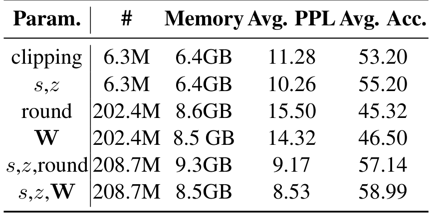</button>
<figcaption><strong>更多参数并不保证更低任务损失</strong><a href="https://arxiv.org/abs/2407.11062v3" target="_blank" rel="noopener">EfficientQAT: Efficient Quantization-Aware Training for Large Language Models</a> · Table 5 · version 2407.11062v3 · PDF p.8 / printed page unnumbered
<button class="original-direct" type="button">Read original size</button>

Original caption &amp; source

Table 5: W2g64 Llama-2-7B performance with different
trainable parameters in the block-wise training (w/o
E2E-QP). “#” indicates trainable parameters count in a
block.
<a class="source-url" href="https://arxiv.org/pdf/2407.11062v3">https://arxiv.org/pdf/2407.11062v3</a>
</figcaption></figure>

表改变 block 内 clipping、scale／zero、round 或 shadow W，自由度、内存和质量同时列出。只训 W 的 14.32 PPL 高于联合 s,z,W 的 8.53；训练 round 也不自动更好。说明量化参数与影子更新需要配合，而非只增加参数数量。不同参数组优化难度不同，不能把表格解释成全参数训练理论上劣于小参数。

<figure id="fig-efficient-03">
<button class="paper-image" type="button" aria-label="Zoom: 训练零点会改变有效位数">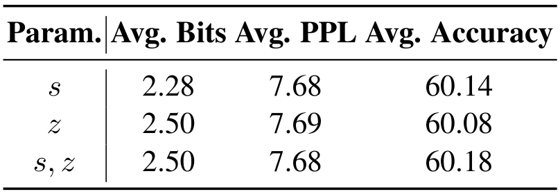</button>
<figcaption><strong>训练零点会改变有效位数</strong><a href="https://arxiv.org/abs/2407.11062v3" target="_blank" rel="noopener">EfficientQAT: Efficient Quantization-Aware Training for Large Language Models</a> · Table 6 · version 2407.11062v3 · PDF p.8 / printed page unnumbered
<button class="original-direct" type="button">Read original size</button>

Original caption &amp; source

Table 6: Llama-2-7B w2g64 quantization with different
trainable parameters for E2E-QP (w/ Block-AP).
<a class="source-url" href="https://arxiv.org/pdf/2407.11062v3">https://arxiv.org/pdf/2407.11062v3</a>
</figcaption></figure>

在已经完成 Block-AP 的 W2g64 下，单训 s 为 2.28 avg bits／7.68 PPL；训 z 或 s,z 为 2.50 avg bits，质量相近。原来的低位 zero 转成可训练浮点状态后需更多保存字节，所以作者默认只训 s。它把优化自由度与最终 metadata 的成本联系起来；名义 W2 不是实际每权重恰好 2 bit。

<figure id="fig-efficient-04">
<button class="paper-image" type="button" aria-label="Zoom: 更多数据改善 PPL，任务平均趋于饱和">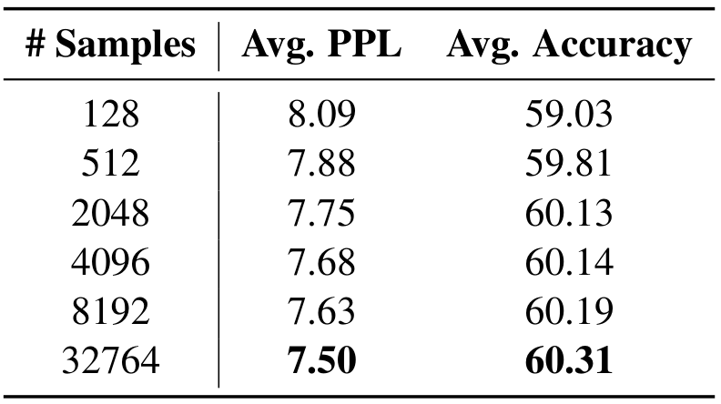</button>
<figcaption><strong>更多数据改善 PPL，任务平均趋于饱和</strong><a href="https://arxiv.org/abs/2407.11062v3" target="_blank" rel="noopener">EfficientQAT: Efficient Quantization-Aware Training for Large Language Models</a> · Table 8 · version 2407.11062v3 · PDF p.9 / printed page unnumbered
<button class="original-direct" type="button">Read original size</button>

Original caption &amp; source

Table 8: Llama-2-7B w2g64 quantization performance
with different sample numbers for E2E-QP (w/ Block-
AP).
<a class="source-url" href="https://arxiv.org/pdf/2407.11062v3">https://arxiv.org/pdf/2407.11062v3</a>
</figcaption></figure>

原表 #Samples 从 128 增到 32764，PPL 从 8.09 到 7.50，准确率从 59.03% 到 60.31%；默认 4096 为 7.68／60.14%。样本数不同意味着额外数据与更新成本；PPL 连续改善而宏平均趋缓，说明指标各有敏感区。这里不把采样预算变化当同成本方法比较，也不推定换业务数据会同样饱和。

<figure id="fig-efficient-08">
<button class="paper-image" type="button" aria-label="Zoom: 单卡训练账本分阶段而非只报总时长">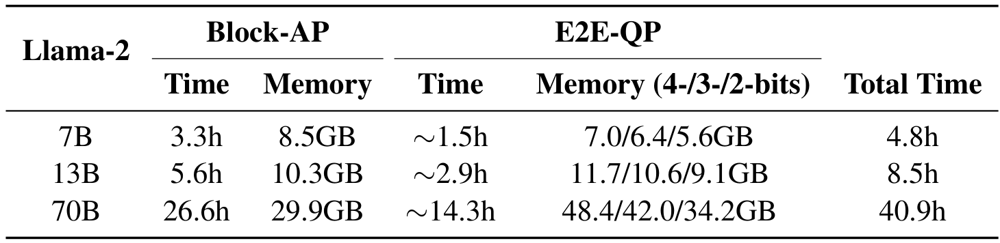</button>
<figcaption><strong>单卡训练账本分阶段而非只报总时长</strong><a href="https://arxiv.org/abs/2407.11062v3" target="_blank" rel="noopener">EfficientQAT: Efficient Quantization-Aware Training for Large Language Models</a> · Table 7 · version 2407.11062v3 · PDF p.9 / printed page unnumbered
<button class="original-direct" type="button">Read original size</button>

Original caption &amp; source

Table 7: The detailed training time and training memory of EfficientQAT across different model size and quantization
bits on a single A100-80GB GPU.
<a class="source-url" href="https://arxiv.org/pdf/2407.11062v3">https://arxiv.org/pdf/2407.11062v3</a>
</figcaption></figure>

条件是一张 A100-80GB，列 Block-AP 与 E2E-QP 时间、memory；70B 为 26.6h 与约 14.3h，总 40.9h，W2 全局阶段 34.2GB。block 阶段峰值不能与全局阶段相加成同时驻留量。该表说明分阶段降低可运行门槛，结果依赖 bit 和模型规模，不能换算为手机训练或该卡以外的固定小时数。

<figure id="fig-efficient-05">
<button class="paper-image" type="button" aria-label="Zoom: GPU-hours 汇总是预算线索，不是严格墙钟竞速">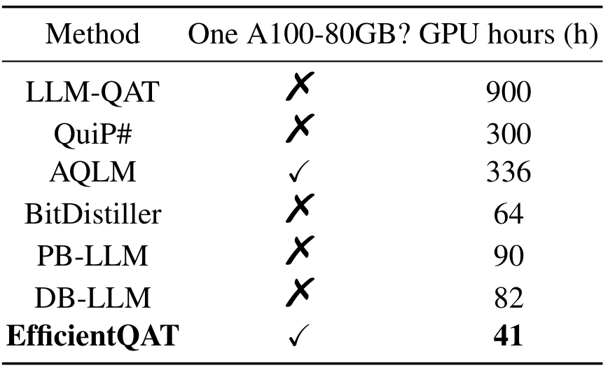</button>
<figcaption><strong>GPU-hours 汇总是预算线索，不是严格墙钟竞速</strong><a href="https://arxiv.org/abs/2407.11062v3" target="_blank" rel="noopener">EfficientQAT: Efficient Quantization-Aware Training for Large Language Models</a> · Table 9 · version 2407.11062v3 · PDF p.9 / printed page unnumbered
<button class="original-direct" type="button">Read original size</button>

Original caption &amp; source

Table 9: Comparisons of training time with existing
methods in Llama-2-70B.
<a class="source-url" href="https://arxiv.org/pdf/2407.11062v3">https://arxiv.org/pdf/2407.11062v3</a>
</figcaption></figure>

表列 Llama-2-70B 的方法、能否在一张 A100-80GB 完成，以及 GPU-hours。来自不同实现和论文的 budget 汇总，不能把 900h 与 41h 直接称 matched-stack 加速；多卡小时数与单卡墙钟也应区分。它有助于筛选资源可行路线，但仍需记录相同数据、长度和最终低位质量。

EfficientQAT 进一步把“需要全量更新”与“需要全网络同时保留训练状态”拆开：先逐块恢复可量化性，再让低位网络端到端调尺度。它代表了这条路线的一个转折：局部训练保留充分自由度，全局阶段承担层间误差传播。其主表和消融也提醒读者，更多可训练参数不总意味着更好结果。

## 6. 优化路线：STE 的偏差、离散搜索与训练停滞

统一视角是把低位表示写成**离散 assignments 加连续重建参数**。STE 用连续影子状态代理选码；PV-Tuning 直接交替优化这两部分；JacQuant 改变反向敏感度；QUASAR 改变每一步影子权重如何重建；WinQ 改变停滞后的状态和噪声。这些方向可以组合，不能仅以“非 STE”分为优劣两组。

<figure id="diagram-optimization">
<svg xmlns="http://www.w3.org/2000/svg" viewBox="0 0 900 540" role="img" aria-labelledby="svg-378e1e06-title svg-378e1e06-desc">
<title id="svg-378e1e06-title">离散量化优化接口</title><desc id="svg-378e1e06-desc">固定码调连续值、固定值选码、改变代理梯度和零阶估计分别承担不同自由度与计算成本。</desc>
<defs><marker id="svg-378e1e06-arrow" markerWidth="8" markerHeight="8" refX="7" refY="4" orient="auto"><path d="M0 0L8 4L0 8" fill="#8292a8"/></marker></defs>

<text x="24" y="36" font-size="22" font-weight="600">更新 codes、重建参数、反向代理，是三个不同接口</text><rect x="24" y="102" width="264" height="172" rx="8" fill="#182230" stroke="#344355"/><rect x="24" y="114" width="3" height="148" fill="#7dc6b2"/><text x="42" y="132" class="label" font-weight="600">连续重建参数</text><text x="42" y="158" class="small muted">固定 codes → 移动 scale</text><text x="42" y="181" class="small muted">PEQA 等：少状态 / 少自由度</text><text x="42" y="204" class="small muted">PV P 步：保共享关系调值</text><rect x="318" y="102" width="264" height="172" rx="8" fill="#182230" stroke="#344355"/><rect x="318" y="114" width="3" height="148" fill="#a7b5ee"/><text x="336" y="132" class="label" font-weight="600">离散 assignments</text><text x="336" y="158" class="small muted">固定可用值 → 重新选码</text><text x="336" y="181" class="small muted">PV V 步：改变分配</text><text x="336" y="204" class="small muted">搜索成本随表示空间增长</text><rect x="612" y="102" width="264" height="172" rx="8" fill="#182230" stroke="#344355"/><rect x="612" y="114" width="3" height="148" fill="#e6bf88"/><text x="630" y="132" class="label" font-weight="600">反向代理 / 训练状态</text><text x="630" y="158" class="small muted">JacQuant：组敏感度</text><text x="630" y="181" class="small muted">WinQ：噪声 / 重初始化</text><text x="630" y="204" class="small muted">不把硬量化当光滑函数</text><rect x="24" y="355" width="405" height="147" rx="8" fill="#182230" stroke="#344355"/><rect x="24" y="367" width="3" height="123" fill="#a7b5ee"/><text x="42" y="385" class="label" font-weight="600">QUASAR：任务敏感度进入重建</text><text x="42" y="411" class="small muted">Adam 二阶矩是对角代理</text><text x="42" y="434" class="small muted">加权拟合 scale / offset + code search</text><text x="42" y="457" class="small muted">不等于精确 Hessian 或全局最优</text><rect x="470" y="355" width="406" height="147" rx="8" fill="#182230" stroke="#344355"/><rect x="470" y="367" width="3" height="123" fill="#e6bf88"/><text x="488" y="385" class="label" font-weight="600">ZeroQAT：改变反馈的获得方式</text><text x="488" y="411" class="small muted">随机方向上两次前向估计</text><text x="488" y="434" class="small muted">省反向激活，增加方差 / 前向</text><text x="488" y="457" class="small muted">扰动小到不跨码可能被吞掉</text></svg>
<figcaption>原创机制图 · 小屏可局部横向滚动，保留完整关系与标签。</figcaption></figure>

图从左到右对比三个更新接口。固定 codes 改尺度，只能移动已有格点；固定码本改 assignments，可以让值换到另一格点；改变反向代理，影响影子状态如何跨过边界。下方 loss-aware 重建还利用训练中的敏感度选择网格。每个箭头都需要计算预算，离散搜索尤其不能当作免费的反向。

### PV-Tuning：交替改共享值和分组，不必始终依赖 STE

低位模型可以视为许多位置共享有限个数值。PV 的 P 步固定哪些位置共享同一值，连续优化这些共享值；V 步固定可用值集合，重新分配位置。应用到向量量化时，对应调整码本及索引。理论精确子问题与实际有限搜索应分开：离散空间随维度增长，工程实现用近似更新，不是每轮求出全局最优。<a href="#source-17">[17]</a>

<figure id="fig-pvtune-03">
<button class="paper-image" type="button" aria-label="Zoom: PV 的两步：保留划分调数值，再保留数值改分配">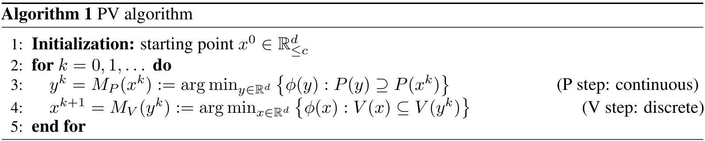</button>
<figcaption><strong>PV 的两步：保留划分调数值，再保留数值改分配</strong><a href="https://arxiv.org/abs/2405.14852v2" target="_blank" rel="noopener">PV-Tuning: Beyond Straight-Through Estimation for Extreme LLM Compression</a> · Algorithm 1 · version 2405.14852v2 · PDF p.4 / printed p.4
<button class="original-direct" type="button">Read original size</button>

Original caption &amp; source

Algorithm 1 PV algorithm
<a class="source-url" href="https://arxiv.org/pdf/2405.14852v2">https://arxiv.org/pdf/2405.14852v2</a>
</figcaption></figure>

从初始化往下读，P 步约束新划分保留原有相等关系，V 步约束使用现有值集合。以两个位置共同使用 0.2 为例，P 步可共同移到 0.25；V 步可让其中一个改选另一个已存在值。严格解子问题时目标不升的性质，不能直接套到有限步 Adam 和近似离散搜索，也不保证独立测试 PPL。

<figure id="fig-pvtune-01">
<button class="paper-image" type="button" aria-label="Zoom: 同字节而非同参数量的 2 bit 质量曲线">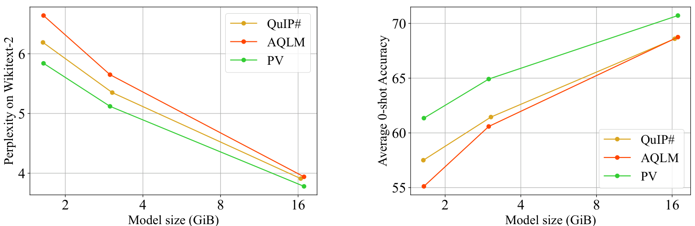</button>
<figcaption><strong>同字节而非同参数量的 2 bit 质量曲线</strong><a href="https://arxiv.org/abs/2405.14852v2" target="_blank" rel="noopener">PV-Tuning: Beyond Straight-Through Estimation for Extreme LLM Compression</a> · Figure 1 · version 2405.14852v2 · PDF p.2 / printed p.2
<button class="original-direct" type="button">Read original size</button>

Original caption &amp; source

Figure 1: WikiText-2 perplexity (left) and average zero-shot accuracy (right) of 2-bit quantized
LLAMA 2 models as a function of model size (GiB). See detailed setup in Section 4.3.
<a class="source-url" href="https://arxiv.org/pdf/2405.14852v2">https://arxiv.org/pdf/2405.14852v2</a>
</figcaption></figure>

左图横轴 GiB、纵轴 WikiText2 PPL，右图同样按大小比较平均零样本准确率。先看同一 LLAMA 2 规模中更新的增量，再看同字节允许的模型容量。PV 让有限表示更适应任务，但不同量化方案的码本、索引和 group metadata 改变实际大小；曲线不提供同 batch 推理延迟。

<figure id="fig-pvtune-02">
<button class="paper-image" type="button" aria-label="Zoom: 同 7B checkpoint 下，是否更新离散分配有何增量">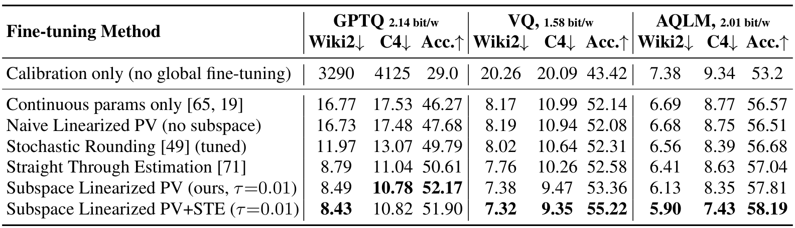</button>
<figcaption><strong>同 7B checkpoint 下，是否更新离散分配有何增量</strong><a href="https://arxiv.org/abs/2405.14852v2" target="_blank" rel="noopener">PV-Tuning: Beyond Straight-Through Estimation for Extreme LLM Compression</a> · Table 1 · version 2405.14852v2 · PDF p.8 / printed p.8
<button class="original-direct" type="button">Read original size</button>

Original caption &amp; source

Table 1: Comparing different fine-tuning strategies for VQ, GPTQ and AQLM on LLAMA 2 7B in
terms of perplexity on WikiText-2, C4 and average zero-shot accuracy on tasks from Section 4.3.
<a class="source-url" href="https://arxiv.org/pdf/2405.14852v2">https://arxiv.org/pdf/2405.14852v2</a>
</figcaption></figure>

表固定 LLAMA 2 7B，在 VQ、GPTQ、AQLM 等表示上比较微调策略，分别读 WikiText2、C4 PPL 和任务平均。它把表示与更新接口分开：只调连续参数、STE 和 PV 不完全相同。两套文本和任务共同改善比单一训练损失更可信；各表示的有效位宽、搜索预算和核实现仍需单独核对。

### PARQ：用退火与近端映射接近离散约束，证据来自视觉任务

PARQ 把低位约束写成非光滑惩罚，并随训练逐步强化量化约束；近端步骤将普通梯度更新后的状态拉向量化集合。它为避免一次硬切换提供优化思想，但原文评测是 ResNet／DeiT、CIFAR／ImageNet。本文纳入技术源流，不把它的分类准确率写成 LLM QAT 结果。<a href="#source-18">[18]</a>

<figure id="fig-parq-01">
<button class="paper-image" type="button" aria-label="Zoom: 两种惩罚的形状决定怎样靠近量化集合">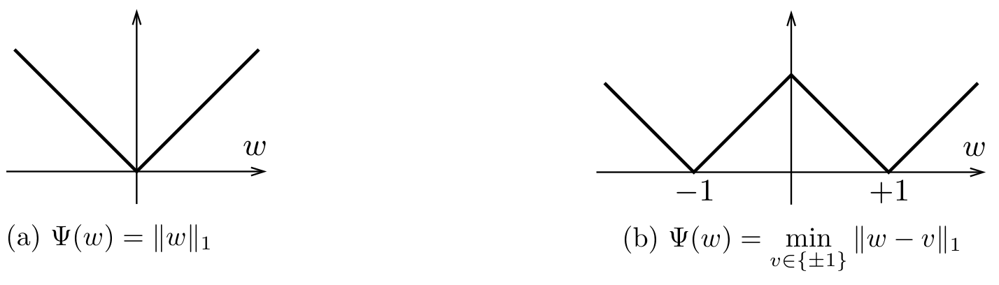</button>
<figcaption><strong>两种惩罚的形状决定怎样靠近量化集合</strong><a href="https://arxiv.org/abs/2503.15748v1" target="_blank" rel="noopener">PARQ: Piecewise-Affine Regularized Quantization</a> · Figure 2 · version 2503.15748v1 · PDF p.4 / printed page unnumbered
<button class="original-direct" type="button">Read original size</button>

Original caption &amp; source

Figure 2: Illustration of two nonsmooth regularizers.
<a class="source-url" href="https://arxiv.org/pdf/2503.15748v1">https://arxiv.org/pdf/2503.15748v1</a>
</figcaption></figure>

横轴为连续权重，纵轴为正则代价。靠近合法离散值时惩罚较小，偏离时增加；折点意味着不能处处用普通导数。读曲线时要区分“鼓励靠近”与“立即限制为离散值”。正则形状决定优化路径，但不是已经证明哪条路径对语言模型最好。

<figure id="fig-parq-02">
<button class="paper-image" type="button" aria-label="Zoom: 退火改变约束强度，三个特例属于同一族"></button>
<figcaption><strong>退火改变约束强度，三个特例属于同一族</strong><a href="https://arxiv.org/abs/2503.15748v1" target="_blank" rel="noopener">PARQ: Piecewise-Affine Regularized Quantization</a> · Figure 4 · version 2503.15748v1 · PDF p.6 / printed page unnumbered
<button class="original-direct" type="button">Read original size</button>

Original caption &amp; source

Figure 4: Three special cases of PAR for low-bit quantization.
<a class="source-url" href="https://arxiv.org/pdf/2503.15748v1">https://arxiv.org/pdf/2503.15748v1</a>
</figcaption></figure>

图展示参数变化下 PAR 的不同量化特例。沿训练日程，较柔和约束给连续优化空间，后期再靠近低位集合。对于最终二值／低位模型，必须在冻结后的硬表示上评测；中间平滑模型质量并不自动等于部署质量。原图表达正则族的关系，不是三项 LLM 基准。

<figure id="fig-parq-03">
<button class="paper-image" type="button" aria-label="Zoom: 近端映射怎样把更新后的值拉向格点"></button>
<figcaption><strong>近端映射怎样把更新后的值拉向格点</strong><a href="https://arxiv.org/abs/2503.15748v1" target="_blank" rel="noopener">PARQ: Piecewise-Affine Regularized Quantization</a> · Figure 9 · version 2503.15748v1 · PDF p.10 / printed page unnumbered
<button class="original-direct" type="button">Read original size</button>

Original caption &amp; source

Figure 9: Proximal maps of PARQ and BinaryRelax.
<a class="source-url" href="https://arxiv.org/pdf/2503.15748v1">https://arxiv.org/pdf/2503.15748v1</a>
</figcaption></figure>

横轴输入连续值，纵轴近端输出，比较 PARQ 与 BinaryRelax。读一条竖线对应的输出，看靠近边界时两种映射是否保留连续移动空间。近端映射包含惩罚强度与量化集合，不能只看台阶数判断优劣；最终仍需要离散化和完整任务验证。

<figure id="fig-parq-04">
<button class="paper-image" type="button" aria-label="Zoom: ImageNet 原表限定了迁移证据的范围"></button>
<figcaption><strong>ImageNet 原表限定了迁移证据的范围</strong><a href="https://arxiv.org/abs/2503.15748v1" target="_blank" rel="noopener">PARQ: Piecewise-Affine Regularized Quantization</a> · Table 2 · version 2503.15748v1 · PDF p.12 / printed page unnumbered
<button class="original-direct" type="button">Read original size</button>

Original caption &amp; source

Table 2: Quantized ResNet-50 test accuracy on ImageNet.
<a class="source-url" href="https://arxiv.org/pdf/2503.15748v1">https://arxiv.org/pdf/2503.15748v1</a>
</figcaption></figure>

表比较 ResNet-50 在 ImageNet 的低位测试准确率，先固定权重／激活 bit，再比较方法。这个结果检验视觉网络的退火优化效果；不含自回归 token、KV cache 或 LLM PPL。把方法应用到 Transformer 是可以研究的方向，本文没有证据宣布已复现该迁移。

### WinQ：对低位训练停滞，尝试噪声与权重重初始化

WinQ 观察到极低位训练的曲率谱更集中于近零区，提出在训练中加入噪声及周期性重初始化以改善跨码和收敛。谱来自特定损失、模型和估计协议；冻结代码使用 LSQ／elastic 自定义反向。因此它是对该量化训练协议的经验分析，不能把硬 round 当成全局光滑函数。<a href="#source-19">[19]</a>

<figure id="fig-winq-01">
<button class="paper-image" type="button" aria-label="Zoom: 曲率谱：近零质量随 bit 降低而增加"></button>
<figcaption><strong>曲率谱：近零质量随 bit 降低而增加</strong><a href="https://arxiv.org/abs/2605.17471v1" target="_blank" rel="noopener">WinQ: Accelerating Quantization-Aware Training of Language Models Around Saddle Points</a> · Figure 3 · version 2605.17471v1 · PDF p.4 / printed page unnumbered
<button class="original-direct" type="button">Read original size</button>

Original caption &amp; source

Figure 3. We illustrate the estimated eigenvalues and their probability mass of the loss Hessian matrix in 3-bit, 2-bit, and 1-bit QAT,
respectively. (1) Most of the eigenvalues concentrate close to zero, and there are both negative and positive eigenvalues with comparable
probability mass. This suggests that the model weights converge to a flat region around saddle points during training. (2) For a lower
precision, the magnitude of eigenvalues becomes smaller, and more eigenvalues are around zero. This suggests that the model weights
are in a region with flatter curvature, thus exhibiting slower convergence. The x-axis corresponds to the eigenvalues. y-axis corresponds
to the probability mass function of the eigenvalues (in log scale). We illustrate the eigenvalues for the weights in transformer layers. We
describe the results for the FP16-precision model and for embedding layers in Appendix B.
<a class="source-url" href="https://arxiv.org/pdf/2605.17471v1">https://arxiv.org/pdf/2605.17471v1</a>
</figcaption></figure>

横轴为估计 Hessian 特征值，纵轴是概率质量的对数尺度；三列为 3、2、1 bit，三行为 step0、10K、80K。虚线／点线标估计最小／最大特征值。各面板横轴范围不同，不能仅按柱形在像素上的宽窄判断曲率；应读数值范围，训练后谱从初始千量级收缩，极低位的范围更小。

正负特征值并存，近零质量增加；作者数值上用 −0.001…0.001 定义近零，在 80K steps 报告约 41%、55%、63%。这提示所定义的替代训练目标可能处于较平坦的区域，不证明每个权重都是严格鞍点，也不保证加噪声必然找到更好全局解。

<figure id="fig-winq-02">
<button class="paper-image" type="button" aria-label="Zoom: 噪声与重初始化进入训练循环的具体位置"></button>
<figcaption><strong>噪声与重初始化进入训练循环的具体位置</strong><a href="https://arxiv.org/abs/2605.17471v1" target="_blank" rel="noopener">WinQ: Accelerating Quantization-Aware Training of Language Models Around Saddle Points</a> · Algorithm 1 · version 2605.17471v1 · PDF p.5 / printed page unnumbered
<button class="original-direct" type="button">Read original size</button>

Original caption &amp; source

Algorithm 1 WINQ: Weight (re)-initialization with noise
injection for Quantization-aware training
<a class="source-url" href="https://arxiv.org/pdf/2605.17471v1">https://arxiv.org/pdf/2605.17471v1</a>
</figcaption></figure>

算法从预训练状态出发，按日程调整噪声并在选定间隔重初始化权重状态，再继续低位训练。重初始化不是丢弃整个模型重新预训练，而是按规则改变继续优化的起点。频率和噪声强度是超参数；过大扰动也会破坏已经学到的任务行为。

<figure id="fig-winq-04">
<button class="paper-image" type="button" aria-label="Zoom: 训练步数上的收敛改善，不等于内核加速"></button>
<figcaption><strong>训练步数上的收敛改善，不等于内核加速</strong><a href="https://arxiv.org/abs/2605.17471v1" target="_blank" rel="noopener">WinQ: Accelerating Quantization-Aware Training of Language Models Around Saddle Points</a> · Figure 4 · version 2605.17471v1 · PDF p.6 / printed page unnumbered
<button class="original-direct" type="button">Read original size</button>

Original caption &amp; source

Figure 4. We evaluate training loss convergence by comparing our approach with the SoTA STE-based quantization-aware training
method on the LLaMA-3-1B model. Our method accelerates convergence by 1.5-4× across weight precisions of 1–2 bits and activation
precisions of 8–16 bits. In higher-precision settings, longer re-initialization intervals generally lead to improved performance. Through-
out, we use the notation W2A16 to indicate 2-bit weights and 16-bit activations, with analogous notation for other configurations. The
result of W1A16 is reported in Figure 1.
<a class="source-url" href="https://arxiv.org/pdf/2605.17471v1">https://arxiv.org/pdf/2605.17471v1</a>
</figcaption></figure>

横轴训练进程、纵轴训练 loss，各面板固定 LLaMA-3-1B 的 W／A 配置，曲线比较 STE 基线与不同重初始化间隔。文中 1.5–4 倍指这些条件下达到训练损失的收敛改善；噪声、重初始化和每步计算都应计入墙钟。较高精度偏好较长间隔是该日程的经验，不是普遍定律。

<figure id="fig-winq-03">
<button class="paper-image" type="button" aria-label="Zoom: PPL 和八任务平均检验收敛能否转为质量"></button>
<figcaption><strong>PPL 和八任务平均检验收敛能否转为质量</strong><a href="https://arxiv.org/abs/2605.17471v1" target="_blank" rel="noopener">WinQ: Accelerating Quantization-Aware Training of Language Models Around Saddle Points</a> · Table 1 · version 2605.17471v1 · PDF p.7 / printed page unnumbered
<button class="original-direct" type="button">Read original size</button>

Original caption &amp; source

Table 1. This table reports the comparison of our approach to recent quantization methods. We evaluate quantization performance across
various settings for LLaMA models, with weights quantized to 1 to 4 bits and activations to 8 to 16 bits. We report the perplexity (PPL)
on WikiText2 and the average zero-shot test accuracy (Acc.) across eight QA datasets. To show relative performance, we also evaluate
the full-precision (FP) pretrained model. W2A16 means 2-bit weights and 16-bit activations, and analogous notations for others. 1.58-bit
means ternary quantization.
<a class="source-url" href="https://arxiv.org/pdf/2605.17471v1">https://arxiv.org/pdf/2605.17471v1</a>
</figcaption></figure>

表按 LLaMA 模型、权重 1–4 bit、激活 8／16 bit 分块；1.58 表示三值。固定模型与 W/A 后同时看 WikiText2 PPL 和八 QA 的宏平均，再和浮点参考比较。它支持相应配置中训练方法有质量收益；不同位宽、训练预算和表示空间不能揉成一个统一排名。

### JacQuant：学习组级敏感度，而不是宣称得到硬量化的真导数

JacQuant 通过扰动探测和移动平均，学习量化重建对影子权重变化的替代敏感度。默认每 128 个权重一组，一个标量乘该组梯度；组内不能任意旋转，多组相对缩放可以改变整体方向。论文平滑／dither 参考与实际硬前向的边界必须保留。<a href="#source-20">[20]</a>

<figure id="fig-jacquant-01">
<button class="paper-image" type="button" aria-label="Zoom: 梯度箭头是概念示意，默认结构是组标量"></button>
<figcaption><strong>梯度箭头是概念示意，默认结构是组标量</strong><a href="https://arxiv.org/abs/2605.25469v1" target="_blank" rel="noopener">JacQuant: STE-Free Quantization-Aware Training via Learned Jacobian Surrogates</a> · Figure 1 · version 2605.25469v1 · PDF p.2 / printed p.2
<button class="original-direct" type="button">Read original size</button>

Original caption &amp; source

Figure 1: Gradient propagation schemes in quantized optimization. Left: STE, which directly copies
the forward gradient direction. Middle: Rotation Trick (Fifty et al., 2025), which applies a fixed
relative rotation θ to the gradient. Right: JacQuant (ours), which learns an adaptive surrogate Jacobian
B(W), yielding an optimal rotation θ⋆together with an optimal gradient rescaling.
<a class="source-url" href="https://arxiv.org/pdf/2605.25469v1">https://arxiv.org/pdf/2605.25469v1</a>
</figcaption></figure>

左面 STE 复制方向，中面 Rotation Trick 改方向，右面示意适应方向与幅值。图中角度不能读成实现了任意可学习稠密旋转矩阵：正文限制 B 为 blkdiag(bg I)。一个组中两分量始终同倍缩放；不同组变化才可能改变拼接向量方向。所谓 optimal 也依赖所设代理目标和结构。

<figure id="fig-jacquant-02">
<button class="paper-image" type="button" aria-label="Zoom: 探测、拟合与训练更新分别承担什么"></button>
<figcaption><strong>探测、拟合与训练更新分别承担什么</strong><a href="https://arxiv.org/abs/2605.25469v1" target="_blank" rel="noopener">JacQuant: STE-Free Quantization-Aware Training via Learned Jacobian Surrogates</a> · Algorithm 1 · version 2605.25469v1 · PDF p.4 / printed p.4
<button class="original-direct" type="button">Read original size</button>

Original caption &amp; source

Algorithm 1 JacQuant-VR (unified view)
<a class="source-url" href="https://arxiv.org/pdf/2605.25469v1">https://arxiv.org/pdf/2605.25469v1</a>
</figcaption></figure>

算法用扰动前后的量化差拟合替代 Jacobian，稳定估计后用于梯度传播，并可配方差控制。先确认探测损失／量化调用和常规训练更新不是同一操作，再计入额外成本。有限扰动敏感度并不等于硬函数几乎处处为零的点导数，也不保证扰动尺度对所有模型最优。

<figure id="fig-jacquant-04">
<button class="paper-image" type="button" aria-label="Zoom: 有限差分诊断比较的是所定义参考"></button>
<figcaption><strong>有限差分诊断比较的是所定义参考</strong><a href="https://arxiv.org/abs/2605.25469v1" target="_blank" rel="noopener">JacQuant: STE-Free Quantization-Aware Training via Learned Jacobian Surrogates</a> · Figure 2 · version 2605.25469v1 · PDF p.9 / printed p.9
<button class="original-direct" type="button">Read original size</button>

Original caption &amp; source

Figure 2: Finite-difference gradient diagnostics. (a) JacQuant converges faster than STE and
stabilizes within a smaller neighborhood; (b) variance of the coordinate-wise mismatch between a
central-difference reference gradient and the approximate training gradients; (c) histogram of the
learned group-wise Jacobian scalars bg at the target step, with the dashed line indicating the STE
identity (b = 1).
<a class="source-url" href="https://arxiv.org/pdf/2605.25469v1">https://arxiv.org/pdf/2605.25469v1</a>
</figcaption></figure>

a 看收敛与稳定邻域，b 看坐标梯度与中心差分参考的 mismatch 方差，c 看组标量 bg 的直方图，虚线 b=1 对应 STE。更低差异支持估计更贴近这个参考；平滑／扰动、步长和目标决定参考含义。直方图也直接说明默认学的是组尺度，而不是每组任意旋转。

<figure id="fig-jacquant-03">
<button class="paper-image" type="button" aria-label="Zoom: 对称均匀量化下的语言模型质量"></button>
<figcaption><strong>对称均匀量化下的语言模型质量</strong><a href="https://arxiv.org/abs/2605.25469v1" target="_blank" rel="noopener">JacQuant: STE-Free Quantization-Aware Training via Learned Jacobian Surrogates</a> · Table 1 · version 2605.25469v1 · PDF p.8 / printed p.8
<button class="original-direct" type="button">Read original size</button>

Original caption &amp; source

Table 1: QAT results under symmetric uniform quantization.
(a) LLaMA3-1B, A16.
<a class="source-url" href="https://arxiv.org/pdf/2605.25469v1">https://arxiv.org/pdf/2605.25469v1</a>
</figcaption></figure>

a 固定 LLaMA3-1B、A16，按 W1／W1.58／W2 比较 PPL 与八任务平均，分别看 ParetoQ／WinQ 加入 JacQuant 的增量；例如 W2A16 的 ParetoQ 为 13.5／55.7，加入后 12.3／56.6。b 使用 LLaMA3-3B 和 Qwen3-1.7B、A8，检验另一激活精度和模型家族，不能与 a 跨模型横比。

c 是 LLaMA3-8B、W2A16 在 30K／60K／90K 训练步骤上的轨迹；90K 的 PPL／Acc 从 9.79／61.41 变为 9.71／62.04。该子表说明增量随训练进度仍存在，不是内存／运行时表。比较同一子表、同一 bit 和训练时点才隔离替代反向的变化；不自动证明大 MoE、FP4 KV 或端侧延迟有同等收益。

### QUASAR：仍可用 STE，但让每轮重建对任务敏感度负责

QUASAR 改的是影子权重到码与重建值的接口：用训练二阶矩代理给误差加权，搜索 assignments 并拟合 dequantizer。普通 absmax 主要照顾极值，loss-aware 目标关心误差落在什么位置。它不等于精确 Hessian，也不消除非凸训练与跨分布风险。<a href="#source-21">[21]</a>

<figure id="fig-quasar-01">
<button class="paper-image" type="button" aria-label="Zoom: 同一训练循环中，网格来源和误差分布改变"></button>
<figcaption><strong>同一训练循环中，网格来源和误差分布改变</strong><a href="https://arxiv.org/abs/2608.13966v2" target="_blank" rel="noopener">QUASAR: Lowering the Loss Floor of Quantization-Aware Training with Loss-Aware Reconstruction</a> · Figure 2 · version 2608.13966v2 · PDF p.4 / printed p.4
<button class="original-direct" type="button">Read original size</button>

Original caption &amp; source

Figure 2: The training loops for standard QAT and QUASAR differ only in the reconstruction
w 7→q 7→r. Standard QAT determines the quantization grid from each group’s extreme weights;
QUASAR searches over code assignments and fits the dequantizer to minimize loss-aware recon-
struction error. The right panels show the resulting grids and error distributions; empirical measure-
ments appear in Appendix A.
<a class="source-url" href="https://arxiv.org/pdf/2608.13966v2">https://arxiv.org/pdf/2608.13966v2</a>
</figcaption></figure>

左面标准 QAT 从每组极值定网格，右面 QUASAR 做加权重建；右侧小图比较网格和残差。沿 w→q→r 看，任务敏感度影响 code search 与 scale／offset 拟合，而反向主框架可保持不变。冻结源码取 AdamW exp_avg_sq、组归一化并在 no_grad 下搜索，不能把这些操作误称第二阶精确反传。

<figure id="fig-quasar-02">
<button class="paper-image" type="button" aria-label="Zoom: 思考模型：忠实度与任务成绩分别报告"></button>
<figcaption><strong>思考模型：忠实度与任务成绩分别报告</strong><a href="https://arxiv.org/abs/2608.13966v2" target="_blank" rel="noopener">QUASAR: Lowering the Loss Floor of Quantization-Aware Training with Loss-Aware Reconstruction</a> · Table 1 · version 2608.13966v2 · PDF p.8 / printed p.8
<button class="original-direct" type="button">Read original size</button>

Original caption &amp; source

Table 1: Reasoning, coding, and long-context results for Qwen3-4B-Thinking-2507 and Llama-
3.1-8B-Instruct at INT2, INT3, and INT4. We report KL and top-1 agreement between quantized
checkpoints and the BF16 original, as well as benchmark accuracy.
<a class="source-url" href="https://arxiv.org/pdf/2608.13966v2">https://arxiv.org/pdf/2608.13966v2</a>
</figcaption></figure>

表在 Qwen3-4B-Thinking-2507 和 Llama-3.1-8B-Instruct 上比较 INT2／3／4，列含 KL、top-1 agreement、推理／代码／长上下文能力。先固定 checkpoint 与 bit：KL 低表示更像 BF16，agreement 高表示首选 token 更一致，二者均不等于答案正确。多任务证据有价值，但生成长度、采样和评测协议仍约束结论。

<figure id="fig-quasar-03">
<button class="paper-image" type="button" aria-label="Zoom: 领域适配中，改善可能同时来自数学数据"></button>
<figcaption><strong>领域适配中，改善可能同时来自数学数据</strong><a href="https://arxiv.org/abs/2608.13966v2" target="_blank" rel="noopener">QUASAR: Lowering the Loss Floor of Quantization-Aware Training with Loss-Aware Reconstruction</a> · Table 2 · version 2608.13966v2 · PDF p.8 / printed p.8
<button class="original-direct" type="button">Read original size</button>

Original caption &amp; source

Table 2: Comparison of QAT and PTQ methods for adapting Qwen3-4B-Base on OpenMathReason-
ing at INT2, INT3, and INT4. We report held-out perplexity and accuracy on five math benchmarks.
<a class="source-url" href="https://arxiv.org/pdf/2608.13966v2">https://arxiv.org/pdf/2608.13966v2</a>
</figcaption></figure>

表固定 Qwen3-4B-Base，在 OpenMathReasoning 上进行 PTQ／QAT 适配，比较 held-out PPL 和五数学任务。训练可学到领域知识，故应联同未量化同预算适配基线理解；不能把所有分数增加都称量化损失恢复。INT2／3／4 分开比较，搜索与训练预算也应进入成本账本。

### ZeroQAT：前向扰动替代普通反向，降低状态内存

ZeroQAT 把零阶更新用于低位训练和微调，以随机方向的损失差估计更新，减少存储反向激活的需要。既有 checkpoint 可以继续适配，但扰动方差、两次或多次前向与被取整吞掉的微小扰动构成新成本。首次公开为 **2025-08-21**，不能由 2509 的编号误判成九月；本文使用 Findings EMNLP 2026 版本。<a href="#source-22">[22]</a>

<figure id="fig-zeroqat-01">
<button class="paper-image" type="button" aria-label="Zoom: 逐块重建改善不应代替全局指标"></button>
<figcaption><strong>逐块重建改善不应代替全局指标</strong><a href="https://arxiv.org/abs/2509.00031v3" target="_blank" rel="noopener">End-to-End On-Device Quantization-Aware Training for LLMs at Inference Cost</a> · Figure 1 · version 2509.00031v3 · PDF p.4 / printed page unnumbered
<button class="original-direct" type="button">Read original size</button>

Original caption &amp; source

Figure 1: Comparison of the block-wise reconstruction loss reduction between OmniQuant (Shao et al., 2023) and
our method. The X-axis is the index of layer, Y-axis measures the ratio of loss decrease.
<a class="source-url" href="https://arxiv.org/pdf/2509.00031v3">https://arxiv.org/pdf/2509.00031v3</a>
</figcaption></figure>

横轴层号，纵轴 reconstruction loss 的下降比例，对照 OmniQuant 与该方法。每个柱／点描述该层代理目标恢复多少；局部 loss 更低未必使后续层收到更合适输入。比较需固定同层和相同输入协议，不能用一张层级图宣布完整模型最好。

<figure id="fig-zeroqat-02">
<button class="paper-image" type="button" aria-label="Zoom: 目标不一致：局部重建与最终评测不总同向"></button>
<figcaption><strong>目标不一致：局部重建与最终评测不总同向</strong><a href="https://arxiv.org/abs/2509.00031v3" target="_blank" rel="noopener">End-to-End On-Device Quantization-Aware Training for LLMs at Inference Cost</a> · Figure 2 · version 2509.00031v3 · PDF p.4 / printed page unnumbered
<button class="original-direct" type="button">Read original size</button>

Original caption &amp; source

Figure 2: Objective inconsistency between the recon-
struction loss used by approximation-based PTQ and
final evaluation metrics.
<a class="source-url" href="https://arxiv.org/pdf/2509.00031v3">https://arxiv.org/pdf/2509.00031v3</a>
</figcaption></figure>

图把 approximation-based PTQ 的重建 loss 与最终指标并列，指出优化代理可能偏离最终任务。读变化趋势而不是只挑最低重建值：代理目标的改善可能在测试 PPL／能力上变小或反向。这是使用全局任务反馈的动机，不是证明所有 PTQ 都无效。

<figure id="fig-zeroqat-07">
<button class="paper-image" type="button" aria-label="Zoom: 轻量微调在 Q／V 等选定参数上执行更新"></button>
<figcaption><strong>轻量微调在 Q／V 等选定参数上执行更新</strong><a href="https://arxiv.org/abs/2509.00031v3" target="_blank" rel="noopener">End-to-End On-Device Quantization-Aware Training for LLMs at Inference Cost</a> · Figure 3 · version 2509.00031v3 · PDF p.5 / printed p.5
<button class="original-direct" type="button">Read original size</button>

Original caption &amp; source

Figure 3: lightweight ZeroQAT for fine-tuning.
<a class="source-url" href="https://arxiv.org/pdf/2509.00031v3">https://arxiv.org/pdf/2509.00031v3</a>
</figcaption></figure>

图沿输入到 attention 的 Q、K、V 与输出分支读，标出轻量 ZeroQAT 的可训练子集及量化路径。只适配选定投影可节省更新状态，也限制表达自由度；它不是每个权重都可自由改变的全参数训练。所选层、位宽和扰动同步必须保留，不能只报一个“零反向”标签。

<figure id="fig-zeroqat-03">
<button class="paper-image" type="button" aria-label="Zoom: 文本质量在 W-only 与 W/A 下分别核对"></button>
<figcaption><strong>文本质量在 W-only 与 W/A 下分别核对</strong><a href="https://arxiv.org/abs/2509.00031v3" target="_blank" rel="noopener">End-to-End On-Device Quantization-Aware Training for LLMs at Inference Cost</a> · Table 3 · version 2509.00031v3 · PDF p.6 / printed page unnumbered
<button class="original-direct" type="button">Read original size</button>

Original caption &amp; source

Table 3: Weight-only and weight-activation quantization results of LLama-series models on two datasets: WikiText2
(WIKI), and C4.
<a class="source-url" href="https://arxiv.org/pdf/2509.00031v3">https://arxiv.org/pdf/2509.00031v3</a>
</figcaption></figure>

表按 LLaMA 系列模型、W／A／group 配置比较 WikiText2、C4 PPL。相同模型和精度内观察零阶方法与基线的取舍；两套文本验证优于只看训练 loss。它不含真实生成鲁棒性，也不能把 W2A16 结果称 W2A2。

<figure id="fig-zeroqat-04">
<button class="paper-image" type="button" aria-label="Zoom: 微调后的五任务平均不等于知识完全保留"></button>
<figcaption><strong>微调后的五任务平均不等于知识完全保留</strong><a href="https://arxiv.org/abs/2509.00031v3" target="_blank" rel="noopener">End-to-End On-Device Quantization-Aware Training for LLMs at Inference Cost</a> · Table 6 · version 2509.00031v3 · PDF p.7 / printed page unnumbered
<button class="original-direct" type="button">Read original size</button>

Original caption &amp; source

Table 6: Averaged accuracy over 5 zero-shot datasets
after fine-tuning. Results on MMLU and GSM8K are
presented in Table E.2 and Table E.3.
<a class="source-url" href="https://arxiv.org/pdf/2509.00031v3">https://arxiv.org/pdf/2509.00031v3</a>
</figcaption></figure>

表报告五零样本任务的平均准确率，MMLU、GSM8K 在附录另列。任务适配和通用能力恢复可能同时发生；宏平均相近不说明每一任务相近。需要分别读各模型和位宽，不能把这五任务平均换成 MMLU 成绩。

<figure id="fig-zeroqat-05">
<button class="paper-image" type="button" aria-label="Zoom: 内存和每更新墙钟：省反向不等于免计算"></button>
<figcaption><strong>内存和每更新墙钟：省反向不等于免计算</strong><a href="https://arxiv.org/abs/2509.00031v3" target="_blank" rel="noopener">End-to-End On-Device Quantization-Aware Training for LLMs at Inference Cost</a> · Table 7 · version 2509.00031v3 · PDF p.8 / printed page unnumbered
<button class="original-direct" type="button">Read original size</button>

Original caption &amp; source

Table 7: Memory consumption and wallclock time per update during quantized pre-training and fine-tuning under
the W2A16g128 setting. Since ZeroQAT only stores the weights in memory, its memory usage remains unaffected
by batch size. Four and sixteen is the ideal batch size in FlatQuant and EfficientQAT, respectively.
<a class="source-url" href="https://arxiv.org/pdf/2509.00031v3">https://arxiv.org/pdf/2509.00031v3</a>
</figcaption></figure>

表固定 W2A16g128，分别列预训练／微调内存和每次更新时间，并采用不同方法适合的 batch。作者的“只存权重、不受 batch 影响”描述主要持久训练状态；实际前向工作区仍可随长度／batch 改变。两次扰动前向、随机种子重建等成本必须计入；不同 ideal batch 的结果不是同 batch 竞速。

<figure id="fig-zeroqat-06">
<button class="paper-image" type="button" aria-label="Zoom: OnePlus 12 上的部署证据与训练成本分开"></button>
<figcaption><strong>OnePlus 12 上的部署证据与训练成本分开</strong><a href="https://arxiv.org/abs/2509.00031v3" target="_blank" rel="noopener">End-to-End On-Device Quantization-Aware Training for LLMs at Inference Cost</a> · Table 8 · version 2509.00031v3 · PDF p.8 / printed page unnumbered
<button class="original-direct" type="button">Read original size</button>

Original caption &amp; source

Table 8: Evaluation of memory consumption and speed on a OnePlus 12 smartphone under W4A4 quantization.
Prompts of 384 tokens are used in inference, and OOM indicates out of memory.
<a class="source-url" href="https://arxiv.org/pdf/2509.00031v3">https://arxiv.org/pdf/2509.00031v3</a>
</figcaption></figure>

表在手机、W4A4、384-token prompt 下比较内存和速度，OOM 表示该配置不可运行。它是原论文端侧推理证据，不能认成本次实测，也不能转成任意 QNN／HTP 版本的承诺。模型规模、输出长度和具体后端需联同原文读取；端侧更快不等于手机承担了 QAT 训练。

### 三个公式，分别说明三种不同的代理

JacQuant 的默认组结构为每组一个标量，而不是任意矩阵旋转：

$$
B=\operatorname{blkdiag}(b_g I),\qquad
\widehat b_g=
\frac{\langle Q(W_g+\delta_g)-Q(W_g),\,\delta_g\rangle}
{\|\delta_g\|_2^2+\epsilon}.
$$

$W_g$ 是第 $g$ 个组的权重向量，$\delta_g$ 是同形的随机探测扰动，$Q$ 在这里表示量化后的重建向量，$I$ 是该组大小的单位阵；拼接所有组后，$B$ 是作用于展开权重梯度的方阵。$\epsilon>0$ 防止分母为零，并与扰动平方范数采用同一数值尺度；$\widehat b_g$ 是无量纲的有限扰动平均斜率。论文把估计裁剪并用指数移动平均更新 $b_g$。组内乘同一个标量不会任意旋转梯度，多个组缩放不同会改变完整梯度的相对方向。分析对象是平滑／扰动参考敏感度，不是宣称硬量化的真实导数突然非零。<a href="#source-20">[20]</a>

QUASAR 在接近驻点、忽略一阶项时，用二阶损失变化指导重建；实际采用 Adam 二阶矩的对角代理：

$$
L(\widehat W)-L(W)\approx\frac12 e^\top H e,\qquad
\widehat S=\sum_i h_i(\widehat w_i-w_i)^2,\qquad h_i=\operatorname{EMA}(g_i^2).
$$

$e=\operatorname{vec}(\widehat W-W)$，$H$ 是任务损失对展开权重的 Hessian，$g_i$ 为训练梯度，$h_i$ 为梯度平方的移动平均。实际 $h_i$ 不是精确 Hessian，也不能表达权重之间的非对角耦合；驻点假设不成立时一阶项不可忽略。直觉是“把误差留给不敏感的位置”，而不是“按权重大小保护极端值”。冻结实现还按组归一化二阶矩，进行加权尺度／偏移拟合与离散码搜索。<a href="#source-21">[21]</a>

ZeroQAT 用零阶扰动估计更新，避免保存普通反向激活：

$$
\widehat g=\frac{L(\theta+\varepsilon u)-L(\theta-\varepsilon u)}
{2\varepsilon}\,u.
$$

$\theta$ 是可训练状态向量，$u$ 是随机方向；这里给出各坐标独立标准高斯方向的通用教学形式，$\varepsilon>0$ 为扰动尺度。若方向从单位球采样，需要相应维度归一化，不能混用。两次前向估计方向导数，再用该方向更新；通常是平滑目标的随机估计，并不等于完整精确梯度。若扰动小到完全不改变 codes，损失差也可能为零；扰动太大则有偏差和方差。这是低位零阶训练需要额外设计的原因。<a href="#source-22">[22]</a>

## 7. 表示路线：从标量网格到受约束向量和隐式格点

同样写“2 bit”，表示空间可能完全不同。标量量化逐个选值；向量量化（Vector Quantization，VQ）让一小组权重共同选择一个向量。若一个 $d$ 维向量有 $K$ 个候选，索引的名义预算为 $\log_2 K/d$ bit/weight，另有存储码本、尺度和异常值的开销。索引查找使训练和内核更复杂；LC-QAT 约束表示以简化查找，E8-QAT 用算术格点投影换掉显式大码本。

### LC-QAT：约束向量表示，绕过显式码本查找

显式 VQ 训练在有限码本搜索和 lookup 上付出开销。LC-QAT 以 round／clip 整数坐标与线性约束重建表示，利用标量量化式 MatMul 接口；反向用近似梯度。论文描述可学习仿射投影，但冻结 449e8e4 配置固定 codebook_scale／zero_point，并训练 SU／SV 等状态，两者不能无条件等同。<a href="#source-23">[23]</a>

<figure id="fig-lcqat-01">
<button class="paper-image" type="button" aria-label="Zoom: 从任意码本换成受约束重建，训练接口更规则"></button>
<figcaption><strong>从任意码本换成受约束重建，训练接口更规则</strong><a href="https://arxiv.org/abs/2606.10531v3" target="_blank" rel="noopener">LC-QAT: Data-Efficient 2-Bit QAT for LLMs via Linear-Constrained Vector Quantization</a> · Figure 1 · version 2606.10531v3 · PDF p.2 / printed page unnumbered
<button class="original-direct" type="button">Read original size</button>

Original caption &amp; source

Figure 1. LC-QAT training pipeline with a linear-constrained
parameterization. By replacing discrete codebook lookup with an
SQ-style round/clip discretization followed by an affine projection,
LC-QAT makes VQ-QAT lookup-free in the forward pass and
compatible with standard end-to-end backpropagation.
<a class="source-url" href="https://arxiv.org/pdf/2606.10531v3">https://arxiv.org/pdf/2606.10531v3</a>
</figcaption></figure>

图沿 proxy→整数坐标→仿射重建读，码本不再每次显式搜索和查表。表达空间因此受结构约束；lookup-free 不等于毫无量化开销，也不等于硬 round 真可微。本文区分论文一般 A／B 参数化与公开代码的固定 affine 配置，避免给实现多算自由度。

<figure id="fig-lcqat-02">
<button class="paper-image" type="button" aria-label="Zoom: 前向转成 Int2-FP16 接口，反向仍用 DGE"></button>
<figcaption><strong>前向转成 Int2-FP16 接口，反向仍用 DGE</strong><a href="https://arxiv.org/abs/2606.10531v3" target="_blank" rel="noopener">LC-QAT: Data-Efficient 2-Bit QAT for LLMs via Linear-Constrained Vector Quantization</a> · Figure 3 · version 2606.10531v3 · PDF p.4 / printed page unnumbered
<button class="original-direct" type="button">Read original size</button>

Original caption &amp; source

Figure 3. Overview of the forward and backward pass of LC-QAT. During the forward pass, proxy weights are discretized into integer
weights to incorporate quantization errors. The computational workflow is reformulated to leverage Int2-FP16 MatMul kernels, which
are well-optimized for SQ models. In the backward pass, by bypassing the traditional codebook lookup operation, LC-QAT enables
end-to-end optimization via approximate gradients. LC-QAT utilizes a Differentiable Gradient Estimator (DGE) to facilitate stable
gradient flow for the integer weights.
<a class="source-url" href="https://arxiv.org/pdf/2606.10531v3">https://arxiv.org/pdf/2606.10531v3</a>
</figcaption></figure>

上面前向模拟量化并重排计算，下面反向绕过离散查找，DGE 给整数 proxy 传播估计梯度。Int2 描述权重表示，FP16 描述另一侧计算接口；不能写成所有训练算术是 2 bit。冻结 DGE 使用 round／clamp forward 和形状化反向，Hadamard／SU／SV 还带额外变换与尺度。

<figure id="fig-lcqat-03">
<button class="paper-image" type="button" aria-label="Zoom: 同训练数据预算下的 PPL 与六任务比较"></button>
<figcaption><strong>同训练数据预算下的 PPL 与六任务比较</strong><a href="https://arxiv.org/abs/2606.10531v3" target="_blank" rel="noopener">LC-QAT: Data-Efficient 2-Bit QAT for LLMs via Linear-Constrained Vector Quantization</a> · Table 1 · version 2606.10531v3 · PDF p.7 / printed page unnumbered
<button class="original-direct" type="button">Read original size</button>

Original caption &amp; source

Table 1. Comparison of the perplexity (PPL) on the Wikitext-2 test set and zero-shot QA accuracy between LC-QAT and other baselines.
Under the same amount of training data, LC-QAT consistently outperforms vector quantization–aware training baselines. AE, AC, BQ,
HS, WG, and PQ denote ARC-Easy, ARC-Challenge, BoolQ, HellaSwag, WinoGrande, and PIQA, respectively. Avg stands for Average,
and Per stands for Performance. AQLM is under the commonly-used 2*8 configuration.
<a class="source-url" href="https://arxiv.org/pdf/2606.10531v3">https://arxiv.org/pdf/2606.10531v3</a>
</figcaption></figure>

表列 WikiText2 PPL、ARC-E/C、BoolQ、HellaSwag、WinoGrande、PIQA 及平均，AQLM 使用常见 2×8 配置。先在同模型块比较，再确认有效位宽与表示 metadata。它支持相应训练预算下受约束表示可有较好质量；不能从“同数据”推定相同搜索 FLOPs、训练墙钟或任意内核相同速度。

### E8-QAT：八维算术格点投影，导出保留逃逸值

E8 格点提供结构化的八维表示，不需训练时存一个任意大显式码本。前向将归一化八维权重投影到格点，反向用 identity STE；导出以有限核心索引加稀疏 escape 保存完整格点。特殊表示也要专用编码、尺度和解码接口；不能只数核心索引的 2 bit。<a href="#source-24">[24]</a>

<figure id="fig-e8qat-01">
<button class="paper-image" type="button" aria-label="Zoom: 显式码本、线性约束和 E8 算术的差别"></button>
<figcaption><strong>显式码本、线性约束和 E8 算术的差别</strong><a href="https://arxiv.org/abs/2610.27699v1" target="_blank" rel="noopener">E8-QAT: Efficient 2-Bit Quantization-Aware Training with Implicit Lattice Codebooks</a> · Figure 1 · version 2610.27699v1 · PDF p.3 / printed p.3
<button class="original-direct" type="button">Read original size</button>

Original caption &amp; source

Figure 1: Training-time quantization. (a) Explicit-codebook vector quantization searches a stored
codebook of K = 2kv entries. (b) LC-QAT rounds each coordinate and applies a fixed scale and
shift, q = sz + b. (c) E8-QAT projects eight normalized coordinates onto E8 by arithmetic, without
a stored codebook.
<a class="source-url" href="https://arxiv.org/pdf/2610.27699v1">https://arxiv.org/pdf/2610.27699v1</a>
</figcaption></figure>

a 搜索 K 个已存向量，b 使用固定尺度／平移的 LC 已发布比较配置，c 用八维算术投影。这里 b 不是 LC 论文所有可能的可学习仿射形式。图回答候选表示怎么生成；算术投影减少 lookup，并不证明所有完整网络都比标量内核快。

<figure id="fig-e8qat-02">
<button class="paper-image" type="button" aria-label="Zoom: 训练不限有限核心，导出用 escape 保留最终点"></button>
<figcaption><strong>训练不限有限核心，导出用 escape 保留最终点</strong><a href="https://arxiv.org/abs/2610.27699v1" target="_blank" rel="noopener">E8-QAT: Efficient 2-Bit Quantization-Aware Training with Implicit Lattice Codebooks</a> · Figure 2 · version 2610.27699v1 · PDF p.5 / printed p.5
<button class="original-direct" type="button">Read original size</button>

Original caption &amp; source

Figure 2:
Overview of E8-QAT. (a) PTQ initializes latent weights from a fixed E8 core. (b)
Arithmetic lattice projection with an identity STE enables joint QAT without explicit codebook search
or finite-core clipping. (c) Core indices and sparse escape records preserve the final lattice points.
Hadamard transforms and reconstruction scales are omitted for clarity.
<a class="source-url" href="https://arxiv.org/pdf/2610.27699v1">https://arxiv.org/pdf/2610.27699v1</a>
</figcaption></figure>

沿归一化、格点投影到重建读取；导出时核心内点写紧凑索引，外部点写 escape。这样不会为装入有限表而再次截断训练后的权重；代价是稀疏记录、位置和尺度字节。图省略 Hadamard 与重建尺度，读者不能据此认为它们不存在，也不能把 STE 写成精确格点导数。

<figure id="fig-e8qat-03">
<button class="paper-image" type="button" aria-label="Zoom: 四任务平均相等，其他能力仍有差距"></button>
<figcaption><strong>四任务平均相等，其他能力仍有差距</strong><a href="https://arxiv.org/abs/2610.27699v1" target="_blank" rel="noopener">E8-QAT: Efficient 2-Bit Quantization-Aware Training with Implicit Lattice Codebooks</a> · Table 1 · version 2610.27699v1 · PDF p.7 / printed p.7
<button class="original-direct" type="button">Read original size</button>

Original caption &amp; source

Table 1: Results at 2 bits on Qwen3.6-35B-A3B. Bold marks the best quantized result in each column.
Full results, including ARC-Easy, BoolQ, are given in Appendix C.3.
<a class="source-url" href="https://arxiv.org/pdf/2610.27699v1">https://arxiv.org/pdf/2610.27699v1</a>
</figcaption></figure>

在 Qwen3.6-35B-A3B 2 bit 下，四基础任务平均 E8 与 BF16 同为 73.93%；但 LCB 为 80.09% 对 81.42%，BFCL 为 74.16% 对 75.99%。相等平均可能来自不同单项误差抵消，不等于量化无损。MoE 总参数／激活参数、训练数据和代码／工具协议共同限定结果。

<figure id="fig-e8qat-04">
<button class="paper-image" type="button" aria-label="Zoom: Llama-3.1-8B 是另一组独立的 2 bit 证据"></button>
<figcaption><strong>Llama-3.1-8B 是另一组独立的 2 bit 证据</strong><a href="https://arxiv.org/abs/2610.27699v1" target="_blank" rel="noopener">E8-QAT: Efficient 2-Bit Quantization-Aware Training with Implicit Lattice Codebooks</a> · Table 2 · version 2610.27699v1 · PDF p.7 / printed p.7
<button class="original-direct" type="button">Read original size</button>

Original caption &amp; source

Table 2: Results at 2 bits on Llama-3.1-8B. Bold marks
the best quantized result in each column. Full results,
including ARC-Easy, BoolQ, and WikiText perplexity,
are given in Appendix C.4.
<a class="source-url" href="https://arxiv.org/pdf/2610.27699v1">https://arxiv.org/pdf/2610.27699v1</a>
</figcaption></figure>

表固定 Llama-3.1-8B，比各量化方法与 BF16，粗体只表示本列量化结果最佳；完整 WikiText 与其他任务在附录。不能由 Qwen MoE 的收益自动推到 dense Llama，也不能只用粗体数量评估能力。对每项任务保留方向、有效位宽和训练配置，避免把模型家族差异当算法增量。

<figure id="fig-e8qat-05">
<button class="paper-image" type="button" aria-label="Zoom: 容量增益与最大 batch 吞吐，不能读成同 batch 延迟"></button>
<figcaption><strong>容量增益与最大 batch 吞吐，不能读成同 batch 延迟</strong><a href="https://arxiv.org/abs/2610.27699v1" target="_blank" rel="noopener">E8-QAT: Efficient 2-Bit Quantization-Aware Training with Implicit Lattice Codebooks</a> · Figure 3 · version 2610.27699v1 · PDF p.7 / printed p.7
<button class="original-direct" type="button">Read original size</button>

Original caption &amp; source

Figure 3: Serving capacity. Memory is
measured at batch 1 and throughput at
each model’s largest feasible batch.
<a class="source-url" href="https://arxiv.org/pdf/2610.27699v1">https://arxiv.org/pdf/2610.27699v1</a>
</figcaption></figure>

memory 在 batch 1 测，BF16 70.75GB、低位 14.17GB；吞吐却在最大可行 batch 32／128 下，为 77.62／153.27 tok/s。更大并发是低存储带来的系统价值，但两吞吐比约 1.97 不等于 matched-batch 速度提升。也没有由该图得出 batch1 TPOT 或长上下文 KV 峰值。

E8-QAT 还把“训练时允许的格点”与“有限码流的导出”分开：正常值进入有限核心索引，范围外值写入稀疏 escape 记录，以保持最终格点。这个接口可以避免为了导出而重新截断权重，但 escape 的索引、坐标和值都要计入实际位数。其 serving 图比较的是各自最大可行 batch 的吞吐，不能解读为相同 batch 的延迟提升。

## 8. 预算与日程：1 bit 是否值得，取决于多大的模型和多少训练

位宽越低，网格越粗，也越可能需要重新学习表征。相同参数量比质量、相同字节比质量、相同训练 FLOPs 比质量是三个问题。降低 bit 后扩大参数量可以改变模型容量，但也改变训练和运行条件。下面的工作探索如何分配预算、共训多个位宽和逐步降低精度。

### ParetoQ：按预算和位宽寻找合适训练分配

ParetoQ 将参数量、精度和训练 token 共同考察，而不是只比较同模型的 bit。实验显示极低位可能需要较大权重重组，并据此设计不同量化网格及 QAT 日程。其“最优”是给定模型族、预算、硬件与指标的 Pareto 取舍，不是跨所有 LLM 的定理。<a href="#source-25">[25]</a>

<figure id="fig-pareto-01">
<button class="paper-image" type="button" aria-label="Zoom: 固定 100B token，预训练和 QAT 怎么分配"></button>
<figcaption><strong>固定 100B token，预训练和 QAT 怎么分配</strong><a href="https://arxiv.org/abs/2502.02631v2" target="_blank" rel="noopener">ParetoQ: Improving Scaling Laws in Extremely Low-bit LLM Quantization</a> · Figure 2 · version 2502.02631v2 · PDF p.3 / printed p.3
<button class="original-direct" type="button">Read original size</button>

Original caption &amp; source

Figure 2: With a fixed total training budget of 100B tokens (Btrain), where BFP + BQAT = Btrain, we explore optimal
allocation between full-precision pretraining (BFP) and QAT fine-tuning (BQAT). “0.0” represents QAT from scratch,
while “1.0” indicates full-precision pretraining followed by PTQ. Results on MobileLLM-125M show peak accuracy
with ∼90% of the budget for full-precision pretraining and ∼10% for QAT fine-tuning.
<a class="source-url" href="https://arxiv.org/pdf/2502.02631v2">https://arxiv.org/pdf/2502.02631v2</a>
</figcaption></figure>

横轴分给浮点预训练的比例，0 为直接低位训练、1 为最后 PTQ；纵轴是 MobileLLM-125M 质量。约 90% FP＋10% QAT 在该实验最好。它对资源分配有参考价值，但 10% 不是任意大模型的固定法则；总 token 相同也不必等价于总 FLOPs 相同。

<figure id="fig-pareto-02">
<button class="paper-image" type="button" aria-label="Zoom: 低位微调与从头训练的 token 需求不同"></button>
<figcaption><strong>低位微调与从头训练的 token 需求不同</strong><a href="https://arxiv.org/abs/2502.02631v2" target="_blank" rel="noopener">ParetoQ: Improving Scaling Laws in Extremely Low-bit LLM Quantization</a> · Figure 3 · version 2502.02631v2 · PDF p.3 / printed p.3
<button class="original-direct" type="button">Read original size</button>

Original caption &amp; source

Figure 3: Analysis of training token requirements for quantization-aware fine-tuning and training from scratch across
1-bit, 1.58-bit, 2-bit, 3-bit, and 4-bit settings. Fine-tuning typically saturates at 10B tokens for 3-bit and 4-bit, and at
30B tokens for 1-bit, 1.58-bit, and 2-bit. Fine-tuning consistently outperforms training from scratch in both accuracy
and token efficiency across all bit configurations.
<a class="source-url" href="https://arxiv.org/pdf/2502.02631v2">https://arxiv.org/pdf/2502.02631v2</a>
</figcaption></figure>

按 1／1.58／2／3／4 bit 面板读图，横轴是模型规模：分隔线左为 MobileLLM-125M…1.5B，右为 LLaMA-3-1B／3B；纵轴是 accuracy。橙圆是 FP，紫三角是基于预训练模型微调，绿方块是从头低位训练，深浅颜色在图例中区分 3／10／30／100B token。固定一个规模沿不同颜色比较，才能讨论 token 的增量。

这些点显示 3／4 bit 微调在约 10B token 后增量较小，1／1.58／2 bit 常需要约 30B；多数配置的微调优于从头训练。已有知识提高适配 token 效率，但浮点预训练本身的成本没有消失。饱和点依赖数据与模型，不能按这张图给所有 checkpoint 相同预算。

<figure id="fig-pareto-03">
<button class="paper-image" type="button" aria-label="Zoom: 归一化权重变化区分温和补偿与较大重组"></button>
<figcaption><strong>归一化权重变化区分温和补偿与较大重组</strong><a href="https://arxiv.org/abs/2502.02631v2" target="_blank" rel="noopener">ParetoQ: Improving Scaling Laws in Extremely Low-bit LLM Quantization</a> · Figure 4 · version 2502.02631v2 · PDF p.4 / printed p.4
<button class="original-direct" type="button">Read original size</button>

Original caption &amp; source

Figure 4: L1 norm difference between QAT-finetuned weights and full-precision initialization (||Wfinetune −Winit||l1
/||Winit||l1). Models quantized to 1, 1.58, and 2 bits show larger weight changes, indicating distinct ‘compensation’
behavior in higher-bit quantization and ‘reconstruction’ in lower-bit settings.
<a class="source-url" href="https://arxiv.org/pdf/2502.02631v2">https://arxiv.org/pdf/2502.02631v2</a>
</figcaption></figure>

纵轴是训练后与初始权重 L1 差除以初始 L1 范数。1、1.58、2 bit 变化更大，作者称低位 reconstruction 与高位 compensation。它是经验性行为分类；权重变化大不必然更有知识，也不证明任何低位方法都必须完全重建表示。

<figure id="fig-pareto-04">
<button class="paper-image" type="button" aria-label="Zoom: bit 改变时，网格是否包含零也影响表达"></button>
<figcaption><strong>bit 改变时，网格是否包含零也影响表达</strong><a href="https://arxiv.org/abs/2502.02631v2" target="_blank" rel="noopener">ParetoQ: Improving Scaling Laws in Extremely Low-bit LLM Quantization</a> · Figure 5 · version 2502.02631v2 · PDF p.5 / printed p.5
<button class="original-direct" type="button">Read original size</button>

Original caption &amp; source

Figure 5: Impact of quantization grid choice across bit widths. Binary quantization uses a sign function; Ternary and
2-bit prefer more balanced output levels and range coverage; For 3-bit and higher, including “0” in quantization levels
is more favorable.
<a class="source-url" href="https://arxiv.org/pdf/2502.02631v2">https://arxiv.org/pdf/2502.02631v2</a>
</figcaption></figure>

图比较不同 bit 的网格与结果：二值用 sign，三值／2 bit 更注重平衡输出级别与覆盖，3 bit 以上包含零更有利。有限级别在范围与分辨率间取舍。不能把某个 bit 的规则机械套到全部 bit；激活非对称性、group size 和 scale 也会改变结论。

<figure id="fig-pareto-05">
<button class="paper-image" type="button" aria-label="Zoom: LLaMA-3-8B 极低位主表，引用行须识别来源"></button>
<figcaption><strong>LLaMA-3-8B 极低位主表，引用行须识别来源</strong><a href="https://arxiv.org/abs/2502.02631v2" target="_blank" rel="noopener">ParetoQ: Improving Scaling Laws in Extremely Low-bit LLM Quantization</a> · Table 1 · version 2502.02631v2 · PDF p.9 / printed p.9
<button class="original-direct" type="button">Read original size</button>

Original caption &amp; source

Table 1: Comparison of 1-bit, 1.58-bit and 2-bit quantization methods on LLaMA-3 8B model. Results for
LLM-QAT, EfficientQAT, GPTQ, AWQ, SpinQuant, OmniQ, AQLM, 1-bit era and BiLLM were obtained using
their publicly released models and codebase. The results of DB-LLM, PB-LLM, QuIP and TernaryLLM are
quoted from the TernaryLLM paper. The results of ARB-LLM is sourced from their paper. All methods employ
integer quantization, except AQLM, which uses vector quantization with a vector dimension of 16.
<a class="source-url" href="https://arxiv.org/pdf/2502.02631v2">https://arxiv.org/pdf/2502.02631v2</a>
</figcaption></figure>

表比较 1／1.58／2 bit、PPL 与多任务，部分结果来自公开模型运行，部分引用其他论文。AQLM 使用 16 维 VQ，其他行主要整数表示；训练 token 和 metadata 并不齐整。可以阅读该协议中的代表取舍，不能把所有行宣布为同栈公平竞赛。

<figure id="fig-pareto-06">
<button class="paper-image" type="button" aria-label="Zoom: 同大小和同速度的 Pareto 前沿是两个问题"></button>
<figcaption><strong>同大小和同速度的 Pareto 前沿是两个问题</strong><a href="https://arxiv.org/abs/2502.02631v2" target="_blank" rel="noopener">ParetoQ: Improving Scaling Laws in Extremely Low-bit LLM Quantization</a> · Figure 7 · version 2502.02631v2 · PDF p.7 / printed p.7
<button class="original-direct" type="button">Read original size</button>

Original caption &amp; source

Figure 7: (a) (b) In sub-4-bit regime, 1.58-bit, 2-bit, and 3-bit quantization outperform 4-bit in terms of the accuracy-
model size trade-off. (c) Under hardware constraints, 2-bit quantization demonstrates superior accuracy-speed trade-offs
compared to higher-bit schemes.
<a class="source-url" href="https://arxiv.org/pdf/2502.02631v2">https://arxiv.org/pdf/2502.02631v2</a>
</figcaption></figure>

a／b 在模型大小和质量之间比较，c 加入硬件约束后比较速度。亚 4 bit 可允许更大模型，在相同存储下获得较好准确率；硬件上 2 bit 的优势依赖实际实现。不能从大小曲线直接推出任何 GPU／HTP 都具有相同前沿，也不能忽略 KV 与 batch。

### Matryoshka／MatQuant：共训可嵌套的多个整数精度

MatQuant 利用高位码移位可得到低位码的嵌套结构，在同一模型中显式训练 INT8／4／2，换取部署时选择精度的弹性。多精度共享参数意味着损失之间可能竞争，量化规则、右移和尺度必须一致；它不是随意删除文件里的几个 bit。<a href="#source-26">[26]</a>

<figure id="fig-matryoshka-01">
<button class="paper-image" type="button" aria-label="Zoom: 三个子图连接嵌套结构、任务结果和分布"></button>
<figcaption><strong>三个子图连接嵌套结构、任务结果和分布</strong><a href="https://arxiv.org/abs/2502.06786v3" target="_blank" rel="noopener">Matryoshka Quantization</a> · Figure 1 · version 2502.06786v3 · PDF p.2 / printed p.2
<button class="original-direct" type="button">Read original size</button>

Original caption &amp; source

Figure 1 | (a) MatQuant is a multi-scale quantization training technique using the inherent Matryoshka
structure of int8 →int4 →int2. (b) Empirical gains of MatQuant on downstream tasks, especially
&gt; 8% for int2, on Gemma-2 9B with OmniQuant. (c) The right-shifted quantized weight distribution
as a consequence of MatQuant’s training mechanism that maximises accuracies across all precisions.
<a class="source-url" href="https://arxiv.org/pdf/2502.06786v3">https://arxiv.org/pdf/2502.06786v3</a>
</figcaption></figure>

a 示意 int8→int4→int2，b 是 Gemma-2-9B／OmniQuant 条件的任务增量，c 展示右移后的码分布。共享高位码接受多精度目标，会改变最适合单一精度的分布。b 的超过 8% 增量有具体模型／配置，不能外推所有 INT2；更不能将 c 的偏移误认解码 bug。

<figure id="fig-matryoshka-02">
<button class="paper-image" type="button" aria-label="Zoom: 显式训练与插值精度分别验证"></button>
<figcaption><strong>显式训练与插值精度分别验证</strong><a href="https://arxiv.org/abs/2502.06786v3" target="_blank" rel="noopener">Matryoshka Quantization</a> · Table 2 · version 2502.06786v3 · PDF p.8 / printed p.8
<button class="original-direct" type="button">Read original size</button>

Original caption &amp; source

Table 2 | MatQuant with QAT across Gemma-2 2B, 9B and Mistral 7B models. MatQuant performs
on par with the baseline for int4 and int8 while significantly outperforming it for int2. Even the
int3, int6 models obtained for free through interpolation from MatQuant perform comparably to the
explicitly trained baselines. Task Avg. is average accuracy on the evaluation tasks (↑) while log pplx
(perplexity) is computed on C4 validation set (↓).
<a class="source-url" href="https://arxiv.org/pdf/2502.06786v3">https://arxiv.org/pdf/2502.06786v3</a>
</figcaption></figure>

表按 Gemma-2-2B／9B、Mistral-7B 比较任务平均和 C4 log perplexity，INT2／4／8 为训练目标，INT3／6 由插值得到。log pplx 越低越好，不能直接当 PPL 数值。插值质量需要实测而不是由嵌套结构保证；表支持所列模型的部署弹性，未给全部设备性能。

<figure id="fig-matryoshka-03">
<button class="paper-image" type="button" aria-label="Zoom: 损失权重改变不同精度的取舍"></button>
<figcaption><strong>损失权重改变不同精度的取舍</strong><a href="https://arxiv.org/abs/2502.06786v3" target="_blank" rel="noopener">Matryoshka Quantization</a> · Table 3 · version 2502.06786v3 · PDF p.9 / printed p.9
<button class="original-direct" type="button">Read original size</button>

Original caption &amp; source

Table 3
|
Design choice ablation for loss
re-weighting
of
the
3
target
bit-widths
(int8,
int4,
int2) that MatQuant explicitly
optimizes.
Note that MatQuant (0, 0, 1) ≡
Single Precison MatQuant.
<a class="source-url" href="https://arxiv.org/pdf/2502.06786v3">https://arxiv.org/pdf/2502.06786v3</a>
</figcaption></figure>

表改变三个目标的权重，(0,0,1) 为只训练单精度 MatQuant。沿行读 INT8／4／2 和平均，观察多目标协同还是冲突。单一低位目标可能适合固定部署，而多精度目标适合弹性需求；最优混合取决于使用频率和任务，不能默认等权最优。

<figure id="fig-matryoshka-04">
<button class="paper-image" type="button" aria-label="Zoom: 量化 attention 后，稳定性也需要重新验证"></button>
<figcaption><strong>量化 attention 后，稳定性也需要重新验证</strong><a href="https://arxiv.org/abs/2502.06786v3" target="_blank" rel="noopener">Matryoshka Quantization</a> · Table 6 · version 2502.06786v3 · PDF p.10 / printed p.10
<button class="original-direct" type="button">Read original size</button>

Original caption &amp; source

Table 6 | Extending MatQuant with QAT to FFN
+ Attention parameters. Baseline QAT destabi-
lizes for int2 and int3 but improves significantly
through MatQuant &amp; Single Precison MatQuant.
<a class="source-url" href="https://arxiv.org/pdf/2502.06786v3">https://arxiv.org/pdf/2502.06786v3</a>
</figcaption></figure>

表把量化范围从 FFN 扩到 FFN＋attention；baseline QAT 在 INT2／3 不稳定，MatQuant 和单精度变体改善。扩大范围同时改变误差传播，不是仅减少参数字节。结果支持共享／日程机制缓和该设置的低位训练，仍需注意未量化层、激活精度和真实 attention 内核。

### Rethinking 1-bit Optimization：借已有模型设计二值训练过程

本篇的论文标题是 **Rethinking 1-bit Optimization Leveraging Pre-trained Large Language Models**；FBI-LLM 是其对照文献，不能把两篇合并。它研究已有浮点知识怎样帮助二值优化，通过渐进训练缓解连续状态到二值表示的冲击。最终成本需包括训练日程和二值矩阵外围的高精度状态。<a href="#source-27">[27]</a>

<figure id="fig-fbi-01">
<button class="paper-image" type="button" aria-label="Zoom: 不同渐进日程改变硬二值约束的进入方式"></button>
<figcaption><strong>不同渐进日程改变硬二值约束的进入方式</strong><a href="https://arxiv.org/abs/2508.06974v2" target="_blank" rel="noopener">Rethinking 1-bit Optimization Leveraging Pre-trained Large Language Models</a> · Figure 3 · version 2508.06974v2 · PDF p.5 / printed page unnumbered
<button class="original-direct" type="button">Read original size</button>

Original caption &amp; source

Figure 3. Comparison of different progressive training in binary neural networks.
<a class="source-url" href="https://arxiv.org/pdf/2508.06974v2">https://arxiv.org/pdf/2508.06974v2</a>
</figcaption></figure>

图对比二值神经网络的 progressive training：按箭头看连续／量化状态如何演进，明确哪些权重或近似程度在各阶段改变。高精度阶段提供较平稳起点，后期仍必须在真实二值前向验证。图不证明渐进策略总比直接 sign 最优，也不能省略每阶段 token 预算。

<figure id="fig-fbi-02">
<button class="paper-image" type="button" aria-label="Zoom: 主表中的 OneBit、BitNet、FBI-LLM 是不同来源"></button>
<figcaption><strong>主表中的 OneBit、BitNet、FBI-LLM 是不同来源</strong><a href="https://arxiv.org/abs/2508.06974v2" target="_blank" rel="noopener">Rethinking 1-bit Optimization Leveraging Pre-trained Large Language Models</a> · Table 2 · version 2508.06974v2 · PDF p.7 / printed page unnumbered
<button class="original-direct" type="button">Read original size</button>

Original caption &amp; source

Table 2. Main results on different evaluation benchmarks. We report the perplexity on Wiki2, C4 and PTB, and zero-shot accuracy on 7
downstream tasks. The results of OneBit (Xu et al., 2024), BitNet (Ma et al., 2024b) and FBI-LLM (Ma et al., 2024a) are from the paper
or evaluated on the open-source pre-trained weights.
<a class="source-url" href="https://arxiv.org/pdf/2508.06974v2">https://arxiv.org/pdf/2508.06974v2</a>
</figcaption></figure>

按模型与方法行读 Wiki2、C4、PTB PPL 及七任务平均；部分比较来自论文或公开预训练权重。原生二值预训练、已有 checkpoint 蒸馏与该方法并不共享成本。表可展示质量位置，但不能由一行平均宣称与浮点原模型全能力等价，或把 FBI-LLM 的训练配置归给本文方法。

### Bit-by-Bit：逐步降精度，并让异常通道拆分考虑取整

直接进入 2 bit 会突然把权重聚成粗簇；Bit-by-Bit 用较高精度阶段初始化下一阶段，并用 rounding-aware outlier channel splitting 缓和异常通道。拆分引入结构与计算变化，因此不仅是训练 scheduler；其可用性要与部署 Linear 形状、码流和内核一并检查。<a href="#source-28">[28]</a>

<figure id="fig-progressive-01">
<button class="paper-image" type="button" aria-label="Zoom: 渐进优化与通道拆分分别解决什么"></button>
<figcaption><strong>渐进优化与通道拆分分别解决什么</strong><a href="https://arxiv.org/abs/2604.07888v1" target="_blank" rel="noopener">Bit-by-Bit: Progressive QAT Strategy with Outlier Channel Splitting for Stable Low-Bit LLMs</a> · Figure 4 · version 2604.07888v1 · PDF p.4 / printed p.4
<button class="original-direct" type="button">Read original size</button>

Original caption &amp; source

Figure 4: (a) Progressive Bit-by-Bit QAT: Direct 2-bit QAT drives weights into coarse clusters under a non-smooth
loss landscape, progressive schedule that lowers precision stage-by-stage, using the higher-precision phase to
stabilize and initialize the next stage. (b) Rounding-aware outlier channel splitting: detect outlier channels via
metric ||x||2 · max|w|, then apply identical, rounding-aware halving that keeps the quantized output unchanged.
<a class="source-url" href="https://arxiv.org/pdf/2604.07888v1">https://arxiv.org/pdf/2604.07888v1</a>
</figcaption></figure>

a 比较直接粗网格与逐级降低精度；b 根据输入范数与最大权重识别异常通道，进行考虑取整的相同减半。普通浮点中复制并减半可保输出，量化后需要码与尺度保证，不能任意除二。示意保护的是特定拆分规则下的量化输出，不是整个网络任意重写恒等。

<figure id="fig-progressive-02">
<button class="paper-image" type="button" aria-label="Zoom: 共享 scale 的 bit shifting 有严格表示前提"></button>
<figcaption><strong>共享 scale 的 bit shifting 有严格表示前提</strong><a href="https://arxiv.org/abs/2604.07888v1" target="_blank" rel="noopener">Bit-by-Bit: Progressive QAT Strategy with Outlier Channel Splitting for Stable Low-Bit LLMs</a> · Figure 5 · version 2604.07888v1 · PDF p.4 / printed p.4
<button class="original-direct" type="button">Read original size</button>

Original caption &amp; source

Figure 5: Bit-shifting from higher to lower precision
while sharing the same scale s.
<a class="source-url" href="https://arxiv.org/pdf/2604.07888v1">https://arxiv.org/pdf/2604.07888v1</a>
</figcaption></figure>

图展示从高位到低位移码，并共享尺度 s。位移改变合法码和舍入边界，需使用方法规定的映射才能解释相邻训练阶段。它不是把任意 INT4 checkpoint 的字节右移就能得到正确 INT2；zero、signed 范围与 packing 顺序均需核对。

<figure id="fig-progressive-03">
<button class="paper-image" type="button" aria-label="Zoom: 跨规模文本测试检验渐进训练后的硬模型"></button>
<figcaption><strong>跨规模文本测试检验渐进训练后的硬模型</strong><a href="https://arxiv.org/abs/2604.07888v1" target="_blank" rel="noopener">Bit-by-Bit: Progressive QAT Strategy with Outlier Channel Splitting for Stable Low-Bit LLMs</a> · Table 1 · version 2604.07888v1 · PDF p.7 / printed p.7
<button class="original-direct" type="button">Read original size</button>

Original caption &amp; source

Table 1: Evaluation results on WikiText2 and C4 across different model sizes. Our method Bit-by-Bit is highlighted.
<a class="source-url" href="https://arxiv.org/pdf/2604.07888v1">https://arxiv.org/pdf/2604.07888v1</a>
</figcaption></figure>

上半表是 W2A16 的权重量化，下半表是 W2A2 的权重／激活联合量化；Group 列为分组大小，模型列的 2-7B、3.2-1B、3.2-3B、3-8B 表示不同 Llama checkpoint。左右分别是 WikiText2 与 C4 PPL，黄色行标出 Bit-by-Bit。例如 Llama-2-7B 的 WikiText2 为 6.50（W2A16）与 7.72（W2A2），FP16 为 5.47；量化激活后仍有额外损失。

应固定同一模型列、W/A 与 group 后比较方法，再确认拆分是否改变有效参数／字节。不能把上半表较低的 PPL 当作下半表 W2A2 的成绩，也不能跨模型列讨论单一算法增量。它支持这些转换配置中的文本恢复，尚不能由此证明代码、工具调用、KV 量化和 matched-stack TTFT／TPOT。

ParetoQ 的意义在于实验性识别“较温和的权重调整”与“极低位的大幅表征重组”，并为不同 bit 选择不同量化规则。Matryoshka 把多个精度放进同一训练目标，换取部署弹性。逐步 QAT 和异常通道拆分降低突然切到粗网格的冲击，却引入日程与结构成本。不能把其中任一结果推广为所有硬件上“bit 越低越好”。

## 9. 原生低位预训练：相邻路线，不能当作 checkpoint 转换结果

已有 checkpoint 的 QAT 希望保留浮点预训练知识；原生低位预训练从开始就让网络适应低位约束。后者可改变 Linear 周边的归一化、激活量化和缩放结构，也投入数十亿到数万亿训练 token。两者共享替代梯度等工具，成本和目标明显不同。

### BitNet：从预训练开始适应二值 Linear

BitNet 把 BitLinear 纳入 Transformer，预训练时前向量化权重并模拟激活约束，反向保留高精度影子状态。它是原生架构／训练路线；已有浮点 checkpoint 的直接二值转换不是等价过程。其低位算术能耗估算与可运行系统的实测也应分别标记。<a href="#source-29">[29]</a>

<figure id="fig-bitnet-01">
<button class="paper-image" type="button" aria-label="Zoom: BitLinear 的缩放／归一化与完整 Transformer"></button>
<figcaption><strong>BitLinear 的缩放／归一化与完整 Transformer</strong><a href="https://arxiv.org/abs/2310.11453v1" target="_blank" rel="noopener">BitNet: Scaling 1-bit Transformers for Large Language Models</a> · Figure 2 · version 2310.11453v1 · PDF p.3 / printed p.3
<button class="original-direct" type="button">Read original size</button>

Original caption &amp; source

Figure 2: (a) The computation flow of BitLinear. (b) The architecture of BitNet, consisting of the
stacks of attentions and FFNs, where matrix multiplication is implemented as BitLinear.
<a class="source-url" href="https://arxiv.org/pdf/2310.11453v1">https://arxiv.org/pdf/2310.11453v1</a>
</figcaption></figure>

a 沿 norm、权重量化、激活量化、低位乘法与恢复尺度读；b 将这种层放到 attention 和 FFN。外围状态是低位层能工作的组成部分，不能只留下 sign 矩阵便复制质量。训练主权重、梯度和优化器未因此自动变成 1 bit；架构修改限制了与普通 checkpoint 转换的比较。

<figure id="fig-bitnet-02">
<button class="paper-image" type="button" aria-label="Zoom: 512 输入长度的模型能耗估算"></button>
<figcaption><strong>512 输入长度的模型能耗估算</strong><a href="https://arxiv.org/abs/2310.11453v1" target="_blank" rel="noopener">BitNet: Scaling 1-bit Transformers for Large Language Models</a> · Table 1 · version 2310.11453v1 · PDF p.5 / printed p.5
<button class="original-direct" type="button">Read original size</button>

Original caption &amp; source

Table 1: Energy consumption of BitNet and Transformer varying different model size. Results are
reported with 512 as input length.
<a class="source-url" href="https://arxiv.org/pdf/2310.11453v1">https://arxiv.org/pdf/2310.11453v1</a>
</figcaption></figure>

表随模型规模比较 BitNet 与 Transformer，输入长度固定 512。能耗模型反映低位加法／乘法成本与数量，不等于用电表测完整推理服务。KV 访问、归一化、kernel launch 和实际制程设备可能改变收益；本文不将这张表称手机实测。

<figure id="fig-bitnet-03">
<button class="paper-image" type="button" aria-label="Zoom: 加法和乘法的单操作能耗有制程条件"></button>
<figcaption><strong>加法和乘法的单操作能耗有制程条件</strong><a href="https://arxiv.org/abs/2310.11453v1" target="_blank" rel="noopener">BitNet: Scaling 1-bit Transformers for Large Language Models</a> · Table 2 · version 2310.11453v1 · PDF p.6 / printed p.6
<button class="original-direct" type="button">Read original size</button>

Original caption &amp; source

Table 2: ADD and MUL energy consumption [Hor14, ZZL22] for different bit representations at
45nm and 7nm process nodes.
<a class="source-url" href="https://arxiv.org/pdf/2310.11453v1">https://arxiv.org/pdf/2310.11453v1</a>
</figcaption></figure>

表列 45nm、7nm 与不同 bit 的 ADD／MUL 能耗，来源是被引用的算术成本研究。低位二值计算可用加减替代一般乘法，但完整层仍含缩放、读写和高精度操作。per-op 更省为架构提供动机，不构成同 batch TPOT 比值。

<figure id="fig-bitnet-04">
<button class="paper-image" type="button" aria-label="Zoom: 原生预训练结果不能当作 PTQ 后恢复量"></button>
<figcaption><strong>原生预训练结果不能当作 PTQ 后恢复量</strong><a href="https://arxiv.org/abs/2310.11453v1" target="_blank" rel="noopener">BitNet: Scaling 1-bit Transformers for Large Language Models</a> · Table 3 · version 2310.11453v1 · PDF p.9 / printed p.9
<button class="original-direct" type="button">Read original size</button>

Original caption &amp; source

Table 3: Zero-shot results for BitNet and the baselines (PTQ: Post-training quantization, WGe: Wino-
grande, WG: Winograd, SC: Storycloze, and HS: Hellaswag dataset).
<a class="source-url" href="https://arxiv.org/pdf/2310.11453v1">https://arxiv.org/pdf/2310.11453v1</a>
</figcaption></figure>

表列零样本任务，与 PTQ 等基线比较；缩写对应 WinoGrande、Winograd、StoryCloze、HellaSwag 等不同项目。必须连同模型规模与训练 token 判断质量。BitNet 学到低位表示是本路线的证据，不是把任意浮点 Transformer 二值化后得到同分数的保证。

### BitNet b1.58：用零扩大二值表示，但仍从训练学习

b1.58 的主矩阵为 −1、0、+1，保留零可增加表达方式，激活采用 8 bit 等配套规则。名称来自理想三值信息量；metadata、实际紧凑编码和未量化层决定真正 bytes。这里纳入其方法定义与主要对照，不把它称普通三值 PTQ。<a href="#source-30">[30]</a>

<figure id="fig-b158-01">
<button class="paper-image" type="button" aria-label="Zoom: PPL、内存与延迟各有模型条件"></button>
<figcaption><strong>PPL、内存与延迟各有模型条件</strong><a href="https://arxiv.org/abs/2402.17764v1" target="_blank" rel="noopener">The Era of 1-bit LLMs: All Large Language Models are in 1.58 Bits</a> · Table 1 · version 2402.17764v1 · PDF p.3 / printed p.3
<button class="original-direct" type="button">Read original size</button>

Original caption &amp; source

Table 1: Perplexity as well as the cost of BitNet b1.58 and LLaMA LLM.
<a class="source-url" href="https://arxiv.org/pdf/2402.17764v1">https://arxiv.org/pdf/2402.17764v1</a>
</figcaption></figure>

表把 b1.58 与 LLaMA 的 PPL 和 cost 并列。先固定对应规模、训练和输入／输出条件，再读 memory／latency；三值模型的外围缩放和激活规则不能忽略。该表说明原生低位可形成质量／成本取舍，不证明任意已有 LLaMA 转换后保留相同质量。

<figure id="fig-b158-02">
<button class="paper-image" type="button" aria-label="Zoom: 下游任务验证不等于所有能力无损"></button>
<figcaption><strong>下游任务验证不等于所有能力无损</strong><a href="https://arxiv.org/abs/2402.17764v1" target="_blank" rel="noopener">The Era of 1-bit LLMs: All Large Language Models are in 1.58 Bits</a> · Table 2 · version 2402.17764v1 · PDF p.3 / printed p.3
<button class="original-direct" type="button">Read original size</button>

Original caption &amp; source

Table 2: Zero-shot accuracy of BitNet b1.58 and LLaMA LLM on the end tasks.
<a class="source-url" href="https://arxiv.org/pdf/2402.17764v1">https://arxiv.org/pdf/2402.17764v1</a>
</figcaption></figure>

表比较多个零样本任务与平均。平均相近时仍应检查单项，特别是题数和打分协议；生成代码、工具调用和长上下文并未由这些任务全部覆盖。它与 OneBit／TernaryLLM 的已有 checkpoint 训练预算不同，不能只凭“1.58”列名合并排名。

### BitNet b1.58 2B4T：公开原生低位模型的训练预算边界

2B4T 名称表达约 2B 参数与 4T token 的训练规模，是原生三值训练成果及部署证据。完整预训练投入远大于本篇 checkpoint 适配诊断；相近存储的模型不一定相近总训练成本。其专用运行栈也不能直接转成 QNN／HTP 的性能承诺。<a href="#source-31">[31]</a>

<figure id="fig-b2b4-01">
<button class="paper-image" type="button" aria-label="Zoom: 同量级指令模型的广泛评测与效率"></button>
<figcaption><strong>同量级指令模型的广泛评测与效率</strong><a href="https://arxiv.org/abs/2504.12285v2" target="_blank" rel="noopener">BitNet b1.58 2B4T Technical Report</a> · Table 1 · version 2504.12285v2 · PDF p.6 / printed p.6
<button class="original-direct" type="button">Read original size</button>

Original caption &amp; source

Table 1: Comparison of BitNet b1.58 2B4T with leading open-weight full-precision LLMs of similar
size (1B-2B parameters) on efficiency metrics and performance across a wide range of benchmarks.
All models compared are instruction-tuned versions.
<a class="source-url" href="https://arxiv.org/pdf/2504.12285v2">https://arxiv.org/pdf/2504.12285v2</a>
</figcaption></figure>

表比较 1B–2B 的 instruction-tuned open-weight 模型，包含效率与多任务指标。不同模型的数据、token 和 post-training 各异；同参数量比较反映发布成果的位置，不是隔离 bit 的随机控制实验。同时看推理质量和运行成本，不能只挑某列最好。

<figure id="fig-b2b4-02">
<button class="paper-image" type="button" aria-label="Zoom: 原生与后量化的极低位模型须分类阅读"></button>
<figcaption><strong>原生与后量化的极低位模型须分类阅读</strong><a href="https://arxiv.org/abs/2504.12285v2" target="_blank" rel="noopener">BitNet b1.58 2B4T Technical Report</a> · Table 3 · version 2504.12285v2 · PDF p.7 / printed p.7
<button class="original-direct" type="button">Read original size</button>

Original caption &amp; source

Table 3: Performance comparison of BitNet b1.58 2B4T against other open-weight 1-bit models.
This includes natively trained 1-bit models (Bonsai-0.5B, OLMo-Bitnet-1B) and larger models post-
training quantized to 1.58-bit (Falcon3-1.58bit-7B, Llama3-8B-1.58).
<a class="source-url" href="https://arxiv.org/pdf/2504.12285v2">https://arxiv.org/pdf/2504.12285v2</a>
</figcaption></figure>

表将 Bonsai、OLMo-Bitnet 等原生模型与 Falcon3／Llama3 后量化 1.58-bit 模型并列。容量与训练来源不一致；应分别看同类规模和任务，再评估同存储需求。它不支持“二值／三值预训练总优于 QAT”这样的无条件判断，也不包括本篇实际 Pythia 实验。

### QuEST：归一化与可信梯度估计共同支持原生低位训练

QuEST 用 Hadamard 归一化等方式改善低位量化分布，再按量化误差估计哪些更新可信，设计替代反向。它研究从头训练的 W/A 低位约束及 scaling law，区别于从现成 checkpoint 恢复。W1A1 描述训练前向接口，不是所有 optimizer、累加和通信状态都只有 1 bit。<a href="#source-32">[32]</a>

<figure id="fig-quest-04">
<button class="paper-image" type="button" aria-label="Zoom: 前向：归一化、量化、矩阵乘法的位置"></button>
<figcaption><strong>前向：归一化、量化、矩阵乘法的位置</strong><a href="https://arxiv.org/abs/2502.05003v2" target="_blank" rel="noopener">QuEST: Stable Training of LLMs with 1-Bit Weights and Activations</a> · Algorithm 1 · version 2502.05003v2 · PDF p.4 / printed p.4
<button class="original-direct" type="button">Read original size</button>

Original caption &amp; source

Algorithm 1 QuEST Training Forward
<a class="source-url" href="https://arxiv.org/pdf/2502.05003v2">https://arxiv.org/pdf/2502.05003v2</a>
</figcaption></figure>

算法分别处理输入／权重归一化、quantization 和乘法；Hadamard 将能量分散到较规则坐标。按变量流可以确认量化作用于变换后的值，不是对未变换 tensor 任意 round。在线变换、尺度和恢复操作有开销；训练模拟结果也需要对应实际部署内核。

<figure id="fig-quest-05">
<button class="paper-image" type="button" aria-label="Zoom: 反向：可信规则对部分梯度作选择"></button>
<figcaption><strong>反向：可信规则对部分梯度作选择</strong><a href="https://arxiv.org/abs/2502.05003v2" target="_blank" rel="noopener">QuEST: Stable Training of LLMs with 1-Bit Weights and Activations</a> · Algorithm 2 · version 2502.05003v2 · PDF p.4 / printed p.4
<button class="original-direct" type="button">Read original size</button>

Original caption &amp; source

Algorithm 2 QuEST Training Backward
<a class="source-url" href="https://arxiv.org/pdf/2502.05003v2">https://arxiv.org/pdf/2502.05003v2</a>
</figcaption></figure>

算法从上游梯度经量化估计器、归一化逆关系回到影子状态，trust 规则依据量化误差处理不可靠的更新。它与恒等 STE 的差别是哪些坐标传递信号；不等于无偏硬量化导数，也不是简单统一缩小学习率。门限／格式与归一化条件必须随训练记录。

<figure id="fig-quest-01">
<button class="paper-image" type="button" aria-label="Zoom: 对齐诊断：比较估计更新和参考方向"></button>
<figcaption><strong>对齐诊断：比较估计更新和参考方向</strong><a href="https://arxiv.org/abs/2502.05003v2" target="_blank" rel="noopener">QuEST: Stable Training of LLMs with 1-Bit Weights and Activations</a> · Figure 2 · version 2502.05003v2 · PDF p.5 / printed page unnumbered
<button class="original-direct" type="button">Read original size</button>

Original caption &amp; source

Figure 2. Gradient alignment comparison for a 30M Llama model
after training on 2.7B tokens in 8-bit precision.
<a class="source-url" href="https://arxiv.org/pdf/2502.05003v2">https://arxiv.org/pdf/2502.05003v2</a>
</figcaption></figure>

图在 30M Llama、8-bit 训练 2.7B token 后比较 gradient alignment。对齐更好为稳定低位更新提供证据，参考梯度和评测状态是其前提；不能从 8-bit 诊断一张图直接保证 W1A1 任意大模型收敛。后续硬模型验证还需下表。

<figure id="fig-quest-02">
<button class="paper-image" type="button" aria-label="Zoom: C4 validation loss：模型规模和 bit 分开"></button>
<figcaption><strong>C4 validation loss：模型规模和 bit 分开</strong><a href="https://arxiv.org/abs/2502.05003v2" target="_blank" rel="noopener">QuEST: Stable Training of LLMs with 1-Bit Weights and Activations</a> · Table 1 · version 2502.05003v2 · PDF p.6 / printed page unnumbered
<button class="original-direct" type="button">Read original size</button>

Original caption &amp; source

Table 1. C4 validation loss comparison across bit-widths and
model sizes for STE, a QAT extension of QuaRot, LSQ, AdaBin
and QuEST. AdaBin is only defined in the binary case.
<a class="source-url" href="https://arxiv.org/pdf/2502.05003v2">https://arxiv.org/pdf/2502.05003v2</a>
</figcaption></figure>

表比较 STE、QuaRot 的 QAT 扩展、LSQ、AdaBin 与 QuEST，固定规模／W/A 后看 C4 loss；AdaBin 仅定义于二值。loss 为自然对数损失，不能直接当准确率或 PPL。训练 token 与配置限定其原生低位能力，不是已有 LLaMA 转换的恢复量。

<figure id="fig-quest-03">
<button class="paper-image" type="button" aria-label="Zoom: 格式、weight-only 与 trust 的 scaling law"></button>
<figcaption><strong>格式、weight-only 与 trust 的 scaling law</strong><a href="https://arxiv.org/abs/2502.05003v2" target="_blank" rel="noopener">QuEST: Stable Training of LLMs with 1-Bit Weights and Activations</a> · Figure 4 · version 2502.05003v2 · PDF p.7 / printed page unnumbered
<button class="original-direct" type="button">Read original size</button>

Original caption &amp; source

Figure 4. Additional scaling laws induced by QuEST: (a, left) compares INT, FP, and INT+sparse formats at 4-bit precision, (b, middle)
shows the scaling laws for weight-only quantization, where 2-bit appears to be Pareto-dominant, while (c, right) shows that trust estimation
benefits significantly from Hadamard normalization.
<a class="source-url" href="https://arxiv.org/pdf/2502.05003v2">https://arxiv.org/pdf/2502.05003v2</a>
</figcaption></figure>

左面比较 4-bit INT、FP、INT＋sparse，中面比较 weight-only 位宽，右面比较有无 Hadamard 对 trust 的影响。不同子图只隔离各自变量，不能交叉拼一个最优配置。2 bit 的 Pareto 优势是在所研究模型与预算下，特殊 sparse metadata 和变换成本仍需计入。

三值 $\{-1,0,+1\}$ 的理想信息量为 $\log_2 3\approx1.585$ bit/weight；独立存储一个三值可能仍占 2 bit，紧凑编码、分块及解码决定实际字节。“b1.58”不是说每个权重都能直接放进 1.58 个物理 bit，也不是把任意浮点 Llama 四舍五入成三值便得到同样质量。QuEST 的 W1A1 训练结果说明更强约束下可以设计稳定日程和反向规则，但也不代表整个训练栈已经只用 1 bit 状态。

## 10. 部署闭环：FP4 训练图、真实 rollout 和导出参数必须对应

FP4 是带有限指数和尾数的 4 bit 浮点表示，不是“把 INT4 换个名字”。块尺度、张量尺度、饱和和舍入一起定义其数值语义。NVFP4 之类硬件格式还约束分组和尺度编码；训练时自定义一个理想 4 bit 网格，未必等于推理内核。

<figure id="diagram-deployment">
<svg xmlns="http://www.w3.org/2000/svg" viewBox="0 0 900 540" role="img" aria-labelledby="svg-21662ca4-title svg-21662ca4-desc">
<title id="svg-21662ca4-title">QAT部署与RL反馈</title><desc id="svg-21662ca4-desc">训练模拟经导出和真实低位运行验证，TRACE反馈实际量化信息；系统性能需单独测量而非从fakequant推出。</desc>
<defs><marker id="svg-21662ca4-arrow" markerWidth="8" markerHeight="8" refX="7" refY="4" orient="auto"><path d="M0 0L8 4L0 8" fill="#8292a8"/></marker></defs>

<text x="24" y="36" font-size="22" font-weight="600">训练、export 和 rollout 共用格式，RL 还要反馈实际执行</text><rect x="24" y="100" width="264" height="154" rx="8" fill="#182230" stroke="#344355"/><rect x="24" y="112" width="3" height="130" fill="#7dc6b2"/><text x="42" y="130" class="label" font-weight="600">训练 fake quant</text><text x="42" y="156" class="small muted">BF16 影子状态 / STE</text><text x="42" y="179" class="small muted">W/A/KV 与 scale 语义</text><path d="M290 177H314" class="line"/><rect x="318" y="100" width="264" height="154" rx="8" fill="#182230" stroke="#344355"/><rect x="318" y="112" width="3" height="130" fill="#a7b5ee"/><text x="336" y="130" class="label" font-weight="600">Export → Pack → Load</text><text x="336" y="156" class="small muted">codes + scales + fused metadata</text><text x="336" y="179" class="small muted">group / dtype / layout / version</text><path d="M584 177H608" class="line"/><rect x="612" y="100" width="264" height="154" rx="8" fill="#182230" stroke="#344355"/><rect x="612" y="112" width="3" height="130" fill="#e6bf88"/><text x="630" y="130" class="label" font-weight="600">真实低位 rollout</text><text x="630" y="156" class="small muted">内核执行、路由与 KV 状态</text><text x="630" y="179" class="small muted">token / probability / reward</text><path d="M744 257V302H156V342" class="line"/><rect x="24" y="345" width="405" height="158" rx="8" fill="#182230" stroke="#344355"/><rect x="24" y="357" width="3" height="134" fill="#e6bf88"/><text x="42" y="375" class="label" font-weight="600">TRACE：回传实际量化指导</text><text x="42" y="401" class="small muted">paired guidance 对应 rollout codes</text><text x="42" y="424" class="small muted">减少模拟与真实路径失配</text><text x="42" y="447" class="small muted">更新后仍需处理信息 stale</text><rect x="470" y="345" width="406" height="158" rx="8" fill="#182230" stroke="#344355"/><rect x="470" y="357" width="3" height="134" fill="#7dc6b2"/><text x="488" y="375" class="label" font-weight="600">逐级验证，区分质量与速度</text><text x="488" y="401" class="small muted">codes → weights → layer → logits</text><text x="488" y="424" class="small muted">任务 → TTFT / TPOT → peak memory</text><text x="488" y="447" class="small muted">prefill / decode、batch 与长度固定</text><path d="M155 342V258" class="line"/></svg>
<figcaption>原创机制图 · 小屏可局部横向滚动，保留完整关系与标签。</figcaption></figure>

图从训练 fake quant 走向格式转换、内核 rollout，再返回训练反馈。SFT（监督微调）只在给定文本前缀上训练；RL（强化学习）还依赖模型实际生成的序列、概率和奖励。如果 rollout 用真实 FP4，而训练概率在不匹配的 BF16 路径上计算，会形成额外的策略差异。保存权重之外还需要尺度、融合元数据、路由配置和相同 tokenizer。

### QATFactory：把格式、QAD／QARL 与 exporter 放进同一框架

QATFactory 在 BF16 训练中模拟指定低位格式，并提供部署 exporter；QAD 用冻结教师，QARL 用真实低位推理引擎生成序列后更新。它强调最终格式和训练量化位置的一致性。冻结源码的 LoRA 分支与 export 都先合并 base＋scaled BA，再量化，还要读取输入尺度与融合 metadata。<a href="#source-33">[33]</a>

<figure id="fig-factory-01">
<button class="paper-image" type="button" aria-label="Zoom: 既有模型到部署模型：训练前向含量化"></button>
<figcaption><strong>既有模型到部署模型：训练前向含量化</strong><a href="https://arxiv.org/abs/2609.39223v2" target="_blank" rel="noopener">QATFactory: A Versatile, Deployment-Aligned Framework for Quantization-aware Training and Distillation of LLMs</a> · Figure 1 · version 2609.39223v2 · PDF p.2 / printed p.2
<button class="original-direct" type="button">Read original size</button>

Original caption &amp; source

Figure 1: Comparison of post-training quantization (PTQ) and quantization-aware training (QAT)
in QATFactory. PTQ directly quantizes a pretrained model and can lead to accuracy degradation.
QATFactory instead trains the model with quantization in the loop using self-distillation or reinforcement
learning, then exports deployment-ready low-precision checkpoints. On Qwen3.5-9B, QATFactory
produces higher-quality NVFP4 models than RTN and GPTQ on both LiveCodeBench and BigCodeBench.
<a class="source-url" href="https://arxiv.org/pdf/2609.39223v2">https://arxiv.org/pdf/2609.39223v2</a>
</figcaption></figure>

图将 PTQ 的一次转换与 QAT 的蒸馏／RL 循环对比，右侧展示 Qwen3.5-9B 的 NVFP4 代码任务结果。改善有具体 checkpoint 和协议，并非所有 PTQ 自动劣于所有 QAT。关键箭头是量化进入训练、最终出口对齐运行格式；右图不承担所有训练成本证明。

<figure id="fig-factory-02">
<button class="paper-image" type="button" aria-label="Zoom: QAD 和 QARL 共享低位层，但监督来源不同"></button>
<figcaption><strong>QAD 和 QARL 共享低位层，但监督来源不同</strong><a href="https://arxiv.org/abs/2609.39223v2" target="_blank" rel="noopener">QATFactory: A Versatile, Deployment-Aligned Framework for Quantization-aware Training and Distillation of LLMs</a> · Figure 2 · version 2609.39223v2 · PDF p.6 / printed p.6
<button class="original-direct" type="button">Read original size</button>

Original caption &amp; source

Figure 2: Overview of QATFactory. (a) Quantization-aware distillation (QAD): a frozen high-precision
teacher supervises a quantization-aware student initialized from the same pretrained checkpoint. (b)
Quantization-aware reinforcement learning (QARL): a low-precision inference engine generates
rollouts, reward functions or verifiers evaluate them, and updated weights are synchronized back
to the rollout engine. Right: the shared internal structure of a quantization-aware layer. Latent
weights and activations undergo simulated quantization in BF16, and parameter updates flow through
a straight-through estimator (STE).
<a class="source-url" href="https://arxiv.org/pdf/2609.39223v2">https://arxiv.org/pdf/2609.39223v2</a>
</figcaption></figure>

a 教师概率监督 fake-quant 学生，b 低位 rollout 经 reward／verifier 回到训练并同步权重。右边 latent W/A 在 BF16 中模拟量化、STE 反传。RL 额外依赖真实生成轨迹及策略概率，同步频率和量化路径会影响训练稳定性；BF16 状态仍存在，不能写成纯 FP4 训练。

<figure id="fig-factory-03">
<button class="paper-image" type="button" aria-label="Zoom: NVFP4、MXFP4 和整数格式的 metadata 不同"></button>
<figcaption><strong>NVFP4、MXFP4 和整数格式的 metadata 不同</strong><a href="https://arxiv.org/abs/2609.39223v2" target="_blank" rel="noopener">QATFactory: A Versatile, Deployment-Aligned Framework for Quantization-aware Training and Distillation of LLMs</a> · Table 1 · version 2609.39223v2 · PDF p.8 / printed p.8
<button class="original-direct" type="button">Read original size</button>

Original caption &amp; source

Table 1: Quantization formats supported by QATFactory. Effective bits per weight include element codes
and scaling metadata. W4A4 denotes 4-bit weights and activations; W4A16 denotes 4-bit weights with
high-precision activations.
<a class="source-url" href="https://arxiv.org/pdf/2609.39223v2">https://arxiv.org/pdf/2609.39223v2</a>
</figcaption></figure>

表列支持格式、W/A 和 effective bits，码值加尺度才是完整表示。W4A4 不是四 bit 全模型，W4A16 也不是 NVFP4 激活执行。块尺度、全局尺度和 dtype 改变实际位数；读有效 bit 后，还需加未量化层与运行状态。

<figure id="fig-factory-04">
<button class="paper-image" type="button" aria-label="Zoom: 全部部署 W4A4，训练 A16 或 A4 的差异"></button>
<figcaption><strong>全部部署 W4A4，训练 A16 或 A4 的差异</strong><a href="https://arxiv.org/abs/2609.39223v2" target="_blank" rel="noopener">QATFactory: A Versatile, Deployment-Aligned Framework for Quantization-aware Training and Distillation of LLMs</a> · Table 2 · version 2609.39223v2 · PDF p.13 / printed p.13
<button class="original-direct" type="button">Read original size</button>

Original caption &amp; source

Table 2: Benchmark accuracy and KL divergence to the BF16 reference for Qwen3.5 9B and DeepSeek
R1 Distill Llama 8B. All quantized checkpoints are deployed at W4A4. The QAD rows differ only in
whether activations are quantized during training. Higher accuracy and lower KL divergence are better.
<a class="source-url" href="https://arxiv.org/pdf/2609.39223v2">https://arxiv.org/pdf/2609.39223v2</a>
</figcaption></figure>

表固定 Qwen3.5-9B／DeepSeek R1 Distill Llama-8B、最终 W4A4，只改变 QAD 训练是否量化激活，比较准确率及对 BF16 的 KL。它直接检验激活训练／部署失配，不能将 A16 训练行误称 W4A16 推理。更低 KL 与更高任务成绩应分别读，不假设二者总同向。

<figure id="fig-factory-05">
<button class="paper-image" type="button" aria-label="Zoom: LoRA 的内存节省来自状态与教师组织"></button>
<figcaption><strong>LoRA 的内存节省来自状态与教师组织</strong><a href="https://arxiv.org/abs/2609.39223v2" target="_blank" rel="noopener">QATFactory: A Versatile, Deployment-Aligned Framework for Quantization-aware Training and Distillation of LLMs</a> · Table 4 · version 2609.39223v2 · PDF p.16 / printed p.16
<button class="original-direct" type="button">Read original size</button>

Original caption &amp; source

Table 4: Training memory breakdown (GiB) measured for Qwen3.5 9B with an 8K sequence length,
comparing full-parameter QAD with LoRA QAD (r = 16) under the same hardware configuration. ∆is
the LoRA value minus the full-parameter QAD value. LoRA removes the separate teacher copy and
confines trainable parameters, gradients, and optimizer states to the adapters. In this configuration,
LoRA reduces GPU memory usage by roughly 2.9×.
<a class="source-url" href="https://arxiv.org/pdf/2609.39223v2">https://arxiv.org/pdf/2609.39223v2</a>
</figcaption></figure>

在 Qwen3.5-9B、8K 长度、r16 与相同硬件下，表拆参数、梯度、optimizer 和其他项，LoRA 约省至 1/2.9。该配置去掉独立教师副本并限制可训练状态；不是只由 adapter 参数少一个因素造成。GiB 不能与论文别处 GB 数字直接混用，峰值还依赖 checkpointing 和 batch。

<figure id="fig-factory-06">
<button class="paper-image" type="button" aria-label="Zoom: 匹配 token 后，训练长度和领域仍影响外推"></button>
<figcaption><strong>匹配 token 后，训练长度和领域仍影响外推</strong><a href="https://arxiv.org/abs/2609.39223v2" target="_blank" rel="noopener">QATFactory: A Versatile, Deployment-Aligned Framework for Quantization-aware Training and Distillation of LLMs</a> · Table 7 · version 2609.39223v2 · PDF p.19 / printed p.19
<button class="original-direct" type="button">Read original size</button>

Original caption &amp; source

Table 7: Token-matched length–domain generalization. AIME25 is averaged over five samples per
problem; BigCodeBench (BCB) and LiveCodeBench-v6 (LCB-v6) use 300 problems each, all with a 32K
maximum generation budget. Avg. is their unweighted average. Bold marks the best benchmark result
within each inference dtype; shaded rows are the 32K treatments.
<a class="source-url" href="https://arxiv.org/pdf/2609.39223v2">https://arxiv.org/pdf/2609.39223v2</a>
</figcaption></figure>

表做 token-matched length–domain 比较，32K 最大生成预算，AIME25 每题五样本，BCB／LCB-v6 各 300 题。先固定 inference dtype，再比较短／长训练和领域。Avg 为等权平均；训练 token 相同不意味着序列分布相同，不能据此宣称长上下文无条件恢复。

<figure id="fig-factory-07">
<button class="paper-image" type="button" aria-label="Zoom: 真实 NVFP4 QARL 与 BF16 RL 后再 RTN 不相同"></button>
<figcaption><strong>真实 NVFP4 QARL 与 BF16 RL 后再 RTN 不相同</strong><a href="https://arxiv.org/abs/2609.39223v2" target="_blank" rel="noopener">QATFactory: A Versatile, Deployment-Aligned Framework for Quantization-aware Training and Distillation of LLMs</a> · Table 8 · version 2609.39223v2 · PDF p.21 / printed p.21
<button class="original-direct" type="button">Read original size</button>

Original caption &amp; source

Table 8: Reasoning benchmark accuracy for Qwen3-8B-Base before RL, after BF16 RL, after BF16
RL followed by NVFP4 round-to-nearest (RTN) quantization, and after NVFP4 QARL. Values are
percentages; higher is better.
<a class="source-url" href="https://arxiv.org/pdf/2609.39223v2">https://arxiv.org/pdf/2609.39223v2</a>
</figcaption></figure>

表比较 Qwen3-8B-Base、BF16 RL、BF16 RL→NVFP4 RTN、NVFP4 QARL 的推理任务。RL 时见到量化与结束后突然量化是两条路径；最终精度相同才有意义的对照。结果支持该训练设置中的格式感知收益，奖励、rollout budget 和同步成本仍需保留。

<figure id="fig-factory-08">
<button class="paper-image" type="button" aria-label="Zoom: 每 optimizer step 拆分 rollout、训练和同步"></button>
<figcaption><strong>每 optimizer step 拆分 rollout、训练和同步</strong><a href="https://arxiv.org/abs/2609.39223v2" target="_blank" rel="noopener">QATFactory: A Versatile, Deployment-Aligned Framework for Quantization-aware Training and Distillation of LLMs</a> · Table 9 · version 2609.39223v2 · PDF p.21 / printed p.21
<button class="original-direct" type="button">Read original size</button>

Original caption &amp; source

Table 9: Wall-clock time per optimizer step, in seconds, broken down by stage. The backward measure-
ment includes activation-checkpoint recomputation. Lower is better.
<a class="source-url" href="https://arxiv.org/pdf/2609.39223v2">https://arxiv.org/pdf/2609.39223v2</a>
</figcaption></figure>

表单位秒，backward 包含 activation-checkpoint 重算。低位 rollout 更省或更快，不代表完整 step 同倍改善；总时间由生成、forward／backward、同步等相加，可能有新的瓶颈。该测量属于论文训练系统，不能替代本文未测的端侧 TTFT／TPOT。

### TRACE：把真实 FP4 rollout 的量化信息带回训练

TRACE 针对 MoE RL 的 train–rollout discrepancy：真实推理的动态尺度、codes、KV 与 BF16 fake quant 可能不同。它利用 rollout 侧量化信息指导训练，减少对实际执行的失配。本研究配置主要将 routed experts 与 KV 低位化，其他模块仍 BF16；不能把 W/A/KV 标签解释成每个算子全 FP4。<a href="#source-34">[34]</a>

<figure id="fig-trace-06">
<button class="paper-image" type="button" aria-label="Zoom: rollout 信息与策略梯度在何处汇合"></button>
<figcaption><strong>rollout 信息与策略梯度在何处汇合</strong><a href="https://arxiv.org/abs/2610.07767v2" target="_blank" rel="noopener">TRACE: Rollout-Guided Quantization-Aware Training for FP4 Reinforcement Learning of MoE Language Models</a> · Figure 2 · version 2610.07767v2 · PDF p.3 / printed p.3
<button class="original-direct" type="button">Read original size</button>

Original caption &amp; source

Figure 2: Overview of TRACE for FP4 RL (FP4 W/A + FP4 KV) Training of MoE Models .
<a class="source-url" href="https://arxiv.org/pdf/2610.07767v2">https://arxiv.org/pdf/2610.07767v2</a>
</figcaption></figure>

沿推理引擎生成、收集量化相关信息、训练重放和权重同步的环读。训练不仅拿 token／reward，还拿实际 FP4 路径的指导；MoE 路由和缓存状态影响对应关系。指导来自已有 rollout，权重更新后仍可能 stale；同步策略没有凭这张图消除所有策略偏差。

<figure id="fig-trace-07">
<button class="paper-image" type="button" aria-label="Zoom: 同一数值的 code 选择差异会进入策略概率"></button>
<figcaption><strong>同一数值的 code 选择差异会进入策略概率</strong><a href="https://arxiv.org/abs/2610.07767v2" target="_blank" rel="noopener">TRACE: Rollout-Guided Quantization-Aware Training for FP4 Reinforcement Learning of MoE Language Models</a> · Figure 3 · version 2610.07767v2 · PDF p.3 / printed p.3
<button class="original-direct" type="button">Read original size</button>

Original caption &amp; source

Figure 3: Two Examples of Train–Rollout Discrepancy under
Different FP4 RL Methods.
<a class="source-url" href="https://arxiv.org/pdf/2610.07767v2">https://arxiv.org/pdf/2610.07767v2</a>
</figcaption></figure>

两个例子比较不同 FP4 RL 路径在训练和 rollout 下的表示。靠近边界时微小尺度／数值差能选到相邻码，逐层累积后改变 token 概率。TRACE 的 paired guidance 对应实际 round 结果，局部候选不等式只保证所构造局部误差目标，不是全网 KL 或任务单调改善的定理。

<figure id="fig-trace-01">
<button class="paper-image" type="button" aria-label="Zoom: 训练失配与 Terminal-Bench 曲线一起观察"></button>
<figcaption><strong>训练失配与 Terminal-Bench 曲线一起观察</strong><a href="https://arxiv.org/abs/2610.07767v2" target="_blank" rel="noopener">TRACE: Rollout-Guided Quantization-Aware Training for FP4 Reinforcement Learning of MoE Language Models</a> · Figure 1 · version 2610.07767v2 · PDF p.2 / printed p.2
<button class="original-direct" type="button">Read original size</button>

Original caption &amp; source

Figure 1: Training dynamics of Qwen3.8-Flash-Next under FP4 rollout. Conventional FP4 QAT exhibits
increasing train-rollout discrepancy and degraded test score on Terminal-Bench 2.1, while TRACE maintains
stable alignment and enables the policy to progressively adapt to FP4 rollout.
<a class="source-url" href="https://arxiv.org/pdf/2610.07767v2">https://arxiv.org/pdf/2610.07767v2</a>
</figcaption></figure>

横轴训练进程，图对比 Qwen3.8-Flash-Next 的 discrepancy 与 Terminal-Bench 2.1 变化。普通 FP4 QAT 的失配增加并伴随质量下降，TRACE 维持较稳定对应。曲线支持这些 RL 条件的工程问题；不能由相关变化单独证明每次成绩下降的唯一原因。

<figure id="fig-trace-02">
<button class="paper-image" type="button" aria-label="Zoom: Qwen3.5 MoE 的 FP4 RL 问题分项分析"></button>
<figcaption><strong>Qwen3.5 MoE 的 FP4 RL 问题分项分析</strong><a href="https://arxiv.org/abs/2610.07767v2" target="_blank" rel="noopener">TRACE: Rollout-Guided Quantization-Aware Training for FP4 Reinforcement Learning of MoE Language Models</a> · Figure 4 · version 2610.07767v2 · PDF p.4 / printed p.4
<button class="original-direct" type="button">Read original size</button>

Original caption &amp; source

Figure 4: Problem Analysis of FP4 RL Methods on Qwen3.5-35B-A3B.
<a class="source-url" href="https://arxiv.org/pdf/2610.07767v2">https://arxiv.org/pdf/2610.07767v2</a>
</figcaption></figure>

图比较不同 FP4 RL 方法的误差／训练行为，固定 Qwen3.5-35B-A3B。注意 routed expert 与 KV 的量化范围、训练概率和 rollout 概率来自不同路径。分项诊断有助于区分权重、激活、缓存及更新失配；不能把任何一条曲线外推到 dense W4A16 SFT。

<figure id="fig-trace-08">
<button class="paper-image" type="button" aria-label="Zoom: 通信压缩的是指导信息，也要承担传输成本"></button>
<figcaption><strong>通信压缩的是指导信息，也要承担传输成本</strong><a href="https://arxiv.org/abs/2610.07767v2" target="_blank" rel="noopener">TRACE: Rollout-Guided Quantization-Aware Training for FP4 Reinforcement Learning of MoE Language Models</a> · Figure 5 · version 2610.07767v2 · PDF p.5 / printed p.5
<button class="original-direct" type="button">Read original size</button>

Original caption &amp; source

Figure 5: Data Communication Pipeline of Rollout-Side Quantization Information.
<a class="source-url" href="https://arxiv.org/pdf/2610.07767v2">https://arxiv.org/pdf/2610.07767v2</a>
</figcaption></figure>

图从 rollout 侧量化信息收集、压缩到训练侧重构读取。后段采用尺度／尾数等 compact 表示，降低完整指导数据的传输体积；仍需元数据和对应 token／层。通信节省不是零成本，错误重建或错配时间步会破坏指导，实际 pipeline 与吞吐应共同审查。

<figure id="fig-trace-09">
<button class="paper-image" type="button" aria-label="Zoom: 训练激活与 rollout 激活的码差有多少"></button>
<figcaption><strong>训练激活与 rollout 激活的码差有多少</strong><a href="https://arxiv.org/abs/2610.07767v2" target="_blank" rel="noopener">TRACE: Rollout-Guided Quantization-Aware Training for FP4 Reinforcement Learning of MoE Language Models</a> · Figure 6 · version 2610.07767v2 · PDF p.5 / printed p.5
<button class="original-direct" type="button">Read original size</button>

Original caption &amp; source

Figure 6: Difference in FP4 Codebook Entries Be-
tween Training and Rollout Activations.
<a class="source-url" href="https://arxiv.org/pdf/2610.07767v2">https://arxiv.org/pdf/2610.07767v2</a>
</figcaption></figure>

横轴为 Layer Index，纵轴 Ratio（%）；红圆、蓝三角、绿方块分别是相差 1、2、至少 3 个 FP4 codebook entries，灰虚线是相差 0。随层加深，相邻码差的比例升到约 80%，完全一致的比例降到约 20%，相差两格以上接近零。它解释为什么指导较深层的 rounding 特别有价值。

相邻码差不总意味着很小的数值误差：尺度与所在指数段影响具体差值，且误差会沿多层累积。该图是层级比例统计，不是对差值大小画直方图；也不能从某个较低比例保证任务无损，需要结合敏感层和生成步骤。

<figure id="fig-trace-03">
<button class="paper-image" type="button" aria-label="Zoom: 联合 NVFP4 W/A/KV rollout 的推理 RL 主表"></button>
<figcaption><strong>联合 NVFP4 W/A/KV rollout 的推理 RL 主表</strong><a href="https://arxiv.org/abs/2610.07767v2" target="_blank" rel="noopener">TRACE: Rollout-Guided Quantization-Aware Training for FP4 Reinforcement Learning of MoE Language Models</a> · Table 1 · version 2610.07767v2 · PDF p.6 / printed p.6
<button class="original-direct" type="button">Read original size</button>

Original caption &amp; source

Table 1: Performance (↑) comparison of QAT, QaRL, QUADS, and TRACE under joint NVFP4 W/A/KV
rollout setting on Qwen3.5-35B-A3B for reasoning RL tasks. The best performance is marked in bold. The
performance gain compared to baselines is marked in green inside bracket.
<a class="source-url" href="https://arxiv.org/pdf/2610.07767v2">https://arxiv.org/pdf/2610.07767v2</a>
</figcaption></figure>

表固定 Qwen3.5-35B-A3B 与该低位范围，比较 QAT、QaRL、QUADS、TRACE，括号为对基线增量。先检查每项任务和生成预算，粗体只在此表条件内成立。提升是论文报告，本文未运行对应 MoE RL；其他 BF16 模块和训练数据不能从记账中删除。

<figure id="fig-trace-04">
<button class="paper-image" type="button" aria-label="Zoom: 隔离权重与 KV 的消融帮助定位失配"></button>
<figcaption><strong>隔离权重与 KV 的消融帮助定位失配</strong><a href="https://arxiv.org/abs/2610.07767v2" target="_blank" rel="noopener">TRACE: Rollout-Guided Quantization-Aware Training for FP4 Reinforcement Learning of MoE Language Models</a> · Table 3 · version 2610.07767v2 · PDF p.8 / printed p.8
<button class="original-direct" type="button">Read original size</button>

Original caption &amp; source

Table 3: Ablation of isolated NVFP4 weight and NVFP4 KV on Qwen3.5-35B-A3B under reasoning RL
tasks. † marks results quoted from QUADS (Zhuge et al., 2026). The best performance is marked in bold.
The performance gain compared to baselines is marked in green inside bracket.
<a class="source-url" href="https://arxiv.org/pdf/2610.07767v2">https://arxiv.org/pdf/2610.07767v2</a>
</figcaption></figure>

表分别只启用 NVFP4 weight 或 KV，部分 † 行引自 QUADS。若分别与联合配置比较，可看问题来自何接口及组合效应；引用行的栈与预算未必全部相同。它支持两类量化都需要考虑，而不证明收益能简单线性相加。

<figure id="fig-trace-05">
<button class="paper-image" type="button" aria-label="Zoom: 只 rollout 的吞吐与完整训练 step 分开"></button>
<figcaption><strong>只 rollout 的吞吐与完整训练 step 分开</strong><a href="https://arxiv.org/abs/2610.07767v2" target="_blank" rel="noopener">TRACE: Rollout-Guided Quantization-Aware Training for FP4 Reinforcement Learning of MoE Language Models</a> · Figure 9 · version 2610.07767v2 · PDF p.8 / printed p.8
<button class="original-direct" type="button">Read original size</button>

Original caption &amp; source

Figure 9: Efficiency analysis of TRACE on Qwen3.5-35B-A3B. Decoding throughput is measured using only
the rollout engine (SGLang). End-to-end RL training step time is measured on the reasoning RL tasks.
<a class="source-url" href="https://arxiv.org/pdf/2610.07767v2">https://arxiv.org/pdf/2610.07767v2</a>
</figcaption></figure>

图中 decoding throughput 仅在 SGLang rollout engine 测，step time 是完整 reasoning RL。指导通信与训练重放可能吃掉部分生成收益；应同时看这两项。吞吐不能直接转 batch1 TPOT，更不能把 RL 训练速度当手机应用推理延迟。

### Nemotron 3.5 Bolt：QAD 是压缩后恢复链路中的一环

Bolt 联合模型裁剪、蒸馏、混合架构与低位格式，QAD 恢复的是经过这些变化后的部署模型。这里仅用其实际 QAD 和内存条件解释工程闭环，VLM 架构／视觉量化不展开为另一篇领域综述。全链路收益不能都归给 QAT。<a href="#source-35">[35]</a>

<figure id="fig-bolt-01">
<button class="paper-image" type="button" aria-label="Zoom: 压缩后的 BF16 post-training 与 QAD 要分阶段读"></button>
<figcaption><strong>压缩后的 BF16 post-training 与 QAD 要分阶段读</strong><a href="https://arxiv.org/abs/2610.33039v1" target="_blank" rel="noopener">Nemotron 3.5 Bolt 74B-A9B 24GB: A Hybrid Vision-Language Model for Local AI</a> · Figure 5 · version 2610.33039v1 · PDF p.7 / printed page unnumbered
<button class="original-direct" type="button">Read original size</button>

Original caption &amp; source

Figure 5 | Post-training journey after compression
<a class="source-url" href="https://arxiv.org/pdf/2610.33039v1">https://arxiv.org/pdf/2610.33039v1</a>
</figcaption></figure>

Figure 5 展示压缩之后的 BF16 post-training journey，包括恢复／后训练阶段；它本身不是 FP4 QAD 图。按箭头确认各阶段模型与数据预算，再连接后面的 Figure 7。这样才能区分结构压缩恢复、任务训练和最终格式适配的来源。

<figure id="fig-bolt-03">
<button class="paper-image" type="button" aria-label="Zoom: 真正的 QAD 工作流：教师指导低位学生"></button>
<figcaption><strong>真正的 QAD 工作流：教师指导低位学生</strong><a href="https://arxiv.org/abs/2610.33039v1" target="_blank" rel="noopener">Nemotron 3.5 Bolt 74B-A9B 24GB: A Hybrid Vision-Language Model for Local AI</a> · Figure 7 · version 2610.33039v1 · PDF p.11 / printed page unnumbered
<button class="original-direct" type="button">Read original size</button>

Original caption &amp; source

Figure 7 | Quantization-Aware-Distillation workflow
<a class="source-url" href="https://arxiv.org/pdf/2610.33039v1">https://arxiv.org/pdf/2610.33039v1</a>
</figcaption></figure>

Figure 7 才显示量化感知蒸馏流程，高精度教师与经过格式模拟的学生接收监督，训练后的模型面向部署精度。多阶段数据和混合架构已经改变模型，不能把本图理解为任意未裁剪原模型直接量化。教师、训练 dtype、scale 和最终出口共同定义恢复任务。

<figure id="fig-bolt-04">
<button class="paper-image" type="button" aria-label="Zoom: 10B 与 26B token：训练预算是质量条件"></button>
<figcaption><strong>10B 与 26B token：训练预算是质量条件</strong><a href="https://arxiv.org/abs/2610.33039v1" target="_blank" rel="noopener">Nemotron 3.5 Bolt 74B-A9B 24GB: A Hybrid Vision-Language Model for Local AI</a> · Figure 8 · version 2610.33039v1 · PDF p.11 / printed page unnumbered
<button class="original-direct" type="button">Read original size</button>

Original caption &amp; source

Figure 8 | Benchmark accuracy after 10B and 26B training tokens. Longer quantization-aware training
improves results across benchmarks.
<a class="source-url" href="https://arxiv.org/pdf/2610.33039v1">https://arxiv.org/pdf/2610.33039v1</a>
</figcaption></figure>

图比较不同基准在 10B、26B QAT token 后的准确率，更多训练在所测任务中提高结果。它说明质量需要额外 token，而不是最后一次 export 自己产生能力；没有同预算对照就不能把全部差值归给单一算法组件。延长训练的成本和分布均须考虑。

<figure id="fig-bolt-02">
<button class="paper-image" type="button" aria-label="Zoom: 24GB 是限定文本路径的估计，视觉另外计入"></button>
<figcaption><strong>24GB 是限定文本路径的估计，视觉另外计入</strong><a href="https://arxiv.org/abs/2610.33039v1" target="_blank" rel="noopener">Nemotron 3.5 Bolt 74B-A9B 24GB: A Hybrid Vision-Language Model for Local AI</a> · Table 2 · version 2610.33039v1 · PDF p.10 / printed page unnumbered
<button class="original-direct" type="button">Read original size</button>

Original caption &amp; source

Table 2 | Precision and estimated memory for Nemotron 3.5 Bolt. Deployment settings are given in Section 8.2.
<a class="source-url" href="https://arxiv.org/pdf/2610.33039v1">https://arxiv.org/pdf/2610.33039v1</a>
</figcaption></figure>

原表权重约 22.01GB，combined 22.87GB，计 speculative 等后的非视觉估计约 23.83GB；视觉另加约 1.68GB。部署设定是 text-only、batch1、context131072、Mamba prefill chunk8192。它是论文估算，不是本次 dmabuf／VmHWM 实测，也不能证明完整视觉请求连工作区都可在 24GB 内运行。

Bolt 是联合裁剪、蒸馏、架构与混合状态优化的应用案例，不能把全部质量和内存收益归于 QAT。尤其是标题的 24GB 目标：原文估算的文本路径总量约 23.83GB，包含 speculative 相关项，视觉另加约 1.68GB；条件限定 batch 1、上下文 131072、Mamba prefill chunk 8192。完整视觉请求的峰值不能由这个文本估算代替。

## 11. 数据、指标与条件对齐

QAT 至少涉及三种数据：用于训练的文本／教师生成数据、调超参数的验证数据、冻结后的测试数据。校准层重建的数据也不应悄悄当作独立测试。领域微调的质量提升可能来自学到新数据，不一定全是“恢复量化损失”；必须保留未量化同预算微调的对照。

| 数据／协议 | 用途与构成 | 必须绑定的条件与盲区 |
| --- | --- | --- |
| WikiText-2 raw、C4 | 文本续写的 token 负对数似然；WikiText 偏百科，C4 偏网页 | tokenizer、raw／clean 版本、split、文本拼接、上下文和滑窗 stride；片段测试不能冒充全测试集 |
| LLM-QAT 教师合成文本 | 无需取回原始预训练语料；教师随机／混合采样生成 | 教师版本、生成 token 数、采样温度及重复率；不是“无数据、无计算” |
| RedPajama 等通用训练集合 | 恢复通用语言行为 | 训练样本长度、去重、分布、验证集是否独立；不同模型的预训练重叠难完全排除 |
| Alpaca 等指令样本 | QA-LoRA／L4Q 等任务适配 | 指令模板、训练划分、样本数、未量化同预算基线；instruction tuning 与通用恢复目标不同 |
| OpenMathReasoning、UltraData agent 文本 | 数学或长序列 agent 适配 | 领域覆盖、训练 token、epoch、长上下文条件；可能对特定任务有强领域收益 |
| BoolQ、PIQA、ARC、HellaSwag、WinoGrande 等 | 判断、多选常识与推理 | 零／few-shot、候选 token 概率或长度归一化、harness commit；简单平均不是合并样本准确率 |
| MMLU、GSM8K、AIME、GPQA 等 | 学科知识或生成式解题 | shot 数、答案解析、thinking token 上限、采样与多数投票；同名数据不同预算不宜直接排名 |
| LiveCodeBench、BFCL、IFEval | 代码测试、工具调用、指令遵循 | LCB 日期窗与 pass@1、BFCL 版本、IFEval strict／loose 与 prompt／instruction 级别 |

数据及评测工具的官方链接位于末尾；这些资源说明与被引用的方法论文分开编号。论文未公开固定 harness commit、样本过滤或随机种子时，本文不补造条件，也不把那一行纳入跨论文统一排名。

困惑度（Perplexity，PPL）是 token 平均负对数似然的指数：

$$
\operatorname{NLL}=-\frac1N\sum_{t=1}^{N}\log p(x_t\mid x_{<t}),\qquad
\operatorname{PPL}=\exp(\operatorname{NLL}).
$$

$N$ 只计实际参与打分的目标 token；自然对数下 NLL 单位为 nats/token，PPL 无量纲，越低越好。先按 token 加权平均 NLL，再取指数；不要先平均窗口 PPL。它测试教师强制前缀下的预测分布，不直接等于自由生成的事实性、代码可执行性或工具成功率。换 tokenizer 后，一个 token 的粒度变化，PPL 通常不能横比。

准确率是正确样本数除以有效样本数；任务宏平均让每个 benchmark 权重相等，与按所有题数合并不同。KL 衡量概率分布偏离；top-1 agreement 衡量量化模型与原模型的 argmax 是否一致，这不代表原模型预测就是正确标签。本文没有把文本生成硬套成二分类，因此不报告不适用的 TP／FP／TN／FN 或 F1。

### 可对齐的代表结果，不制作跨论文总排行榜

| 论文报告／证据 | 固定条件 | 结果与可支持的结论 |
| --- | --- | --- |
| LLM-QAT Table 1 | LLaMA-7B，W4A8KV4，8 个常识任务等权平均 | RTN 41.2%、SmoothQuant 43.2%、QAT 60.7%；FP16 66.2%。同协议恢复明显，仍差 5.5 个百分点 |
| LR-QAT Table 3 | LLaMA-2-7B，W3 per-channel，A100 80GB，5 seeds | full QAT PPL 6.14±0.01，LR-QAT 6.13±0.02；max memory 62.2GB（checkpointing）与 20.5GB。原表还列无 checkpointing 98.5GB |
| EfficientQAT Tables 4／6 | Llama-2-7B，W2g64，论文双文本 PPL 平均及任务宏平均 | Block-AP 8.53／58.99%，加 E2E-QP 7.68／60.14%；只训尺度的实存平均 2.28 bit，训练零点提高至 2.50 bit |
| EfficientQAT Table 7 | 一张 A100-80GB，Llama-2-70B，两阶段 | 26.6h+约 14.3h=40.9h；Block-AP 29.9GB，W2 E2E-QP 34.2GB。GPU-hours 表不能代替相同实现的控制实验 |
| E8-QAT Table 1 | Qwen3.6-35B-A3B，2 bit，论文统一 harness／训练设定 | 4 项基础任务均值 E8-QAT 73.93%，BF16 73.93%；LCB 80.09% 对 BF16 81.42%，BFCL 74.16% 对 75.99%。均值相等不表示每项任务相等 |
| E8-QAT Figure 3 | memory 在 batch 1，吞吐在各自最大可行 batch | 70.75→14.17GB；batch 32→128；77.62→153.27 tok/s。是容量和不同 batch 吞吐，不能称 matched-batch 延迟加速 |

上述数字都可回到对应章节的原表。不同训练预算、模型家族、标量／向量表示和激活精度分组呈现；ParetoQ 的“同字节模型”与 LR-QAT 的“同 checkpoint”尤其不能拼在同一个优胜排名里。

## 12. 本次实测：量化前向、冻结码和合并顺序

使用真实缓存的 **EleutherAI/pythia-70m-deduped** checkpoint 与 **WikiText-2-raw-v1**，实跑三个种子 20261119、20261120、20261121。这是小模型机制诊断，不是复现上述某篇论文。脚本、逐步损失和每窗口 NLL 可下载；研究文献截止日期与独立实验日志时间分别记录。

24 个 Transformer Linear 矩阵，共 18,874,368 个权重被量化／训练；模型总参数 70,426,624，embedding、输出 head、norm、bias、激活和 KV 保持原格式。量化沿每个输出行的输入维度按 g128 分组，W3 使用对称窄范围 −3…3、ties-to-even。绝非把全部 70M 参数都压到 3 bit。

训练取 train split 前 16384 token，64 个不重叠长度 256 窗口，batch 1、两轮打乱、128 更新；测试取 test split 前 4096 token，16 窗口，每窗首 token 无前缀故不打分，共 4080 targets。文本行以两个换行拼接，不额外清洗。float32、eager attention、MPS，PyTorch 2.9.1／Transformers 4.57.6；训练期间关闭 dropout 以隔离量化变化。AdamW 无 weight decay、梯度范数截断 1.0；全权重学习率 2e−5，尺度与 rank-8 更新为 1e−3，因此实验不是充分调优后方法之间的公平竞赛。

<figure id="diagram-experiment">
<svg xmlns="http://www.w3.org/2000/svg" viewBox="0 0 900 720" role="img" aria-labelledby="svg-03ad4d92-title svg-03ad4d92-desc">
<title id="svg-03ad4d92-title">Pythia真实QAT实验</title><desc id="svg-03ad4d92-desc">真实三种子测试PPL用对数坐标，误差线为样本标准差；并展示改变导出粒度损害量化前向一致性。</desc>
<defs><marker id="svg-03ad4d92-arrow" markerWidth="8" markerHeight="8" refX="7" refY="4" orient="auto"><path d="M0 0L8 4L0 8" fill="#8292a8"/></marker></defs>

<text x="24" y="36" font-size="22" font-weight="600">真实 Pythia-70M：目标网格进入训练，导出粒度必须一致</text><text x="24" y="74" class="small muted">WikiText2 前4096 test tokens / 4080 targets；3 seeds；只量化24个Linear，FP32 GEMM。</text><path d="M240.0 112V454" stroke="#263441"/><text x="228.0" y="477" class="small">50</text><path d="M355.7555867474075 112V454" stroke="#263441"/><text x="343.7555867474075" y="477" class="small">100</text><path d="M471.511173494815 112V454" stroke="#263441"/><text x="459.511173494815" y="477" class="small">200</text><path d="M624.5317357563843 112V454" stroke="#263441"/><text x="612.5317357563843" y="477" class="small">500</text><path d="M740.2873225037918 112V454" stroke="#263441"/><text x="728.2873225037918" y="477" class="small">1000</text><path d="M808.0 112V454" stroke="#263441"/><text x="796.0" y="477" class="small">1500</text><text x="24" y="143" class="small">FP32</text><path d="M323.02342257566954 138H323.02342257566954" stroke="#7dc6b2" stroke-width="3"/><circle cx="323.02342257566954" cy="138" r="6" fill="#7dc6b2"/><text x="333.02342257566954" y="128" class="small">82.20 ± 0.00</text><text x="24" y="198" class="small">W3 RTN</text><path d="M757.4376112905678 193H757.4376112905678" stroke="#e6bf88" stroke-width="3"/><circle cx="757.4376112905678" cy="193" r="6" fill="#e6bf88"/><text x="767.4376112905678" y="183" class="small">1108.15 ± 0.00</text><text x="24" y="253" class="small">FT → RTN</text><path d="M677.7946129837953 248H722.955295447469" stroke="#e6bf88" stroke-width="3"/><circle cx="701.8968874922539" cy="248" r="6" fill="#e6bf88"/><text x="711.8968874922539" y="238" class="small">794.63 ± 106.79</text><text x="24" y="308" class="small">Full QAT</text><path d="M390.64229037206513 303H404.4502111163785" stroke="#7dc6b2" stroke-width="3"/><circle cx="397.68891869248455" cy="303" r="6" fill="#7dc6b2"/><text x="407.68891869248455" y="293" class="small">128.54 ± 5.31</text><text x="24" y="363" class="small">Frozen-code scale</text><path d="M475.1650316120023 358H476.3971864273502" stroke="#7dc6b2" stroke-width="3"/><circle cx="475.7822453983782" cy="358" r="6" fill="#7dc6b2"/><text x="485.7822453983782" y="348" class="small">205.18 ± 0.76</text><text x="24" y="418" class="small">Rank8 merged QAT</text><path d="M404.3766756151997 413H424.4839451678281" stroke="#7dc6b2" stroke-width="3"/><circle cx="414.7327492279394" cy="413" r="6" fill="#7dc6b2"/><text x="424.7327492279394" y="403" class="small">142.36 ± 8.56</text><text x="365" y="513" class="small">PPL（对数坐标；越低越好）</text><rect x="24" y="549" width="405" height="136" rx="8" fill="#182230" stroke="#344355"/><rect x="24" y="561" width="3" height="112" fill="#e6bf88"/><text x="42" y="579" class="label" font-weight="600">误差线：PPL 样本标准差</text><text x="42" y="605" class="small muted">不是置信区间；基线未训练</text><text x="42" y="628" class="small muted">策略学习率不同，不是方法排行榜</text><text x="42" y="651" class="small muted">浮点微调后再 RTN 仍明显失真</text><rect x="470" y="549" width="406" height="136" rx="8" fill="#182230" stroke="#344355"/><rect x="470" y="561" width="3" height="112" fill="#a7b5ee"/><text x="488" y="579" class="label" font-weight="600">主动改变导出 g128 → g256</text><text x="488" y="605" class="small muted">Full QAT 三种子 PPL 均恶化</text><text x="488" y="628" class="small muted">正确 Q/DQ export sampled logits差0</text><text x="488" y="651" class="small muted">额外 pack 只在后两个种子检验</text></svg>
<figcaption>原创机制图 · 小屏可局部横向滚动，保留完整关系与标签。</figcaption></figure>

图使用真实测试 PPL 的对数坐标，误差范围为三个随机种子的 PPL 样本标准差；不同策略学习率不同，图支持“这些明确设置下可以恢复多少”，不支持全局优胜排序。FP32 和 RTN 未训练、三个种子完全相同，不应将重复读取当作三次独立测量。

| 实际策略 | 可训练参数 | Seed 20261119 | Seed 20261120 | Seed 20261121 | PPL mean ± sample SD |
| --- | ---: | ---: | ---: | ---: | ---: |
| FP32 checkpoint | 0 | 82.2011 | 82.2011 | 82.2011 | 82.2011 ± 0.0000 |
| W3 group128 RTN | 0 | 1108.1548 | 1108.1548 | 1108.1548 | 1108.1548 ± 0.0000 |
| float fine-tune then W3 RTN | 18,874,368 | 917.8587 | 729.1242 | 736.8973 | 794.6267 ± 106.7928 |
| W3 full linear-weight QAT | 18,874,368 | 134.6076 | 124.7188 | 126.3043 | 128.5436 ± 5.3111 |
| W3 frozen-code scale adaptation | 147,456 | 205.5597 | 205.6739 | 204.3095 | 205.1810 ± 0.7569 |
| W3 rank8 merged-weight QAT | 393,216 | 140.5022 | 134.8742 | 151.6899 | 142.3554 ± 8.5597 |

浮点微调之后再 RTN，浮点模型虽更好，量化模型仍明显受损；训练量化前向则恢复更多。冻结初始 codes、只优化正尺度，有效却受表示自由度约束。rank-8 更新在每次 forward **先合并再 Q/DQ**，更少状态也能改善，但没有跨模型、跨任务的普适排序结论。全权重 QAT 每次重新计算 detached absmax 尺度，STE 只传给影子权重；没有实现 LSQ 的可学习尺度，不能给它冠上 EfficientQAT 或 LR-QAT 的名字。

### 导出一致与格式改变的主动对照

三种 QAT 变体、三个种子，冻结 Q/DQ 前后抽样 logits 最大绝对差均为 0。对新增两个种子，再由训练后的生效权重生成 3 bit codes，实际打包、读取 FP32 scales 并解码：六份结果的 code mismatch 均为 0；完整权重和 rank-8 两种策略的解码权重误差为 0，冻结码尺度适配的两个种子最大绝对差均为 **1.1920928955078125e−7**。原始种子没有额外打包检查，不计入这六次验证。

打包测试中的 `pack_check` 对生效权重在 CPU 上重新计算 absmax 尺度并执行 Q/DQ，并未直接序列化可训练的 `log_scale`。因此它包含一次额外的尺度重建／浮点取整；尺度适配的微小差异不能写成逐 bit 权重恒等。这里也没有用解包后的模型重新测完整 logits／PPL；前一项零 logits 差来自直接冻结生效权重的 Q/DQ 导出，与打包检查是两条独立证据。

每个导出结果中，24 个被量化矩阵的总 payload 为 **7,077,888 bytes**，FP32 scale 为 **589,824 bytes**，有效预算 **3.25 bit/quantized weight**。这个数字不含未量化的 51.55M 参数、张量索引或容器开销；推理仍是解码后的 FP32 GEMM，没有测量低位内核 TTFT／TPOT。

主动改变导出粒度，把 full QAT 已冻结的 g128 生效权重再量化成 g256，三种子测试 PPL 变为 **210.8067、189.4269、191.4453**，相较原 g128 的 **134.6076、124.7188、126.3043** 明显恶化。这一步从已反量化的导出权重出发，而非从未取整的影子权重直接导出。训练“见过量化”还不够，必须见过**最终那一个量化器**。这项注入说明格式改变的质量风险；没有注入真实内核布局错误，也不声称已验证所有硬件执行路径。

<a href="assets/experiment.py">Experiment script</a> · <a href="assets/results.json">Three-seed summary</a> · <a href="assets/README.md">Protocol &amp; reproduction</a>

## 13. 冻结源码：训练状态、量化器和导出接口

冻结 24 个源码记录、22 个独立仓库。EdgeQAT 仓库重定向到 Squat；LC-QAT 的当前与论文基线快照同落在 449e8e4，分别保留出处。本文检查选定的算法、quantizer、训练和 export 文件，没有运行这些仓库的完整大模型 benchmark。以下短表列出最影响工程结论的实现差别，完整 commit 与文件链接在其后。

| 项目／路径 | 本次源码核验 | 对部署的含义 |
| --- | --- | --- |
| LLM-QAT，utils/kd_trainer.py | 教师／学生概率损失进入训练；quantization 与训练配置分别控制 | 生成文本、教师前向和 KV 位宽都须记录 |
| EfficientQAT，quantize/block_ap.py、int_linear_fake.py／real.py | 逐块训练与真实低位 Linear 分离，全局阶段更新尺度 | fake graph 通过不等于 pack／kernel 通过 |
| LR-QAT，hijacker.py、rounding_utils.py | 低秩更新进入量化器，冻结基座 downcast 保留分数信息 | rank、缩放、Qb.(8−b) 表示与合并顺序不能省略 |
| OneBit，models/bitnet.py | sign 前向，tanh 形替代反向，input_factor／weight_scale；BitLinearInf 解包到浮点后 F.linear | bit packing 是存储证据，Python 路径不是原生 binary GEMM |
| LC-QAT，model/lc_qat_linear.py | frozen codebook_scale／zero_point，DGE round／clamp；训练 SU／SV 和 Hadamard 相关状态 | 论文一般 A／B 参数化与发布配置须分别描述；DGE 仍是替代梯度 |
| QUASAR，quasar/quant/quasar.py | Adam 二阶矩组归一化，加权 clipping／拟合，no_grad 下离散搜索 | 对角敏感度代理，不能写成精确 Hessian 优化 |
| WinQ，models/utils_quant.py | LSQ／elastic 的自定义 backward；训练含噪声与重初始化 | Hessian 图按这个训练梯度协议解释 |
| QATFactory，formats/lora.py、export/nvfp4_vllm.py | fake quant 与 exporter 都先合并 base+scaled BA；导出读取输入尺度与融合配置 | 仅保存权重不够；family 与 scale metadata 也是接口 |

本次未定位到可确认的 L4Q、PEQA、TernaryLLM、JacQuant、ZeroQAT、E8-QAT、TRACE、Bit-by-Bit 官方完整代码，故不提供冒充官方实现的仓库。E8-QAT 中链接的 LC-QAT 代码是基线，不能认作 E8 的发布源码。论文成立的实验结果与可独立复现性属于两个判断维度。

<h3>microsoft/BitNet</h3>

本次查看算法、格式或 dispatch 的选定源码；未复现该仓库完整大模型 benchmark。

Frozen commit: <code>0b341e582afbf9e1011f24744b554c96a3477eb5</code> · accessed 2026-11-19
<a class="source-url" href="https://github.com/microsoft/BitNet/tree/0b341e582afbf9e1011f24744b554c96a3477eb5">https://github.com/microsoft/BitNet/tree/0b341e582afbf9e1011f24744b554c96a3477eb5</a><ul><li><a class="source-url" href="https://github.com/microsoft/BitNet/blob/0b341e582afbf9e1011f24744b554c96a3477eb5/README.md">README.md</a></li><li><a class="source-url" href="https://github.com/microsoft/BitNet/blob/0b341e582afbf9e1011f24744b554c96a3477eb5/gpu/bitnet_kernels/setup.py">gpu/bitnet_kernels/setup.py</a></li><li><a class="source-url" href="https://github.com/microsoft/BitNet/blob/0b341e582afbf9e1011f24744b554c96a3477eb5/gpu/model.py">gpu/model.py</a></li><li><a class="source-url" href="https://github.com/microsoft/BitNet/blob/0b341e582afbf9e1011f24744b554c96a3477eb5/utils/convert-bitnet-embedding-to-gguf.py">utils/convert-bitnet-embedding-to-gguf.py</a></li><li><a class="source-url" href="https://github.com/microsoft/BitNet/blob/0b341e582afbf9e1011f24744b554c96a3477eb5/utils/convert-helper-bitnet.py">utils/convert-helper-bitnet.py</a></li><li><a class="source-url" href="https://github.com/microsoft/BitNet/blob/0b341e582afbf9e1011f24744b554c96a3477eb5/utils/convert-hf-to-gguf-bitnet.py">utils/convert-hf-to-gguf-bitnet.py</a></li></ul>

<h3>OpenBitSys/BitDistiller</h3>

本次查看算法、格式或 dispatch 的选定源码；未复现该仓库完整大模型 benchmark。

Frozen commit: <code>9faaab822614a167fdf3d4421d0a054c55c56f9c</code> · accessed 2026-11-19
<a class="source-url" href="https://github.com/OpenBitSys/BitDistiller/tree/9faaab822614a167fdf3d4421d0a054c55c56f9c">https://github.com/OpenBitSys/BitDistiller/tree/9faaab822614a167fdf3d4421d0a054c55c56f9c</a><ul><li><a class="source-url" href="https://github.com/OpenBitSys/BitDistiller/blob/9faaab822614a167fdf3d4421d0a054c55c56f9c/readme.md">readme.md</a></li><li><a class="source-url" href="https://github.com/OpenBitSys/BitDistiller/blob/9faaab822614a167fdf3d4421d0a054c55c56f9c/inference/dump_quant.py">inference/dump_quant.py</a></li><li><a class="source-url" href="https://github.com/OpenBitSys/BitDistiller/blob/9faaab822614a167fdf3d4421d0a054c55c56f9c/inference/utils/load_quant.py">inference/utils/load_quant.py</a></li><li><a class="source-url" href="https://github.com/OpenBitSys/BitDistiller/blob/9faaab822614a167fdf3d4421d0a054c55c56f9c/quantization/autoclip.py">quantization/autoclip.py</a></li><li><a class="source-url" href="https://github.com/OpenBitSys/BitDistiller/blob/9faaab822614a167fdf3d4421d0a054c55c56f9c/quantization/clip_utils.py">quantization/clip_utils.py</a></li><li><a class="source-url" href="https://github.com/OpenBitSys/BitDistiller/blob/9faaab822614a167fdf3d4421d0a054c55c56f9c/quantization/pre_quant.py">quantization/pre_quant.py</a></li><li><a class="source-url" href="https://github.com/OpenBitSys/BitDistiller/blob/9faaab822614a167fdf3d4421d0a054c55c56f9c/train/mytrainer.py">train/mytrainer.py</a></li><li><a class="source-url" href="https://github.com/OpenBitSys/BitDistiller/blob/9faaab822614a167fdf3d4421d0a054c55c56f9c/quantization/quantizer.py">quantization/quantizer.py</a></li><li><a class="source-url" href="https://github.com/OpenBitSys/BitDistiller/blob/9faaab822614a167fdf3d4421d0a054c55c56f9c/quantization/qlinear.py">quantization/qlinear.py</a></li></ul>

<h3>shawnricecake/squant</h3>

本次查看算法、格式或 dispatch 的选定源码；未复现该仓库完整大模型 benchmark。

Frozen commit: <code>c6b1d74a89a8f89a3c50ad165cc1af1cab577325</code> · accessed 2026-11-19
<a class="source-url" href="https://github.com/shawnricecake/squant/tree/c6b1d74a89a8f89a3c50ad165cc1af1cab577325">https://github.com/shawnricecake/squant/tree/c6b1d74a89a8f89a3c50ad165cc1af1cab577325</a><ul><li><a class="source-url" href="https://github.com/shawnricecake/squant/blob/c6b1d74a89a8f89a3c50ad165cc1af1cab577325/README.md">README.md</a></li><li><a class="source-url" href="https://github.com/shawnricecake/squant/blob/c6b1d74a89a8f89a3c50ad165cc1af1cab577325/distill_train/dataset_babylm.py">distill_train/dataset_babylm.py</a></li><li><a class="source-url" href="https://github.com/shawnricecake/squant/blob/c6b1d74a89a8f89a3c50ad165cc1af1cab577325/distill_train/dataset_cleaning.py">distill_train/dataset_cleaning.py</a></li><li><a class="source-url" href="https://github.com/shawnricecake/squant/blob/c6b1d74a89a8f89a3c50ad165cc1af1cab577325/distill_train/dataset_mrclean.py">distill_train/dataset_mrclean.py</a></li><li><a class="source-url" href="https://github.com/shawnricecake/squant/blob/c6b1d74a89a8f89a3c50ad165cc1af1cab577325/distill_train/dataset_tokenizer_training.py">distill_train/dataset_tokenizer_training.py</a></li><li><a class="source-url" href="https://github.com/shawnricecake/squant/blob/c6b1d74a89a8f89a3c50ad165cc1af1cab577325/distill_train/models/__init__.py">distill_train/models/__init__.py</a></li><li><a class="source-url" href="https://github.com/shawnricecake/squant/blob/c6b1d74a89a8f89a3c50ad165cc1af1cab577325/distill_train/models/modeling_llama_qat_distribution_guide.py">distill_train/models/modeling_llama_qat_distribution_guide.py</a></li><li><a class="source-url" href="https://github.com/shawnricecake/squant/blob/c6b1d74a89a8f89a3c50ad165cc1af1cab577325/distill_train/quant-train-distribution-guide-llama-58m-distill.py">distill_train/quant-train-distribution-guide-llama-58m-distill.py</a></li><li><a class="source-url" href="https://github.com/shawnricecake/squant/blob/c6b1d74a89a8f89a3c50ad165cc1af1cab577325/distill_train/quant/quant.py">distill_train/quant/quant.py</a></li></ul>

<h3>shawnricecake/squant</h3>

本次查看算法、格式或 dispatch 的选定源码；未复现该仓库完整大模型 benchmark。

Frozen commit: <code>c6b1d74a89a8f89a3c50ad165cc1af1cab577325</code> · accessed 2026-11-19
<a class="source-url" href="https://github.com/shawnricecake/squant/tree/c6b1d74a89a8f89a3c50ad165cc1af1cab577325">https://github.com/shawnricecake/squant/tree/c6b1d74a89a8f89a3c50ad165cc1af1cab577325</a><ul><li><a class="source-url" href="https://github.com/shawnricecake/squant/blob/c6b1d74a89a8f89a3c50ad165cc1af1cab577325/README.md">README.md</a></li><li><a class="source-url" href="https://github.com/shawnricecake/squant/blob/c6b1d74a89a8f89a3c50ad165cc1af1cab577325/distill_train/dataset_babylm.py">distill_train/dataset_babylm.py</a></li><li><a class="source-url" href="https://github.com/shawnricecake/squant/blob/c6b1d74a89a8f89a3c50ad165cc1af1cab577325/distill_train/dataset_cleaning.py">distill_train/dataset_cleaning.py</a></li><li><a class="source-url" href="https://github.com/shawnricecake/squant/blob/c6b1d74a89a8f89a3c50ad165cc1af1cab577325/distill_train/dataset_mrclean.py">distill_train/dataset_mrclean.py</a></li><li><a class="source-url" href="https://github.com/shawnricecake/squant/blob/c6b1d74a89a8f89a3c50ad165cc1af1cab577325/distill_train/dataset_tokenizer_training.py">distill_train/dataset_tokenizer_training.py</a></li><li><a class="source-url" href="https://github.com/shawnricecake/squant/blob/c6b1d74a89a8f89a3c50ad165cc1af1cab577325/distill_train/models/__init__.py">distill_train/models/__init__.py</a></li></ul>

<h3>OpenGVLab/EfficientQAT</h3>

本次查看算法、格式或 dispatch 的选定源码；未复现该仓库完整大模型 benchmark。

Frozen commit: <code>39f37f3b6053681c9b1cd4c9dcaf692d8999459e</code> · accessed 2026-11-19
<a class="source-url" href="https://github.com/OpenGVLab/EfficientQAT/tree/39f37f3b6053681c9b1cd4c9dcaf692d8999459e">https://github.com/OpenGVLab/EfficientQAT/tree/39f37f3b6053681c9b1cd4c9dcaf692d8999459e</a><ul><li><a class="source-url" href="https://github.com/OpenGVLab/EfficientQAT/blob/39f37f3b6053681c9b1cd4c9dcaf692d8999459e/README.md">README.md</a></li><li><a class="source-url" href="https://github.com/OpenGVLab/EfficientQAT/blob/39f37f3b6053681c9b1cd4c9dcaf692d8999459e/datautils_block.py">datautils_block.py</a></li><li><a class="source-url" href="https://github.com/OpenGVLab/EfficientQAT/blob/39f37f3b6053681c9b1cd4c9dcaf692d8999459e/datautils_e2e.py">datautils_e2e.py</a></li><li><a class="source-url" href="https://github.com/OpenGVLab/EfficientQAT/blob/39f37f3b6053681c9b1cd4c9dcaf692d8999459e/main_block_ap.py">main_block_ap.py</a></li><li><a class="source-url" href="https://github.com/OpenGVLab/EfficientQAT/blob/39f37f3b6053681c9b1cd4c9dcaf692d8999459e/main_e2e_qp.py">main_e2e_qp.py</a></li><li><a class="source-url" href="https://github.com/OpenGVLab/EfficientQAT/blob/39f37f3b6053681c9b1cd4c9dcaf692d8999459e/quantize/__init__.py">quantize/__init__.py</a></li><li><a class="source-url" href="https://github.com/OpenGVLab/EfficientQAT/blob/39f37f3b6053681c9b1cd4c9dcaf692d8999459e/quantize/block_ap.py">quantize/block_ap.py</a></li><li><a class="source-url" href="https://github.com/OpenGVLab/EfficientQAT/blob/39f37f3b6053681c9b1cd4c9dcaf692d8999459e/quantize/quantizer.py">quantize/quantizer.py</a></li><li><a class="source-url" href="https://github.com/OpenGVLab/EfficientQAT/blob/39f37f3b6053681c9b1cd4c9dcaf692d8999459e/quantize/int_linear_fake.py">quantize/int_linear_fake.py</a></li><li><a class="source-url" href="https://github.com/OpenGVLab/EfficientQAT/blob/39f37f3b6053681c9b1cd4c9dcaf692d8999459e/quantize/int_linear_real.py">quantize/int_linear_real.py</a></li></ul>

<h3>QATFactory/QATFactory</h3>

本次查看算法、格式或 dispatch 的选定源码；未复现该仓库完整大模型 benchmark。

Frozen commit: <code>435b79e2cd5b125210d16491fe515e16512a4260</code> · accessed 2026-11-19
<a class="source-url" href="https://github.com/QATFactory/QATFactory/tree/435b79e2cd5b125210d16491fe515e16512a4260">https://github.com/QATFactory/QATFactory/tree/435b79e2cd5b125210d16491fe515e16512a4260</a><ul><li><a class="source-url" href="https://github.com/QATFactory/QATFactory/blob/435b79e2cd5b125210d16491fe515e16512a4260/README.md">README.md</a></li><li><a class="source-url" href="https://github.com/QATFactory/QATFactory/blob/435b79e2cd5b125210d16491fe515e16512a4260/benchmarks/bench_fp4_fake_quant.py">benchmarks/bench_fp4_fake_quant.py</a></li><li><a class="source-url" href="https://github.com/QATFactory/QATFactory/blob/435b79e2cd5b125210d16491fe515e16512a4260/qatfactory/quant/__init__.py">qatfactory/quant/__init__.py</a></li><li><a class="source-url" href="https://github.com/QATFactory/QATFactory/blob/435b79e2cd5b125210d16491fe515e16512a4260/qatfactory/quant/export/__init__.py">qatfactory/quant/export/__init__.py</a></li><li><a class="source-url" href="https://github.com/QATFactory/QATFactory/blob/435b79e2cd5b125210d16491fe515e16512a4260/qatfactory/quant/export/moe_layout.py">qatfactory/quant/export/moe_layout.py</a></li><li><a class="source-url" href="https://github.com/QATFactory/QATFactory/blob/435b79e2cd5b125210d16491fe515e16512a4260/qatfactory/quant/export/mxfp4_vllm.py">qatfactory/quant/export/mxfp4_vllm.py</a></li><li><a class="source-url" href="https://github.com/QATFactory/QATFactory/blob/435b79e2cd5b125210d16491fe515e16512a4260/qatfactory/quant/fake_quant.py">qatfactory/quant/fake_quant.py</a></li><li><a class="source-url" href="https://github.com/QATFactory/QATFactory/blob/435b79e2cd5b125210d16491fe515e16512a4260/qatfactory/quant/formats/nvfp4.py">qatfactory/quant/formats/nvfp4.py</a></li><li><a class="source-url" href="https://github.com/QATFactory/QATFactory/blob/435b79e2cd5b125210d16491fe515e16512a4260/qatfactory/quant/export/nvfp4_vllm.py">qatfactory/quant/export/nvfp4_vllm.py</a></li><li><a class="source-url" href="https://github.com/QATFactory/QATFactory/blob/435b79e2cd5b125210d16491fe515e16512a4260/qatfactory/quant/formats/lora.py">qatfactory/quant/formats/lora.py</a></li></ul>

<h3>google/gemmlowp</h3>

本次查看算法、格式或 dispatch 的选定源码；未复现该仓库完整大模型 benchmark。

Frozen commit: <code>fcf32e7a0a4d2af46e63eccf0c8fa4d83d0311c5</code> · accessed 2026-11-19
<a class="source-url" href="https://github.com/google/gemmlowp/tree/fcf32e7a0a4d2af46e63eccf0c8fa4d83d0311c5">https://github.com/google/gemmlowp/tree/fcf32e7a0a4d2af46e63eccf0c8fa4d83d0311c5</a><ul><li><a class="source-url" href="https://github.com/google/gemmlowp/blob/fcf32e7a0a4d2af46e63eccf0c8fa4d83d0311c5/README.md">README.md</a></li><li><a class="source-url" href="https://github.com/google/gemmlowp/blob/fcf32e7a0a4d2af46e63eccf0c8fa4d83d0311c5/doc/quantization.md">doc/quantization.md</a></li><li><a class="source-url" href="https://github.com/google/gemmlowp/blob/fcf32e7a0a4d2af46e63eccf0c8fa4d83d0311c5/fixedpoint/fixedpoint.h">fixedpoint/fixedpoint.h</a></li></ul>

<h3>ggml-org/llama.cpp</h3>

本次查看算法、格式或 dispatch 的选定源码；未复现该仓库完整大模型 benchmark。

Frozen commit: <code>08c252e221759e0f69e80f0450b295c92d2344e1</code> · accessed 2026-11-19
<a class="source-url" href="https://github.com/ggml-org/llama.cpp/tree/08c252e221759e0f69e80f0450b295c92d2344e1">https://github.com/ggml-org/llama.cpp/tree/08c252e221759e0f69e80f0450b295c92d2344e1</a><ul><li><a class="source-url" href="https://github.com/ggml-org/llama.cpp/blob/08c252e221759e0f69e80f0450b295c92d2344e1/README.md">README.md</a></li><li><a class="source-url" href="https://github.com/ggml-org/llama.cpp/blob/08c252e221759e0f69e80f0450b295c92d2344e1/ggml/src/ggml-common.h">ggml/src/ggml-common.h</a></li><li><a class="source-url" href="https://github.com/ggml-org/llama.cpp/blob/08c252e221759e0f69e80f0450b295c92d2344e1/ggml/src/ggml-quants.c">ggml/src/ggml-quants.c</a></li></ul>

<h3>AI9Stars/UniSVQ</h3>

本次查看算法、格式或 dispatch 的选定源码；未复现该仓库完整大模型 benchmark。

Frozen commit: <code>449e8e4f317d2c539d7135c39f66817adce3cf4c</code> · accessed 2026-11-19
<a class="source-url" href="https://github.com/AI9Stars/UniSVQ/tree/449e8e4f317d2c539d7135c39f66817adce3cf4c">https://github.com/AI9Stars/UniSVQ/tree/449e8e4f317d2c539d7135c39f66817adce3cf4c</a><ul><li><a class="source-url" href="https://github.com/AI9Stars/UniSVQ/blob/449e8e4f317d2c539d7135c39f66817adce3cf4c/README.md">README.md</a></li><li><a class="source-url" href="https://github.com/AI9Stars/UniSVQ/blob/449e8e4f317d2c539d7135c39f66817adce3cf4c/hadaquant/csrc/setup.py">hadaquant/csrc/setup.py</a></li><li><a class="source-url" href="https://github.com/AI9Stars/UniSVQ/blob/449e8e4f317d2c539d7135c39f66817adce3cf4c/lib/algo/finetune.py">lib/algo/finetune.py</a></li><li><a class="source-url" href="https://github.com/AI9Stars/UniSVQ/blob/449e8e4f317d2c539d7135c39f66817adce3cf4c/lib/linear/quantized_linear.py">lib/linear/quantized_linear.py</a></li><li><a class="source-url" href="https://github.com/AI9Stars/UniSVQ/blob/449e8e4f317d2c539d7135c39f66817adce3cf4c/lib/utils/finetune.py">lib/utils/finetune.py</a></li><li><a class="source-url" href="https://github.com/AI9Stars/UniSVQ/blob/449e8e4f317d2c539d7135c39f66817adce3cf4c/model/hadaquant_infer_model.py">model/hadaquant_infer_model.py</a></li><li><a class="source-url" href="https://github.com/AI9Stars/UniSVQ/blob/449e8e4f317d2c539d7135c39f66817adce3cf4c/model/lc_qat_linear.py">model/lc_qat_linear.py</a></li><li><a class="source-url" href="https://github.com/AI9Stars/UniSVQ/blob/449e8e4f317d2c539d7135c39f66817adce3cf4c/quantize/quantize_finetune.py">quantize/quantize_finetune.py</a></li></ul>

<h3>AI9Stars/UniSVQ</h3>

本次查看算法、格式或 dispatch 的选定源码；未复现该仓库完整大模型 benchmark。

Frozen commit: <code>449e8e4f317d2c539d7135c39f66817adce3cf4c</code> · accessed 2026-11-19
<a class="source-url" href="https://github.com/AI9Stars/UniSVQ/tree/449e8e4f317d2c539d7135c39f66817adce3cf4c">https://github.com/AI9Stars/UniSVQ/tree/449e8e4f317d2c539d7135c39f66817adce3cf4c</a><ul><li><a class="source-url" href="https://github.com/AI9Stars/UniSVQ/blob/449e8e4f317d2c539d7135c39f66817adce3cf4c/README.md">README.md</a></li><li><a class="source-url" href="https://github.com/AI9Stars/UniSVQ/blob/449e8e4f317d2c539d7135c39f66817adce3cf4c/hadaquant/csrc/setup.py">hadaquant/csrc/setup.py</a></li><li><a class="source-url" href="https://github.com/AI9Stars/UniSVQ/blob/449e8e4f317d2c539d7135c39f66817adce3cf4c/lib/algo/finetune.py">lib/algo/finetune.py</a></li><li><a class="source-url" href="https://github.com/AI9Stars/UniSVQ/blob/449e8e4f317d2c539d7135c39f66817adce3cf4c/lib/linear/quantized_linear.py">lib/linear/quantized_linear.py</a></li><li><a class="source-url" href="https://github.com/AI9Stars/UniSVQ/blob/449e8e4f317d2c539d7135c39f66817adce3cf4c/lib/utils/finetune.py">lib/utils/finetune.py</a></li><li><a class="source-url" href="https://github.com/AI9Stars/UniSVQ/blob/449e8e4f317d2c539d7135c39f66817adce3cf4c/model/hadaquant_infer_model.py">model/hadaquant_infer_model.py</a></li></ul>

<h3>facebookresearch/LLM-QAT</h3>

本次查看算法、格式或 dispatch 的选定源码；未复现该仓库完整大模型 benchmark。

Frozen commit: <code>5ef1289730de080a4781f21ef27105b6c01b116a</code> · accessed 2026-11-19
<a class="source-url" href="https://github.com/facebookresearch/LLM-QAT/tree/5ef1289730de080a4781f21ef27105b6c01b116a">https://github.com/facebookresearch/LLM-QAT/tree/5ef1289730de080a4781f21ef27105b6c01b116a</a><ul><li><a class="source-url" href="https://github.com/facebookresearch/LLM-QAT/blob/5ef1289730de080a4781f21ef27105b6c01b116a/README.md">README.md</a></li><li><a class="source-url" href="https://github.com/facebookresearch/LLM-QAT/blob/5ef1289730de080a4781f21ef27105b6c01b116a/models/modeling_llama_quant.py">models/modeling_llama_quant.py</a></li><li><a class="source-url" href="https://github.com/facebookresearch/LLM-QAT/blob/5ef1289730de080a4781f21ef27105b6c01b116a/models/utils_quant.py">models/utils_quant.py</a></li><li><a class="source-url" href="https://github.com/facebookresearch/LLM-QAT/blob/5ef1289730de080a4781f21ef27105b6c01b116a/utils/kd_trainer.py">utils/kd_trainer.py</a></li><li><a class="source-url" href="https://github.com/facebookresearch/LLM-QAT/blob/5ef1289730de080a4781f21ef27105b6c01b116a/train.py">train.py</a></li></ul>

<h3>Qualcomm-AI-research/lr-qat</h3>

本次查看算法、格式或 dispatch 的选定源码；未复现该仓库完整大模型 benchmark。

Frozen commit: <code>8795afe054cf951b714299e01083a1b354721829</code> · accessed 2026-11-19
<a class="source-url" href="https://github.com/Qualcomm-AI-research/lr-qat/tree/8795afe054cf951b714299e01083a1b354721829">https://github.com/Qualcomm-AI-research/lr-qat/tree/8795afe054cf951b714299e01083a1b354721829</a><ul><li><a class="source-url" href="https://github.com/Qualcomm-AI-research/lr-qat/blob/8795afe054cf951b714299e01083a1b354721829/README.md">README.md</a></li><li><a class="source-url" href="https://github.com/Qualcomm-AI-research/lr-qat/blob/8795afe054cf951b714299e01083a1b354721829/models/llm_quant_states.py">models/llm_quant_states.py</a></li><li><a class="source-url" href="https://github.com/Qualcomm-AI-research/lr-qat/blob/8795afe054cf951b714299e01083a1b354721829/models/quantized_llama.py">models/quantized_llama.py</a></li><li><a class="source-url" href="https://github.com/Qualcomm-AI-research/lr-qat/blob/8795afe054cf951b714299e01083a1b354721829/models/quantized_mistral.py">models/quantized_mistral.py</a></li><li><a class="source-url" href="https://github.com/Qualcomm-AI-research/lr-qat/blob/8795afe054cf951b714299e01083a1b354721829/quantization/__init__.py">quantization/__init__.py</a></li><li><a class="source-url" href="https://github.com/Qualcomm-AI-research/lr-qat/blob/8795afe054cf951b714299e01083a1b354721829/quantization/autoquant_utils.py">quantization/autoquant_utils.py</a></li><li><a class="source-url" href="https://github.com/Qualcomm-AI-research/lr-qat/blob/8795afe054cf951b714299e01083a1b354721829/quantization/quantizers/uniform_quantizers.py">quantization/quantizers/uniform_quantizers.py</a></li><li><a class="source-url" href="https://github.com/Qualcomm-AI-research/lr-qat/blob/8795afe054cf951b714299e01083a1b354721829/quantization/quantizers/rounding_utils.py">quantization/quantizers/rounding_utils.py</a></li><li><a class="source-url" href="https://github.com/Qualcomm-AI-research/lr-qat/blob/8795afe054cf951b714299e01083a1b354721829/quantization/hijacker.py">quantization/hijacker.py</a></li><li><a class="source-url" href="https://github.com/Qualcomm-AI-research/lr-qat/blob/8795afe054cf951b714299e01083a1b354721829/quantization/base_quantized_classes.py">quantization/base_quantized_classes.py</a></li></ul>

<h3>NVIDIA/Model-Optimizer</h3>

本次查看算法、格式或 dispatch 的选定源码；未复现该仓库完整大模型 benchmark。

Frozen commit: <code>17ac4fc9ad2b1b293954efa9c4bc076f803ca091</code> · accessed 2026-11-19
<a class="source-url" href="https://github.com/NVIDIA/Model-Optimizer/tree/17ac4fc9ad2b1b293954efa9c4bc076f803ca091">https://github.com/NVIDIA/Model-Optimizer/tree/17ac4fc9ad2b1b293954efa9c4bc076f803ca091</a><ul><li><a class="source-url" href="https://github.com/NVIDIA/Model-Optimizer/blob/17ac4fc9ad2b1b293954efa9c4bc076f803ca091/README.md">README.md</a></li><li><a class="source-url" href="https://github.com/NVIDIA/Model-Optimizer/blob/17ac4fc9ad2b1b293954efa9c4bc076f803ca091/modelopt/torch/quantization/config.py">modelopt/torch/quantization/config.py</a></li><li><a class="source-url" href="https://github.com/NVIDIA/Model-Optimizer/blob/17ac4fc9ad2b1b293954efa9c4bc076f803ca091/modelopt/torch/quantization/model_quant.py">modelopt/torch/quantization/model_quant.py</a></li><li><a class="source-url" href="https://github.com/NVIDIA/Model-Optimizer/blob/17ac4fc9ad2b1b293954efa9c4bc076f803ca091/modelopt/torch/quantization/nn/modules/tensor_quantizer.py">modelopt/torch/quantization/nn/modules/tensor_quantizer.py</a></li></ul>

<h3>xuyuzhuang11/OneBit</h3>

本次查看算法、格式或 dispatch 的选定源码；未复现该仓库完整大模型 benchmark。

Frozen commit: <code>42d6d7b54016660cbc21938fbf455aaa83797a69</code> · accessed 2026-11-19
<a class="source-url" href="https://github.com/xuyuzhuang11/OneBit/tree/42d6d7b54016660cbc21938fbf455aaa83797a69">https://github.com/xuyuzhuang11/OneBit/tree/42d6d7b54016660cbc21938fbf455aaa83797a69</a><ul><li><a class="source-url" href="https://github.com/xuyuzhuang11/OneBit/blob/42d6d7b54016660cbc21938fbf455aaa83797a69/README.md">README.md</a></li><li><a class="source-url" href="https://github.com/xuyuzhuang11/OneBit/blob/42d6d7b54016660cbc21938fbf455aaa83797a69/llama_factory/train_bash.py">llama_factory/train_bash.py</a></li><li><a class="source-url" href="https://github.com/xuyuzhuang11/OneBit/blob/42d6d7b54016660cbc21938fbf455aaa83797a69/transformers/src/transformers/commands/train.py">transformers/src/transformers/commands/train.py</a></li><li><a class="source-url" href="https://github.com/xuyuzhuang11/OneBit/blob/42d6d7b54016660cbc21938fbf455aaa83797a69/transformers/src/transformers/generation/beam_constraints.py">transformers/src/transformers/generation/beam_constraints.py</a></li><li><a class="source-url" href="https://github.com/xuyuzhuang11/OneBit/blob/42d6d7b54016660cbc21938fbf455aaa83797a69/transformers/src/transformers/integrations/bitsandbytes.py">transformers/src/transformers/integrations/bitsandbytes.py</a></li><li><a class="source-url" href="https://github.com/xuyuzhuang11/OneBit/blob/42d6d7b54016660cbc21938fbf455aaa83797a69/transformers/src/transformers/models/bit/__init__.py">transformers/src/transformers/models/bit/__init__.py</a></li><li><a class="source-url" href="https://github.com/xuyuzhuang11/OneBit/blob/42d6d7b54016660cbc21938fbf455aaa83797a69/transformers/src/transformers/models/bitllama/modeling_bitllama.py">transformers/src/transformers/models/bitllama/modeling_bitllama.py</a></li><li><a class="source-url" href="https://github.com/xuyuzhuang11/OneBit/blob/42d6d7b54016660cbc21938fbf455aaa83797a69/llama_factory/llamafactory/kd.py">llama_factory/llamafactory/kd.py</a></li><li><a class="source-url" href="https://github.com/xuyuzhuang11/OneBit/blob/42d6d7b54016660cbc21938fbf455aaa83797a69/scripts/convert_llama_to_infer_ckpt.py">scripts/convert_llama_to_infer_ckpt.py</a></li><li><a class="source-url" href="https://github.com/xuyuzhuang11/OneBit/blob/42d6d7b54016660cbc21938fbf455aaa83797a69/transformers/src/transformers/models/bitnet.py">transformers/src/transformers/models/bitnet.py</a></li></ul>

<h3>facebookresearch/ParetoQ</h3>

本次查看算法、格式或 dispatch 的选定源码；未复现该仓库完整大模型 benchmark。

Frozen commit: <code>7b36b8de958aada6508e620c8dc544e6ed6c39b4</code> · accessed 2026-11-19
<a class="source-url" href="https://github.com/facebookresearch/ParetoQ/tree/7b36b8de958aada6508e620c8dc544e6ed6c39b4">https://github.com/facebookresearch/ParetoQ/tree/7b36b8de958aada6508e620c8dc544e6ed6c39b4</a><ul><li><a class="source-url" href="https://github.com/facebookresearch/ParetoQ/blob/7b36b8de958aada6508e620c8dc544e6ed6c39b4/README.md">README.md</a></li><li><a class="source-url" href="https://github.com/facebookresearch/ParetoQ/blob/7b36b8de958aada6508e620c8dc544e6ed6c39b4/models/modeling_llama_quant.py">models/modeling_llama_quant.py</a></li><li><a class="source-url" href="https://github.com/facebookresearch/ParetoQ/blob/7b36b8de958aada6508e620c8dc544e6ed6c39b4/models/utils_quant.py">models/utils_quant.py</a></li><li><a class="source-url" href="https://github.com/facebookresearch/ParetoQ/blob/7b36b8de958aada6508e620c8dc544e6ed6c39b4/train.py">train.py</a></li></ul>

<h3>facebookresearch/parq</h3>

本次查看算法、格式或 dispatch 的选定源码；未复现该仓库完整大模型 benchmark。

Frozen commit: <code>2313e6b3280325e9135e6a962fac15a4cc4a3769</code> · accessed 2026-11-19
<a class="source-url" href="https://github.com/facebookresearch/parq/tree/2313e6b3280325e9135e6a962fac15a4cc4a3769">https://github.com/facebookresearch/parq/tree/2313e6b3280325e9135e6a962fac15a4cc4a3769</a><ul><li><a class="source-url" href="https://github.com/facebookresearch/parq/blob/2313e6b3280325e9135e6a962fac15a4cc4a3769/README.md">README.md</a></li><li><a class="source-url" href="https://github.com/facebookresearch/parq/blob/2313e6b3280325e9135e6a962fac15a4cc4a3769/parq/optim/__init__.py">parq/optim/__init__.py</a></li><li><a class="source-url" href="https://github.com/facebookresearch/parq/blob/2313e6b3280325e9135e6a962fac15a4cc4a3769/parq/optim/binarelax.py">parq/optim/binarelax.py</a></li><li><a class="source-url" href="https://github.com/facebookresearch/parq/blob/2313e6b3280325e9135e6a962fac15a4cc4a3769/parq/optim/nm_sgd.py">parq/optim/nm_sgd.py</a></li><li><a class="source-url" href="https://github.com/facebookresearch/parq/blob/2313e6b3280325e9135e6a962fac15a4cc4a3769/parq/optim/parq.py">parq/optim/parq.py</a></li><li><a class="source-url" href="https://github.com/facebookresearch/parq/blob/2313e6b3280325e9135e6a962fac15a4cc4a3769/parq/optim/proxmap.py">parq/optim/proxmap.py</a></li><li><a class="source-url" href="https://github.com/facebookresearch/parq/blob/2313e6b3280325e9135e6a962fac15a4cc4a3769/parq/optim/quantopt.py">parq/optim/quantopt.py</a></li></ul>

<h3>Vahe1994/AQLM</h3>

本次查看算法、格式或 dispatch 的选定源码；未复现该仓库完整大模型 benchmark。

Frozen commit: <code>a35bcf137cd8654953709fa756d53416ed7dc81e</code> · accessed 2026-11-19
<a class="source-url" href="https://github.com/Vahe1994/AQLM/tree/a35bcf137cd8654953709fa756d53416ed7dc81e">https://github.com/Vahe1994/AQLM/tree/a35bcf137cd8654953709fa756d53416ed7dc81e</a><ul><li><a class="source-url" href="https://github.com/Vahe1994/AQLM/blob/a35bcf137cd8654953709fa756d53416ed7dc81e/README.md">README.md</a></li><li><a class="source-url" href="https://github.com/Vahe1994/AQLM/blob/a35bcf137cd8654953709fa756d53416ed7dc81e/finetune_fsdp.py">finetune_fsdp.py</a></li><li><a class="source-url" href="https://github.com/Vahe1994/AQLM/blob/a35bcf137cd8654953709fa756d53416ed7dc81e/finetune_legacy.py">finetune_legacy.py</a></li><li><a class="source-url" href="https://github.com/Vahe1994/AQLM/blob/a35bcf137cd8654953709fa756d53416ed7dc81e/src/beam_search_l2.py">src/beam_search_l2.py</a></li><li><a class="source-url" href="https://github.com/Vahe1994/AQLM/blob/a35bcf137cd8654953709fa756d53416ed7dc81e/src/beam_search_xtx.py">src/beam_search_xtx.py</a></li><li><a class="source-url" href="https://github.com/Vahe1994/AQLM/blob/a35bcf137cd8654953709fa756d53416ed7dc81e/src/finetune.py">src/finetune.py</a></li><li><a class="source-url" href="https://github.com/Vahe1994/AQLM/blob/a35bcf137cd8654953709fa756d53416ed7dc81e/src/pv_optimizer.py">src/pv_optimizer.py</a></li><li><a class="source-url" href="https://github.com/Vahe1994/AQLM/blob/a35bcf137cd8654953709fa756d53416ed7dc81e/src/pv_utils.py">src/pv_utils.py</a></li></ul>

<h3>yuhuixu1993/qa-lora</h3>

本次查看算法、格式或 dispatch 的选定源码；未复现该仓库完整大模型 benchmark。

Frozen commit: <code>91604c71e981946442b05b5b6c3f8f07e4e9c1dc</code> · accessed 2026-11-19
<a class="source-url" href="https://github.com/yuhuixu1993/qa-lora/tree/91604c71e981946442b05b5b6c3f8f07e4e9c1dc">https://github.com/yuhuixu1993/qa-lora/tree/91604c71e981946442b05b5b6c3f8f07e4e9c1dc</a><ul><li><a class="source-url" href="https://github.com/yuhuixu1993/qa-lora/blob/91604c71e981946442b05b5b6c3f8f07e4e9c1dc/README.md">README.md</a></li><li><a class="source-url" href="https://github.com/yuhuixu1993/qa-lora/blob/91604c71e981946442b05b5b6c3f8f07e4e9c1dc/qalora.py">qalora.py</a></li></ul>

<h3>artidoro/qlora</h3>

本次查看算法、格式或 dispatch 的选定源码；未复现该仓库完整大模型 benchmark。

Frozen commit: <code>7f4e95a68dc076bea9b3a413d2b512eca6d004e5</code> · accessed 2026-11-19
<a class="source-url" href="https://github.com/artidoro/qlora/tree/7f4e95a68dc076bea9b3a413d2b512eca6d004e5">https://github.com/artidoro/qlora/tree/7f4e95a68dc076bea9b3a413d2b512eca6d004e5</a><ul><li><a class="source-url" href="https://github.com/artidoro/qlora/blob/7f4e95a68dc076bea9b3a413d2b512eca6d004e5/README.md">README.md</a></li><li><a class="source-url" href="https://github.com/artidoro/qlora/blob/7f4e95a68dc076bea9b3a413d2b512eca6d004e5/qlora.py">qlora.py</a></li></ul>

<h3>vincentcounathe/quasar-qat</h3>

本次查看算法、格式或 dispatch 的选定源码；未复现该仓库完整大模型 benchmark。

Frozen commit: <code>580faaafe7279660fb09f9e848d66f6c9977cc19</code> · accessed 2026-11-19
<a class="source-url" href="https://github.com/vincentcounathe/quasar-qat/tree/580faaafe7279660fb09f9e848d66f6c9977cc19">https://github.com/vincentcounathe/quasar-qat/tree/580faaafe7279660fb09f9e848d66f6c9977cc19</a><ul><li><a class="source-url" href="https://github.com/vincentcounathe/quasar-qat/blob/580faaafe7279660fb09f9e848d66f6c9977cc19/README.md">README.md</a></li><li><a class="source-url" href="https://github.com/vincentcounathe/quasar-qat/blob/580faaafe7279660fb09f9e848d66f6c9977cc19/quasar/__init__.py">quasar/__init__.py</a></li><li><a class="source-url" href="https://github.com/vincentcounathe/quasar-qat/blob/580faaafe7279660fb09f9e848d66f6c9977cc19/quasar/data/__init__.py">quasar/data/__init__.py</a></li><li><a class="source-url" href="https://github.com/vincentcounathe/quasar-qat/blob/580faaafe7279660fb09f9e848d66f6c9977cc19/quasar/data/build_distill.py">quasar/data/build_distill.py</a></li><li><a class="source-url" href="https://github.com/vincentcounathe/quasar-qat/blob/580faaafe7279660fb09f9e848d66f6c9977cc19/quasar/data/build_math.py">quasar/data/build_math.py</a></li><li><a class="source-url" href="https://github.com/vincentcounathe/quasar-qat/blob/580faaafe7279660fb09f9e848d66f6c9977cc19/quasar/data/chat.py">quasar/data/chat.py</a></li><li><a class="source-url" href="https://github.com/vincentcounathe/quasar-qat/blob/580faaafe7279660fb09f9e848d66f6c9977cc19/quasar/quant/quasar.py">quasar/quant/quasar.py</a></li><li><a class="source-url" href="https://github.com/vincentcounathe/quasar-qat/blob/580faaafe7279660fb09f9e848d66f6c9977cc19/quasar/quant/quantizer.py">quasar/quant/quantizer.py</a></li><li><a class="source-url" href="https://github.com/vincentcounathe/quasar-qat/blob/580faaafe7279660fb09f9e848d66f6c9977cc19/quasar/train/objectives.py">quasar/train/objectives.py</a></li></ul>

<h3>IST-DASLab/QuEST</h3>

本次查看算法、格式或 dispatch 的选定源码；未复现该仓库完整大模型 benchmark。

Frozen commit: <code>c295afda142c03a89d2af04653881beccf459aa1</code> · accessed 2026-11-19
<a class="source-url" href="https://github.com/IST-DASLab/QuEST/tree/c295afda142c03a89d2af04653881beccf459aa1">https://github.com/IST-DASLab/QuEST/tree/c295afda142c03a89d2af04653881beccf459aa1</a><ul><li><a class="source-url" href="https://github.com/IST-DASLab/QuEST/blob/c295afda142c03a89d2af04653881beccf459aa1/README.md">README.md</a></li><li><a class="source-url" href="https://github.com/IST-DASLab/QuEST/blob/c295afda142c03a89d2af04653881beccf459aa1/gemm-quest/benchmarks/bench_e2e.py">gemm-quest/benchmarks/bench_e2e.py</a></li><li><a class="source-url" href="https://github.com/IST-DASLab/QuEST/blob/c295afda142c03a89d2af04653881beccf459aa1/gemm-quest/benchmarks/bench_layer.py">gemm-quest/benchmarks/bench_layer.py</a></li><li><a class="source-url" href="https://github.com/IST-DASLab/QuEST/blob/c295afda142c03a89d2af04653881beccf459aa1/gemm-quest/benchmarks/utils.py">gemm-quest/benchmarks/utils.py</a></li><li><a class="source-url" href="https://github.com/IST-DASLab/QuEST/blob/c295afda142c03a89d2af04653881beccf459aa1/gemm-quest/quest/__init__.py">gemm-quest/quest/__init__.py</a></li><li><a class="source-url" href="https://github.com/IST-DASLab/QuEST/blob/c295afda142c03a89d2af04653881beccf459aa1/gemm-quest/setup.py">gemm-quest/setup.py</a></li><li><a class="source-url" href="https://github.com/IST-DASLab/QuEST/blob/c295afda142c03a89d2af04653881beccf459aa1/src/models/quantization/base_linear.py">src/models/quantization/base_linear.py</a></li></ul>

<h3>pytorch/ao</h3>

本次查看算法、格式或 dispatch 的选定源码；未复现该仓库完整大模型 benchmark。

Frozen commit: <code>a791dcb26432500f99d40271c81ee8e2753cf99a</code> · accessed 2026-11-19
<a class="source-url" href="https://github.com/pytorch/ao/tree/a791dcb26432500f99d40271c81ee8e2753cf99a">https://github.com/pytorch/ao/tree/a791dcb26432500f99d40271c81ee8e2753cf99a</a><ul><li><a class="source-url" href="https://github.com/pytorch/ao/blob/a791dcb26432500f99d40271c81ee8e2753cf99a/README.md">README.md</a></li><li><a class="source-url" href="https://github.com/pytorch/ao/blob/a791dcb26432500f99d40271c81ee8e2753cf99a/torchao/quantization/qat/__init__.py">torchao/quantization/qat/__init__.py</a></li><li><a class="source-url" href="https://github.com/pytorch/ao/blob/a791dcb26432500f99d40271c81ee8e2753cf99a/torchao/quantization/qat/affine_fake_quantized_tensor.py">torchao/quantization/qat/affine_fake_quantized_tensor.py</a></li><li><a class="source-url" href="https://github.com/pytorch/ao/blob/a791dcb26432500f99d40271c81ee8e2753cf99a/torchao/quantization/qat/api.py">torchao/quantization/qat/api.py</a></li><li><a class="source-url" href="https://github.com/pytorch/ao/blob/a791dcb26432500f99d40271c81ee8e2753cf99a/torchao/quantization/qat/embedding.py">torchao/quantization/qat/embedding.py</a></li><li><a class="source-url" href="https://github.com/pytorch/ao/blob/a791dcb26432500f99d40271c81ee8e2753cf99a/torchao/quantization/qat/fake_quantize_config.py">torchao/quantization/qat/fake_quantize_config.py</a></li></ul>

<h3>meta-pytorch/torchtune</h3>

本次查看算法、格式或 dispatch 的选定源码；未复现该仓库完整大模型 benchmark。

Frozen commit: <code>ef542e46285f9b68b37de938d4a59ca2d6dc1ef1</code> · accessed 2026-11-19
<a class="source-url" href="https://github.com/meta-pytorch/torchtune/tree/ef542e46285f9b68b37de938d4a59ca2d6dc1ef1">https://github.com/meta-pytorch/torchtune/tree/ef542e46285f9b68b37de938d4a59ca2d6dc1ef1</a><ul><li><a class="source-url" href="https://github.com/meta-pytorch/torchtune/blob/ef542e46285f9b68b37de938d4a59ca2d6dc1ef1/README.md">README.md</a></li><li><a class="source-url" href="https://github.com/meta-pytorch/torchtune/blob/ef542e46285f9b68b37de938d4a59ca2d6dc1ef1/recipes/configs/llama2/1B_qat_single_device.yaml">recipes/configs/llama2/1B_qat_single_device.yaml</a></li><li><a class="source-url" href="https://github.com/meta-pytorch/torchtune/blob/ef542e46285f9b68b37de938d4a59ca2d6dc1ef1/recipes/configs/llama2/7B_qat_full.yaml">recipes/configs/llama2/7B_qat_full.yaml</a></li><li><a class="source-url" href="https://github.com/meta-pytorch/torchtune/blob/ef542e46285f9b68b37de938d4a59ca2d6dc1ef1/recipes/configs/llama3/8B_qat_full.yaml">recipes/configs/llama3/8B_qat_full.yaml</a></li><li><a class="source-url" href="https://github.com/meta-pytorch/torchtune/blob/ef542e46285f9b68b37de938d4a59ca2d6dc1ef1/recipes/configs/llama3/8B_qat_lora.yaml">recipes/configs/llama3/8B_qat_lora.yaml</a></li><li><a class="source-url" href="https://github.com/meta-pytorch/torchtune/blob/ef542e46285f9b68b37de938d4a59ca2d6dc1ef1/recipes/configs/llama3_1/8B_qat_full.yaml">recipes/configs/llama3_1/8B_qat_full.yaml</a></li></ul>

<h3>facebookresearch/WinQ</h3>

本次查看算法、格式或 dispatch 的选定源码；未复现该仓库完整大模型 benchmark。

Frozen commit: <code>222385e66a5795459623c6d3d1d17bd60503f599</code> · accessed 2026-11-19
<a class="source-url" href="https://github.com/facebookresearch/WinQ/tree/222385e66a5795459623c6d3d1d17bd60503f599">https://github.com/facebookresearch/WinQ/tree/222385e66a5795459623c6d3d1d17bd60503f599</a><ul><li><a class="source-url" href="https://github.com/facebookresearch/WinQ/blob/222385e66a5795459623c6d3d1d17bd60503f599/README.md">README.md</a></li><li><a class="source-url" href="https://github.com/facebookresearch/WinQ/blob/222385e66a5795459623c6d3d1d17bd60503f599/models/modeling_llama_quant.py">models/modeling_llama_quant.py</a></li><li><a class="source-url" href="https://github.com/facebookresearch/WinQ/blob/222385e66a5795459623c6d3d1d17bd60503f599/models/utils_quant.py">models/utils_quant.py</a></li><li><a class="source-url" href="https://github.com/facebookresearch/WinQ/blob/222385e66a5795459623c6d3d1d17bd60503f599/train.py">train.py</a></li></ul>

## 14. 瓶颈如何迁移，今天应怎样选择

| 原始瓶颈 | 具体失败机制 | 代表解决接口 | 尚未消失的成本／风险 |
| --- | --- | --- | --- |
| round 阻断更新 | 碼格内导数为零 | STE、LSQ、JacQuant | 代理偏差、跨码跳变、平滑目标假设 |
| 仅权重距离不保语言行为 | 层间传播改变 token 概率 | LLM-QAT、BitDistiller、全局尺度阶段 | 教师预算、分布偏移、生成误差累积 |
| 全参数训练状态过大 | 影子权重、梯度、优化器和激活同时驻留 | PEQA、LR-QAT、EfficientQAT、ZeroQAT | 减少自由度或增加前向估计方差 |
| 固定网格陷入较差解 | 极端值与敏感值争用少量格点 | PV-Tuning、QUASAR、向量／格点表示 | 搜索开销、码本／escape 元数据、特殊内核 |
| 从高位直接切低位冲击 | 粗网格破坏既有表征 | ParetoQ 预算、嵌套位宽、渐进 QAT | 更多训练 token、日程与结构改动 |
| 模拟图与真实执行不一致 | format、merge、动态尺度／rollout 路径不同 | QATFactory、TRACE、格式注入验证 | kernel 数值、路由、状态缓存、导出版本约束 |

若目标是保留已有 W4A16 模型的通用行为，先测当前 PTQ 的质量、字节和真实内核，再判断 QAT 是否值得额外训练。如果需要 W2／W3，优先明确训练状态上限、是否能用教师、是否必须使用现成标量内核；参数高效和分阶段训练可提供预算不同的选择。如果目标是 W4A4／FP4 rollout，训练激活精度与实际内核格式通常比“论文方法名”更早决定边界。

端侧 SDK 可让上层保持原调用方式，但底层模型 schema 应绑定 codes 的轴／group、scale dtype、zero、layout、packing 版本及 fused transform。导出验证按 **codes→解码权重→层输出→logits→完整任务→真实延迟与内存** 逐级推进。prefill 与 decode 都要核对，不能把长矩阵吞吐直接当 TPOT；warmup、batch、输入输出长度、同步边界与 KV 状态也必须固定。本文实测完成的是前半段的数值检查，系统后半段必须在目标硬件执行。

## 15. 截止日期内可核验的前沿与开放问题

截至 2026-11-19，可核验的前沿不止一个方向：QUASAR 研究训练中 loss-aware 网格重建；JacQuant 与 WinQ 研究反向代理和停滞；LC-QAT／E8-QAT 研究 2 bit 表示与内核接口；QATFactory／TRACE 研究 FP4 训练和真实 rollout。它们的模型、数据与成本不统一，本文没有证据确认跨场景“当前第一”。

**仍有实验证据的开放问题。** 低 PPL 不保证推理、代码、工具任务均恢复；E8 主表的基础平均恢复与其他任务差距同时存在。低位代码与高位影子状态造成训练内存悖论；ZeroQAT 减少反向存储却要处理扰动被 round 吞掉。统一 scalar kernel 比特殊表示易部署，但细节如零点浮点化、稀疏 escape 和在线旋转都会改变实际预算。

**值得验证的方向一：训练与部署共享格式定义。** 把分组、舍入、尺度精度、饱和、融合和 packing 写入机器可检查的 schema，训练与 exporter 使用同一规范。QATFactory 的格式模块和本文 g128→g256 注入提供了动机。验证应比较真实内核层输出和完整生成，同时保留不同长度／领域数据；困难是内核版本和混合精度算子不断变化。

**方向二：反向代理与重建联合优化。** JacQuant 改反向，QUASAR 改前向重建，PV 改离散 assignments；可研究其组合是否降低总训练成本。当前只有各自早期证据，不能推定组合必然更好。控制实验应固定 token、更新数、峰值内存和真实墙钟，计入探测与搜索开销，观察 across-seed 方差及最终硬量化结果。

**方向三：以真实生成和系统预算选精度。** TRACE 把 rollout 质量反馈到训练，Matryoshka 提供多位宽选择；未来可以按部署预算评估模型质量与状态内存。它仍面临策略更新、路由、长上下文和 KV 精度之间的耦合。验证需要同硬件、同 batch、同输出预算的 TTFT／TPOT 与任务成功率，而非一个混合吞吐值。

**方向四：可复现的低位预算报告。** 论文应同时给名义 bit、实际 bytes、未量化参数、训练 optimizer／activation 状态、数据 token 和码流格式。对向量量化还要报告码本、scale、escape 与内核；对原生预训练还要给总 token／FLOPs。数据和代码不足时保留边界，比把不一致结果挤成一个排行榜更有用。

## 16. 学习路径与可带走的判断

第一次接触 QAT，可以先沿“STE→学习尺度→LLM 蒸馏→合并前量化→冻结导出”的主线，再回看优化和原生预训练分支。已有端侧部署经验的读者，可从格式定义和导出注入反推训练图需要模拟的误差；关注算法的读者，可比较 PV、JacQuant、QUASAR 各自修改了哪个接口。

最有用的判断是：**QAT 让训练承担最终低位前向的误差，但收益由可训练自由度、监督数据、优化代理和导出一致性共同决定。** 减少影子状态不自动等于更好的质量，更低名义 bit 不自动等于更小总内存，fake quant 质量改善也不自动等于真实推理更快。先明确目标格式与验证协议，再选择训练路线。

## 17. 参考来源

以下保留本文实际使用的论文版本、首次公开日期、完整 URL 和 PDF 身份。数字引用与原图、正文互相对应；候选但未采用的论文仅保留在内部调研档案。

<h3>[1] · Estimating or Propagating Gradients Through Stochastic Neurons for Conditional Computation</h3>

Original paper · version: <code>1308.3432v1</code> · first public 2013-08-15 · accessed 2026-11-19

<a class="source-url" href="https://arxiv.org/abs/1308.3432v1">https://arxiv.org/abs/1308.3432v1</a>
<a class="source-url" href="https://arxiv.org/pdf/1308.3432v1">https://arxiv.org/pdf/1308.3432v1</a>

Frozen source identity

PDF SHA256: <code>509eb5e5294d6a5cb730a239022a6bd3589ed54cd24c1d7482c1edf6237ed863</code>

<h3>[2] · Quantization and Training of Neural Networks for Efficient Integer-Arithmetic-Only Inference</h3>

Original paper · version: <code>1712.05877v1</code> · first public 2017-12-15 · accessed 2026-11-19

<a class="source-url" href="https://arxiv.org/abs/1712.05877v1">https://arxiv.org/abs/1712.05877v1</a>
<a class="source-url" href="https://arxiv.org/pdf/1712.05877v1">https://arxiv.org/pdf/1712.05877v1</a>

Frozen source identity

PDF SHA256: <code>049f08b194f03bb401e96c841708da3b71ae0924261224bc34444ebdc41ff675</code>

<h3>[3] · PACT: Parameterized Clipping Activation for Quantized Neural Networks</h3>

Original paper · version: <code>1805.06085v2</code> · first public 2018-05-16 · accessed 2026-11-19

<a class="source-url" href="https://arxiv.org/abs/1805.06085v2">https://arxiv.org/abs/1805.06085v2</a>
<a class="source-url" href="https://arxiv.org/pdf/1805.06085v2">https://arxiv.org/pdf/1805.06085v2</a>

Frozen source identity

PDF SHA256: <code>bd471647526e8f67b9dcfe60dafbb52879b8518dffda01fe4d17fae2556d806e</code>

<h3>[4] · Learned Step Size Quantization</h3>

Original paper · version: <code>1902.08153v3</code> · first public 2019-02-21 · accessed 2026-11-19

<a class="source-url" href="https://arxiv.org/abs/1902.08153v3">https://arxiv.org/abs/1902.08153v3</a>
<a class="source-url" href="https://arxiv.org/pdf/1902.08153v3">https://arxiv.org/pdf/1902.08153v3</a>

Frozen source identity

PDF SHA256: <code>b9ba7c12296ad921dfd3a61b98563400a369d4d3d0425375d20f6f0e50a41e5b</code>

<h3>[5] · LLM-QAT: Data-Free Quantization Aware Training for Large Language Models</h3>

Original paper · version: <code>2305.17888v1</code> · first public 2023-05-29 · accessed 2026-11-19

<a class="source-url" href="https://arxiv.org/abs/2305.17888v1">https://arxiv.org/abs/2305.17888v1</a>
<a class="source-url" href="https://arxiv.org/pdf/2305.17888v1">https://arxiv.org/pdf/2305.17888v1</a>

Frozen source identity

PDF SHA256: <code>3359dde6976aaa4237a99aa3a3b9b19c620c140d64a844d6d6a28ce638f5bfb9</code>

<h3>[6] · Memory-Efficient Fine-Tuning of Compressed Large Language Models via sub-4-bit Integer Quantization</h3>

Original paper · version: <code>2305.14152v2</code> · first public 2023-05-23 · accessed 2026-11-19

<a class="source-url" href="https://arxiv.org/abs/2305.14152v2">https://arxiv.org/abs/2305.14152v2</a>
<a class="source-url" href="https://arxiv.org/pdf/2305.14152v2">https://arxiv.org/pdf/2305.14152v2</a>

Frozen source identity

PDF SHA256: <code>b0f0f4dc87e359c4853729f8f111ac7ea8b3f84ade52c3c48708a9dd36e5cd53</code>

<h3>[7] · QLoRA: Efficient Finetuning of Quantized LLMs</h3>

Original paper · version: <code>2305.14314v1</code> · first public 2023-05-23 · accessed 2026-11-19

<a class="source-url" href="https://arxiv.org/abs/2305.14314v1">https://arxiv.org/abs/2305.14314v1</a>
<a class="source-url" href="https://arxiv.org/pdf/2305.14314v1">https://arxiv.org/pdf/2305.14314v1</a>

Frozen source identity

PDF SHA256: <code>33a4e757c19d6ea8d3cca8958fce8fe405e290272e135c99ee66065c775d5bd1</code>

<h3>[8] · QA-LoRA: Quantization-Aware Low-Rank Adaptation of Large Language Models</h3>

Original paper · version: <code>2309.14717v2</code> · first public 2023-09-26 · accessed 2026-11-19

<a class="source-url" href="https://arxiv.org/abs/2309.14717v2">https://arxiv.org/abs/2309.14717v2</a>
<a class="source-url" href="https://arxiv.org/pdf/2309.14717v2">https://arxiv.org/pdf/2309.14717v2</a>

Frozen source identity

PDF SHA256: <code>c8086d00324e1606184346cfffb0caac165e3174090210c721ddca419ed2f38d</code>

<h3>[9] · L4Q: Parameter Efficient Quantization-Aware Fine-Tuning on Large Language Models</h3>

Original paper · version: <code>2402.04902v6</code> · first public 2024-02-07 · accessed 2026-11-19

<a class="source-url" href="https://arxiv.org/abs/2402.04902v6">https://arxiv.org/abs/2402.04902v6</a>
<a class="source-url" href="https://arxiv.org/pdf/2402.04902v6">https://arxiv.org/pdf/2402.04902v6</a>

Frozen source identity

PDF SHA256: <code>9915a9c78e558917eaac47ae63cba2f3b553d118042025128298d6e478354fa0</code>

<h3>[10] · Low-Rank Quantization-Aware Training for LLMs</h3>

Original paper · version: <code>2406.06385v3</code> · first public 2024-06-10 · accessed 2026-11-19

<a class="source-url" href="https://arxiv.org/abs/2406.06385v3">https://arxiv.org/abs/2406.06385v3</a>
<a class="source-url" href="https://arxiv.org/pdf/2406.06385v3">https://arxiv.org/pdf/2406.06385v3</a>

Frozen source identity

PDF SHA256: <code>9c3fdc9233f28982ed4bebad6c3ae7df68650c79500edfd53fc42207942fee28</code>

<h3>[11] · EfficientQAT: Efficient Quantization-Aware Training for Large Language Models</h3>

Original paper · version: <code>2407.11062v3</code> · first public 2024-07-10 · accessed 2026-11-19

<a class="source-url" href="https://arxiv.org/abs/2407.11062v3">https://arxiv.org/abs/2407.11062v3</a>
<a class="source-url" href="https://arxiv.org/pdf/2407.11062v3">https://arxiv.org/pdf/2407.11062v3</a>

Frozen source identity

PDF SHA256: <code>e4036f5b554fa94299121ad68a974ebd91eb23dae8200fa6f921159fabef80e9</code>

<h3>[12] · EdgeQAT: Entropy and Distribution Guided Quantization-Aware Training for the Acceleration of Lightweight LLMs on the Edge</h3>

Original paper · version: <code>2402.10787v1</code> · first public 2024-02-16 · accessed 2026-11-19

<a class="source-url" href="https://arxiv.org/abs/2402.10787v1">https://arxiv.org/abs/2402.10787v1</a>
<a class="source-url" href="https://arxiv.org/pdf/2402.10787v1">https://arxiv.org/pdf/2402.10787v1</a>

Frozen source identity

PDF SHA256: <code>a9a196f54225f63e1dc3e9e0d447f4f2bb9cc19a3799963d6a1db3f63efba1c1</code>

<h3>[13] · Squat: Quant Small Language Models on the Edge</h3>

Original paper · version: <code>2402.10787v2</code> · first public 2024-02-16 · accessed 2026-11-19

<a class="source-url" href="https://arxiv.org/abs/2402.10787v2">https://arxiv.org/abs/2402.10787v2</a>
<a class="source-url" href="https://arxiv.org/pdf/2402.10787v2">https://arxiv.org/pdf/2402.10787v2</a>

Frozen source identity

PDF SHA256: <code>c27ac84b77815953d9ae9be6e9b714316cef5301012056ddac59ba5b4cef703f</code>

<h3>[14] · BitDistiller: Unleashing the Potential of Sub-4-Bit LLMs via Self-Distillation</h3>

Original paper · version: <code>2402.10631v1</code> · first public 2024-02-16 · accessed 2026-11-19

<a class="source-url" href="https://arxiv.org/abs/2402.10631v1">https://arxiv.org/abs/2402.10631v1</a>
<a class="source-url" href="https://arxiv.org/pdf/2402.10631v1">https://arxiv.org/pdf/2402.10631v1</a>

Frozen source identity

PDF SHA256: <code>4086a00203a6d4724748d2f39a245a68f85818fa1d55072c1a3ab52d318995a2</code>

<h3>[15] · OneBit: Towards Extremely Low-bit Large Language Models</h3>

Original paper · version: <code>2402.11295v6</code> · first public 2024-02-17 · accessed 2026-11-19

<a class="source-url" href="https://arxiv.org/abs/2402.11295v6">https://arxiv.org/abs/2402.11295v6</a>
<a class="source-url" href="https://arxiv.org/pdf/2402.11295v6">https://arxiv.org/pdf/2402.11295v6</a>

Frozen source identity

PDF SHA256: <code>d99e619c3fbc7c25d8171229f81ba5a219f4f2e4249109c6939081b387a16cee</code>

<h3>[16] · TernaryLLM: Ternarized Large Language Model</h3>

Original paper · version: <code>2406.07177v2</code> · first public 2024-06-11 · accessed 2026-11-19

<a class="source-url" href="https://arxiv.org/abs/2406.07177v2">https://arxiv.org/abs/2406.07177v2</a>
<a class="source-url" href="https://arxiv.org/pdf/2406.07177v2">https://arxiv.org/pdf/2406.07177v2</a>

Frozen source identity

PDF SHA256: <code>ee5025ba686d0da6a5d64b24d1d1fed4f455920a13bbd25decbe40783058758a</code>

<h3>[17] · PV-Tuning: Beyond Straight-Through Estimation for Extreme LLM Compression</h3>

Original paper · version: <code>2405.14852v2</code> · first public 2024-05-23 · accessed 2026-11-19

<a class="source-url" href="https://arxiv.org/abs/2405.14852v2">https://arxiv.org/abs/2405.14852v2</a>
<a class="source-url" href="https://arxiv.org/pdf/2405.14852v2">https://arxiv.org/pdf/2405.14852v2</a>

Frozen source identity

PDF SHA256: <code>91c3276e330d154ad73e136138f774ae3633e2c4db57b9bb40192a3483e46ebd</code>

<h3>[18] · PARQ: Piecewise-Affine Regularized Quantization</h3>

Original paper · version: <code>2503.15748v1</code> · first public 2025-03-19 · accessed 2026-11-19

<a class="source-url" href="https://arxiv.org/abs/2503.15748v1">https://arxiv.org/abs/2503.15748v1</a>
<a class="source-url" href="https://arxiv.org/pdf/2503.15748v1">https://arxiv.org/pdf/2503.15748v1</a>

Frozen source identity

PDF SHA256: <code>36181144a57e6855cf39969da6fa3f6f4d73fcd86d1303f73b5a0199e12c781f</code>

<h3>[19] · WinQ: Accelerating Quantization-Aware Training of Language Models Around Saddle Points</h3>

Original paper · version: <code>2605.17471v1</code> · first public 2026-05-17 · accessed 2026-11-19

<a class="source-url" href="https://arxiv.org/abs/2605.17471v1">https://arxiv.org/abs/2605.17471v1</a>
<a class="source-url" href="https://arxiv.org/pdf/2605.17471v1">https://arxiv.org/pdf/2605.17471v1</a>

Frozen source identity

PDF SHA256: <code>239d4bcea17139933d9ba0897521a2de76e3e52fa8b0f6ecb67e30f7419d74fd</code>

<h3>[20] · JacQuant: STE-Free Quantization-Aware Training via Learned Jacobian Surrogates</h3>

Original paper · version: <code>2605.25469v1</code> · first public 2026-05-25 · accessed 2026-11-19

<a class="source-url" href="https://arxiv.org/abs/2605.25469v1">https://arxiv.org/abs/2605.25469v1</a>
<a class="source-url" href="https://arxiv.org/pdf/2605.25469v1">https://arxiv.org/pdf/2605.25469v1</a>

Frozen source identity

PDF SHA256: <code>79f02ab89882d03ae4fd99a6f77381fd1ffba1136c3c62e305def6c142016b97</code>

<h3>[21] · QUASAR: Lowering the Loss Floor of Quantization-Aware Training with Loss-Aware Reconstruction</h3>

Original paper · version: <code>2608.13966v2</code> · first public 2026-08-14 · accessed 2026-11-19

<a class="source-url" href="https://arxiv.org/abs/2608.13966v2">https://arxiv.org/abs/2608.13966v2</a>
<a class="source-url" href="https://arxiv.org/pdf/2608.13966v2">https://arxiv.org/pdf/2608.13966v2</a>

Frozen source identity

PDF SHA256: <code>987d09e82738423d861253befb87cb282348b9d6af3581b440568051669a1067</code>

<h3>[22] · End-to-End On-Device Quantization-Aware Training for LLMs at Inference Cost</h3>

Original paper · version: <code>2509.00031v3</code> · first public 2025-08-21 · accessed 2026-11-19

<a class="source-url" href="https://arxiv.org/abs/2509.00031v3">https://arxiv.org/abs/2509.00031v3</a>
<a class="source-url" href="https://arxiv.org/pdf/2509.00031v3">https://arxiv.org/pdf/2509.00031v3</a>

Frozen source identity

PDF SHA256: <code>066801bb214c6123156abc4b2516935894501c0a866bbcf91107b43064b29727</code>

<h3>[23] · LC-QAT: Data-Efficient 2-Bit QAT for LLMs via Linear-Constrained Vector Quantization</h3>

Original paper · version: <code>2606.10531v3</code> · first public 2026-06-09 · accessed 2026-11-19

<a class="source-url" href="https://arxiv.org/abs/2606.10531v3">https://arxiv.org/abs/2606.10531v3</a>
<a class="source-url" href="https://arxiv.org/pdf/2606.10531v3">https://arxiv.org/pdf/2606.10531v3</a>

Frozen source identity

PDF SHA256: <code>c65625bd0be7afb6beb949125ee4a12821001991885e0509f79387184ac89946</code>

<h3>[24] · E8-QAT: Efficient 2-Bit Quantization-Aware Training with Implicit Lattice Codebooks</h3>

Original paper · version: <code>2610.27699v1</code> · first public 2026-10-20 · accessed 2026-11-19

<a class="source-url" href="https://arxiv.org/abs/2610.27699v1">https://arxiv.org/abs/2610.27699v1</a>
<a class="source-url" href="https://arxiv.org/pdf/2610.27699v1">https://arxiv.org/pdf/2610.27699v1</a>

Frozen source identity

PDF SHA256: <code>e7a511ed65f37c1ae1fc1d85b5fabe69fe2faeb6bc74522327f158d249ca3cae</code>

<h3>[25] · ParetoQ: Improving Scaling Laws in Extremely Low-bit LLM Quantization</h3>

Original paper · version: <code>2502.02631v2</code> · first public 2025-02-04 · accessed 2026-11-19

<a class="source-url" href="https://arxiv.org/abs/2502.02631v2">https://arxiv.org/abs/2502.02631v2</a>
<a class="source-url" href="https://arxiv.org/pdf/2502.02631v2">https://arxiv.org/pdf/2502.02631v2</a>

Frozen source identity

PDF SHA256: <code>8c9b4ec1beaea9af616f78b12f6238275dbd4fae760544b4177df818cdc7ffa8</code>

<h3>[26] · Matryoshka Quantization</h3>

Original paper · version: <code>2502.06786v3</code> · first public 2025-02-10 · accessed 2026-11-19

<a class="source-url" href="https://arxiv.org/abs/2502.06786v3">https://arxiv.org/abs/2502.06786v3</a>
<a class="source-url" href="https://arxiv.org/pdf/2502.06786v3">https://arxiv.org/pdf/2502.06786v3</a>

Frozen source identity

PDF SHA256: <code>f42f24d1fc8e6966c21d35779c657d98221e9eb9d527306a2052c895cded27b2</code>

<h3>[27] · Rethinking 1-bit Optimization Leveraging Pre-trained Large Language Models</h3>

Original paper · version: <code>2508.06974v2</code> · first public 2025-08-09 · accessed 2026-11-19

<a class="source-url" href="https://arxiv.org/abs/2508.06974v2">https://arxiv.org/abs/2508.06974v2</a>
<a class="source-url" href="https://arxiv.org/pdf/2508.06974v2">https://arxiv.org/pdf/2508.06974v2</a>

Frozen source identity

PDF SHA256: <code>dda4df431d83b0fc2c24a2ffd981c13cea8e0b3e41e702040cf13fb6643179fc</code>

<h3>[28] · Bit-by-Bit: Progressive QAT Strategy with Outlier Channel Splitting for Stable Low-Bit LLMs</h3>

Original paper · version: <code>2604.07888v1</code> · first public 2026-04-09 · accessed 2026-11-19

<a class="source-url" href="https://arxiv.org/abs/2604.07888v1">https://arxiv.org/abs/2604.07888v1</a>
<a class="source-url" href="https://arxiv.org/pdf/2604.07888v1">https://arxiv.org/pdf/2604.07888v1</a>

Frozen source identity

PDF SHA256: <code>b46ad5cdc2a1e48dba38cc79249d7b082dad3aec38ccf274c5df9c5596c751e2</code>

<h3>[29] · BitNet: Scaling 1-bit Transformers for Large Language Models</h3>

Original paper · version: <code>2310.11453v1</code> · first public 2023-10-17 · accessed 2026-11-19

<a class="source-url" href="https://arxiv.org/abs/2310.11453v1">https://arxiv.org/abs/2310.11453v1</a>
<a class="source-url" href="https://arxiv.org/pdf/2310.11453v1">https://arxiv.org/pdf/2310.11453v1</a>

Frozen source identity

PDF SHA256: <code>55424deeba35df1db7d8c936285657acf55ecd1e2c3dbbda8336b3f72db8b9e8</code>

<h3>[30] · The Era of 1-bit LLMs: All Large Language Models are in 1.58 Bits</h3>

Original paper · version: <code>2402.17764v1</code> · first public 2024-02-27 · accessed 2026-11-19

<a class="source-url" href="https://arxiv.org/abs/2402.17764v1">https://arxiv.org/abs/2402.17764v1</a>
<a class="source-url" href="https://arxiv.org/pdf/2402.17764v1">https://arxiv.org/pdf/2402.17764v1</a>

Frozen source identity

PDF SHA256: <code>bcd625e89f95c39dc9143af4174978fcf2467eb9659d86f8da448d7d9366c332</code>

<h3>[31] · BitNet b1.58 2B4T Technical Report</h3>

Original paper · version: <code>2504.12285v2</code> · first public 2025-04-16 · accessed 2026-11-19

<a class="source-url" href="https://arxiv.org/abs/2504.12285v2">https://arxiv.org/abs/2504.12285v2</a>
<a class="source-url" href="https://arxiv.org/pdf/2504.12285v2">https://arxiv.org/pdf/2504.12285v2</a>

Frozen source identity

PDF SHA256: <code>af78afa2409dc8c50ef16574d80081c340d93ea52656be5224640b6eec7f5f01</code>

<h3>[32] · QuEST: Stable Training of LLMs with 1-Bit Weights and Activations</h3>

Original paper · version: <code>2502.05003v2</code> · first public 2025-02-07 · accessed 2026-11-19

<a class="source-url" href="https://arxiv.org/abs/2502.05003v2">https://arxiv.org/abs/2502.05003v2</a>
<a class="source-url" href="https://arxiv.org/pdf/2502.05003v2">https://arxiv.org/pdf/2502.05003v2</a>

Frozen source identity

PDF SHA256: <code>47a4cc4d4ac58a1941d110bda6f3caf641009a7fd8defbc1b3d350ea47c8fed8</code>

<h3>[33] · QATFactory: A Versatile, Deployment-Aligned Framework for Quantization-aware Training and Distillation of LLMs</h3>

Original paper · version: <code>2609.39223v2</code> · first public 2026-09-30 · accessed 2026-11-19

<a class="source-url" href="https://arxiv.org/abs/2609.39223v2">https://arxiv.org/abs/2609.39223v2</a>
<a class="source-url" href="https://arxiv.org/pdf/2609.39223v2">https://arxiv.org/pdf/2609.39223v2</a>

Frozen source identity

PDF SHA256: <code>d731109eb376192b993a94c72ada4da048ba40fb083cfabe230b4517138438c2</code>

<h3>[34] · TRACE: Rollout-Guided Quantization-Aware Training for FP4 Reinforcement Learning of MoE Language Models</h3>

Original paper · version: <code>2610.07767v2</code> · first public 2026-10-06 · accessed 2026-11-19

<a class="source-url" href="https://arxiv.org/abs/2610.07767v2">https://arxiv.org/abs/2610.07767v2</a>
<a class="source-url" href="https://arxiv.org/pdf/2610.07767v2">https://arxiv.org/pdf/2610.07767v2</a>

Frozen source identity

PDF SHA256: <code>8ff23b9aab8a5f2882b9f2364f3fae1e67c12c1c5e518686acffe28820ca6890</code>

<h3>[35] · Nemotron 3.5 Bolt 74B-A9B 24GB: A Hybrid Vision-Language Model for Local AI</h3>

Original paper · version: <code>2610.33039v1</code> · first public 2026-10-15 · accessed 2026-11-19

<a class="source-url" href="https://arxiv.org/abs/2610.33039v1">https://arxiv.org/abs/2610.33039v1</a>
<a class="source-url" href="https://arxiv.org/pdf/2610.33039v1">https://arxiv.org/pdf/2610.33039v1</a>

Frozen source identity

PDF SHA256: <code>70f1afc12653b1066258f2b7695502394aaae548fce874e793f5d6daa9f44385</code>

<h3>[torchao2024] · PyTorch: Quantization-Aware Training (2024)</h3>
official blog or publication record ·  · accessed 2026-11-19
<a class="source-url" href="https://pytorch.org/blog/quantization-aware-training/">https://pytorch.org/blog/quantization-aware-training/</a>

<h3>[torchao2026] · PyTorch: Quantization-Aware Training in torchao II</h3>
official blog or publication record ·  · accessed 2026-11-19
<a class="source-url" href="https://pytorch.org/blog/quantization-aware-training-in-torchao-ii/">https://pytorch.org/blog/quantization-aware-training-in-torchao-ii/</a>

<h3>[zeroqat-acl] · ZeroQAT: Findings of EMNLP 2026 publication record</h3>
official blog or publication record ·  · accessed 2026-11-19
<a class="source-url" href="https://aclanthology.org/2026.findings-emnlp.28/">https://aclanthology.org/2026.findings-emnlp.28/</a>

<h3>[bolt-nvidia] · NVIDIA: Nemotron 3.5 Super VL and Bolt announcement</h3>
official blog or publication record ·  · accessed 2026-11-19
<a class="source-url" href="https://blogs.nvidia.com/blog/nemotron-3.5-super-vl/">https://blogs.nvidia.com/blog/nemotron-3.5-super-vl/</a>

<h3>[D1] · Transformer Engine FP8 / FP4 primer</h3>
official datatype implementation documentation · c2b5a322fc0220770171b9dc6b9b922cb3ddcbdd · accessed 2026-11-19
<a class="source-url" href="https://github.com/NVIDIA/TransformerEngine/blob/c2b5a322fc0220770171b9dc6b9b922cb3ddcbdd/docs/examples/fp8_primer.ipynb">https://github.com/NVIDIA/TransformerEngine/blob/c2b5a322fc0220770171b9dc6b9b922cb3ddcbdd/docs/examples/fp8_primer.ipynb</a>

<h3>[D3] · WikiText2 raw dataset</h3>
dataset · b08601e04326c79dfdd32d625aee71d232d685c3 · accessed 2026-11-19
<a class="source-url" href="https://huggingface.co/datasets/Salesforce/wikitext">https://huggingface.co/datasets/Salesforce/wikitext</a>

<h3>[D4] · EleutherAI Pythia-70m-deduped</h3>
official model · e93a9faa9c77e5d09219f6c868bfc7a1bd65593c · accessed 2026-11-19
<a class="source-url" href="https://huggingface.co/EleutherAI/pythia-70m-deduped">https://huggingface.co/EleutherAI/pythia-70m-deduped</a>

<h3>[c4] · C4 dataset and preprocessing</h3>
official dataset or benchmark resource ·  · accessed 2026-11-19
<a class="source-url" href="https://huggingface.co/datasets/allenai/c4">https://huggingface.co/datasets/allenai/c4</a>

<h3>[harness] · Language Model Evaluation Harness</h3>
official dataset or benchmark resource ·  · accessed 2026-11-19
<a class="source-url" href="https://raw.githubusercontent.com/EleutherAI/lm-evaluation-harness/main/README.md">https://raw.githubusercontent.com/EleutherAI/lm-evaluation-harness/main/README.md</a>

<h3>[redpajama] · RedPajama data</h3>
official dataset or benchmark resource ·  · accessed 2026-11-19
<a class="source-url" href="https://raw.githubusercontent.com/togethercomputer/RedPajama-Data/main/README.md">https://raw.githubusercontent.com/togethercomputer/RedPajama-Data/main/README.md</a>

<h3>[alpaca] · Stanford Alpaca</h3>
official dataset or benchmark resource ·  · accessed 2026-11-19
<a class="source-url" href="https://raw.githubusercontent.com/tatsu-lab/stanford_alpaca/main/README.md">https://raw.githubusercontent.com/tatsu-lab/stanford_alpaca/main/README.md</a>

<h3>[openmath] · NVIDIA OpenMathReasoning dataset</h3>
official dataset or benchmark resource ·  · accessed 2026-11-19
<a class="source-url" href="https://huggingface.co/datasets/nvidia/OpenMathReasoning">https://huggingface.co/datasets/nvidia/OpenMathReasoning</a>

<h3>[blimp] · BLiMP benchmark</h3>
official dataset or benchmark resource ·  · accessed 2026-11-19
<a class="source-url" href="https://raw.githubusercontent.com/alexwarstadt/blimp/master/README.md">https://raw.githubusercontent.com/alexwarstadt/blimp/master/README.md</a>

<h3>[lcb] · LiveCodeBench</h3>
official dataset or benchmark resource ·  · accessed 2026-11-19
<a class="source-url" href="https://livecodebench.github.io/">https://livecodebench.github.io/</a>

<h3>[bfcl] · Berkeley Function Calling Leaderboard</h3>
official dataset or benchmark resource ·  · accessed 2026-11-19
<a class="source-url" href="https://gorilla.cs.berkeley.edu/leaderboard.html">https://gorilla.cs.berkeley.edu/leaderboard.html</a>

<h3>[ifeval] · Instruction Following Evaluation</h3>
official dataset or benchmark resource ·  · accessed 2026-11-19
<a class="source-url" href="https://raw.githubusercontent.com/google-research/google-research/master/instruction_following_eval/README.md">https://raw.githubusercontent.com/google-research/google-research/master/instruction_following_eval/README.md</a>

