# MoE 模型：从条件计算到系统协同

**让模型拥有更多知识容量，同时让每个 Token 只动用其中一部分。**

Mixture of Experts，通常译为“混合专家”，是当代大语言模型扩大容量的重要路线。它的关键不是把几个完整聊天机器人接在一起，而是在网络内部放置许多可学习的子网络，再根据输入选择其中少数参与计算。总参数可以很大，每次前向真正使用的参数却相对少。

但这只是故事的起点。更多专家会引出负载失衡、训练不稳定、通信拥塞、权重搬运和小矩阵利用率问题；“激活参数少”也不能直接推出“显存少”“首字快”或“每字快”。这篇综述沿着问题与解决方案串联经典论文、开放模型和近期研究，说明 MoE 为什么逐渐从一种网络层，发展成模型、训练和部署共同设计的体系。

本文以 **2026 年 11 月 16 日**为研究截止，覆盖 24 篇原始论文，重点是语言模型中的稀疏前馈专家，也包含视觉、软路由和端侧推理分支。论文结果按各自实验条件解读；文中的 CPU 小实验用于验证路由语义，不能替代大型模型训练或 GPU／NPU 性能复现。

## 1. 一张图看懂三十多年的演进

<figure><div class="diagram-frame"><svg xmlns="http://www.w3.org/2000/svg" viewBox="0 0 900 720" role="img" aria-labelledby="svg-58e73917-title svg-58e73917-desc">
<title id="svg-58e73917-title">MoE 领域技术发展总览</title><desc id="svg-58e73917-desc">五个阶段连接分工、稀疏计算、稳定性、细粒度与系统协同，并区分视觉和部署分支。</desc>
<defs><marker id="svg-58e73917-arrow" markerWidth="8" markerHeight="8" refX="7" refY="4" orient="auto"><path d="M0 0L8 4L0 8" fill="#8292a8"/></marker></defs>
<style>text{font-family:system-ui,-apple-system,sans-serif;fill:#dce4ef} .muted{fill:#9cabc0} .year{fill:#7dc6b2;font-size:17px;font-weight:600} .label{font-size:16px} .small{font-size:14px} .line{stroke:#718299;stroke-width:2;fill:none;marker-end:url(#svg-58e73917-arrow)}</style>
<text x="24" y="38" font-size="23" font-weight="600">MoE：分工 → 稀疏容量 → 模型与系统协同</text><text x="24" y="98" class="year">1991—1994</text><text x="24" y="123" class="small muted">起点</text><rect x="182" y="70" width="318" height="106" rx="8" fill="#182230" stroke="#344355"/><rect x="182" y="82" width="3" height="82" fill="#7dc6b2"/><text x="200" y="100" class="label" font-weight="600">统计分工</text><text x="200" y="126" class="small muted">输入决定专家责任</text><text x="200" y="149" class="small muted">概率混合与分层门控</text><rect x="536" y="70" width="338" height="106" rx="8" fill="#182230" stroke="#344355"/><rect x="536" y="82" width="3" height="82" fill="#a7b5ee"/><text x="554" y="100" class="label" font-weight="600">学习分工</text><text x="554" y="126" class="small muted">尚未以万亿级计算为目标</text><path d="M501 122H532" class="line"/><path d="M342 177V194" class="line"/><text x="24" y="226" class="year">2017—2021</text><text x="24" y="251" class="small muted">稀疏化</text><rect x="182" y="198" width="318" height="106" rx="8" fill="#182230" stroke="#344355"/><rect x="182" y="210" width="3" height="82" fill="#7dc6b2"/><text x="200" y="228" class="label" font-weight="600">稀疏条件计算</text><text x="200" y="254" class="small muted">少数专家执行每个 Token</text><text x="200" y="277" class="small muted">GShard / Switch 扩展 Transformer</text><rect x="536" y="198" width="338" height="106" rx="8" fill="#182230" stroke="#344355"/><rect x="536" y="210" width="3" height="82" fill="#a7b5ee"/><text x="554" y="228" class="label" font-weight="600">容量与并行</text><text x="554" y="254" class="small muted">专家分片 → 通信</text><text x="554" y="277" class="small muted">容量限制 → 丢弃 / padding</text><path d="M501 250H532" class="line"/><path d="M342 305V322" class="line"/><text x="24" y="354" class="year">2022—2023</text><text x="24" y="379" class="small muted">可靠化</text><rect x="182" y="326" width="318" height="106" rx="8" fill="#182230" stroke="#344355"/><rect x="182" y="338" width="3" height="82" fill="#7dc6b2"/><text x="200" y="356" class="label" font-weight="600">稳定与替代路由</text><text x="200" y="382" class="small muted">z-loss / Scaling Laws</text><text x="200" y="405" class="small muted">Expert Choice / Soft MoE</text><rect x="536" y="326" width="338" height="106" rx="8" fill="#182230" stroke="#344355"/><rect x="536" y="338" width="3" height="82" fill="#a7b5ee"/><text x="554" y="356" class="label" font-weight="600">计算组织</text><text x="554" y="382" class="small muted">MegaBlocks 保留分配</text><text x="554" y="405" class="small muted">因果性与视觉分支需区分</text><path d="M501 378H532" class="line"/><path d="M342 433V450" class="line"/><text x="24" y="482" class="year">2024—2025</text><text x="24" y="507" class="small muted">成熟化</text><rect x="182" y="454" width="318" height="106" rx="8" fill="#182230" stroke="#344355"/><rect x="182" y="466" width="3" height="82" fill="#7dc6b2"/><text x="200" y="484" class="label" font-weight="600">细粒度与开放验证</text><text x="200" y="510" class="small muted">共享专家 / 无辅助损失均衡</text><text x="200" y="533" class="small muted">Mixtral / OLMoE / V2–V3 / K2</text><rect x="536" y="454" width="338" height="106" rx="8" fill="#182230" stroke="#344355"/><rect x="536" y="466" width="3" height="82" fill="#a7b5ee"/><text x="554" y="484" class="label" font-weight="600">联合设计</text><text x="554" y="510" class="small muted">数据预算 + 低精度</text><text x="554" y="533" class="small muted">设备约束 + 计算通信重叠</text><path d="M501 506H532" class="line"/><path d="M342 561V578" class="line"/><text x="24" y="610" class="year">2026</text><text x="24" y="635" class="small muted">协同化</text><rect x="182" y="582" width="318" height="106" rx="8" fill="#182230" stroke="#344355"/><rect x="182" y="594" width="3" height="82" fill="#7dc6b2"/><text x="200" y="612" class="label" font-weight="600">潜空间与新控制</text><text x="200" y="638" class="small muted">V4 / K3 / Multi-View</text><text x="200" y="661" class="small muted">分位数均衡与混合架构</text><rect x="536" y="582" width="338" height="106" rx="8" fill="#182230" stroke="#344355"/><rect x="536" y="594" width="3" height="82" fill="#a7b5ee"/><text x="554" y="612" class="label" font-weight="600">部署前沿</text><text x="554" y="638" class="small muted">Stepped：分段路由</text><text x="554" y="661" class="small muted">FreeToken：带宽分担</text><path d="M501 634H532" class="line"/></svg></div><figcaption>自绘：技术演进总览 · 小屏可横向滚动查看完整图。</figcaption></figure>

这张总览有三条相互交织的线。第一条是**容量线**：从概率混合，到只激活少数专家，再到细粒度与潜空间专家。第二条是**优化线**：先用辅助损失拉平负载，再治理数值不稳定，随后把均衡控制与任务梯度解耦。第三条是**系统线**：专家分片引出 All-to-All，容量限制引出丢弃和补齐，推理时又引出缓存、主机带宽和分段路由。

几个真正的转折点值得先记住。1991 年的 MoE 主要在问“不同子模型如何学会分工”；2017 年开始强调“容量能否增长而不同比例增加计算”；2020—2022 年开始处理“怎样让这种稀疏计算在大集群里高效且稳定”；2024 年细粒度专家、开放训练和新的均衡方式形成成熟路线；2025—2026 年则更明显地与混合注意力、低精度和推理调度共同演进。视觉分支也在探索“哪些图像 Patch 值得投入计算”，不能简单当成语言模型的同义改写。

阅读时可以抓住一个问题：**每一代方法，把原来哪个瓶颈转移到了哪里？** Top-1 降低路由成本，却更依赖选对专家；dropless 避免丢 Token，却需要高效处理不规则矩阵；细粒度提高组合自由度，却增加调度复杂度；卸载降低 GPU 驻留需求，却把延迟推向 PCIe 和 CPU 内存系统。

## 2. MoE 到底在计算什么

### 2.1 专家通常是一段 FFN，不是一个完整大模型

Transformer 层通常包含 Attention 和前馈网络 FFN。Attention 负责 Token 之间的信息交互，FFN 对每个 Token 的隐藏向量做非线性变换。常见 MoE 将部分或多数 FFN 替换成多个专家 FFN，Attention、归一化和残差路径仍由 Token 共享。

设隐藏向量 $x_t\in\mathbb{R}^{d}$，专家数为 $E$，一次选择 $k$ 个专家。路由器先算每位专家的分数，再决定集合 $\mathcal{S}_t$。常见形式为：

$$
z_t=W_r x_t,\qquad
p_{t,e}=\frac{\exp(z_{t,e})}{\sum_{j=1}^{E}\exp(z_{t,j})},\qquad
y_t=\sum_{e\in\mathcal{S}_t}g_{t,e}F_e(x_t).
$$

$W_r\in\mathbb{R}^{E\times d}$ 是路由投影，$z_t$ 是 $E$ 维 logits，$p_{t,e}$ 是归一化分数，$F_e$ 是第 $e$ 个专家。$g_{t,e}$ 是输出权重：某些模型使用所选专家内重新归一化的分数，另一些保留原分数或采用 sigmoid。**这是一种常见写法，不是所有 MoE 的统一实现规范。** 稀疏性来自集合中只有 $k$ 个专家真正运行，并非把其余专家的结果算完再乘零。

<figure><div class="diagram-frame"><svg xmlns="http://www.w3.org/2000/svg" viewBox="0 0 900 540" role="img" aria-labelledby="svg-e51ea071-title svg-e51ea071-desc">
<title id="svg-e51ea071-title">Token 到专家再合并</title><desc id="svg-e51ea071-desc">四专家 Top-2，选择专家1和3，其他不执行，输出加权合并。</desc>
<defs><marker id="svg-e51ea071-arrow" markerWidth="8" markerHeight="8" refX="7" refY="4" orient="auto"><path d="M0 0L8 4L0 8" fill="#8292a8"/></marker></defs>
<style>text{font-family:system-ui,-apple-system,sans-serif;fill:#dce4ef} .muted{fill:#9cabc0} .year{fill:#7dc6b2;font-size:17px;font-weight:600} .label{font-size:16px} .small{font-size:14px} .line{stroke:#718299;stroke-width:2;fill:none;marker-end:url(#svg-e51ea071-arrow)}</style>
<text x="24" y="38" font-size="23" font-weight="600">一个 Token 在一层内部的路由</text><rect x="24" y="134" width="162" height="96" rx="8" fill="#182230" stroke="#344355"/><rect x="24" y="146" width="3" height="72" fill="#7dc6b2"/><text x="42" y="164" class="label" font-weight="600">隐藏向量 x</text><text x="42" y="190" class="small muted">共享 Attention 输出</text><rect x="222" y="134" width="180" height="96" rx="8" fill="#182230" stroke="#344355"/><rect x="222" y="146" width="3" height="72" fill="#7dc6b2"/><text x="240" y="164" class="label" font-weight="600">Router</text><text x="240" y="190" class="small muted">打分 → Top-2</text><text x="240" y="213" class="small muted">未选专家不运行</text><rect x="480" y="70" width="170" height="80" rx="8" fill="#182230" stroke="#344355"/><rect x="480" y="82" width="3" height="56" fill="#7dc6b2"/><text x="498" y="100" class="label" font-weight="600">专家 1</text><text x="498" y="126" class="small muted">独立 FFN</text><rect x="480" y="176" width="170" height="80" rx="8" fill="#182230" stroke="#344355"/><rect x="480" y="188" width="3" height="56" fill="#48576b"/><text x="498" y="206" class="label" font-weight="600">专家 2</text><text x="498" y="232" class="small muted">独立 FFN</text><rect x="480" y="282" width="170" height="80" rx="8" fill="#182230" stroke="#344355"/><rect x="480" y="294" width="3" height="56" fill="#7dc6b2"/><text x="498" y="312" class="label" font-weight="600">专家 3</text><text x="498" y="338" class="small muted">独立 FFN</text><rect x="480" y="388" width="170" height="80" rx="8" fill="#182230" stroke="#344355"/><rect x="480" y="400" width="3" height="56" fill="#48576b"/><text x="498" y="418" class="label" font-weight="600">专家 4</text><text x="498" y="444" class="small muted">独立 FFN</text><rect x="708" y="185" width="168" height="116" rx="8" fill="#182230" stroke="#344355"/><rect x="708" y="197" width="3" height="92" fill="#7dc6b2"/><text x="726" y="215" class="label" font-weight="600">加权合并</text><text x="726" y="241" class="small muted">所选输出 × gate</text><text x="726" y="264" class="small muted">再进入残差路径</text><path d="M186 181H218" class="line"/><path d="M402 170L476 110" class="line"/><path d="M402 190L476 322" class="line"/><path d="M650 110L704 215" class="line"/><path d="M650 322L704 265" class="line"/><text x="24" y="512" class="small muted">不同 Token、不同层可以使用不同专家；“专家”不保证固定语义职业。</text></svg></div><figcaption>自绘：Token 的专家路径 · 小屏可横向滚动查看完整图。</figcaption></figure>

图中一个 Token 被送到两位专家，专家输出加权合并后再进入残差路径。同一层里，不同 Token 可以选择不同组合；同一个 Token 到下一层也可以换组合。因此“专家”是一种可学习计算单元，名字本身不保证它具有“数学”“代码”“医学”这样的清晰语义。

例如采用门控 FFN 时，可写为：

$$
F_e(x)=W_{e,\mathrm{down}}\left[\phi(W_{e,\mathrm{gate}}x)\odot(W_{e,\mathrm{up}}x)\right].
$$

两个输入投影将 $d$ 维向量变成 $h$ 维，$\phi$ 是激活函数，$\odot$ 是逐元素乘法，再由 down 投影变回 $d$ 维。忽略偏置时，一位专家约有 $3dh$ 个参数。专家并非免费：每增加一位，都增加权重存储和训练状态；每激活一位，都增加矩阵乘、数据排布与可能的通信。

### 2.2 总参数、激活参数、FLOPs 和显存是四本账

用 $P_{\mathrm{shared}}$ 表示共享 Attention、Embedding 等参数，$L_m$ 表示 MoE 层数，$P_e$ 表示每位等大小专家参数，$s$ 表示每层始终运行的等大小共享专家数量：

$$
P_{\mathrm{total}}\approx P_{\mathrm{shared}}+L_m(E+s)P_e,\qquad
P_{\mathrm{active}}\approx P_{\mathrm{shared}}+L_m(k+s)P_e.
$$

公式忽略路由器等小项，且只适用于这里的等大小专家假设。它说明 $E$ 可以增长而 $k$ 不变；但共享部分不能按 $k/E$ 缩放。激活参数是一次 Token 计算使用的权重口径，也不等于所有计算 FLOPs：Attention 的序列长度、路由、重排和通信都有额外成本。

<figure><div class="diagram-frame"><svg xmlns="http://www.w3.org/2000/svg" viewBox="0 0 900 468" role="img" aria-labelledby="svg-b9c32a82-title svg-b9c32a82-desc">
<title id="svg-b9c32a82-title">MoE 的四本资源账</title><desc id="svg-b9c32a82-desc">区分总参数、每Token激活、实际内存和实际运行，并说明prefill decode区别。</desc>
<defs><marker id="svg-b9c32a82-arrow" markerWidth="8" markerHeight="8" refX="7" refY="4" orient="auto"><path d="M0 0L8 4L0 8" fill="#8292a8"/></marker></defs>
<style>text{font-family:system-ui,-apple-system,sans-serif;fill:#dce4ef} .muted{fill:#9cabc0} .year{fill:#7dc6b2;font-size:17px;font-weight:600} .label{font-size:16px} .small{font-size:14px} .line{stroke:#718299;stroke-width:2;fill:none;marker-end:url(#svg-b9c32a82-arrow)}</style>
<text x="24" y="38" font-size="23" font-weight="600">四本账：容量 ≠ 激活计算 ≠ 驻留内存 ≠ 延迟</text><rect x="24" y="76" width="408" height="132" rx="8" fill="#182230" stroke="#344355"/><rect x="24" y="88" width="3" height="108" fill="#7dc6b2"/><text x="42" y="106" class="label" font-weight="600">① 总参数</text><text x="42" y="132" class="small muted">所有专家 + Attention / Embedding</text><text x="42" y="155" class="small muted">决定完整权重规模；训练还有状态</text><rect x="468" y="76" width="408" height="132" rx="8" fill="#182230" stroke="#344355"/><rect x="468" y="88" width="3" height="108" fill="#7dc6b2"/><text x="486" y="106" class="label" font-weight="600">② 每 Token 激活</text><text x="486" y="132" class="small muted">少数路由专家 + 必跑共享部分</text><text x="486" y="155" class="small muted">不能按 k/E 缩放全部模型</text><rect x="24" y="240" width="408" height="156" rx="8" fill="#182230" stroke="#344355"/><rect x="24" y="252" width="3" height="132" fill="#7dc6b2"/><text x="42" y="270" class="label" font-weight="600">③ 实际内存</text><text x="42" y="296" class="small muted">权重 + KV + 激活 + 工作区</text><text x="42" y="319" class="small muted">卸载：CPU 内存 / 缓存 / 传输</text><text x="42" y="342" class="small muted">量化：比例因子与对齐也占字节</text><rect x="468" y="240" width="408" height="156" rx="8" fill="#182230" stroke="#344355"/><rect x="468" y="252" width="3" height="132" fill="#7dc6b2"/><text x="486" y="270" class="label" font-weight="600">④ 实际运行</text><text x="486" y="296" class="small muted">FFN + 路由 + 重排 + 通信 + 等待</text><text x="486" y="319" class="small muted">Prefill：大矩阵与吞吐</text><text x="486" y="342" class="small muted">Decode：小矩阵、权重带宽与 TPOT</text><path d="M227 209V235" class="line"/><path d="M672 209V235" class="line"/><text x="24" y="440" class="small muted">总 35B / 激活 3B：BF16 全部裸权重约 70GB；不能用激活规模推算驻留。</text></svg></div><figcaption>自绘：参数、内存与运行成本 · 小屏可横向滚动查看完整图。</figcaption></figure>

若全部权重驻留，最简单的权重字节数是 $M_w=P_{\mathrm{total}}b_w$，$b_w$ 是每参数有效字节数。实际还要加量化元数据、对齐、KV Cache、激活、工作区；训练另有梯度与优化器状态。若权重卸载，GPU 驻留账会下降，却出现 CPU 内存、缓存与搬运账。比如“总 35B、激活 3B”不能推出 BF16 全模型只占约 6GB：仅 35B 个两字节参数的裸权重就约 70GB，尚未计其他项目。

还要区分 **Prefill** 与 **Decode**。Prefill 一次有许多 Token，各专家能形成较大的矩阵；Decode 在低并发时每位专家可能只收到少数 Token，矩阵变小、权重读取与调度更突出。TTFT 是请求到首个输出 Token 的时间，TPOT 是输出阶段平均每 Token 时间。高吞吐与低延迟属于不同目标，后文的加速数字会分别注明它们的口径。

## 3. 起源：先学会分工，再学会少算

### 3.1 1991：Adaptive Mixtures of Local Experts

Jacobs 等人的原始工作 <a href="#source-P01">[P01]</a> 把复杂映射拆成若干局部专家，让 gating network 根据输入决定各专家的责任。核心思想是：如果所有子模型都被同一个整体误差强迫拟合所有样本，它们可能学得相似；引入竞争与条件分配，可以鼓励不同专家擅长不同输入区域。

<figure id="fig-jacobs91-F1">
<button class="paper-image" type="button" aria-label="Zoom: 1991：专家网络、门控网络与随机选择器">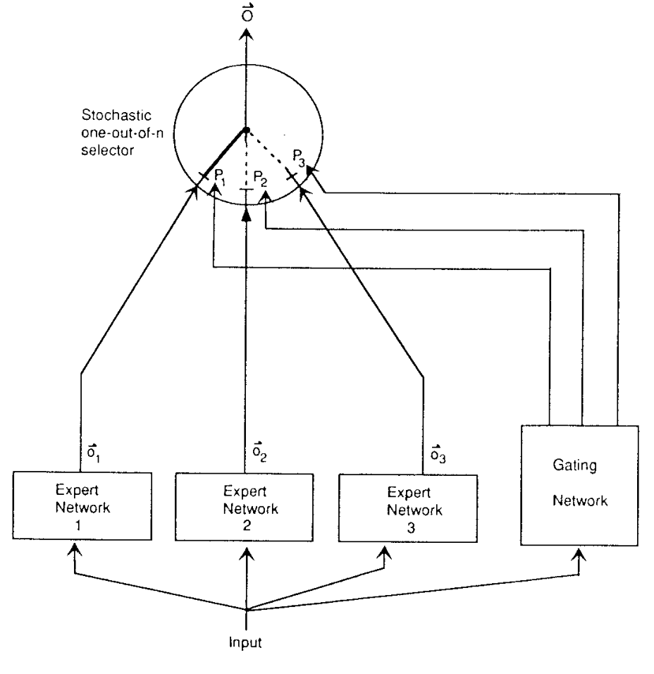</button>
<figcaption><strong>1991：专家网络、门控网络与随机选择器</strong><a href="https://www.cs.utoronto.ca/~hinton/absps/jjnh91.pdf" target="_blank" rel="noopener">Adaptive Mixtures of Local Experts</a> · Figure 1 · PDF p.3 / printed p.81
<details><summary>Original caption &amp; source</summary><div class="original-caption">Figure 1: A system of expert and gating networks. Each expert is a feedforward network and all experts receive the same input and have the same number of outputs. The gating network is also feedforward and typically receives the same input as the expert networks. It has normalized outputs p_j = exp(r_j)/sum_i exp(r_i), where r_j is the total weighted input received by output unit j of the gating network. The selector acts like a multiple input, single output stochastic switch; the probability that the switch will select the output from expert j is p_j. [Manually transcribed from the scanned original.]</div><a class="source-url" href="https://www.cs.utoronto.ca/~hinton/absps/jjnh91.pdf">https://www.cs.utoronto.ca/~hinton/absps/jjnh91.pdf</a></details></figcaption></figure>

原图从下向上读：输入同时进入专家和门控网络；左侧专家分别产生输出，右侧 gating network 产生归一化概率；顶端 selector 按概率选择专家输出。图中的选择器带有随机含义，不是今天 Transformer 中常见的确定性 Top-k 图。它强调的是“哪个专家解释这条样本”的条件概率。

用一般概率混合表示：

$$
p(y\mid x)=\sum_{e=1}^{E}\pi_e(x)\,p_e(y\mid x).
$$

$\pi_e(x)$ 是输入相关的混合概率，非负且和为 1；$p_e(y\mid x)$ 是第 $e$ 个专家对目标的分布。训练时的责任可理解成“观察到目标后，这位专家有多大可能负责解释它”。概率分布的混合、专家均值的加权平均、随机选一位专家，是相关但不同的操作，不能把它们不加区分地叫作同一条现代稀疏前向。

这项工作的历史贡献是让“分工”成为可学习结构，而不是由人工先把数据切成学科。它还没有回答万亿参数的跨设备训练或高吞吐 Token 路由问题；现代 MoE 继承了输入相关分工，却重新设计了计算和系统约束。

### 3.2 1994：Hierarchical Mixtures of Experts 与 EM

Jordan 与 Jacobs <a href="#source-P02">[P02]</a> 将平面混合扩展成树。根门控先决定大区域，内部门控继续细分，叶子专家负责局部映射。沿一条根到叶子的路径，门控概率相乘，形成该叶子对输入的混合权重。

<figure id="fig-hierarchical94-F1">
<button class="paper-image" type="button" aria-label="Zoom: 1994：分层门控将输入空间逐级划分">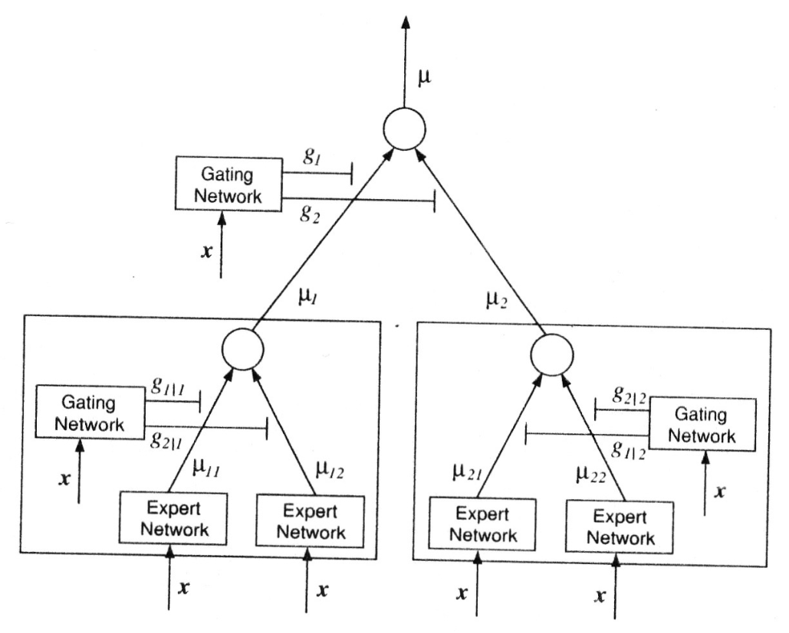</button>
<figcaption><strong>1994：分层门控将输入空间逐级划分</strong><a href="https://www2.bcs.rochester.edu/sites/robbie/jordanjacobs.nc94.pdf" target="_blank" rel="noopener">Hierarchical Mixtures of Experts and the EM Algorithm</a> · Figure 1 · PDF p.3 / printed p.184
<details><summary>Original caption &amp; source</summary><div class="original-caption">Figure 1: A two-level hierarchical mixture of experts. To form a deeper tree, each expert is expanded recursively into a gating network and a set of subexperts. [Manually transcribed from the scanned original.]</div><a class="source-url" href="https://www2.bcs.rochester.edu/sites/robbie/jordanjacobs.nc94.pdf">https://www2.bcs.rochester.edu/sites/robbie/jordanjacobs.nc94.pdf</a></details></figcaption></figure>

图的顶部是第一级门控，下面是第二级门控和叶子专家。这里的“层级”是混合结构的树深度，不是把 Transformer 的多个 MoE 层叫成层级 MoE。递归扩展任一叶子，就能增加局部模型的表达细节。

EM 算法的直觉是交替做两件事：E 步估计样本对各条路径的责任，M 步根据这些责任更新门控与专家参数。这为分工提供了统计学习解释；它的局部模型与优化设定也不同于今天端到端反向传播的巨大 FFN 专家。历史上从“树状条件概率”到“平行设备上的稀疏矩阵计算”，真正保持不变的是**计算路径依赖于输入**。

### 3.3 2017：Sparsely-Gated MoE，把容量与计算解耦

Shazeer 等 <a href="#source-P03">[P03]</a> 将大型 MoE 层嵌入循环语言模型，只激活少数专家。相对于全部运行所有专家，这才把条件分工转化为直接的计算稀疏。路由噪声与负载／重要性均衡机制，帮助专家在训练初期获得机会，避免少数专家长期占据全部样本。

<figure id="fig-sparse17-F1">
<button class="paper-image" type="button" aria-label="Zoom: 2017：循环语言模型内部的稀疏专家层">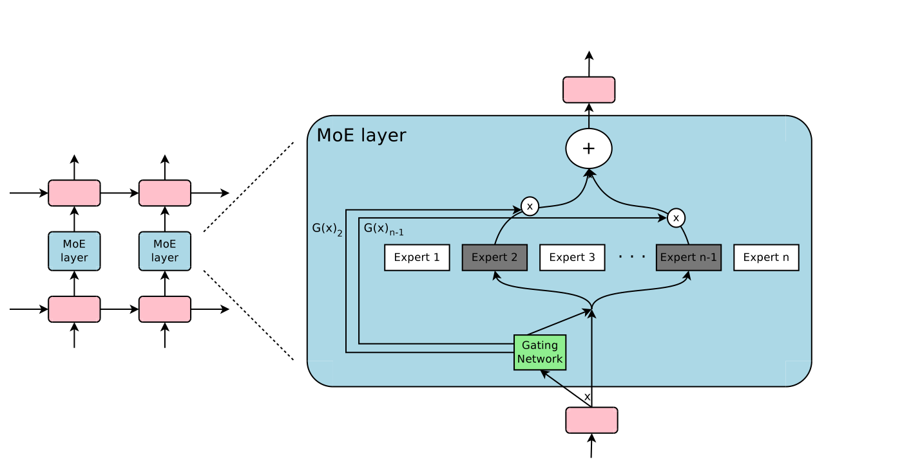</button>
<figcaption><strong>2017：循环语言模型内部的稀疏专家层</strong><a href="https://arxiv.org/pdf/1701.06538v1" target="_blank" rel="noopener">Outrageously Large Neural Networks: The Sparsely-Gated Mixture-of-Experts Layer</a> · Figure 1 · PDF p.2 / printed p.2
<details><summary>Original caption &amp; source</summary><div class="original-caption">Figure 1: A Mixture of Experts (MoE) layer embedded within a recurrent language model. In this
case, the sparse gating function selects two experts to perform computations. Their outputs are
modulated by the outputs of the gating network.</div><a class="source-url" href="https://arxiv.org/pdf/1701.06538v1">https://arxiv.org/pdf/1701.06538v1</a></details></figcaption></figure>

原图中的绿色专家只有两位被选中，线条表示门控对输出的加权，其余专家不执行当前输入的计算。图是两位专家的示意；论文主要语言建模实验每个输入激活 **4 位**专家。把架构图里的数值直接当作全部实验配置，会读错结果。

<figure id="fig-sparse17-F2">
<button class="paper-image" type="button" aria-label="Zoom: 2017：相近计算预算下，容量增加如何改变困惑度">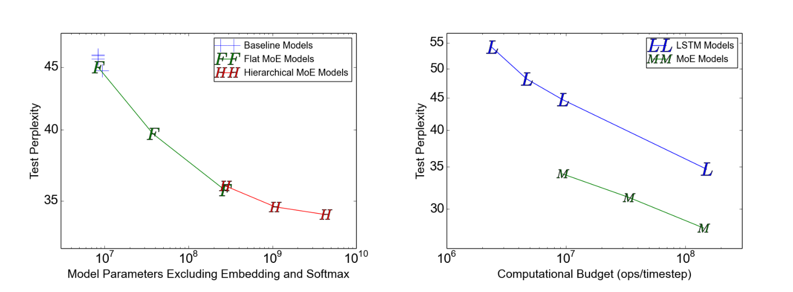</button>
<figcaption><strong>2017：相近计算预算下，容量增加如何改变困惑度</strong><a href="https://arxiv.org/pdf/1701.06538v1" target="_blank" rel="noopener">Outrageously Large Neural Networks: The Sparsely-Gated Mixture-of-Experts Layer</a> · Figure 2 · PDF p.6 / printed p.6
<details><summary>Original caption &amp; source</summary><div class="original-caption">Figure 2: Model comparison on 1-Billion-Word Language-Modeling Benchmark. On the left, we
plot test perplexity as a function of model capacity for models with similar computational budgets
of approximately 8-million-ops-per-timestep. On the right, we plot test perplexity as a function of
computational budget. The top line represents the LSTM models from (Jozefowicz et al., 2016).
The bottom line represents 4-billion parameter MoE models with different computational budgets.</div><a class="source-url" href="https://arxiv.org/pdf/1701.06538v1">https://arxiv.org/pdf/1701.06538v1</a></details></figcaption></figure>

左图横轴是模型容量，纵轴是测试 perplexity，越低越好；曲线比较约每时间步 8M multiply-adds 的相近前向预算，且该口径不含输出 softmax。参数横轴也排除了 Embedding 和输出 softmax。右图则改变计算预算，展示不同计算投入下的质量。

实验使用 1-Billion-Word benchmark，实际约 829M words，词表 793,471；专家数最高到 4096。论文报告约 24% 更低的 perplexity。它支持“相近前向预算下增加条件容量可以改善语言建模”的结论，不能直接推出同硬件上每 Token 延迟降低 24%，更不是现代聊天、推理或 Agent 能力的通用百分比。

从这里开始，研究对象从“能不能分工”变成“如何让稀疏容量增长真正划算”。之后所有系统问题都已经埋下种子：热门专家拥挤、冷门专家学不到、跨设备传 Token、每位专家形成不同大小的输入矩阵。

## 4. Transformer 大规模化：分片、容量与视觉分支

### 4.1 GShard：专家并行成为模型的一部分

GShard <a href="#source-P04">[P04]</a> 将 MoE 放进 Transformer，配合自动分片扩展多语言翻译。专家可以分布在不同设备，Token 先从当前设备发送到被选专家所在设备，专家算完后再送回。这个过程通常需要 All-to-All 数据交换。

<figure id="fig-gshard20-F3">
<button class="paper-image" type="button" aria-label="Zoom: GShard：FFN 替换与跨设备专家分片">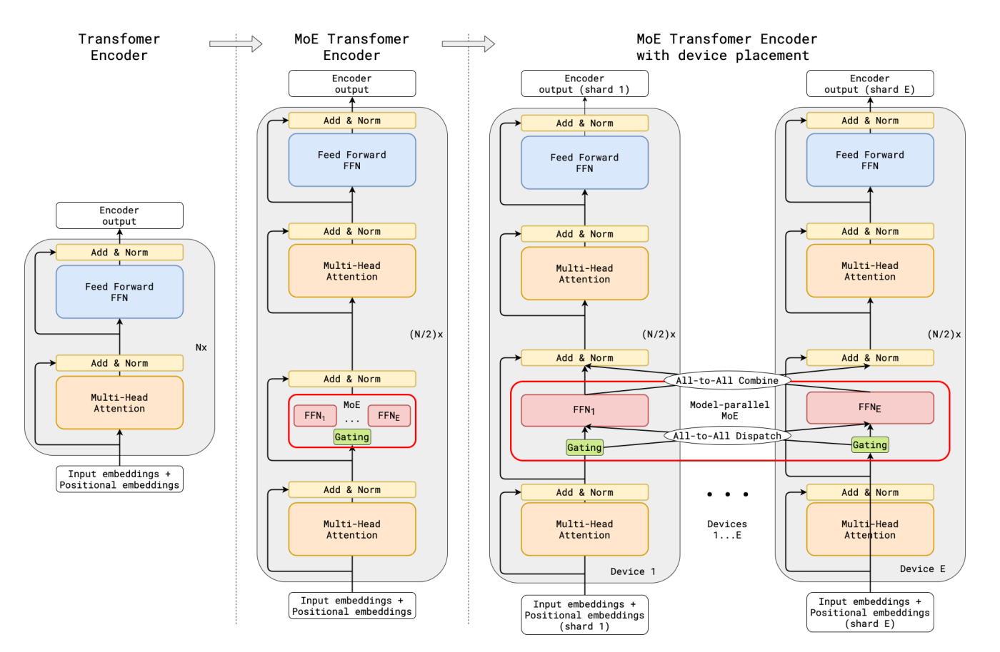</button>
<figcaption><strong>GShard：FFN 替换与跨设备专家分片</strong><a href="https://arxiv.org/pdf/2006.16668v1" target="_blank" rel="noopener">GShard: Scaling Giant Models with Conditional Computation and Automatic Sharding</a> · Figure 3 · PDF p.5 / printed p.5
<details><summary>Original caption &amp; source</summary><div class="original-caption">Figure 3: Illustration of scaling of Transformer Encoder with MoE Layers. The MoE layer replaces
the every other Transformer feed-forward layer. Decoder modification is similar. (a) The encoder of
a standard Transformer model is a stack of self-attention and feed forward layers interleaved with
residual connections and layer normalization. (b) By replacing every other feed forward layer with
a MoE layer, we get the model structure of the MoE Transformer Encoder. (c) When scaling to
multiple devices, the MoE layer is sharded across devices, while all other layers are replicated.</div><a class="source-url" href="https://arxiv.org/pdf/2006.16668v1">https://arxiv.org/pdf/2006.16668v1</a></details></figcaption></figure>

图的左边是普通 Encoder，Attention 与 FFN 交替；中间将每隔一个 FFN 替换为 MoE；右边展示 MoE 专家分片、其余结构复制的例子。模型层设计和设备拓扑第一次以很直接的方式绑定在一起。Top-2 路由还涉及容量上限和第二选择的处理，不能只把它理解成“同时运行两次 FFN”。

<figure id="fig-gshard20-F1">
<button class="paper-image" type="button" aria-label="Zoom: GShard：质量、训练墙钟时间与总 TPU 成本同时变化">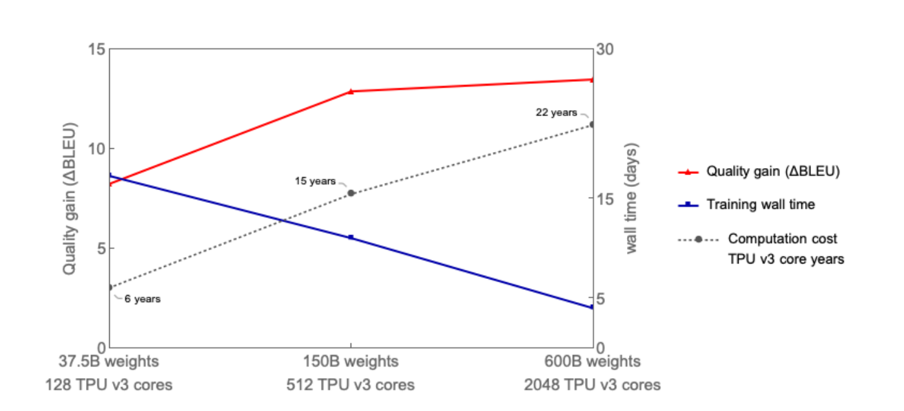</button>
<figcaption><strong>GShard：质量、训练墙钟时间与总 TPU 成本同时变化</strong><a href="https://arxiv.org/pdf/2006.16668v1" target="_blank" rel="noopener">GShard: Scaling Giant Models with Conditional Computation and Automatic Sharding</a> · Figure 1 · PDF p.2 / printed p.2
<details><summary>Original caption &amp; source</summary><div class="original-caption">Figure 1: Multilingual translation quality (average ∆BLEU comparing to bilingual baselines) im-
proved as MoE model size grows up to 600B, while the end-to-end training cost (in terms of TPU v3
core-year) only increased sublinearly. Increasing the model size from 37.5B to 600B (16x), results in
computation cost increase from 6 to 22 years (3.6x). The 600B parameters model that achieved the
best translation quality was trained with 2048 TPU v3 cores for 4 days, a total cost of 22 TPU v3
core-years. In contrast, training all 100 bilingual baseline models would have required 29 TPU v3
core-years. Our best quality dense single Transformer model (2.3B parameters) achieving ∆BLEU
of 6.1, was trained with GPipe [15] on 2048 TPU v3 cores for 6 weeks or total of 235.5 TPU v3
core-years.</div><a class="source-url" href="https://arxiv.org/pdf/2006.16668v1">https://arxiv.org/pdf/2006.16668v1</a></details></figcaption></figure>

这张图必须连同硬件读：37.5B 模型使用 128 个 TPUv3 cores，150B 用 512，600B 用 2048。红线代表平均翻译质量变化，蓝线代表训练墙钟时间，虚线代表 TPU core-years。模型更大、硬件更多，墙钟时间可以下降，而总计算设备成本仍会上升。

从 37.5B 到 600B，参数增长 16 倍，总 TPU 成本约增长 3.6 倍；600B 模型训练约四天。这里的意义是容量的扩张成本低于参数同比例增长，并借助更大并行度缩短训练时间。它不是“固定 128 核硬件把模型放大后反而快了”的证据。BLEU 是翻译指标，也不应和语言建模 perplexity 或现代问答准确率放进一个统一分数榜。

### 4.2 Switch Transformer：Top-1 简化计算，容量问题更清楚

Switch <a href="#source-P05">[P05]</a> 把路由简化到每个 Token 一位专家，减少专家计算和发送对象。Top-1 的收益不只是 FFN FLOPs 少，也来自路由、通信与合并流程更简单；代价是每次决策更单一，专家容量和训练稳定性更加关键。

<figure id="fig-switch21-F2">
<button class="paper-image" type="button" aria-label="Zoom: Switch：一个 Token 只切换到一位专家">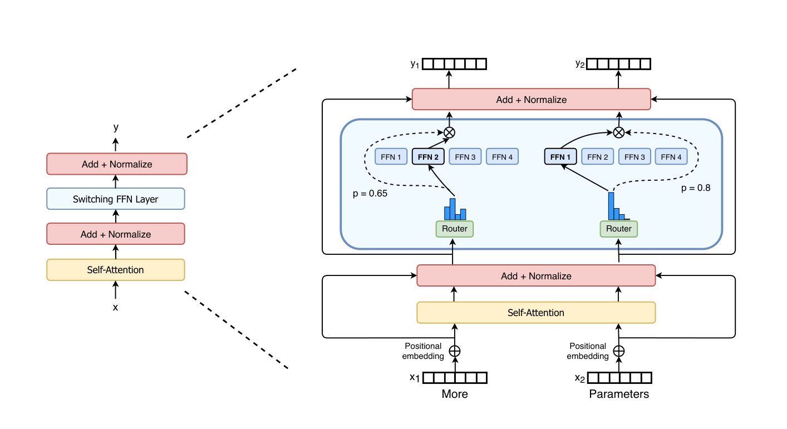</button>
<figcaption><strong>Switch：一个 Token 只切换到一位专家</strong><a href="https://arxiv.org/pdf/2101.03961v1" target="_blank" rel="noopener">Switch Transformers: Scaling to Trillion Parameter Models with Simple and Efficient Sparsity</a> · Figure 2 · PDF p.4 / printed p.4
<details><summary>Original caption &amp; source</summary><div class="original-caption">Figure 2: Illustration of a Switch Transformer encoder block. We replace the dense feed forward
network (FFN) layer present in the Transformer with a sparse Switch FFN layer (light blue). The
layer operates independently on the tokens in the sequence. We diagram two tokens (x1 = “More”
and x2 = “Parameters” below) being routed (solid lines) across four FFN experts, where the router
independently routes each token. The switch FFN layer returns the output of the selected FFN
multiplied by the router gate value (dotted-line).</div><a class="source-url" href="https://arxiv.org/pdf/2101.03961v1">https://arxiv.org/pdf/2101.03961v1</a></details></figcaption></figure>

原图突出从稠密 FFN 到稀疏 Switch FFN 的替换。Token 经 router 进入一个专家，其输出按 gate 调制，再回到网络。所有 Token 并不共用一个固定专家，选择随隐藏状态变化。

<figure id="fig-switch21-F3">
<button class="paper-image" type="button" aria-label="Zoom: Switch：固定专家容量带来的拥挤与空位">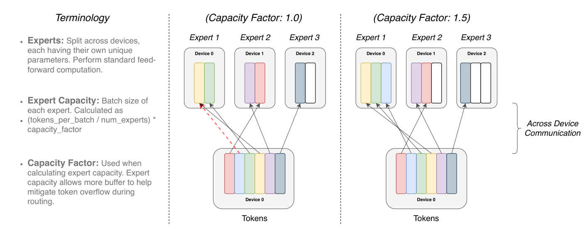</button>
<figcaption><strong>Switch：固定专家容量带来的拥挤与空位</strong><a href="https://arxiv.org/pdf/2101.03961v1" target="_blank" rel="noopener">Switch Transformers: Scaling to Trillion Parameter Models with Simple and Efficient Sparsity</a> · Figure 3 · PDF p.5 / printed p.5
<details><summary>Original caption &amp; source</summary><div class="original-caption">Figure 3: Illustration of token routing dynamics. Each expert processes a fixed batch-size of
tokens modulated by the capacity factor. Each token is routed to the expert with the highest router
probability, but each expert has a fixed batch size of (total tokens / num experts) × capacity factor.
If the tokens are unevenly dispatched then certain experts will overflow (denoted by dotted red
lines), resulting in these tokens not being processed by this layer. A larger capacity factor alleviates
this overflow issue, but also increases computation and communication costs (depicted by padded
white/empty slots).</div><a class="source-url" href="https://arxiv.org/pdf/2101.03961v1">https://arxiv.org/pdf/2101.03961v1</a></details></figcaption></figure>

当一个专家收到的 Token 超过 capacity，固定缓冲区装不下全部分配；另一个专家可能还有空位。容量因子通常用下式直观估计：

$$
C=\left\lceil c_f\frac{Tk}{E}\right\rceil.
$$

$T$ 是这次路由的 Token 数，$Tk$ 是专家分配总数，$E$ 是专家数，$c_f$ 是容量因子，$C$ 是每位专家可接收的分配数。实现还可能有最小容量与对齐要求。这个公式用的是**均值乘余量**，不能保证实际最大负载不超限。

超限时某些专家贡献会被丢弃，残差路径通常仍在；因此“丢 Token”在这里常指丢掉该 MoE 层的专家计算，不等于把 Token 从整个序列删除。增大容量缓解溢出，却增加 padding、显存和无效矩阵运算。

<figure id="fig-switch21-F4">
<button class="paper-image" type="button" aria-label="Zoom: Switch：按训练步骤观察质量进展">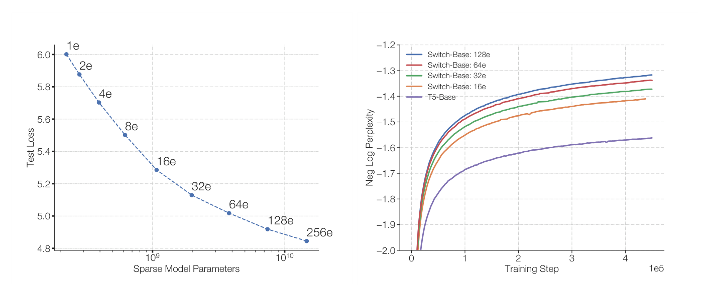</button>
<figcaption><strong>Switch：按训练步骤观察质量进展</strong><a href="https://arxiv.org/pdf/2101.03961v1" target="_blank" rel="noopener">Switch Transformers: Scaling to Trillion Parameter Models with Simple and Efficient Sparsity</a> · Figure 4 · PDF p.10 / printed p.10
<details><summary>Original caption &amp; source</summary><div class="original-caption">Figure 4: Scaling properties of the Switch Transformer. Left Plot: We measure the quality im-
provement, as measured by perplexity, as the parameters increase by scaling the number of experts.
The top-left point corresponds to the T5-Base model with 223M parameters. Moving from top-left
to bottom-right, we double the number of experts from 2, 4, 8 and so on until the bottom-right point
of a 256 expert model with 14.7B parameters. Despite all models using an equal computational
budget, we observe consistent improvements scaling the number of experts. Right Plot: Negative
log-perplexity per step sweeping over the number of experts. The dense baseline is shown with the
purple line and we note improved sample efficiency of our Switch-Base models.</div><a class="source-url" href="https://arxiv.org/pdf/2101.03961v1">https://arxiv.org/pdf/2101.03961v1</a></details></figcaption></figure>

这一组曲线以训练 step 为横轴，对比不同专家设置达到的质量。step 图适合观察优化进展，但每 step 时间不同，不能只根据步数判断训练成本。

<figure id="fig-switch21-F5">
<button class="paper-image" type="button" aria-label="Zoom: Switch：按实际训练时间观察达到目标质量的速度">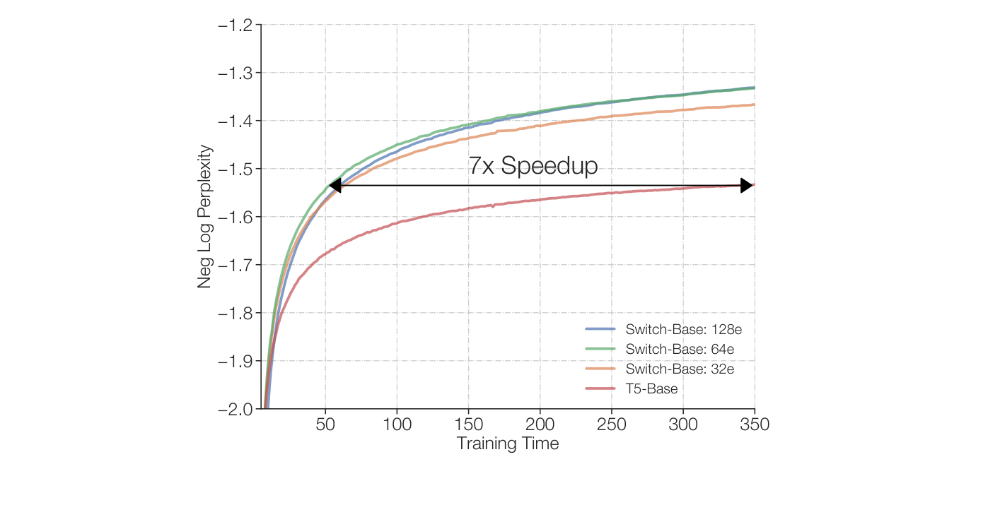</button>
<figcaption><strong>Switch：按实际训练时间观察达到目标质量的速度</strong><a href="https://arxiv.org/pdf/2101.03961v1" target="_blank" rel="noopener">Switch Transformers: Scaling to Trillion Parameter Models with Simple and Efficient Sparsity</a> · Figure 5 · PDF p.10 / printed p.10
<details><summary>Original caption &amp; source</summary><div class="original-caption">Figure 5: Speed advantage of Switch Transformer. All models trained on 32 TPU cores with equal
FLOPs per example. For a fixed amount of computation and training time, Switch Transformers
significantly outperform the dense Transformer baseline. Our 64 expert Switch-Base model achieves
the same quality in one-seventh the time of the T5-Base and continues to improve.</div><a class="source-url" href="https://arxiv.org/pdf/2101.03961v1">https://arxiv.org/pdf/2101.03961v1</a></details></figcaption></figure>

时间图把专家执行和通信成本纳入观察。论文在 32 TPU cores、每个 example 相同 FLOPs 的设置中，64 专家模型达到相同质量约快 7 倍。时间轴原图没有给出可直接转写的单位，本文保留原口径。这是**达到目标质量的训练时间**，不是单次推理 Token 的 7 倍加速。

### 4.3 V-MoE：图像 Patch 也可以按需分配计算

V-MoE <a href="#source-P06">[P06]</a> 把 ViT 的部分 MLP 替换成稀疏专家。图像被拆成 Patch Token，路由器为不同 Patch 分配不同专家。这是条件计算跨入视觉的代表：任务是分类和迁移，而不是自回归文本生成。

<figure id="fig-vmoe21-F1">
<button class="paper-image" type="button" aria-label="Zoom: V-MoE：ViT Patch 在设备间进入不同专家">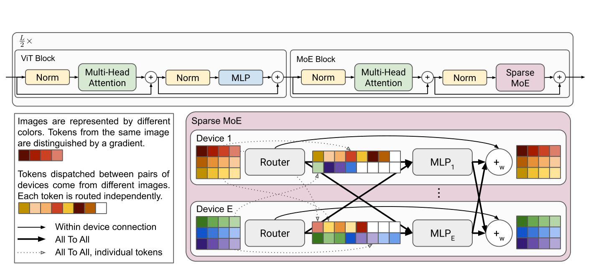</button>
<figcaption><strong>V-MoE：ViT Patch 在设备间进入不同专家</strong><a href="https://arxiv.org/pdf/2106.05974v1" target="_blank" rel="noopener">Scaling Vision with Sparse Mixture of Experts</a> · Figure 1 · PDF p.2 / printed p.2
<details><summary>Original caption &amp; source</summary><div class="original-caption">Figure 1: Overview of the architecture. V-MoE is composed of L ViT blocks. In some, we replace
the MLP with a sparsely activated mixture of MLPs. Each MLP (the expert) is stored on a separate
device, and processes a fixed number of tokens. The communication of these tokens between devices
is shown in this example, which depicts the case when k = 1 expert is selected per token. Here each
expert uses a capacity ratio C = 4</div><a class="source-url" href="https://arxiv.org/pdf/2106.05974v1">https://arxiv.org/pdf/2106.05974v1</a></details></figcaption></figure>

沿原图看，每个 ViT block 有 Token 混合和逐 Token MLP；在部分 block，后者换成设备上的专家。彩色 Token 代表不同 Patch 的路由与通信，图中的 $k=1$ 是示例。容量仍限制每个专家接收数量，因此视觉 MoE 同样面对拥挤、丢弃与设备平衡。

<figure id="fig-vmoe21-F4">
<button class="paper-image" type="button" aria-label="Zoom: V-MoE：降低计算预算时，哪些 Patch 的专家计算被省略">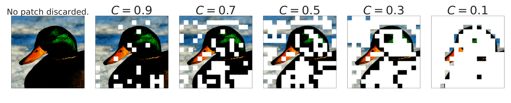</button>
<figcaption><strong>V-MoE：降低计算预算时，哪些 Patch 的专家计算被省略</strong><a href="https://arxiv.org/pdf/2106.05974v1" target="_blank" rel="noopener">Scaling Vision with Sparse Mixture of Experts</a> · Figure 4 · PDF p.6 / printed p.6
<details><summary>Original caption &amp; source</summary><div class="original-caption">Figure 4: White patches are discarded tokens in the first layer of experts, for different capacities, using
Batch Prioritized Routing (Section 4.1) with a V-MoE-H/14. See Appendix D for more examples.</div><a class="source-url" href="https://arxiv.org/pdf/2106.05974v1">https://arxiv.org/pdf/2106.05974v1</a></details></figcaption></figure>

白色 Patch 表示第一层专家中被丢弃的 Token，比较不同容量下 Batch Prioritized Routing 的结果。它优先分配更高优先级的 Token，通常能看到对象相关区域被保留的倾向。这里不是把原始图片剪去白色区域，也不是证明模型具有人的注意力或因果解释能力；它显示的是这一层的计算分配。

视觉任务中，输入图像的 Patch 可以共同参与决策，因此某些跨 Token 的分配方法更容易使用。语言 Decode 必须保证当前位置不依赖未来 Token，这个差别会在 Expert Choice 与 Soft MoE 中成为核心边界。

## 5. 2022：稳定性、扩展收益和路由方向

### 5.1 ST-MoE：均衡之外，还要治理数值尺度

ST-MoE <a href="#source-P07">[P07]</a> 系统研究训练稳定性和迁移。MoE 的路由 logits 经指数／归一化再参与离散选择，数值扰动可能改变专家分配；混合精度和优化器更新又会放大这种脆弱性。负载均衡只解决“谁忙谁闲”，并不自动解决数值发散。

<figure id="fig-stmoe22-F1">
<button class="paper-image" type="button" aria-label="Zoom: ST-MoE：相似配置下稳定与发散的训练轨迹">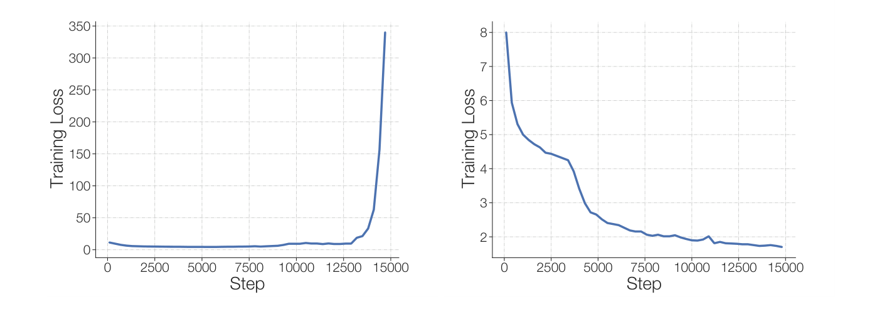</button>
<figcaption><strong>ST-MoE：相似配置下稳定与发散的训练轨迹</strong><a href="https://arxiv.org/pdf/2202.08906v1" target="_blank" rel="noopener">ST-MoE: Designing Stable and Transferable Sparse Expert Models</a> · Figure 1 · PDF p.5 / printed p.5
<details><summary>Original caption &amp; source</summary><div class="original-caption">Figure 1: Training instabilities for sparse models. We refer to training instabilities as divergences
in the training loss. Above are two runs from sparse models FLOP-matched to the T5-XL version
(Raffel et al., 2019) each trained with a batch size of 1M tokens using the Adafactor optimizer
(Shazeer and Stern, 2018). (Left) An unstable training run. (Right) A stable training run.</div><a class="source-url" href="https://arxiv.org/pdf/2202.08906v1">https://arxiv.org/pdf/2202.08906v1</a></details></figcaption></figure>

左图 loss 明显异常上升，右图相对平稳。两次运行都是与 T5-XL FLOPs 匹配的稀疏模型、1M Token batch、Adafactor。它展示训练运行之间的不稳定差异，而不是一次普通 loss 波动就被认定为完全训练失败。

作者提出 router z-loss：

$$
\mathcal{L}_z=\frac{1}{T}\sum_{t=1}^{T}\left[\log\sum_{e=1}^{E}\exp(z_{t,e})\right]^2.
$$

$T$ 是 Token 数，$z_{t,e}$ 是路由 logit。方括号是 log-sum-exp，平方惩罚约束其绝对尺度。训练时还要乘相应系数并与任务损失相加。直觉是避免路由器把数值抬得很大，即使理想数学中的概率变化不大，有限精度下也可能增加误差。

<figure id="fig-stmoe22-F2">
<button class="paper-image" type="button" aria-label="Zoom: ST-MoE：数值越大，低精度舍入误差可能越大">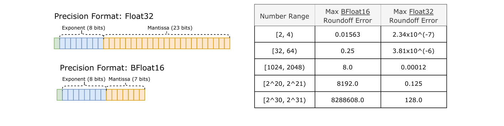</button>
<figcaption><strong>ST-MoE：数值越大，低精度舍入误差可能越大</strong><a href="https://arxiv.org/pdf/2202.08906v1" target="_blank" rel="noopener">ST-MoE: Designing Stable and Transferable Sparse Expert Models</a> · Figure 2 · PDF p.8 / printed p.8
<details><summary>Original caption &amp; source</summary><div class="original-caption">Figure 2: Numerical precision formats and roundoff errors. Larger numbers have larger roundoff
errors. bfloat16 has up to 65,536x worse roundoff errors than float32. The router z-loss
encourages the absolute magnitude of numbers to be small, which doesn’t hinder model performance
and reduces roundoff errors. The router z-loss is most effective into functions where larger errors
can drastically change the relative output (e.g. exponential and sinusoidal functions).</div><a class="source-url" href="https://arxiv.org/pdf/2202.08906v1">https://arxiv.org/pdf/2202.08906v1</a></details></figcaption></figure>

原图比较不同浮点格式的舍入误差随数值尺度变化。它解释 z-loss 为什么有意义：限制 logits 的尺度，有助于减小敏感函数中的数值误差。图并不说明所有 BF16 算子都该改成 FP32，也不说明仅加 z-loss 就能解决所有训练问题。

<figure id="fig-stmoe22-T4">
<button class="paper-image" type="button" aria-label="Zoom: ST-MoE：稳定了，还必须检查质量有没有被破坏">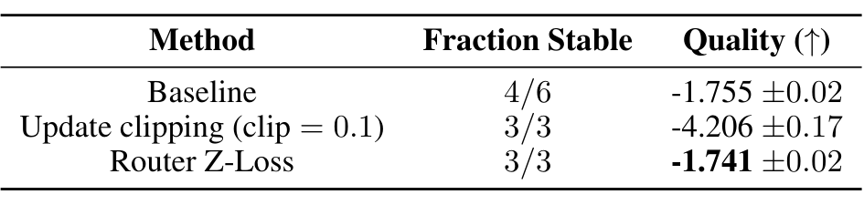</button>
<figcaption><strong>ST-MoE：稳定了，还必须检查质量有没有被破坏</strong><a href="https://arxiv.org/pdf/2202.08906v1" target="_blank" rel="noopener">ST-MoE: Designing Stable and Transferable Sparse Expert Models</a> · Table 4 · PDF p.8 / printed p.8
<details><summary>Original caption &amp; source</summary><div class="original-caption">Table 4 shows that both update clipping and the router z-loss stabilize the model in all 3 runs, but the
update clipping significantly hurts the model quality. Therefore we use the z-loss method for fixing
our model stability due to improved quality and stability4.
Table 4: Constraining weight updates and router logits. Constraining the update clipping in
Adafactor improves stability, but at a catastrophic loss of quality. Looser clipping values did not
reliably stabilize training so we exclude them here. The router z-loss stabilizes the model without
any quality degradation (in this case, we observe a slight quality boost).</div><a class="source-url" href="https://arxiv.org/pdf/2202.08906v1">https://arxiv.org/pdf/2202.08906v1</a></details></figcaption></figure>

表中 baseline 的稳定比例为 4/6，更新裁剪与 z-loss 均为 3/3；但更新裁剪的质量值约为 −4.206，baseline 为 −1.755，z-loss 为 −1.741，后者保留了质量。这些是论文自己的负对数困惑度口径。小样本运行条件是 mC4、20k steps、每第四个 FFN 使用 MoE，训练容量因子 1.25、评测为 2。三次稳定不能证明普遍零发散，表格最关键的结论是：**数值稳定与最终质量必须一起验证。**

### 5.2 Routed Scaling Laws：增加专家也有边际收益

Unified Scaling Laws <a href="#source-P08">[P08]</a> 比较不同路由方法，研究基础模型规模与专家数共同影响 loss。它纠正一种过度直觉：既然每次只激活少数专家，那么无限增加专家就总能低成本提高能力。

<figure id="fig-scaling22-F1">
<button class="paper-image" type="button" aria-label="Zoom: 扩展规律：基础规模与专家数存在交互">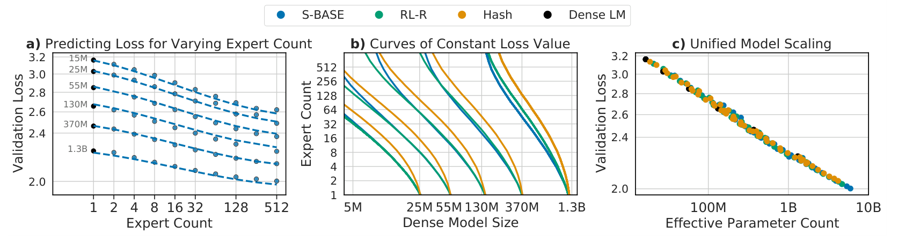</button>
<figcaption><strong>扩展规律：基础规模与专家数存在交互</strong><a href="https://arxiv.org/pdf/2202.01169v2" target="_blank" rel="noopener">Unified Scaling Laws for Routed Language Models</a> · Figure 1 · PDF p.2 / printed p.2
<details><summary>Original caption &amp; source</summary><div class="original-caption">Figure 1: (a) The performance achieved by Routing Networks when varying the number of experts for a fixed dense
model size is described by a bilinear function (Eq. 1), (b) whose level curves indicate how to trade model size with
expert count to maintain a fixed performance, (c) and which can be manipulated to align dense and routed model
performance under a shared power law.</div><a class="source-url" href="https://arxiv.org/pdf/2202.01169v2">https://arxiv.org/pdf/2202.01169v2</a></details></figcaption></figure>

三幅子图依次展示拟合曲面、同质量的规模交换关系，以及稠密和路由模型的统一描述。基础模型越大，额外专家的边际价值可能变化，不能把一个小模型实验中的收益比例无限外推。

理解交互项可用论文双线性关系的简化写法：

$$
\log \mathcal{L}=a\log N+b\log E+c(\log N)(\log E)+d_0.
$$

$\mathcal{L}$ 是语言建模 loss，$N$ 是论文定义的基础模型规模，$E$ 是专家数，$a,b,c,d_0$ 是拟合系数。这里不复述完整的饱和变换；交互项表明，专家数变化的斜率依赖 $N$。这是一组特定实验的经验关系，并非硬件速度公式或数学上保证成立的自然定律。

<figure id="fig-scaling22-F6">
<button class="paper-image" type="button" aria-label="Zoom: 扩展规律：不同路由方法的拟合收益范围不同"></button>
<figcaption><strong>扩展规律：不同路由方法的拟合收益范围不同</strong><a href="https://arxiv.org/pdf/2202.01169v2" target="_blank" rel="noopener">Unified Scaling Laws for Routed Language Models</a> · Figure 6 · PDF p.9 / printed p.9
<details><summary>Original caption &amp; source</summary><div class="original-caption">Figure 6: Maximum effective parameter count as a function of base model size. Routing helps until a certain size
Ncutoff, that varies strongly between methods (S-BASE being the best)</div><a class="source-url" href="https://arxiv.org/pdf/2202.01169v2">https://arxiv.org/pdf/2202.01169v2</a></details></figcaption></figure>

图比较最大有效参数量随基础规模变化的趋势，给出不同方法的拟合 cutoff。论文所有模型在约 130B Token、序列长 2048、batch 256 的预算下研究；S-BASE、RLR、Hash 的拟合 cutoff 分别约 937B、85B、83B。它们是外推值，且会受训练 Token 预算影响，不能当成“MoE 到 937B 必然失效”的普适上限。

更实用的启示是同时选择专家数、激活数、基础宽度和训练数据量。总容量增长得快，而每位专家能看到的数据不够，容量可能难以充分学习；算力预算固定时，扩容量与多训练 Token 也会竞争。

### 5.3 Expert Choice：让专家选 Token，而不是 Token 选专家

传统 Token Choice 是每个 Token 选 $k$ 位专家，因而每 Token 计算可控、每专家负载不确定。Expert Choice <a href="#source-P09">[P09]</a> 把方向反过来：每位专家从一个 Token 集合选固定数量的高分 Token，从而直接控制专家负载。

<figure id="fig-expertchoice22-F1">
<button class="paper-image" type="button" aria-label="Zoom: Expert Choice：固定专家负载，Token 激活数可以变化">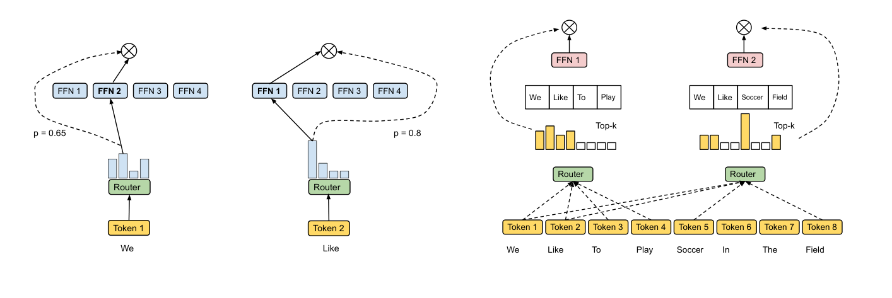</button>
<figcaption><strong>Expert Choice：固定专家负载，Token 激活数可以变化</strong><a href="https://arxiv.org/pdf/2202.09368v1" target="_blank" rel="noopener">Mixture-of-Experts with Expert Choice Routing</a> · Figure 1 · PDF p.2 / printed p.2
<details><summary>Original caption &amp; source</summary><div class="original-caption">Figure 1: High-level Comparison Between Conventional MoE and expert choice MoE.</div><a class="source-url" href="https://arxiv.org/pdf/2202.09368v1">https://arxiv.org/pdf/2202.09368v1</a></details></figcaption></figure>

原图的连线需要从专家端理解。某个 Token 可以被多位专家选中，另一个可能较少甚至未被选中。它将计算预算从“每 Token 固定”转换成“每专家固定”，解决拥挤方式不同，输入位置获得的计算量也不同。

<figure id="fig-expertchoice22-F3">
<button class="paper-image" type="button" aria-label="Zoom: Expert Choice：相同平均激活预算下的收敛比较">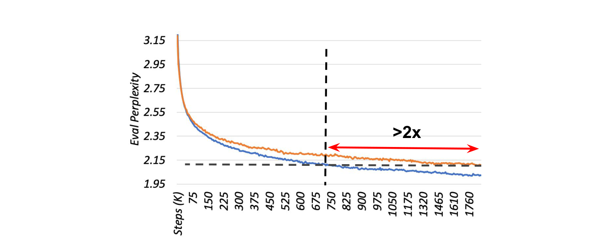</button>
<figcaption><strong>Expert Choice：相同平均激活预算下的收敛比较</strong><a href="https://arxiv.org/pdf/2202.09368v1" target="_blank" rel="noopener">Mixture-of-Experts with Expert Choice Routing</a> · Figure 3 · PDF p.7 / printed p.7
<details><summary>Original caption &amp; source</summary><div class="original-caption">Figure 3: Training convergence is more than 2x faster using our method compared to GShard top-2
gating.</div><a class="source-url" href="https://arxiv.org/pdf/2202.09368v1">https://arxiv.org/pdf/2202.09368v1</a></details></figcaption></figure>

8B、64 专家设置下，EC-CF2 与 GShard Top-2 的平均激活预算相近；横轴是训练 steps。论文报告 EC 的收敛超过两倍快，属于收敛步数口径，不能改写成实测 tokens/s 翻倍。实验使用来自 1.6T Token 数据来源池的训练设置，序列长 1024，最大规模使用 512 TPUv4。

这里还必须问：**专家选择的候选 Token 集合包括谁？** 若在当前文本序列中比较全部位置，较早 Token 是否入选可能取决于较晚 Token 的得分。即使 Attention 使用 causal mask，路由决策仍可能泄露未来信息。非因果任务、严格限定的独立候选集合与自回归训练是不同场景，不能把 EC 的负载优势无条件迁移到 Decode。

## 6. 不规则计算：dropless 与 Soft MoE 的两种回答

### 6.1 MegaBlocks：保留所有专家分配，把不规则矩阵交给内核

MegaBlocks <a href="#source-P10">[P10]</a> 要解决固定 capacity 的两难：容量小会丢掉专家贡献，容量大又大量 padding。dropless 指保留所有路由分配，不代表没有任何块对齐，也不代表硬件天然擅长任意稀疏计算。

<figure id="fig-megablocks22-F3">
<button class="paper-image" type="button" aria-label="Zoom: MegaBlocks：从统一补齐的专家批次到块稀疏矩阵">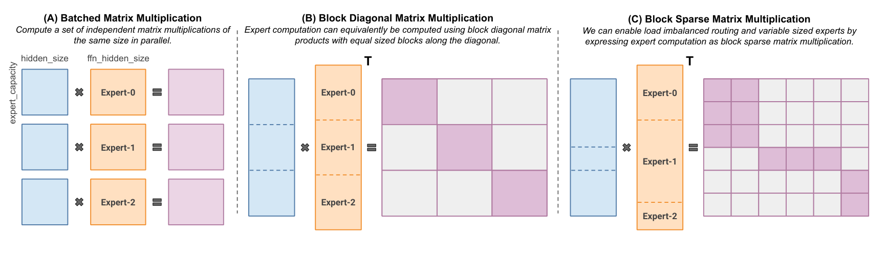</button>
<figcaption><strong>MegaBlocks：从统一补齐的专家批次到块稀疏矩阵</strong><a href="https://arxiv.org/pdf/2211.15841v1" target="_blank" rel="noopener">MegaBlocks: Efficient Sparse Training with Mixture-of-Experts</a> · Figure 3 · PDF p.4 / printed p.4
<details><summary>Original caption &amp; source</summary><div class="original-caption">Figure 3. Expert Computation in an MoE Layer. Shown with num expert=3. (A) State-of-the-art MoE implementations use batched</div><a class="source-url" href="https://arxiv.org/pdf/2211.15841v1">https://arxiv.org/pdf/2211.15841v1</a></details></figcaption></figure>

原图比较传统专家计算与块稀疏表达。把 Token 按专家排序后，每位专家形成不同高度的矩阵。统一补到最大高度会处理很多空行；块稀疏布局只保留需要的块，使专家负载不同也能在统一内核中表达。

关键链路是 **路由 → 按专家分组／排列 → 专家矩阵乘 → 逆排列与合并**。权重和输入排列必须对应，否则即使矩阵形状合法，也会让某位专家收到错误 Token。若 $k>1$，同一个 Token 有多个副本和输出贡献，合并阶段还要正确累加 gate 权重。

<figure id="fig-megablocks22-F7">
<button class="paper-image" type="button" aria-label="Zoom: MegaBlocks：实际训练吞吐的收益带有 microbatch 条件">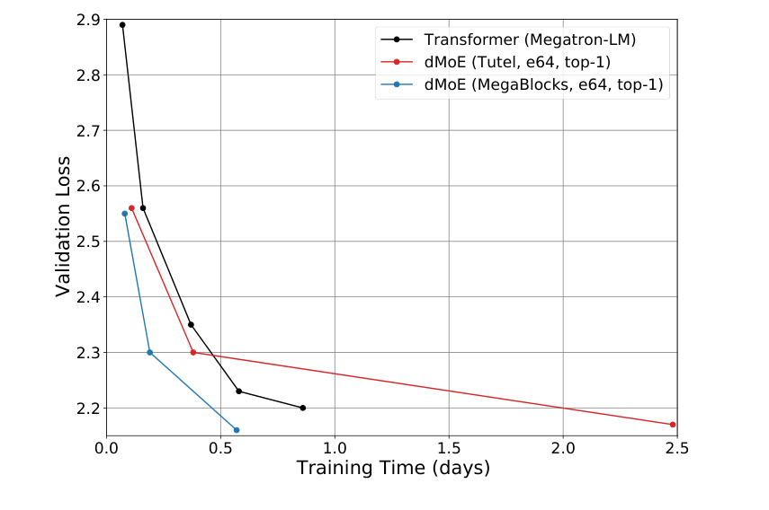</button>
<figcaption><strong>MegaBlocks：实际训练吞吐的收益带有 microbatch 条件</strong><a href="https://arxiv.org/pdf/2211.15841v1" target="_blank" rel="noopener">MegaBlocks: Efficient Sparse Training with Mixture-of-Experts</a> · Figure 7 · PDF p.8 / printed p.8
<details><summary>Original caption &amp; source</summary><div class="original-caption">Figure 7. MegaBlocks dMoEs, Tutel dMoEs and Megatron-</div><a class="source-url" href="https://arxiv.org/pdf/2211.15841v1">https://arxiv.org/pdf/2211.15841v1</a></details></figcaption></figure>

原实验使用 8×A100 SXM4 80GB、CUDA 11.5、CUTLASS 2.5、混合精度、64 专家 Top-1 和 Pile 数据。相对 Tutel，在 XS／Small／Medium 配置下训练加速为约 1.38／2.0／4.35 倍；达到稠密模型相同 loss 的训练收益约为 1.8—2.4 倍。

各方法使用自己显存可容纳的最大 microbatch。因此收益一部分来自减少 padding 后释放显存，使 microbatch 能增大，不能写成“完全相同 microbatch 时内核必然快 4.35 倍”。本文核对的当前实现 <a href="#source-C03">[C03]</a> 同时存在 sparse 与 grouped 路径；sparse 路径仍按块向上对齐专家行数。论文算法、库版本、GPU 架构和运行参数需要分别确认。

### 6.2 Soft MoE：用连续的 Token 汇聚替代硬选择

Soft MoE <a href="#source-P11">[P11]</a> 不直接把每个 Token 离散送到少数专家，而是先构造 slot：让多个 Token 按连续权重混合成专家输入，再将专家输出混回各 Token。它改善了可微性和负载结构，但计算语义已经改变。

<figure id="fig-softmoe23-F2">
<button class="paper-image" type="button" aria-label="Zoom: Soft MoE：Token → slot → 专家 → Token">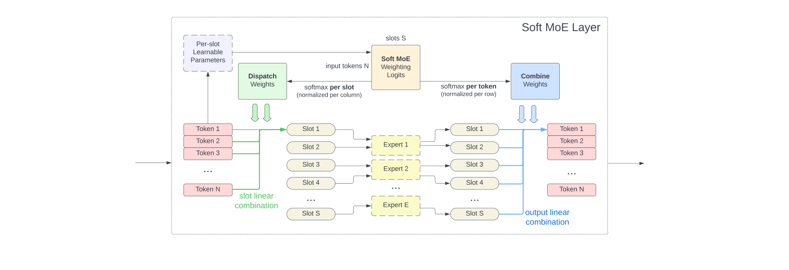</button>
<figcaption><strong>Soft MoE：Token → slot → 专家 → Token</strong><a href="https://arxiv.org/pdf/2308.00951v1" target="_blank" rel="noopener">From Sparse to Soft Mixtures of Experts</a> · Figure 2 · PDF p.3 / printed p.3
<details><summary>Original caption &amp; source</summary><div class="original-caption">Figure 2: The Soft MoE routing algorithm. Soft MoE first computes scores or logits for every pair of input
token and slot, based on some learnable per-slot parameters. These logits are then normalized per slot
(columns) and every slot computes a linear combination of all the input tokens based on these weights (in
green). Each expert (an MLP in this work) then processes its slots (e.g. 2 slots per expert, in this diagram).
Finally, the same original logits are normalized per token (i.e. by row) and used to combine all the slot
outputs, for every input token (in blue). Dashed boxes represent learnable parameters.</div><a class="source-url" href="https://arxiv.org/pdf/2308.00951v1">https://arxiv.org/pdf/2308.00951v1</a></details></figcaption></figure>

输入矩阵 $X\in\mathbb{R}^{T\times d}$ 与参数 $\Phi\in\mathbb{R}^{d\times S}$ 产生 $T\times S$ 分数。dispatch 权重沿 Token 维归一化，使每个 slot 是多个 Token 的加权汇聚；combine 权重沿 slot 维归一化，使每个输出 Token 混合 slot 的专家结果：

$$
\widetilde X=D^\top X,\qquad
Y=C\,\mathcal{F}(\widetilde X).
$$

$D,C$ 均为 $T\times S$，$\widetilde X$ 为 $S\times d$；$\mathcal{F}$ 对各 slot 使用对应专家，输出仍为 $S\times d$。$D$ 与 $C$ 的归一化方向不同，这是读图和实现中最容易混淆的部分。图中的连线是连续混合，不是 Top-k 的离散派发。

<figure id="fig-softmoe23-F3">
<button class="paper-image" type="button" aria-label="Zoom: Soft MoE：视觉预训练质量与计算投入">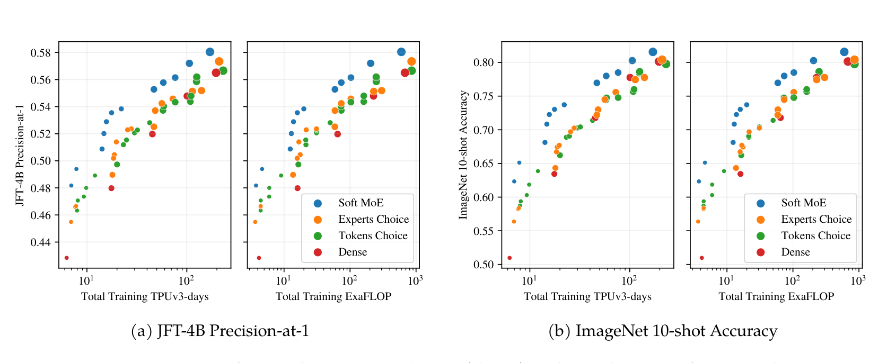</button>
<figcaption><strong>Soft MoE：视觉预训练质量与计算投入</strong><a href="https://arxiv.org/pdf/2308.00951v1" target="_blank" rel="noopener">From Sparse to Soft Mixtures of Experts</a> · Figure 3 · PDF p.8 / printed p.8
<details><summary>Original caption &amp; source</summary><div class="original-caption">Figure 3: Pareto Models. Soft MoE dominates both ViTs (dense) and popular MoEs (Experts Choice,Tokens
Choice) on the training cost / performance Pareto frontier. Each point is a model trained for 300k steps, and
larger marker sizes indicate larger models: S/32, S/16, B/32, B/16, L/16 and H/14. Cost is shown both in
terms of FLOPS and realized TPU-v3 training time. MoE runs include different configuration; for clarity,
only models on their respective Pareto frontier are displayed. Figure 22 in Appendix F shows all models.</div><a class="source-url" href="https://arxiv.org/pdf/2308.00951v1">https://arxiv.org/pdf/2308.00951v1</a></details></figcaption></figure>

原图比较 JFT-4B precision@1、ImageNet 10-shot 等结果与 TPUv3 days／ExaFLOPs 的关系。它证明的是这一视觉预训练设定下的质量与计算权衡。JFT-4B 属于非公开数据，不能因方法有论文就声称整个实验可由公开数据完整复现。

由于 slot 汇聚跨 Token，直接在文本整段中混合会包含未来位置；原结构不能原封不动用于因果 Decode。Soft MoE 的价值是提出“专家输入本身也可以学习组织”，但若目标改成自回归 LLM，必须重新证明路由、汇聚和输出组合的因果性。

## 7. 2024：细粒度专家与可验证的开放路线

### 7.1 Mixtral：开放稀疏 LLM，专家分工仍需谨慎解释

Mixtral <a href="#source-P12">[P12]</a> 在每层使用 8 位专家、每 Token 选择 2 位。其总参数约 46.7B，激活约 12.9B。名称中的 8×7B 不能直接相乘得到模型总参数：Attention、Embedding 等共享组件没有复制成八个完整 7B 模型。

<figure id="fig-mixtral24-F1">
<button class="paper-image" type="button" aria-label="Zoom: Mixtral：共享 Attention 与 Top-2 专家 FFN">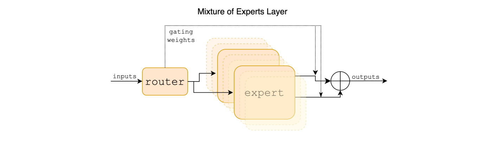</button>
<figcaption><strong>Mixtral：共享 Attention 与 Top-2 专家 FFN</strong><a href="https://arxiv.org/pdf/2401.04088v1" target="_blank" rel="noopener">Mixtral of Experts</a> · Figure 1 · PDF p.2 / printed p.2
<details><summary>Original caption &amp; source</summary><div class="original-caption">Figure 1: Mixture of Experts Layer. Each input vector is assigned to 2 of the 8 experts by a router. The
layer’s output is the weighted sum of the outputs of the two selected experts. In Mixtral, an expert is a standard
feedforward block as in a vanilla transformer architecture.</div><a class="source-url" href="https://arxiv.org/pdf/2401.04088v1">https://arxiv.org/pdf/2401.04088v1</a></details></figcaption></figure>

原图显示专家位于 FFN 路径，路由器给当前隐藏状态选两位专家并合并结果。它不代表两个完整模型分别生成一句话，再由外部裁判挑答案。稀疏计算发生在很多层内部，一个 Token 的多层路径可以组合成复杂变换。

<figure id="fig-mixtral24-F8">
<button class="paper-image" type="button" aria-label="Zoom: Mixtral：观察专家颜色，能看到局部模式但不能直接命名专家">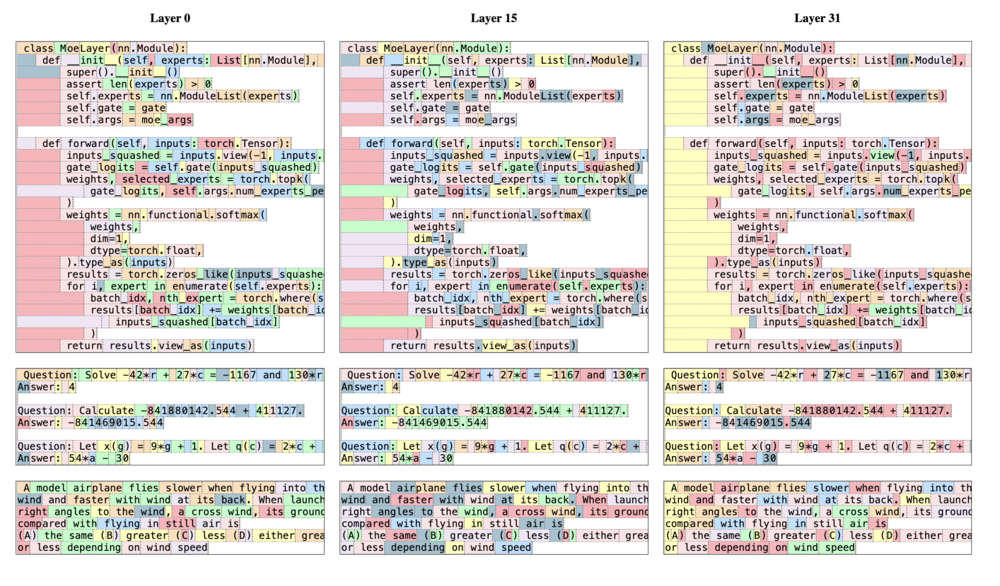</button>
<figcaption><strong>Mixtral：观察专家颜色，能看到局部模式但不能直接命名专家</strong><a href="https://arxiv.org/pdf/2401.04088v1" target="_blank" rel="noopener">Mixtral of Experts</a> · Figure 8 · PDF p.8 / printed p.8
<details><summary>Original caption &amp; source</summary><div class="original-caption">Figure 8: Text samples where each token is colored with the first expert choice. The selection of experts
appears to be more aligned with the syntax rather than the domain, especially at the initial and final layers.</div><a class="source-url" href="https://arxiv.org/pdf/2401.04088v1">https://arxiv.org/pdf/2401.04088v1</a></details></figcaption></figure>

图用颜色表示第 0、15、31 层中 Token 的专家分配。相邻 Token、格式或局部语法模式可能共享颜色，不同深度的分配也会变化。它更支持“路由存在结构与局部规律”，而不是“一位专家负责数学，一位专家负责代码”的固定职业表。

真正证明专业化需要对路由与专家输出进行干预：交换专家、固定路由、改变输入，并观察 loss 或任务结果。只看 Token 颜色或领域频率，无法排除专家输出冗余、gate 影响以及其他网络层的补偿。

### 7.2 DeepSeekMoE：把大专家切细，并设置共享专家

DeepSeekMoE <a href="#source-P13">[P13]</a> 提出两项结构：细粒度专家分割，以及共享专家隔离。将每位专家变窄、增加专家总数并提高所选数量，可以在近似相同专家参数量和计算预算下形成更多组合；共享专家持续处理通用部分，路由专家更有机会学习差异。

<figure id="fig-deepseekmoe24-F2">
<button class="paper-image" type="button" aria-label="Zoom: DeepSeekMoE：粗专家、细专家与共享路径的比较">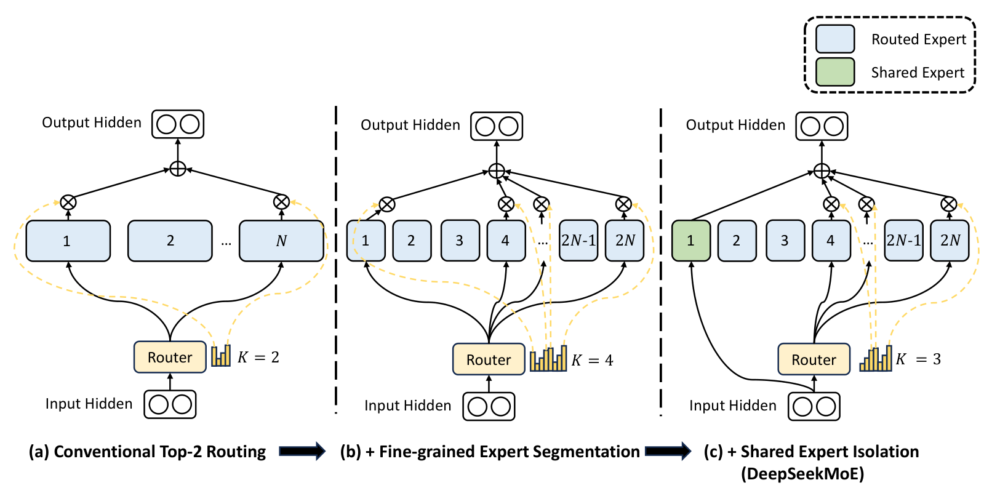</button>
<figcaption><strong>DeepSeekMoE：粗专家、细专家与共享路径的比较</strong><a href="https://arxiv.org/pdf/2401.06066v1" target="_blank" rel="noopener">DeepSeekMoE: Towards Ultimate Expert Specialization in Mixture-of-Experts Language Models</a> · Figure 2 · PDF p.5 / printed p.5
<details><summary>Original caption &amp; source</summary><div class="original-caption">Figure 2 | Illustration of DeepSeekMoE. Subfigure (a) showcases an MoE layer with the con-
ventional top-2 routing strategy. Subfigure (b) illustrates the fine-grained expert segmentation
strategy. Subsequently, subfigure (c) demonstrates the integration of the shared expert isolation
strategy, constituting the complete DeepSeekMoE architecture. It is noteworthy that across these
three architectures, the number of expert parameters and computational costs remain constant.</div><a class="source-url" href="https://arxiv.org/pdf/2401.06066v1">https://arxiv.org/pdf/2401.06066v1</a></details></figcaption></figure>

原图把几种结构并列，保持专家总参数和计算规模可比。重点是专家宽度变小、选择数变多，而不是把原来每位专家完整复制很多份。共享专家是每 Token 必跑的内部 FFN 路径，也不是一个外部常识检索库。

组合自由度可以用小例子理解：8 选 2 有 28 种集合，16 选 4 有 1820 种。若后一种专家宽度约为前者一半，总专家权重和激活专家权重可保持近似相同。**更多组合只是表达机会，不保证每种组合都学到了独立技能**，路由相关性、数据和训练优化仍会限制实际使用。

<figure id="fig-deepseekmoe24-T1">
<button class="paper-image" type="button" aria-label="Zoom: DeepSeekMoE：在匹配预算下核对主结果">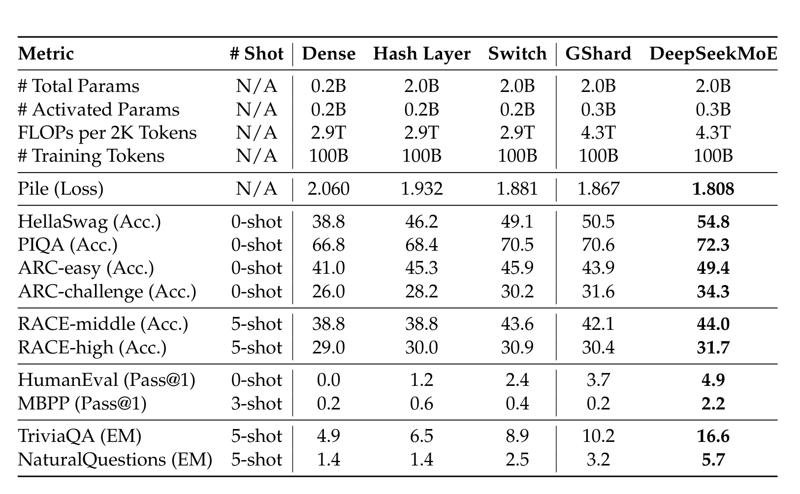</button>
<figcaption><strong>DeepSeekMoE：在匹配预算下核对主结果</strong><a href="https://arxiv.org/pdf/2401.06066v1" target="_blank" rel="noopener">DeepSeekMoE: Towards Ultimate Expert Specialization in Mixture-of-Experts Language Models</a> · Table 1 · PDF p.10 / printed p.10
<details><summary>Original caption &amp; source</summary><div class="original-caption">Table 1 | Evaluation results for validation experiments. Bold font indicates the best. Compared
with other MoE architectures, DeepSeekMoE exhibits a substantial performance advantage.</div><a class="source-url" href="https://arxiv.org/pdf/2401.06066v1">https://arxiv.org/pdf/2401.06066v1</a></details></figcaption></figure>

表中 GShard 与 DeepSeekMoE 的可比配置都是约 2.0B 总参数、0.3B 激活参数、100B 训练 Token、每 2K Token 约 4.3T FLOPs。Pile loss 从 1.867 降到 1.808，HellaSwag 从 50.5 升到 54.8。这支持同预算下结构改进有效。表中其他 Switch 配置约 0.2B 激活、2.9T FLOPs，不能说整张表的每个基线都完全等算力。

<figure id="fig-deepseekmoe24-F3">
<button class="paper-image" type="button" aria-label="Zoom: DeepSeekMoE：共享与细粒度设计的消融">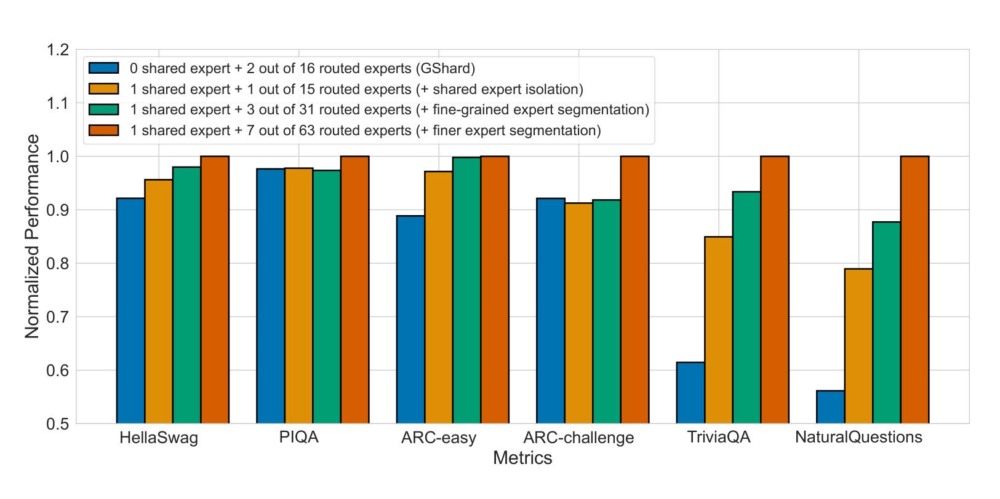</button>
<figcaption><strong>DeepSeekMoE：共享与细粒度设计的消融</strong><a href="https://arxiv.org/pdf/2401.06066v1" target="_blank" rel="noopener">DeepSeekMoE: Towards Ultimate Expert Specialization in Mixture-of-Experts Language Models</a> · Figure 3 · PDF p.12 / printed p.12
<details><summary>Original caption &amp; source</summary><div class="original-caption">Figure 3 | Ablation studies for DeepSeekMoE. The performance is normalized by the best perfor-
mance for clarity in presentation. All compared models have the same number of parameters
and activated parameters. We can find that fine-grained expert segmentation and shared expert
isolation both contribute to stronger overall performance.</div><a class="source-url" href="https://arxiv.org/pdf/2401.06066v1">https://arxiv.org/pdf/2401.06066v1</a></details></figcaption></figure>

原图比较 0+2/16、1+1/15、1+3/31、1+7/63 等配置，前一项体现共享路径，后两项体现激活数与路由池。柱状值经过归一化，用于看设计相对趋势，不是所有下游原始分数的绝对增量。主表与消融要一起读：前者支持质量，后者帮助定位收益来源。

### 7.3 DeepSeek-V2：MoE 与 KV 压缩共同工作

DeepSeek-V2 <a href="#source-P14">[P14]</a> 约有 236B 总参数、21B 激活参数，结合 DeepSeekMoE 与 Multi-head Latent Attention（MLA）。MoE 主要降低每 Token 的 FFN 激活计算；MLA 主要改变注意力状态的缓存表达。两者解决不同账本。

<figure id="fig-deepseekv2-F2">
<button class="paper-image" type="button" aria-label="Zoom: DeepSeek-V2：MLA 与 MoE 出现在同一整体架构">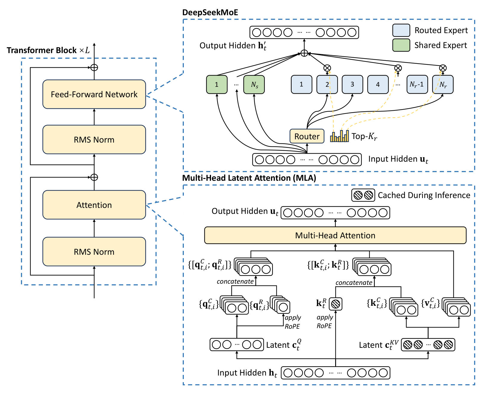</button>
<figcaption><strong>DeepSeek-V2：MLA 与 MoE 出现在同一整体架构</strong><a href="https://arxiv.org/pdf/2405.04434v5" target="_blank" rel="noopener">DeepSeek-V2: A Strong, Economical, and Efficient Mixture-of-Experts Language Model</a> · Figure 2 · PDF p.5 / printed p.5
<details><summary>Original caption &amp; source</summary><div class="original-caption">Figure 2 | Illustration of the architecture of DeepSeek-V2. MLA ensures efficient inference by
significantly reducing the KV cache for generation, and DeepSeekMoE enables training strong
models at an economical cost through the sparse architecture.</div><a class="source-url" href="https://arxiv.org/pdf/2405.04434v5">https://arxiv.org/pdf/2405.04434v5</a></details></figcaption></figure>

在整图中定位两个模块：Attention 路径中的潜表示与 MoE 路径中的共享／路由专家。架构一起提高效率，但不能把 MLA 的 KV Cache 节省全部算成 MoE 自身收益。模型参数口径也没有包含推理时所有缓存和工作空间。

<figure id="fig-deepseekv2-F3">
<button class="paper-image" type="button" aria-label="Zoom: DeepSeek-V2：潜表示注意力的具体数据路径">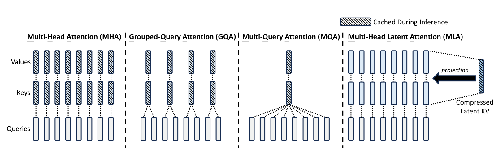</button>
<figcaption><strong>DeepSeek-V2：潜表示注意力的具体数据路径</strong><a href="https://arxiv.org/pdf/2405.04434v5" target="_blank" rel="noopener">DeepSeek-V2: A Strong, Economical, and Efficient Mixture-of-Experts Language Model</a> · Figure 3 · PDF p.7 / printed p.7
<details><summary>Original caption &amp; source</summary><div class="original-caption">Figure 3 | Simplified illustration of Multi-Head Attention (MHA), Grouped-Query Atten-
tion (GQA), Multi-Query Attention (MQA), and Multi-head Latent Attention (MLA). Through
jointly compressing the keys and values into a latent vector, MLA significantly reduces the KV
cache during inference.</div><a class="source-url" href="https://arxiv.org/pdf/2405.04434v5">https://arxiv.org/pdf/2405.04434v5</a></details></figcaption></figure>

这张细节图展示压缩后的表示怎样参与 Key／Value 等计算，与 Token 进入哪个 FFN 专家的选择是两条路径。读者若只记住“21B active”，就会遗漏长上下文中仍然重要的 KV 结构和 Attention 成本。

V2 还把专家选择与设备约束相结合，限制一次路由涉及的设备范围，以控制跨设备通信。它说明路由不只是语义分类器，也要服从物理拓扑；选择质量、负载平衡和通信范围之间存在工程取舍。

### 7.4 无辅助损失均衡：将选择偏置与输出权重分开

Auxiliary-Loss-Free Load Balancing <a href="#source-P15">[P15]</a> 要解决辅助均衡损失与任务目标之间的干扰。传统辅助项鼓励均匀使用专家，却也通过梯度改变路由器的任务学习。新的方法给专家增加动态偏置，使忙的专家下一批更难入选、闲的专家更易入选。

<figure id="fig-lossfree24-F1">
<button class="paper-image" type="button" aria-label="Zoom: Loss-free：用控制偏置调节路由选择">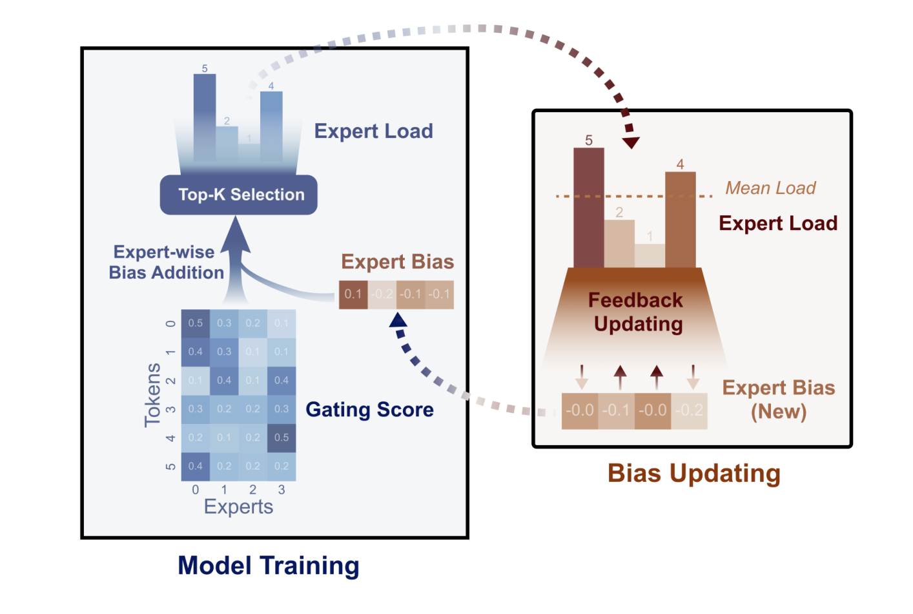</button>
<figcaption><strong>Loss-free：用控制偏置调节路由选择</strong><a href="https://arxiv.org/pdf/2408.15664v1" target="_blank" rel="noopener">Auxiliary-Loss-Free Load Balancing Strategy for Mixture-of-Experts</a> · Figure 1 · PDF p.2 / printed p.2
<details><summary>Original caption &amp; source</summary><div class="original-caption">Figure 1: Loss-Free Balancing selects experts according to a “biased gating score” in each training
step and updates this expert-wise bias after each training step.</div><a class="source-url" href="https://arxiv.org/pdf/2408.15664v1">https://arxiv.org/pdf/2408.15664v1</a></details></figcaption></figure>

原图把基于损失的平衡与基于偏置的控制区分开。偏置进入 Top-k 选择，而不直接进入被选专家的输出 gate；因此“给冷门专家更多被选机会”和“把它的输出数值放大”是两个不同动作。

$$
\mathcal{S}_t=\operatorname{TopK}_e(s_{t,e}+b_e),\qquad
b_e\leftarrow b_e+\eta\,\operatorname{sign}(\bar n-n_e).
$$

$s_{t,e}$ 是原始路由分数，$b_e$ 是专家偏置，$n_e$ 是上一批负载，$\bar n$ 是目标平均负载，$\eta$ 是更新步长。过载时偏置下降，欠载时上升；更新用于后续 batch，推理时冻结。这里表示核心控制逻辑，不包括所有实现细节。“loss-free”指不用对应的辅助负载损失，并不是语言模型不需要任务 loss。

<figure id="fig-lossfree24-F2">
<button class="paper-image" type="button" aria-label="Zoom: Loss-free：质量与负载偏差的取舍">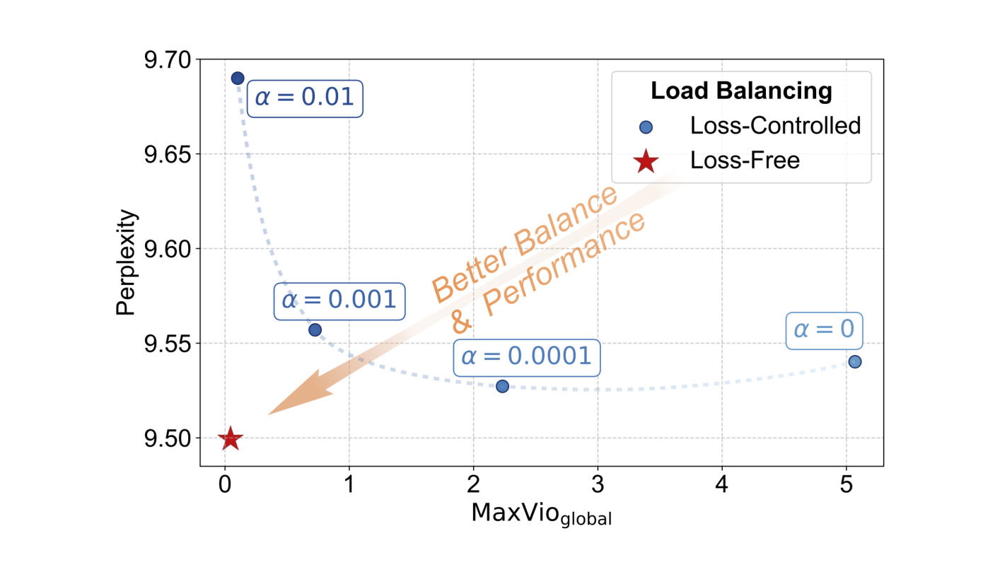</button>
<figcaption><strong>Loss-free：质量与负载偏差的取舍</strong><a href="https://arxiv.org/pdf/2408.15664v1" target="_blank" rel="noopener">Auxiliary-Loss-Free Load Balancing Strategy for Mixture-of-Experts</a> · Figure 2 · PDF p.4 / printed p.4
<details><summary>Original caption &amp; source</summary><div class="original-caption">Figure 2: The dilemma between load balance and model performance for auxiliary-loss-controlled
training. A small auxiliary loss coefficient α leads to poor load balance, while a large α impairs the
model performance. In contrast, our Loss-Free Balancing method breaks this dilemma.</div><a class="source-url" href="https://arxiv.org/pdf/2408.15664v1">https://arxiv.org/pdf/2408.15664v1</a></details></figcaption></figure>

原图比较不同均衡方法在验证困惑度和负载偏差上的位置。MaxVio_global 衡量最坏专家相对平均负载的偏差，数值小表示最拥挤专家更接近平均；它不是丢 Token 比例。偏置控制使质量与均衡更容易兼顾，但负载的时间变化、更新速度和分布漂移仍要监测。

<figure id="fig-lossfree24-F6">
<button class="paper-image" type="button" aria-label="Zoom: 因果性反例：专家竞争也可能把未来信息带到当前位置">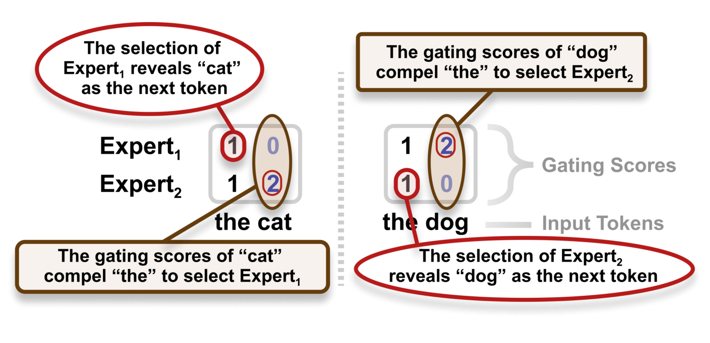</button>
<figcaption><strong>因果性反例：专家竞争也可能把未来信息带到当前位置</strong><a href="https://arxiv.org/pdf/2408.15664v1" target="_blank" rel="noopener">Auxiliary-Loss-Free Load Balancing Strategy for Mixture-of-Experts</a> · Figure 6 · PDF p.9 / printed p.9
<details><summary>Original caption &amp; source</summary><div class="original-caption">Figure 6: An example of future token leakage in EC. Future tokens can influence the expert assign-
ment of previous tokens. Such an assignment can help previous tokens to infer the identity of their
successors.</div><a class="source-url" href="https://arxiv.org/pdf/2408.15664v1">https://arxiv.org/pdf/2408.15664v1</a></details></figcaption></figure>

图展示 Expert Choice 在序列范围内竞争 Token 的情况。未来 Token 的得分会影响较早 Token 能否进入某专家，因此 Attention 的因果掩码无法自动阻断路由侧的信息。用上一批统计更新、在当前 Token 独立执行 Top-k，则有不同的信息边界。判断因果性必须沿整个调用链，而不能只检查 Attention mask。

### 7.5 OLMoE：公开训练让“快在哪里”可以细拆

OLMoE <a href="#source-P16">[P16]</a> 公开模型、训练代码、数据相关材料与分析，提供可研究的 MoE 基线。最终模型约 6.9B 总参数、1.3B 激活参数，64 专家选择 8 位。较小专家和较多选择，使它适合研究稀疏度、负载和训练效率。

<figure id="fig-olmoe24-F2">
<button class="paper-image" type="button" aria-label="Zoom: OLMoE：MoE 设计空间与开放模型位置">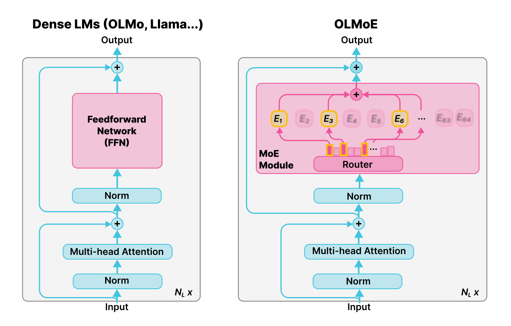</button>
<figcaption><strong>OLMoE：MoE 设计空间与开放模型位置</strong><a href="https://arxiv.org/pdf/2409.02060v1" target="_blank" rel="noopener">OLMoE: Open Mixture-of-Experts Language Models</a> · Figure 2 · PDF p.4 / printed p.4
<details><summary>Original caption &amp; source</summary><div class="original-caption">Figure 2: Comparison of the architecture of dense LMs and MoE models like OLMOE. The
figure excludes some details, e.g., OLMOE-1B-7B also uses QK-Norm (§4.2.5).</div><a class="source-url" href="https://arxiv.org/pdf/2409.02060v1">https://arxiv.org/pdf/2409.02060v1</a></details></figcaption></figure>

这张图对照 dense 与 MoE 的层内结构：共享 Attention 之后，dense 使用一个 FFN，MoE 则经路由进入部分专家，再组合输出。图省略了部分细节，例如 OLMoE 还有 QK-Norm。比较模型时要核对 active 口径，不能把 dense 的总参数与 MoE 的总参数当成相同计算投入。

<figure id="fig-olmoe24-F4">
<button class="paper-image" type="button" aria-label="Zoom: OLMoE：更少训练 Token，不等于更高单步吞吐">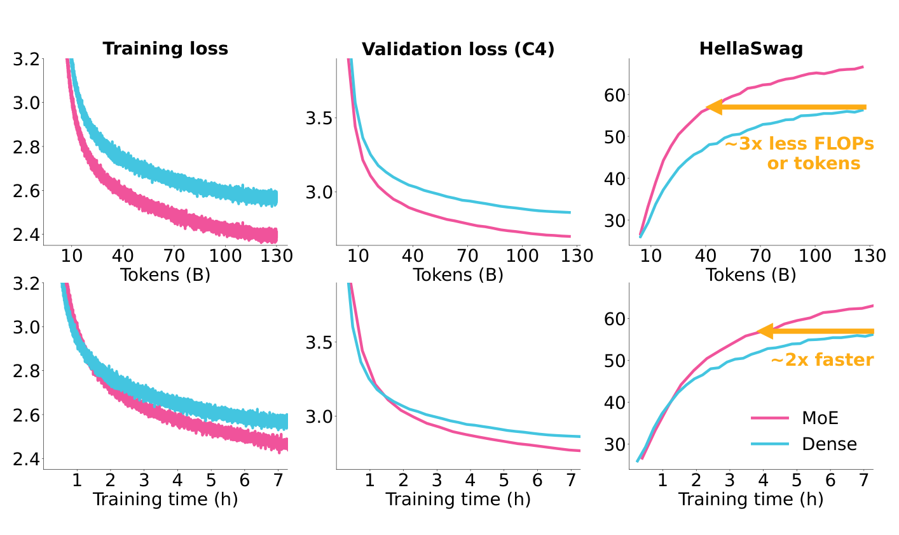</button>
<figcaption><strong>OLMoE：更少训练 Token，不等于更高单步吞吐</strong><a href="https://arxiv.org/pdf/2409.02060v1" target="_blank" rel="noopener">OLMoE: Open Mixture-of-Experts Language Models</a> · Figure 4 · PDF p.9 / printed p.9
<details><summary>Original caption &amp; source</summary><div class="original-caption">Figure 4: MoE vs. Dense. We train a 1.3B parameter dense model and a 1.3B active, 6.9B total
parameter MoE model, each on 128 H100 GPUs. Apart from MoE-related changes, we train both
with the same configuration for 130B tokens. The MoE contains 64 experts out of which 8 are
activated with an FFN dimension of 1,024, while the dense model has an FFN dimension of 8,192.
Thus both have the same number of active parameters. Top: The MoE reaches the final dense
performance with ∼3× fewer tokens (or FLOPs, as both have the same active parameters ignoring
the trivial router parameters). Bottom: Due to some memory overhead, this equates to ∼2× faster
training. More results, logs, and configurations: https://wandb.ai/ai2-llm/olmoe/reports/
Plot-MoE-vs-Dense--Vmlldzo4OTM0Mjkx</div><a class="source-url" href="https://arxiv.org/pdf/2409.02060v1">https://arxiv.org/pdf/2409.02060v1</a></details></figcaption></figure>

同 128 H100 条件、约 130B 训练 Token 的对照中，1.3B active／6.9B total MoE 对比 1.3B dense。达到 dense 最终表现时，MoE 约节省 3 倍 Token／FLOPs，却只节省约 2 倍墙钟时间；MoE 的吞吐约 23,600 tokens/s/GPU，dense 约 37,500。模型每步更慢，但学习到目标质量更省数据与计算，两件事可以同时成立。

<figure id="fig-olmoe24-F7">
<button class="paper-image" type="button" aria-label="Zoom: OLMoE：Token Choice 与 Expert Choice 的验证和迁移差异">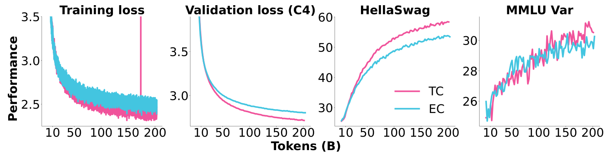</button>
<figcaption><strong>OLMoE：Token Choice 与 Expert Choice 的验证和迁移差异</strong><a href="https://arxiv.org/pdf/2409.02060v1" target="_blank" rel="noopener">OLMoE: Open Mixture-of-Experts Language Models</a> · Figure 7 · PDF p.11 / printed p.11
<details><summary>Original caption &amp; source</summary><div class="original-caption">Figure 7: Expert choice (EC) vs. token choice (TC). Both models have an 8-expert MoE in every
2nd layer. For TC, 2 experts are activated per token, while for EC the capacity factor is 2. Thus,
both models use the same number of active parameters. More results, logs, and configurations:
https://wandb.ai/ai2-llm/olmoe/reports/Plot-EC-vs-TC--Vmlldzo4MzkzMDM3</div><a class="source-url" href="https://arxiv.org/pdf/2409.02060v1">https://arxiv.org/pdf/2409.02060v1</a></details></figcaption></figure>

原图给出路由比较。这里 Token Choice 在验证和下游表现更好，提醒我们不能仅凭训练 loss、专家负载整齐或另一篇论文的收敛图，就宣布 EC 全面优于 TC。

固定版本的公开配置 <a href="#source-C05">[C05]</a> 包括 16 层、隐藏维度 2048、64 专家、Top-8、dropless sparse 路径、z-loss 系数 0.001、负载辅助项 0.01、最大序列长 4096。它是最终配置，不应与每张消融图的运行配置混为一谈。开放的意义是可以核对和重做实验，而不是不用核对就认定所有结果完全可比。

## 8. 2024—2025：大模型、低精度和训练体系共同演进

### 8.1 DeepSeek-V3：稀疏结构需要通信与精度配合

DeepSeek-V3 <a href="#source-P17">[P17]</a> 约有 671B 总参数、37B 激活参数，每层路由池 256 位、选择 8 位，并有 1 位共享专家。MLA、细粒度 MoE、均衡控制、并行调度和低精度框架共同组成训练与推理设计。

<figure id="fig-deepseekv3-F2">
<button class="paper-image" type="button" aria-label="Zoom: DeepSeek-V3：共享专家、路由专家与 MLA 的整体位置">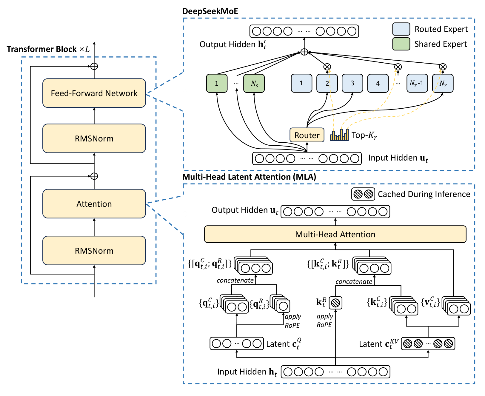</button>
<figcaption><strong>DeepSeek-V3：共享专家、路由专家与 MLA 的整体位置</strong><a href="https://arxiv.org/pdf/2412.19437v2" target="_blank" rel="noopener">DeepSeek-V3 Technical Report</a> · Figure 2 · PDF p.7 / printed p.7
<details><summary>Original caption &amp; source</summary><div class="original-caption">Figure 2 | Illustration of the basic architecture of DeepSeek-V3. Following DeepSeek-V2, we
adopt MLA and DeepSeekMoE for efficient inference and economical training.</div><a class="source-url" href="https://arxiv.org/pdf/2412.19437v2">https://arxiv.org/pdf/2412.19437v2</a></details></figcaption></figure>

原图再次强调 Attention 与专家模块的分工。8/256 的比值描述路由专家部分，不能拿它乘模型总 FLOPs 得到准确运行成本，因为共享专家、Attention 和其他计算仍然执行。

<figure id="fig-deepseekv3-F4">
<button class="paper-image" type="button" aria-label="Zoom: DeepSeek-V3：训练 chunk 内计算与通信的重叠">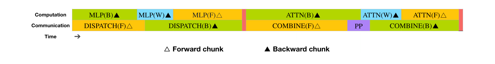</button>
<figcaption><strong>DeepSeek-V3：训练 chunk 内计算与通信的重叠</strong><a href="https://arxiv.org/pdf/2412.19437v2" target="_blank" rel="noopener">DeepSeek-V3 Technical Report</a> · Figure 4 · PDF p.12 / printed p.12
<details><summary>Original caption &amp; source</summary><div class="original-caption">Figure 4 | Overlapping strategy for a pair of individual forward and backward chunks (the
boundaries of the transformer blocks are not aligned). Orange denotes forward, green denotes
&quot;backward for input&quot;, blue denotes &quot;backward for weights&quot;, purple denotes PP communication,
and red denotes barriers. Both all-to-all and PP communication can be fully hidden.</div><a class="source-url" href="https://arxiv.org/pdf/2412.19437v2">https://arxiv.org/pdf/2412.19437v2</a></details></figcaption></figure>

图中橙色是 forward，绿色是输入梯度，蓝色是权重梯度，紫色是流水并行通信，红色是 barrier。它把不同计算段错开，让 All-to-All 与其他有用计算重叠，降低暴露在关键路径上的等待时间。

这不是通信字节消失了，也不是任意小 batch 下都能完全隐藏。能否重叠取决于 chunk 大小、网络带宽、执行依赖与并行布局；错误的事件等待或缓冲生命周期还可能导致读到尚未完成的结果。图描述训练的 forward／backward 调度，不能直接当成 Decode 的端到端性能保证。

<figure id="fig-deepseekv3-F6">
<button class="paper-image" type="button" aria-label="Zoom: DeepSeek-V3：FP8 操作数与高精度状态共存">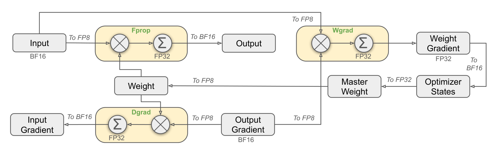</button>
<figcaption><strong>DeepSeek-V3：FP8 操作数与高精度状态共存</strong><a href="https://arxiv.org/pdf/2412.19437v2" target="_blank" rel="noopener">DeepSeek-V3 Technical Report</a> · Figure 6 · PDF p.15 / printed p.15
<details><summary>Original caption &amp; source</summary><div class="original-caption">Figure 6 | The overall mixed precision framework with FP8 data format. For clarification, only
the Linear operator is illustrated.</div><a class="source-url" href="https://arxiv.org/pdf/2412.19437v2">https://arxiv.org/pdf/2412.19437v2</a></details></figcaption></figure>

原图展示线性层的混合精度：部分操作数使用 FP8，累积使用 FP32，主参数和优化器状态保留 FP32，还有部分 BF16 路径。细粒度缩放和高精度累积控制数值误差。它不意味着所有权重、激活、路由和训练状态都被压成 FP8。

<figure id="fig-deepseekv3-F3">
<button class="paper-image" type="button" aria-label="Zoom: DeepSeek-V3：Multi-Token Prediction 保持连续的因果链">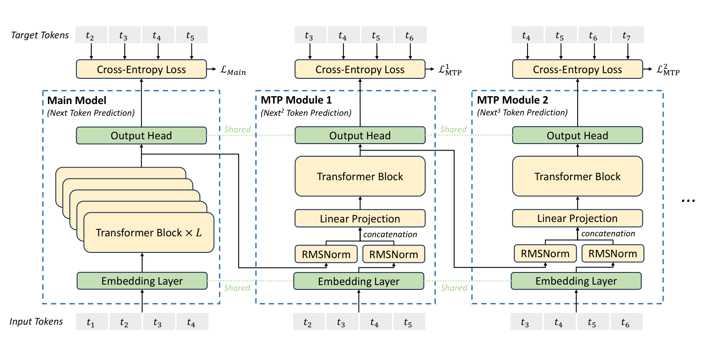</button>
<figcaption><strong>DeepSeek-V3：Multi-Token Prediction 保持连续的因果链</strong><a href="https://arxiv.org/pdf/2412.19437v2" target="_blank" rel="noopener">DeepSeek-V3 Technical Report</a> · Figure 3 · PDF p.10 / printed p.10
<details><summary>Original caption &amp; source</summary><div class="original-caption">Figure 3 | Illustration of our Multi-Token Prediction (MTP) implementation. We keep the
complete causal chain for the prediction of each token at each depth.</div><a class="source-url" href="https://arxiv.org/pdf/2412.19437v2">https://arxiv.org/pdf/2412.19437v2</a></details></figcaption></figure>

MTP 在训练时增加预测未来多个 Token 的深度分支。图中的隐藏状态与下一 Token 的 Embedding 合并后，沿因果链继续预测；不是把未知未来文本直接输入主模型作为答案。它改变训练监督，也可为推理策略提供组件，但属于与 MoE 并列的设计，不能把 MTP 的收益全部归因于稀疏专家。

### 8.2 Qwen3：MoE 架构与 thinking 模式是不同开关

Qwen3 技术报告 <a href="#source-P18">[P18]</a> 包含 dense 与 MoE 家族。2025 年报告中的 Qwen3 MoE 使用 128 专家、Top-8，无共享专家；30B 总／3B 激活与 235B 总／22B 激活是该版本的参数口径。

<figure id="fig-qwen3-T2">
<button class="paper-image" type="button" aria-label="Zoom: Qwen3：2025 年 MoE 家族的架构参数">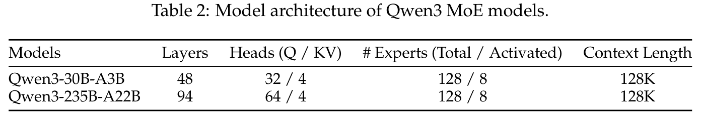</button>
<figcaption><strong>Qwen3：2025 年 MoE 家族的架构参数</strong><a href="https://arxiv.org/pdf/2505.09388v1" target="_blank" rel="noopener">Qwen3 Technical Report</a> · Table 2 · PDF p.3 / printed p.3
<details><summary>Original caption &amp; source</summary><div class="original-caption">Table 2: Model architecture of Qwen3 MoE models.</div><a class="source-url" href="https://arxiv.org/pdf/2505.09388v1">https://arxiv.org/pdf/2505.09388v1</a></details></figcaption></figure>

表格是架构证据，应逐列看模型规模、层数和专家设置。家族命名相似不代表不同年份版本有相同专家池，也不代表所有小模型都采用同一种稀疏结构。

<figure id="fig-qwen3-F1">
<button class="paper-image" type="button" aria-label="Zoom: Qwen3：后训练与强到弱蒸馏的流程">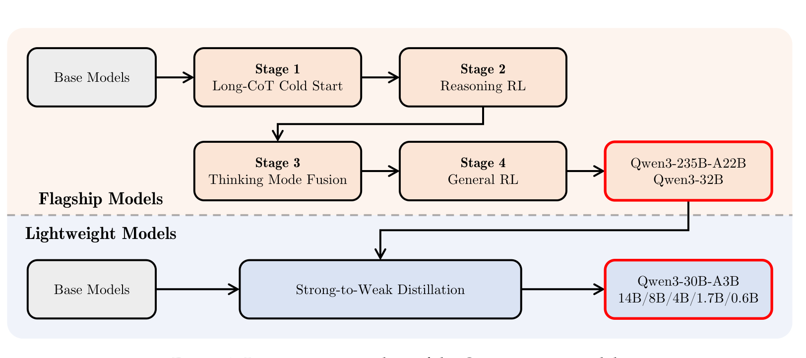</button>
<figcaption><strong>Qwen3：后训练与强到弱蒸馏的流程</strong><a href="https://arxiv.org/pdf/2505.09388v1" target="_blank" rel="noopener">Qwen3 Technical Report</a> · Figure 1 · PDF p.9 / printed p.9
<details><summary>Original caption &amp; source</summary><div class="original-caption">Figure 1: Post-training pipeline of the Qwen3 series models.</div><a class="source-url" href="https://arxiv.org/pdf/2505.09388v1">https://arxiv.org/pdf/2505.09388v1</a></details></figcaption></figure>

图展示旗舰模型的 reasoning cold start、推理强化学习、模式融合、通用强化学习，以及小模型的 strong-to-weak distillation。thinking／non-thinking 涉及后训练与生成行为；router 决定层内哪些 FFN 计算。打开思考模式并不是“让更多专家同时工作”的同义词。

截至本文截止的 Qwen3.6-35B-A3B 官方 model card 与配置 <a href="#source-M05">[M05]</a><a href="#source-M06">[M06]</a> 是另一组来源：256 专家选择 8 位，加 1 位共享专家，40 层、隐藏维度 2048，混合注意力配置采用 3 层 DeltaNet 对 1 层 Attention 的模式。本文把它用于当前部署讨论，不能把 2025 年 Qwen3 论文表格的无共享配置套到 3.6。

### 8.3 Kimi K2：大稀疏模型还受优化器与注意力数值约束

Kimi K2 <a href="#source-P19">[P19]</a> 的公开口径约为 1T 总参数、32B 激活参数，后续 K3 架构表给出更精确的 K2 数值 1.04T／32.6B。它展示大规模 MoE 的另一条事实：即使专家负载合理，其他模块仍会影响训练稳定性与有效扩展。

<figure id="fig-kimik2-F2">
<button class="paper-image" type="button" aria-label="Zoom: Kimi K2：Muon 与注意力 logits 的稳定性问题">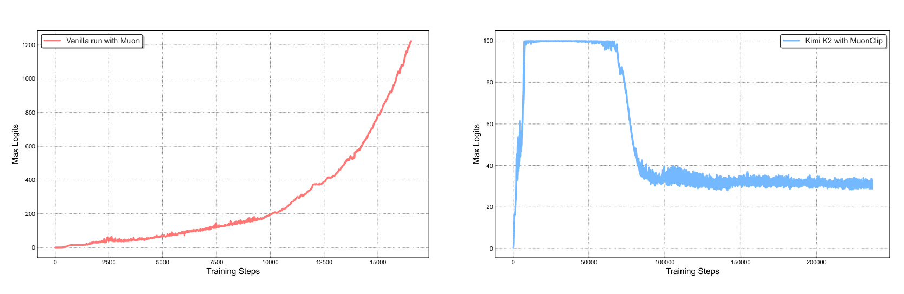</button>
<figcaption><strong>Kimi K2：Muon 与注意力 logits 的稳定性问题</strong><a href="https://arxiv.org/pdf/2507.20534v2" target="_blank" rel="noopener">Kimi K2: Open Agentic Intelligence</a> · Figure 2 · PDF p.4 / printed p.4
<details><summary>Original caption &amp; source</summary><div class="original-caption">Figure 2: Left: During a mid-scale training run, attention logits rapidly exceed 1000, which could lead to potential
numerical instabilities and even training divergence. Right: Maximum logits for Kimi K2 with MuonClip and τ = 100
over the entire training run. The max logits rapidly increase to the capped value of 100, and only decay to a stable range
after approximately 30% of the training steps, demonstrating the effective regulation effect of QK-Clip.</div><a class="source-url" href="https://arxiv.org/pdf/2507.20534v2">https://arxiv.org/pdf/2507.20534v2</a></details></figcaption></figure>

原图比较不同优化处理下 attention logits 的变化。出现超过 1000 的 logits 时，训练可能不稳定；MuonClip 在优化更新后对 Q／K 相关权重进行约束和重缩放，治理的是注意力的数值尺度。右图展示 K2 在阈值设定为 100 时的 logits 控制轨迹。

它不是 ST-MoE router z-loss 的简单替代。一个作用于注意力相关更新，一个约束路由 logits；应用位置和故障机制不同。排查 MoE 发散时，应分别查看 Attention、专家激活、router、优化器和混合精度路径，不能一看到“MoE 模型”就只盯负载均衡。

<figure id="fig-kimik2-F5">
<button class="paper-image" type="button" aria-label="Zoom: Kimi K2：稀疏度、训练 FLOPs 与 loss 的共同关系">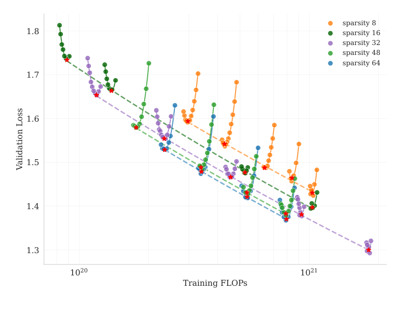</button>
<figcaption><strong>Kimi K2：稀疏度、训练 FLOPs 与 loss 的共同关系</strong><a href="https://arxiv.org/pdf/2507.20534v2" target="_blank" rel="noopener">Kimi K2: Open Agentic Intelligence</a> · Figure 5 · PDF p.7 / printed p.7
<details><summary>Original caption &amp; source</summary><div class="original-caption">Figure 5: Sparsity Scaling Law. Increasing sparsity leads
to improved model performance. We fixed the number of
activated experts to 8 and the number of shared experts
to 1, and varied the total number of experts, resulting in
models with different sparsity levels.</div><a class="source-url" href="https://arxiv.org/pdf/2507.20534v2">https://arxiv.org/pdf/2507.20534v2</a></details></figcaption></figure>

图比较不同稀疏度下训练 FLOPs 到 loss 的曲线，涉及稀疏度约 8—64 的设置。增加总容量与减少每次激活可改变效率，但固定算力预算下，专家容量、活跃计算和训练 Token 数需要权衡。它支持特定预算下的稀疏扩展分析，不能证明“激活越少，模型必然越强”。

## 9. 2026 前沿：长上下文、潜空间与均衡控制

### 9.1 DeepSeek-V4：系统收益必须按模块归因

DeepSeek-V4 <a href="#source-P20">[P20]</a> 将 MoE 与 CSA／HCA 注意力、mHC 残差等组件结合，面向百万 Token 上下文。报告给出 Pro 约 1.6T 总／49B 激活，Flash 约 284B 总／13B 激活。大容量与长上下文效率是组合设计的结果。

<figure id="fig-deepseekv4-F2">
<button class="paper-image" type="button" aria-label="Zoom: DeepSeek-V4：长上下文注意力、残差与专家模块共同设计">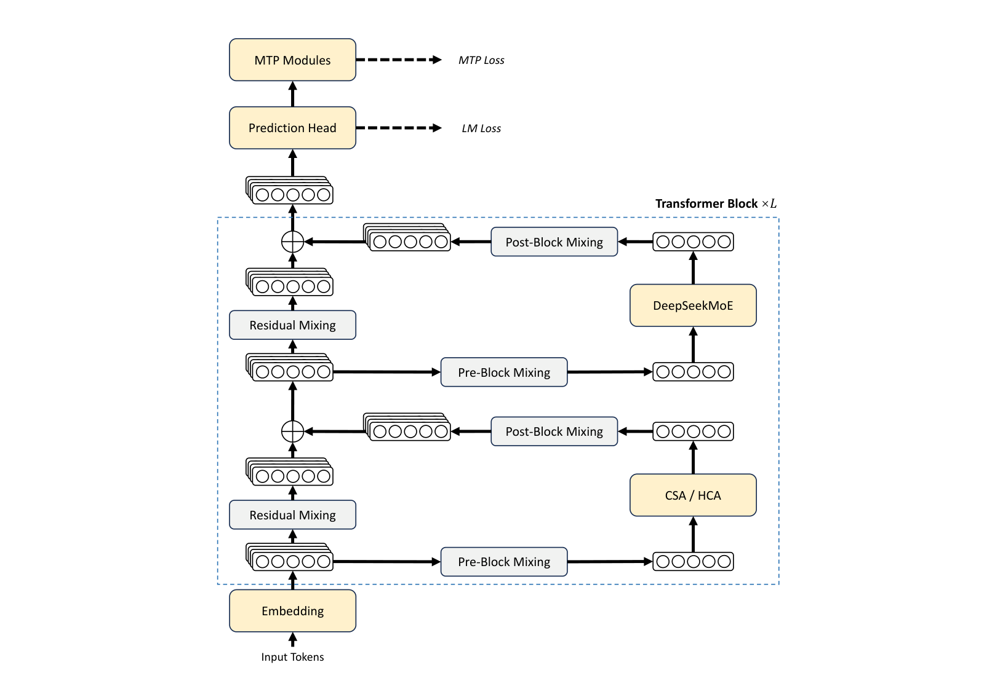</button>
<figcaption><strong>DeepSeek-V4：长上下文注意力、残差与专家模块共同设计</strong><a href="https://arxiv.org/pdf/2606.19348v1" target="_blank" rel="noopener">DeepSeek-V4: Towards Highly Efficient Million-Token Context Intelligence</a> · Figure 2 · PDF p.6 / printed p.6
<details><summary>Original caption &amp; source</summary><div class="original-caption">Figure 2 | Overall architecture of DeepSeek-V4 series. We use hybrid CSA (Compressed Sparse
Attention) and HCA (Heavily Compressed Attention) for attention layers, DeepSeekMoE for
feed-forward layers, and strengthen conventional residual connections with mHC.</div><a class="source-url" href="https://arxiv.org/pdf/2606.19348v1">https://arxiv.org/pdf/2606.19348v1</a></details></figcaption></figure>

在架构图中，MoE 是通道变换路径，压缩／分层注意力控制上下文状态与访问成本，mHC 影响残差信息流。报告相对 V3.2 在 1M 上下文下给出的 KV Cache 约 10%、推理 FLOPs 约 27%，属于整体架构比较，不能改写成“换 MoE 就把 KV 减到十分之一”。

<figure id="fig-deepseekv4-F5">
<button class="paper-image" type="button" aria-label="Zoom: DeepSeek-V4：expert waves 的理论执行收益">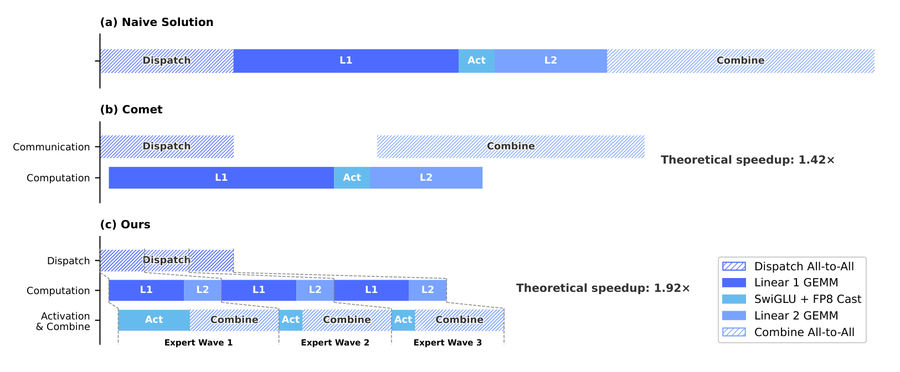</button>
<figcaption><strong>DeepSeek-V4：expert waves 的理论执行收益</strong><a href="https://arxiv.org/pdf/2606.19348v1" target="_blank" rel="noopener">DeepSeek-V4: Towards Highly Efficient Million-Token Context Intelligence</a> · Figure 5 · PDF p.15 / printed p.15
<details><summary>Original caption &amp; source</summary><div class="original-caption">Figure 5 | Illustration of our EP scheme with related works. Comet (Zhang et al., 2025b) overlaps
Dispatch with Linear-1, and Linear-2 with Combine, separately. Our EP scheme achieves a finer-
grained overlapping by splitting and scheduling experts into waves. The theoretical speedup is
evaluated in the configuration of the DeepSeek-V4-Flash architecture.</div><a class="source-url" href="https://arxiv.org/pdf/2606.19348v1">https://arxiv.org/pdf/2606.19348v1</a></details></figcaption></figure>

原图与 Comet 比较专家执行波次。路由后各专家负载并不完全相同，组织计算和通信的波次可以缩短关键路径；图中的 Flash 配置给出约 **1.92 倍理论收益**。它是特定模型与调度分析，不能称为所有 GPU 上实测 Decode 加速 1.92 倍。

<figure id="fig-deepseekv4-T1">
<button class="paper-image" type="button" aria-label="Zoom: DeepSeek-V4：模型规模与原始评测条件的入口">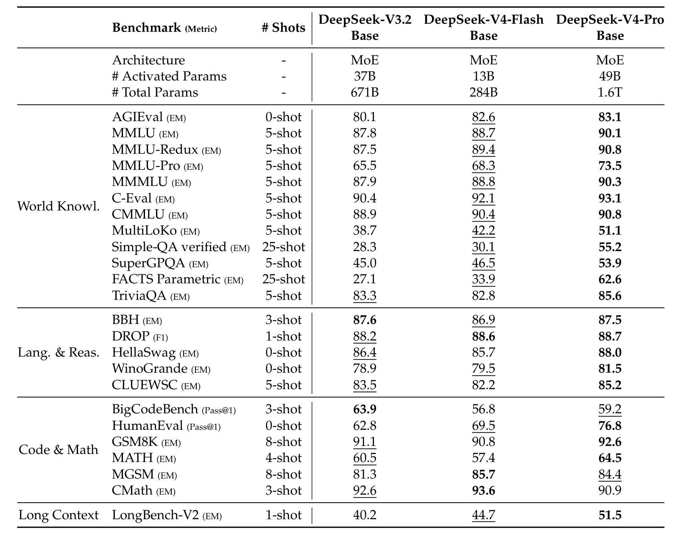</button>
<figcaption><strong>DeepSeek-V4：模型规模与原始评测条件的入口</strong><a href="https://arxiv.org/pdf/2606.19348v1" target="_blank" rel="noopener">DeepSeek-V4: Towards Highly Efficient Million-Token Context Intelligence</a> · Table 1 · PDF p.28 / printed p.28
<details><summary>Original caption &amp; source</summary><div class="original-caption">Table 1 | Comparison among DeepSeek-V3.2-Base, DeepSeek-V4-Flash-Base, and DeepSeek-V4-
Pro-Base. All models are evaluated in our internal framework and share the same evaluation
setting. Scores with a gap not exceeding 0.3 are considered to be at the same level. The highest
score in each row is in bold font, and the second is underlined.</div><a class="source-url" href="https://arxiv.org/pdf/2606.19348v1">https://arxiv.org/pdf/2606.19348v1</a></details></figcaption></figure>

原表包含 Pro／Flash 的模型与评测结果。本文用其支撑参数口径，并保留完整截图供核对；不把表里的不同任务分数压成跨代统一排名。官方 Pro 配置 <a href="#source-M02">[M02]</a> 的路由池为 384、Top-6、61 层、专家中间维度 3072、隐藏维度 7168，并含三层 hash routing 与 noaux 设置。这是当前 V4 的证据，不能误读成沿用 V3 的 256 专家配置。

### 9.2 Kimi K3：潜空间专家、激活有界和分位数均衡

Kimi K3 <a href="#source-P21">[P21]</a> 的报告给出 2.78T 总参数、104.2B 激活，896 位路由专家选择 16 位，再加 2 位共享专家。它采用 Stable LatentMoE，把专家计算放进较低维的潜空间，与混合注意力和跨层信息流共同构成模型。

<figure id="fig-kimik3-F2">
<button class="paper-image" type="button" aria-label="Zoom: Kimi K3：Token、通道与层三个方向的信息混合">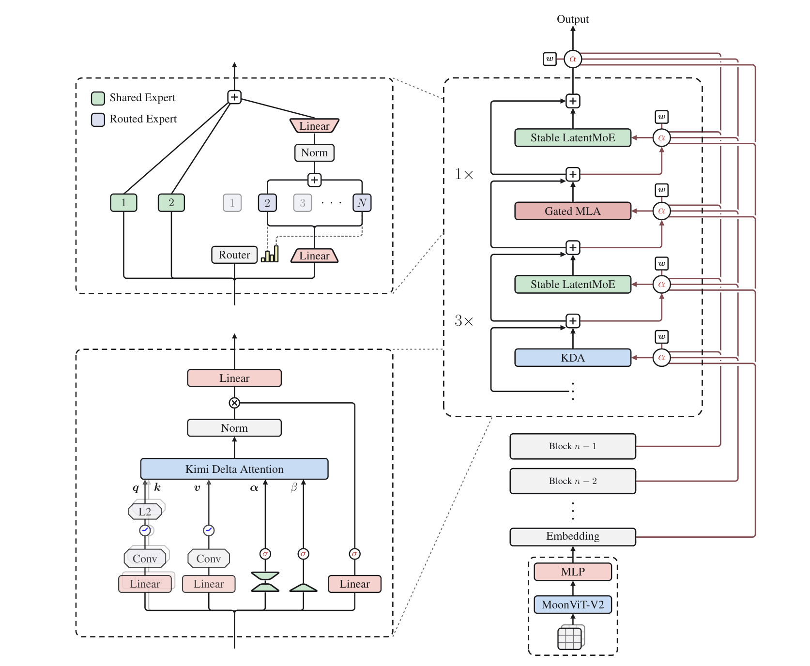</button>
<figcaption><strong>Kimi K3：Token、通道与层三个方向的信息混合</strong><a href="https://arxiv.org/pdf/2607.24653v2" target="_blank" rel="noopener">Kimi K3: Open Frontier Intelligence</a> · Figure 2 · PDF p.3 / printed p.3
<details><summary>Original caption &amp; source</summary><div class="original-caption">Figure 2: The Kimi K3 architecture, organized around token, channel, and layer mixing, with a native vision pathway at the input.
Each block contains three Kimi Delta Attention (KDA) layers followed by one Gated MLA layer, with each attention layer paired
with a Stable LatentMoE feed-forward network. Attention Residuals (AttnRes) use learned pseudo-queries (w) to derive attention
weights (α) over the embedding and preceding block outputs, enabling selective information flow across depth. Top left: the Stable
LatentMoE module with shared and routed experts. Bottom left: the KDA module. Bottom right: the native vision pathway.</div><a class="source-url" href="https://arxiv.org/pdf/2607.24653v2">https://arxiv.org/pdf/2607.24653v2</a></details></figcaption></figure>

原图左上是共享和路由专家组成的 Stable LatentMoE，Token 混合部分使用 3 层 KDA 配 1 层 Gated MLA，跨层通过 Attention Residuals 选择先前表示，还有输入端视觉路径。潜空间宽度 3584，小于主隐藏宽度 7168；专家处理的表示维度与原隐藏维度不同，不能机械套用“全宽 FFN 专家”的参数公式。

<figure id="fig-kimik3-F4">
<button class="paper-image" type="button" aria-label="Zoom: Kimi K3：SiTU-GLU 限制两分支乘积的尾部幅度">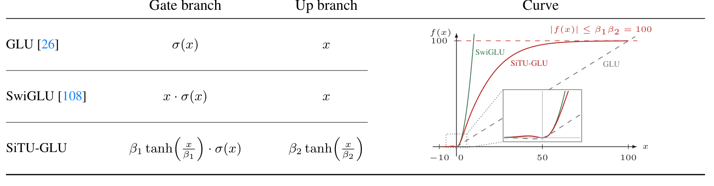</button>
<figcaption><strong>Kimi K3：SiTU-GLU 限制两分支乘积的尾部幅度</strong><a href="https://arxiv.org/pdf/2607.24653v2" target="_blank" rel="noopener">Kimi K3: Open Frontier Intelligence</a> · Figure 4 · PDF p.7 / printed p.7
<details><summary>Original caption &amp; source</summary><div class="original-caption">Figure 4: Gate and up branches of GLU, SwiGLU, and SiTU-GLU, together with their scalar responses, where σ denotes the
sigmoid function. Both branches receive the scalar input x, and all curves share the domain x ∈[−10, 100]; the inset magnifies the
near-origin region. SiTU-GLU, shown in red with β1 = 4 and β2 = 25, closely follows SwiGLU near the origin and approaches the
bound |f(x)| ≤β1β2 = 100 for large positive inputs, whereas SwiGLU remains unbounded.</div><a class="source-url" href="https://arxiv.org/pdf/2607.24653v2">https://arxiv.org/pdf/2607.24653v2</a></details></figcaption></figure>

红色 SiTU-GLU 曲线在原点附近接近 SwiGLU，正方向大输入时趋于界限。两分支使用有界 tanh 形式，gate／up 的尺度参数分别为 4 与 25，因此对应逐元素乘积的绝对值受 100 限制。这个“100”不是整条向量的二范数界，也不是说每层输出幅度都不超过 100：后续线性投影仍会改变数值。

<figure id="fig-kimik3-F5">
<button class="paper-image" type="button" aria-label="Zoom: Kimi K3：Quantile Balancing 调整下一批选择阈值">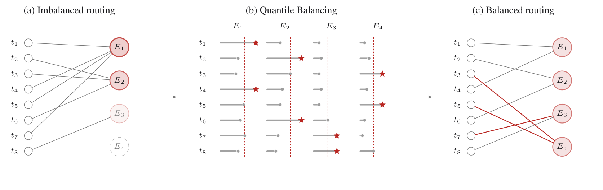</button>
<figcaption><strong>Kimi K3：Quantile Balancing 调整下一批选择阈值</strong><a href="https://arxiv.org/pdf/2607.24653v2" target="_blank" rel="noopener">Kimi K3: Open Frontier Intelligence</a> · Figure 5 · PDF p.8 / printed p.8
<details><summary>Original caption &amp; source</summary><div class="original-caption">Figure 5: Illustration of Quantile Balancing with m = 8 tokens, n = 4 routed experts, and k = 1 selected expert per token. (a)
Token-wise Top-k routing (tokens on the left, experts on the right) produces loads (4, 3, 1, 0); darker circles indicate overheated
experts, whereas faded and dashed circles indicate underutilized and dying experts, respectively. (b) Each gray bar is the margin of
the currently biased score, si,j + b(t)</div><a class="source-url" href="https://arxiv.org/pdf/2607.24653v2">https://arxiv.org/pdf/2607.24653v2</a></details></figcaption></figure>

示例有 8 个 Token、4 位专家、Top-1，普通路由负载是 4、3、1、0，经分位数调节后展示为 2、2、2、2。灰条反映相对门限的分数余量；利用全局统计的分位数更新偏置，目标是更直接地校准专家入选机会。

实际控制用当前统计影响后续 batch，推理时冻结。图的整齐结果是解释性示例；下一批输入分布变化时，固定偏置不保证每批都完美均匀。与 Expert Choice 比，它仍维持 Token 侧选择边界，避免当前序列内的跨 Token 竞争成为因果漏洞。

<figure id="fig-kimik3-F7">
<button class="paper-image" type="button" aria-label="Zoom: Kimi K3：扩展效率的拟合比较">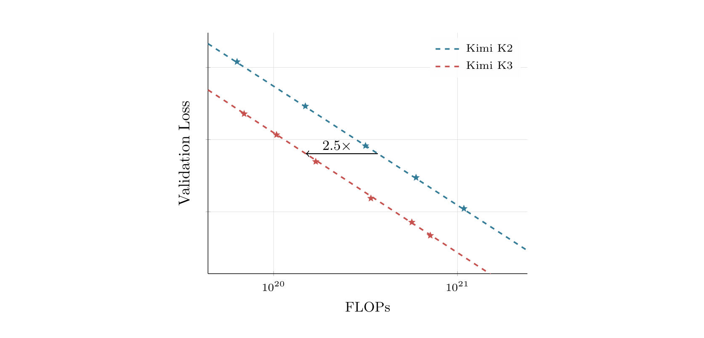</button>
<figcaption><strong>Kimi K3：扩展效率的拟合比较</strong><a href="https://arxiv.org/pdf/2607.24653v2" target="_blank" rel="noopener">Kimi K3: Open Frontier Intelligence</a> · Figure 7 · PDF p.11 / printed p.11
<details><summary>Original caption &amp; source</summary><div class="original-caption">Figure 7: Fitted scaling-law curves for Kimi K2 and Kimi K3. Kimi K3 achieves 2.5× gain in scaling efficiency over Kimi K2.</div><a class="source-url" href="https://arxiv.org/pdf/2607.24653v2">https://arxiv.org/pdf/2607.24653v2</a></details></figcaption></figure>

图报告相对 K2 约 2.5 倍 fitted scaling efficiency。这里指训练预算与质量关系的拟合收益，不是 tokens/s、TTFT 或 GPU 内核吞吐提高 2.5 倍。混合架构、稳定性与训练设计共同变化，也不能把这个比值全部归因于 Quantile Balancing。

<figure id="fig-kimik3-T1">
<button class="paper-image" type="button" aria-label="Zoom: Kimi K3：核对架构规模与 K2 的比较口径"></button>
<figcaption><strong>Kimi K3：核对架构规模与 K2 的比较口径</strong><a href="https://arxiv.org/pdf/2607.24653v2" target="_blank" rel="noopener">Kimi K3: Open Frontier Intelligence</a> · Table 1 · PDF p.11 / printed p.11
<details><summary>Original caption &amp; source</summary><div class="original-caption">Table 1: Architectural comparison between Kimi K2 and Kimi K3.</div><a class="source-url" href="https://arxiv.org/pdf/2607.24653v2">https://arxiv.org/pdf/2607.24653v2</a></details></figcaption></figure>

表给出 93 层，其中 24 MLA、69 KDA，主宽度 7168、潜宽度 3584、专家宽度 3072，及前述专家配置。官方导出配置 <a href="#source-M04">[M04]</a> 与多数路由参数相符，但其 num_nextn_predict_layers 为 0，而论文训练配置包含 1 层 MTP。导出推理结构与论文训练结构可以不同，不能宣称两个配置逐字段完全一致。

### 9.3 Multi-View Latent MoE：路由器不只挑专家，也塑造专家输入

Multi-View Latent MoE <a href="#source-P24">[P24]</a> 进一步追问：当路由依据一个表示，而专家收到另一个潜表示时，路由分数是否真能反映专家作用？其设计让多个 view 的路由与输入混合耦合，使每个 router 能影响被选专家看到的输入，而不是仅投票选专家。

<figure id="fig-multiview26-F2">
<button class="paper-image" type="button" aria-label="Zoom: Multi-View：路由分数与专家输出代理量的关联"></button>
<figcaption><strong>Multi-View：路由分数与专家输出代理量的关联</strong><a href="https://arxiv.org/pdf/2610.40577v2" target="_blank" rel="noopener">Multi-View Latent MoE: Letting Every Router Shape Expert Computation</a> · Figure 2 · PDF p.3 / printed p.3
<details><summary>Original caption &amp; source</summary><div class="original-caption">Figure 2: Agreement between single-router scores and empirical expert-utility evaluation on the 24-layer 10B-A1B
backbone. (a) Spearman correlation across training. The logarithmic training-step axis expands the early stage
and compresses later intervals to show early-training changes more clearly. (b) Layer-wise means over the 201
logged measurements used in the router comparison; shaded bands show ±1 standard deviation. Scores exclude
the load-balancing bias. Expert utility is evaluated using each expert’s output L2 norm, normalized by its mean
over sampled tokens (App. B.5).</div><a class="source-url" href="https://arxiv.org/pdf/2610.40577v2">https://arxiv.org/pdf/2610.40577v2</a></details></figcaption></figure>

图分析 routing score 与 normalized expert-output norm 所构造的 utility proxy：左图观察训练阶段，右图按层看关联；分数不含均衡偏置。论文另给出的单 router／Multi-Router 对照相关性约为 0.1245／0.1346，这个增量不等于 Multi-View 本身的因果收益。proxy 不是知道“哪位专家最有用”的 oracle，也不是最终任务正确性。它提示路由与计算可能存在错位，需要后续干预实验佐证。

<figure id="fig-multiview26-F3">
<button class="paper-image" type="button" aria-label="Zoom: Multi-View：多个 view 汇入同一个专家池，每位所选专家只运行一次"></button>
<figcaption><strong>Multi-View：多个 view 汇入同一个专家池，每位所选专家只运行一次</strong><a href="https://arxiv.org/pdf/2610.40577v2" target="_blank" rel="noopener">Multi-View Latent MoE: Letting Every Router Shape Expert Computation</a> · Figure 3 · PDF p.5 / printed p.5
<details><summary>Original caption &amp; source</summary><div class="original-caption">Figure 3: Comparison of latent-space MoE architectures. Top: (a) LatentMoE uses a router and a shared latent
input; (b) Multi-Router sums scores from separately parameterized sigmoid routing heads for top-k selection while
retaining the shared input; (c) Multi-View adds distinct down-projections and expert-specific view mixing. Bottom:
expansion of the boxed routed path in (c), with matching colors and numbered markers. Balancing bias b is added
to summed scores only for selection. Output gates gi follow Eq. 3. For each selected expert, raw sigmoid scores
are normalized across routers to form view proportions am,i, whose sum is one. Each selected expert processes
its mixed input once. The aggregated representation y is up-projected and combined with the shared-expert output
shown above. K = 2 views and selected experts i, j are illustrative; k is the number of active experts out of N.
Bars depict example routing scores. Normalization modules and residual paths are omitted for clarity.</div><a class="source-url" href="https://arxiv.org/pdf/2610.40577v2">https://arxiv.org/pdf/2610.40577v2</a></details></figcaption></figure>

每个 router 在自己的潜表示上产生 sigmoid 分数，选择共享专家池中的成员；各 view 的表示再按分数组合成该专家的输入。输出 gate 与被选专家的分数及混合系数相关，路由均衡偏置只影响选择。

图的关键是**一个共享池，每位入选专家一次 FFN**，不是每个 view 各建一套专家，也不是选中同一专家后每个 view 都重复运行一遍。多 view 增加了表示与路由的组织能力，但激活 FFN 预算仍可与基线匹配。

<figure id="fig-multiview26-T1">
<button class="paper-image" type="button" aria-label="Zoom: Multi-View：匹配预算的九项任务结果，也包含退步项"></button>
<figcaption><strong>Multi-View：匹配预算的九项任务结果，也包含退步项</strong><a href="https://arxiv.org/pdf/2610.40577v2" target="_blank" rel="noopener">Multi-View Latent MoE: Letting Every Router Shape Expert Computation</a> · Table 1 · PDF p.8 / printed p.8
<details><summary>Original caption &amp; source</summary><div class="original-caption">Table 1: Downstream scores (%) at 708B training tokens. Baseline: latent-space MoE; MR: Multi-Router (R = 2);
MV: score-derived Multi-View (K = R = 2; Eq. 5). Tasks are grouped into exams, knowledge, science, and
reasoning. Avg. is the unweighted within-group mean; Overall is the unweighted mean across all nine tasks. Bold
marks the highest displayed score in each column. The final row reports MV minus Baseline in percentage points.
Prompt and scoring protocols appear in App. B.4.</div><a class="source-url" href="https://arxiv.org/pdf/2610.40577v2">https://arxiv.org/pdf/2610.40577v2</a></details></figcaption></figure>

表比较 708B 训练 Token、10B-A1B、24 层、256 专家选 8 位的配置。九项任务的不加权平均从 33.07 到 33.69、34.25，最终比基础单路由高 **1.18 个百分点**。但 MMLU-Pro 从 27.28 到 27.12，BBH 从 36.10 到 35.76。平均改善不能写成“每项任务都提升”，百分点也不能与相对百分比混写。

<figure id="fig-multiview26-F4">
<button class="paper-image" type="button" aria-label="Zoom: Multi-View：达到相同 loss 的 Token 预算比较"></button>
<figcaption><strong>Multi-View：达到相同 loss 的 Token 预算比较</strong><a href="https://arxiv.org/pdf/2610.40577v2" target="_blank" rel="noopener">Multi-View Latent MoE: Letting Every Router Shape Expert Computation</a> · Figure 4 · PDF p.8 / printed p.8
<details><summary>Original caption &amp; source</summary><div class="original-caption">Figure 4: Training loss of the baseline, Multi-Router, and Multi-View on 10B-A1B through 708B tokens. (a)
Loss difference from the baseline; the inset shows the full loss trajectories. (b) Magnification of the blue-bordered
window in (a), covering 50–230B tokens. (c) Magnification of the purple-bordered window in the full-loss inset,
showing absolute loss over 620–708B tokens. All curves use the same causal exponential moving average (EMA),
with a 2,000-step span (α = 2/2001), initialized at the first observation. The final losses reported in the text average
the last 1,000 unsmoothed steps.</div><a class="source-url" href="https://arxiv.org/pdf/2610.40577v2">https://arxiv.org/pdf/2610.40577v2</a></details></figcaption></figure>

图中的训练曲线采用跨度 2000 的因果 EMA 平滑，比较到达指定 loss 的进展，例如 MV 约 88B Token、MR 约 180B Token 的交点；最终结果使用末 1000 steps 的未平滑平均。平滑曲线适合看趋势，精确终点与对照条件仍应回到表格，不宜只凭曲线宽度目测绝对优势。

<figure id="fig-multiview26-F5">
<button class="paper-image" type="button" aria-label="Zoom: Multi-View：路由干预比颜色热图更接近机制检验"></button>
<figcaption><strong>Multi-View：路由干预比颜色热图更接近机制检验</strong><a href="https://arxiv.org/pdf/2610.40577v2" target="_blank" rel="noopener">Multi-View Latent MoE: Letting Every Router Shape Expert Computation</a> · Figure 5 · PDF p.9 / printed p.9
<details><summary>Original caption &amp; source</summary><div class="original-caption">Figure 5: Expert-specific inputs and controlled mixing interventions in the score-derived Multi-View checkpoint
at 708B tokens. (a) Differences among the eight experts selected for the same token: the mean absolute pairwise
difference in view-1 proportions Dr (top) and the mean pairwise input distance normalized by the mean input norm
Dv (bottom). Zero denotes identical proportions or inputs, respectively. Curves show the median across tokens at
each layer; bands show the 25th–75th percentiles. (b) Final-layer interventions on 256 sequences, changing view
proportions while holding S and output gates gi fixed to numerical precision. Whiskers are 95% sequence-bootstrap
CIs; crosses mark permutation-seed means. (c) Single-layer interventions on 80 sequences. Bands are pointwise
95% CIs; downstream routing is recomputed. ∆NLL is intervention loss minus the original loss.</div><a class="source-url" href="https://arxiv.org/pdf/2610.40577v2">https://arxiv.org/pdf/2610.40577v2</a></details></figcaption></figure>

图 (a) 先测同一个 Token 所选专家的 view 混合比例和输入距离，检查它们是否确实收到不同输入。图 (b) 在最终层对 256 条序列做干预，固定 route 与输出 gate，只改变 view 混合比例。Token permutation、uniform、expert permutation 的 loss 变化约为 0.00223、0.00662、0.0134 nats/token，并给出序列 bootstrap 的 95% 置信区间。

图 (c) 则对 80 条序列逐层扫描：固定被干预层的 route 与 gate，下游层继续重新路由。因此 (c) 的观察包含后续网络的总影响，不是仅这位专家的纯局部作用；(b) 是终层实验，应分别解读。它提供比“看起来像专业化”更强的证据，但仍没有证明生产部署的吞吐或端侧收益。当前它属于研究前沿，而非已经建立统一优势的行业默认结构。

## 10. 部署前沿：先减少搬运，再决定在哪里计算

### 10.1 Stepped MoE：让一段 Token 复用后层专家选择

Stepped MoE <a href="#source-P22">[P22]</a> 改变路由的时间粒度。传统模型每层、每 Token 决策，导致 Decode 时专家访问不断变化；它用前段 dense 层预测后续层的专家 mask，在一个 segment 内复用，提高可预取性并允许配置推理复杂度。

<figure id="fig-stepped26-F1">
<button class="paper-image" type="button" aria-label="Zoom: Stepped MoE：从逐 Token 路由到分段预测后续专家"></button>
<figcaption><strong>Stepped MoE：从逐 Token 路由到分段预测后续专家</strong><a href="https://arxiv.org/pdf/2610.07348v1" target="_blank" rel="noopener">Stepped MoE: Segment-Level Routing with Configurable Inference Complexity</a> · Figure 1 · PDF p.2 / printed p.2
<details><summary>Original caption &amp; source</summary><div class="original-caption">Figure 1: Left: Traditional MoE based architecture where experts are selected per token at each layer,
Middle: Stepped MoE architecture that decides the experts for all layers to use at once using the
mask generator, Right: Accuracy-Latency trade-off curve showing how stepped-MoE bridges the gap
between Dense and MoE Models (size of the bubble represents active size of the models).</div><a class="source-url" href="https://arxiv.org/pdf/2610.07348v1">https://arxiv.org/pdf/2610.07348v1</a></details></figcaption></figure>

原图把早期 dense 层与后期稀疏层分开。前段表示预测后段多层专家访问，mask 在 segment 内复用。它是需要配合训练的架构变化，不是给任意现成 MoE 安装 LRU 缓存就自动得到的同一种行为。

<figure id="fig-stepped26-F2">
<button class="paper-image" type="button" aria-label="Zoom: Stepped MoE：segment 长度与激活预算可调整"></button>
<figcaption><strong>Stepped MoE：segment 长度与激活预算可调整</strong><a href="https://arxiv.org/pdf/2610.07348v1" target="_blank" rel="noopener">Stepped MoE: Segment-Level Routing with Configurable Inference Complexity</a> · Figure 2 · PDF p.3 / printed p.3
<details><summary>Original caption &amp; source</summary><div class="original-caption">Figure 2: Left: Flexible Stepped-MoE model architecture with expanded mask generator, Right:
Inference time layout of the model to allow flexible sparsity based on resource availability.</div><a class="source-url" href="https://arxiv.org/pdf/2610.07348v1">https://arxiv.org/pdf/2610.07348v1</a></details></figcaption></figure>

图展示 segment 和后层稀疏执行的关系。更长 segment 能减少选择与搬运变化，却更可能错过输入状态的快速改变；mask 稀疏度可控制计算量，也会改变模型实际使用的能力。它是在精度、灵活性和硬件可预测性之间建立新旋钮。

<figure id="fig-stepped26-F3">
<button class="paper-image" type="button" aria-label="Zoom: Stepped MoE：NPU 模拟器中的延迟与缓存条件"></button>
<figcaption><strong>Stepped MoE：NPU 模拟器中的延迟与缓存条件</strong><a href="https://arxiv.org/pdf/2610.07348v1" target="_blank" rel="noopener">Stepped MoE: Segment-Level Routing with Configurable Inference Complexity</a> · Figure 3 · PDF p.8 / printed p.8
<details><summary>Original caption &amp; source</summary><div class="original-caption">Figure 3: Decoding length vs Latency of various models and CHR: Cache Hit Rate; ratio of experts
already present in DRAM from previous decoding step. Left ⇒Right we vary CHR from 0 to 0.6 to
show the latency decreasing for Vanilla and Stepped-MoE models</div><a class="source-url" href="https://arxiv.org/pdf/2610.07348v1">https://arxiv.org/pdf/2610.07348v1</a></details></figcaption></figure>

这张性能图来自 **NPU simulator**，并结合真实矩阵乘与 NAND 传输测量，而不是完整真机端到端 profiling。缓存命中率 0—0.6 是控制条件。论文给出可行性与趋势证据，不能称为在某款手机上已经实测的全链路加速。

<figure id="fig-stepped26-T9">
<button class="paper-image" type="button" aria-label="Zoom: Stepped MoE：segment 扩大后的质量并非完全无损"></button>
<figcaption><strong>Stepped MoE：segment 扩大后的质量并非完全无损</strong><a href="https://arxiv.org/pdf/2610.07348v1" target="_blank" rel="noopener">Stepped MoE: Segment-Level Routing with Configurable Inference Complexity</a> · Table 9 · PDF p.15 / printed p.15
<details><summary>Original caption &amp; source</summary><div class="original-caption">Table 9: Cross-segment-length evaluation of a single Flexible S-MoE checkpoint with 3B active and
12B total parameters, trained at Strain = 16.
Seval
Core-En-0s
Core-En-1s
MMLU-5s
GSM-8k</div><a class="source-url" href="https://arxiv.org/pdf/2610.07348v1">https://arxiv.org/pdf/2610.07348v1</a></details></figcaption></figure>

同一 12B total／3B active、训练 segment 16 的 checkpoint，测试 segment 16／32／64：CoreEn 0-shot 从 0.722 到 0.706、0.695；CoreEn 1-shot 从 0.298 到 0.284、0.217；MMLU 5-shot 为 0.653、0.654、0.650；GSM8K 为 0.513、0.508、0.489。

MMLU 相对稳定不代表所有任务无损，CoreEn 1-shot 和 GSM8K 出现明显取舍。部署参数必须与真实业务输入分布共同验证，不能只保留性能图而删去质量表。

### 10.2 FreeToken：专家 miss 时，GPU 搬运与 CPU 计算分担工作

FreeToken <a href="#source-P23">[P23]</a> 面向专家权重不能全部驻留 GPU 的服务。遇到 miss，可以把专家权重搬到 GPU，也可以留在 CPU 上计算其贡献。两条路径都使用主机内存带宽，如何分配才是核心，而不是“有空闲 CPU 就全部交给 CPU”。

<figure id="fig-freetoken26-F2">
<button class="paper-image" type="button" aria-label="Zoom: FreeToken：缓存命中、GPU fill 与 CPU 专家执行重叠"></button>
<figcaption><strong>FreeToken：缓存命中、GPU fill 与 CPU 专家执行重叠</strong><a href="https://arxiv.org/pdf/2608.16157v1" target="_blank" rel="noopener">FreeToken: Efficient Edge-Native MoE Serving with Bandwidth-Adaptive Execution</a> · Figure 2 · PDF p.6 / printed p.6
<details><summary>Original caption &amp; source</summary><div class="original-caption">Figure 2 FreeToken overview. (1) Prefill: expert loading is double-buffered at full-layer granularity, streaming layer l+1
over PCIe while the GPU computes layer l; recurrent-state checkpoints are anchored at special-token boundaries, so a
context edit resumes from the nearest surviving anchor and re-prefills only the new suffix. (2) Decode: most routed
experts hit the shared LRU expert cache (here 8 of 12, following temporal locality). The m=4 misses are divided by
q⋆= m BP/BH between cache fills over PCIe (one expert) and in-place CPU execution (three), using bandwidths
profiled on the deployed machine; the GPU and CPU partial outputs merge exactly. The host-resident expert pool
remains the source of truth throughout.</div><a class="source-url" href="https://arxiv.org/pdf/2608.16157v1">https://arxiv.org/pdf/2608.16157v1</a></details></figcaption></figure>

图上半部分是 Prefill：按完整层双缓冲加载，一边算当前层、一边通过 PCIe 预取下一层；对循环状态在特殊 Token 边界设置 checkpoint，上下文编辑后从仍有效的锚点恢复，并重新处理后缀。这要求锚点和状态确实对应保留前缀，不能把任意旧状态当成新上下文的缓存。

下半部分是 Decode：缓存命中直接在 GPU 使用专家；未命中的一部分被搬入 GPU，另一部分在 CPU 计算，再合并结果。主机专家池保持完整权重来源。四个 miss 中一 fill 的画法只是带宽比例的教学例子，不是所有硬件都固定按 1:3 分配。

设 miss 数为 $m$，每位专家权重大小为 $S$ 字节，$B_P$ 是 pinned PCIe 传输的有效带宽，$B_H$ 是实际测得的 CPU 侧专家内核有效带宽，而非 DRAM 峰值规格。若 $q$ 位专家由 GPU fill，且主机带宽争用近似可写成 CPU 剩余 $B_H-B_P$：

$$
\frac{qS}{B_P}=\frac{(m-q)S}{B_H-B_P},
\qquad
q^\star=\frac{mB_P}{B_H}.
$$

等式令搬运与 CPU 执行同时结束；$q^\star$ 是连续近似，实际要取整，并满足缓存填充等约束。假设包括 $B_H>B_P$、内存受限、传输与计算能够重叠，专家大小近似一致。它没有把 CPU 与 PCIe 当成两套互不争用的完整带宽。

<figure id="fig-freetoken26-T1">
<button class="paper-image" type="button" aria-label="Zoom: FreeToken：同一 GPU，不同主机决定不同分担比例"></button>
<figcaption><strong>FreeToken：同一 GPU，不同主机决定不同分担比例</strong><a href="https://arxiv.org/pdf/2608.16157v1" target="_blank" rel="noopener">FreeToken: Efficient Edge-Native MoE Serving with Bandwidth-Adaptive Execution</a> · Table 1 · PDF p.10 / printed p.10
<details><summary>Original caption &amp; source</summary><div class="original-caption">Table 1 Test systems. BP is the measured host-to-device expert-transfer bandwidth over PCIe; BH is the measured
effective bandwidth of the CPU-side MoE expert kernel. On the three rented servers the CPU-thread and DRAM
columns give container quotas.</div><a class="source-url" href="https://arxiv.org/pdf/2608.16157v1">https://arxiv.org/pdf/2608.16157v1</a></details></figcaption></figure>

服务器 RTX 5090 的 $B_P=52.7$ GB/s、$B_H=77.3$ GB/s；桌面 9950X3D 配置分别为 49、53.8。四个 miss 时连续最优 fill 数约为 2.727 与 3.643。图里的一个 fill 对应 $B_P:B_H=1:4$ 的简化情形，不能套在上述真实配置上。

<figure id="fig-freetoken26-F3">
<button class="paper-image" type="button" aria-label="Zoom: FreeToken：真实任务的 TPS 与 TTFT 需要分别看"></button>
<figcaption><strong>FreeToken：真实任务的 TPS 与 TTFT 需要分别看</strong><a href="https://arxiv.org/pdf/2608.16157v1" target="_blank" rel="noopener">FreeToken: Efficient Edge-Native MoE Serving with Bandwidth-Adaptive Execution</a> · Figure 3 · PDF p.11 / printed p.11
<details><summary>Original caption &amp; source</summary><div class="original-caption">Figure 3 End-to-end serving on the RTX 5090 across four workloads (1. AIME, 2. OpenCode+SWE, 3. Claude
Code+SWE, 4.OpenClaw+Email/Cal) and two models (Qwen3.6-35B-A3B BF16 and DeepSeek-V4-Flash MXFP4).
Top: decode TPS; bottom: mean TTFT (log scale). × marks configurations an engine cannot serve (Ollama and
MoE-Infinity lack DSV4 support; MoE-Infinity provides no usable server for multi-turn agents).</div><a class="source-url" href="https://arxiv.org/pdf/2608.16157v1">https://arxiv.org/pdf/2608.16157v1</a></details></figcaption></figure>

该实验使用 5090 配服务器主机，Qwen3.6 BF16 用 6 个 CPU threads，DeepSeek-V4-Flash MXFP4 用 8 个。W1—W4 分别涉及 AIME、OpenCode SWE、Claude Code、OpenClaw；图中报告平均请求 TPS 与 TTFT，Agent 轨迹可能不同，不能把运行总时间视为严格同轨迹对照。

W1 中 Qwen 的 TPS 为 77.1，对照最佳约 42.6；V4-Flash 为 24.9，对照最佳约 13。可见逐 Token 吞吐受益。但 W1 的 llama.cpp TTFT 约 0.8s、FreeToken 约 1.2s；W3 Qwen 的 KTransformers 约 3.3s、FreeToken 约 10.5s。**吞吐领先不等于每个任务首字都最快。** 35B BF16 模型也不是全部权重能直接驻留 32GB GPU，这正是专家缓存的作用场景。

<figure id="fig-freetoken26-F4">
<button class="paper-image" type="button" aria-label="Zoom: FreeToken：缓存替换与 Prefill 缓冲优化是另外两项收益来源"></button>
<figcaption><strong>FreeToken：缓存替换与 Prefill 缓冲优化是另外两项收益来源</strong><a href="https://arxiv.org/pdf/2608.16157v1" target="_blank" rel="noopener">FreeToken: Efficient Edge-Native MoE Serving with Bandwidth-Adaptive Execution</a> · Figure 4 · PDF p.12 / printed p.12
<details><summary>Original caption &amp; source</summary><div class="original-caption">Figure 4 (a) Prefill TPS versus prompt length (RTX 5090, Qwen3.6-35B BF16), with and without FreeToken’s pipelined
full-layer loading. (b) Decode-time expert miss rate versus cache size (as a percentage of the expert pool) under
the three engines’ placement policies, replayed on identical routing traces; lines are means over W1–W4, bands the
min–max range.</div><a class="source-url" href="https://arxiv.org/pdf/2608.16157v1">https://arxiv.org/pdf/2608.16157v1</a></details></figcaption></figure>

图比较 LRU 与静态缓存在相同容量下的 miss 曲线，并展示 Prefill buffer 调整后的收益。LRU 利用访问局部性，静态缓存更依赖长期频率；若请求分布变化，二者差距也会改变。Prefill 的批量缓冲与 Decode miss 分担是不同机制，不能用一个吞吐数字概括所有路径。

这条路线与用户常见的端侧优化问题直接相连：低并发 Decode 可能更受权重带宽限制，异构计算不只看峰值 TOPS；必须测 miss、每专家字节数、CPU 内存争用、设备等待和输出合并。不同布局、低精度格式、量化粒度或错误同步都可能让“理论带宽更好”的实现失去实际收益。

## 11. 实验与工程：把稀疏语义跑通，再谈速度

### 11.1 一个真实运行的 CPU 小实验

为检验路由和排列的基本语义，本文提供固定随机种子的 Python 双精度小实验：8 个 Token，4 位专家，Top-2，隐藏维度 6、专家中间维度 4。示例专家使用两层 ReLU FFN，route 与 gate 人工固定，便于单独验证排列和合并；它没有训练 router，也不复现前文三投影门控 FFN。参考路径把专家全部算出后只保留所选贡献；分组路径按专家聚集 Token，只运行实际需要的专家。两者应得到同一数学结果。

| 检查 | 本次实际输出 | 意义 |
|---|---:|---|
| 专家负载 | 8、4、2、2 | 平均为 4，最大为 8，均值容量不够 |
| 总专家分配 | 16 | 8 Token × Top-2 |
| 分组路径对参考最大绝对误差 | 0.0 | 本次输入中路由、排列与合并一致 |
| 容量因子 1 的容量 | 每专家 4 | 热门专家的后四个分配超限 |
| 被丢专家分配 | 4 | 不等于四个 Token 从序列消失 |
| 丢弃路径对参考最大绝对误差 | 0.675832131 | 少算专家贡献会改变输出 |
| 统一补到最大负载的行数 | 32 | 4 专家 × 8 行 |
| 每专家按 2 行块对齐的行数 | 16 | 本例负载恰好均为偶数 |

这个实验把三个概念分开：**重排不该改变输出；丢弃确实可能改变输出；避免统一 padding 能减少空行。** 本次误差 0 只证明本次 float64 执行，不保证 GPU 原子累加或低精度路径逐 bit 一致。块为 2 的教学设置也不代表 MegaBlocks 的实际内核块尺寸，本例 16 行不意味着块稀疏永远没有 padding。

代码与 JSON 结果可下载： [toy_routing.py](assets/toy_routing.py)、[toy_results.json](assets/toy_results.json)。仅需 Python 3.8+ 标准库：

```bash
python3 toy_routing.py
```

它没有计时、训练、量化或真实设备通信，所以没有推导 GPU 加速比。若要验证生产实现，应先用相同 route、gate、输入和权重对齐 dense reference，再逐项引入低精度、分组内核、专家并行和异步重叠，检查输出、负载和生命周期，而不是一次改完后只测 tokens/s。

### 11.2 四个可进入实现细节的 GitHub 项目

| 项目 | 可以核对什么 | 不能仅凭 README 推出什么 |
|---|---|---|
| [DeepEP](https://github.com/deepseek-ai/DeepEP) <a href="#source-C01">[C01]</a> | 专家并行的 dispatch／combine、异步事件、数据布局 | 任意拓扑与 batch 下都完全隐藏通信 |
| [MegaBlocks](https://github.com/databricks/megablocks) <a href="#source-C02">[C02]</a><a href="#source-C03">[C03]</a> | dropless 分组、块稀疏与 grouped 分支 | 所有 GPU 上的论文加速倍数原样复现 |
| [OLMoE](https://github.com/allenai/OLMoE) <a href="#source-C04">[C04]</a><a href="#source-C05">[C05]</a> | 最终模型配置、训练与分析入口 | 每份消融都使用相同最终配置 |
| [FreeToken](https://github.com/FlashML-org/FreeToken) <a href="#source-C06">[C06]</a> | 专家缓存、CPU／GPU 分担与部署说明 | 项目说明等于第三方性能复现 |

本文固定了对应 commit 和文本快照，具体版本见文末来源。DeepEP 当前 V2.5 使用统一 EPBuffer prefill／decode API；新路由产生新 dispatch，输出使用前要等待完成事件，并正确维护 layout／handle 生命周期。旧 V1 的 NVSHMEM 示例不能不加核对地移植到当前接口。

工程排查应沿调用链问：Token 在哪里被复制？谁按专家排序？gate 与排序后的行是否一致？远端专家结果何时可读？combine 是否对同一 Token 的多个贡献正确累加？一次超时或 abort 后，旧缓冲是否还会被回调访问？这些问题决定结果和服务稳定性，版本号本身不能解释全部故障。

### 11.3 如何理解每次 MoE 的额外成本

一个粗略单层延迟账为：

$$
t_{\mathrm{layer}}\approx t_{\mathrm{router}}+t_{\mathrm{permute}}+t_{\mathrm{dispatch}}+
t_{\mathrm{expert}}+t_{\mathrm{combine}}-t_{\mathrm{overlap}}.
$$

各项均为时间：路由、排列、发送、专家执行、返回合并，最后减去真实发生的重叠。它是测量分解的启发式，不是可直接相加的严格调度定律；异步流水中有依赖，关键路径必须结合 trace 分析。

对跨设备的远程分配，忽略元数据与协议开销，发送输入并返回输出的字节量可近似为 $V\approx 2A_{\mathrm{remote}}db_a$，$A_{\mathrm{remote}}$ 是远程专家分配数，$d$ 是隐藏维度，$b_a$ 是每激活元素字节数。Top-k 越大、副本越多，激活通信可能更多；细粒度专家若改变潜表示宽度，通信口径又会变化。若使用融合传输、压缩或共享表示，实际字节数还要重算。

训练、Prefill 和 Decode 的瓶颈位置不同。大 batch 专家矩阵常有较好算力利用率，通信可与计算重叠；小 batch Decode 更容易由内存读取、小矩阵启动和同步主导。端侧还要把权重 miss 搬运纳入关键路径。只用 active 参数估算每秒 Token，遗漏的恰好往往是性能损失最大的部分。

## 12. 数据、Benchmark 与当前结果怎样比较

### 12.1 数据和评测并不是一张排行榜

| 数据／评测 | 在本文对应的作用 | 指标与必要条件 |
|---|---|---|
| 1-Billion-Word | 早期语言建模稀疏容量实验 <a href="#source-P03">[P03]</a> | test perplexity；词表、输出 softmax 和计算口径 |
| 多语言翻译 | GShard 大规模条件计算 <a href="#source-P04">[P04]</a> | 平均 ΔBLEU；语言集合、基线与硬件规模 |
| mC4 | ST-MoE 稳定性／迁移 <a href="#source-P07">[P07]</a> | 训练 loss、稳定种子比例、容量因子 |
| Pile | MegaBlocks 训练、DeepSeekMoE 质量 <a href="#source-P10">[P10]</a><a href="#source-P13">[P13]</a> | loss／吞吐；Token 预算、batch 与最大 microbatch |
| JFT／JFT-4B、ImageNet | 视觉 MoE／Soft MoE <a href="#source-P06">[P06]</a><a href="#source-P11">[P11]</a> | precision@1、10-shot；私有预训练数据与计算预算 |
| OLMoE 公开训练材料 | 可核对稀疏 LLM 训练 <a href="#source-P16">[P16]</a> | 验证 loss、下游指标、同硬件与训练 Token |
| HellaSwag、MMLU／MMLU-Pro、BBH | 常识与知识／推理维度 | 版本、few-shot、prompt、评分方法 |
| GSM8K、AIME | 数学与推理 | 采样数、思考长度、是否工具调用 |
| SWE／真实 Agent 工作负载 | 代码任务与系统服务 <a href="#source-P23">[P23]</a> | harness、任务版本、请求 TPS／TTFT、轨迹差异 |

这里不把 Accuracy、pass@1、BLEU 和 perplexity 强行平均。即使两个模型都报告 MMLU，同一模型版本、提示、few-shot 和是否启用 thinking 也会改变结果。评测集用于定义测量问题，训练集用于学习；“在某数据上 loss 更低”和“对未见任务更强”需要分别证明。

开放复现可先从 OLMoE 官方仓库的训练／数据入口开始，再核对所需许可、数据版本与预算；视觉大规模结果涉及私有数据时，应承认完整复现条件不具备。当前系统结果应固定模型 revision、量化格式、runtime commit、主机／加速器、并发、上下文长度与请求分布，避免只有一个模型名和 tokens/s。

### 12.2 截止日可核对的代表架构

| 模型／来源 | 总参数／每 Token 激活 | 路由配置 | 比较边界 |
|---|---|---|---|
| Mixtral <a href="#source-P12">[P12]</a> | 46.7B／12.9B | 8 选 2 | 共享组件不重复计为八个模型 |
| DeepSeek-V2 <a href="#source-P14">[P14]</a> | 236B／21B | 细粒度＋共享专家 | MLA 的 KV 收益单列 |
| OLMoE <a href="#source-P16">[P16]</a> | 6.9B／1.3B | 64 选 8 | 开放训练，较适合机制复现 |
| DeepSeek-V3 <a href="#source-P17">[P17]</a> | 671B／37B | 256 选 8＋1 shared | 模型、并行与混合精度共同变化 |
| Qwen3 2025 <a href="#source-P18">[P18]</a> | 30B／3B；235B／22B | 128 选 8，无 shared | 不等同于 3.6 配置 |
| Kimi K2 <a href="#source-P19">[P19]</a><a href="#source-P21">[P21]</a> | 1.04T／32.6B | K3 原表中的精确对照口径 | 不等于 32.6B 的 dense 模型 |
| DeepSeek-V4 Pro／Flash <a href="#source-P20">[P20]</a> | 1.6T／49B；284B／13B | Pro 官方配置 384 选 6 | Flash 不套 Pro 配置 |
| Kimi K3 <a href="#source-P21">[P21]</a> | 2.78T／104.2B | 896 选 16＋2 shared | 潜空间专家，导出与训练 MTP 有差异 |
| Qwen3.6-35B-A3B <a href="#source-M05">[M05]</a><a href="#source-M06">[M06]</a> | 35B／3B（官方命名口径） | 256 选 8＋1 shared | 当前模型来源，不冒充 2025 论文结论 |

这张表回答“结构是什么、容量与激活规模是多少”，不回答“谁是统一 SOTA”。大模型、长上下文、数学、代码 Agent、低并发端侧和训练效率是不同坐标。本文能核对的是各论文与官方配置中的代表结果；公开来源没有构成同硬件、同数据、同推理预算、同 harness 的完整统一排名。

若目标是研究训练效率，可从 OLMoE 的质量—Token—时间拆分与 MegaBlocks 的内核／microbatch 条件入手；目标是长上下文，需要一起评估 Attention／KV 设计；目标是单机卸载，要看 FreeToken 的 miss 分担、TPS 与 TTFT；目标是更好的路由表达，可关注 K3 与 Multi-View 的新设计及其消融。**当前前沿是多目标的，不存在一个总参数数字就能概括的优胜者。**

## 13. 仍然没有解决的问题

### 13.1 分工到底有多真实

专家访问统计不能直接等于专家能力。一个专家可能处理特定格式、位置或数值模式，也可能与其他专家高度冗余。Mixtral 的颜色图提供观察，Multi-View 的排列干预增加机制证据，但建立稳定的“技能专家地图”仍需要跨任务、跨层、跨训练阶段的因果分析。

值得研究的方向包括：衡量路由分数与实际输出贡献的偏差；区分专家本身作用与下游补偿；研究专家是否能独立增删、迁移、编辑而不破坏整体质量。更强可解释性有望指导缓存和裁剪，但不能先假设“一位专家对应一个领域”再据此优化。

### 13.2 均衡与任务质量、因果性仍然拉扯

强制每专家均匀使用未必最符合数据分布，完全不均衡又会浪费设备与训练机会。辅助损失、动态偏置、分位数控制把取舍移到了不同位置；控制太慢可能追不上分布，太快可能震荡。推理冻结的偏置面对新域或长 Agent 会话，仍可能产生新热点。

未来可研究结合拓扑、缓存与业务分布的均衡控制，但模型决策必须保持因果、稳定和可验证。利用当前序列全部位置做竞争的方案，必须明确未来信息边界。路由、slot 汇聚、专家输入构造和缓存状态，都属于应检查的因果链。

### 13.3 稀疏容量不等于低成本部署

总专家权重仍要存放于某个内存层次。量化能减少字节数，但 router 与专家对误差的敏感性不同；Top-k 边界附近的微小分数变化可能交换专家。校准只看最终文本，可能漏掉路由迁移和长期负载变化；只看量化 loss，也可能漏掉 TTFT、TPOT 和缓存 miss。

一个严谨部署实验应分别核对：量化／转换后的权重与布局、路由选中集合、gate、专家输出、最终 logits，再测物理内存峰值和真实链路性能。NPU／HTP 上的图切分、形状支持、数据格式和设备回调边界，还会决定小专家是否真能高效执行。本文没有该硬件的端到端复现，因此不能从 GPU 论文加速直接推断 NPU 收益。

### 13.4 模型与系统协同会更深，但通用性需要证据

DeepSeek 的拓扑约束与重叠、Stepped 的分段预测、FreeToken 的带宽分担说明，下一步不只是把专家做得更多。更可预测的访问、更有效的内核布局和更合适的存储位置，可能带来比单纯减少激活 FLOPs 更大的实际收益。

不过，专为特定硬件或访问模式训练的结构也可能降低通用性。分段更长会损失部分任务质量，固定缓存可能受请求漂移影响，理论 wave 收益需要真实服务验证。未来最有价值的报告，应把**质量、训练预算、TTFT／TPOT、吞吐、驻留／峰值内存、能耗和实现版本**一起公开，而不只给一个“快几倍”。

## 14. 从这篇综述继续往下读

如果刚接触 MoE，可先重读第 2 节的四本账，再看 Switch 的容量图和第 11 节小实验；它们解释了“少算”为什么仍可能慢。研究训练，可沿 ST-MoE → Scaling Laws → DeepSeekMoE → OLMoE 阅读，比较稳定性、预算和真正的墙钟收益。研究实现，可从 MegaBlocks 的排列与块稀疏开始，再看 DeepEP 的 dispatch／combine 与异步依赖。

研究前沿时，可以带着两个判断标准读论文：第一，新增模块究竟改变了路由、专家输入、专家计算还是系统执行；第二，主结果是否在匹配质量、预算和硬件下成立。长上下文、潜空间、分位数均衡和端侧缓存分别改变了不同成本，只有把它们放回完整链路，才知道 MoE 真正省下了什么。

## 15. 原始论文、代码与配置来源

下面列出本文引用的固定论文版本及代码／模型 revision。每张论文截图均对应版本、页码和原图编号；点击图片可放大，原始 caption 可在图下展开。文章自绘总览和账本图用于辅助解释，原始实验结论仍以论文图表及其条件为准。

<div class="source-entry" id="source-P01"><h3>P01 · Adaptive Mixtures of Local Experts</h3><p>original paper · version / revision: <code>jjnh91.pdf</code> · accessed 2026-11-16</p><a class="source-url" href="https://www.cs.utoronto.ca/~hinton/absps/jjnh91.pdf" target="_blank" rel="noopener">https://www.cs.utoronto.ca/~hinton/absps/jjnh91.pdf</a></div>
<div class="source-entry" id="source-P02"><h3>P02 · Hierarchical Mixtures of Experts and the EM Algorithm</h3><p>original paper · version / revision: <code>jordanjacobs.nc94.pdf</code> · accessed 2026-11-16</p><a class="source-url" href="https://www2.bcs.rochester.edu/sites/robbie/jordanjacobs.nc94.pdf" target="_blank" rel="noopener">https://www2.bcs.rochester.edu/sites/robbie/jordanjacobs.nc94.pdf</a></div>
<div class="source-entry" id="source-P03"><h3>P03 · Outrageously Large Neural Networks: The Sparsely-Gated Mixture-of-Experts Layer</h3><p>original paper · version / revision: <code>1701.06538v1</code> · accessed 2026-11-16</p><a class="source-url" href="https://arxiv.org/pdf/1701.06538v1" target="_blank" rel="noopener">https://arxiv.org/pdf/1701.06538v1</a></div>
<div class="source-entry" id="source-P04"><h3>P04 · GShard: Scaling Giant Models with Conditional Computation and Automatic Sharding</h3><p>original paper · version / revision: <code>2006.16668v1</code> · accessed 2026-11-16</p><a class="source-url" href="https://arxiv.org/pdf/2006.16668v1" target="_blank" rel="noopener">https://arxiv.org/pdf/2006.16668v1</a></div>
<div class="source-entry" id="source-P05"><h3>P05 · Switch Transformers: Scaling to Trillion Parameter Models with Simple and Efficient Sparsity</h3><p>original paper · version / revision: <code>2101.03961v1</code> · accessed 2026-11-16</p><a class="source-url" href="https://arxiv.org/pdf/2101.03961v1" target="_blank" rel="noopener">https://arxiv.org/pdf/2101.03961v1</a></div>
<div class="source-entry" id="source-P06"><h3>P06 · Scaling Vision with Sparse Mixture of Experts</h3><p>original paper · version / revision: <code>2106.05974v1</code> · accessed 2026-11-16</p><a class="source-url" href="https://arxiv.org/pdf/2106.05974v1" target="_blank" rel="noopener">https://arxiv.org/pdf/2106.05974v1</a></div>
<div class="source-entry" id="source-P07"><h3>P07 · ST-MoE: Designing Stable and Transferable Sparse Expert Models</h3><p>original paper · version / revision: <code>2202.08906v1</code> · accessed 2026-11-16</p><a class="source-url" href="https://arxiv.org/pdf/2202.08906v1" target="_blank" rel="noopener">https://arxiv.org/pdf/2202.08906v1</a></div>
<div class="source-entry" id="source-P08"><h3>P08 · Unified Scaling Laws for Routed Language Models</h3><p>original paper · version / revision: <code>2202.01169v2</code> · accessed 2026-11-16</p><a class="source-url" href="https://arxiv.org/pdf/2202.01169v2" target="_blank" rel="noopener">https://arxiv.org/pdf/2202.01169v2</a></div>
<div class="source-entry" id="source-P09"><h3>P09 · Mixture-of-Experts with Expert Choice Routing</h3><p>original paper · version / revision: <code>2202.09368v1</code> · accessed 2026-11-16</p><a class="source-url" href="https://arxiv.org/pdf/2202.09368v1" target="_blank" rel="noopener">https://arxiv.org/pdf/2202.09368v1</a></div>
<div class="source-entry" id="source-P10"><h3>P10 · MegaBlocks: Efficient Sparse Training with Mixture-of-Experts</h3><p>original paper · version / revision: <code>2211.15841v1</code> · accessed 2026-11-16</p><a class="source-url" href="https://arxiv.org/pdf/2211.15841v1" target="_blank" rel="noopener">https://arxiv.org/pdf/2211.15841v1</a></div>
<div class="source-entry" id="source-P11"><h3>P11 · From Sparse to Soft Mixtures of Experts</h3><p>original paper · version / revision: <code>2308.00951v1</code> · accessed 2026-11-16</p><a class="source-url" href="https://arxiv.org/pdf/2308.00951v1" target="_blank" rel="noopener">https://arxiv.org/pdf/2308.00951v1</a></div>
<div class="source-entry" id="source-P12"><h3>P12 · Mixtral of Experts</h3><p>original paper · version / revision: <code>2401.04088v1</code> · accessed 2026-11-16</p><a class="source-url" href="https://arxiv.org/pdf/2401.04088v1" target="_blank" rel="noopener">https://arxiv.org/pdf/2401.04088v1</a></div>
<div class="source-entry" id="source-P13"><h3>P13 · DeepSeekMoE: Towards Ultimate Expert Specialization in Mixture-of-Experts Language Models</h3><p>original paper · version / revision: <code>2401.06066v1</code> · accessed 2026-11-16</p><a class="source-url" href="https://arxiv.org/pdf/2401.06066v1" target="_blank" rel="noopener">https://arxiv.org/pdf/2401.06066v1</a></div>
<div class="source-entry" id="source-P14"><h3>P14 · DeepSeek-V2: A Strong, Economical, and Efficient Mixture-of-Experts Language Model</h3><p>original paper · version / revision: <code>2405.04434v5</code> · accessed 2026-11-16</p><a class="source-url" href="https://arxiv.org/pdf/2405.04434v5" target="_blank" rel="noopener">https://arxiv.org/pdf/2405.04434v5</a></div>
<div class="source-entry" id="source-P15"><h3>P15 · Auxiliary-Loss-Free Load Balancing Strategy for Mixture-of-Experts</h3><p>original paper · version / revision: <code>2408.15664v1</code> · accessed 2026-11-16</p><a class="source-url" href="https://arxiv.org/pdf/2408.15664v1" target="_blank" rel="noopener">https://arxiv.org/pdf/2408.15664v1</a></div>
<div class="source-entry" id="source-P16"><h3>P16 · OLMoE: Open Mixture-of-Experts Language Models</h3><p>original paper · version / revision: <code>2409.02060v1</code> · accessed 2026-11-16</p><a class="source-url" href="https://arxiv.org/pdf/2409.02060v1" target="_blank" rel="noopener">https://arxiv.org/pdf/2409.02060v1</a></div>
<div class="source-entry" id="source-P17"><h3>P17 · DeepSeek-V3 Technical Report</h3><p>original paper · version / revision: <code>2412.19437v2</code> · accessed 2026-11-16</p><a class="source-url" href="https://arxiv.org/pdf/2412.19437v2" target="_blank" rel="noopener">https://arxiv.org/pdf/2412.19437v2</a></div>
<div class="source-entry" id="source-P18"><h3>P18 · Qwen3 Technical Report</h3><p>original paper · version / revision: <code>2505.09388v1</code> · accessed 2026-11-16</p><a class="source-url" href="https://arxiv.org/pdf/2505.09388v1" target="_blank" rel="noopener">https://arxiv.org/pdf/2505.09388v1</a></div>
<div class="source-entry" id="source-P19"><h3>P19 · Kimi K2: Open Agentic Intelligence</h3><p>original paper · version / revision: <code>2507.20534v2</code> · accessed 2026-11-16</p><a class="source-url" href="https://arxiv.org/pdf/2507.20534v2" target="_blank" rel="noopener">https://arxiv.org/pdf/2507.20534v2</a></div>
<div class="source-entry" id="source-P20"><h3>P20 · DeepSeek-V4: Towards Highly Efficient Million-Token Context Intelligence</h3><p>original paper · version / revision: <code>2606.19348v1</code> · accessed 2026-11-16</p><a class="source-url" href="https://arxiv.org/pdf/2606.19348v1" target="_blank" rel="noopener">https://arxiv.org/pdf/2606.19348v1</a></div>
<div class="source-entry" id="source-P21"><h3>P21 · Kimi K3: Open Frontier Intelligence</h3><p>original paper · version / revision: <code>2607.24653v2</code> · accessed 2026-11-16</p><a class="source-url" href="https://arxiv.org/pdf/2607.24653v2" target="_blank" rel="noopener">https://arxiv.org/pdf/2607.24653v2</a></div>
<div class="source-entry" id="source-P22"><h3>P22 · Stepped MoE: Segment-Level Routing with Configurable Inference Complexity</h3><p>original paper · version / revision: <code>2610.07348v1</code> · accessed 2026-11-16</p><a class="source-url" href="https://arxiv.org/pdf/2610.07348v1" target="_blank" rel="noopener">https://arxiv.org/pdf/2610.07348v1</a></div>
<div class="source-entry" id="source-P23"><h3>P23 · FreeToken: Efficient Edge-Native MoE Serving with Bandwidth-Adaptive Execution</h3><p>original paper · version / revision: <code>2608.16157v1</code> · accessed 2026-11-16</p><a class="source-url" href="https://arxiv.org/pdf/2608.16157v1" target="_blank" rel="noopener">https://arxiv.org/pdf/2608.16157v1</a></div>
<div class="source-entry" id="source-P24"><h3>P24 · Multi-View Latent MoE: Letting Every Router Shape Expert Computation</h3><p>original paper · version / revision: <code>2610.40577v2</code> · accessed 2026-11-16</p><a class="source-url" href="https://arxiv.org/pdf/2610.40577v2" target="_blank" rel="noopener">https://arxiv.org/pdf/2610.40577v2</a></div>
<div class="source-entry" id="source-C01"><h3>C01 · deepseek-ai/DeepEP / README.md</h3><p>official code · version / revision: <code>f6aa38fe06cd4a0489e7730365d4e0114970a2f3</code> · accessed 2026-11-16</p><a class="source-url" href="https://github.com/deepseek-ai/DeepEP/blob/f6aa38fe06cd4a0489e7730365d4e0114970a2f3/README.md" target="_blank" rel="noopener">https://github.com/deepseek-ai/DeepEP/blob/f6aa38fe06cd4a0489e7730365d4e0114970a2f3/README.md</a></div>
<div class="source-entry" id="source-C02"><h3>C02 · databricks/megablocks / README.md</h3><p>official code · version / revision: <code>952db33d6eac334d22c61e47a0d5d41446298784</code> · accessed 2026-11-16</p><a class="source-url" href="https://github.com/databricks/megablocks/blob/952db33d6eac334d22c61e47a0d5d41446298784/README.md" target="_blank" rel="noopener">https://github.com/databricks/megablocks/blob/952db33d6eac334d22c61e47a0d5d41446298784/README.md</a></div>
<div class="source-entry" id="source-C03"><h3>C03 · databricks/megablocks / megablocks/layers/dmoe.py</h3><p>official code · version / revision: <code>952db33d6eac334d22c61e47a0d5d41446298784</code> · accessed 2026-11-16</p><a class="source-url" href="https://github.com/databricks/megablocks/blob/952db33d6eac334d22c61e47a0d5d41446298784/megablocks/layers/dmoe.py" target="_blank" rel="noopener">https://github.com/databricks/megablocks/blob/952db33d6eac334d22c61e47a0d5d41446298784/megablocks/layers/dmoe.py</a></div>
<div class="source-entry" id="source-C04"><h3>C04 · allenai/OLMoE / README.md</h3><p>official code · version / revision: <code>357454f4f647385839c0ff6b99a688dc7cd9c13f</code> · accessed 2026-11-16</p><a class="source-url" href="https://github.com/allenai/OLMoE/blob/357454f4f647385839c0ff6b99a688dc7cd9c13f/README.md" target="_blank" rel="noopener">https://github.com/allenai/OLMoE/blob/357454f4f647385839c0ff6b99a688dc7cd9c13f/README.md</a></div>
<div class="source-entry" id="source-C05"><h3>C05 · allenai/OLMoE / configs/OLMoE-1B-7B-0924.yml</h3><p>official code · version / revision: <code>357454f4f647385839c0ff6b99a688dc7cd9c13f</code> · accessed 2026-11-16</p><a class="source-url" href="https://github.com/allenai/OLMoE/blob/357454f4f647385839c0ff6b99a688dc7cd9c13f/configs/OLMoE-1B-7B-0924.yml" target="_blank" rel="noopener">https://github.com/allenai/OLMoE/blob/357454f4f647385839c0ff6b99a688dc7cd9c13f/configs/OLMoE-1B-7B-0924.yml</a></div>
<div class="source-entry" id="source-C06"><h3>C06 · FlashML-org/FreeToken / README.md</h3><p>official code · version / revision: <code>548f97f51e434367f9fe4575d8aac45f68e92ca5</code> · accessed 2026-11-16</p><a class="source-url" href="https://github.com/FlashML-org/FreeToken/blob/548f97f51e434367f9fe4575d8aac45f68e92ca5/README.md" target="_blank" rel="noopener">https://github.com/FlashML-org/FreeToken/blob/548f97f51e434367f9fe4575d8aac45f68e92ca5/README.md</a></div>
<div class="source-entry" id="source-M01"><h3>M01 · deepseek-ai/DeepSeek-V4-Pro / README.md</h3><p>official model · version / revision: <code>b5968e9190ef611bbf34a7229255be88a0e937c1</code> · accessed 2026-11-16</p><a class="source-url" href="https://huggingface.co/deepseek-ai/DeepSeek-V4-Pro/resolve/b5968e9190ef611bbf34a7229255be88a0e937c1/README.md" target="_blank" rel="noopener">https://huggingface.co/deepseek-ai/DeepSeek-V4-Pro/resolve/b5968e9190ef611bbf34a7229255be88a0e937c1/README.md</a></div>
<div class="source-entry" id="source-M02"><h3>M02 · deepseek-ai/DeepSeek-V4-Pro / config.json</h3><p>official model · version / revision: <code>b5968e9190ef611bbf34a7229255be88a0e937c1</code> · accessed 2026-11-16</p><a class="source-url" href="https://huggingface.co/deepseek-ai/DeepSeek-V4-Pro/resolve/b5968e9190ef611bbf34a7229255be88a0e937c1/config.json" target="_blank" rel="noopener">https://huggingface.co/deepseek-ai/DeepSeek-V4-Pro/resolve/b5968e9190ef611bbf34a7229255be88a0e937c1/config.json</a></div>
<div class="source-entry" id="source-M03"><h3>M03 · moonshotai/Kimi-K3 / README.md</h3><p>official model · version / revision: <code>f831ab66814297da540d832a5235f8e904f29d06</code> · accessed 2026-11-16</p><a class="source-url" href="https://huggingface.co/moonshotai/Kimi-K3/resolve/f831ab66814297da540d832a5235f8e904f29d06/README.md" target="_blank" rel="noopener">https://huggingface.co/moonshotai/Kimi-K3/resolve/f831ab66814297da540d832a5235f8e904f29d06/README.md</a></div>
<div class="source-entry" id="source-M04"><h3>M04 · moonshotai/Kimi-K3 / config.json</h3><p>official model · version / revision: <code>f831ab66814297da540d832a5235f8e904f29d06</code> · accessed 2026-11-16</p><a class="source-url" href="https://huggingface.co/moonshotai/Kimi-K3/resolve/f831ab66814297da540d832a5235f8e904f29d06/config.json" target="_blank" rel="noopener">https://huggingface.co/moonshotai/Kimi-K3/resolve/f831ab66814297da540d832a5235f8e904f29d06/config.json</a></div>
<div class="source-entry" id="source-M05"><h3>M05 · Qwen/Qwen3.6-35B-A3B / README.md</h3><p>official model · version / revision: <code>345d467b117d1fd5eda9b879a5988de9ae5f47a7</code> · accessed 2026-11-16</p><a class="source-url" href="https://huggingface.co/Qwen/Qwen3.6-35B-A3B/resolve/345d467b117d1fd5eda9b879a5988de9ae5f47a7/README.md" target="_blank" rel="noopener">https://huggingface.co/Qwen/Qwen3.6-35B-A3B/resolve/345d467b117d1fd5eda9b879a5988de9ae5f47a7/README.md</a></div>
<div class="source-entry" id="source-M06"><h3>M06 · Qwen/Qwen3.6-35B-A3B / config.json</h3><p>official model · version / revision: <code>345d467b117d1fd5eda9b879a5988de9ae5f47a7</code> · accessed 2026-11-16</p><a class="source-url" href="https://huggingface.co/Qwen/Qwen3.6-35B-A3B/resolve/345d467b117d1fd5eda9b879a5988de9ae5f47a7/config.json" target="_blank" rel="noopener">https://huggingface.co/Qwen/Qwen3.6-35B-A3B/resolve/345d467b117d1fd5eda9b879a5988de9ae5f47a7/config.json</a></div>
