# RNN 模型综述：从递归骨干到语言、语音、OCR、时序与视觉任务

调研截止：2026-11-23。本文覆盖经典循环神经网络（Recurrent Neural Network，RNN）、门控与深层骨干、空间及迭代递归、现代递归语言模型，并分别解释它们怎样接到具体任务。状态空间模型（State Space Model，SSM）、线性注意力和混合模型用于解释相邻路线的融合，明确保留各自的架构身份。文中的原论文结果、代码核验和本次 CPU 教学实验分别标识。

## 1. 先看全局：RNN 的核心是“怎样更新状态”

一段语音、一行文字、一组传感器读数和一段视频有共同的问题：**当前输出需要利用之前的信息，而系统通常不能无限保存全部历史。** RNN 学习一个反复调用的状态更新函数，把新输入与已有状态合并，再从状态产生结果。它可以每时刻输出，也可以读完整段输入后才输出；递归步还可以对应图像中的位置或一次预测修正，并不一定对应真实时间。

贯穿本文的例子是一张手写数字图片。把它按行读入，模型每次看到一条笔画切片，最后判断数字类别；把同样像素拆成更长序列，训练难度和调用次数都会变化。实际 OCR 还需要输出不定长字符串，视频跟踪需要连续坐标，降水预测需要下一张空间场。这些任务共享“状态”，却需要不同的编码器、监督和解码头。

<figure id="diagram-overview">
<svg xmlns="http://www.w3.org/2000/svg" viewBox="0 0 1200 660" role="img" aria-label="RNN 的发展：状态、任务与硬件的三条并行路线"><defs><marker id="arrow" markerWidth="8" markerHeight="8" refX="7" refY="4" orient="auto"><path d="M0,0 L8,4 L0,8" fill="#81bba6"/></marker></defs><rect width="1200" height="660" rx="12" fill="#111821"/><text x="28" y="38" font-size="24" font-weight="600">RNN 的发展：状态、任务与硬件的三条并行路线</text><text x="28" y="68" class="small">箭头表示问题与机制的延续；SSM、线性注意力与混合模型保留不同身份。</text><text x="30" y="107" class="lane">状态与记忆</text><text x="30" y="296" class="lane">任务与信息可见性</text><text x="30" y="486" class="lane">计算组织</text><path class="wire" d="M275,174.0 H302.5 V174.0 H330"/><path class="wire" d="M575,174.0 H602.5 V174.0 H630"/><path class="wire" d="M875,174.0 H902.5 V174.0 H930"/><path class="wire" d="M275,364.0 H302.5 V364.0 H330"/><path class="wire" d="M575,364.0 H602.5 V364.0 H630"/><path class="wire" d="M875,364.0 H902.5 V364.0 H930"/><path class="wire" d="M275,554.0 H302.5 V554.0 H330"/><path class="wire" d="M575,554.0 H602.5 V554.0 H630"/><path class="wire" d="M875,554.0 H902.5 V554.0 H930"/><path class="wire" d="M452.5,223 V269.0 H452.5 V315"/><path class="wire" d="M752.5,223 V364.0 H752.5 V505"/><rect x="30" y="125" width="245" height="98" rx="6" fill="#1a2634" stroke="#405368"/><text x="44" y="153" font-size="18" font-weight="600">Elman / BPTT</text><text x="44" y="180" class="small">1988–1994：学习时间结构</text><text x="44" y="204" class="small">长期梯度难传播</text><rect x="330" y="125" width="245" height="98" rx="6" fill="#1a2634" stroke="#405368"/><text x="344" y="153" font-size="18" font-weight="600">LSTM → forget → GRU</text><text x="344" y="180" class="small">1997–2014：读写与遗忘</text><text x="344" y="204" class="small">双向、投影、深层骨干</text><rect x="630" y="125" width="245" height="98" rx="6" fill="#1a2634" stroke="#405368"/><text x="644" y="153" font-size="18" font-weight="600">sLSTM / mLSTM / RWKV</text><text x="644" y="180" class="small">2023–2025：动态门、矩阵</text><text x="644" y="204" class="small">delta 更新与状态跟踪</text><rect x="930" y="125" width="240" height="98" rx="6" fill="#1a2634" stroke="#405368"/><text x="944" y="153" font-size="18" font-weight="600">2025–2026：记忆几何</text><text x="944" y="180" class="small">KDA / Preconditioned Delta</text><text x="944" y="204" class="small">容量、纠错与计算折中</text><rect x="30" y="315" width="245" height="98" rx="6" fill="#1a2634" stroke="#405368"/><text x="44" y="343" font-size="18" font-weight="600">输入 → 状态 → task head</text><text x="44" y="370" class="small">语言 / 分类 / 序列标注</text><text x="44" y="394" class="small">Backbone 与监督分开</text><rect x="330" y="315" width="245" height="98" rx="6" fill="#1a2634" stroke="#405368"/><text x="344" y="343" font-size="18" font-weight="600">CTC / RNN-T / 空间递归</text><text x="344" y="370" class="small">语音与 OCR：对齐</text><text x="344" y="394" class="small">视觉：位置、多阶段修正</text><rect x="630" y="315" width="245" height="98" rx="6" fill="#1a2634" stroke="#405368"/><text x="644" y="343" font-size="18" font-weight="600">ConvLSTM / TFT / VRWKV</text><text x="644" y="370" class="small">视频、概率预测、视觉</text><text x="644" y="394" class="small">空间 / 时间 / 已知未来</text><rect x="930" y="315" width="240" height="98" rx="6" fill="#1a2634" stroke="#405368"/><text x="944" y="343" font-size="18" font-weight="600">TiRex / TiRex-2</text><text x="944" y="370" class="small">预测基础模型与变量混合</text><text x="944" y="394" class="small">评测协议、公开流接口</text><rect x="30" y="505" width="245" height="98" rx="6" fill="#1a2634" stroke="#405368"/><text x="44" y="533" font-size="18" font-weight="600">经典逐步执行</text><text x="44" y="560" class="small">时间状态相互依赖</text><text x="44" y="584" class="small">训练存激活，推理传状态</text><rect x="330" y="505" width="245" height="98" rx="6" fill="#1a2634" stroke="#405368"/><text x="344" y="533" font-size="18" font-weight="600">QRNN / SRU / IndRNN</text><text x="344" y="560" class="small">移出稠密跨通道计算</text><text x="344" y="584" class="small">各自非线性依赖仍要看</text><rect x="630" y="505" width="245" height="98" rx="6" fill="#1a2634" stroke="#405368"/><text x="644" y="533" font-size="18" font-weight="600">minRNN / Mamba / SSD</text><text x="644" y="560" class="small">输入依赖的可扫描更新</text><text x="644" y="584" class="small">chunk matmul 与 fused kernel</text><rect x="930" y="505" width="240" height="98" rx="6" fill="#1a2634" stroke="#405368"/><text x="944" y="533" font-size="18" font-weight="600">ParaRNN / hybrid</text><text x="944" y="560" class="small">非线性并行求解 / 部分注意力</text><text x="944" y="584" class="small">收敛、缓存与实际延迟</text></svg>
<figcaption>原创机制图 · Read along the arrows; small screens support local horizontal scrolling.</figcaption></figure>

**沿箭头读图。** 左侧是学习记忆的历史问题：简单非线性递归容易丢失远处的训练信号，LSTM、GRU 用门控改变信息路径。中间是任务分化：双向读取、对齐损失、空间状态和多次修正，让递归适配不同输入输出。右侧是硬件与规模问题：把可并行的大矩阵运算移到递归之外，或者改变更新规则，使序列扫描更高效。SSM、线性注意力与新型 RNN 在这里发生交叉；不存在所有路线依次淘汰前一代的单线历史。

图中的重要转折需要区分。**门控**改变记忆写入、保留、读取与梯度通路；**对齐和任务头**处理输入帧数与输出符号数不同、像素需要空间位置等监督问题，CTC不是另一种LSTM cell。**矩阵状态与delta更新**改变记忆表示和管理规则；**并行扫描、分块与融合kernel**改变计算组织。模型结构与执行方式往往配套变化，不能把矩阵state当成普通向量的存储重排，也不能从可并行推出任何设备都更快。

如果只想建立骨架，可以先读第 2–4 节的状态与门控，再按任务选择语言、语音/OCR、视觉或时序章节，最后读教学实验与工程边界。本文与 [CNN 模型综述](../cnn-backbones-tasks/)互补：CNN 重点解释空间特征骨干，这里重点解释状态更新、序列监督与递归计算。混合视觉系统常同时需要两者。

## 2. Backbone 与任务：先把接口划清

RNN 的 backbone 是产生上下文表示的递归主干。一个完整任务系统通常是“输入编码 → 递归状态 → 任务头 → 解码或后处理”。输入编码可以是词向量、声学特征、CNN 特征或时间序列数值。任务头可以产生分类 logits、字符概率、坐标、像素分布或概率预测参数。损失函数规定怎样训练；解码器规定怎样从概率得到业务结果。

<figure id="diagram-interfaces">
<svg xmlns="http://www.w3.org/2000/svg" viewBox="0 0 1200 620" role="img" aria-label="Backbone 与任务：编码、递归、监督与输出各有责任"><defs><marker id="arrow" markerWidth="8" markerHeight="8" refX="7" refY="4" orient="auto"><path d="M0,0 L8,4 L0,8" fill="#81bba6"/></marker></defs><rect width="1200" height="620" rx="12" fill="#111821"/><text x="28" y="38" font-size="24" font-weight="600">Backbone 与任务：编码、递归、监督与输出各有责任</text><text x="28" y="68" class="small">沿输入输出路线读；方向与状态形状由任务可见性决定。</text><path class="wire" d="M280,168.0 H307.5 V168.0 H335"/><path class="wire" d="M585,168.0 H612.5 V168.0 H640"/><path class="wire" d="M890,168.0 H917.5 V168.0 H945"/><path class="wire" d="M280,348.0 H307.5 V348.0 H335"/><path class="wire" d="M585,348.0 H612.5 V348.0 H640"/><path class="wire" d="M890,348.0 H917.5 V348.0 H945"/><path class="wire" d="M280,528.0 H307.5 V528.0 H335"/><path class="wire" d="M585,528.0 H612.5 V528.0 H640"/><path class="wire" d="M890,528.0 H917.5 V528.0 H945"/><rect x="30" y="120" width="250" height="96" rx="6" fill="#1a2634" stroke="#405368"/><text x="44" y="148" font-size="18" font-weight="600">token / 声学帧 / 图像列</text><text x="44" y="175" class="small">embedding / acoustic / CNN</text><text x="44" y="199" class="small">先定义每一步输入</text><rect x="335" y="120" width="250" height="96" rx="6" fill="#1a2634" stroke="#405368"/><text x="349" y="148" font-size="18" font-weight="600">向量 / 双向递归</text><text x="349" y="175" class="small">h，或 h+c；逐步更新</text><text x="349" y="199" class="small">双向会读取未来后缀</text><rect x="640" y="120" width="250" height="96" rx="6" fill="#1a2634" stroke="#405368"/><text x="654" y="148" font-size="18" font-weight="600">token logits / CTC / RNN-T</text><text x="654" y="175" class="small">next-token / alignment / joint</text><text x="654" y="199" class="small">损失与解码不属于 cell</text><rect x="945" y="120" width="230" height="96" rx="6" fill="#1a2634" stroke="#405368"/><text x="959" y="148" font-size="18" font-weight="600">字符串 / 类别</text><text x="959" y="175" class="small">beam、词表、字典</text><text x="959" y="199" class="small">识别与检测不同</text><rect x="30" y="300" width="250" height="96" rx="6" fill="#1a2634" stroke="#405368"/><text x="44" y="328" font-size="18" font-weight="600">图像 / 视频 / 关节</text><text x="44" y="355" class="small">patch / feature map / pose</text><text x="44" y="379" class="small">时间、空间、迭代区分</text><rect x="335" y="300" width="250" height="96" rx="6" fill="#1a2634" stroke="#405368"/><text x="349" y="328" font-size="18" font-weight="600">空间 / 时间状态</text><text x="349" y="355" class="small">ConvLSTM / VRWKV / 修正</text><text x="349" y="379" class="small">网格不能错误展平</text><rect x="640" y="300" width="250" height="96" rx="6" fill="#1a2634" stroke="#405368"/><text x="654" y="328" font-size="18" font-weight="600">检测 / mask / landmark head</text><text x="654" y="355" class="small">box、像素、坐标监督</text><text x="654" y="379" class="small">保留多尺度与位置</text><rect x="945" y="300" width="230" height="96" rx="6" fill="#1a2634" stroke="#405368"/><text x="959" y="328" font-size="18" font-weight="600">位置 / 掩码 / 轨迹</text><text x="959" y="355" class="small">坐标还原 / 跟踪</text><text x="959" y="379" class="small">按对应指标验证</text><rect x="30" y="480" width="250" height="96" rx="6" fill="#1a2634" stroke="#405368"/><text x="44" y="508" font-size="18" font-weight="600">多变量与协变量</text><text x="44" y="535" class="small">mask / 时间差 / scale</text><text x="44" y="559" class="small">已知未来 ≠ 未来真值</text><rect x="335" y="480" width="250" height="96" rx="6" fill="#1a2634" stroke="#405368"/><text x="349" y="508" font-size="18" font-weight="600">概率 / 混合递归</text><text x="349" y="535" class="small">DeepAR / TFT / TiRex-2</text><text x="349" y="559" class="small">跨时间与跨变量分开</text><rect x="640" y="480" width="250" height="96" rx="6" fill="#1a2634" stroke="#405368"/><text x="654" y="508" font-size="18" font-weight="600">分布 / quantile head</text><text x="654" y="535" class="small">likelihood / pinball loss</text><text x="654" y="559" class="small">校准与路径相关性</text><rect x="945" y="480" width="230" height="96" rx="6" fill="#1a2634" stroke="#405368"/><text x="959" y="508" font-size="18" font-weight="600">未来分布与区间</text><text x="959" y="535" class="small">采样 / 分位数</text><text x="959" y="559" class="small">MASE、CRPS、覆盖</text></svg>
<figcaption>原创机制图 · Read along the arrows; small screens support local horizontal scrolling.</figcaption></figure>

图中每条输入路线都经过自己的编码接口。比如 OCR 的 CNN 把文字图像变成按宽度排列的特征，双向 RNN 为每列补充左右上下文，CTC 汇总多种帧级对齐；跟踪则把当前帧目标特征、位置与历史状态合并，输出下一次定位。把这些责任分开，才知道性能收益来自骨干、数据处理、损失、解码还是整个系统的组合。

| 任务 | 输入 → 输出 | 典型递归用途 | 监督与关键约束 |
| --- | --- | --- | --- |
| 分类、序列标注 | 整段输入 → 一个类别，或逐位置标签 | 聚合上下文、逐步特征提取 | 分类交叉熵；标签是否逐帧对齐 |
| 语言建模、翻译、描述生成 | token 序列或图像 → token 序列 | 预测下一 token、编码上下文、递归解码 | 自回归交叉熵；训练/生成输入差异 |
| 语音、手写与场景文字识别 | 声学帧/图像列 → 符号序列 | 声学/文字主干与历史标签建模 | CTC、RNN-T；延迟、对齐、重复字符 |
| 时序预测与医疗建模 | 带时间戳和缺测的多变量 → 预测/风险 | 历史状态、缺测动态、概率输出 | 数据切分、协变量可见性、预测区间 |
| 视觉分类、分割、landmark | 图像/特征图 → 类别、像素标签、关键点 | 空间扫描或多阶段修正 | 保留空间位置；是否属于时间序列 |
| 视频分类、预测与跟踪 | 多帧 → 动作、未来帧、位置轨迹 | 时间融合、空间状态、运动记忆 | 帧率、遮挡、预测跨度、误差累积 |
| 图像生成 | 随机变量/条件 → 逐步生成的画布 | 多次读、写和修正 | 生成分布、重构与潜变量约束 |

这里的“目标检测”需要精确界定：本文解释视觉递归表示、目标位置预测与跟踪中的检测器接口；ROLO 使用已有检测特征辅助连续跟踪，不是通用多目标检测的完整替代。静态图像检测的候选分配、框分类和去重可接不同 backbone，详细的 CNN 检测路线见关联综述。人体 landmark 章节覆盖单图多阶段关键点修正，不把所有关键点系统都归为时序 RNN。

### 2.1 一个状态更新式能说明什么

下面是单层 tanh RNN 的教学形式：

$$
h_t=\tanh(W_xx_t+W_hh_{t-1}+b_h),\qquad o_t=W_oh_t+b_o.
$$

$x_t\in\mathbb{R}^{D}$ 是第 $t$ 步输入，$h_t\in\mathbb{R}^{H}$ 是隐藏状态，$o_t\in\mathbb{R}^{K}$ 是输出 logits；$W_x\in\mathbb{R}^{H\times D}$、$W_h\in\mathbb{R}^{H\times H}$、$W_o\in\mathbb{R}^{K\times H}$，偏置分别属于对应输出空间。这里省略 batch 与层索引，假设参数在各步共享。$\tanh$ 逐元素作用，把状态压进有限范围。输入单位由编码器决定，隐藏状态本身没有“秒”或“像素”的物理单位。

例如按行读取 8×8 图片时，$D=8$、$T=8$；按单像素读取时，$D=1$、$T=64$。同样图像经过不同序列接口后，模型所需保持的跨步关系不同。分类只在最后使用 $o_T$；序列标注使用每个 $o_t$。这是输出策略差异，不需要为两者发明两种 cell。

**递归状态不是原始历史的完整存档。** 固定 $H$ 的状态被训练成适合目标的压缩表示；它可能丢失任务之外的信息。模型“状态内存不随历史长度线性增加”，不等于“能无损检索任意长历史”。

### 2.2 三种递归、三种方向

时间递归沿帧或 token 更新；空间递归沿行、列或图像 patch 扫描；迭代递归反复修正同一输入的预测。方向也要独立判断：单向模型只能使用已有前缀，双向模型还用到后缀，离线双向结果不能直接宣称为同延迟的在线能力。卷积状态保留二维网格，向量状态则把空间表示压进一个向量；二者状态内存口径不同。

### 2.3 纳入范围与证据方法

先明确几类指标：WER（word error rate）与CER（character error rate）分别以词/字符编辑距离的替换、删除、插入总数除以参考词/字符数，越低越好，插入很多时可以超过100%。PPL是perplexity（困惑度），与同tokenization的平均负对数概率对应；AP是按规定匹配与召回区间汇总的average precision，mIoU是各类预测/真值交并比的平均。不同任务指标不共享同一个分母。

本文纳入 53 篇承担机制或结论的原论文，覆盖起源、门控、训练、语言、语音/OCR、视觉、预测与现代递归路线；每篇展示经过源页对照的原文图、表或推导截图。无完整官方实现的历史工作明确保留这一限制，现代代码按 commit 固定。经典 RTRL 的完整在线梯度推导、脉冲神经网络、神经 ODE、所有图递归网络，以及完整通用视频检测史不在本文展开范围；这限制了本文对在线学习和生物动力学的结论，不影响所讨论的主干与任务接口。

首次公开时间与所使用版本分别记录。老论文使用原文/作者镜像，LSTM 1997 的下载版本含更新的文献头但保留原始正文；更新日期不被当成模型诞生日期。现代前沿截至 2026-11-23 核验官方论文、代码和评测说明。未获得统一、独立且同条件的实时排行榜时，本文只称“可核验代表结果”，不将不同任务排成一个总冠军榜。

## 3. 起点与训练：为什么远处的信息学不到

### 3.1 Elman 网络：时间被写进隐藏状态

Elman 的《Finding Structure in Time》<a href="#source-1">[1]</a>展示了一种简单递归结构：上一时刻的隐藏激活被复制到 context units，与新输入一起参与下一次计算。论文讨论的目标是从序列任务中学习带上下文的表示，实验从时序 XOR 到词汇关系，并非今天的通用大模型能力评测。

<figure id="fig-elman-f2"><button class="paper-image" type="button" aria-label="Zoom: Elman：context units 保存上一时刻的隐藏激活">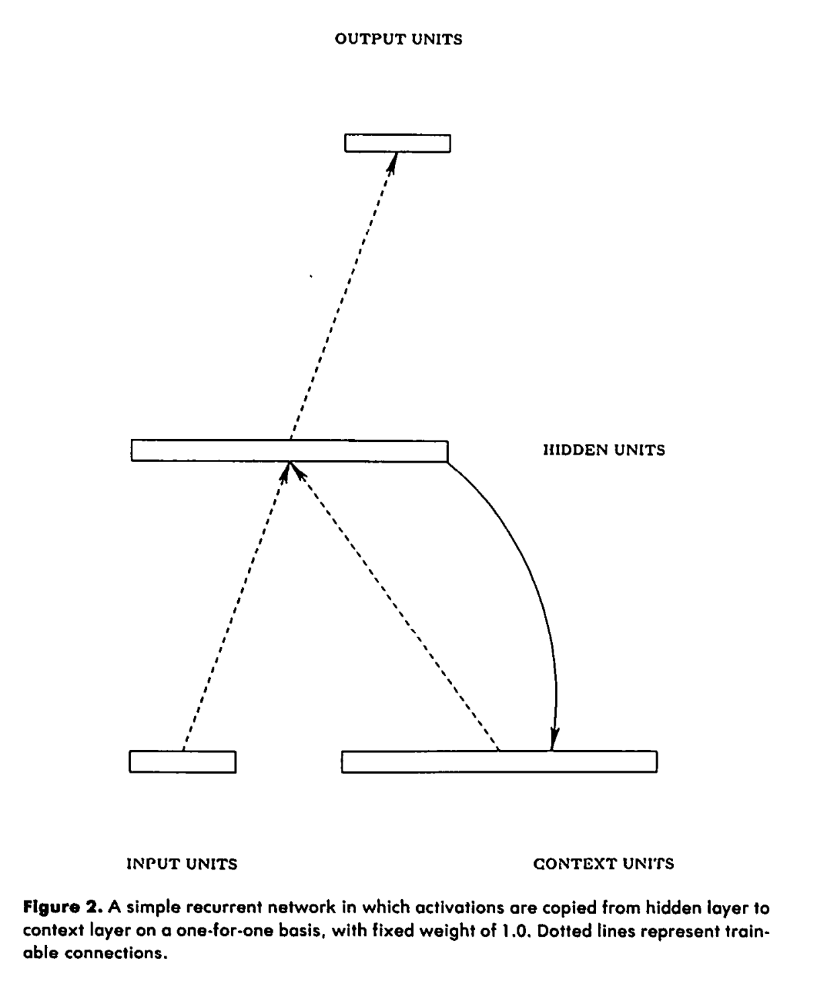</button><figcaption><strong>Elman：context units 保存上一时刻的隐藏激活</strong><a href="https://cseweb.ucsd.edu/~gary/cs200/s11/fsit.pdf">Finding Structure in Time</a> · Figure 2 · version author-hosted original PDF · PDF p.6 / printed p.184<button class="original-direct" type="button">Read original size</button>

Original caption &amp; source

Figure 
2. A simple 
recurrent 
network 
in which 
octivotions 
ore 
copied 
from 
hidden 
layer 
to
<a class="source-url" href="https://cseweb.ucsd.edu/~gary/cs200/s11/fsit.pdf">https://cseweb.ucsd.edu/~gary/cs200/s11/fsit.pdf</a>
</figcaption></figure>

沿图中的前馈边读：输入与 context 一起进入 hidden，hidden 产生输出，同时被复制到下一步的 context。复制本身不引入另一个可学习的编码器；学习发生在随后如何使用这个状态的连接上。与一次性拼接固定窗口相比，递归允许状态反映更早的加工，但也使历史影响受相同权重反复变换。手写数字例子里，当前行的横线是否属于“7”，可能取决于前几行已经建立的状态。

<figure id="fig-elman-f3"><button class="paper-image" type="button" aria-label="Zoom: Elman：时序 XOR 的预测误差随位置变化">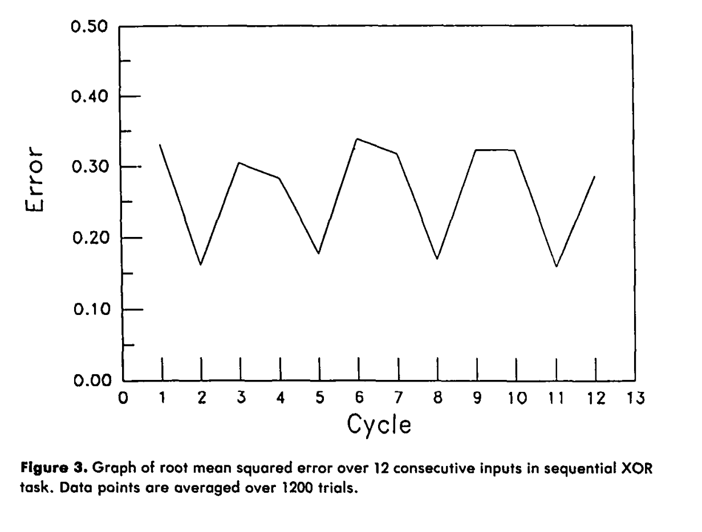</button><figcaption><strong>Elman：时序 XOR 的预测误差随位置变化</strong><a href="https://cseweb.ucsd.edu/~gary/cs200/s11/fsit.pdf">Finding Structure in Time</a> · Figure 3 · version author-hosted original PDF · PDF p.8 / printed p.186<button class="original-direct" type="button">Read original size</button>

Original caption &amp; source

Figure 
3. Graph 
of root 
mean 
squared 
error 
over 
12 consecutive 
inputs 
in sequentiol 
XOR
<a class="source-url" href="https://cseweb.ucsd.edu/~gary/cs200/s11/fsit.pdf">https://cseweb.ucsd.edu/~gary/cs200/s11/fsit.pdf</a>
</figcaption></figure>

横轴是连续输入位置，纵轴是 root mean squared error（均方根误差）；原图对应 12 个连续输入。时序 XOR 中，并不是每个位置都能仅由已见输入确定，因而误差会随序列中的角色变化。要读的是周期性结构与可预测位置，而不是把整条曲线解释为“训练越久误差越小”：这幅图的横轴不是训练 epoch。它证明了状态能被任务塑造成有用的时间表示，没有证明任意长度依赖都容易学习。

### 3.2 BPTT：展开的是计算，反传的是跨步影响

《Backpropagation Through Time》<a href="#source-2">[2]</a>系统解释通过时间反向传播（Backpropagation Through Time，BPTT），并承认此前相关推导。它不是“RNN 有了记忆以后才补上的一个标签”：参数在每个时间位置复用，必须累计这些位置对训练目标的影响。

<figure id="fig-bptt-f5"><button class="paper-image" type="button" aria-label="Zoom: BPTT：带时间延迟的网络怎样形成动力系统">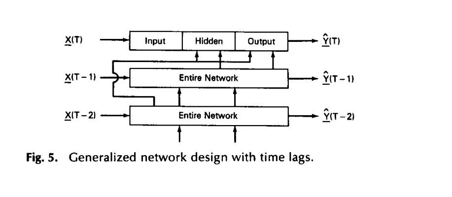</button><figcaption><strong>BPTT：带时间延迟的网络怎样形成动力系统</strong><a href="https://zenodo.org/records/1262035/files/article.pdf">Backpropagation Through Time: What It Does and How to Do It</a> · Figure 5 · version author-hosted original PDF · PDF p.5 / printed p.1554<button class="original-direct" type="button">Read original size</button>

Original caption &amp; source

Fig. 5. Generalized network design with time lags.
<a class="source-url" href="https://zenodo.org/records/1262035/files/article.pdf">https://zenodo.org/records/1262035/files/article.pdf</a>
</figcaption></figure>

图中的时间延迟把当前计算连接到历史值；零延迟与有延迟的连接承担不同依赖。展开后，同一个可训练连接会在不同时间位置重复出现。用数字行序列理解：第二行计算依赖第一行状态，第三行再依赖第二行；这些节点是同一套参数的多次使用，不是每行训练一个独立模型。原图采用比单层 RNN 更广义的网络设计，因此不能把所有边直接套成一个 $W_h$。

<figure id="fig-bptt-f6"><button class="paper-image" type="button" aria-label="Zoom: BPTT：虚线展示效用/导数怎样跨时间回传">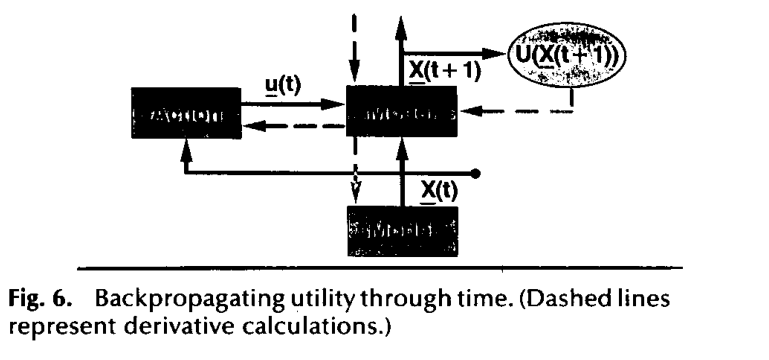</button><figcaption><strong>BPTT：虚线展示效用/导数怎样跨时间回传</strong><a href="https://zenodo.org/records/1262035/files/article.pdf">Backpropagation Through Time: What It Does and How to Do It</a> · Figure 6 · version author-hosted original PDF · PDF p.9 / printed p.1558<button class="original-direct" type="button">Read original size</button>

Original caption &amp; source

Fig. 6. Backpropagating utilitythrough time. (Dashed lines 
represent derivative calculations.)
<a class="source-url" href="https://zenodo.org/records/1262035/files/article.pdf">https://zenodo.org/records/1262035/files/article.pdf</a>
</figcaption></figure>

正向计算先得到状态与输出；虚线代表导数计算，将后来的目标影响传回先前节点。共享参数的梯度是所有时间位置贡献的和。对最后一行分类有帮助的第一行特征，要通过中间各步接受训练反馈。图回答“谁在影响谁”，不意味着训练时只存一份状态；为反向传播保留的中间激活通常仍随序列长度增加，除非截断、检查点或重计算。

### 3.3 梯度消失与爆炸：连续相乘的代价

对上述 tanh RNN，下面是沿状态链的一条导数路径；它是教学展开，完整参数梯度还包含输入、输出与所有目标位置的贡献：

$$
\frac{\partial h_t}{\partial h_k}
=J_tJ_{t-1}\cdots J_{k+1},\qquad
J_j=\operatorname{diag}(1-h_j^2)W_h.
$$

$k<t$ 为两个时间位置，$J_j\in\mathbb{R}^{H\times H}$ 为该步状态 Jacobian；$h_j^2$ 是逐元素平方，$\operatorname{diag}$ 将向量放在对角线上。矩阵乘法次序按链式法则从较晚步到较早步排列。若传播方向持续被缩小，远处反馈会消失；若某些方向持续被放大，则会爆炸。单看 $W_h$ 的某一个权重，或者只看“序列很长”，都不能完全判断真实梯度，因为激活区间、矩阵方向和训练轨迹共同参与。

《Learning Long-Term Dependencies with Gradient Descent is Difficult》<a href="#source-3">[3]</a>把长期保存信息与稳定的梯度学习之间的困难联系起来。重要的是“困难”及其条件，不是一个声称所有 RNN 必然失败的定理。

<figure id="fig-gradient-f1"><button class="paper-image" type="button" aria-label="Zoom: 长期依赖：锁存神经元与带干扰的输入">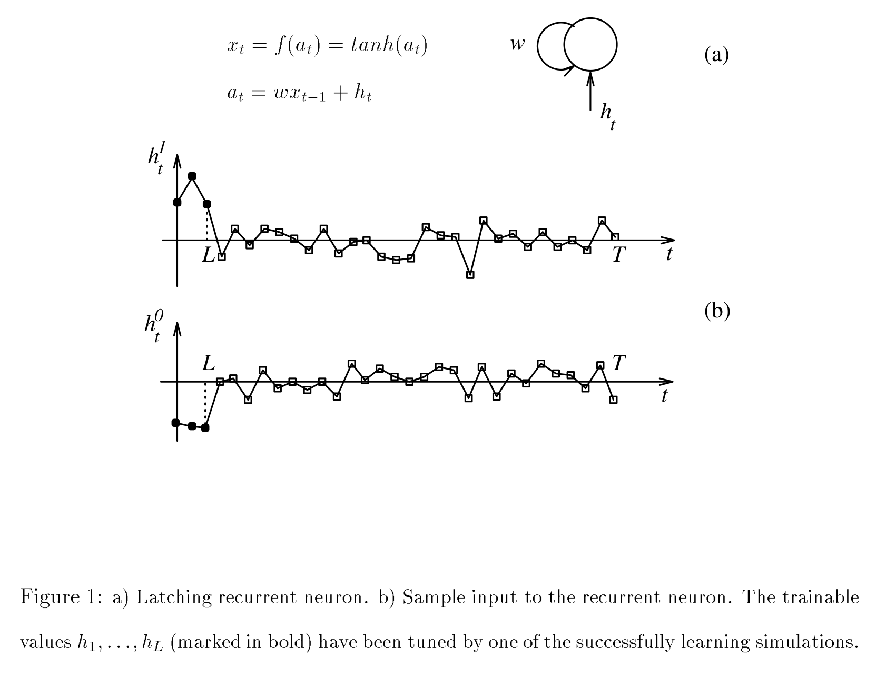</button><figcaption><strong>长期依赖：锁存神经元与带干扰的输入</strong><a href="https://www.dlsi.ua.es/~mlf/nnafmc/papers/bengio94learning.pdf">Learning Long-Term Dependencies with Gradient Descent is Difficult</a> · Figure 1 · version author-hosted original PDF · PDF p.32 / printed p.32<button class="original-direct" type="button">Read original size</button>

Original caption &amp; source

Figure 1: a) Latching recurrent neuron. b) Sample input to the recurrent neuron. The trainable

values hy,..., hz (marked in bold) have been tuned by one of the successfully learning simulations.
<a class="source-url" href="https://www.dlsi.ua.es/~mlf/nnafmc/papers/bengio94learning.pdf">https://www.dlsi.ua.es/~mlf/nnafmc/papers/bengio94learning.pdf</a>
</figcaption></figure>

子图 a 是能锁存信息的递归单元，子图 b 是早期信号与随后干扰组成的输入。任务可以用少量状态表达，却不代表梯度下降容易发现正确参数。图中加粗的参数来自成功学习的仿真，说明这里有可行解；困难发生在学习到该解的过程。数字分类中的类似情形是早期笔画提供类别线索，后续多数像素只有干扰作用。

<figure id="fig-gradient-f2"><button class="paper-image" type="button" aria-label="Zoom: 长期依赖：收敛随初值、噪声和序列长度变化">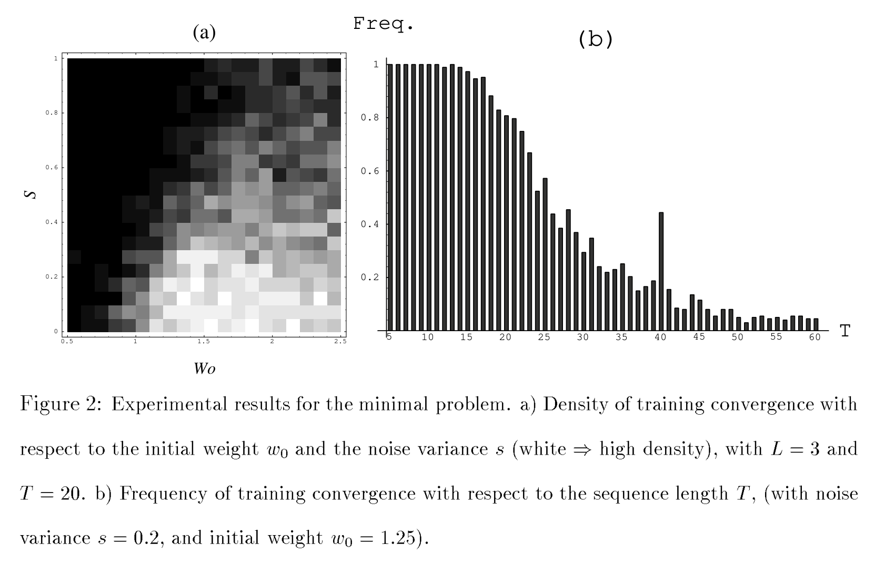</button><figcaption><strong>长期依赖：收敛随初值、噪声和序列长度变化</strong><a href="https://www.dlsi.ua.es/~mlf/nnafmc/papers/bengio94learning.pdf">Learning Long-Term Dependencies with Gradient Descent is Difficult</a> · Figure 2 · version author-hosted original PDF · PDF p.33 / printed p.33<button class="original-direct" type="button">Read original size</button>

Original caption &amp; source

Figure 2: Experimental results for the minimal problem. a) Density of training convergence with
respect to the initial weight wo and the noise variance s (white = high density), with L = 3 and
T = 20. b) Frequency of training convergence with respect to the sequence length 7, (with noise

variance s = 0.2, and initial weight wo = 1.25).
<a class="source-url" href="https://www.dlsi.ua.es/~mlf/nnafmc/papers/bengio94learning.pdf">https://www.dlsi.ua.es/~mlf/nnafmc/papers/bengio94learning.pdf</a>
</figcaption></figure>

左图把初始递归权重和噪声方差作为轴，明亮区域表示更高的训练收敛密度；右图固定部分条件后观察序列长度对成功频率的影响。它把“能存住”和“能学会”分开：存在成功区域，同时成功频率对初始化与长度敏感。不能把某个亮点当成稳定的普遍能力，也不能把横轴长度直接推广到任何真实语言任务。

<figure id="fig-gradient-f4"><button class="paper-image" type="button" aria-label="Zoom: 长期依赖：不同优化与搜索方法的成本和错误">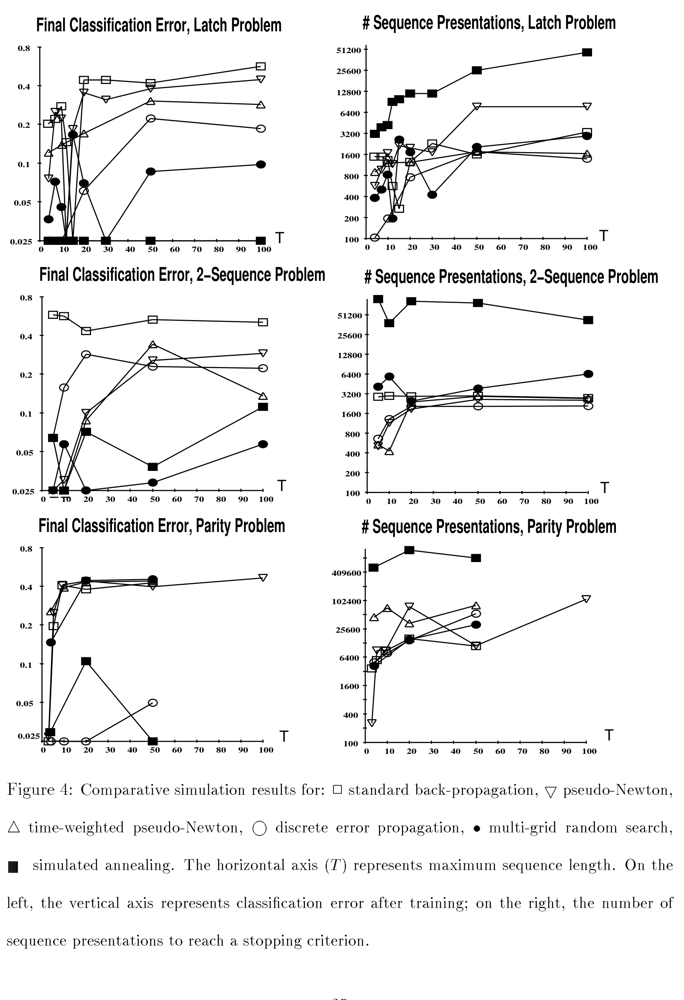</button><figcaption><strong>长期依赖：不同优化与搜索方法的成本和错误</strong><a href="https://www.dlsi.ua.es/~mlf/nnafmc/papers/bengio94learning.pdf">Learning Long-Term Dependencies with Gradient Descent is Difficult</a> · Figure 4 · version author-hosted original PDF · PDF p.35 / printed p.35<button class="original-direct" type="button">Read original size</button>

Original caption &amp; source

Figure 4: Comparative simulation results for: O standard back-propagation, V7 pseudo-Newton,
A time-weighted pseudo-Newton, © discrete error propagation, e multi-grid random search,
M simulated annealing. The horizontal axis (TJ) represents maximum sequence length. On the
left, the vertical axis represents classification error after training; on the right, the number of

sequence presentations to reach a stopping criterion.
<a class="source-url" href="https://www.dlsi.ua.es/~mlf/nnafmc/papers/bengio94learning.pdf">https://www.dlsi.ua.es/~mlf/nnafmc/papers/bengio94learning.pdf</a>
</figcaption></figure>

横轴表示最大序列长度；左面板的纵轴是训练后分类错误，右面板是达到停止准则需要呈现的序列数。不同标记对应标准反向传播、拟 Newton、时间加权版本、离散误差传播和搜索方法，必须分别读两个面板。低错误不自动等于低训练成本；搜索方法在这个合成问题上的行为也不能证明大模型训练效率。本文据此建立的主线是：单纯换优化器未必解决结构性传播困难，后续方法开始改状态通路本身。

### 3.4 裁剪、截断与深度：三个不同开关

Pascanu 等的训练困难分析<a href="#source-11">[11]</a>将爆炸梯度、消失梯度与参数空间几何联系起来。**梯度裁剪**限制一次参数更新中的梯度范数；**截断 BPTT**限制梯度回看的时间长度；**重置状态**直接删除前向记忆。这三种操作不能互换。

对参数梯度向量 $g$，范数裁剪的教学形式为：

$$
g_{\mathrm{clip}}=g\min\left(1,\frac{\tau}{\lVert g\rVert_2}\right).
$$

$\tau>0$ 是阈值，$\lVert g\rVert_2$ 是所有被裁剪参数梯度合并后的欧氏范数；$g=0$ 时直接保留零向量。范数超过阈值才整体缩放，不改变该步梯度方向。它降低爆炸更新的破坏性，却无法把已经消失的远处梯度补回来。截断时可以保留数值状态并 `detach`，只是让下一段不再沿该状态回传；本次实验会直接验证这种区别。

<figure id="fig-clip-f2"><button class="paper-image" type="button" aria-label="Zoom: 时间展开：每一步的误差都能贡献共享参数梯度">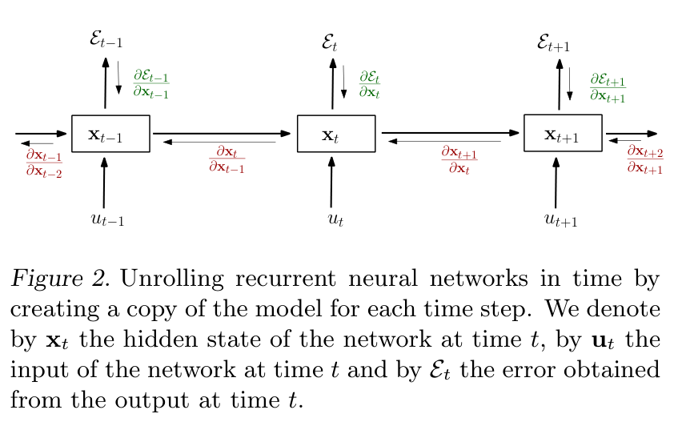</button><figcaption><strong>时间展开：每一步的误差都能贡献共享参数梯度</strong><a href="https://arxiv.org/abs/1211.5063">On the difficulty of training recurrent neural networks</a> · Figure 2 · version v2 · PDF p.2 / PDF page for source lookup<button class="original-direct" type="button">Read original size</button>

Original caption &amp; source

Figure 2. Unrolling recurrent neural networks in time by
creating a copy of the model for each time step. We denote
by xt the hidden state of the network at time t, by ut the
input of the network at time t and by Et the error obtained
from the output at time t.
<a class="source-url" href="https://arxiv.org/pdf/1211.5063v2">https://arxiv.org/pdf/1211.5063v2</a>
</figcaption></figure>

原图用 $x_t$ 表示隐藏状态、$u_t$ 表示输入，符号与本文第 2 节不同；沿时间展开，每个输出误差 $E_t$ 都向先前状态传播。读图时先固定一个误差节点，再追溯可达的参数使用位置，最后累计所有误差的贡献。它帮助区分“最后一步分类”与“逐步预测”，也说明共享参数不意味着只有一个梯度来源。

<figure id="fig-clip-f6"><button class="paper-image" type="button" aria-label="Zoom: 梯度几何：突然变陡的区域怎样造成大步更新">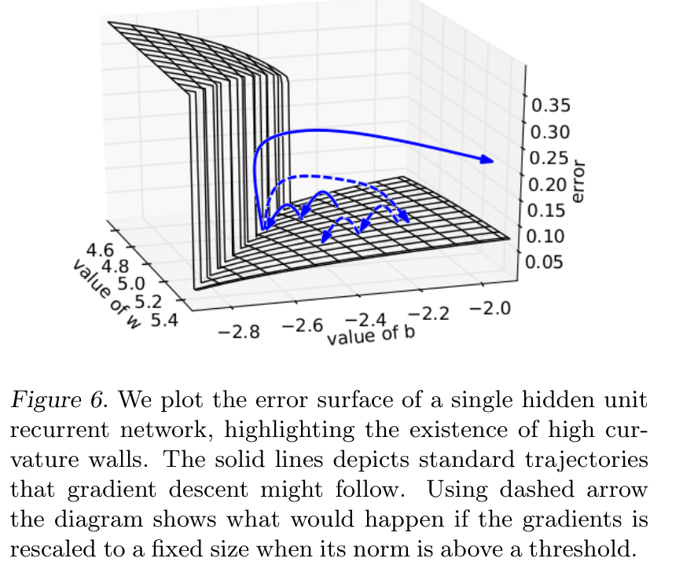</button><figcaption><strong>梯度几何：突然变陡的区域怎样造成大步更新</strong><a href="https://arxiv.org/abs/1211.5063">On the difficulty of training recurrent neural networks</a> · Figure 6 · version v2 · PDF p.5 / PDF page for source lookup<button class="original-direct" type="button">Read original size</button>

Original caption &amp; source

Figure 6. We plot the error surface of a single hidden unit
recurrent network, highlighting the existence of high cur-
vature walls. The solid lines depicts standard trajectories
that gradient descent might follow.
Using dashed arrow
the diagram shows what would happen if the gradients is
rescaled to a fixed size when its norm is above a threshold.
<a class="source-url" href="https://arxiv.org/pdf/1211.5063v2">https://arxiv.org/pdf/1211.5063v2</a>
</figcaption></figure>

这张原图用目标曲面与优化轨迹说明局部“悬崖”区域的效应。沿陡方向出现的大梯度会把参数推出原本较平稳的区域，裁剪缩短这一跳跃。它解释更新稳定性，不能从一条轨迹读出所有模型的收敛率，也不能据此声称远距离信用分配已解决。

<figure id="fig-clip-a1"><button class="paper-image" type="button" aria-label="Zoom: 范数裁剪算法：缩放整组梯度，保留方向">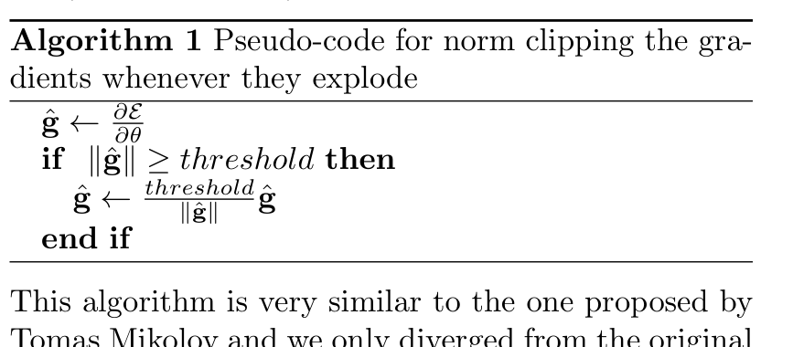</button><figcaption><strong>范数裁剪算法：缩放整组梯度，保留方向</strong><a href="https://arxiv.org/abs/1211.5063">On the difficulty of training recurrent neural networks</a> · Algorithm 1 · version v2 · PDF p.6 / PDF page for source lookup<button class="original-direct" type="button">Read original size</button>

Original caption &amp; source

Algorithm 1 Pseudo-code for norm clipping the gra-
dients whenever they explode
<a class="source-url" href="https://arxiv.org/pdf/1211.5063v2">https://arxiv.org/pdf/1211.5063v2</a>
</figcaption></figure>

伪代码先计算梯度范数，超过阈值再缩放，与上面的教学公式对应。要区别按范数整体裁剪与把每个元素夹到区间：后者可能改变方向，不能把两种策略的实验效果混称。梯度裁剪发生在反向传播和参数更新之间，不参与推理，也不修改当前请求的隐藏状态。

<figure id="fig-clip-f7"><button class="paper-image" type="button" aria-label="Zoom: 训练困难的合成验证：方法与任务长度必须一起读">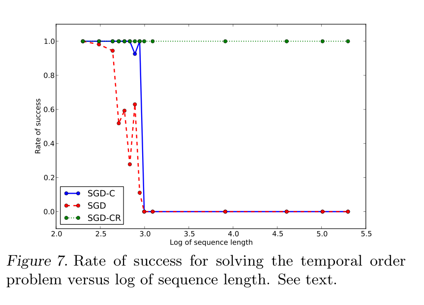</button><figcaption><strong>训练困难的合成验证：方法与任务长度必须一起读</strong><a href="https://arxiv.org/abs/1211.5063">On the difficulty of training recurrent neural networks</a> · Figure 7 · version v2 · PDF p.8 / PDF page for source lookup<button class="original-direct" type="button">Read original size</button>

Original caption &amp; source

Figure 7. Rate of success for solving the temporal order
problem versus log of sequence length. See text.
<a class="source-url" href="https://arxiv.org/pdf/1211.5063v2">https://arxiv.org/pdf/1211.5063v2</a>
</figcaption></figure>

横轴是序列长度的对数，纵轴是 temporal order 合成问题的解题成功率。读图需要同时保留图例里的优化策略和任务条件：裁剪作用于爆炸，论文提出的其他正则化针对传播性质，两者解决的问题不同。成功率不是每个测试样本的 accuracy。数字行序列中，控制大梯度有助于防止一次更新破坏模型，但不保证 64 个像素步比 8 个行步更容易学习。

深度也有多个位置。《How to Construct Deep Recurrent Neural Networks》<a href="#source-10">[10]</a>区分输入到隐藏、隐藏转移、隐藏到输出，以及递归层堆叠的深度。仅说“用了三层 RNN”会漏掉一步内部的非线性网络到底有多深。

<figure id="fig-deep-f2"><button class="paper-image" type="button" aria-label="Zoom: Deep RNN：堆叠层与加深单步计算是不同拓扑">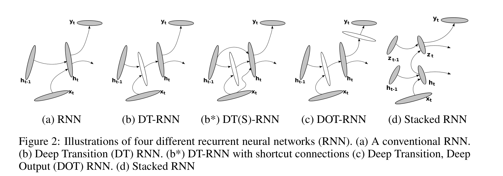</button><figcaption><strong>Deep RNN：堆叠层与加深单步计算是不同拓扑</strong><a href="https://arxiv.org/abs/1312.6026">How to Construct Deep Recurrent Neural Networks</a> · Figure 2 · version v5 · PDF p.4 / printed p.4<button class="original-direct" type="button">Read original size</button>

Original caption &amp; source

Figure 2: Illustrations of four different recurrent neural networks (RNN). (a) A conventional RNN.
(b) Deep Transition (DT) RNN. (b*) DT-RNN with shortcut connections (c) Deep Transition, Deep
Output (DOT) RNN. (d) Stacked RNN
<a class="source-url" href="https://arxiv.org/pdf/1312.6026v5">https://arxiv.org/pdf/1312.6026v5</a>
</figcaption></figure>

图中各方案改变的深度位置不同：时间展开增加重复步，堆叠增加每时刻的层间处理，deep transition 则让一次状态转移经过更多变换。读者应沿同一时刻和跨时刻分别追踪箭头。在数字例子中，“每一行都再经过一个 MLP”与“将第一层整段输出送给第二层递归网络”不是同一拓扑。

<figure id="fig-deep-t2"><button class="paper-image" type="button" aria-label="Zoom: Deep RNN：复调音乐预测中的深层结构比较">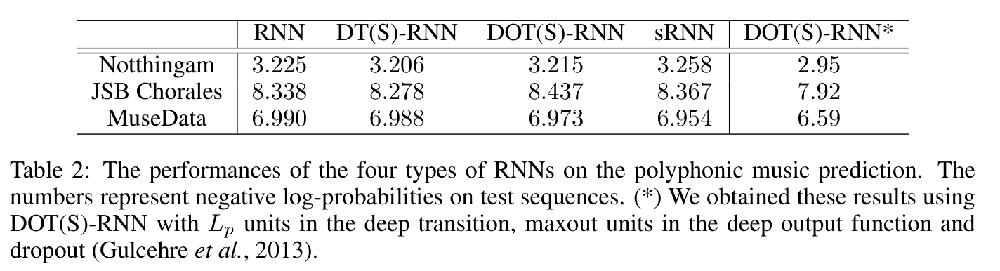</button><figcaption><strong>Deep RNN：复调音乐预测中的深层结构比较</strong><a href="https://arxiv.org/abs/1312.6026">How to Construct Deep Recurrent Neural Networks</a> · Table 2 · version v5 · PDF p.8 / printed p.8<button class="original-direct" type="button">Read original size</button>

Original caption &amp; source

Table 2: The performances of the four types of RNNs on the polyphonic music prediction. The
numbers represent negative log-probabilities on test sequences. (*) We obtained these results using
DOT(S)-RNN with Lp units in the deep transition, maxout units in the deep output function and
dropout (Gulcehre et al., 2013).
<a class="source-url" href="https://arxiv.org/pdf/1312.6026v5">https://arxiv.org/pdf/1312.6026v5</a>
</figcaption></figure>

表中比较四类 RNN 的复调音乐预测，数字是测试序列负对数概率，越低越好。不同数据列分别判断，不能合并成统一排名；星号版本还使用不同激活与 dropout，不能把全部收益归到“递归深度”。尤其需要保留参数量与训练配置，避免混淆加深、加宽及训练配方。其后续影响是把单元设计和层级表示分开研究，同时更深路径也增加优化与调用成本。

## 4. 经典 backbone：门控、方向与储备池

### 4.1 1997 LSTM：先给状态一条受控的通路

原始 LSTM<a href="#source-4">[4]</a>把线性自连接的 memory cell 与输入、输出门结合。论文的 constant error carousel（CEC，可理解为恒定误差循环通路）让误差信号在特定内部路径上更容易保持；它不等价于整个模型所有方向的梯度永远恒定。**1997 原始结构没有今天通常使用的遗忘门**，遗忘门要在后续工作中讨论。

<figure id="fig-lstm-f1"><button class="paper-image" type="button" aria-label="Zoom: 1997 LSTM：输入门、输出门与权重为 1 的自连接">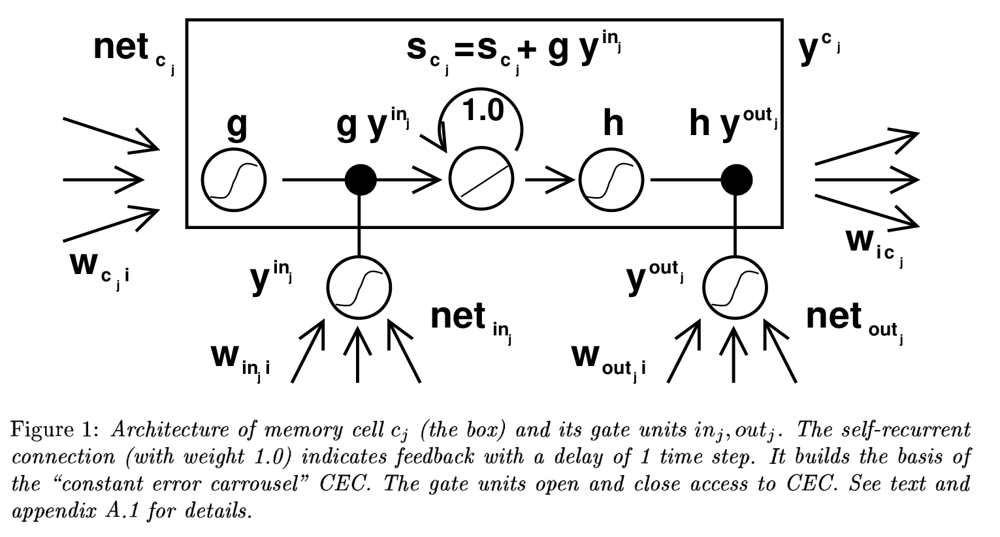</button><figcaption><strong>1997 LSTM：输入门、输出门与权重为 1 的自连接</strong><a href="https://people.idsia.ch/~juergen/lstm1997-2024head.pdf">Long Short-Term Memory</a> · Figure 1 · version 1997 original text, author reprint with updated bibliographic header · PDF p.7 / printed p.7<button class="original-direct" type="button">Read original size</button>

Original caption &amp; source

Figure 1: Architecture of memory cell c; (the box) and its gate units in;, out;. The self-recurrent

connection (with weight 1.0) indicates feedback with a delay of 1 time step. It builds the basis of

the “constant error carrousel” CEC. The gate units open and close access to CEC. See text and

appendix A.1 for details.

Bally
<a class="source-url" href="https://people.idsia.ch/~juergen/lstm1997-2024head.pdf">https://people.idsia.ch/~juergen/lstm1997-2024head.pdf</a>
</figcaption></figure>

方框是 cell，输入门控制写入，输出门控制读取，自连接的权重标为 1 并延迟一个时间步。直接沿这条内部路径传播时，不反复经过普通 tanh 状态转移矩阵；周围门与输入输出变换仍需要学习。数字例子中，重要的早期笔画可以先写入 cell，在无关行到来时少写入，最后再读出。原图中的符号沿用历史论文，后面现代教学公式采用更常见的 $c,h,i,f,o$。

<figure id="fig-lstm-t3"><button class="paper-image" type="button" aria-label="Zoom: 1997 LSTM：带大量干扰的长时间间隔实验">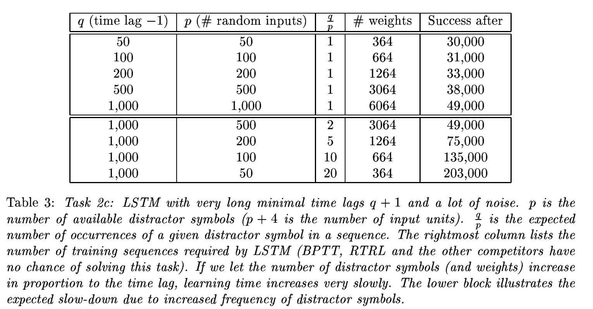</button><figcaption><strong>1997 LSTM：带大量干扰的长时间间隔实验</strong><a href="https://people.idsia.ch/~juergen/lstm1997-2024head.pdf">Long Short-Term Memory</a> · Table 3 · version 1997 original text, author reprint with updated bibliographic header · PDF p.15 / printed p.15<button class="original-direct" type="button">Read original size</button>

Original caption &amp; source

Table 3: Task 2c: LSTM with very long minimal time lags q+ 1 and a lot of noise. p is the
number of available distractor symbols (p+ 4 is the number of input units). 4 is the expected
number of occurrences of a given distractor symbol in a sequence. The rightmost column lists the
number of training sequences required by LSTM (BPTT, RTRL and the other competitors have
no chance of solving this task). If we let the number of distractor symbols (and weights) increase
in proportion to the time lag, learning time increases very slowly. The lower block illustrates the
expected slow-down due to increased frequency of distractor symbols.
<a class="source-url" href="https://people.idsia.ch/~juergen/lstm1997-2024head.pdf">https://people.idsia.ch/~juergen/lstm1997-2024head.pdf</a>
</figcaption></figure>

表中的时间间隔、干扰符号数量与训练序列数要一起读。它表明原论文构造的长延迟任务能够被这套记忆机制学到；增加延迟、增加干扰种类以及增加同一干扰的重复次数，会改变学习代价。表中关于其他算法“无机会”的表述是该文任务下的作者判断，本文不将其扩展成今天任意训练方法的普遍结论。合成长依赖也不等于真实语言的开放域理解。

### 4.2 遗忘门：连续流里的旧状态要能清除

《Learning to Forget》<a href="#source-5">[5]</a>面对的是持续预测：没有外部操作者在每个样本结束时可靠清空状态，旧记忆可能累积并干扰新任务。它让自连接权重变成随输入学习的遗忘门。这是门控历史中的关键修正，而非原始 LSTM 图中一直存在的模块。

<figure id="fig-forget-f1"><button class="paper-image" type="button" aria-label="Zoom: 遗忘门论文回顾的标准 LSTM：读写受控，旧状态仍会积累">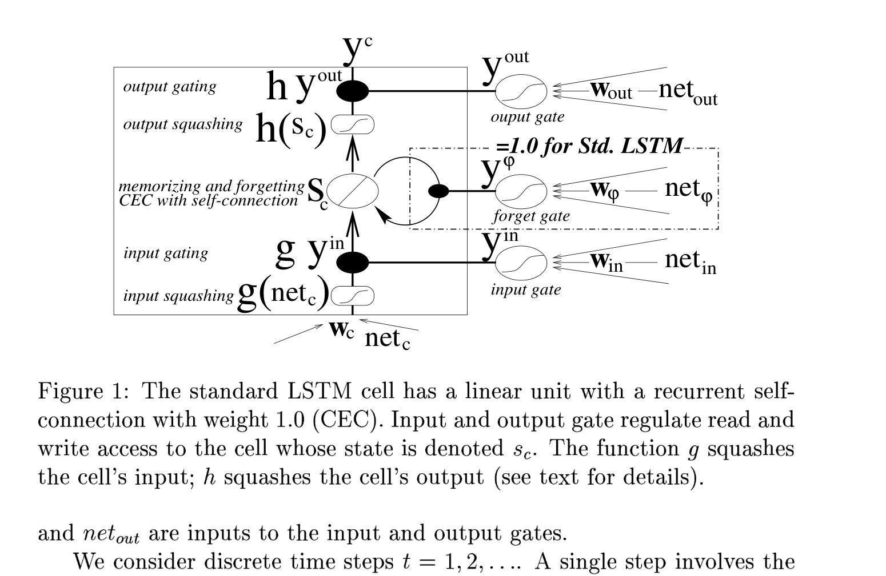</button><figcaption><strong>遗忘门论文回顾的标准 LSTM：读写受控，旧状态仍会积累</strong><a href="https://sferics.idsia.ch/pub/juergen/FgGates-NC.pdf">Learning to Forget: Continual Prediction with LSTM</a> · Figure 1 · version author-hosted original PDF · PDF p.4 / printed p.3<button class="original-direct" type="button">Read original size</button>

Original caption &amp; source

Figure 1: The standard LSTM cell has a linear unit with a recurrent, self-
connection with weight 1.0 (CEC). Input and output gate regulate read and
write access to the cell whose state is denoted s.. The function g squashes
the cell’s input; A squashes the cell’s output (see text for details).

and netou, are inputs to the input and output gates.
We consider discrete time steps t = 1,2,.... A single step involves the
<a class="source-url" href="https://sferics.idsia.ch/pub/juergen/FgGates-NC.pdf">https://sferics.idsia.ch/pub/juergen/FgGates-NC.pdf</a>
</figcaption></figure>

这张图首先画的是原有 LSTM，状态通过权重为 1 的自连接持续保持。输入和输出门决定“写什么、读什么”，却不能直接让已有内容按需衰减。连续读取多个数字或多个语法字符串时，仅靠少写入不能保证上一段状态自然消失；这正是后续扩展要修改的边。

<figure id="fig-forget-eq7"><button class="paper-image" type="button" aria-label="Zoom: 遗忘门的原文推导：让内部状态自连接的权重可学习">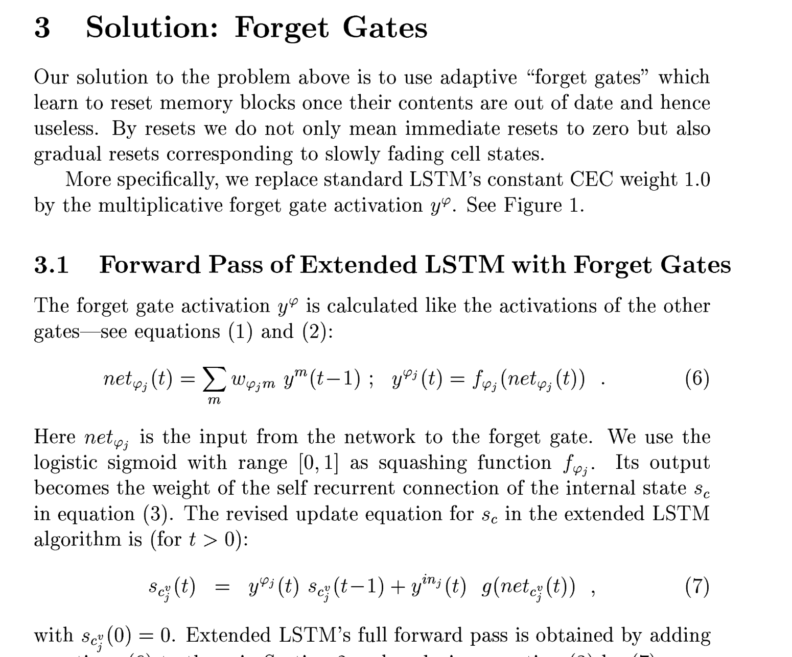</button><figcaption><strong>遗忘门的原文推导：让内部状态自连接的权重可学习</strong><a href="https://sferics.idsia.ch/pub/juergen/FgGates-NC.pdf">Learning to Forget: Continual Prediction with LSTM</a> · Section 3.1, equations 6–7 · version author-hosted original PDF · PDF p.6 / printed p.5<button class="original-direct" type="button">Read original size</button>

Original caption &amp; source

Figure 1.

3.1 Forward Pass of Extended LSTM with Forget Gates

The forget gate activation y® is calculated like the activations of the other
gates—see equations (1) and (2):

nety, (t) = Sows y™(t-1) ¢ y%*(E) = Fos (net, (0) (6)

Here nety, is the input from the network to the forget gate. We use the
logistic sigmoid with range [0,1] as squashing function f,,. Its output
becomes the weight of the self recurrent connection of the internal state s,
in equation (3). The revised update equation for s, in the extended LSTM
algorithm is (for t &gt; 0):

Se(t) = y(t) se(t—l + y(t) g(neter(t)) , (7)

J

with so (0) = 0. Extended LSTM’s full forward pass is obtained by adding

_
<a class="source-url" href="https://sferics.idsia.ch/pub/juergen/FgGates-NC.pdf">https://sferics.idsia.ch/pub/juergen/FgGates-NC.pdf</a>
</figcaption></figure>

截图是原文第 3.1 节的公式，不伪称一幅新的架构 Figure。新门的 sigmoid 输出落在 0 到 1 之间，乘在前一步 cell state 上；另一项仍是输入门控制的新写入。若门接近 1，旧信息保留；接近 0，旧信息被压掉。下面现代单层 LSTM 的教学式省略 peephole 等变体，并采用 tanh 候选：

$$
\begin{aligned}
i_t&=\sigma(W_ix_t+U_ih_{t-1}+b_i),&
f_t&=\sigma(W_fx_t+U_fh_{t-1}+b_f),\\
o_t&=\sigma(W_ox_t+U_oh_{t-1}+b_o),&
\widetilde c_t&=\tanh(W_cx_t+U_ch_{t-1}+b_c),\\
c_t&=f_t\odot c_{t-1}+i_t\odot\widetilde c_t,&
h_t&=o_t\odot\tanh(c_t).
\end{aligned}
$$

$i_t,f_t,o_t,\widetilde c_t,c_t,h_t\in\mathbb{R}^{H}$；$\sigma$ 是 sigmoid，$\odot$ 是逐元素乘法，$W_\bullet\in\mathbb{R}^{H\times D}$、$U_\bullet\in\mathbb{R}^{H\times H}$，每组偏置属于 $\mathbb{R}^{H}$。$c_t$ 保存 cell 内容，$h_t$ 是对外读出的隐藏表示，二者都必须随流传递。这里 $W_o$ 指输出门权重，不是第 2 节的分类头，符号由当前公式局部定义。

若某维 $f_t=0.9$，连续 10 步只保留旧内容且没有新写入，该维旧内容系数是 $0.9^{10}$，约 0.349。这个教学数值说明“有遗忘门”不等于“不衰减”。在此无peephole教学式中，固定前一步h，有$\partial c_t/\partial c_{t-1}=\operatorname{diag}(f_t)$；完整状态$(c,h)$的Jacobian为$2H\times2H$，还包含门/候选对旧h的导数。门乘积只是直接记忆路径，不能代替完整状态敏感度或共享参数的BPTT梯度。

三道门是连续调节，不是互斥开关，i与f也不要求和为1。候选决定拟写内容，i控制强度，o控制对外读出而不清空c。例如单维旧c=2、f=0.5、i=0.25、候选=-0.8，新c=0.8，随后由o乘tanh(0.8)读出。

<figure id="fig-forget-t2"><button class="paper-image" type="button" aria-label="Zoom: 连续 Reber Grammar：完美、较好与失败解分开统计">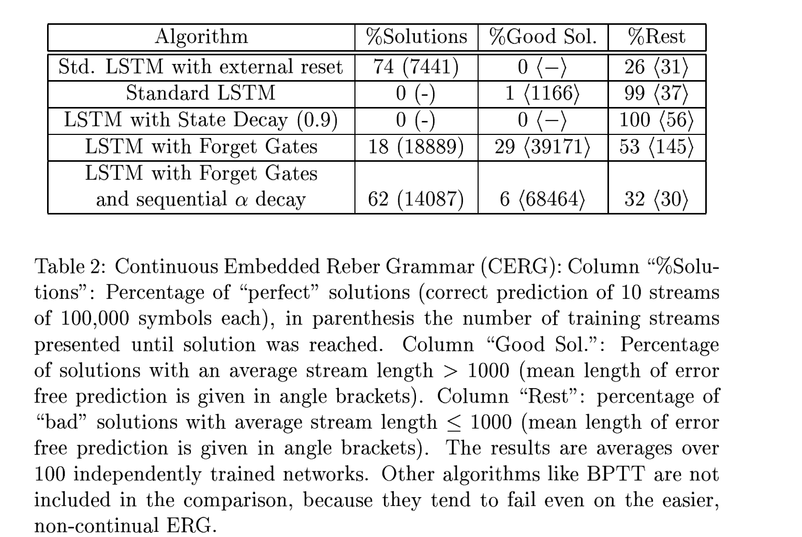</button><figcaption><strong>连续 Reber Grammar：完美、较好与失败解分开统计</strong><a href="https://sferics.idsia.ch/pub/juergen/FgGates-NC.pdf">Learning to Forget: Continual Prediction with LSTM</a> · Table 2 · version author-hosted original PDF · PDF p.13 / printed p.12<button class="original-direct" type="button">Read original size</button>

Original caption &amp; source

Table 2: Continuous Embedded Reber Grammar (CERG): Column “%Solu-
tions”: Percentage of “perfect” solutions (correct prediction of 10 streams
of 100,000 symbols each), in parenthesis the number of training streams
presented until solution was reached. Column “Good Sol.”: Percentage
of solutions with an average stream length &gt; 1000 (mean length of error
free prediction is given in angle brackets). Column “Rest”: percentage of
“bad” solutions with average stream length &lt; 1000 (mean length of error
free prediction is given in angle brackets). The results are averages over
100 independently trained networks. Other algorithms like BPTT are not
included in the comparison, because they tend to fail even on the easier,
non-continual ERG.
<a class="source-url" href="https://sferics.idsia.ch/pub/juergen/FgGates-NC.pdf">https://sferics.idsia.ch/pub/juergen/FgGates-NC.pdf</a>
</figcaption></figure>

表按 100 次独立训练统计不同类型解；“perfect”对应原文规定的长流预测成功，“good”与其余结果使用平均无错误流长度划分。它不是普通分类 accuracy 表。关注的是标准结构与带遗忘机制结构在持续输入下是否能稳定工作，以及达到解需要多少训练流。语法任务证明了自重置行为有价值，没有证明所有真实序列都需要相同重置模式。

<figure id="fig-forget-f4"><button class="paper-image" type="button" aria-label="Zoom: 标准 LSTM 的内部状态：新字符串到来，旧值没有自动清空">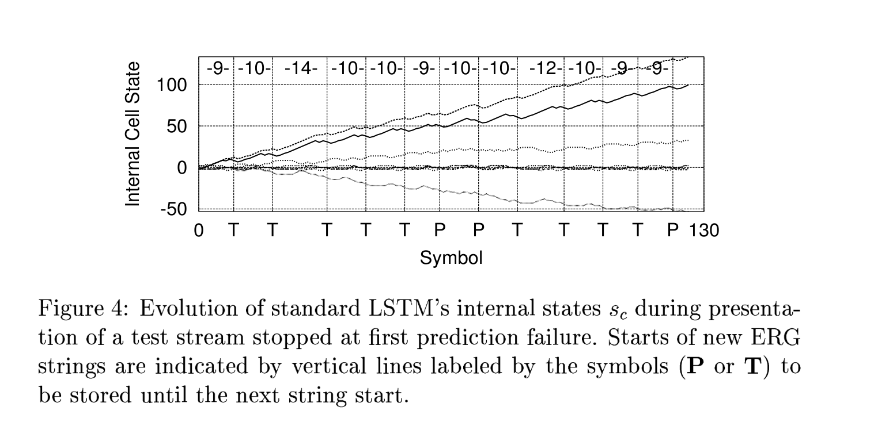</button><figcaption><strong>标准 LSTM 的内部状态：新字符串到来，旧值没有自动清空</strong><a href="https://sferics.idsia.ch/pub/juergen/FgGates-NC.pdf">Learning to Forget: Continual Prediction with LSTM</a> · Figure 4 · version author-hosted original PDF · PDF p.14 / printed p.13<button class="original-direct" type="button">Read original size</button>

Original caption &amp; source

Figure 4: Evolution of standard LSTM’s internal states s, during presenta-
tion of a test stream stopped at first prediction failure. Starts of new ERG
strings are indicated by vertical lines labeled by the symbols (P or T) to
be stored until the next string start.
<a class="source-url" href="https://sferics.idsia.ch/pub/juergen/FgGates-NC.pdf">https://sferics.idsia.ch/pub/juergen/FgGates-NC.pdf</a>
</figcaption></figure>

横轴沿连续符号流，纵轴是不同 cell 的内部状态；竖线标记新语法字符串开始及需要记住的 P/T 符号。状态曲线在多个字符串间累积，直到预测失败才停止展示。不能把曲线升高理解为“记住得越来越多”：无界积累也会破坏可读出性。这是连续运行中生命周期管理的早期模型层证据。

<figure id="fig-forget-f56"><button class="paper-image" type="button" aria-label="Zoom: 带遗忘门的状态与门激活：重置行为由输入触发">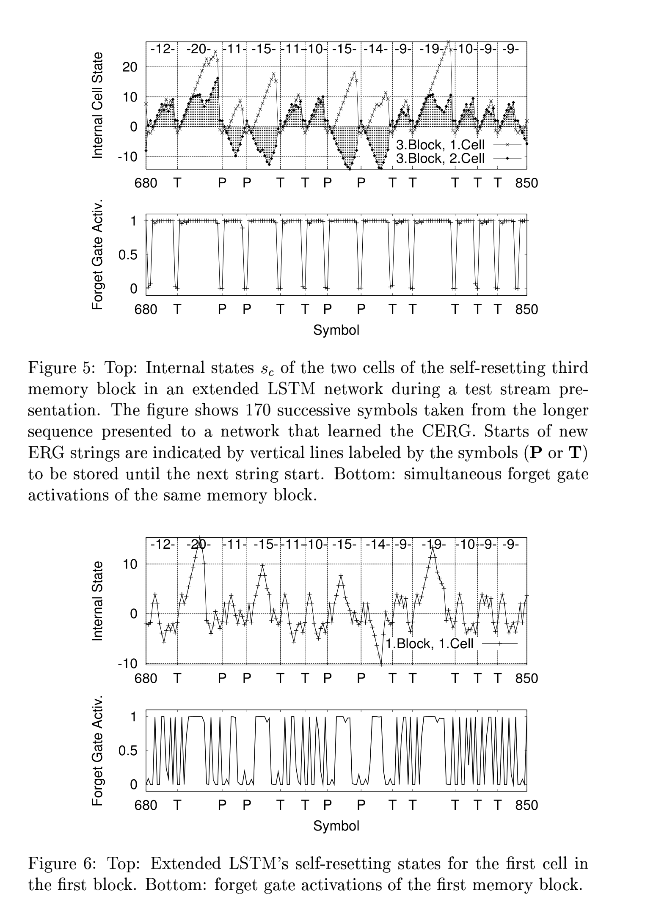</button><figcaption><strong>带遗忘门的状态与门激活：重置行为由输入触发</strong><a href="https://sferics.idsia.ch/pub/juergen/FgGates-NC.pdf">Learning to Forget: Continual Prediction with LSTM</a> · Figures 5–6 · version author-hosted original PDF · PDF p.15 / printed p.14<button class="original-direct" type="button">Read original size</button>

Original caption &amp; source

Figure 5: Top: Internal states s, of the two cells of the self-resetting third
memory block in an extended LSTM network during a test stream pre-
sentation. The figure shows 170 successive symbols taken from the longer
sequence presented to a network that learned the CERG. Starts of new
ERG strings are indicated by vertical lines labeled by the symbols (P or T)
to be stored until the next string start. Bottom: simultaneous forget gate
activations of the same memory block.

12-7 -B- F117 -15--114105 -15-1-14--9- -49- -105-9-7-9-
2 10 Al i
ow
7)
E of ik Ny ce ; as ‘
Bea WRN ay Lal Ta
~ 1,Block, 1.Gell, ——
-10
680 T P P T TP P TT T T T 850
2
&amp; 1
2
&amp; 0.5
LL 680 T P P T TP P TT T T T 850
Symbol

Figure 6: Top: Extended LSTM’s self-resetting states for the first cell in
the first block. Bottom: forget gate activations of the first memory block.
<a class="source-url" href="https://sferics.idsia.ch/pub/juergen/FgGates-NC.pdf">https://sferics.idsia.ch/pub/juergen/FgGates-NC.pdf</a>
</figcaption></figure>

两组图分别配对 cell state 与同一 memory block 的 forget gate 激活；横轴相同，才能对照新字符串边界、门下降和状态变化。某些门在边界附近衰减旧状态，另一些 block 保留不同信息，体现可学习的分工。实际服务仍应在独立请求边界显式隔离状态；模型学会“可能重置”不能替代系统保证不会把用户 A 的状态传给用户 B。

### 4.3 双向 RNN：上下文更多，在线可见性改变

双向 RNN<a href="#source-6">[6]</a>让一个递归链从左向右、另一个从右向左读取输入，再合并同位置的表示。它增加后文可见性，不是让单向状态凭空知道未来。双向 LSTM/GRU 是这种组织方式与对应 cell 的组合。

<figure id="fig-birnn-f23"><button class="paper-image" type="button" aria-label="Zoom: 双向网络：先比较可见范围，再看两条时间链">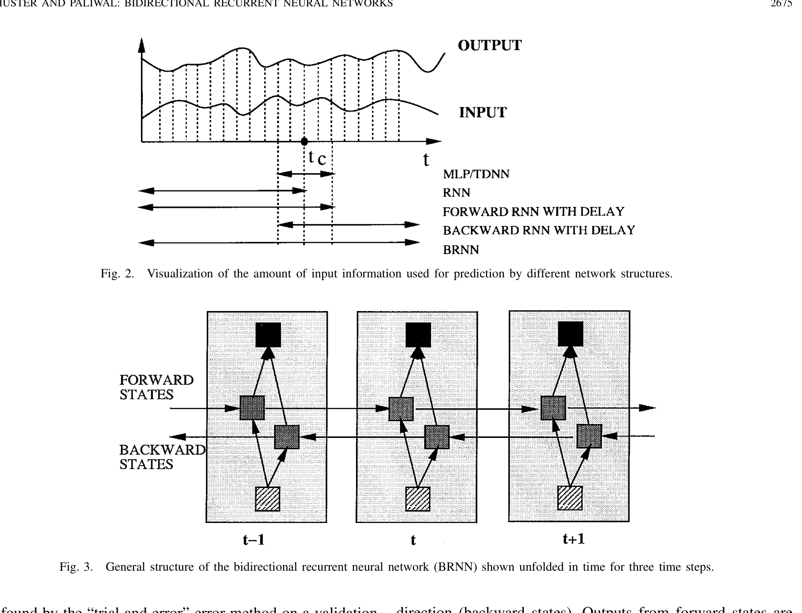</button><figcaption><strong>双向网络：先比较可见范围，再看两条时间链</strong><a href="https://deeplearning.cs.cmu.edu/F21/document/readings/Bidirectional%20Recurrent%20Neural%20Networks.pdf">Bidirectional Recurrent Neural Networks</a> · Figures 2–3 · version author-hosted original PDF · PDF p.3 / printed p.2675<button class="original-direct" type="button">Read original size</button>

Original caption &amp; source

Fig. 2.
Visualization of the amount of input information used for prediction by different network structures.

Fig. 3.
General structure of the bidirectional recurrent neural network (BRNN) shown unfolded in time for three time steps.
<a class="source-url" href="https://deeplearning.cs.cmu.edu/F21/document/readings/Bidirectional%20Recurrent%20Neural%20Networks.pdf">https://deeplearning.cs.cmu.edu/F21/document/readings/Bidirectional%20Recurrent%20Neural%20Networks.pdf</a>
</figcaption></figure>

Figure 2 对比不同结构预测一个位置时能利用的输入范围；Figure 3 将双向链展开为三个时间步。前向与后向状态分别独立递归，到输出层才汇合，不应把相反方向连成一个因果循环。OCR 当前列是“l”还是相邻笔画的一部分，右侧列常能消除歧义；但完整右侧输入尚未到来时，这个判断无法立即获得。

<figure id="fig-birnn-f4"><button class="paper-image" type="button" aria-label="Zoom: 双向网络的人工回归实验：未来位移与误差的关系">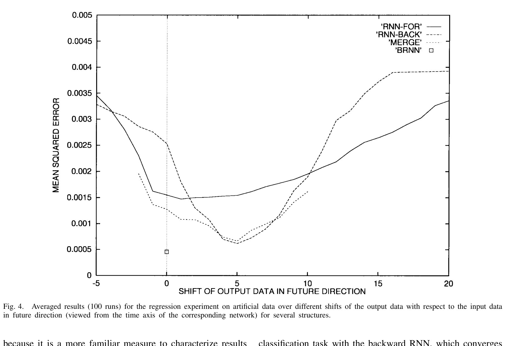</button><figcaption><strong>双向网络的人工回归实验：未来位移与误差的关系</strong><a href="https://deeplearning.cs.cmu.edu/F21/document/readings/Bidirectional%20Recurrent%20Neural%20Networks.pdf">Bidirectional Recurrent Neural Networks</a> · Figure 4 · version author-hosted original PDF · PDF p.5 / printed p.2677<button class="original-direct" type="button">Read original size</button>

Original caption &amp; source

Fig. 4.
Averaged results (100 runs) for the regression experiment on artificial data over different shifts of the output data with respect to the input data
in future direction (viewed from the time axis of the corresponding network) for several structures.
<a class="source-url" href="https://deeplearning.cs.cmu.edu/F21/document/readings/Bidirectional%20Recurrent%20Neural%20Networks.pdf">https://deeplearning.cs.cmu.edu/F21/document/readings/Bidirectional%20Recurrent%20Neural%20Networks.pdf</a>
</figcaption></figure>

横轴改变输出相对输入向未来移动的程度，纵轴是论文人工回归任务的平均结果，原图按 100 次运行汇总。不同结构访问未来输入的能力不同，因而曲线分化。这个证据支持“可见性很重要”，不支持把离线双向误差与零前瞻在线模型直接当同条件比较。流式语音若用有限右上下文，必须单独报告等待时间。

### 4.4 Echo State Network：随机动力学也能形成特征

Echo State Network（ESN，回声状态网络）<a href="#source-7">[7]</a>把大部分递归连接固定为储备池，通常只训练读出部分。它降低了全网 BPTT 的训练负担，前提是储备池动态提供足够有用而稳定的状态。原文及其勘误提醒：某些谱半径条件并非任意网络获得 echo state property 的充分保证，不能简化成“谱半径小于 1 就永远正确”。

<figure id="fig-esn-f1"><button class="paper-image" type="button" aria-label="Zoom: ESN：固定储备池、输入驱动与可训练读出">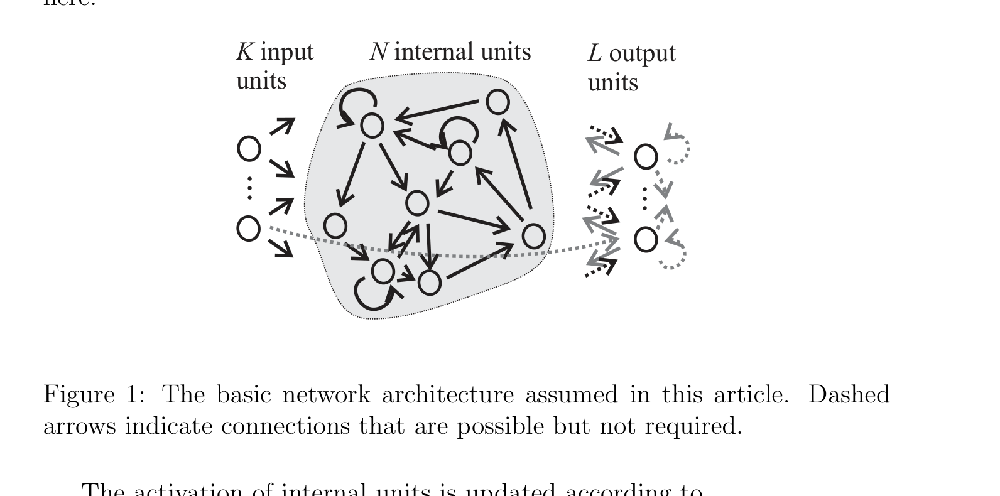</button><figcaption><strong>ESN：固定储备池、输入驱动与可训练读出</strong><a href="https://www.ai.rug.nl/minds/uploads/EchoStatesTechRep.pdf">The &quot;Echo State&quot; Approach to Analysing and Training Recurrent Neural Networks</a> · Figure 1 · version author-hosted original PDF · PDF p.5 / printed p.5<button class="original-direct" type="button">Read original size</button>

Original caption &amp; source

Figure 1: The basic network architecture assumed in this article. Dashed
arrows indicate connections that are possible but not required.
<a class="source-url" href="https://www.ai.rug.nl/minds/uploads/EchoStatesTechRep.pdf">https://www.ai.rug.nl/minds/uploads/EchoStatesTechRep.pdf</a>
</figcaption></figure>

实线与虚线区分必须和可选的连接，储备池在输入驱动下形成丰富响应，读出把这些状态组合成目标。虚线反馈若启用，会影响生成阶段的闭环动力学，不能只看开环拟合效果。数字例子中，可以让随机池产生不同时间尺度的笔画响应，再训练分类读出；但特征是否足够好仍由任务和池设计决定。

<figure id="fig-esn-f7"><button class="paper-image" type="button" aria-label="Zoom: ESN 的失败例子：训练拟合不能保证闭环生成稳定">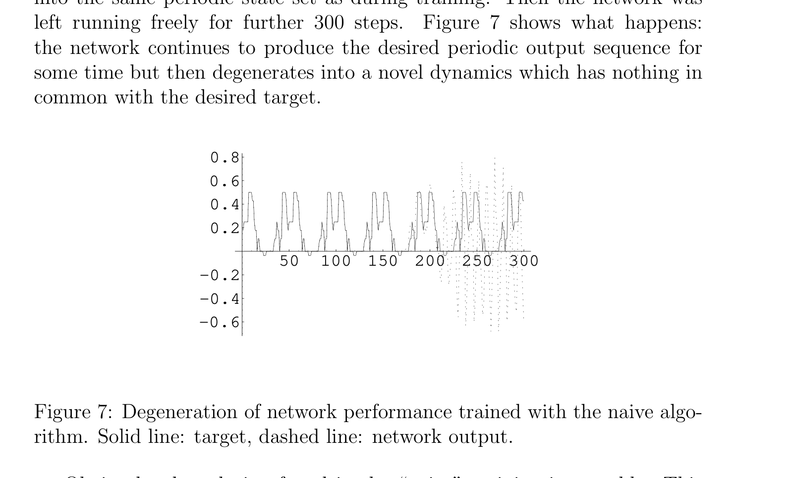</button><figcaption><strong>ESN 的失败例子：训练拟合不能保证闭环生成稳定</strong><a href="https://www.ai.rug.nl/minds/uploads/EchoStatesTechRep.pdf">The &quot;Echo State&quot; Approach to Analysing and Training Recurrent Neural Networks</a> · Figure 7 · version author-hosted original PDF · PDF p.19 / printed p.19<button class="original-direct" type="button">Read original size</button>

Original caption &amp; source

Figure 7: Degeneration of network performance trained with the naive algo-
rithm. Solid line: target, dashed line: network output.
<a class="source-url" href="https://www.ai.rug.nl/minds/uploads/EchoStatesTechRep.pdf">https://www.ai.rug.nl/minds/uploads/EchoStatesTechRep.pdf</a>
</figcaption></figure>

实线是目标，虚线是网络输出；曲线随运行出现退化，展示朴素训练策略的限制。关键是训练时提供的驱动条件与生成时自己的输出反馈可能不同，微小误差会改变后续状态。原图属于论文的具体动力学设置，不是“所有储备池都失败”的结论；它与后面自回归预测的误差累积形成呼应。需要持续生成时，稳定性验证不能只停在训练集读出误差。

### 4.5 GRU：合并状态，分别控制更新与重置

Cho 等的 RNN Encoder–Decoder<a href="#source-8">[8]</a>提出后来通称 GRU（Gated Recurrent Unit，门控递归单元）的更新方式。GRU 不额外维护 LSTM 式的独立 cell state，而是直接在旧隐藏状态与候选状态之间选择；reset gate 决定旧状态怎样参与候选计算。

<figure id="fig-gru-f2"><button class="paper-image" type="button" aria-label="Zoom: GRU：更新门选择保留，重置门控制候选中的历史">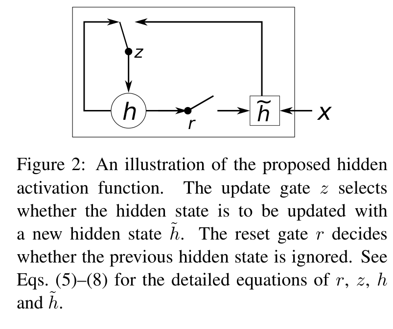</button><figcaption><strong>GRU：更新门选择保留，重置门控制候选中的历史</strong><a href="https://arxiv.org/abs/1406.1078">Learning Phrase Representations using RNN Encoder-Decoder for Statistical Machine Translation</a> · Figure 2 · version v3 · PDF p.3 / PDF page for source lookup<button class="original-direct" type="button">Read original size</button>

Original caption &amp; source

Figure 2: An illustration of the proposed hidden
activation function.
The update gate z selects
whether the hidden state is to be updated with
a new hidden state ˜h. The reset gate r decides
whether the previous hidden state is ignored. See
Eqs. (5)–(8) for the detailed equations of r, z, h
and ˜h.
<a class="source-url" href="https://arxiv.org/pdf/1406.1078v3">https://arxiv.org/pdf/1406.1078v3</a>
</figcaption></figure>

沿旧状态的直接通路和候选通路分别读图：update gate 控制两路如何混合，reset gate 作用于候选计算中的历史项。两道门不是两个独立记忆库。数字早期笔画仍有用时，可以保留旧状态；需要建立新局部特征时，候选支路可以减少旧内容干扰。

原始论文的约定可写为：

$$
\begin{aligned}
r_t&=\sigma(W_rx_t+U_rh_{t-1}),\\
z_t&=\sigma(W_zx_t+U_zh_{t-1}),\\
\widetilde h_t&=\tanh(Wx_t+U(r_t\odot h_{t-1})),\\
h_t&=z_t\odot h_{t-1}+(1-z_t)\odot\widetilde h_t.
\end{aligned}
$$

$r_t,z_t,h_t,\widetilde h_t\in\mathbb{R}^{H}$，各输入权重为 $H\times D$，递归权重为 $H\times H$；这里省略偏置以贴近原文表达。$z_t$ 接近 1 时保留旧状态。其他文献可能将 $z$ 的定义取反，必须同时看混合式，不能仅凭门名判断。

**PyTorch 的候选状态计算与原始式有实现差别。** 它将 reset gate 乘在隐藏线性变换之后，即候选含 $r_t\odot(Uh_{t-1}+b_h)$，而原文是先逐元素重置再乘 $U$。一般稠密 $U$ 下，两者不等价。本次教学实验用实际安装的 PyTorch 实现，不声称逐项复现原始 GRU；正式转换还应核对权重门顺序、偏置及 reset-before/reset-after 约定。

<figure id="fig-gru-f1"><button class="paper-image" type="button" aria-label="Zoom: RNN Encoder–Decoder：把源短语编码为状态，再递归生成目标短语">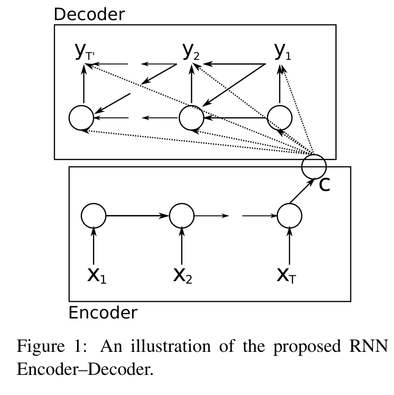</button><figcaption><strong>RNN Encoder–Decoder：把源短语编码为状态，再递归生成目标短语</strong><a href="https://arxiv.org/abs/1406.1078">Learning Phrase Representations using RNN Encoder-Decoder for Statistical Machine Translation</a> · Figure 1 · version v3 · PDF p.2 / PDF page for source lookup<button class="original-direct" type="button">Read original size</button>

Original caption &amp; source

Figure 1: An illustration of the proposed RNN
Encoder–Decoder.
<a class="source-url" href="https://arxiv.org/pdf/1406.1078v3">https://arxiv.org/pdf/1406.1078v3</a>
</figcaption></figure>

编码器读入源符号形成摘要，解码器按已有输出与该摘要生成下一个符号。图中共享 cell 与两个网络的参数共享是不同概念：编码器和解码器不必使用同一套参数。这里解决变长短语间的映射，GRU 是内部单元，encoder–decoder 是系统结构。固定摘要也会成为长输入的信息瓶颈，后面注意力对此做了接口改变。

<figure id="fig-gru-t1"><button class="paper-image" type="button" aria-label="Zoom: GRU 原始应用：神经短语评分加入统计机器翻译">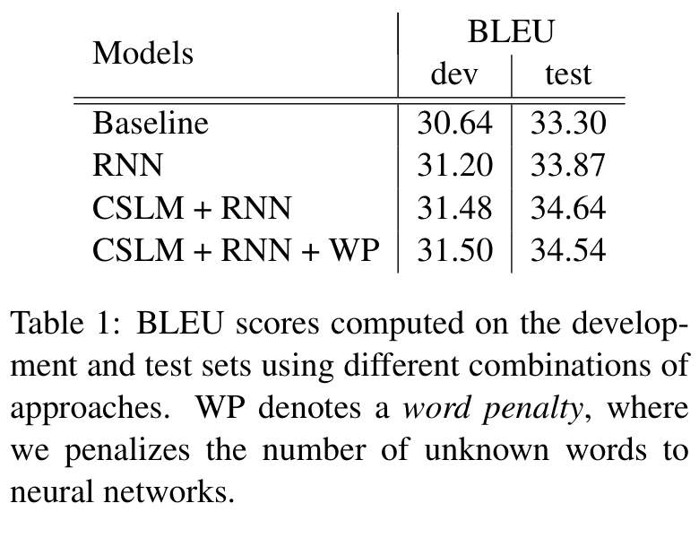</button><figcaption><strong>GRU 原始应用：神经短语评分加入统计机器翻译</strong><a href="https://arxiv.org/abs/1406.1078">Learning Phrase Representations using RNN Encoder-Decoder for Statistical Machine Translation</a> · Table 1 · version v3 · PDF p.6 / PDF page for source lookup<button class="original-direct" type="button">Read original size</button>

Original caption &amp; source

Table 1: BLEU scores computed on the develop-
ment and test sets using different combinations of
approaches. WP denotes a word penalty, where
we penalizes the number of unknown words to
neural networks.
<a class="source-url" href="https://arxiv.org/pdf/1406.1078v3">https://arxiv.org/pdf/1406.1078v3</a>
</figcaption></figure>

这是开发集和测试集的 BLEU 表。论文 baseline 测试 33.30，加入 RNN 短语评分为 33.87，CSLM+RNN 为 34.64，额外 word penalty 的组合为 34.54。这里是对统计机器翻译系统加入评分项，不是完全神经翻译与所有其他系统的独立对决；组合模型的收益也不能全部归到 GRU 门。BLEU 是基于候选与参考文本的 n-gram 匹配并含长度惩罚，分词、参考与解码设置会影响数值，不能跨协议直接比较。

### 4.6 LSTM 与 GRU：参数更少不代表任何任务都更优

《Empirical Evaluation of Gated Recurrent Neural Networks》<a href="#source-9">[9]</a>比较 tanh RNN、LSTM 和 GRU，在复调音乐与语音信号建模中观察门控的作用。它支持“GRU 可与 LSTM 相当”的经验结论，并不产生一个脱离任务的永久排名。

<figure id="fig-grutest-f1"><button class="paper-image" type="button" aria-label="Zoom: 同图对照 LSTM 与 GRU：两种状态组织方式">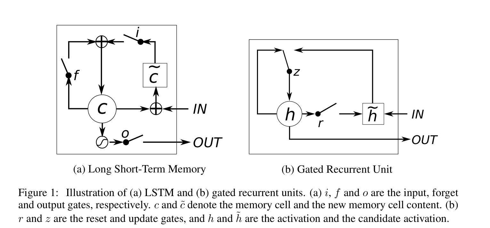</button><figcaption><strong>同图对照 LSTM 与 GRU：两种状态组织方式</strong><a href="https://arxiv.org/abs/1412.3555">Empirical Evaluation of Gated Recurrent Neural Networks on Sequence Modeling</a> · Figure 1 · version v1 · PDF p.3 / printed p.3<button class="original-direct" type="button">Read original size</button>

Original caption &amp; source

Figure 1: Illustration of (a) LSTM and (b) gated recurrent units. (a) i, f and o are the input, forget
and output gates, respectively. c and ˜c denote the memory cell and the new memory cell content. (b)
r and z are the reset and update gates, and h and ˜h are the activation and the candidate activation.
<a class="source-url" href="https://arxiv.org/pdf/1412.3555v1">https://arxiv.org/pdf/1412.3555v1</a>
</figcaption></figure>

LSTM 的输入、遗忘、输出门围绕独立 cell 工作；GRU 的 reset 与 update 围绕隐藏状态工作。读取时要区分乘法门和加法汇合，不要把图中每个圆都当成一层矩阵。相同隐藏宽度下 LSTM 通常有四组投影、GRU 三组，但有效容量、状态接口和实际 kernel 都不同。

<figure id="fig-grutest-t12"><button class="paper-image" type="button" aria-label="Zoom: 门控比较：先看模型规模，再看负对数概率">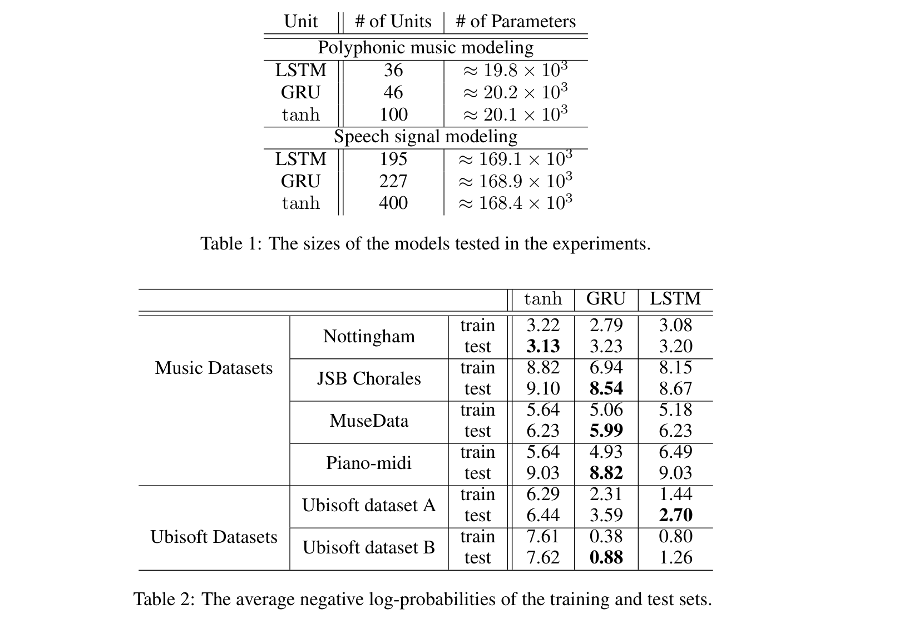</button><figcaption><strong>门控比较：先看模型规模，再看负对数概率</strong><a href="https://arxiv.org/abs/1412.3555">Empirical Evaluation of Gated Recurrent Neural Networks on Sequence Modeling</a> · Tables 1–2 · version v1 · PDF p.6 / printed p.6<button class="original-direct" type="button">Read original size</button>

Original caption &amp; source

Table 1: The sizes of the models tested in the experiments.

Table 2: The average negative log-probabilities of the training and test sets.
<a class="source-url" href="https://arxiv.org/pdf/1412.3555v1">https://arxiv.org/pdf/1412.3555v1</a>
</figcaption></figure>

Table 1 给出实验模型尺寸，Table 2 给出训练与测试平均负对数概率，越低越好。论文在音乐数据上差距较小，GRU 并非每个数据集最好；在两套 Ubisoft 信号数据中，LSTM 与 GRU 各有表现更好的情况。不能忽略训练集与测试集的差距，也不能把不同模型参数预算的结果解释为纯门数因果效应。

<figure id="fig-grutest-f23"><button class="paper-image" type="button" aria-label="Zoom: 门控学习曲线：迭代次数与真实时间是两个坐标">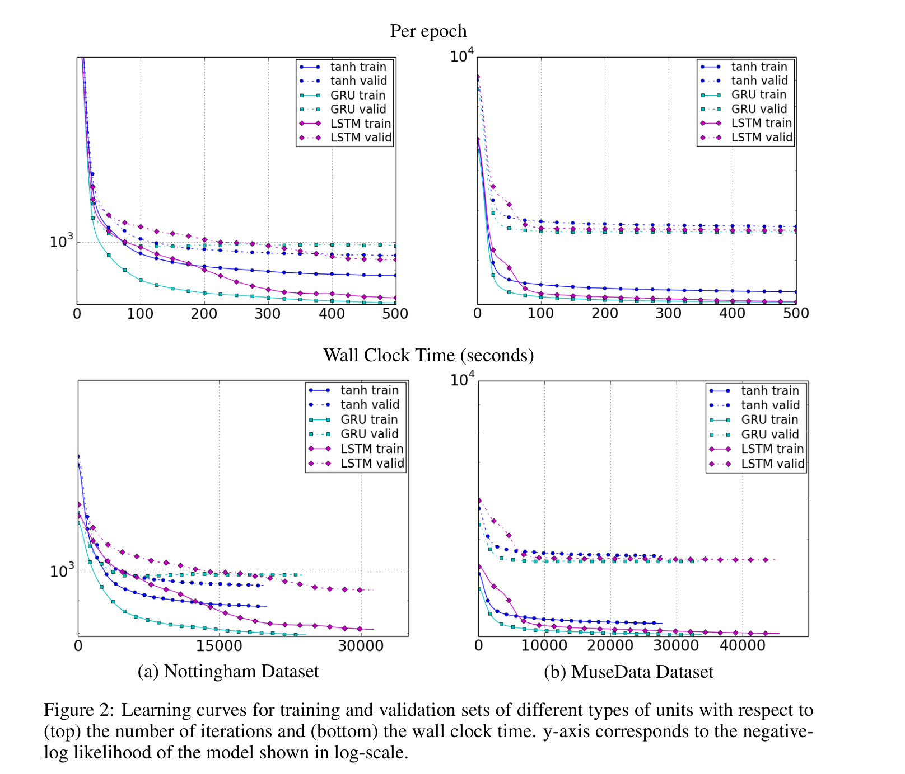</button><figcaption><strong>门控学习曲线：迭代次数与真实时间是两个坐标</strong><a href="https://arxiv.org/abs/1412.3555">Empirical Evaluation of Gated Recurrent Neural Networks on Sequence Modeling</a> · Figure 2 · version v1 · PDF p.7 / printed p.7<button class="original-direct" type="button">Read original size</button>

Original caption &amp; source

Figure 2: Learning curves for training and validation sets of different types of units with respect to
(top) the number of iterations and (bottom) the wall clock time. y-axis corresponds to the negative-
log likelihood of the model shown in log-scale.
<a class="source-url" href="https://arxiv.org/pdf/1412.3555v1">https://arxiv.org/pdf/1412.3555v1</a>
</figcaption></figure>

这份截图是 Figure 2：上排横轴为更新次数，下排为 wall-clock time，纵轴为对数刻度的负对数似然；不同面板对应音乐数据集。某方法每次更新更有效，与它同样时间内更有效不是同一结论。曲线选择论文中最佳验证运行，不等于全部随机种子的方差。实际端上还要测 batch、线程、kernel 融合与状态拷贝，不能从这张训练曲线推出 NPU 延迟。

### 4.7 LSTM 消融：不要只挑一个幸运配置

《LSTM: A Search Space Odyssey》<a href="#source-12">[12]</a>在三个数据集、九种变体上各做 200 次随机搜索，共 5400 次试验。它把结构选择与超参数搜索联合起来，帮助判断某个模块的重要性是否只是调参偶然。

<figure id="fig-odyssey-f1"><button class="paper-image" type="button" aria-label="Zoom: LSTM Odyssey：标准单元与 LSTM block 的细节对照">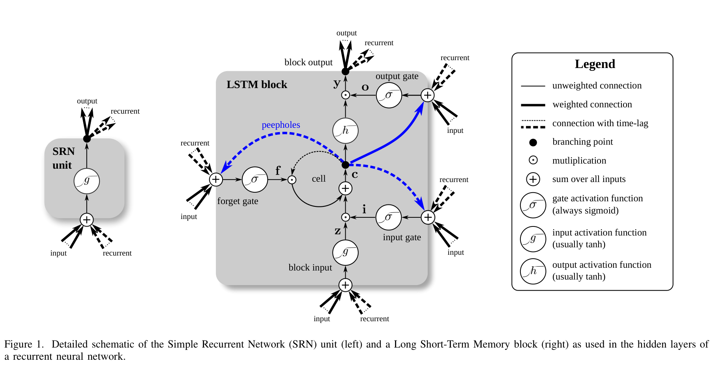</button><figcaption><strong>LSTM Odyssey：标准单元与 LSTM block 的细节对照</strong><a href="https://arxiv.org/abs/1503.04069">LSTM: A Search Space Odyssey</a> · Figure 1 · version v2 · PDF p.2 / printed p.2<button class="original-direct" type="button">Read original size</button>

Original caption &amp; source

Figure 1. Detailed schematic of the Simple Recurrent Network (SRN) unit (left) and a Long Short-Term Memory block (right) as used in the hidden layers of
a recurrent neural network.
<a class="source-url" href="https://arxiv.org/pdf/1503.04069v2">https://arxiv.org/pdf/1503.04069v2</a>
</figcaption></figure>

图将 simple recurrent unit 与 LSTM block 并排，标出门、状态、输出激活和不同连接。后续消融在这张计算图上移除或改写具体部件，所以“没有某门”和“门参数更少”需要落实到路径。原文标准结构的细节多于本文简化公式；不能借教学式声称已覆盖所有 peephole 或耦合变体。

<figure id="fig-odyssey-f3"><button class="paper-image" type="button" aria-label="Zoom: LSTM Odyssey：全体试验与验证集选出的最佳 10%">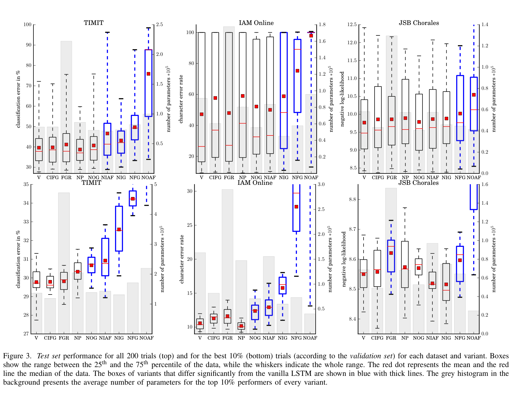</button><figcaption><strong>LSTM Odyssey：全体试验与验证集选出的最佳 10%</strong><a href="https://arxiv.org/abs/1503.04069">LSTM: A Search Space Odyssey</a> · Figure 3 · version v2 · PDF p.6 / printed p.6<button class="original-direct" type="button">Read original size</button>

Original caption &amp; source

Figure 3. Test set performance for all 200 trials (top) and for the best 10% (bottom) trials (according to the validation set) for each dataset and variant. Boxes
show the range between the 25th and the 75th percentile of the data, while the whiskers indicate the whole range. The red dot represents the mean and the red
line the median of the data. The boxes of variants that differ significantly from the vanilla LSTM are shown in blue with thick lines. The grey histogram in the
background presents the average number of parameters for the top 10% performers of every variant.
<a class="source-url" href="https://arxiv.org/pdf/1503.04069v2">https://arxiv.org/pdf/1503.04069v2</a>
</figcaption></figure>

上排包含全部 200 次试验，下排只看依据验证集选出的最佳 10%；箱体是 25%–75% 分位，须线是全范围，红点为均值、红线为中位，灰色背景给出参数数目，粗蓝框标记与标准结构显著不同的变体。论文在这些任务和搜索范围内发现遗忘门与输出激活较关键，没有变体显著超越标准结构。它不证明未来结构无法改进，也不保证固定参数量对比会得到同样结论：原文明确没有对所有变体保持参数量一致。

<figure id="fig-odyssey-f4"><button class="paper-image" type="button" aria-label="Zoom: LSTM Odyssey：学习率、隐藏宽度、输入噪声与性能/时间">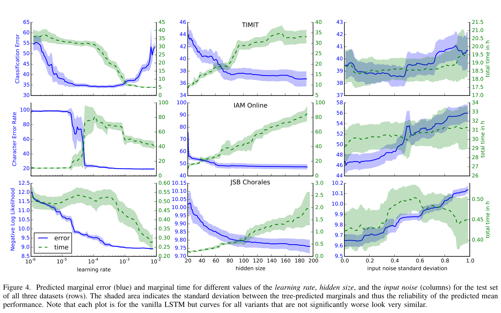</button><figcaption><strong>LSTM Odyssey：学习率、隐藏宽度、输入噪声与性能/时间</strong><a href="https://arxiv.org/abs/1503.04069">LSTM: A Search Space Odyssey</a> · Figure 4 · version v2 · PDF p.8 / printed p.8<button class="original-direct" type="button">Read original size</button>

Original caption &amp; source

Figure 4. Predicted marginal error (blue) and marginal time for different values of the learning rate, hidden size, and the input noise (columns) for the test set
of all three datasets (rows). The shaded area indicates the standard deviation between the tree-predicted marginals and thus the reliability of the predicted mean
performance. Note that each plot is for the vanilla LSTM but curves for all variants that are not significantly worse look very similar.
<a class="source-url" href="https://arxiv.org/pdf/1503.04069v2">https://arxiv.org/pdf/1503.04069v2</a>
</figcaption></figure>

每列一个超参数，每行一个数据集；蓝色表示模型预测的边际误差，另一条曲线表示边际时间，阴影反映该分析的预测分歧。它是基于试验的超参数影响分析，不是逐点受控单变量实验。隐藏宽度提高可能增加计算时间，学习率不合适会破坏性能；选 cell 时先固定可承受预算，再进行合理搜索，比只看一个默认配置更有解释力。

## 5. 语言任务：从固定摘要到逐步读取原输入

### 5.1 语言建模与 Seq2Seq 的目标不同

语言建模预测下一个 token；翻译、问答和描述生成还需要条件输入。自回归条件序列目标的通用教学式为：

$$
\mathcal L=-\sum_{u=1}^{U}\log p_\theta(y_u\mid y_{<u},X).
$$

$X$ 是源句或图像编码，$y_u$ 是第 $u$ 个目标符号，$y_{<u}$ 是更早目标，$U$ 包含训练协议中的结束标记；$\theta$ 为所有参数。每项是正确符号概率的负对数。训练通常提供真实前缀（teacher forcing），生成时却只能使用自身已输出的前缀。困惑度 perplexity 通常由平均 token 负对数似然取指数得到，必须固定 tokenizer 和计数单位；每字节 bits、每字符 bits 与每 token perplexity 不能混排。

《Sequence to Sequence Learning》<a href="#source-13">[13]</a>用深层 LSTM 编码源句，再以状态初始化解码器。它展示了端到端直接生成翻译的重要转折：输入输出不必等长，结束符决定生成停止。

<figure id="fig-seq2seq-f1"><button class="paper-image" type="button" aria-label="Zoom: Seq2Seq：读入 ABC，递归产生 WXYZ 与结束符">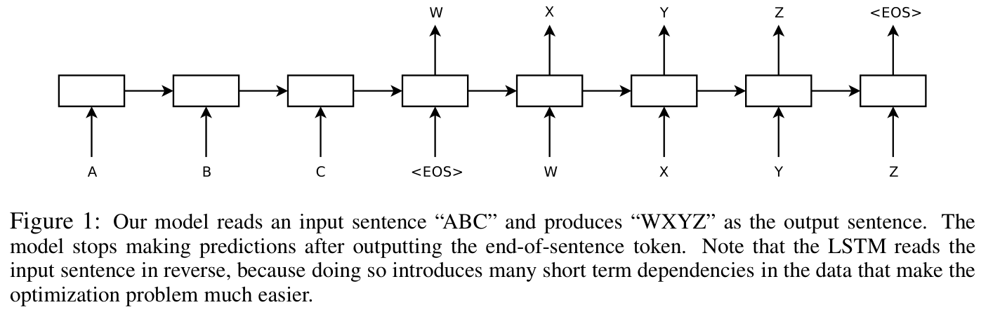</button><figcaption><strong>Seq2Seq：读入 ABC，递归产生 WXYZ 与结束符</strong><a href="https://arxiv.org/abs/1409.3215">Sequence to Sequence Learning with Neural Networks</a> · Figure 1 · version v3 · PDF p.2 / printed p.2<button class="original-direct" type="button">Read original size</button>

Original caption &amp; source

Figure 1: Our model reads an input sentence “ABC” and produces “WXYZ” as the output sentence. The
model stops making predictions after outputting the end-of-sentence token. Note that the LSTM reads the
input sentence in reverse, because doing so introduces many short term dependencies in the data that make the
optimization problem much easier.
<a class="source-url" href="https://arxiv.org/pdf/1409.3215v3">https://arxiv.org/pdf/1409.3215v3</a>
</figcaption></figure>

源句被读入编码器，目标解码每次使用此前符号；原文反转源句顺序，使许多源目标相关位置的计算路径缩短。图中目标 WXYZ 不反转。反转改善这套设置的优化问题，不代表任何序列都应该反转；本次数字实验的反转仅作为输入分布改变的失败注入，不能冒称复现翻译中的训练技巧。

<figure id="fig-seq2seq-t1"><button class="paper-image" type="button" aria-label="Zoom: Seq2Seq：反向源句、集成与 beam 大小的条件性收益">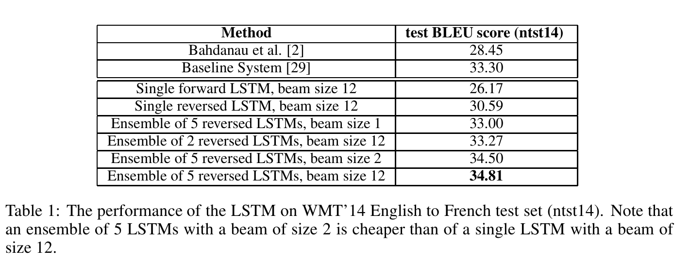</button><figcaption><strong>Seq2Seq：反向源句、集成与 beam 大小的条件性收益</strong><a href="https://arxiv.org/abs/1409.3215">Sequence to Sequence Learning with Neural Networks</a> · Table 1 · version v3 · PDF p.6 / printed p.6<button class="original-direct" type="button">Read original size</button>

Original caption &amp; source

Table 1: The performance of the LSTM on WMT’14 English to French test set (ntst14). Note that
an ensemble of 5 LSTMs with a beam of size 2 is cheaper than of a single LSTM with a beam of
size 12.
<a class="source-url" href="https://arxiv.org/pdf/1409.3215v3">https://arxiv.org/pdf/1409.3215v3</a>
</figcaption></figure>

WMT’14 英法测试表中，单个正向 LSTM、beam=12 为 26.17 BLEU，单个反向源句模型同 beam 为 30.59；五模型集成、beam=12 为 34.81，统计翻译 baseline 为 33.30。五模型集成、beam=2 为 34.50，表明模型数量与搜索预算也影响结果。26.17→30.59 是表中反转条件的比较，30.59→34.81 还包含集成，不可全归到“LSTM 更有记忆”。不同论文的数据预算和训练条件也不能仅凭相同 WMT 测试名认定一致。

<figure id="fig-seq2seq-f3"><button class="paper-image" type="button" aria-label="Zoom: Seq2Seq：按句长与稀有词程度分组看翻译质量">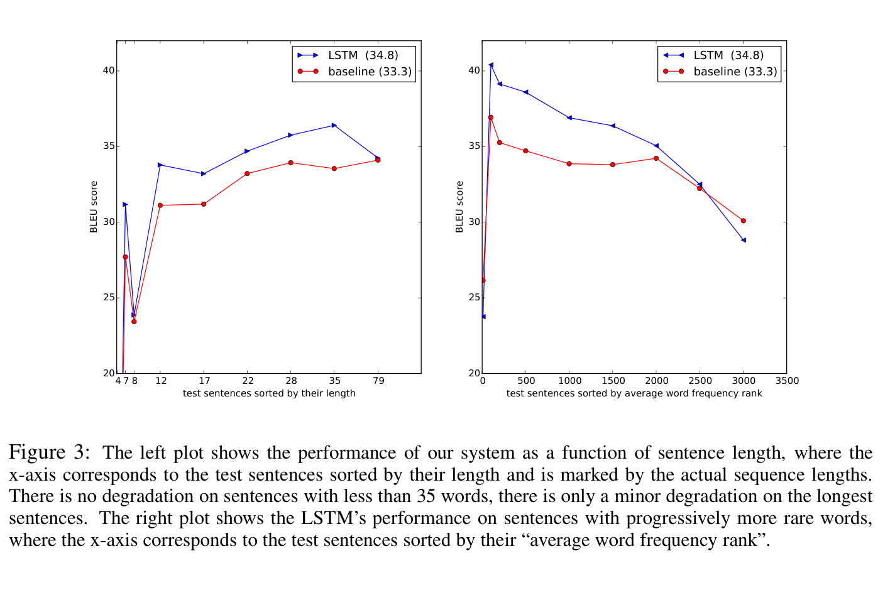</button><figcaption><strong>Seq2Seq：按句长与稀有词程度分组看翻译质量</strong><a href="https://arxiv.org/abs/1409.3215">Sequence to Sequence Learning with Neural Networks</a> · Figure 3 · version v3 · PDF p.7 / printed p.7<button class="original-direct" type="button">Read original size</button>

Original caption &amp; source

Figure 3: The left plot shows the performance of our system as a function of sentence length, where the
x-axis corresponds to the test sentences sorted by their length and is marked by the actual sequence lengths.
There is no degradation on sentences with less than 35 words, there is only a minor degradation on the longest
sentences. The right plot shows the LSTM’s performance on sentences with progressively more rare words,
where the x-axis corresponds to the test sentences sorted by their “average word frequency rank”.
<a class="source-url" href="https://arxiv.org/pdf/1409.3215v3">https://arxiv.org/pdf/1409.3215v3</a>
</figcaption></figure>

左图按源句长度排序，右图按平均词频 rank 排序；两种横轴都不是训练步数。论文报告短于约 35 个词的区间没有明显退化，最长句略有下降，稀有词同样带来压力。固定摘要在本配置并未立刻使所有长句失败，但这不证明信息瓶颈不存在。词表限制与未知词会影响得分，后续改进要分别解决表示容量和词汇覆盖。

### 5.2 Bahdanau 注意力：每个输出重新选择输入信息

Bahdanau 等<a href="#source-14">[14]</a>让解码器不只依赖一个固定末状态，而是在每步对源句各位置的编码表示加权。**这是 RNN 编码器、RNN 解码器与可变上下文接口的组合**；注意力出现并不意味着递归立刻消失。

<figure id="fig-bahdanau-f1"><button class="paper-image" type="button" aria-label="Zoom: 注意力翻译：目标第 t 步重新组合源句 annotation">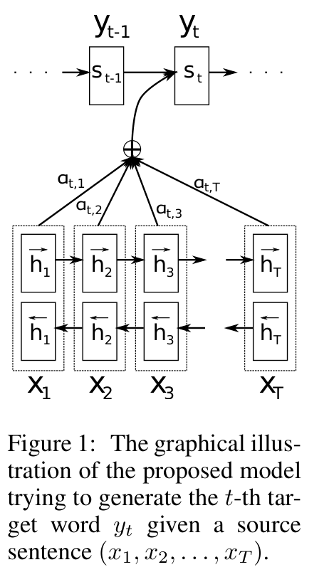</button><figcaption><strong>注意力翻译：目标第 t 步重新组合源句 annotation</strong><a href="https://arxiv.org/abs/1409.0473">Neural Machine Translation by Jointly Learning to Align and Translate</a> · Figure 1 · version v7 · PDF p.3 / printed p.3<button class="original-direct" type="button">Read original size</button>

Original caption &amp; source

Figure 1: The graphical illus-
tration of the proposed model
trying to generate the t-th tar-
get word yt given a source
sentence (x1, x2, . . . , xT ).
<a class="source-url" href="https://arxiv.org/pdf/1409.0473v7">https://arxiv.org/pdf/1409.0473v7</a>
</figcaption></figure>

双向源编码器为每个词形成 annotation，解码器根据前一状态给各源位置打分，加权得到当前上下文，再产生目标词。源词表示保存为可访问序列，因此推理内存不再仅是一个固定状态。翻译“European Economic Area”时，各目标词可以访问不同源位置，缓解全部语义挤进一个末状态的压力。

采用常见记号，原方法的加性打分可写成以下等价结构：

$$
e_{u,t}=v^\top\tanh(W_ss_{u-1}+W_hh_t),\qquad
\alpha_{u,t}=\frac{\exp(e_{u,t})}{\sum_{j=1}^{T}\exp(e_{u,j})},\qquad
a_u=\sum_{t=1}^{T}\alpha_{u,t}h_t.
$$

$u$ 是目标步，$t$ 是源位置，$s_{u-1}\in\mathbb{R}^{H_s}$ 为解码状态，$h_t\in\mathbb{R}^{H_e}$ 为源 annotation，$W_s,W_h$ 将两者映射到相同打分宽度 $A$，$v\in\mathbb{R}^{A}$，$\alpha$ 是非负且对源位置和为 1 的权重，$a_u\in\mathbb{R}^{H_e}$ 为加权上下文。这里省略偏置；$a_u$ 避免与 LSTM cell $c_t$ 混淆。实际 softmax 应考虑数值稳定与 padding mask。权重描述当前信息路由，并不自动提供完整因果解释。

<figure id="fig-bahdanau-f2"><button class="paper-image" type="button" aria-label="Zoom: 固定摘要与注意力：句长增加时质量曲线分化">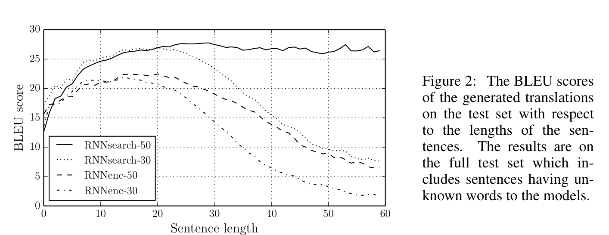</button><figcaption><strong>固定摘要与注意力：句长增加时质量曲线分化</strong><a href="https://arxiv.org/abs/1409.0473">Neural Machine Translation by Jointly Learning to Align and Translate</a> · Figure 2 · version v7 · PDF p.5 / printed p.5<button class="original-direct" type="button">Read original size</button>

Original caption &amp; source

Figure 2: The BLEU scores
of the generated translations
on the test set with respect
to the lengths of the sen-
tences.
The results are on
the full test set which in-
cludes sentences having un-
known words to the models.
<a class="source-url" href="https://arxiv.org/pdf/1409.0473v7">https://arxiv.org/pdf/1409.0473v7</a>
</figcaption></figure>

横轴是源句长度，纵轴是生成翻译的 BLEU；测试包括模型词表之外的词。RNNsearch 相比固定摘要的 RNNencdec，在这套实验中更能应对长句。曲线支持“可访问各位置的上下文有帮助”，没有单独隔离所有训练与模型规模差异；未知词仍会拖累完整测试得分。

<figure id="fig-bahdanau-f3"><button class="paper-image" type="button" aria-label="Zoom: 注意力热图：英语源词与法语输出词的软对齐">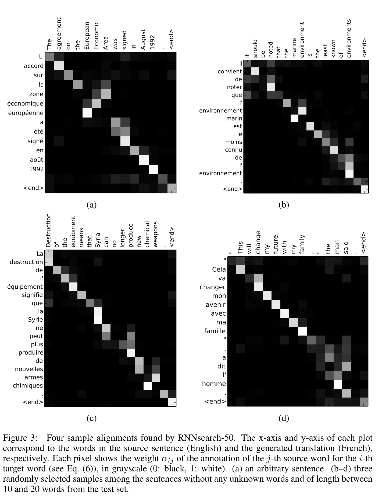</button><figcaption><strong>注意力热图：英语源词与法语输出词的软对齐</strong><a href="https://arxiv.org/abs/1409.0473">Neural Machine Translation by Jointly Learning to Align and Translate</a> · Figure 3 · version v7 · PDF p.6 / printed p.6<button class="original-direct" type="button">Read original size</button>

Original caption &amp; source

Figure 3:
Four sample alignments found by RNNsearch-50. The x-axis and y-axis of each plot
correspond to the words in the source sentence (English) and the generated translation (French),
respectively. Each pixel shows the weight αij of the annotation of the j-th source word for the i-th
target word (see Eq. (6)), in grayscale (0: black, 1: white). (a) an arbitrary sentence. (b–d) three
randomly selected samples among the sentences without any unknown words and of length between
10 and 20 words from the test set.
<a class="source-url" href="https://arxiv.org/pdf/1409.0473v7">https://arxiv.org/pdf/1409.0473v7</a>
</figcaption></figure>

横轴为英语源词，纵轴为生成的法语词；每行对应一个目标输出，灰度编码权重，原图黑为 0、白为 1。接近对角的区域表示大体顺序一致，局部离开对角的对应展示英法词序调整。不能将颜色方向误读为“黑更重要”；也不能把这些挑选的案例当成所有句子的错误率。它让固定摘要无法展示的读取位置变得可观察，但仍需实际翻译质量验证。

<figure id="fig-bahdanau-t1"><button class="paper-image" type="button" aria-label="Zoom: 注意力翻译结果：完整测试与 No UNK 子集分开">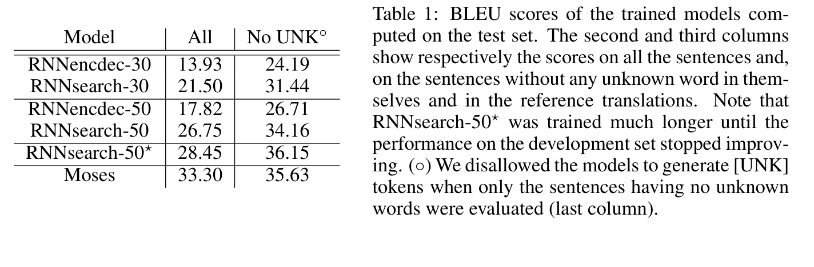</button><figcaption><strong>注意力翻译结果：完整测试与 No UNK 子集分开</strong><a href="https://arxiv.org/abs/1409.0473">Neural Machine Translation by Jointly Learning to Align and Translate</a> · Table 1 · version v7 · PDF p.7 / printed p.7<button class="original-direct" type="button">Read original size</button>

Original caption &amp; source

Table 1: BLEU scores of the trained models com-
puted on the test set. The second and third columns
show respectively the scores on all the sentences and,
on the sentences without any unknown word in them-
selves and in the reference translations. Note that
RNNsearch-50⋆was trained much longer until the
performance on the development set stopped improv-
ing. (◦) We disallowed the models to generate [UNK]
tokens when only the sentences having no unknown
words were evaluated (last column).
<a class="source-url" href="https://arxiv.org/pdf/1409.0473v7">https://arxiv.org/pdf/1409.0473v7</a>
</figcaption></figure>

RNNencdec-50 在完整测试为 17.82 BLEU，RNNsearch-50 为 26.75；训练更久的 RNNsearch-50⋆ 为 28.45。No UNK 子集的 26.71、34.16、36.15 使用受限子集与禁止生成 UNK 的条件，而 Moses 对应 35.63。不能把 36.15 当成完整测试超越 33.30 的同条件数字。星号还改变训练时间，这一收益不能单独归因于注意力结构。

### 5.3 Scheduled Sampling：让训练遇到自己的错误前缀

Scheduled Sampling<a href="#source-15">[15]</a>针对 teacher forcing 与生成阶段前缀分布不同的问题：训练中逐渐用模型自身采样的符号替代真实前一个符号。它改变训练输入选择，不改变 RNN cell。

<figure id="fig-scheduled-f12"><button class="paper-image" type="button" aria-label="Zoom: Scheduled Sampling：每步选择真实 token 或模型采样 token">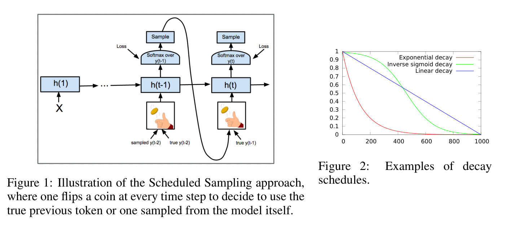</button><figcaption><strong>Scheduled Sampling：每步选择真实 token 或模型采样 token</strong><a href="https://arxiv.org/abs/1506.03099">Scheduled Sampling for Sequence Prediction with Recurrent Neural Networks</a> · Figures 1–2 · version v3 · PDF p.4 / printed p.4<button class="original-direct" type="button">Read original size</button>

Original caption &amp; source

Figure 1: Illustration of the Scheduled Sampling approach,
where one flips a coin at every time step to decide to use the
true previous token or one sampled from the model itself.

Figure 2:
Examples of decay
schedules.
<a class="source-url" href="https://arxiv.org/pdf/1506.03099v3">https://arxiv.org/pdf/1506.03099v3</a>
</figcaption></figure>

Figure 1 的硬币决定下一步输入来自真实标签还是模型输出；Figure 2 给出随训练推进改变概率的调度。早期更多使用真实符号，模型稳定后增加自身预测的暴露，直觉是训练“走偏以后怎么继续”。离散采样的梯度处理与标准最大似然不同，因此这里只将其当成经验训练方法，不声称它是严格等价的概率估计或自动修复所有曝光偏差。

<figure id="fig-scheduled-t1"><button class="paper-image" type="button" aria-label="Zoom: 图像描述：单模型、dropout 与集成必须分开">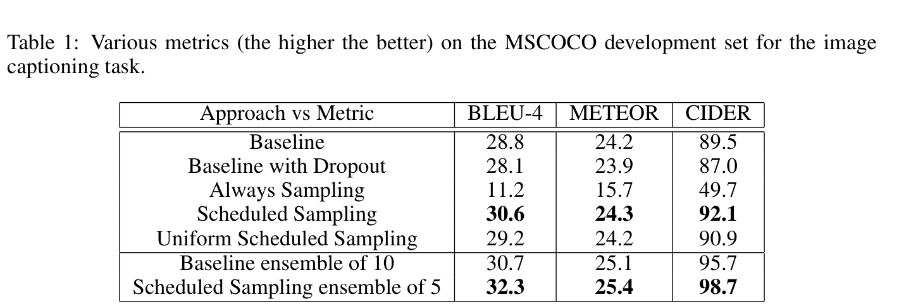</button><figcaption><strong>图像描述：单模型、dropout 与集成必须分开</strong><a href="https://arxiv.org/abs/1506.03099">Scheduled Sampling for Sequence Prediction with Recurrent Neural Networks</a> · Table 1 · version v3 · PDF p.6 / printed p.6<button class="original-direct" type="button">Read original size</button>

Original caption &amp; source

Table 1: Various metrics (the higher the better) on the MSCOCO development set for the image
captioning task.
<a class="source-url" href="https://arxiv.org/pdf/1506.03099v3">https://arxiv.org/pdf/1506.03099v3</a>
</figcaption></figure>

MSCOCO 开发集表中单模型 baseline 的 BLEU-4/CIDEr 为 28.8/89.5，scheduled sampling 为 30.6/92.1；总是采样则明显较差，为 11.2/49.7。过早依赖不可靠的自身输出会伤害学习。十模型 baseline 与五模型 sampling 集成又有不同预算，不能从最后一行归出纯训练策略的加速或容量结论。CIDEr 衡量与多参考描述的一致性，表内缩放口径保留原文，不与现代不同评测工具无条件比较。

<figure id="fig-scheduled-t3"><button class="paper-image" type="button" aria-label="Zoom: 语音实验：下一步预测与真正解码不是同一个指标条件">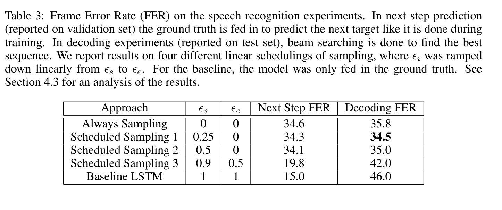</button><figcaption><strong>语音实验：下一步预测与真正解码不是同一个指标条件</strong><a href="https://arxiv.org/abs/1506.03099">Scheduled Sampling for Sequence Prediction with Recurrent Neural Networks</a> · Table 3 · version v3 · PDF p.8 / printed p.8<button class="original-direct" type="button">Read original size</button>

Original caption &amp; source

Table 3: Frame Error Rate (FER) on the speech recognition experiments. In next step prediction
(reported on validation set) the ground truth is fed in to predict the next target like it is done during
training. In decoding experiments (reported on test set), beam searching is done to find the best
sequence. We report results on four different linear schedulings of sampling, where ϵi was ramped
down linearly from ϵs to ϵe. For the baseline, the model was only fed in the ground truth. See
Section 4.3 for an analysis of the results.
<a class="source-url" href="https://arxiv.org/pdf/1506.03099v3">https://arxiv.org/pdf/1506.03099v3</a>
</figcaption></figure>

原表的 next-step prediction 在验证集使用真实历史标签，decoding 在测试集通过 beam search 生成序列；都报告帧错误率，但输入前缀及划分不同。调度从不同起始概率降到结束概率，不能只按“sampling”这个名称合并。这个例子提醒：训练/验证 loss 下降不保证生成结果改善，正确评估要让模型经过实际解码链路。

## 6. 语音与 OCR：没有逐帧标签，也能训练序列输出

### 6.1 CTC：把未知对齐当成隐变量求和

一段语音可能有几百帧，却只对应几十个符号；文字图像中字符宽度也不相同。如果监督只给最终字符串，就不能直接拿“第 17 帧属于哪个字符”来训练普通逐帧分类。Connectionist Temporal Classification（CTC，连接时序分类）<a href="#source-16">[16]</a>在符号表中加入 blank，对所有能折叠成正确标签的帧级路径求和。

<figure id="fig-ctc-f1"><button class="paper-image" type="button" aria-label="Zoom: CTC 与逐帧分类：正确标签不必落在手工边界上">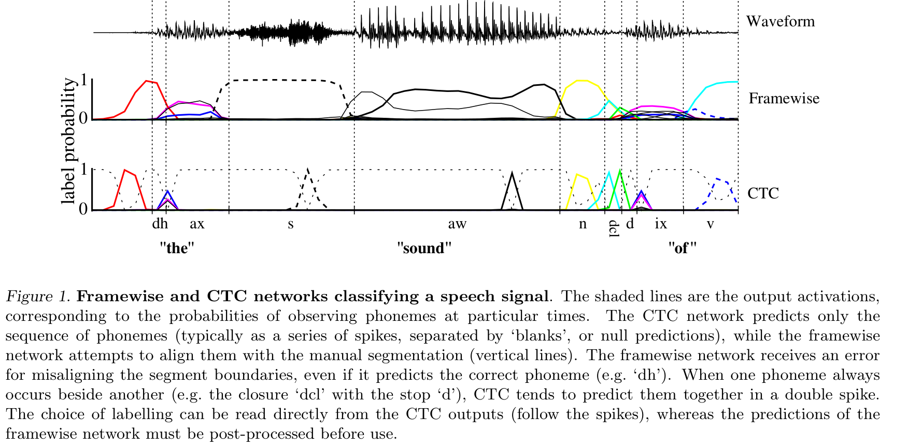</button><figcaption><strong>CTC 与逐帧分类：正确标签不必落在手工边界上</strong><a href="https://mediatum.ub.tum.de/doc/1292048/file.pdf">Connectionist Temporal Classification: Labelling Unsegmented Sequence Data with Recurrent Neural Networks</a> · Figure 1 · version author-hosted original PDF · PDF p.3 / PDF page for source lookup<button class="original-direct" type="button">Read original size</button>

Original caption &amp; source

Figure 1. Framewise and CTC networks classifying a speech signal. The shaded lines are the output activations,
corresponding to the probabilities of observing phonemes at particular times.
The CTC network predicts only the
sequence of phonemes (typically as a series of spikes, separated by ‘blanks’, or null predictions), while the framewise
network attempts to align them with the manual segmentation (vertical lines). The framewise network receives an error
for misaligning the segment boundaries, even if it predicts the correct phoneme (e.g. ‘dh’). When one phoneme always
occurs beside another (e.g. the closure ‘dcl’ with the stop ‘d’), CTC tends to predict them together in a double spike.
The choice of labelling can be read directly from the CTC outputs (follow the spikes), whereas the predictions of the
framewise network must be post-processed before use.
<a class="source-url" href="https://mediatum.ub.tum.de/doc/1292048/file.pdf">https://mediatum.ub.tum.de/doc/1292048/file.pdf</a>
</figcaption></figure>

横轴沿语音时间，曲线表示音素概率，竖线是手工切分边界。逐帧模型即使输出正确音素，也可能因边界错位而被罚；CTC 则允许标签在某些位置形成尖峰，其余位置输出 blank。相邻音素的关联尖峰是这张具体例子的观察，不是必须遵循的输出形状。对 OCR，“CAT”不用预先标出三段精确字符框，整串标签即可提供监督。

CTC 的序列概率可写为：

$$
p(y\mid X)=\sum_{\pi\in\mathcal B^{-1}(y)}
\prod_{t=1}^{T}p(\pi_t\mid X),\qquad
\mathcal L_{\mathrm{CTC}}=-\log p(y\mid X).
$$

$X$ 是整个输入，$T$ 为编码器输出步数；$\pi$ 是长度 $T$ 的符号/blank 路径，$\mathcal B$ 先合并连续相同符号，再删 blank，$\mathcal B^{-1}(y)$ 是折叠得到目标串 $y$ 的路径集合。乘积是给定编码器输入后的帧级概率分解，**不意味着编码器不能使用双向上下文**。例如 `C,C,blank,A,blank,T` 折成 `CAT`；要得到重复字符 `ll`，两个 `l` 之间需要 blank，否则会合并成一个。训练实际采用稳定的动态规划，不枚举指数数量路径。

<figure id="fig-ctc-f3"><button class="paper-image" type="button" aria-label="Zoom: CTC forward–backward：CAT 与 blank 组成允许路径图">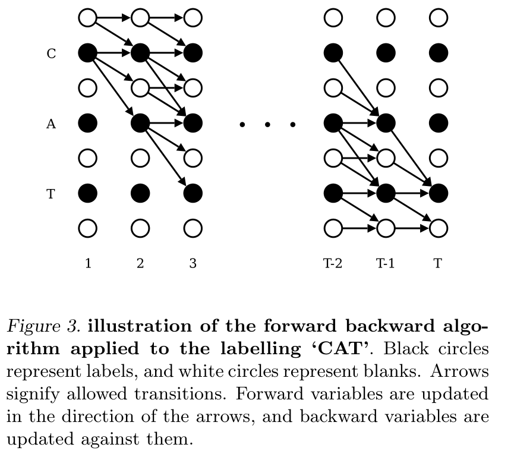</button><figcaption><strong>CTC forward–backward：CAT 与 blank 组成允许路径图</strong><a href="https://mediatum.ub.tum.de/doc/1292048/file.pdf">Connectionist Temporal Classification: Labelling Unsegmented Sequence Data with Recurrent Neural Networks</a> · Figure 3 · version author-hosted original PDF · PDF p.5 / PDF page for source lookup<button class="original-direct" type="button">Read original size</button>

Original caption &amp; source

Figure 3. illustration of the forward backward algo-
rithm applied to the labelling ‘CAT’. Black circles
represent labels, and white circles represent blanks. Arrows
signify allowed transitions. Forward variables are updated
in the direction of the arrows, and backward variables are
updated against them.
<a class="source-url" href="https://mediatum.ub.tum.de/doc/1292048/file.pdf">https://mediatum.ub.tum.de/doc/1292048/file.pdf</a>
</figcaption></figure>

黑节点是目标字符，白节点是 blank，箭头定义保持、前进以及满足条件时跳过 blank 的转移；forward 沿箭头累积，backward 反向累积。每个状态不是一个独立字符检测框，而是“已走到扩展标签串的哪个位置”。重复字符限制跳转，防止不经过分隔便错误合并。图展示怎样求序列概率，不展示所有视觉特征处理；编码器时间压缩过度会让某些目标根本没有有效路径。

<figure id="fig-ctc-t1"><button class="paper-image" type="button" aria-label="Zoom: 原始 CTC：TIMIT 的标签错误率与解码策略">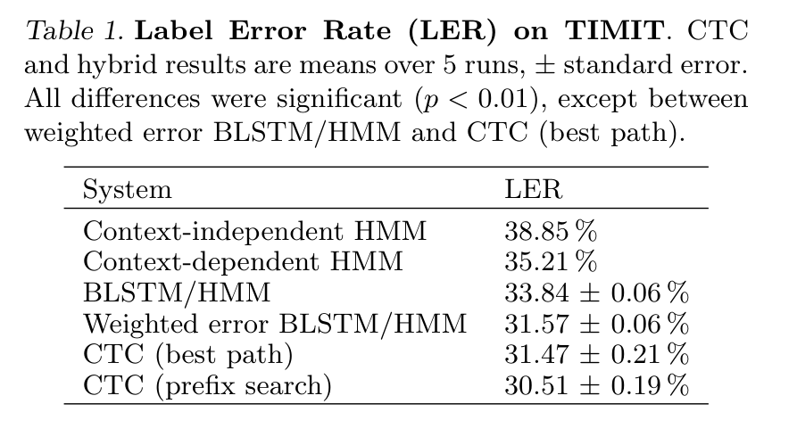</button><figcaption><strong>原始 CTC：TIMIT 的标签错误率与解码策略</strong><a href="https://mediatum.ub.tum.de/doc/1292048/file.pdf">Connectionist Temporal Classification: Labelling Unsegmented Sequence Data with Recurrent Neural Networks</a> · Table 1 · version author-hosted original PDF · PDF p.7 / PDF page for source lookup<button class="original-direct" type="button">Read original size</button>

Original caption &amp; source

Table 1. Label Error Rate (LER) on TIMIT. CTC
and hybrid results are means over 5 runs, ± standard error.
All differences were significant (p &lt; 0.01), except between
weighted error BLSTM/HMM and CTC (best path).
<a class="source-url" href="https://mediatum.ub.tum.de/doc/1292048/file.pdf">https://mediatum.ub.tum.de/doc/1292048/file.pdf</a>
</figcaption></figure>

论文在其 TIMIT 设置中报告 CTC best path 为 31.47±0.21%，prefix search 为 30.51±0.19%；表中 CTC 与混合系统是五次运行的均值±标准误，不是标准差。加权 BLSTM/HMM 为 31.57±0.06%，原文未认为它与 best path 的差异显著。best path 先取最大帧路径再折叠，未必等于最大序列概率；搜索聚合多条路径可改变结果。不同后续论文的音素集合、划分与预处理不同，不把这里的 30.51 与下一节 25.5 当作唯一架构改进量。

### 6.2 RNN-T：输入时间与已输出符号构成二维网格

Recurrent Neural Network Transducer（RNN-T，递归神经网络转导器）<a href="#source-17">[17]</a>进一步建模已有标签历史：输入编码器产生声学表示，prediction network 根据已输出符号产生标签状态，joint 将两者合并。CTC 的帧级独立输出与 RNN-T 的标签历史条件不同。现代 RNN-T 的声学编码器也可以使用其他架构，“Transducer”不保证所有子网络仍是传统 RNN。

<figure id="fig-rnnt-f1"><button class="paper-image" type="button" aria-label="Zoom: RNN-T 概率格：blank 推进输入，标签推进输出">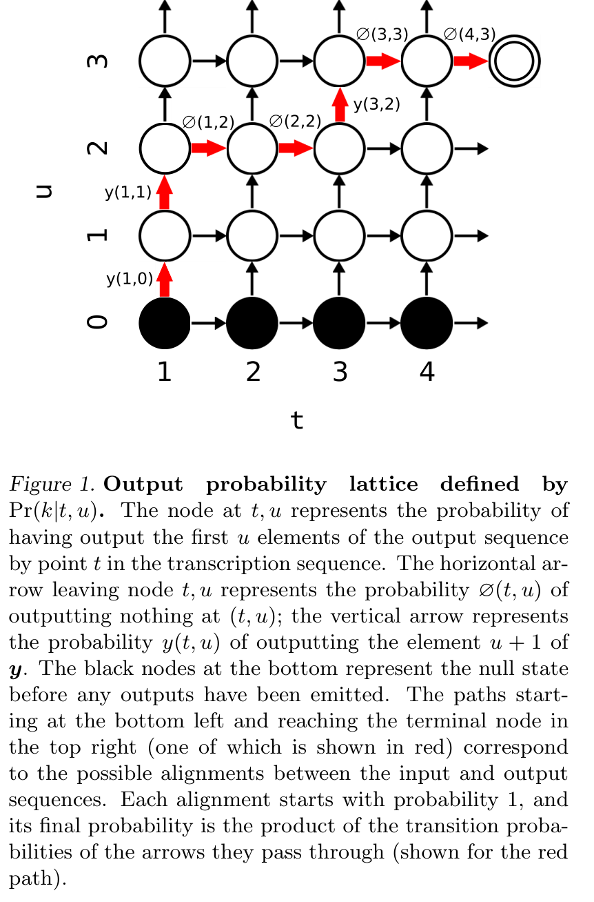</button><figcaption><strong>RNN-T 概率格：blank 推进输入，标签推进输出</strong><a href="https://arxiv.org/abs/1211.3711">Sequence Transduction with Recurrent Neural Networks</a> · Figure 1 · version v1 · PDF p.4 / PDF page for source lookup<button class="original-direct" type="button">Read original size</button>

Original caption &amp; source

Figure 1. Output
probability
lattice
defined
by
Pr(k|t, u). The node at t, u represents the probability of
having output the first u elements of the output sequence
by point t in the transcription sequence. The horizontal ar-
row leaving node t, u represents the probability ∅(t, u) of
outputting nothing at (t, u); the vertical arrow represents
the probability y(t, u) of outputting the element u + 1 of
y. The black nodes at the bottom represent the null state
before any outputs have been emitted. The paths start-
ing at the bottom left and reaching the terminal node in
the top right (one of which is shown in red) correspond
to the possible alignments between the input and output
sequences. Each alignment starts with probability 1, and
its final probability is the product of the transition proba-
bilities of the arrows they pass through (shown for the red
path).
<a class="source-url" href="https://arxiv.org/pdf/1211.3711v1">https://arxiv.org/pdf/1211.3711v1</a>
</figcaption></figure>

横轴 $t$ 是输入编码位置，纵轴 $u$ 是已发射标签数；横向 blank 边推进时间，纵向标签边发射下一目标而保留当前时间。红路径是众多有效对齐中的一条，路径概率为边概率乘积，所有有效路径再相加。一次输入位置可以发射多个标签，这与 CTC 每帧一个路径符号不同；实际解码仍要限制搜索与异常重复输出，避免无界等待。

一个现代 joint 的常见教学形式为：

$$
j_{t,u}=\phi(Ae_t+Bg_u+b),\qquad
p(k\mid t,u)=\operatorname{softmax}(Cj_{t,u}+d)_k.
$$

$e_t\in\mathbb{R}^{H_e}$ 是输入编码状态，$g_u\in\mathbb{R}^{H_g}$ 是标签前缀状态，$A,B$ 映到 joint 宽度 $H_j$，$\phi$ 为激活，$C\in\mathbb{R}^{V\times H_j}$，$V$ 包括 blank。$k$ 为候选符号。此式解释常用非线性 joint，并非声称原始论文与所有现代实现逐项相同。网格有约 $T(U+1)$ 个位置，若每位置都保存 $V$ 个 logits，训练中间量会很大；这与单步推理只保存少量递归状态是两回事。

<figure id="fig-rnnt-f2"><button class="paper-image" type="button" aria-label="Zoom: RNN-T forward–backward 热图：目标如何对齐到声谱">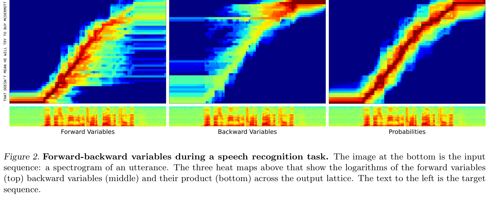</button><figcaption><strong>RNN-T forward–backward 热图：目标如何对齐到声谱</strong><a href="https://arxiv.org/abs/1211.3711">Sequence Transduction with Recurrent Neural Networks</a> · Figure 2 · version v1 · PDF p.5 / PDF page for source lookup<button class="original-direct" type="button">Read original size</button>

Original caption &amp; source

Figure 2. Forward-backward variables during a speech recognition task. The image at the bottom is the input
sequence: a spectrogram of an utterance. The three heat maps above that show the logarithms of the forward variables
(top) backward variables (middle) and their product (bottom) across the output lattice. The text to the left is the target
sequence.
<a class="source-url" href="https://arxiv.org/pdf/1211.3711v1">https://arxiv.org/pdf/1211.3711v1</a>
</figcaption></figure>

底部是输入声谱，上方分别显示 forward、backward 变量及其乘积的对数；左侧是目标符号。亮度表示可能路径质量，整片区域体现多种对齐共同贡献，不能只选一条亮带当作确定时戳。若需要字幕时间戳，还应核对具体解码与对齐提取规则，训练概率格本身不自动提供经过校准的时间边界。

<figure id="fig-rnnt-t1"><button class="paper-image" type="button" aria-label="Zoom: 原始 RNN-T：标签历史与声学联合建模的实验">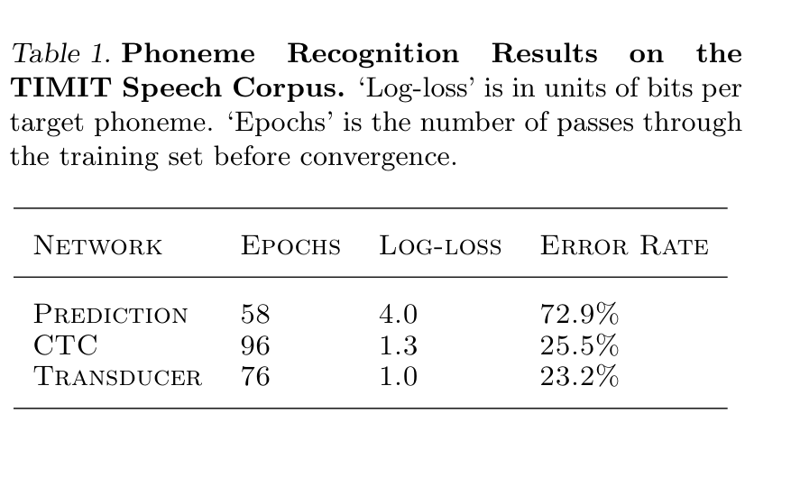</button><figcaption><strong>原始 RNN-T：标签历史与声学联合建模的实验</strong><a href="https://arxiv.org/abs/1211.3711">Sequence Transduction with Recurrent Neural Networks</a> · Table 1 · version v1 · PDF p.6 / PDF page for source lookup<button class="original-direct" type="button">Read original size</button>

Original caption &amp; source

Table 1. Phoneme
Recognition
Results
on
the
TIMIT Speech Corpus. ‘Log-loss’ is in units of bits per
target phoneme. ‘Epochs’ is the number of passes through
the training set before convergence.
<a class="source-url" href="https://arxiv.org/pdf/1211.3711v1">https://arxiv.org/pdf/1211.3711v1</a>
</figcaption></figure>

这套 TIMIT 实验中，CTC 为 25.5% 音素错误率，Transducer 为 23.2%；log-loss 为每目标音素 1.3 与 1.0 bits。prediction-only 的 72.9% 是给定历史预测下一音素的误分类率，不能与声学识别错误率直接横比。训练收敛 epoch 也不等于 wall-clock 加速；transducer 参数与两个单独子系统不同。它支持联合输入/输出序列建模有价值，未直接复现现代大规模流式语音系统。

### 6.3 LSTMP：cell 可以宽，递归投影可以窄

大型词汇语音模型面临宽状态与大输出词表的计算成本。LSTM with projection（LSTMP）<a href="#source-18">[18]</a>将 cell 输出投影成较窄的递归向量，并可增加非递归投影。它把内部记忆宽度与传回下一步的表示宽度分开，而不是简单把所有维度一起缩小。

<figure id="fig-lstmp-f1"><button class="paper-image" type="button" aria-label="Zoom: 投影 LSTM：递归与非递归输出各有接口">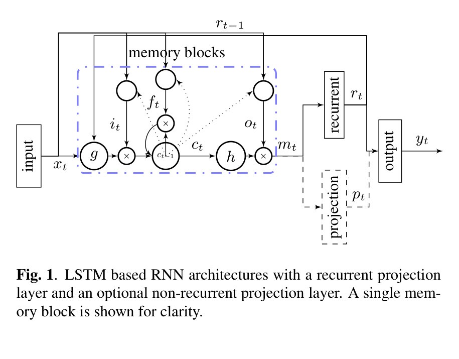</button><figcaption><strong>投影 LSTM：递归与非递归输出各有接口</strong><a href="https://arxiv.org/abs/1402.1128">Long Short-Term Memory Based Recurrent Neural Network Architectures for Large Vocabulary Speech Recognition</a> · Figure 1 · version v1 · PDF p.2 / PDF page for source lookup<button class="original-direct" type="button">Read original size</button>

Original caption &amp; source

Fig. 1. LSTM based RNN architectures with a recurrent projection
layer and an optional non-recurrent projection layer. A single mem-
ory block is shown for clarity.
<a class="source-url" href="https://arxiv.org/pdf/1402.1128v1">https://arxiv.org/pdf/1402.1128v1</a>
</figcaption></figure>

cell 内部计算后经过 recurrent projection，较窄向量返回下一时刻；可选的 non-recurrent projection 只服务输出。图只画一个 memory block 以便阅读，并不表示真实模型只有一个 cell。若 cell 宽 $C$、递归投影宽 $P$，状态恢复必须同时保存 cell 与递归状态，内存近似按 $C+P$ 计，不能套普通 LSTM 的 $2H$。

<figure id="fig-lstmp-f57"><button class="paper-image" type="button" aria-label="Zoom: 投影 LSTM：训练帧数、WER 与不同输出状态数"></button><figcaption><strong>投影 LSTM：训练帧数、WER 与不同输出状态数</strong><a href="https://arxiv.org/abs/1402.1128">Long Short-Term Memory Based Recurrent Neural Network Architectures for Large Vocabulary Speech Recognition</a> · Figures 5–6 · version v1 · PDF p.4 / PDF page for source lookup<button class="original-direct" type="button">Read original size</button>

Original caption &amp; source

Fig. 5. 126 context independent phone HMM states.

Fig. 6. 2000 context dependent phone HMM states.
<a class="source-url" href="https://arxiv.org/pdf/1402.1128v1">https://arxiv.org/pdf/1402.1128v1</a>
</figcaption></figure>

截图包含 Figure 5 与 Figure 6，分别对应 126 个 context-independent HMM state 和 2000 个 context-dependent HMM state；文件 ID 沿用归档命名，不表示含 Figure 7。横轴是已用于训练的帧数（十亿级），纵轴是 WER，图例同时给出 cell/投影尺寸与参数量。原文指出一些配置尚未收敛，不能把最后一个点当成所有模型充分训练后的排名。投影结构可在类似参数量下改善其声学任务，但这是混合 HMM 声学模型的结果，不是端到端 RNN-T 或现代手机真实延迟测量。

### 6.4 Deep Speech 2：架构、训练配方和系统共同扩大能力

Deep Speech 2<a href="#source-19">[19]</a>组合卷积前端、深层简单/门控递归、CTC、归一化、训练课程和高性能计算，并覆盖英语与普通话。它的重要转折是整个训练和服务系统的规模化，不能只记成“换用了 GRU”。

<figure id="fig-ds2-f1"><button class="paper-image" type="button" aria-label="Zoom: Deep Speech 2：声谱卷积、递归层与 CTC 输出"></button><figcaption><strong>Deep Speech 2：声谱卷积、递归层与 CTC 输出</strong><a href="https://arxiv.org/abs/1512.02595">Deep Speech 2: End-to-End Speech Recognition in English and Mandarin</a> · Figure 1 · version v1 · PDF p.5 / printed p.5<button class="original-direct" type="button">Read original size</button>

Original caption &amp; source

Figure 1: Architecture of the DS2 system used to train on both English and Mandarin speech. We explore
variants of this architecture by varying the number of convolutional layers from 1 to 3 and the number of
recurrent or GRU layers from 1 to 7.
<a class="source-url" href="https://arxiv.org/pdf/1512.02595v1">https://arxiv.org/pdf/1512.02595v1</a>
</figcaption></figure>

输入声谱经过卷积提取局部时间/频率特征，递归层聚合上下文，输出层得到字符或其他输出单位概率，CTC 对齐最终文本。论文在卷积层数、递归层数与单元种类之间做变体。卷积时间 stride 会降低递归步数，同时也限制输出分辨率；解码和语言模型条件需要单列，不能把系统 WER 全归到声学 backbone。

<figure id="fig-ds2-t3"><button class="paper-image" type="button" aria-label="Zoom: DS2 深度比较：约 38M 参数下 GRU 与简单 RNN"></button><figcaption><strong>DS2 深度比较：约 38M 参数下 GRU 与简单 RNN</strong><a href="https://arxiv.org/abs/1512.02595">Deep Speech 2: End-to-End Speech Recognition in English and Mandarin</a> · Table 3 · version v1 · PDF p.8 / printed p.8<button class="original-direct" type="button">Read original size</button>

Original caption &amp; source

Table 3: Comparison of development set WER for networks with either simple RNN or GRU, for various
depths. All models have batch normalization, one layer of 1D-invariant convolution, and approximately 38
million parameters.
<a class="source-url" href="https://arxiv.org/pdf/1512.02595v1">https://arxiv.org/pdf/1512.02595v1</a>
</figcaption></figure>

表中的不同网络使用 batch normalization、一层 1D-invariant 卷积和约 38M 参数。递归层增多时简单 RNN 的开发集 WER 从 14.40 降到 9.52，GRU 从 10.53 改善到中间配置 7.79 后，七层递归配置为 8.19。深度收益不是单调的，且参数近似固定意味着宽度也在调整。这个范围支持 GRU 的优势，不能直接推广到更大模型。

<figure id="fig-ds2-t11"><button class="paper-image" type="button" aria-label="Zoom: DS2 的规模与内部测试：更大模型改变了单元比较"></button><figcaption><strong>DS2 的规模与内部测试：更大模型改变了单元比较</strong><a href="https://arxiv.org/abs/1512.02595">Deep Speech 2: End-to-End Speech Recognition in English and Mandarin</a> · Tables 11–12 · version v1 · PDF p.18 / printed p.18<button class="original-direct" type="button">Read original size</button>

Original caption &amp; source

Table 11: Comparing the effect of model size on the WER of the English speech system on both the regular and
noisy development sets. We vary the number of hidden units in all but the convolutional layers. The GRU model
has 3 layers of bidirectional GRUs with 1 layer of 2D-invariant convolution. The RNN model has 7 layers of
bidirectional simple recurrence with 3 layers of 2D-invariant convolution. Both models output bigrams with a
temporal stride of 3. All models contain approximately 35 million parameters and are trained with BatchNorm
and SortaGrad.

Table 12: Comparison of DS1 and DS2 WER on an internal test set of 3,300 examples. The test set contains a
wide variety of speech including accents, low signal-to-noise speech, spontaneous and conversational speech.
<a class="source-url" href="https://arxiv.org/pdf/1512.02595v1">https://arxiv.org/pdf/1512.02595v1</a>
</figcaption></figure>

Table 11 的表体明确比较 18M–100M 参数；其caption末尾“所有模型约35M”与表体及相邻正文冲突，本文按表体和DS2原论文第6.1.1节的规模实验解释，不沿用这个不一致条件。100M GRU的常规/噪声开发WER为7.78/14.17，100M简单RNN为7.73/13.06。**两者还使用不同卷积与递归层数**，因此不能说仅换cell就改善了1.11个百分点的噪声WER。Table 12的内部3300条语音测试从DS1的24.01到DS2的13.59，支持整个系统改进，测试内容不是公开LibriSpeech。

<figure id="fig-ds2-t13"><button class="paper-image" type="button" aria-label="Zoom: DS2 与人工转写：干净朗读和困难语音仍有差别"></button><figcaption><strong>DS2 与人工转写：干净朗读和困难语音仍有差别</strong><a href="https://arxiv.org/abs/1512.02595">Deep Speech 2: End-to-End Speech Recognition in English and Mandarin</a> · Table 13 · version v1 · PDF p.18 / printed p.18<button class="original-direct" type="button">Read original size</button>

Original caption &amp; source

Table 13: Comparison of WER for two speech systems and human level performance on read speech.
<a class="source-url" href="https://arxiv.org/pdf/1512.02595v1">https://arxiv.org/pdf/1512.02595v1</a>
</figcaption></figure>

表中 LibriSpeech test-clean 的 WER 为 DS2 5.33%、人工 5.83%，test-other 为 13.25%、人工 12.69%；两个 WSJ 测试也分别列出。论文在这些人工比较条件下讨论“human level”，并不证明任意口音、噪声、对话和领域都达到人类水平。原文人工基线来自特定转写流程，不能把有限样本对照理解为人类能力的普遍上限。

<figure id="fig-ds2-f6"><button class="paper-image" type="button" aria-label="Zoom: DS2 服务延迟：中位数与 98 分位随负载变化"></button><figcaption><strong>DS2 服务延迟：中位数与 98 分位随负载变化</strong><a href="https://arxiv.org/abs/1512.02595">Deep Speech 2: End-to-End Speech Recognition in English and Mandarin</a> · Figure 6 · version v1 · PDF p.21 / printed p.21<button class="original-direct" type="button">Read original size</button>

Original caption &amp; source

Figure 6: Median and 98 percentile latencies as a function of server load
<a class="source-url" href="https://arxiv.org/pdf/1512.02595v1">https://arxiv.org/pdf/1512.02595v1</a>
</figcaption></figure>

横轴是服务器负载，纵轴是延迟，分别展示中位与尾部值。吞吐提高时排队和 batching 会影响用户等待，因此服务 latency 不能由某个单算子时间代替。原文数据中心 GPU 调度的结论不等于端侧 HTP 收益；真实语音流还应报告前瞻、音频缓冲、分段、解码与完整输出的计时边界。

### 6.5 2026 Flash RNN-T：优化训练中间量，而非发明新声学 backbone

Flash RNN-T<a href="#source-52">[52]</a>是截至截止日可核验的训练系统预印本。它评估 joint network 与 transducer loss 的前向/反向，将有效对齐位置打包后按 tile 重计算，结合专用 kernel，避免同时保存巨大 hidden/logit 张量。这里的“Flash”收益不是整体 ASR 模型识别精度提升，也不是纯流式 decode benchmark。

<figure id="fig-flashrnnt-f2"><button class="paper-image" type="button" aria-label="Zoom: Flash RNN-T：保留少量转移概率，反传时重算 tile 中间量"></button><figcaption><strong>Flash RNN-T：保留少量转移概率，反传时重算 tile 中间量</strong><a href="https://arxiv.org/abs/2610.23409">Flash RNN-T: Memory-Efficient Joint Network and Transducer Loss Computation</a> · Figure 2 · version v1 · PDF p.3 / printed p.3<button class="original-direct" type="button">Read original size</button>

Original caption &amp; source

Figure 2: Dashed enclosure marks intermediates dis-
carded after each tile’s forward computation and recom-
puted during backward. Outputs from all tiles feed the
loss.
<a class="source-url" href="https://arxiv.org/pdf/2610.23409v1">https://arxiv.org/pdf/2610.23409v1</a>
</figcaption></figure>

沿每个 tile 的数据流读：投影后的 encoder/prediction 输入组合成 joint hidden，计算完整词表归一化，然后只保留 blank 与正确下一目标的转移 log-probability。虚线框内的较大中间量在前向后释放，反向到来时重算。**完整词表仍参与归一化，全部有效对齐仍参与 loss**；不是仅计算两个 logits，也不是剪掉其他对齐路径。dropout 重计算要复用相同 mask，否则不再是同一前向的梯度。

<figure id="fig-flashrnnt-f3"><button class="paper-image" type="button" aria-label="Zoom: Flash RNN-T：retain/release 调度下的吞吐–内存前沿"></button><figcaption><strong>Flash RNN-T：retain/release 调度下的吞吐–内存前沿</strong><a href="https://arxiv.org/abs/2610.23409">Flash RNN-T: Memory-Efficient Joint Network and Transducer Loss Computation</a> · Figure 3 · version v1 · PDF p.5 / printed p.5<button class="original-direct" type="button">Read original size</button>

Original caption &amp; source

Figure 3: Throughput–memory tradeoffs under retain and release scheduling. Points correspond to tile limits for tiled
Flash and sub-batch sizes for the other implementations.
<a class="source-url" href="https://arxiv.org/pdf/2610.23409v1">https://arxiv.org/pdf/2610.23409v1</a>
</figcaption></figure>

横纵轴分别衡量峰值分配内存与 samples/s；点来自 tile limit 或 sub-batch 的变化。retain 保留相应中间依赖并以整个 batch 的一次 backward 组织，release 更早释放分组中间量，调度边界会改变比较。论文每实现选择“达到至少峰值吞吐 95% 的配置中内存最低者”，不是所有实现固定同一配置的速度比。

H100 80GB、batch=128、joint hidden=640、词表=1024、dropout=0.1 的 long workload 中，retain 下其他被测实现均 OOM，tiled 为 163.6 samples/s、4.26 GiB；release 下 untiled 为 258.6 samples/s、12.55 GiB，而 tiled 仍为 163.6、4.26。**节省内存可能牺牲吞吐**，不能写成 tiled 在所有条件更快。测试以已经投影的 joint 输入开始，排除完整声学/prediction 网络训练、数据加载与识别解码。

<figure id="fig-flashrnnt-t2"><button class="paper-image" type="button" aria-label="Zoom: Flash RNN-T 消融：专用 kernel 与重计算的贡献分开"></button><figcaption><strong>Flash RNN-T 消融：专用 kernel 与重计算的贡献分开</strong><a href="https://arxiv.org/abs/2610.23409">Flash RNN-T: Memory-Efficient Joint Network and Transducer Loss Computation</a> · Table 2 · version v1 · PDF p.4 / printed p.4<button class="original-direct" type="button">Read original size</button>

Original caption &amp; source

Table 2: Throughput (samples/s) / peak allocated mem-
ory (GiB). Tiled variants use a tile limit of 200k align-
ment positions.
<a class="source-url" href="https://arxiv.org/pdf/2610.23409v1">https://arxiv.org/pdf/2610.23409v1</a>
</figcaption></figure>

表体以吞吐/峰值 allocated GiB 成对呈现，tiled 消融使用 200k alignment-position tile，与主比较的 800k 设置不同。在对应消融配置中，两类优化都启用的 tiled 为 137.8 samples/s、1.72 GiB，compiled 比较项为 124.2、3.49。allocated 不是整机物理峰值，不应与 CPU VmHWM 或 dma-buf 相加混报。论文官方 benchmark 仓库与 NVIDIA NeMo 的实际 loss/joint kernel 都已按 commit 核验，但本次未在 H100 运行，不称独立复现。

## 7. 手写与场景 OCR：二维图像怎样变成一维字符序列

### 7.1 MDLSTM：同时从多个空间方向读取

离线手写只有最终像素图，没有笔轨。Multidimensional LSTM（MDLSTM，多维 LSTM）用于离线手写识别<a href="#source-20">[20]</a>，在二维网格递归，并与 CTC 结合。它不是简单把整幅图拉成一个像素向量；同一位置可接收不同空间方向的先前状态。

<figure id="fig-mdlstm-f1"><button class="paper-image" type="button" aria-label="Zoom: 二维递归：当前位置接收已扫描邻域的状态"></button><figcaption><strong>二维递归：当前位置接收已扫描邻域的状态</strong><a href="https://papers.neurips.cc/paper/3449-offline-handwriting-recognition-with-multidimensional-recurrent-neural-networks.pdf">Offline Handwriting Recognition with Multidimensional Recurrent Neural Networks</a> · Figure 1 · version author-hosted original PDF · PDF p.2 / printed p.2<button class="original-direct" type="button">Read original size</button>

Original caption &amp; source

Figure 1: Two dimensional MDRNN. The thick lines show connections to the current point (i, j).
The connections within the hidden layer plane are recurrent. The dashed lines show the scanning
strips along which previous points were visited, starting at the top left corner.
<a class="source-url" href="https://papers.neurips.cc/paper/3449-offline-handwriting-recognition-with-multidimensional-recurrent-neural-networks.pdf">https://papers.neurips.cc/paper/3449-offline-handwriting-recognition-with-multidimensional-recurrent-neural-networks.pdf</a>
</figcaption></figure>

粗线指向当前 $(i,j)$，隐藏平面内的边是递归连接，虚线标示从左上开始的扫描带。不同维度有各自历史边，不要把行列两条边当成同一个时间索引。一个字符的局部笔画可以结合上方与左方信息；但单一方向的可见范围有限，多方向扫描补全上下文，计算调度也比普通并行卷积复杂。

<figure id="fig-mdlstm-f2"><button class="paper-image" type="button" aria-label="Zoom: 手写识别全链路：多方向扫描、缩放与 CTC"></button><figcaption><strong>手写识别全链路：多方向扫描、缩放与 CTC</strong><a href="https://papers.neurips.cc/paper/3449-offline-handwriting-recognition-with-multidimensional-recurrent-neural-networks.pdf">Offline Handwriting Recognition with Multidimensional Recurrent Neural Networks</a> · Figure 2 · version author-hosted original PDF · PDF p.6 / printed p.6<button class="original-direct" type="button">Read original size</button>

Original caption &amp; source

Figure 2: The complete recognition system. First the input image is collected into boxes 3 pixels
wide and 4 pixels high which are then scanned by four MDLSTM layers. The activations of the cells
in each layer are displayed separately, and the arrows in the corners indicates the scanning direction.
Next the MDLSTM activations are gathered into 4 x 3 boxes and fed to a feedforward layer of tanh
summation units. This process is repeated two more times, until the final MDLSTM activations are
collapsed to a 1D sequence and transcribed by the CTC layer. In this case all characters are correctly
labelled except the second last one, and the correct town name is chosen from the dictionary.
<a class="source-url" href="https://papers.neurips.cc/paper/3449-offline-handwriting-recognition-with-multidimensional-recurrent-neural-networks.pdf">https://papers.neurips.cc/paper/3449-offline-handwriting-recognition-with-multidimensional-recurrent-neural-networks.pdf</a>
</figcaption></figure>

图将输入收集为 3×4 像素小块，四个方向的 MDLSTM 产生空间状态，再按 4×3 分组与前馈层聚合，重复后把二维激活折成一维序列，用 CTC 转写。角落箭头标扫描方向，彩色/灰度激活展示不同 cell 的响应，不是字符真值分割。示例中有一个字符误标，词典仍选出正确 town name；识别原始字符串与词典约束最终结果需要区分。

<figure id="fig-mdlstm-t1"><button class="paper-image" type="button" aria-label="Zoom: 阿拉伯手写比赛：邮编识别 Top-1，不是任意语言 OCR accuracy"></button><figcaption><strong>阿拉伯手写比赛：邮编识别 Top-1，不是任意语言 OCR accuracy</strong><a href="https://papers.neurips.cc/paper/3449-offline-handwriting-recognition-with-multidimensional-recurrent-neural-networks.pdf">Offline Handwriting Recognition with Multidimensional Recurrent Neural Networks</a> · Table 1 · version author-hosted original PDF · PDF p.7 / printed p.7<button class="original-direct" type="button">Read original size</button>

Original caption &amp; source

Table 1: Results on the ICDAR 2007 Arabic handwriting recognition contest. All scores are
percentages of correctly identified postcodes. The systems are ordered by the ‘top 1’ results on test
set ‘f’. The best score in each column is shown in bold.
<a class="source-url" href="https://papers.neurips.cc/paper/3449-offline-handwriting-recognition-with-multidimensional-recurrent-neural-networks.pdf">https://papers.neurips.cc/paper/3449-offline-handwriting-recognition-with-multidimensional-recurrent-neural-networks.pdf</a>
</figcaption></figure>

IFN/ENIT 公开训练/验证部分为 30000/2492 张孤立城镇名图片，测试由比赛组织者按规则评估。表中是正确识别邮编的百分比，分 test f、s 以及 top-1/5/10；原文摘要 91.4% 对 87.2% 是这个受限任务的代表比较。正确词典结果可以掩盖部分字符错误，所以不能把它直接当 CER，也不能据作者不了解阿拉伯语就声称完全零数据跨语言泛化。统一可训练流程减少手工特征，不等于不需要目标语言训练数据。

### 7.2 CRNN：CNN 提局部特征，双向 LSTM 建上下文，CTC 转写

Convolutional Recurrent Neural Network（CRNN，卷积递归网络）<a href="#source-21">[21]</a>把图像特征提取、序列建模与转写串成可联合训练的系统。它是 OCR 中最容易看清 backbone 与任务分工的例子：CNN 提取空间特征，RNN 处理列序列，CTC 解决对齐。

<figure id="fig-crnn-f1"><button class="paper-image" type="button" aria-label="Zoom: CRNN 全局架构：特征图列成为递归输入步"></button><figcaption><strong>CRNN 全局架构：特征图列成为递归输入步</strong><a href="https://arxiv.org/abs/1507.05717">An End-to-End Trainable Neural Network for Image-based Sequence Recognition and Its Application to Scene Text Recognition</a> · Figure 1 · version v1 · PDF p.2 / PDF page for source lookup<button class="original-direct" type="button">Read original size</button>

Original caption &amp; source

Figure 1. The network architecture. The architecture consists of
three parts: 1) convolutional layers, which extract a feature se-
quence from the input image; 2) recurrent layers, which predict
a label distribution for each frame; 3) transcription layer, which
translates the per-frame predictions into the final label sequence.
<a class="source-url" href="https://arxiv.org/pdf/1507.05717v1">https://arxiv.org/pdf/1507.05717v1</a>
</figcaption></figure>

卷积层把文字裁剪图变为特征图，沿宽度取向量序列；递归层形成各位置的上下文表示，字符投影/head把表示映射到字符加blank的logits/概率。CTC训练汇总有效路径，推理折叠或搜索才得到字符串，不是把loss当解码器。输入是已经定位的文字图像，不含通用场景文字检测器。图片高度归一化、宽度比例和步数共同影响字符可分辨性，不能只看最终logits shape。

<figure id="fig-crnn-f2"><button class="paper-image" type="button" aria-label="Zoom: CRNN 的感受野：一列特征不是一列原始像素"></button><figcaption><strong>CRNN 的感受野：一列特征不是一列原始像素</strong><a href="https://arxiv.org/abs/1507.05717">An End-to-End Trainable Neural Network for Image-based Sequence Recognition and Its Application to Scene Text Recognition</a> · Figure 2 · version v1 · PDF p.3 / PDF page for source lookup<button class="original-direct" type="button">Read original size</button>

Original caption &amp; source

Figure 2. The receptive field. Each vector in the extracted feature
sequence is associated with a receptive field on the input image,
and can be considered as the feature vector of that field.
<a class="source-url" href="https://arxiv.org/pdf/1507.05717v1">https://arxiv.org/pdf/1507.05717v1</a>
</figcaption></figure>

每个序列向量对应图像中的一个感受野，邻近步可覆盖重叠区域。模型看见的是局部笔画组合，因此无需提前精确切字符；矩形池化也有助于保留细长字符的结构。宽度方向过度压缩会把重复窄字符挤到太少步，CTC 无法凭空恢复没有有效路径的标签。这个空间–时间映射是 OCR 布局核对的重要接口。

<figure id="fig-crnn-f23"><button class="paper-image" type="button" aria-label="Zoom: CRNN 的 Figure 3：LSTM 单元与堆叠双向链"></button><figcaption><strong>CRNN 的 Figure 3：LSTM 单元与堆叠双向链</strong><a href="https://arxiv.org/abs/1507.05717">An End-to-End Trainable Neural Network for Image-based Sequence Recognition and Its Application to Scene Text Recognition</a> · Figure 3 · version v1 · PDF p.3 / PDF page for source lookup<button class="original-direct" type="button">Read original size</button>

Original caption &amp; source

Figure 3. (a) The structure of a basic LSTM unit. An LSTM con-
sists of a cell module and three gates, namely the input gate, the
output gate and the forget gate. (b) The structure of deep bidirec-
tional LSTM we use in our paper. Combining a forward (left to
right) and a backward (right to left) LSTMs results in a bidirec-
tional LSTM. Stacking multiple bidirectional LSTM results in a
deep bidirectional LSTM.
<a class="source-url" href="https://arxiv.org/pdf/1507.05717v1">https://arxiv.org/pdf/1507.05717v1</a>
</figcaption></figure>

子图 a 是带输入、输出、遗忘门的现代 LSTM，子图 b 是前向/后向链合并后再堆叠。这里的两个方向来自完整文字裁剪，不是同时推进同一个 cell。每列判断利用左右字符上下文，深层进一步组合表示；因此本文不把其整行离线识别能力包装成无需等待整行的在线结果。

<figure id="fig-crnn-t2"><button class="paper-image" type="button" aria-label="Zoom: CRNN 识别表：小词典、大词典和无词典协议分别判断"></button><figcaption><strong>CRNN 识别表：小词典、大词典和无词典协议分别判断</strong><a href="https://arxiv.org/abs/1507.05717">An End-to-End Trainable Neural Network for Image-based Sequence Recognition and Its Application to Scene Text Recognition</a> · Table 2 · version v1 · PDF p.7 / PDF page for source lookup<button class="original-direct" type="button">Read original size</button>

Original caption &amp; source

Table 2. Recognition accuracies (%) on four datasets. In the second row, “50”, “1k”, “50k” and “Full” denote the lexicon used, and “None”
denotes recognition without a lexicon. (*[22] is not lexicon-free in the strict sense, as its outputs are constrained to a 90k dictionary.
<a class="source-url" href="https://arxiv.org/pdf/1507.05717v1">https://arxiv.org/pdf/1507.05717v1</a>
</figcaption></figure>

Table 2 按 IIIT5K、SVT、IC03、IC13 分组，每组再区分 50、1k、50k、Full 或 None 的 lexicon。词典越小，错误字符被先验纠正的机会越多，不能将 50-word lexicon accuracy 当成无限词表能力；脚注还指出某个所谓无词典基线仍被 90k 词表约束。原文 Torch7/K40 的测试耗时也有无词典与 50k 近似检索两条链，不与本次 M3 Pro 单层数字实验混比。

实际 OCR 部署应保存“文字裁剪 → resize/pad → CNN tensor → 序列步 → 字符后验 → 解码字符串 → 原图坐标”的每一层映射。RNN 数值正确但宽度轴取错、CTC blank index 错或字符串框坐标未还原，都会让业务结果出错。若服务中途超时恢复，除了状态不串请求，还应核对恢复后的文字和坐标与基线一致；只证明“不崩溃”不足以证明识别链恢复。

## 8. 静态视觉：空间扫描与多次修正也属于递归

### 8.1 ReNet 分类：横向、纵向双向扫描形成空间表示

ReNet<a href="#source-22">[22]</a>用四条空间递归扫描替代常规卷积/池化层的表示过程：先沿一个维度双向扫描图像块，再沿另一个维度扫描合并后的表示。它是空间 backbone 的探索，任务仍是图像分类。

<figure id="fig-renet-f1"><button class="paper-image" type="button" aria-label="Zoom: ReNet：一个层内的四向图像扫描"></button><figcaption><strong>ReNet：一个层内的四向图像扫描</strong><a href="https://arxiv.org/abs/1505.00393">ReNet: A Recurrent Neural Network Based Alternative to Convolutional Networks</a> · Figure 1 · version v3 · PDF p.2 / printed p.2<button class="original-direct" type="button">Read original size</button>

Original caption &amp; source

Figure 1: A one-layer ReNet
<a class="source-url" href="https://arxiv.org/pdf/1505.00393v3">https://arxiv.org/pdf/1505.00393v3</a>
</figcaption></figure>

图像切成 patch，两个相反方向的递归网络沿一维读取并拼接，再由另外两个方向沿另一维处理。这样每个输出位置可以结合较远空间上下文；patch 的空间组织仍被保留，区别于把图像全局压成一个最后状态。阅读顺序属于计算调度，不是图片内容发生了运动。串行链长度与行列调度影响硬件效率，图本身不提供所有设备上的性能优势。

<figure id="fig-renet-t2"><button class="paper-image" type="button" aria-label="Zoom: ReNet 分类结果：可行的替代探索，未胜过当时所有 CNN"></button><figcaption><strong>ReNet 分类结果：可行的替代探索，未胜过当时所有 CNN</strong><a href="https://arxiv.org/abs/1505.00393">ReNet: A Recurrent Neural Network Based Alternative to Convolutional Networks</a> · Table 2 · version v3 · PDF p.6 / printed p.6<button class="original-direct" type="button">Read original size</button>

Original caption &amp; source

Table 2: Generalization errors obtained by
the proposed ReNet along with those re-
ported by previous works on each of the three
datasets.
⋆denotes a convolutional neural
network. We only list the results reported by
a single model, i.e., no ensembling of multi-
ple models. In the case of SVHN, we report
results from models trained on the Format 2
(cropped digit) dataset only.
<a class="source-url" href="https://arxiv.org/pdf/1505.00393v3">https://arxiv.org/pdf/1505.00393v3</a>
</figcaption></figure>

Table 2 报告单模型测试错误率，ReNet 在 MNIST、CIFAR-10、SVHN cropped Format 2 分别为 0.45%、12.35%、2.38%。表中 0.47% 位于下一条方法，不能误读为 ReNet。作者明确指出 ReNet 在这三个测试中都没有超越最佳 CNN。它证明空间递归可以承担分类 backbone，不能据论文标题“alternative”便推断 CNN 被替代；数据集之间也不能比较错误率来判断任务难易的一般结论。

### 8.2 ReSeg：局部卷积特征与远处上下文结合

ReSeg<a href="#source-23">[23]</a>把 ReNet 空间扫描接在预训练 CNN 的局部特征之上，再上采样输出像素类别。语义分割要求每个像素有标签，分类末状态不能直接满足空间输出需求。

<figure id="fig-reseg-f2"><button class="paper-image" type="button" aria-label="Zoom: ReSeg：空间递归层后接上采样与逐像素 softmax"></button><figcaption><strong>ReSeg：空间递归层后接上采样与逐像素 softmax</strong><a href="https://arxiv.org/abs/1511.07053">ReSeg: A Recurrent Neural Network-based Model for Semantic Segmentation</a> · Figure 2 · version v3 · PDF p.4 / PDF page for source lookup<button class="original-direct" type="button">Read original size</button>

Original caption &amp; source

Figure 2. The ReSeg network. For space reasons we do not represent the pretrained VGG-16 convolutional layers that we use to preprocess
the input to ReSeg. The first 2 RNNs (blue and green) are applied on 2x2x3 patches of the image, their 16x16x256 feature maps are
concatenated and fed as input to the next two RNNs (red and yellow) which read 1x1x512 patches and emit the output of the first ReNet
layer. Two similar ReNet layers are stacked, followed by an upsampling layer and a softmax nonlinearity.
<a class="source-url" href="https://arxiv.org/pdf/1511.07053v3">https://arxiv.org/pdf/1511.07053v3</a>
</figcaption></figure>

蓝/绿、红/黄分别表示两对相反扫描方向；第一对的特征拼接再交给第二对。多个 ReNet 层后上采样并产生像素类别概率。**原图为节省空间未画出 VGG-16 前处理**，不能将它宣称为没有卷积或没有预训练的纯 RNN 分割系统。空间递归增加上下文，输出恢复仍受特征分辨率和上采样能力限制。

<figure id="fig-reseg-t34"><button class="paper-image" type="button" aria-label="Zoom: ReSeg：类别均衡提高部分小类，但平均 IoU 可能下降"></button><figcaption><strong>ReSeg：类别均衡提高部分小类，但平均 IoU 可能下降</strong><a href="https://arxiv.org/abs/1511.07053">ReSeg: A Recurrent Neural Network-based Model for Semantic Segmentation</a> · Tables 3–4 · version v3 · PDF p.5 / PDF page for source lookup<button class="original-direct" type="button">Read original size</button>

Original caption &amp; source

Table 3. CamVid. The table reports the per-class accuracy, the average per-class accuracy, the global accuracy and the average intersection
over union. The best values and the values within 1 point from the best are highlighted in bold for each column. For completeness we
report the Bayesian Segnet models even if they are not directly comparable to the others as they perform a form of model averaging.

Table 4. Comparison of the performance of different hyperparameter on CamVid.
<a class="source-url" href="https://arxiv.org/pdf/1511.07053v3">https://arxiv.org/pdf/1511.07053v3</a>
</figcaption></figure>

Table 3 同时列每类 accuracy、平均类别 accuracy、global accuracy 和 average IoU；Table 4 比较配置。ReSeg 的三项汇总为 68.1/88.7/58.8%，加入 class balance 后为 73.2/83.5/53.7%。小类召回与总体像素错误的取舍会使指标朝不同方向变化。Bayesian SegNet 使用模型平均，原 caption 明确说不完全可比，不能据最高一列做纯单模型结构排名。

<figure id="fig-reseg-f3"><button class="paper-image" type="button" aria-label="Zoom: ReSeg 的定性对照：少数类改善与整体分割代价"></button><figcaption><strong>ReSeg 的定性对照：少数类改善与整体分割代价</strong><a href="https://arxiv.org/abs/1511.07053">ReSeg: A Recurrent Neural Network-based Model for Semantic Segmentation</a> · Figure 3 · version v3 · PDF p.7 / PDF page for source lookup<button class="original-direct" type="button">Read original size</button>

Original caption &amp; source

Figure 3. Camvid segmentation example with and without class balancing. From the left: input image, ground truth segmentation, ReSeg
segmentation, ReSeg segmentation with class balancing. Class balancing improves the low frequency classes as e.g., the street lights, at
the price of a worse overall segmentation.
<a class="source-url" href="https://arxiv.org/pdf/1511.07053v3">https://arxiv.org/pdf/1511.07053v3</a>
</figcaption></figure>

从左到右是输入、真值、普通 ReSeg、带类别均衡的 ReSeg；同色区域表示类别。街灯等低频小区域的改善并不保证道路、天空等大区域更准确，这与表中平均类别 accuracy 上升、global accuracy 下降相呼应。单张例图只能建立错误类型直觉，整体结论仍以测试协议和汇总统计为依据。

对语义分割，类 $k$ 的 IoU 与平均 IoU 可写为：

$$
\operatorname{IoU}_k=\frac{TP_k}{TP_k+FP_k+FN_k},\qquad
\operatorname{mIoU}=\frac{1}{K}\sum_{k=1}^{K}\operatorname{IoU}_k.
$$

$TP_k,FP_k,FN_k$ 是按像素统计的正确、误报与漏报，$K$ 为参与评测的类别数；忽略区域、缺失类别和零分母处理由 benchmark 决定。这里单位是像素计数，输出为 0–1 比率，乘 100 后为百分比。IoU 不用 $TN$，避免大量背景真负压倒前景错误；它与像素 accuracy 的分母和平均方式不同。

### 8.3 Recurrent Pose：反复修正同一幅图的关键点

《Recurrent Human Pose Estimation》<a href="#source-24">[24]</a>在 CNN 中加入可重复运行的模块，以 keypoint heatmap 表示人体 landmark，并用辅助损失改善训练。这是**单图迭代递归**，不是视频中的 LSTM 时间跟踪。

原实现输入248×248 RGB，输出62×62热图，MPII/LSP分别16/14个关键点。真值在对应位置合成Gaussian热图，网络用逐像素平方误差训练；body-part热图与keypoint热图在loss层等权，前馈及非最终递归轮也有辅助loss。背景像素占多数，原文还平衡前景/背景梯度，防止预测全零。遮挡点分三种训练策略：忽略梯度、按标注位置推断、作为背景惩罚，结果表不能混用。

热图每个空间位置是一个响应分数；把峰位置解码为关键点，再根据输入缩放/裁剪变换映射回原图，是“热图→坐标”的系统接口，具体亚像素修正需单独指定，不能认为上采样会自动还原坐标。若用简单argmax作为教学解码，62×62格点映射到248×248输入还涉及步幅和格点中心约定。本文没有复现其解码器。论文按single-human协议指定active individual，其他人的预测不参与相应训练；它不包含多人检测、人物关联与视频跟踪的完整系统。

辅助body-part标签来自成对关节：以两关节的中点为Gaussian中心，x/y宽度随两关节距离变化，表达肢体所在区域；它不是另一个需要上线返回的关节坐标。原文实施段用$\sigma_x,\sigma_y$分别取距离的0.15/0.1并把峰值放大到约12。这里沿用原文宽度符号，不把其“variance”措辞直接当严格统计方差。每个loss层对keypoint/body-part任务等权，并调整两类像素的梯度，使大量背景与少量前景对更新有相当贡献；它不同于只对所有像素未经加权平均。忽略遮挡时屏蔽相应梯度，推断遮挡时用标注热图监督，惩罚遮挡时目标区域压向零；非active人物的预测梯度忽略。具体前景阈值/权重需与原实现一致，本文没有补造未核验常数。

用一个明确的**教学坐标约定**闭合这条流程，例子不声称复现原decoder。设原图裁剪左上角为$(x_0,y_0)$，宽高为$w_c,h_c$，原坐标$(x,y)$先变成输入坐标$u=248(x-x_0)/w_c,\ v=248(y-y_0)/h_c$；设热图格点$(a,b)$的输入中心是$(4a+2,4b+2)$。真值热图中心于是为$((u-2)/4,(v-2)/4)$，可在非整数中心绘制Gaussian。预测取最大响应格点后，用$x=x_0+w_c(4a+2)/248,\ y=y_0+h_c(4b+2)/248$回到原图。例如裁剪从(100,50)开始、宽高均496，原点(312,230)变成输入(106,90)、热图(26,22)，按逆映射正好回到(312,230)。此例所有坐标单位为相应图像/网格的像素，假设仅裁剪与缩放、无旋转/padding；真实处理若不同，应保存并反演真实变换。argmax的格点误差和亚像素方法还会影响PCKh。

<figure id="fig-pose-f3"><button class="paper-image" type="button" aria-label="Zoom: 递归姿态架构：固定特征与上轮中间特征重新组合"></button><figcaption><strong>递归姿态架构：固定特征与上轮中间特征重新组合</strong><a href="https://arxiv.org/abs/1605.02914">Recurrent Human Pose Estimation</a> · Figure 3 · version v3 · PDF p.3 / PDF page for source lookup<button class="original-direct" type="button">Read original size</button>

Original caption &amp; source

Fig. 3: ConvNet with Recurrent Module: Our network is composed of 7 layers. The recurrent model is introduced for Layer 6 and 7.
In the current example, a network with 2 iterations is visualized. Note that all loss functions are auxiliary for facilitating the optimization
and the final outcome comes from Layer 8D. Moreover, the body part heatmaps is an auxiliary task for additional data augmentation. In
our graph, the symbol N corresponds to the concatenation operation.
<a class="source-url" href="https://arxiv.org/pdf/1605.02914v3">https://arxiv.org/pdf/1605.02914v3</a>
</figcaption></figure>

递归输入拼接固定的Layer 3特征与上一轮更新的Layer 7特征，共享Layer 6/7处理；它传递的是中间特征，不是把预测热图拼回原图。各阶段的输出head另产生热图并接受loss。辅助head帮助优化，最终采用最后一次细化的输出：原文正文/caption称Layer 8D，图中各细化head实际标8R，二者命名不一致，不应据此添加一个图中不存在的新模块。共享迭代允许不同身体部位相互提供上下文，例如手腕局部纹理不清时借助肘部与躯干结构，但增加迭代也增加推理时间。

<figure id="fig-pose-f2"><button class="paper-image" type="button" aria-label="Zoom: 关键点热图的迭代：错误峰逐步受到抑制"></button><figcaption><strong>关键点热图的迭代：错误峰逐步受到抑制</strong><a href="https://arxiv.org/abs/1605.02914">Recurrent Human Pose Estimation</a> · Figure 2 · version v3 · PDF p.2 / PDF page for source lookup<button class="original-direct" type="button">Read original size</button>

Original caption &amp; source

Fig. 2: Results of the Recurrent Human Model: The predicted heatmaps (MPII Human Pose dataset [1]) are visualized after every
iteration of the recurrent module for the right ankle (first row), left wrist (second row) and left wrist (third row). The model progressively
suppresses false positive detections that occur at the first iterations.
<a class="source-url" href="https://arxiv.org/pdf/1605.02914v3">https://arxiv.org/pdf/1605.02914v3</a>
</figcaption></figure>

各行展示具体脚踝或手腕例子，各列对应后续迭代；强响应区域是模型对关键点位置的信念。多峰可能来自相似肢体或背景纹理，迭代使用人体结构上下文减少错误峰。它展示成功修正例子，不等于每次迭代都提高每个人的坐标，也不提供关键点 visibility 的完整校准能力。

<figure id="fig-pose-t1"><button class="paper-image" type="button" aria-label="Zoom: 人体关键点消融：遮挡标签、递归与训练数据各有贡献"></button><figcaption><strong>人体关键点消融：遮挡标签、递归与训练数据各有贡献</strong><a href="https://arxiv.org/abs/1605.02914">Recurrent Human Pose Estimation</a> · Table I · version v3 · PDF p.5 / PDF page for source lookup<button class="original-direct" type="button">Read original size</button>

Original caption &amp; source

TABLE I: Model Components: We evaluate the components
of the model for the body keypoints on MPII Human Pose
dataset using the PCKh metric and the validation dataset
from [37]. First, we evaluate our model by training under
different occlusion settings (including, ignoring or excluding
occluded keypoints). Next, different number of recurrent
iterations is examined and finally the body part heatmaps
are added to the model. We also report results by training
an equivalent model (2 iter. and body parts) in MSCOCO
dataset [24] and then fine-tuning on the MPII dataset. At the
end, we investigate the model’s performance by adding scale
augmentation during testing.
<a class="source-url" href="https://arxiv.org/pdf/1605.02914v3">https://arxiv.org/pdf/1605.02914v3</a>
</figcaption></figure>

MPII 验证 PCKh 表中，包含遮挡关键点监督的基础配置为 82.8，一次和两次递归都为 83.6；加入 body part 辅助任务为 84.6，MSCOCO 预训练/微调为 86.0，测试 scale augmentation 为 86.3。递归带来的收益与额外数据、辅助监督、多尺度测试的收益必须拆开。PCKh 在本论文中按距离小于头部长度 50% 判断正确，属于尺度归一化关键点命中率，不能与 COCO OKS AP 或人脸 NME 直接比较。

这三项静态视觉工作共同说明：RNN 的任务边界不能由输入是否是视频决定。ReNet 用位置作为递归步，ReSeg 保持密集空间输出，姿态网络用修正次数作为递归步；不同方案在状态尺寸、训练目标、可并行性和延迟上的取舍都不同。

## 9. 视频、预测与跟踪：时间状态必须保留空间含义

### 9.1 LRCN：CNN 看帧，LSTM 组织时间与文字

Long-term Recurrent Convolutional Network（LRCN）<a href="#source-25">[25]</a>组合 CNN 空间表示与递归序列表示，用于视频动作分类、图像描述和视频描述。相同组件在三个任务中的输入输出方向不同。

<figure id="fig-lrcn-f3"><button class="paper-image" type="button" aria-label="Zoom: LRCN 三种任务：多帧分类、单图描述与视频描述"></button><figcaption><strong>LRCN 三种任务：多帧分类、单图描述与视频描述</strong><a href="https://arxiv.org/abs/1411.4389">Long-term Recurrent Convolutional Networks for Visual Recognition and Description</a> · Figure 3 · version v4 · PDF p.4 / printed p.4<button class="original-direct" type="button">Read original size</button>

Original caption &amp; source

Fig. 3. Task-specific instantiations of our LRCN model for activity recognition, image description, and video description.
<a class="source-url" href="https://arxiv.org/pdf/1411.4389v4">https://arxiv.org/pdf/1411.4389v4</a>
</figcaption></figure>

动作识别连续输入帧特征并汇总类别，图像描述以视觉条件驱动逐词解码，视频描述同时有视觉输入序列与语言输出序列。图中的 CNN 与递归阶段各负一责，不能把一个任务的输出时间轴照搬到另一个任务。描述中的标签历史来自已生成词，动作分类中的历史来自帧；teacher forcing 的问题只在需要自回归输出的路径上直接出现。

<figure id="fig-lrcn-t1"><button class="paper-image" type="button" aria-label="Zoom: LRCN 的 UCF101：RGB、光流与融合比例分别比较"></button><figcaption><strong>LRCN 的 UCF101：RGB、光流与融合比例分别比较</strong><a href="https://arxiv.org/abs/1411.4389">Long-term Recurrent Convolutional Networks for Visual Recognition and Description</a> · Table I · version v4 · PDF p.5 / printed p.5<button class="original-direct" type="button">Read original size</button>

Original caption &amp; source

TABLE 1
Activity recognition: Comparing single frame models to LRCN networks
for activity recognition on the UCF101 [25] dataset, with RGB and flow
inputs. Average values across all three splits are shown. LRCN
consistently and strongly outperforms a model based on predictions
from the underlying convolutional network architecture alone.
<a class="source-url" href="https://arxiv.org/pdf/1411.4389v4">https://arxiv.org/pdf/1411.4389v4</a>
</figcaption></figure>

表按三个官方 split 平均，RGB 的 single-frame/LRCN 为 67.37/68.20%，光流为 74.37/77.28%；按 RGB:flow=1:2 融合为 78.94/82.34%。光流已经提供运动线索，因此额外收益不是“从完全静态输入首次得到所有运动信息”。融合还带来两个分支的成本，不能只用最终 accuracy 判断哪个 backbone 每次调用更划算。递归时间聚合有帮助，但部分动作类别仍可能退化，不能把总体提升当每类必然改进。

### 9.2 ConvLSTM：让状态保留二维网格

全连接 LSTM 将帧压成向量，容易丢失局部空间结构。ConvLSTM<a href="#source-26">[26]</a>把输入到状态、状态到状态的线性变换改成卷积，使 cell 与 hidden 都是空间特征图，用于短时降水预测。

<figure id="fig-convlstm-f2"><button class="paper-image" type="button" aria-label="Zoom: ConvLSTM：二维图像变为多通道张量，状态转移用卷积"></button><figcaption><strong>ConvLSTM：二维图像变为多通道张量，状态转移用卷积</strong><a href="https://arxiv.org/abs/1506.04214">Convolutional LSTM Network: A Machine Learning Approach for Precipitation Nowcasting</a> · Figures 1–2 · version v2 · PDF p.4 / printed p.4<button class="original-direct" type="button">Read original size</button>

Original caption &amp; source

Figure 1: Transforming 2D image
into 3D tensor

Figure 2: Inner structure of ConvLSTM
<a class="source-url" href="https://arxiv.org/pdf/1506.04214v2">https://arxiv.org/pdf/1506.04214v2</a>
</figcaption></figure>

Figure 1 将图像表示为“通道×高×宽”的张量，Figure 2 展示邻域卷积怎样在时间步之间传递空间状态。当前位置与附近位置的历史可以相互作用，核大小限制一步内的空间传播距离；重复步增加感受范围。不是所有空间点互相完全独立，也不是每一步都进行全局注意力。

以下是去掉 peephole 的教学形式，保留最关键的卷积递归：

$$
\begin{aligned}
i_t&=\sigma(K_{xi}*X_t+K_{hi}*H_{t-1}+b_i),\\
f_t&=\sigma(K_{xf}*X_t+K_{hf}*H_{t-1}+b_f),\\
\widetilde C_t&=\tanh(K_{xc}*X_t+K_{hc}*H_{t-1}+b_c),\\
C_t&=f_t\odot C_{t-1}+i_t\odot\widetilde C_t,\\
o_t&=\sigma(K_{xo}*X_t+K_{ho}*H_{t-1}+b_o),\\
H_t&=o_t\odot\tanh(C_t).
\end{aligned}
$$

$X_t$ 为 $D\times H_s\times W_s$，$C_t,H_t$ 为 $C\times H_s\times W_s$；这里 $H_s,W_s$ 是空间高宽，$C$ 是状态通道数，不与第 2 节的向量隐藏宽度混用。$*$ 为保持空间接口的卷积，$K$ 的输入/输出通道由各路径决定，$b$ 按通道广播。原论文还含 cell-to-gate 连接；这里不把教学简化称作逐项复现。FP32 的两个空间状态每样本需要约 $8CH_sW_s$ 字节，通常远大于向量 RNN 的状态。

<figure id="fig-convlstm-f3"><button class="paper-image" type="button" aria-label="Zoom: 降水 encoding–forecasting：先看历史，再生成未来空间场"></button><figcaption><strong>降水 encoding–forecasting：先看历史，再生成未来空间场</strong><a href="https://arxiv.org/abs/1506.04214">Convolutional LSTM Network: A Machine Learning Approach for Precipitation Nowcasting</a> · Figure 3 · version v2 · PDF p.5 / printed p.5<button class="original-direct" type="button">Read original size</button>

Original caption &amp; source

Figure 3: Encoding-forecasting ConvLSTM network for precipitation nowcasting
<a class="source-url" href="https://arxiv.org/pdf/1506.04214v2">https://arxiv.org/pdf/1506.04214v2</a>
</figcaption></figure>

encoding 网络先读历史雷达图，forecasting 网络以其状态初始化并产生未来序列，最终组合多层状态形成输出。图中编码与预测阶段共享状态接口不等于所有权重必须共享。未来没有真实雷达输入，误差可能逐步累积；状态边界与预测跨度要一起验证。图中的帧是物理场，不能只用自然图像的视觉观感评估降水风险。

<figure id="fig-convlstm-t2f56"><button class="paper-image" type="button" aria-label="Zoom: ConvLSTM 雷达实验：平均分数、随跨度变化与具体预测"></button><figcaption><strong>ConvLSTM 雷达实验：平均分数、随跨度变化与具体预测</strong><a href="https://arxiv.org/abs/1506.04214">Convolutional LSTM Network: A Machine Learning Approach for Precipitation Nowcasting</a> · Table 2 and Figures 5–6 · version v2 · PDF p.8 / printed p.8<button class="original-direct" type="button">Read original size</button>

Original caption &amp; source

Table 2: Comparison of the average scores of different models over 15 prediction steps.
Model
Rainfall-MSE
CSI
FAR
POD
Correlation
ConvLSTM(3x3)-3x3-64-3x3-64
1.420
0.577
0.195
0.660
0.908
Rover1
1.712
0.516
0.308
0.636
0.843
Rover2
1.684
0.522
0.301
0.642
0.850
Rover3
1.685
0.522
0.301
0.642
0.849
FC-LSTM-2000-2000
1.865
0.286
0.335
0.351
0.774

Figure 5: Comparison of different models
based on four precipitation nowcasting met-
rics over time.

Figure 6: Two predicion examples for the pre-
cipitation nowcasting problem. All the pre-
dictions and ground truths are sampled with an
interval of 3. From top to bottom: input frames;
ground truth frames; prediction by ConvLSTM
network; prediction by ROVER2.
<a class="source-url" href="https://arxiv.org/pdf/1506.04214v2">https://arxiv.org/pdf/1506.04214v2</a>
</figcaption></figure>

Table 2 是 15 个预测步的平均分数，Figure 5 给出随步数变化的技能分数，Figure 6 对照输入、真值、ConvLSTM 与 ROVER2 的预测，图像每三步采样一次。论文在香港雷达子集上先裁剪、平滑、降采样，按 0.5 mm/h 阈值判断降雨；ConvLSTM 的 CSI=0.577、FAR=0.195、POD=0.660，ROVER2 为 0.522、0.301、0.642。平均值掩盖远期退化，应同时看曲线。原文 correlation 使用未中心化的归一化内积，不直接当作标准 Pearson 相关系数。

这里三个降雨技能分数可以与检测统计联系：

$$
\operatorname{CSI}=\frac{TP}{TP+FP+FN},\qquad
\operatorname{FAR}=\frac{FP}{TP+FP},\qquad
\operatorname{POD}=\frac{TP}{TP+FN}.
$$

$TP,FP,FN$ 分别为阈值化网格中的命中、误报、漏报；CSI 和 POD 越高越好，FAR 越低越好。FAR 是所有预测为雨的网格中误报所占比例，不是分类中用 $FP/(FP+TN)$ 定义的 false positive rate。阈值换成强降雨标准会改变结果；低雨量改善不保证极端天气同样可靠。Rainfall-MSE 的量纲来自降雨率平方，也不可与 Moving MNIST 的像素 MSE 混比。

### 9.3 PredRNN：时间记忆与跨层空间记忆分开流动

PredRNN<a href="#source-27">[27]</a>认为仅把记忆封在每层 ConvLSTM 内不够，增加跨层、跨时刻的 spatiotemporal memory，并设计 ST-LSTM。它改变的是记忆路由，而不仅仅增加层数。

<figure id="fig-predrnn-f2"><button class="paper-image" type="button" aria-label="Zoom: ST-LSTM 与 PredRNN：橙色路径是新增的时空记忆"></button><figcaption><strong>ST-LSTM 与 PredRNN：橙色路径是新增的时空记忆</strong><a href="https://proceedings.neurips.cc/paper_files/paper/2017/file/e5f6ad6ce374177eef023bf5d0c018b6-Paper.pdf">PredRNN: Recurrent Neural Networks for Predictive Learning using Spatiotemporal LSTMs</a> · Figure 2 · version author-hosted original PDF · PDF p.5 / printed p.5<button class="original-direct" type="button">Read original size</button>

Original caption &amp; source

Figure 2: ST-LSTM (left) and PredRNN (right). The orange circles in the ST-LSTM unit denotes the
differences compared with the conventional ConvLSTM. The orange arrows in PredRNN denote the
spatiotemporal memory flow, namely the transition path of spatiotemporal memory Ml
t in the left.
<a class="source-url" href="https://proceedings.neurips.cc/paper_files/paper/2017/file/e5f6ad6ce374177eef023bf5d0c018b6-Paper.pdf">https://proceedings.neurips.cc/paper_files/paper/2017/file/e5f6ad6ce374177eef023bf5d0c018b6-Paper.pdf</a>
</figcaption></figure>

左图区分传统时间 cell 与额外时空 memory，右图的橙箭头让 memory 沿层向上传递，并在时间边界继续流动。沿橙线追踪可以看到 zigzag，沿常规线则看到每层自己的时间状态。两个状态的更新与最终融合使空间和时间线索协同；它们都要在恢复和内存统计中保存，不能只抓某层最后 hidden。

<figure id="fig-predrnn-t1"><button class="paper-image" type="button" aria-label="Zoom: PredRNN 消融：记忆路由与 ST-LSTM 的收益分开"></button><figcaption><strong>PredRNN 消融：记忆路由与 ST-LSTM 的收益分开</strong><a href="https://proceedings.neurips.cc/paper_files/paper/2017/file/e5f6ad6ce374177eef023bf5d0c018b6-Paper.pdf">PredRNN: Recurrent Neural Networks for Predictive Learning using Spatiotemporal LSTMs</a> · Table 1 · version author-hosted original PDF · PDF p.6 / printed p.6<button class="original-direct" type="button">Read original size</button>

Original caption &amp; source

Table 1: Results of PredRNN with spatiotemporal memory M, PredRNN with ST-LSTMs, and
state-of-the-art models. We report per-frame MSE and Cross-Entropy (CE) of generated sequences
averaged across the Moving MNIST test sets. Lower MSE or CE denotes better prediction accuracy.
<a class="source-url" href="https://proceedings.neurips.cc/paper_files/paper/2017/file/e5f6ad6ce374177eef023bf5d0c018b6-Paper.pdf">https://proceedings.neurips.cc/paper_files/paper/2017/file/e5f6ad6ce374177eef023bf5d0c018b6-Paper.pdf</a>
</figcaption></figure>

Moving MNIST 两数字测试中，四层 128 通道 ConvLSTM 的每帧 MSE=103.3，加入时空 memory 的 PredRNN 为 74.0，完整 ST-LSTM 为 56.8；三数字测试为 142.1、118.2、93.4。CE 与 MSE 是不同列，不能互换。论文说明无法复现完整 VPN，因此使用修改后的 CNN decoder baseline，不能把这个比较写成击败所有完整原版。三数字分布迁移仍是合成运动测试，不证明复杂现实动态普遍泛化。

<figure id="fig-predrnn-f56"><button class="paper-image" type="button" aria-label="Zoom: PredRNN 的 KTH：预测跨度越长，质量怎样变化"></button><figcaption><strong>PredRNN 的 KTH：预测跨度越长，质量怎样变化</strong><a href="https://proceedings.neurips.cc/paper_files/paper/2017/file/e5f6ad6ce374177eef023bf5d0c018b6-Paper.pdf">PredRNN: Recurrent Neural Networks for Predictive Learning using Spatiotemporal LSTMs</a> · Figures 5–6 · version author-hosted original PDF · PDF p.8 / printed p.8<button class="original-direct" type="button">Read original size</button>

Original caption &amp; source

Figure 5: Frame-wise PSNR and SSIM comparisons of different models on the KTH action test set.
A higher score denotes a better prediction accuracy.

Figure 6: KTH prediction samples. We predict 20 frames into the future by observing 10 frames.
<a class="source-url" href="https://proceedings.neurips.cc/paper_files/paper/2017/file/e5f6ad6ce374177eef023bf5d0c018b6-Paper.pdf">https://proceedings.neurips.cc/paper_files/paper/2017/file/e5f6ad6ce374177eef023bf5d0c018b6-Paper.pdf</a>
</figcaption></figure>

Figure 5 的横轴是未来帧位置，纵轴为 PSNR/SSIM，越高越好；Figure 6 展示观察 10 帧后预测 20 帧的动作序列。高 PSNR 可能偏好平均化模糊图像，SSIM 更关注局部结构，但二者都不保证动作语义与多模态未来正确。成功样例说明记忆路由能够保留运动形态，长期遮挡、交互与不确定未来仍需更强的评测。

### 9.4 ROLO：检测器给视觉与位置，递归网络保持目标轨迹

ROLO<a href="#source-28">[28]</a>将检测器高层视觉特征与位置信息合并，通过 LSTM 回归后续目标位置。它说明 RNN 如何参与检测后的跟踪，不应被误写成单独替代所有检测任务的 backbone。

<figure id="fig-rolo-f2"><button class="paper-image" type="button" aria-label="Zoom: ROLO 架构：视觉特征、区域信息与时间位置回归"></button><figcaption><strong>ROLO 架构：视觉特征、区域信息与时间位置回归</strong><a href="https://arxiv.org/abs/1607.05781">Spatially Supervised Recurrent Convolutional Neural Networks for Visual Object Tracking</a> · Figure 2 · version v1 · PDF p.4 / printed p.4<button class="original-direct" type="button">Read original size</button>

Original caption &amp; source

Figure 2: Our proposed architecture.
<a class="source-url" href="https://arxiv.org/pdf/1607.05781v1">https://arxiv.org/pdf/1607.05781v1</a>
</figcaption></figure>

每帧经过视觉网络，目标位置/区域表示与高层特征拼接进入 LSTM，递归输出目标位置。位置监督让状态携带“哪个目标、在哪”的任务信息，视觉表示帮助在相似干扰物中识别对象。前端检测失败时历史可以提供短期约束，但完全改变场景、目标离开画面或新目标出生仍需要不同逻辑；它不是开放世界检测或多目标身份管理的完整方案。

<figure id="fig-rolo-f5"><button class="paper-image" type="button" aria-label="Zoom: ROLO 的遮挡例子：当前检测失效时历史是否仍有作用"></button><figcaption><strong>ROLO 的遮挡例子：当前检测失效时历史是否仍有作用</strong><a href="https://arxiv.org/abs/1607.05781">Spatially Supervised Recurrent Convolutional Neural Networks for Visual Object Tracking</a> · Figure 5 · version v1 · PDF p.6 / printed p.6<button class="original-direct" type="button">Read original size</button>

Original caption &amp; source

Figure 5: Spatio-temporal robustness against occlusion in unseen frames.
<a class="source-url" href="https://arxiv.org/pdf/1607.05781v1">https://arxiv.org/pdf/1607.05781v1</a>
</figcaption></figure>

原图对照未见帧中的目标位置、检测和递归预测，展示检测器暂时失败时模型保持轨迹的案例。可读的是位置与响应随帧变化，而不是“预测框出现就意味着真实可见”。遮挡期间预测靠历史和视觉线索，遮挡过久可能漂移，单案例不能证明永久记忆或必然重新发现目标。

<figure id="fig-rolo-f7"><button class="paper-image" type="button" aria-label="Zoom: ROLO 的 OPE 成功曲线：三个实验有不同训练可见性"></button><figcaption><strong>ROLO 的 OPE 成功曲线：三个实验有不同训练可见性</strong><a href="https://arxiv.org/abs/1607.05781">Spatially Supervised Recurrent Convolutional Neural Networks for Visual Object Tracking</a> · Figure 7 · version v1 · PDF p.7 / printed p.7<button class="original-direct" type="button">Read original size</button>

Original caption &amp; source

Figure 7: Success Plots of OPE (one pass evaluation) on the 3 conducted experiments.
<a class="source-url" href="https://arxiv.org/pdf/1607.05781v1">https://arxiv.org/pdf/1607.05781v1</a>
</figcaption></figure>

OPE（one-pass evaluation）一次连续运行，在不同 IoU 阈值下统计成功比例，曲线面积反映整体重叠表现。原文三个实验的训练/测试视频组织不同，其中先用 OTB-30 的 22 个视频训练、剩余 8 个测试；后续设置不能不加区分地混成一个独立标准榜。它提供时间位置回归的任务证据，但不直接给 detection mAP，也不能将使用测试序列动态的实验当成完全未见视频泛化。

### 9.5 视频任务为什么需要不同指标

动作分类统计整段类别正确率；跟踪统计重叠、中心位置、鲁棒性及身份；视频预测统计生成质量；语音统计符号编辑。共有 RNN backbone 不使指标变得可互换。检测 mAP 还需要类别、框匹配、置信度排序和 IoU 阈值；单目标跟踪 success AUC 不包含同样规则。比较前先确定模型是否看见未来、前端视觉网络是否预训练、是否使用光流、每次读多少帧，以及计时是否包括这些输入特征的生成。

## 10. 生成模型：递归步也可以是一笔一笔写画布

DRAW（Deep Recurrent Attentive Writer）<a href="#source-29">[29]</a>将变分自编码与递归读写画布结合。它展示一种迭代图像生成机制，早于今天常见的扩散与 Transformer 图像生成系统；这里讨论的是历史机制与概率证据，不将 MNIST 表现推广成当前文生图领先能力。

<figure id="fig-draw-f2"><button class="paper-image" type="button" aria-label="Zoom: DRAW 与普通 VAE：一次解码改为多次随机读写"></button><figcaption><strong>DRAW 与普通 VAE：一次解码改为多次随机读写</strong><a href="https://arxiv.org/abs/1502.04623">DRAW: A Recurrent Neural Network For Image Generation</a> · Figure 2 · version v2 · PDF p.2 / PDF page for source lookup<button class="original-direct" type="button">Read original size</button>

Original caption &amp; source

Figure 2. Left: Conventional Variational Auto-Encoder. Dur-
ing generation, a sample z is drawn from a prior P(z) and passed
through the feedforward decoder network to compute the proba-
bility of the input P(x|z) given the sample. During inference the
input x is passed to the encoder network, producing an approx-
imate posterior Q(z|x) over latent variables. During training, z
is sampled from Q(z|x) and then used to compute the total de-
scription length KL

Q(Z|x)||P(Z)

−log(P(x|z)), which is
minimised with stochastic gradient descent. Right: DRAW Net-
work. At each time-step a sample zt from the prior P(zt) is
passed to the recurrent decoder network, which then modifies part
of the canvas matrix. The final canvas matrix cT is used to com-
pute P(x|z1:T ). During inference the input is read at every time-
step and the result is passed to the encoder RNN. The RNNs at
the previous time-step specify where to read. The output of the
encoder RNN is used to compute the approximate posterior over
the latent variables at that time-step.
<a class="source-url" href="https://arxiv.org/pdf/1502.04623v2">https://arxiv.org/pdf/1502.04623v2</a>
</figcaption></figure>

左边普通 VAE 从一个潜变量一次生成；右边 DRAW 每步采样 $z_t$，递归 decoder 修改画布，encoder 在训练时读取图像与当前状态估计潜变量后验。生成阶段没有真实图像可读，只沿 prior 与 decoder 写入。画布是显式像素概率参数，递归 hidden 是控制状态；二者不能混为一个隐藏向量。

<figure id="fig-draw-f3"><button class="paper-image" type="button" aria-label="Zoom: DRAW 空间注意力：可微的高斯滤波网格"></button><figcaption><strong>DRAW 空间注意力：可微的高斯滤波网格</strong><a href="https://arxiv.org/abs/1502.04623">DRAW: A Recurrent Neural Network For Image Generation</a> · Figure 3 · version v2 · PDF p.4 / PDF page for source lookup<button class="original-direct" type="button">Read original size</button>

Original caption &amp; source

Figure 3. Left: A 3 × 3 grid of filters superimposed on an image.
The stride (δ) and centre location (gX, gY ) are indicated. Right:
Three N × N patches extracted from the image (N = 12). The
green rectangles on the left indicate the boundary and precision
(σ) of the patches, while the patches themselves are shown to the
right. The top patch has a small δ and high σ, giving a zoomed-in
but blurry view of the centre of the digit; the middle patch has
large δ and low σ, effectively downsampling the whole image;
and the bottom patch has high δ and σ.
<a class="source-url" href="https://arxiv.org/pdf/1502.04623v2">https://arxiv.org/pdf/1502.04623v2</a>
</figcaption></figure>

网格中心、间距 $\delta$ 与高斯宽度决定读取范围和精细度；左图标位置，右图展示不同参数抽出的 patch。这里的 $\sigma$ 是高斯宽度，宽度更大会更模糊，不能把 caption 中口语的“precision”误解成统计精度 $1/\sigma^2$。中心、间距与模糊程度分别控制“看哪里、看多大、细节如何”；相比离散裁剪，可微滤波便于训练，但模糊、边界及固定 patch 尺寸仍有限制。

简化后的画布更新与变分目标为：

$$
A_t=A_{t-1}+\operatorname{write}(h_t^{\mathrm{dec}}),\qquad
\mathcal L=\mathbb E_q[-\log p(x\mid z_{1:T})]
+\sum_{t=1}^{T}\mathbb E_{q(z_{<t}\mid x)}
\operatorname{KL}(q(z_t\mid x,z_{<t})\Vert p(z_t)).
$$

$A_t$ 是与图像对应的画布参数，初值通常为零；$h_t^{\mathrm{dec}}$ 是 decoder 状态，write 可含空间注意力；$z_t$ 为该步潜变量，$q$ 为训练后验，$p(z_t)$ 为生成先验。重构项让结果解释输入，KL 项限制后验偏离生成先验。这里使用常见的条件记号表达期望，省略具体滤波与重参数化细节；对二值 MNIST，画布经过 sigmoid 得到 Bernoulli 像素概率。$\mathcal L$ 是负 ELBO，对负对数似然给上界，不是直接测得的精确 likelihood。

<figure id="fig-draw-t2"><button class="paper-image" type="button" aria-label="Zoom: DRAW 的二值 MNIST：负对数似然估计与上界不能混用"></button><figcaption><strong>DRAW 的二值 MNIST：负对数似然估计与上界不能混用</strong><a href="https://arxiv.org/abs/1502.04623">DRAW: A Recurrent Neural Network For Image Generation</a> · Table 2 · version v2 · PDF p.6 / PDF page for source lookup<button class="original-direct" type="button">Read original size</button>

Original caption &amp; source

Table 2. Negative log-likelihood (in nats) per test-set example on
the binarised MNIST data set. The right hand column, where
present, gives an upper bound (Eq. 12) on the negative log-
likelihood. The previous results are from [1] (Salakhutdinov &amp;
Hinton, 2009), [2] (Murray &amp; Salakhutdinov, 2009), [3] (Uria
et al., 2014), [4] (Raiko et al., 2014), [5] (Rezende et al., 2014),
[6] (Salimans et al., 2014), [7] (Gregor et al., 2014).
<a class="source-url" href="https://arxiv.org/pdf/1502.04623v2">https://arxiv.org/pdf/1502.04623v2</a>
</figcaption></figure>

原表每测试图片以 nats 计，越低越好；左列部分方法是估计 likelihood，右列给上界。DRAW without attention 的上界为 87.40，带注意力为 80.97。两者同类上界的改善可作证据，却不能把 80.97 当成精确负对数似然，再与别的方法的近似估计无条件排名。数据是 binarized MNIST，不是本文 UCI 的灰度 8×8 数字分类。

<figure id="fig-draw-f7"><button class="paper-image" type="button" aria-label="Zoom: 无注意力 DRAW 的生成过程：从模糊轮廓逐步细化"></button><figcaption><strong>无注意力 DRAW 的生成过程：从模糊轮廓逐步细化</strong><a href="https://arxiv.org/abs/1502.04623">DRAW: A Recurrent Neural Network For Image Generation</a> · Figure 7 · version v2 · PDF p.7 / PDF page for source lookup<button class="original-direct" type="button">Read original size</button>

Original caption &amp; source

Figure 7. MNIST generation sequences for DRAW without at-
tention. Notice how the network first generates a very blurry im-
age that is subsequently refined.
<a class="source-url" href="https://arxiv.org/pdf/1502.04623v2">https://arxiv.org/pdf/1502.04623v2</a>
</figcaption></figure>

各行是不同生成样本，各列是递归生成步骤。早期轮廓模糊，后期写入使数字更清楚，体现画布累积与反馈修正。它不意味着网络显式理解人类绘画规则，也不能据逐步“看起来像”判断生成分布覆盖与记忆训练样本的问题。使用模型时应同时观察概率目标、样本多样性及与训练样本的相似性。

## 11. 时序任务：预测分布、缺测信息与未来协变量

### 11.1 DeepAR：共享网络学习大量相关序列

DeepAR<a href="#source-30">[30]</a>不是给每条需求序列单独训练一个模型，而是跨相关序列共享递归参数，并输出概率分布参数。它关心未来需求的分布与联合路径，库存决策往往需要分位数，不能只用一个点预测。

<figure id="fig-deepar-f2"><button class="paper-image" type="button" aria-label="Zoom: DeepAR：训练使用真实历史，预测反馈采样值"></button><figcaption><strong>DeepAR：训练使用真实历史，预测反馈采样值</strong><a href="https://arxiv.org/abs/1704.04110">DeepAR: Probabilistic Forecasting with Autoregressive Recurrent Networks</a> · Figure 2 · version v3 · PDF p.3 / printed p.3<button class="original-direct" type="button">Read original size</button>

Original caption &amp; source

Figure 2:
Summary of the model. Training (left): At each time step t, the inputs to the network
are the covariates xi,t, the target value at the previous time step zi,t−1, as well as the previous
network output hi,t−1. The network output hi,t = h(hi,t−1, zi,t−1, xi,t, Θ) is then used to compute
the parameters θi,t = θ(hi,t, Θ) of the likelihood ℓ(z|θ), which is used for training the model
parameters. For prediction, the history of the time series zi,t is fed in for t &lt; t0, then in the
prediction range (right) for t ≥t0 a sample ˆzi,t ∼ℓ(·|θi,t) is drawn and fed back for the next
point until the end of the prediction range t = t0 + T generating one sample trace. Repeating this
prediction process yields many traces representing the joint predicted distribution.
<a class="source-url" href="https://arxiv.org/pdf/1704.04110v3">https://arxiv.org/pdf/1704.04110v3</a>
</figcaption></figure>

左侧每步输入协变量、上一真实目标和上一隐藏状态，输出 likelihood 参数；右侧预测阶段从该分布采样，再将采样值送回下一步。重复完整过程得到多条未来轨迹。输入目标的尺度归一化、采样策略及 Gaussian/negative-binomial 等分布选择都会影响表现，不能把所有收益只归给 LSTM。已知未来日历可使用，未来实际销量则不可偷看。

<figure id="fig-deepar-f45"><button class="paper-image" type="button" aria-label="Zoom: DeepAR 的不确定性：逐点覆盖正确还不够"></button><figcaption><strong>DeepAR 的不确定性：逐点覆盖正确还不够</strong><a href="https://arxiv.org/abs/1704.04110">DeepAR: Probabilistic Forecasting with Autoregressive Recurrent Networks</a> · Figures 4–5 · version v3 · PDF p.7 / printed p.7<button class="original-direct" type="button">Read original size</button>

Original caption &amp; source

Figure 4: Uncertainty growth over time for ISSM
and DeepAR models. Unlike the ISSM, which
postulates a linear growth of uncertainty, the be-
havior of uncertainty is learned from the data, re-
sulting in a non-linear growth with a (plausibly)
higher uncertainty around Q4. The aggregate is
calculated over the entire ec dataset.

Figure 5: Coverage for two spans on the ec-sub
dataset.
The left panel shows the coverage for
a single time-step interval, while the right panel
shows these metrics for a larger time interval with
9 time-steps. When correlation in the prediction
sample paths is destroyed by shuffling the samples
for each time step, correlation is destroyed and
the forecast becomes less calibrated. This shuf-
fled prediction also has a 10% higher 0.9-risk.
<a class="source-url" href="https://arxiv.org/pdf/1704.04110v3">https://arxiv.org/pdf/1704.04110v3</a>
</figcaption></figure>

Figure 4 展示聚合预测的不确定性随时间变化；Figure 5 横轴是名义 percentile，纵轴是实际 coverage，接近对角线才表示相应校准。逐时刻打乱采样路径保留部分边际信息，却破坏跨时刻相关，聚合窗口的覆盖变差。右图图例写 span=12，caption 的正文却写 9 time-steps，本文保留原图并明确这个不一致，不替原文编造统一窗口。核心证据是联合路径相关性会影响区间与聚合风险，不能只凭一个时间点的预测区间判断整条路径质量。

<figure id="fig-deepar-t1"><button class="paper-image" type="button" aria-label="Zoom: DeepAR 需求预测：归一化风险按数据集与跨度分别读"></button><figcaption><strong>DeepAR 需求预测：归一化风险按数据集与跨度分别读</strong><a href="https://arxiv.org/abs/1704.04110">DeepAR: Probabilistic Forecasting with Autoregressive Recurrent Networks</a> · Table 1 · version v3 · PDF p.7 / printed p.7<button class="original-direct" type="button">Read original size</button>

Original caption &amp; source

Table 1: Accuracy metrics relative to the strongest previously published method (baseline). Best
results are marked in bold (lower is better).
<a class="source-url" href="https://arxiv.org/pdf/1704.04110v3">https://arxiv.org/pdf/1704.04110v3</a>
</figcaption></figure>

Table 1 将各指标除以该组 baseline，baseline=1，越低越好；parts、ec-sub、ec 使用不同 baseline 与窗口，不能跨组排原始误差。DeepAR 的末列 average 为 0.94、0.77、0.85，分别支持该表定义的相对改善；个别窗口接近或超过 1，说明不是所有条件都胜出。零散需求、尺度差异及样本权重的处理也是方法的一部分，不能将这些设置与没有相同处理的 RNN baseline 称为单独 cell 消融。

### 11.2 GRU-D：缺测模式本身可能携带任务信息

医疗多变量流中，“没有测量”可能反映诊疗流程或病情。GRU-D<a href="#source-31">[31]</a>同时输入 mask 与距离上次测量的时间，并学习输入、隐藏状态的衰减，避免把填补值当成新鲜真值。

<figure id="fig-grud-f3"><button class="paper-image" type="button" aria-label="Zoom: GRU-D：mask、输入衰减与状态衰减进入更新路径"></button><figcaption><strong>GRU-D：mask、输入衰减与状态衰减进入更新路径</strong><a href="https://arxiv.org/abs/1606.01865">Recurrent Neural Networks for Multivariate Time Series with Missing Values</a> · Figure 3 · version v2 · PDF p.3 / printed p.3<button class="original-direct" type="button">Read original size</button>

Original caption &amp; source

Figure 3: Graphical illustrations of the original GRU (left) and the proposed GRU-D (right) models.
<a class="source-url" href="https://arxiv.org/pdf/1606.01865v2">https://arxiv.org/pdf/1606.01865v2</a>
</figcaption></figure>

左图为普通 GRU，右图加入 mask 与两种 $\gamma$。输入衰减决定缺测时在最近一次观测与全局均值之间怎样插值，隐藏衰减决定旧状态可信度怎样下降。某个指标长期未测，模型可以区分“刚刚测得正常”与“长时间没有信息”。这仍不等于推断患者真实的未测数值，缺测信息与目标的关联可能来自医院流程。

一个变量 $d$ 的输入处理可写成：

$$
\gamma_{x,t}=\exp[-\max(0,W_\gamma\delta_t+b_\gamma)],\qquad
\widehat x_t^d=m_t^dx_t^d+(1-m_t^d)
\left(\gamma_{x,t}^dx_{t'}^d+(1-\gamma_{x,t}^d)\bar x^d\right).
$$

$m_t^d\in\{0,1\}$ 表示当前是否观测，$t'$ 是最近观测位置，$\delta_t$ 是每变量距离上次观测的时间，$\bar x^d$ 必须只从训练数据估计；$\gamma$ 位于 $(0,1]$。$W_\gamma,b_\gamma$ 使指数输入无量纲，时间单位和标准化应固定；原文输入衰减结构对变量使用相应约束，隐藏衰减可映射到不同维度。当前真的观测时直接用 $x_t^d$，缺测时才插值。未有历史观测时要定义初值/均值，不能索引不存在的 $t'$。

<figure id="fig-grud-t2f67"><button class="paper-image" type="button" aria-label="Zoom: GRU-D：死亡风险 AUC、可见小时与样本规模"></button><figcaption><strong>GRU-D：死亡风险 AUC、可见小时与样本规模</strong><a href="https://arxiv.org/abs/1606.01865">Recurrent Neural Networks for Multivariate Time Series with Missing Values</a> · Table 2 and Figures 6–7 · version v2 · PDF p.8 / printed p.8<button class="original-direct" type="button">Read original size</button>

Original caption &amp; source

Table 2: Model performances measured by AUC score (mean ± std) for mortality prediction.

Figure 6: Performance for early predicting
mortality on MIMIC-III dataset. x-axis, #
of hours after admission; y-axis, AUC score;
Dash line, RF-simple results for 48 hours.

Figure 7: Performance for predicting mortal-
ity on subsampled MIMIC-III dataset. x-axis,
subsampled dataset size; y-axis, AUC score.
<a class="source-url" href="https://arxiv.org/pdf/1606.01865v2">https://arxiv.org/pdf/1606.01865v2</a>
</figcaption></figure>

Table 2 按论文划分报告均值±标准差，MIMIC-III 的 GRU-simple/GRU-D 为 0.8380±0.008/0.8527±0.003，PhysioNet 为 0.8155±0.004/0.8424±0.012。Figure 6 横轴是入院后已见小时，Figure 7 是子采样训练规模；不能把 48 小时完整 baseline 和 12 小时模型当相同输入比较。ROC-AUC 衡量排序，不给定某个阈值的 precision/recall，也不证明校准或跨医院可靠性。模型利用缺测模式在当前数据上有价值，医院流程改变可能造成分布迁移。

### 11.3 TFT：名称是 Transformer，内部仍包含 LSTM

Temporal Fusion Transformer（TFT）<a href="#source-32">[32]</a>解决多预测跨度任务：输入可能同时有静态信息、历史才能知道的变量和事先知道的未来变量。它用变量选择、LSTM 局部处理、可解释注意力与门控残差组织信息，是混合系统，不是纯 RNN。

<figure id="fig-tft-f2"><button class="paper-image" type="button" aria-label="Zoom: TFT：静态、历史观测与已知未来输入分别进入网络"></button><figcaption><strong>TFT：静态、历史观测与已知未来输入分别进入网络</strong><a href="https://arxiv.org/abs/1912.09363">Temporal Fusion Transformers for Interpretable Multi-horizon Time Series Forecasting</a> · Figure 2 · version v3 · PDF p.6 / printed p.6<button class="original-direct" type="button">Read original size</button>

Original caption &amp; source

Figure 2: TFT architecture. TFT inputs static metadata, time-varying past inputs and time-
varying a priori known future inputs.
Variable Selection is used for judicious selection of
the most salient features based on the input. Gated Residual Network blocks enable efficient
information flow with skip connections and gating layers. Time-dependent processing is based
on LSTMs for local processing, and multi-head attention for integrating information from any
time step.
<a class="source-url" href="https://arxiv.org/pdf/1912.09363v3">https://arxiv.org/pdf/1912.09363v3</a>
</figcaption></figure>

左侧变量选择按输入类型处理，静态编码为后续模块提供条件；LSTM 组织局部时间关系，后面的多头注意力访问较长时间信息，quantile head 输出多个分位数。只把“未来变量”接入网络不够，必须保证它在预测时真的已知，例如日历；未来天气真实观测不能假冒已知协变量。变量权重是模型信息使用的视图，不自动证明变量对目标的因果作用。

分位数预测常用 pinball loss，教学形式为：

$$
\ell_q(y,\widehat y_q)
=(q-\mathbb{1}[y<\widehat y_q])(y-\widehat y_q),\qquad 0<q<1.
$$

$\widehat y_q$ 是目标 $y$ 的预测 $q$ 分位数，$\mathbb{1}$ 为指示函数。预测偏低时按 $q$ 惩罚，偏高时按 $1-q$ 惩罚；$q=0.9$ 更重视低估。这个基础损失与目标同单位，论文 q-Risk 还按评测目标尺度聚合归一化，并有自身倍数约定；必须使用相同分母、窗口与样本权重才可比较。多个分位预测还需检查覆盖与分位交叉。

<figure id="fig-tft-t2"><button class="paper-image" type="button" aria-label="Zoom: TFT 结果：P50、P90 与丰富协变量任务分别分组"></button><figcaption><strong>TFT 结果：P50、P90 与丰富协变量任务分别分组</strong><a href="https://arxiv.org/abs/1912.09363">Temporal Fusion Transformers for Interpretable Multi-horizon Time Series Forecasting</a> · Table 2 · version v3 · PDF p.15 / printed p.15<button class="original-direct" type="button">Read original size</button>

Original caption &amp; source

Table 2: P50 and P90 quantile losses on a range of real-world datasets. Percentages in brackets
reflect the increase in quantile loss versus TFT (lower q-Risk better), with TFT outperforming
competing methods across all experiments, improving on the next best alternative method
(underlined) between 3% and 26%.
<a class="source-url" href="https://arxiv.org/pdf/1912.09363v3">https://arxiv.org/pdf/1912.09363v3</a>
</figcaption></figure>

Electricity P50 的 TFT/ConvTrans 为 0.055/0.059，P90 为 0.027/0.034；Retail P90 为 TFT 0.147、MQRNN 0.152。括号是其他方法相对 TFT 的损失增幅，不等于 TFT 相对其他方法的同一个百分比降幅。部分简单单变量 baseline 引自此前协议，复杂输入上的迭代 baseline 还用末值填补未来不可知输入，条件需要保留。表中领先属于这些数据、划分与输入处理，不是当前所有预测任务 SOTA。

<figure id="fig-tft-f3"><button class="paper-image" type="button" aria-label="Zoom: TFT 消融：各组件在不同数据上贡献不同"></button><figcaption><strong>TFT 消融：各组件在不同数据上贡献不同</strong><a href="https://arxiv.org/abs/1912.09363">Temporal Fusion Transformers for Interpretable Multi-horizon Time Series Forecasting</a> · Figure 3 · version v3 · PDF p.19 / printed p.19<button class="original-direct" type="button">Read original size</button>

Original caption &amp; source

Figure 3: Results of ablation analysis. Both a) and b) show the impact of ablation on the
P50 and P90 losses respectively. Results per dataset shown on the left, and the range across
datasets shown on the right.
While the precise importance of each is dataset-specific, all
components contribute significantly on the whole – with the maximum percentage increase
over all datasets ranging from 3.6% to 23.4% for P50 losses, and similarly from 4.1% to 28.4%
for P90 losses.
<a class="source-url" href="https://arxiv.org/pdf/1912.09363v3">https://arxiv.org/pdf/1912.09363v3</a>
</figcaption></figure>

两个面板分别是 P50/P90，左边按数据集分解，右边给跨数据范围。移除变量选择、局部处理、静态条件、门控或注意力，会产生不同损失增幅；最大增幅不代表每个任务都有同样效果。它支持组合设计的价值，却不能从总模型好就说“attention 才是真正有效、LSTM 可以删掉”。真实部署应测试自身变量可见性与预测跨度，再决定保留哪个组件。

## 12. 递归为何慢：计算组织与表达能力一起改变

### 12.1 TCN 的反例：序列任务不强制使用 RNN

《An Empirical Evaluation of Generic Convolutional and Recurrent Networks》<a href="#source-33">[33]</a>使用 temporal convolutional network（TCN，时间卷积网络）作为序列建模基线。TCN 不是 RNN，纳入它是为了检验“序列就必须递归”的假设。

<figure id="fig-tcn-f1"><button class="paper-image" type="button" aria-label="Zoom: TCN：因果膨胀卷积与残差块扩大历史感受野"></button><figcaption><strong>TCN：因果膨胀卷积与残差块扩大历史感受野</strong><a href="https://arxiv.org/abs/1803.01271">An Empirical Evaluation of Generic Convolutional and Recurrent Networks for Sequence Modeling</a> · Figure 1 · version v2 · PDF p.4 / PDF page for source lookup<button class="original-direct" type="button">Read original size</button>

Original caption &amp; source

Figure 1. Architectural elements in a TCN. (a) A dilated causal convolution with dilation factors d = 1, 2, 4 and filter size k = 3. The
receptive field is able to cover all values from the input sequence. (b) TCN residual block. An 1x1 convolution is added when residual
input and output have different dimensions. (c) An example of residual connection in a TCN. The blue lines are filters in the residual
function, and the green lines are identity mappings.
<a class="source-url" href="https://arxiv.org/pdf/1803.01271v2">https://arxiv.org/pdf/1803.01271v2</a>
</figcaption></figure>

子图 a 的 dilation=1、2、4 使每层跨更大时间间隔取值，因果结构只看过去；子图 b/c 的残差与必要的 1×1 投影连接输入输出。固定模型的感受野有限，扩深或扩 dilation 才覆盖更长历史；训练时多个位置能并行。若逐 token 流式运行，还要缓存各层的历史激活，不能把 TCN 的训练并行性误称为完全零状态的在线模型。

<figure id="fig-tcn-t1"><button class="paper-image" type="button" aria-label="Zoom: TCN 与经典 RNN：任务和“越高/越低”标记先分清"></button><figcaption><strong>TCN 与经典 RNN：任务和“越高/越低”标记先分清</strong><a href="https://arxiv.org/abs/1803.01271">An Empirical Evaluation of Generic Convolutional and Recurrent Networks for Sequence Modeling</a> · Table 1 · version v2 · PDF p.6 / PDF page for source lookup<button class="original-direct" type="button">Read original size</button>

Original caption &amp; source

Table 1. Evaluation of TCNs and recurrent architectures on synthetic stress tests, polyphonic music modeling, character-level language
modeling, and word-level language modeling. The generic TCN architecture outperforms canonical recurrent networks across a
comprehensive suite of tasks and datasets. Current state-of-the-art results are listed in the supplement.
h means that higher is better.
ℓmeans that lower is better.
<a class="source-url" href="https://arxiv.org/pdf/1803.01271v2">https://arxiv.org/pdf/1803.01271v2</a>
</figcaption></figure>

表包含合成 stress test、音乐、字符级与词级语言任务，箭头标明 accuracy 越高还是损失/perplexity 越低。TCN 在论文多数设置优于经典 LSTM/GRU，但这是架构与训练配置的经验比较，不覆盖后面所有现代 RNN。不同任务的数字不能平均成一个“RNN 分数”，token 与字符语言指标也不能互换。

<figure id="fig-tcn-f5"><button class="paper-image" type="button" aria-label="Zoom: Copy-memory：可表示长期记忆，不等于训练中学到"></button><figcaption><strong>Copy-memory：可表示长期记忆，不等于训练中学到</strong><a href="https://arxiv.org/abs/1803.01271">An Empirical Evaluation of Generic Convolutional and Recurrent Networks for Sequence Modeling</a> · Figure 5 · version v2 · PDF p.8 / PDF page for source lookup<button class="original-direct" type="button">Read original size</button>

Original caption &amp; source

Figure 5. Accuracy on the copy memory task for sequences of
different lengths T. While TCN exhibits 100% accuracy for all
sequence lengths, the LSTM and GRU degenerate to random guess-
ing as T grows.
<a class="source-url" href="https://arxiv.org/pdf/1803.01271v2">https://arxiv.org/pdf/1803.01271v2</a>
</figcaption></figure>

横轴是合成记忆长度，纵轴为拷贝 accuracy；TCN 在所测范围保持高准确率，而经典 LSTM/GRU 随长度增长退化。为各长度配置的感受野和模型条件应与曲线一起理解，不能外推无限长度。它提供一个反例：递归结构允许状态持续存在，却不保证优化能学出稳定远距读取。本文自己的 8/64 步数字实验也会区分接口与训练难度。

### 12.2 QRNN：并行卷积负责特征，轻量 pooling 负责记忆

Quasi-Recurrent Neural Network（QRNN）<a href="#source-34">[34]</a>将输入特征与门在整个序列上并行计算，再以逐通道递归 pooling 组合。这把最重的跨通道矩阵运算移出依赖上一步的路径。

<figure id="fig-qrnn-f1"><button class="paper-image" type="button" aria-label="Zoom: QRNN 计算组织：红色大矩阵块，蓝色逐通道递归"></button><figcaption><strong>QRNN 计算组织：红色大矩阵块，蓝色逐通道递归</strong><a href="https://arxiv.org/abs/1611.01576">Quasi-Recurrent Neural Networks</a> · Figure 1 · version v2 · PDF p.2 / printed p.2<button class="original-direct" type="button">Read original size</button>

Original caption &amp; source

Figure 1: Block diagrams showing the computation structure of the QRNN compared with typical
LSTM and CNN architectures. Red signifies convolutions or matrix multiplications; a continuous
block means that those computations can proceed in parallel. Blue signifies parameterless functions
that operate in parallel along the channel/feature dimension. LSTMs can be factored into (red) linear
blocks and (blue) elementwise blocks, but computation at each timestep still depends on the results
from the previous timestep.
<a class="source-url" href="https://arxiv.org/pdf/1611.01576v2">https://arxiv.org/pdf/1611.01576v2</a>
</figcaption></figure>

红色连续块表示可并行卷积/矩阵计算，蓝色是无需跨通道矩阵的逐元素处理；LSTM 红蓝块交替依赖前步，QRNN 可以先算好所有红块，再进行轻量扫描。颜色表示计算类型，不是数据精度。状态混合简单化改变了表达方式，后续层堆叠再提供跨通道交互；不是把原 LSTM 不改模型就自动变快。

以 f-pooling 为例：

$$
z_t=\tanh((K_z*X)_t),\qquad
f_t=\sigma((K_f*X)_t),\qquad
c_t=f_t\odot c_{t-1}+(1-f_t)\odot z_t.
$$

$X$ 为整段输入，$K_z,K_f$ 是因果时间卷积，输出候选/门宽度为 $H$，$c_t\in\mathbb{R}^{H}$。卷积核只使用当前/过去输入，门不依赖未知的 $c_{t-1}$，因此可预计算；fo/ifo 等 pooling 变体还增加输出/输入门。卷积窗口的边界历史同样要保留，完整流状态可能不止 $c_t$。

<figure id="fig-qrnn-t2"><button class="paper-image" type="button" aria-label="Zoom: QRNN 的 PTB：dropout 与测试时平均是额外条件"></button><figcaption><strong>QRNN 的 PTB：dropout 与测试时平均是额外条件</strong><a href="https://arxiv.org/abs/1611.01576">Quasi-Recurrent Neural Networks</a> · Table 2 · version v2 · PDF p.6 / printed p.6<button class="original-direct" type="button">Read original size</button>

Original caption &amp; source

Table 2: Single model perplexity on validation and test sets for the Penn Treebank language model-
ing task. Lower is better. “Medium” refers to a two-layer network with 640 or 650 hidden units per
layer. All QRNN models include dropout of 0.5 on embeddings and between layers. MC refers to
Monte Carlo dropout averaging at test time.
<a class="source-url" href="https://arxiv.org/pdf/1611.01576v2">https://arxiv.org/pdf/1611.01576v2</a>
</figcaption></figure>

表报单模型验证/测试 perplexity，medium 是约 640/650 hidden 的两层模型。QRNN 的 embedding 与层间 dropout 固定，MC 表示 Monte Carlo dropout 测试平均，会增加测试计算；不可把 MC 行视作单次前向同预算结果。PTB 的词表与预处理属于该时代协议，不能与不同 tokenizer 的现代语言模型 perplexity 混排。

<figure id="fig-qrnn-f4"><button class="paper-image" type="button" aria-label="Zoom: QRNN 效率：训练全链路与单层推理是两张不同图"></button><figcaption><strong>QRNN 效率：训练全链路与单层推理是两张不同图</strong><a href="https://arxiv.org/abs/1611.01576">Quasi-Recurrent Neural Networks</a> · Figure 4 · version v2 · PDF p.7 / printed p.7<button class="original-direct" type="button">Read original size</button>

Original caption &amp; source

Figure 4: Left: Training speed for two-layer 640-unit PTB LM on a batch of 20 examples of 105
timesteps. “RNN” and “softmax” include the forward and backward times, while “optimization
overhead” includes gradient clipping, L2 regularization, and SGD computations.
Right: Inference speed advantage of a 320-unit QRNN layer alone over an equal-sized cuDNN
LSTM layer for data with the given batch size and sequence length. Training results are similar.
<a class="source-url" href="https://arxiv.org/pdf/1611.01576v2">https://arxiv.org/pdf/1611.01576v2</a>
</figcaption></figure>

左图为两层 640-unit PTB、batch=20、105 steps，将 RNN、softmax 与优化器分别计时，forward/backward 在相应项内；右图是 320-unit 单层 QRNN 对 cuDNN LSTM 随 batch/长度变化的推理优势。右图没有完整语言头，左图的软最大可能削弱主干加速收益。论文“up to 16×”属于特定区域，不等于 batch=1、目标设备、单 token 调用的普遍加速。

### 12.3 SRU：跨通道投影先做，状态依赖仍可留在轻量门里

Simple Recurrent Unit（SRU）<a href="#source-35">[35]</a>采用逐元素递归连接与 highway 路径，减少每步需要等待的稠密计算。**原论文的门仍依赖前一步 cell**，不能与 minGRU 那样输入独立的门混称。

<figure id="fig-sru-a1"><button class="paper-image" type="button" aria-label="Zoom: SRU 算法：一次批量投影后逐通道运行递归"></button><figcaption><strong>SRU 算法：一次批量投影后逐通道运行递归</strong><a href="https://arxiv.org/abs/1709.02755">Simple Recurrent Units for Highly Parallelizable Recurrence</a> · Algorithm 1 · version v5 · PDF p.4 / PDF page for source lookup<button class="original-direct" type="button">Read original size</button>

Original caption &amp; source

Algorithm 1 Mini-batch version of the forward pass defined in Equations (1)–(4).
<a class="source-url" href="https://arxiv.org/pdf/1709.02755v5">https://arxiv.org/pdf/1709.02755v5</a>
</figcaption></figure>

伪代码先用批量矩阵计算得到候选与两组门的输入投影，再对 batch/通道并行、沿时间循环。门包含 $v_f\odot c_{t-1}$ 与 $v_r\odot c_{t-1}$，所以每个通道有自己的非线性时间依赖；它移除了跨通道等待，不是严格删除所有状态依赖。highway 将输入与当前 cell 混合，利于深层传播。层间仍通过大矩阵交互，不能把“独立通道的递归”解释为整个网络各维永不交流。

<figure id="fig-sru-f1"><button class="paper-image" type="button" aria-label="Zoom: SRU processing time：长度与特征宽度共同决定收益"></button><figcaption><strong>SRU processing time：长度与特征宽度共同决定收益</strong><a href="https://arxiv.org/abs/1709.02755">Simple Recurrent Units for Highly Parallelizable Recurrence</a> · Figure 1 · version v5 · PDF p.2 / PDF page for source lookup<button class="original-direct" type="button">Read original size</button>

Original caption &amp; source

Figure 1: Average processing time in milliseconds of a batch of 32 samples using cuDNN LSTM, word-
level convolution conv2d (with filter width k = 2 and k = 3), and the proposed SRU. We vary the
number of tokens per sequence (l) and feature dimension (d).
<a class="source-url" href="https://arxiv.org/pdf/1709.02755v5">https://arxiv.org/pdf/1709.02755v5</a>
</figcaption></figure>

图固定 batch=32，改变 token 长度与特征宽度，比较 cuDNN LSTM、不同卷积核宽度与 SRU 的 batch 处理 ms。更大矩阵是否充分利用 GPU，以及轻量逐元素 kernel 的调度成本，都会改变曲线。要保留这里的 batch 与 GPU 软件条件，不能用这些 ms 预测手机 CPU/HTP；单步输出的 host 调用还可能成为主成本。

<figure id="fig-sru-t2"><button class="paper-image" type="button" aria-label="Zoom: SRU 的 SQuAD：RNN 时间缩短不等于全系统缩短同倍数"></button><figcaption><strong>SRU 的 SQuAD：RNN 时间缩短不等于全系统缩短同倍数</strong><a href="https://arxiv.org/abs/1709.02755">Simple Recurrent Units for Highly Parallelizable Recurrence</a> · Table 2 · version v5 · PDF p.7 / PDF page for source lookup<button class="original-direct" type="button">Read original size</button>

Original caption &amp; source

Table 2: Exact match (EM) and F1 scores of various models on SQuAD (Section 4.2). We also report
the total processing time per epoch and the time spent in RNN computations. SRU outperforms other
models, and is more than five times faster than cuDNN LSTM.
<a class="source-url" href="https://arxiv.org/pdf/1709.02755v5">https://arxiv.org/pdf/1709.02755v5</a>
</figcaption></figure>

三层 LSTM 的 RNN/total 每 epoch 为 316/431 秒，三层 SRU 为 58/159 秒；RNN 部分约快 5.45 倍，完整 epoch 约快 2.71 倍。模型参数还为 4.1M 与 2.0M，不能当完全同容量消融。开发 EM/F1 为 LSTM 69.5/78.8、SRU 70.2±0.3/79.3±0.1；更深 SRU 又改变容量。这里 F1 是答案 token 重叠，不是十分类每类 F1。工程上应分开主干、头、优化、预处理与调度计时。

### 12.4 IndRNN：对角递归让单元可控制，跨层重新混合

Independently Recurrent Neural Network（IndRNN）<a href="#source-36">[36]</a>将稠密递归矩阵改成逐元素可学习系数，常配 ReLU 和层级/残差结构。它仍有非线性状态更新，不自动成为输入独立门的 affine scan。

$$
h_t=\operatorname{ReLU}(Wx_t+u\odot h_{t-1}+b).
$$

$W\in\mathbb{R}^{H\times D}$ 混合输入通道，$u,b\in\mathbb{R}^{H}$，$h_t\in\mathbb{R}^{H}$。同层每维递归只依赖自身，跨层 $W$ 重新交流。若某路径连续保持 ReLU 激活，递归导数含 $u$ 的连乘；inactive 时该路径为零，边界点遵循框架约定。对 $u$ 的约束有助于控制传播幅度，但 ReLU mask 依赖未知状态，不能不加条件地对原更新套普通仿射扫描。

<figure id="fig-indrnn-f1"><button class="paper-image" type="button" aria-label="Zoom: IndRNN：基础堆叠与残差堆叠"></button><figcaption><strong>IndRNN：基础堆叠与残差堆叠</strong><a href="https://arxiv.org/abs/1803.04831">Independently Recurrent Neural Network (IndRNN): Building A Longer and Deeper RNN</a> · Figure 1 · version v3 · PDF p.4 / PDF page for source lookup<button class="original-direct" type="button">Read original size</button>

Original caption &amp; source

Figure 1. Illustration of (a) the basic IndRNN architecture and (b)
the residual IndRNN architecture.
<a class="source-url" href="https://arxiv.org/pdf/1803.04831v3">https://arxiv.org/pdf/1803.04831v3</a>
</figcaption></figure>

子图 a 将独立递归层堆叠，子图 b 增加残差，使层间传递更直接。独立的是同层状态连接，输入投影与层间仍是混合表示。可训练深度与跨步长度是两个方向，增加层数并不直接等于增加记忆时间；残差还改变优化路径与参数预算。

<figure id="fig-indrnn-f2"><button class="paper-image" type="button" aria-label="Zoom: IndRNN 的 adding task：训练误差与序列长度"></button><figcaption><strong>IndRNN 的 adding task：训练误差与序列长度</strong><a href="https://arxiv.org/abs/1803.04831">Independently Recurrent Neural Network (IndRNN): Building A Longer and Deeper RNN</a> · Figure 2 · version v3 · PDF p.6 / PDF page for source lookup<button class="original-direct" type="button">Read original size</button>

Original caption &amp; source

Figure 2. Results of the adding problem for different sequence lengths. The legends for all figures are the same and thus only shown in (a).
<a class="source-url" href="https://arxiv.org/pdf/1803.04831v3">https://arxiv.org/pdf/1803.04831v3</a>
</figcaption></figure>

不同子图对应不同长度，曲线图例一致；任务要求找出标记位置的数并相加，纵轴为该合成目标的学习误差。长序列的成功说明对角递归与控制传播在该任务有用，不证明任意 token 检索、复杂语义或不受限计数都已解决。需看训练步骤与 baseline 条件，避免把更久训练带来的结果全算为结构收益。

<figure id="fig-indrnn-t4"><button class="paper-image" type="button" aria-label="Zoom: IndRNN 动作识别：骨架输入与 RGB 视频不同"></button><figcaption><strong>IndRNN 动作识别：骨架输入与 RGB 视频不同</strong><a href="https://arxiv.org/abs/1803.04831">Independently Recurrent Neural Network (IndRNN): Building A Longer and Deeper RNN</a> · Table 4 · version v3 · PDF p.9 / PDF page for source lookup<button class="original-direct" type="button">Read original size</button>

Original caption &amp; source

Table 4. Results of all skeleton based methods on NTU RGB+D
dataset.
<a class="source-url" href="https://arxiv.org/pdf/1803.04831v3">https://arxiv.org/pdf/1803.04831v3</a>
</figcaption></figure>

NTU RGB+D 表比较 skeleton-based 方法，按 cross-subject/cross-view 协议分别报告。骨架序列提供已提取的关节位置，数据接口不同于直接 RGB 帧或光流；不能与 LRCN 的 UCF101 数字直接排名。多关节输入混合后经递归和深层结构识别动作，姿态提取的成本与误差若在真实系统中发生，需额外计入。

### 12.5 minGRU/minLSTM：门不再依赖未知历史，才可做精确 affine scan

《Were RNNs All We Needed?》<a href="#source-37">[37]</a>从 GRU/LSTM 中去除门和候选对前一隐藏状态的依赖，提出最小版本。这个改变牺牲/重分配单层表达方式，换来全序列系数可先算出的更新形式。

<figure id="fig-mingru-a12"><button class="paper-image" type="button" aria-label="Zoom: minGRU 顺序与并行算法：同一更新的两种执行"></button><figcaption><strong>minGRU 顺序与并行算法：同一更新的两种执行</strong><a href="https://arxiv.org/abs/2410.01201">Were RNNs All We Needed?</a> · Algorithms 1–2 · version v3 · PDF p.15 / printed p.15<button class="original-direct" type="button">Read original size</button>

Original caption &amp; source

Algorithm 1 Sequential Mode: Minimal Version of GRU (minGRU)

Algorithm 2 Parallel Mode: Minimal Version of GRU (minGRU)
<a class="source-url" href="https://arxiv.org/pdf/2410.01201v3">https://arxiv.org/pdf/2410.01201v3</a>
</figcaption></figure>

Algorithm 1 先由当前输入生成 $z_t$ 和候选，混合旧状态；Algorithm 2 全段生成这些量再扫描。此论文使用 $z$ 作为新写入比例，与第 4 节原始 GRU 的保留比例记号相反。截图是 appendix A 的 vanilla 算法，候选为线性输出；实际稳定训练的 appendix B 使用正值候选与 log-space 技术，不能直接对可能为负的 vanilla 候选取 log。

仿射递归与组合运算可以写为：

$$
h_t=a_t\odot h_{t-1}+b_t,\qquad
(a_2,b_2)\circ(a_1,b_1)
=(a_2\odot a_1,\ a_2\odot b_1+b_2).
$$

$a_t,b_t,h_t\in\mathbb{R}^{H}$；minGRU 中 $a_t=1-z_t$、$b_t=z_t\odot\widetilde h_t$。组合表示先运行第 1 步映射、再运行第 2 步，顺序不能交换。这一运算具有结合律，因此可用树形并行前缀计算减少依赖深度；整体工作仍随序列长度增加，梯度仍需通过所选计算图传播，不能声称没有反向传播。浮点重结合可能改变末位数值，顺序/并行等价验证需要适当误差口径。

三步的两种括号都得到$(a_3\odot a_2\odot a_1,\ a_3\odot a_2\odot b_1+a_3\odot b_2+b_3)$。前t步组合若记为$(A_{1:t},B_{1:t})$，则$h_t=A_{1:t}\odot h_0+B_{1:t}$：扫描求的是各前缀映射，再作用于已知初值，不需要先顺序算出所有中间h。例如标量h0=1、三步系数都a=0.5、b=1，最终h=1.875；换括号不会换时间顺序。矩阵转移也有结合性，但完整矩阵乘比逐元素组合昂贵，不能仅凭结合律保证廉价执行。

minLSTM 还将输入/遗忘门归一化成和为 1 的两个系数，并去掉独立输出门与传统独立 cell/hidden 接口；它不是普通 LSTM 的同参数 kernel 优化。上一层可以通过复杂非线性表示间接编码历史，但当前层的扫描系数必须能先求出，才能使用上述精确 affine 组合。

<figure id="fig-mingru-f1"><button class="paper-image" type="button" aria-label="Zoom: minimal RNN 的 T4 训练效率：batch=64 的长序列区域"></button><figcaption><strong>minimal RNN 的 T4 训练效率：batch=64 的长序列区域</strong><a href="https://arxiv.org/abs/2410.01201">Were RNNs All We Needed?</a> · Figure 1 · version v3 · PDF p.7 / printed p.7<button class="original-direct" type="button">Read original size</button>

Original caption &amp; source

Figure 1: Training runtime (left), speedup (middle), and memory footprint (right) on a T4 GPU for a
batch size of 64. In the training runtime plot (left), minGRU, minLSTM, and Mamba lines overlap.
These methods are approximately the same in training runtime.
<a class="source-url" href="https://arxiv.org/pdf/2410.01201v3">https://arxiv.org/pdf/2410.01201v3</a>
</figcaption></figure>

三幅图分别看训练时间、加速比和内存，固定 T4 GPU、batch=64，随序列长度改变。minGRU、minLSTM 与 Mamba 在左图的曲线近似重叠，不应凭遮挡区分出不存在的明显优势。“可并行”提升训练组织，却不代表 GPU batch=64 的收益就是 batch=1 streaming 或 CPU 单步收益；模型层数、宽度、实现精度也要配套。

<figure id="fig-mingru-t2"><button class="paper-image" type="button" aria-label="Zoom: Selective Copy：输入依赖门有能力选择，而不是无条件平均"></button><figcaption><strong>Selective Copy：输入依赖门有能力选择，而不是无条件平均</strong><a href="https://arxiv.org/abs/2410.01201">Were RNNs All We Needed?</a> · Table 2 · version v3 · PDF p.8 / printed p.8<button class="original-direct" type="button">Read original size</button>

Original caption &amp; source

Table 2:
Selective Copy Task.
minL-
STM, minGRU, and Mamba’s S6 (Gu &amp;
Dao, 2024) are capable of solving this task.
Other methods such as S4, H3, and Hyena
at best only partially solve the task.
<a class="source-url" href="https://arxiv.org/pdf/2410.01201v3">https://arxiv.org/pdf/2410.01201v3</a>
</figcaption></figure>

该合成任务中，minGRU、minLSTM 与 Mamba 的 S6 能较好完成选择性拷贝。它说明即使门不依赖先前 hidden，门依赖输入也可以决定哪些位置写入；不能把简化递归都称为固定时间常数。但有限合成序列仍不证明真实超长上下文的精确检索、状态容量或大规模语言能力。

<figure id="fig-mingru-f2"><button class="paper-image" type="button" aria-label="Zoom: Shakespeare 语言建模：小数据训练步数与过拟合"></button><figcaption><strong>Shakespeare 语言建模：小数据训练步数与过拟合</strong><a href="https://arxiv.org/abs/2410.01201">Were RNNs All We Needed?</a> · Figure 2 · version v3 · PDF p.9 / printed p.9<button class="original-direct" type="button">Read original size</button>

Original caption &amp; source

Figure 2: Language Modelling results on the Shakespeare dataset. Minimal versions of decade-
old RNNs (LSTMs and GRUs) performed comparably to Mamba and Transformers. Transformers
required ∼2.5× more training steps to achieve comparable performance, overfitting eventually.
<a class="source-url" href="https://arxiv.org/pdf/2410.01201v3">https://arxiv.org/pdf/2410.01201v3</a>
</figcaption></figure>

横轴是训练推进，纵轴是该字符语言建模损失/评测；minimal RNN 与部分现代路线在此设置可达到相近表现，Transformer 需要更多步并在后期过拟合。它支持小数据上重新考察简化 RNN，不能据论文疑问式标题宣称大型通用模型只需要 minGRU。训练步数不是相同硬件 wall-clock，也不是固定总训练 token 预算的所有模型对比。

## 13. 现代递归语言骨干：记忆从向量走向矩阵

经典 LSTM 的每一步都有隐藏状态参与的大矩阵投影；现代路线同时研究两件事：怎样把关联信息写进更合适的状态，以及怎样将状态更新映射成高效训练。下面先解释机制，再看原论文协议。这里的“linear”通常指对状态的线性/仿射更新，整个网络仍有输入投影、激活、门、归一化和多层堆叠。

<figure id="diagram-matrix">
<svg xmlns="http://www.w3.org/2000/svg" viewBox="0 0 1200 490" role="img" aria-label="有限记忆的三种写入：向量、关联矩阵、delta 纠错"><defs><marker id="arrow" markerWidth="8" markerHeight="8" refX="7" refY="4" orient="auto"><path d="M0,0 L8,4 L0,8" fill="#81bba6"/></marker></defs><rect width="1200" height="490" rx="12" fill="#111821"/><text x="28" y="38" font-size="24" font-weight="600">有限记忆的三种写入：向量、关联矩阵、delta 纠错</text><text x="28" y="68" class="small">这是机制示意，矩阵没有为每个历史 token 分配一个独占格子。</text><path class="wire" d="M190.0,233 V284.0 H190.0 V335"/><path class="wire" d="M590.0,233 V284.0 H590.0 V335"/><path class="wire" d="M990.0,233 V284.0 H990.0 V335"/><rect x="30" y="135" width="320" height="98" rx="6" fill="#1a2634" stroke="#405368"/><text x="44" y="163" font-size="18" font-weight="600">向量 state h / c</text><text x="44" y="190" class="small">输入 + 旧状态 → 新状态</text><text x="44" y="214" class="small">压缩为任务相关表征</text><rect x="430" y="135" width="320" height="98" rx="6" fill="#1a2634" stroke="#405368"/><text x="444" y="163" font-size="18" font-weight="600">矩阵外积累积</text><text x="444" y="190" class="small">旧矩阵 + value × keyᵀ</text><text x="444" y="214" class="small">关联共享方向，可能干扰</text><rect x="830" y="135" width="320" height="98" rx="6" fill="#1a2634" stroke="#405368"/><text x="844" y="163" font-size="18" font-weight="600">带门 delta 更新</text><text x="844" y="190" class="small">先衰减，再读出当前 key</text><text x="844" y="214" class="small">value − 旧预测 = 写入误差</text><rect x="30" y="335" width="320" height="98" rx="6" fill="#1a2634" stroke="#405368"/><text x="44" y="363" font-size="18" font-weight="600">门控制保留与读写</text><text x="44" y="390" class="small">LSTM / GRU / sLSTM</text><text x="44" y="414" class="small">训练仍要学会写入</text><rect x="430" y="335" width="320" height="98" rx="6" fill="#1a2634" stroke="#405368"/><text x="444" y="363" font-size="18" font-weight="600">query 读出 Cq</text><text x="444" y="390" class="small">mLSTM / retention / SSD</text><text x="444" y="414" class="small">normalizer、stabilizer 另计</text><rect x="830" y="335" width="320" height="98" rx="6" fill="#1a2634" stroke="#405368"/><text x="844" y="363" font-size="18" font-weight="600">沿 key 方向修正</text><text x="844" y="390" class="small">新 S × query → norm / gate</text><text x="844" y="414" class="small">GDN / KDA：有限关联记忆</text></svg>
<figcaption>原创机制图 · Read along the arrows; small screens support local horizontal scrolling.</figcaption></figure>

原创图用三个槽位解释区别。向量状态保存任务压缩表示；外积累积把 key→value 关联叠进矩阵，但相近 key 会相互干扰；delta 更新先读出当前 key 的预测，再针对误差修改相关方向。矩阵不是每个 token 独占一个格子，仍是有限容量的共享记忆。增加 head 宽度会增加状态与计算，不能只说“固定状态所以很小”。

### 13.1 xLSTM：指数门、归一化与两种记忆

xLSTM<a href="#source-38">[38]</a>保留门控记忆思想，区分 sLSTM 与 mLSTM。sLSTM 保留隐藏到隐藏的 memory mixing，增加指数门及数值稳定化；mLSTM 使用矩阵记忆与外积更新，去除相应隐藏到隐藏依赖以支持并行。架构还包括残差、投影、卷积和 MLP，不能把整模型只画成一个 cell。

<figure id="fig-xlstm-f1"><button class="paper-image" type="button" aria-label="Zoom: xLSTM 家族：从 memory cell 到 residual backbone"></button><figcaption><strong>xLSTM 家族：从 memory cell 到 residual backbone</strong><a href="https://arxiv.org/abs/2405.04517">xLSTM: Extended Long Short-Term Memory</a> · Figure 1 · version v2 · PDF p.1 / printed p.1<button class="original-direct" type="button">Read original size</button>

Original caption &amp; source

Figure 1: The extended LSTM (xLSTM) family. From left to right: 1. The original LSTM memory
cell with constant error carousel and gating. 2. New sLSTM and mLSTM memory cells that introduce
exponential gating. sLSTM offers a new memory mixing technique. mLSTM is fully parallelizable
with a novel matrix memory cell state and new covariance update rule. 3. mLSTM and sLSTM in
residual blocks yield xLSTM blocks. 4. Stacked xLSTM blocks give an xLSTM architecture.
<a class="source-url" href="https://arxiv.org/pdf/2405.04517v2">https://arxiv.org/pdf/2405.04517v2</a>
</figcaption></figure>

沿图从左到右，旧 LSTM、两种扩展 cell、包裹它们的 block、最后的堆叠架构是不同层级。sLSTM 的标量记忆指每个 cell 的存储类型，整层当然可以有很多 cell；mLSTM 中多个 key/value 关联共同进入一个矩阵。图中的两条路线互补，xLSTM 不是只包含 mLSTM 的唯一配置。

sLSTM 的未稳定化教学形式为：

$$
c_t=f_t\odot c_{t-1}+i_t\odot z_t,\qquad
n_t=f_t\odot n_{t-1}+i_t,\qquad
h_t=o_t\odot(c_t/n_t).
$$

$c_t,n_t,z_t,h_t\in\mathbb{R}^{H}$，此处z是候选写入内容，不是minGRU的更新门；n是归一化累积量。$i_t$为正值指数输入门，$f_t$可为sigmoid或指数门，$o_t$为sigmoid输出门，除法逐元素进行；有效计算必须处理初始零normalizer。指数门可以让新写入的相对权重大幅超过旧内容，但直接`exp`会溢出。原文维护额外stabilizer $m_t$，比较旧门累计的log尺度与新输入门log尺度，再共同缩放$c,n$的更新，保持读出比例。真实实现不能只保存$h$；归一化、稳定化变量都属于完整状态。

对单个 mLSTM head，未稳定化形式为：

$$
C_t=f_tC_{t-1}+i_tv_tk_t^\top,\qquad
n_t=f_tn_{t-1}+i_tk_t,\qquad
h_t=o_t\odot\frac{C_tq_t}{\max(|n_t^\top q_t|,1)}.
$$

$C_t\in\mathbb{R}^{d_v\times d_k}$，$k_t,q_t,n_t\in\mathbb{R}^{d_k}$，$v_t,h_t,o_t\in\mathbb{R}^{d_v}$，$i_t,f_t$ 是该 head 的标量门；原文常取相同 key/value 宽度。$v_tk_t^\top$ 把关联写入矩阵，$C_tq_t$ 根据 query 读取，分母控制幅度。门、key/value/query 能从该层输入预计算，才有对应扫描形式；实际 log-space 稳定化、headwise norm 与 residual 要一并保留。外积是 associative memory 的写入，原文“covariance update”不意味着每次都计算数据集的无偏统计协方差。

<figure id="fig-xlstm-f3"><button class="paper-image" type="button" aria-label="Zoom: xLSTM block：sLSTM 与 mLSTM 的投影位置不同"></button><figcaption><strong>xLSTM block：sLSTM 与 mLSTM 的投影位置不同</strong><a href="https://arxiv.org/abs/2405.04517">xLSTM: Extended Long Short-Term Memory</a> · Figure 3 · version v2 · PDF p.5 / printed p.5<button class="original-direct" type="button">Read original size</button>

Original caption &amp; source

Figure 3: xLSTM blocks. Left: A residual sLSTM block
with post up-projection (like Transformers): The input is fed
into an sLSTM — with an optional convolution — followed
by a gated MLP. Right: A residual mLSTM block with
pre up-projection (like State Space models): mLSTM is
wrapped inside two MLPs, via a convolution, a learnable
skip connection, and an output gate that acts component-
wise. See Figure 10 and Figure 11 in the appendix for details.
<a class="source-url" href="https://arxiv.org/pdf/2405.04517v2">https://arxiv.org/pdf/2405.04517v2</a>
</figcaption></figure>

左侧 sLSTM 的序列模块后接 gated MLP，右侧 mLSTM 使用预投影、局部卷积、skip 与输出门。原图用颜色和形状组织模块，部分内部块未写文字，本文按原 caption 与正文解释，不将未标注块猜成额外 cell。可并行的性质来自右侧核心更新的依赖关系；不能仅凭残差外形判断。

<figure id="fig-xlstm-t1"><button class="paper-image" type="button" aria-label="Zoom: xLSTM 的 15B-token 对照：同数据，参数仍略有差异"></button><figcaption><strong>xLSTM 的 15B-token 对照：同数据，参数仍略有差异</strong><a href="https://arxiv.org/abs/2405.04517">xLSTM: Extended Long Short-Term Memory</a> · Table 1 · version v2 · PDF p.9 / printed p.9<button class="original-direct" type="button">Read original size</button>

Original caption &amp; source

Table 1:
Method comparison on next
token prediction when trained on 15B
tokens from SlimPajama.
Best valida-
tion perplexities within model classes, i.e.,
Transformers, LSTMs, SSMs, RNNs, and
linear Transformers are underlined and
overall best is in bold. For each model
class, the best performing methods are
later used in Section 4.3 for LLM training.
xLSTMs with new memory (xLSTM[1:0]
and xLSTM[7:1]) perform best.
<a class="source-url" href="https://arxiv.org/pdf/2405.04517v2">https://arxiv.org/pdf/2405.04517v2</a>
</figcaption></figure>

SlimPajama 15B tokens 下，约 408–409M 的 xLSTM[7:1]/[1:0] validation PPL 为 13.48/13.43，423M Mamba 为 13.70、407M Llama 为 14.25。配置中的比例按原文对应 mLSTM:sLSTM，不能倒置。该表支持这套训练协议下的优势；参数并非逐个相同，15B tokens 的相对收敛也不代表充分训练后的所有规模排序。

<figure id="fig-xlstm-t2"><button class="paper-image" type="button" aria-label="Zoom: xLSTM 消融：backbone、门与矩阵记忆逐步改变"></button><figcaption><strong>xLSTM 消融：backbone、门与矩阵记忆逐步改变</strong><a href="https://arxiv.org/abs/2405.04517">xLSTM: Extended Long Short-Term Memory</a> · Table 2 · version v2 · PDF p.10 / printed p.10<button class="original-direct" type="button">Read original size</button>

Original caption &amp; source

Table 2: Ablation studies. Top: Ablation studies on the new xLSTM components, contributing
the strong performance improvement of xLSTM over vanilla LSTM to both the exponential gating
and the matrix memory. Bottom: Ablation studies on different gating techniques. We consider an
xLSTM[1:0] with sigmoid forget gate and exponential input gate. Bias initialization ∞means that the
forget gate is set to one, [3, 6] indicates that values are taken equidistant in the respective interval, and
N(0, 0.1) that values are randomly chosen from a Gaussian with mean 0 and std 0.1. PPL denotes
validation perplexity. The first two lines correspond to models similar to linearized attention, line
four to Retention, line five to RWKV-5, and line six to RWKV-6. Dependencies of the gates on the
input lead to better performance.
<a class="source-url" href="https://arxiv.org/pdf/2405.04517v2">https://arxiv.org/pdf/2405.04517v2</a>
</figcaption></figure>

上半表从 vanilla LSTM 到 residual、up-projection、指数门、矩阵记忆逐步变化，PPL 从极差的 2417.86 降到 13.48；参数量也从 607.8M 变到 408.4M。不能将首尾差值当一个门的纯因果效应。下半表把输入依赖与可学习 bias 分开：仅固定门、只学习 bias、让门依赖输入的能力不同，其中不合理无门配置出现 NaN，提醒数值稳定是模型有效性的前提。

<figure id="fig-xlstm-f5"><button class="paper-image" type="button" aria-label="Zoom: MQAR：需要存的关联更多，状态容量就受到更强考验"></button><figcaption><strong>MQAR：需要存的关联更多，状态容量就受到更强考验</strong><a href="https://arxiv.org/abs/2405.04517">xLSTM: Extended Long Short-Term Memory</a> · Figure 5 · version v2 · PDF p.8 / printed p.8<button class="original-direct" type="button">Read original size</button>

Original caption &amp; source

Figure 5: Test of memory capacities of different models at the Multi-Query Associative Recall task
with context length 2048. Each panel is dedicated to a different number of key-value pairs. The
x-axis displays the model size and the y-axis the validation accuracy.
<a class="source-url" href="https://arxiv.org/pdf/2405.04517v2">https://arxiv.org/pdf/2405.04517v2</a>
</figcaption></figure>

每个面板固定不同 key/value 数量，横轴模型尺寸、纵轴 validation accuracy，context=2048。要在同一面板比较，而不是把较少关联的大模型与较多关联的小模型交叉排名。mLSTM 的矩阵有利于关联检索，有限任务上的接近满分仍不能外推为无限历史的无损存储。

MQAR即Multi-Query Associative Recall（多query关联回忆）：前缀出现A→1、B→7、C→2，随后多个位置询问B、A，要求分别输出7、1。增加关联数、干扰和query数量，检验有限state能否准确保留并读取映射。这里的符号是任务输入输出示例，不是论文固定训练词表。

### 13.2 RWKV-4：并行投影与逐通道加权记忆

RWKV<a href="#source-39">[39]</a>把 time mixing 与 channel mixing 放进 residual block。token shift 混合当前与前一位置的输入；WKV 聚合带时间衰减的 key/value，receptance 控制读取。训练可以先做全段投影，随后由专用 kernel 运行轻量状态链；生成则逐 token 更新状态。

<figure id="fig-rwkv-f2"><button class="paper-image" type="button" aria-label="Zoom: RWKV block：time mixing、channel mixing 与语言头分别负责什么"></button><figcaption><strong>RWKV block：time mixing、channel mixing 与语言头分别负责什么</strong><a href="https://arxiv.org/abs/2305.13048">RWKV: Reinventing RNNs for the Transformer Era</a> · Figure 2 · version v2 · PDF p.3 / printed p.3<button class="original-direct" type="button">Read original size</button>

Original caption &amp; source

Figure 2: Elements within an RWKV block (left) and
the complete RWKV residual block, equipped with a
final head for language modeling (right).
<a class="source-url" href="https://arxiv.org/pdf/2305.13048v2">https://arxiv.org/pdf/2305.13048v2</a>
</figcaption></figure>

左图是子模块投影，右图是完整层堆叠与 head。WKV 更新负责时间记忆，channel mixing 负责特征变换，最后 softmax 才定义词表概率。token shift 的前一输入也属于流状态，不能只恢复 WKV 累积量；数值稳定实现还维护重缩放信息。原论文的时间并行模式并没有把原始逐元素递归变成所有时间位置完全独立。

<figure id="fig-rwkv-f1"><button class="paper-image" type="button" aria-label="Zoom: RWKV 的跨 NLP 任务平均：平均数隐藏了协议差异"></button><figcaption><strong>RWKV 的跨 NLP 任务平均：平均数隐藏了协议差异</strong><a href="https://arxiv.org/abs/2305.13048">RWKV: Reinventing RNNs for the Transformer Era</a> · Figure 1 · version v2 · PDF p.1 / printed p.1<button class="original-direct" type="button">Read original size</button>

Original caption &amp; source

Figure 1: Average performance of RWKV models com-
pared to transformers across twelve NLP tasks. For
further details, see section 5.
<a class="source-url" href="https://arxiv.org/pdf/2305.13048v2">https://arxiv.org/pdf/2305.13048v2</a>
</figcaption></figure>

横轴按模型规模，纵轴汇总 12 个 NLP 任务表现。它显示这个时代训练出的 RWKV 能形成可用语言骨干，而不是仅能做合成记忆。不同模型的训练语料、tokenizer 与 token 预算并非全部相同，平均值也不能代替各任务的测量；要判断推理、检索或多语言能力，应回到分项。

<figure id="fig-rwkv-f4"><button class="paper-image" type="button" aria-label="Zoom: RWKV scaling：训练损失、参数与计算预算相互关联"></button><figcaption><strong>RWKV scaling：训练损失、参数与计算预算相互关联</strong><a href="https://arxiv.org/abs/2305.13048">RWKV: Reinventing RNNs for the Transformer Era</a> · Figure 4 · version v2 · PDF p.6 / printed p.6<button class="original-direct" type="button">Read original size</button>

Original caption &amp; source

Figure 4: Scaling laws curves for RWKV models
<a class="source-url" href="https://arxiv.org/pdf/2305.13048v2">https://arxiv.org/pdf/2305.13048v2</a>
</figcaption></figure>

这张Figure 4是单面板：横轴计算预算FLOPs，纵轴loss，图例区分非最优、最优配置、测试点与拟合趋势线。曲线外推依赖拟合区间、训练配方和数据质量；它是规模趋势证据，不是“再加参数必然按同一公式达到某能力”的保证。固定模型状态与低 decode 历史成本也不说明 prefill 无成本，全部输入仍需读入。

### 13.3 Eagle/Finch：RWKV-5/6 的矩阵状态与动态衰减

Eagle 和 Finch<a href="#source-48">[48]</a>将 RWKV 升级为多头矩阵状态。Eagle 改变记忆容量与关联表示；Finch 进一步使 token mixing、衰减依赖当前输入，允许不同内容触发不同保留策略。论文同时引入多语言数据，因此语言成绩是结构、数据和训练的联合结果。

<figure id="fig-rwkv56-f1"><button class="paper-image" type="button" aria-label="Zoom: Eagle 与 Finch：实线共有，虚线是 Finch 的新增依赖"></button><figcaption><strong>Eagle 与 Finch：实线共有，虚线是 Finch 的新增依赖</strong><a href="https://arxiv.org/abs/2404.05892">Eagle and Finch: RWKV with Matrix-Valued States and Dynamic Recurrence</a> · Figure 1 · version v4 · PDF p.6 / printed p.6<button class="original-direct" type="button">Read original size</button>

Original caption &amp; source

Figure 1: RWKV architecture overview. Left: time-mixing and channel-mixing blocks; top-right:
RWKV time-mixing block as RNN cell; center-bottom: token-shift module in FeedForward module
and Eagle time-mixing; bottom-right: token-shift module in Finch time-mixing. All shape anno-
tations assume a single head for simplicity. Dashed arrows (left, top-right) indicate a connection
in Finch, but not in Eagle.
<a class="source-url" href="https://arxiv.org/pdf/2404.05892v4">https://arxiv.org/pdf/2404.05892v4</a>
</figcaption></figure>

先读左侧 time/channel blocks，再读右侧 head 内的矩阵更新。原图形状注释为方便只画一个 head，虚线标出 Finch 特有连接，不能将它们也归给 Eagle。token shift 和动态递归是不同改动：一个改变输入混合，一个改变旧状态保留。

<figure id="fig-rwkv56-t34"><button class="paper-image" type="button" aria-label="Zoom: RWKV-5/6 多语言与英文结果：分项、预算和模型身份一起看"></button><figcaption><strong>RWKV-5/6 多语言与英文结果：分项、预算和模型身份一起看</strong><a href="https://arxiv.org/abs/2404.05892">Eagle and Finch: RWKV with Matrix-Valued States and Dynamic Recurrence</a> · Tables 3–4 · version v4 · PDF p.11 / printed p.11<button class="original-direct" type="button">Read original size</button>

Original caption &amp; source

Table 3: Multilingual Benchmarks, including LAMBADA Multilingual (lmb.m) (Gao et al., 2023),
XCOPA (Ponti et al., 2020), XNLI (Conneau et al., 2018), PAWS-X (Yang et al., 2019), XStoryCloze
(xsClz) (Lin et al., 2022), xWinogrande (xwin) (Tikhonov &amp; Ryabinin, 2021).

Table 4: English Focused Benchmarks, including LAMBADA (lmb.o) (Paperno et al., 2016),
Hellswag (hella) (Hampel, 1974), PIQA (Bisk et al., 2020), AI2 ARC (arcE, arcC) (Bhakthavatsalam
et al., 2021), GLUE (Wang et al., 2018), Winogrande (winG) (Sakaguchi et al., 2021), SciQ (Welbl
et al., 2017), COPA (Roemmele et al., 2011).
<a class="source-url" href="https://arxiv.org/pdf/2404.05892v4">https://arxiv.org/pdf/2404.05892v4</a>
</figcaption></figure>

上表为多语言，下表为英文，ppl 越低、accuracy 越高；Eagle-1.5B 与 Finch-1.6B 多语言平均为 54.3/55.0，而同组 RWKV-4-1.5B 为 51.8。预算、语料和容量不同，不能把差值完全归到动态门。英文表的 `acc_n` 有归一化评分，GLUE 又汇总多个子任务，平均列并不是统一数据集上的 accuracy。

<figure id="fig-rwkv56-f4"><button class="paper-image" type="button" aria-label="Zoom: RWKV 的 MQAR：关联数量与序列长度同时影响难度"></button><figcaption><strong>RWKV 的 MQAR：关联数量与序列长度同时影响难度</strong><a href="https://arxiv.org/abs/2404.05892">Eagle and Finch: RWKV with Matrix-Valued States and Dynamic Recurrence</a> · Figure 4 · version v4 · PDF p.12 / printed p.12<button class="original-direct" type="button">Read original size</button>

Original caption &amp; source

Figure 4: MQAR tasks. An increase in sequence length correlates with increased task difficulty.
<a class="source-url" href="https://arxiv.org/pdf/2404.05892v4">https://arxiv.org/pdf/2404.05892v4</a>
</figcaption></figure>

图将多 query 关联检索放在不同模型/长度下考察，较长序列增加干扰与检索要求。它适合分析矩阵记忆的瓶颈；一组 MQAR 的改善不能直接代替语义问答或长文引用准确率。部署还要固定 head 宽度，因为宽度同时改变状态容量和单步代价。

### 13.4 RWKV-7：generalized delta rule 与可控的状态修改

RWKV-7<a href="#source-40">[40]</a>采用 generalized delta rule，利用带对角项和低秩项的转移修改矩阵状态，增加 state tracking 的表达能力。它与简单衰减后外积累积不同，也不应直接套成第 13.6 节标量门的 Gated DeltaNet。原文形式复杂度论证依赖计算模型与复杂度假设；不能把“可表示某类状态机”解释成有限精度训练模型已可靠学会所有状态机。

<figure id="fig-rwkv7-f12"><button class="paper-image" type="button" aria-label="Zoom: RWKV-7 的层结构与一次 head 更新"></button><figcaption><strong>RWKV-7 的层结构与一次 head 更新</strong><a href="https://arxiv.org/abs/2503.14456">RWKV-7 &quot;Goose&quot; with Expressive Dynamic State Evolution</a> · Figures 1–2 · version v2 · PDF p.6 / printed p.6<button class="original-direct" type="button">Read original size</button>

Original caption &amp; source

Figure 1: RWKV-7’s overall architecture.

Figure 2: A simple illustration of the update mechanism of a single head of RWKV-7’s state. Note
that the actual state size is 64×64 per head, not 4×4.
<a class="source-url" href="https://arxiv.org/pdf/2503.14456v2">https://arxiv.org/pdf/2503.14456v2</a>
</figcaption></figure>

Figure 1 展示完整 block，Figure 2 用小矩阵演示局部更新；实际 head 为 64×64，不是示意图的 4×4。状态经有结构的变换、写入、读出参与下一步，门和低秩方向控制怎样改变旧关联。跨 head、channel mixing 与 residual 仍承担额外信息交流。

<figure id="fig-rwkv7-t3"><button class="paper-image" type="button" aria-label="Zoom: RWKV-7 英文成绩：开源训练模型与公平 cell 消融分开"></button><figcaption><strong>RWKV-7 英文成绩：开源训练模型与公平 cell 消融分开</strong><a href="https://arxiv.org/abs/2503.14456">RWKV-7 &quot;Goose&quot; with Expressive Dynamic State Evolution</a> · Table 3 · version v2 · PDF p.11 / printed p.11<button class="original-direct" type="button">Read original size</button>

Original caption &amp; source

Table 3: English Focused Benchmarks, including LAMBADA (lmb.o) (Paperno et al., 2016),
Hellswag (hella) (Hampel, 1974), PIQA (Bisk et al., 2020), AI2 ARC (arcE, arcC) (Bhakthavatsalam
et al., 2021), GLUE (Wang et al., 2018), Winogrande (WG) (Sakaguchi et al., 2021), SciQ (Welbl et al.,
<a class="source-url" href="https://arxiv.org/pdf/2503.14456v2">https://arxiv.org/pdf/2503.14456v2</a>
</figcaption></figure>

表同时给训练 token 量及不同参数规模。RWKV7-World3-2.9B 的平均 71.5 接近该表 Qwen2.5-3B 的 71.4，但训练预算与数据不同，平均接近不说明逐任务相同；MMLU 分项便明显不同。模型蒸馏、剪枝来源也在脚注中，不能把所有 baseline 当从同一数据从零训练。

<figure id="fig-rwkv7-t15"><button class="paper-image" type="button" aria-label="Zoom: RWKV-7 状态大小：先辨清“元素数量”与“字节数”"></button><figcaption><strong>RWKV-7 状态大小：先辨清“元素数量”与“字节数”</strong><a href="https://arxiv.org/abs/2503.14456">RWKV-7 &quot;Goose&quot; with Expressive Dynamic State Evolution</a> · Table 15 · version v2 · PDF p.38 / printed p.38<button class="original-direct" type="button">Read original size</button>

Original caption &amp; source

Table 15: Released Goose models with parameters and state size.
<a class="source-url" href="https://arxiv.org/pdf/2503.14456v2">https://arxiv.org/pdf/2503.14456v2</a>
</figcaption></figure>

表中 State Size 是 WKV+shift 的元素数。2.9B 配置为 5,242,880+163,840 个元素；若全部 FP32，仅这些状态约 21.63 MB，FP16 约一半，这是由表推算的教学值，实际混合 dtype/缓冲需看实现。它没有包含模型权重、workspace、batch 和运行时分配。随历史长度固定的状态仍随层数、head、batch 与精度变化。

### 13.5 RetNet 与 Mamba：相邻路线怎样形成递归接口

RetNet<a href="#source-41">[41]</a>的 retention 有 parallel、recurrent、chunkwise 三种计算形式，连接衰减加权的注意力式读写与递归矩阵。Mamba<a href="#source-42">[42]</a>则来自选择性 SSM：隐藏动力学的部分参数依赖输入，结合硬件感知 selective scan。二者纳入这里是解释相邻路线交叉，架构身份分别保留。

<figure id="fig-retnet-f3"><button class="paper-image" type="button" aria-label="Zoom: Retention 双形式：历史求和与矩阵状态更新"></button><figcaption><strong>Retention 双形式：历史求和与矩阵状态更新</strong><a href="https://arxiv.org/abs/2307.08621">Retentive Network: A Successor to Transformer for Large Language Models</a> · Figure 3 and recurrence · version v4 · PDF p.4 / printed p.4<button class="original-direct" type="button">Read original size</button>

Original caption &amp; source

Figure 3: Dual form of RetNet. “GN” is short for GroupNorm.
<a class="source-url" href="https://arxiv.org/pdf/2307.08621v4">https://arxiv.org/pdf/2307.08621v4</a>
</figcaption></figure>

左侧并行计算衰减后的所有位置贡献，右侧将旧贡献浓缩到 head 状态，再写入当前 key/value、按 query 读取。图含 GroupNorm，输出处理必须保留；并行形式不能错误地使用跨未来位置统计而破坏因果性。两种形式指相同 retention 核心的计算组织，而不是无条件任意 attention 都有小状态精确递归。

<figure id="fig-retnet-f4"><button class="paper-image" type="button" aria-label="Zoom: RetNet 三种伪代码：chunk 内并行，chunk 间传状态"></button><figcaption><strong>RetNet 三种伪代码：chunk 内并行，chunk 间传状态</strong><a href="https://arxiv.org/abs/2307.08621">Retentive Network: A Successor to Transformer for Large Language Models</a> · Figure 4 · version v4 · PDF p.5 / printed p.5<button class="original-direct" type="button">Read original size</button>

Original caption &amp; source

Figure 4: Pseudocode for the three computation paradigms of retention.
<a class="source-url" href="https://arxiv.org/pdf/2307.08621v4">https://arxiv.org/pdf/2307.08621v4</a>
</figcaption></figure>

并行版显式组织位置间权重，递归版保存矩阵，chunkwise 版把两种路径结合。状态跨 chunk 时衰减的次数必须对应真实 token 位置，不能每 chunk 只衰减一次。chunk 是计算分组，独立请求才是状态生命周期边界。

<figure id="fig-retnet-t3"><button class="paper-image" type="button" aria-label="Zoom: RetNet 的 6.7B 对照：同训练设计下逐任务看"></button><figcaption><strong>RetNet 的 6.7B 对照：同训练设计下逐任务看</strong><a href="https://arxiv.org/abs/2307.08621">Retentive Network: A Successor to Transformer for Large Language Models</a> · Table 3 · version v4 · PDF p.8 / printed p.8<button class="original-direct" type="button">Read original size</button>

Original caption &amp; source

Table 3: Zero-shot and few-shot learning with Transformer and RetNet. The model size is 6.7B.
<a class="source-url" href="https://arxiv.org/pdf/2307.08621v4">https://arxiv.org/pdf/2307.08621v4</a>
</figcaption></figure>

表为 6.7B、zero/few-shot 分项，论文从 100B tokens 的指定混合语料训练并重新分配 retention/FFN 参数以控制预算。部分任务接近或优于 Transformer，并非每列都同幅增长。标题中的“successor”是作者定位，本文据表称该协议下的可核验代表结果。

<figure id="fig-retnet-f6"><button class="paper-image" type="button" aria-label="Zoom: RetNet 推理成本：固定模型后再改变长度和 batch"></button><figcaption><strong>RetNet 推理成本：固定模型后再改变长度和 batch</strong><a href="https://arxiv.org/abs/2307.08621">Retentive Network: A Successor to Transformer for Large Language Models</a> · Figure 6 · version v4 · PDF p.9 / printed p.9<button class="original-direct" type="button">Read original size</button>

Original caption &amp; source

Figure 6: Inference cost of Transformer and RetNet with a model size of 6.7B. RetNet outperforms
Transformers in terms of memory consumption, throughput, and latency.
<a class="source-url" href="https://arxiv.org/pdf/2307.08621v4">https://arxiv.org/pdf/2307.08621v4</a>
</figcaption></figure>

面板分别比较 GPU 内存、throughput 和 latency；增长历史时 Transformer 的缓存/读取成本变大，retention 状态不按 token 增长。图上的倍率只适用于论文软件、6.7B 配置及相应 batch/长度，不能预测不同 attention kernel 或端侧设备。权重占用及短序列固定开销仍存在。

<figure id="fig-mamba-f1"><button class="paper-image" type="button" aria-label="Zoom: Mamba：每输入通道展开更高维 SSM 状态"></button><figcaption><strong>Mamba：每输入通道展开更高维 SSM 状态</strong><a href="https://arxiv.org/abs/2312.00752">Mamba: Linear-Time Sequence Modeling with Selective State Spaces</a> · Figure 1 · version v2 · PDF p.3 / printed p.3<button class="original-direct" type="button">Read original size</button>

Original caption &amp; source

Figure 1: (Overview.) Structured SSMs independently map each channel (e.g. 𝐷= 5) of an input 𝑥to output 𝑦through a higher
dimensional latent state ℎ(e.g. 𝑁= 4). Prior SSMs avoid materializing this large effective state (𝐷𝑁, times batch size 𝐵and sequence
length 𝐿) through clever alternate computation paths requiring time-invariance: the (Δ, 𝑨, 𝑩, 𝑪) parameters are constant across time. Our
selection mechanism adds back input-dependent dynamics, which also requires a careful hardware-aware algorithm to only materialize
the expanded states in more efficient levels of the GPU memory hierarchy.
<a class="source-url" href="https://arxiv.org/pdf/2312.00752v2">https://arxiv.org/pdf/2312.00752v2</a>
</figcaption></figure>

图中 $D$ 是模型通道、$N$ 是该通道的 latent state 宽度，有效状态约为 $D\times N$，不是只一个长度 $D$ 向量。selection 使部分动力学随输入变，原来的固定卷积捷径因此不能直接使用；hardware-aware scan 将状态展开和更新安排在更合适的 GPU 内存层级。示意尺寸不代表论文所有模型的具体配置。

<figure id="fig-mamba-a12"><button class="paper-image" type="button" aria-label="Zoom: S4 与 S6 算法：输入依赖参数是选择性的来源"></button><figcaption><strong>S4 与 S6 算法：输入依赖参数是选择性的来源</strong><a href="https://arxiv.org/abs/2312.00752">Mamba: Linear-Time Sequence Modeling with Selective State Spaces</a> · Algorithms 1–2 · version v2 · PDF p.6 / printed p.6<button class="original-direct" type="button">Read original size</button>

Original caption &amp; source

Algorithm 1 SSM (S4)

Algorithm 2 SSM + Selection (S6)
<a class="source-url" href="https://arxiv.org/pdf/2312.00752v2">https://arxiv.org/pdf/2312.00752v2</a>
</figcaption></figure>

Algorithm 1 的时间不变参数支持旧计算形式，Algorithm 2 让 $\Delta,B,C$ 等依赖输入，再离散化/扫描；$A$ 的结构约束仍在。它没有把全部 SSM 参数变成任意完整矩阵。教学离散状态式可写为：

$$
h_t=\overline A_t h_{t-1}+\overline B_t x_t,\qquad y_t=C_t h_t.
$$

对单通道，$h_t\in\mathbb{R}^{N}$，$x_t$ 为标量，$\overline A_t\in\mathbb{R}^{N\times N}$、$\overline B_t\in\mathbb{R}^{N}$、$C_t\in\mathbb{R}^{1\times N}$；实际采用结构化参数。横线表示将连续动力学按步长 $\Delta_t$ 离散化后的量，连续 $A$ 与 $\Delta$ 的乘积应无量纲。这是核心 SSM 接口，外层卷积、门和投影并未写入公式；卷积历史也要算入完整增量状态。

<figure id="fig-mamba-t3"><button class="paper-image" type="button" aria-label="Zoom: Mamba 的语言表：同 tokenizer 才比较 Pile PPL"></button><figcaption><strong>Mamba 的语言表：同 tokenizer 才比较 Pile PPL</strong><a href="https://arxiv.org/abs/2312.00752">Mamba: Linear-Time Sequence Modeling with Selective State Spaces</a> · Table 3 · version v2 · PDF p.12 / printed p.12<button class="original-direct" type="button">Read original size</button>

Original caption &amp; source

Table 3: (Zero-shot Evaluations.) Best results for each size in bold. We compare against open source LMs with various tokenizers,
trained for up to 300B tokens. Pile refers to the validation split, comparing only against models trained on the same dataset and tokenizer
(GPT-NeoX-20B). For each model size, Mamba is best-in-class on every single evaluation result, and generally matches baselines at twice
the model size.
<a class="source-url" href="https://arxiv.org/pdf/2312.00752v2">https://arxiv.org/pdf/2312.00752v2</a>
</figcaption></figure>

原表对不同规模报告 downstream 结果，作者特别限定 Pile validation PPL 只比较同训练数据与 GPT-NeoX tokenizer 的模型。下游 accuracy 可展示更广的代表结果，但不同语料预算和 tokenization 仍使它不是单独 SSM 消融。论文时期的 best-in-class 不能当 2026 全部语言模型实时排名。

<figure id="fig-mamba-f8"><button class="paper-image" type="button" aria-label="Zoom: Mamba 效率：scan kernel 加速与生成吞吐分别计量"></button><figcaption><strong>Mamba 效率：scan kernel 加速与生成吞吐分别计量</strong><a href="https://arxiv.org/abs/2312.00752">Mamba: Linear-Time Sequence Modeling with Selective State Spaces</a> · Figure 8 · version v2 · PDF p.15 / printed p.15<button class="original-direct" type="button">Read original size</button>

Original caption &amp; source

Figure 8: (Efficiency Benchmarks.) (Left) Training: our efficient scan is 40× faster than a standard implementation. (Right) Inference:
as a recurrent model, Mamba can achieve 5× higher throughput than Transformers.
<a class="source-url" href="https://arxiv.org/pdf/2312.00752v2">https://arxiv.org/pdf/2312.00752v2</a>
</figcaption></figure>

左边“40×”比较 efficient scan 与标准扫描实现，右边“5×”属于特定生成配置下对 Transformer 的吞吐。它们不是同一个分母，也不说明整个训练快 40 倍。单 token delay、batch throughput、prefill 和 decode 应分别量；必须包含目标软件中真正采用的 kernel。

Mamba-2<a href="#source-43">[43]</a>通过 structured state space duality（SSD）重新组织模型和计算：一种结构化 SSM 与 masked attention 可以共享矩阵观点，block 分解增加 matmul 利用率。这不是仅给原 Mamba 更换相同 kernel。

<figure id="fig-mamba2-f4"><button class="paper-image" type="button" aria-label="Zoom: SSD：两类模型的交集，而不是所有 attention 与 SSM 等价"></button><figcaption><strong>SSD：两类模型的交集，而不是所有 attention 与 SSM 等价</strong><a href="https://arxiv.org/abs/2405.21060">Transformers are SSMs: Generalized Models and Efficient Algorithms Through Structured State Space Duality</a> · Figure 4 · version v1 · PDF p.18 / printed p.18<button class="original-direct" type="button">Read original size</button>

Original caption &amp; source

Figure 4: (Structured State Space Duality.) State space duality describes the close relationship between state space
models and masked attention. (Left) General SSMs and SMA both possess linear and quadratic forms, with direct analogs
in notation. (Right) SSMs and SMA intersect at a large class of state space dual models (SSD) which capture many sequence
models as special cases.
<a class="source-url" href="https://arxiv.org/pdf/2405.21060v1">https://arxiv.org/pdf/2405.21060v1</a>
</figcaption></figure>

左侧并列线性/二次计算形式，右侧画出 SSD 交集。满足结构约束的模型可以互换视角，softmax attention 的任意内容相关归一化并不自动落在这一类。读图时区分一般 SSM、structured masked attention 与具体 SSD 子集。

具体转折是：原Mamba使用结构化对角转移、每组value通道宽度通常为1；SSD进一步令每步状态转移为**标量乘单位矩阵**，并扩大head内value宽度（原文常用64/128），便于matmul。单head教学式$S_t=a_tS_{t-1}+v_tk_t^\top$、$o_t=S_tq_t$展开为$o_t=\sum_{j\le t}(\prod_{u=j+1}^{t}a_u)v_j(k_j^\top q_t)$。这里$a_t$为标量衰减，$S$采用value×key方向，$q,k$为key宽度向量、$v,o$为value宽度向量，空乘积为1，假设初始state为零。并行形式就是QK相似度乘下三角累计衰减mask再作用V，**没有softmax**；原Mamba的更一般对角结构不能无条件套同一标量mask。

<figure id="fig-mamba2-f5"><button class="paper-image" type="button" aria-label="Zoom: SSD block 分解：对角块处理局部，非对角块经状态连接"></button><figcaption><strong>SSD block 分解：对角块处理局部，非对角块经状态连接</strong><a href="https://arxiv.org/abs/2405.21060">Transformers are SSMs: Generalized Models and Efficient Algorithms Through Structured State Space Duality</a> · Figure 5 · version v1 · PDF p.20 / printed p.20<button class="original-direct" type="button">Read original size</button>

Original caption &amp; source

Figure 5: (SSD Algorithm.) By using the matrix transformation viewpoint of state space models to write them as
semiseparable matrices (Section 3), we develop a more hardware-efficient computation of the SSD model through a block-
decomposition matrix multiplication algorithm. The matrix multiplication also has an interpretation as a state space
model, where blocks represent chunking the input and output sequence. Diagonal blocks represent intra-chunk compu-
tations and the off-diagonal blocks represent inter-chunk computations, factored through the SSM’s hidden state.
<a class="source-url" href="https://arxiv.org/pdf/2405.21060v1">https://arxiv.org/pdf/2405.21060v1</a>
</figcaption></figure>

矩阵的对角块表示 chunk 内的输入输出关联，非对角块可以经过较小中间状态因式分解。这样的 block matmul 更适配 GPU；它仍需跨 chunk 传递信息，不能任意将独立 chunk 并排丢掉状态。训练工作量和实际内存取决于块长、状态宽度及实现。

<figure id="fig-mamba2-t2"><button class="paper-image" type="button" aria-label="Zoom: Mamba-2 混合 attention：约 10% 的优势有明确实验规模"></button><figcaption><strong>Mamba-2 混合 attention：约 10% 的优势有明确实验规模</strong><a href="https://arxiv.org/abs/2405.21060">Transformers are SSMs: Generalized Models and Efficient Algorithms Through Structured State Space Duality</a> · Table 2 · version v1 · PDF p.31 / printed p.31<button class="original-direct" type="button">Read original size</button>

Original caption &amp; source

Table 2: (Combining SSD and Attention Blocks.) Perplexity of a 350M model with 48 layers, with different number of
attention layers. Having around a 10% ratio of attention layers performs best.
<a class="source-url" href="https://arxiv.org/pdf/2405.21060v1">https://arxiv.org/pdf/2405.21060v1</a>
</figcaption></figure>

这张消融固定约 350M、48 layers，改变 attention layer 数，约 10% attention 的组合 PPL 最好。它支持少量显式访问补足压缩状态的可能性，不证明所有模型都应固定 10%。混合层重新引入相应 KV 缓存，完整内存不再是纯 SSD 状态。

<figure id="fig-mamba2-f9"><button class="paper-image" type="button" aria-label="Zoom: Mamba-2 scaling：参数、理论 FLOPs 与训练 wall-clock 三种横轴"></button><figcaption><strong>Mamba-2 scaling：参数、理论 FLOPs 与训练 wall-clock 三种横轴</strong><a href="https://arxiv.org/abs/2405.21060">Transformers are SSMs: Generalized Models and Efficient Algorithms Through Structured State Space Duality</a> · Figure 9 · version v1 · PDF p.29 / printed p.29<button class="original-direct" type="button">Read original size</button>

Original caption &amp; source

Figure 9: (Scaling Laws.) Models of size ≈125𝑀to ≈1.3𝐵parameters, trained on the Pile. Mamba-2 matches or exceeds
the performance of Mamba as well as a strong “Transformer++” recipe. Compared to our Transformer baseline, Mamba-2
is Pareto dominant on performance (perplexity), theoretical FLOPs, and actual wall-clock time.
<a class="source-url" href="https://arxiv.org/pdf/2405.21060v1">https://arxiv.org/pdf/2405.21060v1</a>
</figcaption></figure>

约 125M–1.3B 的 Pile 配置在多个预算轴上比较 PPL，图中的 Pareto 优势属于作者的 Transformer recipe 与测量设置。实际训练时间比理论 FLOPs 更接近硬件表现，但仍绑定设备、并行方式和 kernel。不能把同尺寸的趋势图延长成未经测量的超大模型曲线。

### 13.6 Gated DeltaNet：遗忘之外，再修正当前关联

Gated DeltaNet<a href="#source-44">[44]</a>将整体衰减与 delta learning 结合。朴素外积把新 value 叠进状态；delta 先比较当前 key 下的旧预测和输入提供的 value 表征，以误差更新相应方向。这个“内部在线学习”是激活状态更新的解释，模型参数本身仍通过外部训练学习，不意味着部署时在执行一次 Adam。

$$
\overline S_t=\alpha_tS_{t-1},\qquad
S_t=\overline S_t+\beta_t(v_t-\overline S_tk_t)k_t^\top,\qquad
o_t=S_tq_t.
$$

$S_t\in\mathbb{R}^{d_v\times d_k}$，$k_t,q_t\in\mathbb{R}^{d_k}$、$v_t,o_t\in\mathbb{R}^{d_v}$；$\alpha_t$与$\beta_t$均为单head标量，分别控制保留与更新，$I\in\mathbb{R}^{d_k\times d_k}$。v是输入投影生成的value表征，不是部署时偷看的未来标签；o是核心读出，外层还有norm/gate/projection。展开得到 $S_t=\alpha_tS_{t-1}(I-\beta_tk_tk_t^\top)+\beta_tv_tk_t^\top$：固定本层输入产生的key/门时，旧状态项线性，完整更新仿射，转移不再只是标量衰减。原文其他模型表里的online objective需结合近似/更新规则读，不能将截图每一项都视作无约束凸最小化。

取教学条件$\lVert k_t\rVert_2=1$、$0\le\beta_t\le1$，令$e_t=v_t-\overline S_tk_t$，则更新后当前key的误差$v_t-S_tk_t=(1-\beta_t)e_t$；未归一化时系数为$1-\beta_t\lVert k_t\rVert_2^2$，过大可能过冲。另一个query的输出变化为$\beta_te_t(k_t^\top q)$，解释为何相近key会受影响。实际key L2归一化与门参数化需和代码核对，这个单步误差式不保证整个语言模型loss单调改善。

高效chunk算法不直接为每位置存并相乘完整$d_k\times d_k$转移。原文用WY表示将一串identity减rank-1更新压成紧凑因子，结合累计衰减，构造chunk内三角关系和修正value，最终以matmul处理局部输出与跨chunk state。这保留顺序的代数关系，并减少大量逐步小算子；块长、head宽度和数值稳定仍影响实际成本，结合律本身不提供免费矩阵扫描。

可由上述递归推得一个**教学chunk三角式**，展示为何纠错不必逐步调用完整大矩阵；这不是特定kernel的逐行复刻。设chunk含$n$步，输入state为$S_0$，$a_i=\prod_{r=1}^{i}\alpha_r$，$g_{j:i}=\prod_{r=j+1}^{i}\alpha_r$；空乘积为1。定义写入向量$u_i=\beta_i(v_i-\alpha_iS_{i-1}k_i)$，则：

$$
u_i+\sum_{j<i}\beta_i g_{j:i}(k_j^\top k_i)u_j
=\beta_i(v_i-a_iS_0k_i),\qquad
S_i=a_iS_0+\sum_{j\le i}g_{j:i}u_jk_j^\top.
$$

把$u_i$及右端分别组成列矩阵$U,R\in\mathbb{R}^{d_v\times n}$，令严格下三角$L\in\mathbb{R}^{n\times n}$的$L_{ij}=\beta_i g_{j:i}k_j^\top k_i$（$i>j$），便有$(I_n+L)U^\top=R^\top$。key相似度与门可先计算，再做三角求解；各输出由$o_i=S_iq_i$代入上式，成为局部加权$U(K^\top Q)$与入站state读出的组合，这里$K,Q\in\mathbb{R}^{d_k\times n}$按列收集key/query，局部项仍带因果与衰减mask。实现进一步把R中的输入value和$S_0$贡献分离，形成WY紧凑因子与matmul路径。每个$u$宽度为$d_v$，无需为n个位置物化n个完整$d_k\times d_k$转移；却需要chunk平方规模的局部关系及稳定求解。有限精度、累计衰减很小和具体tile选择仍要验证，不能把这个实数等价式当全部实现bitwise一致的保证。

<figure id="fig-gdn-t1"><button class="paper-image" type="button" aria-label="Zoom: 线性 RNN 的 online learning 视角：累积、衰减、纠错不同"></button><figcaption><strong>线性 RNN 的 online learning 视角：累积、衰减、纠错不同</strong><a href="https://arxiv.org/abs/2412.06464">Gated Delta Networks: Improving Mamba2 with Delta Rule</a> · Table 1 · version v3 · PDF p.5 / printed p.5<button class="original-direct" type="button">Read original size</button>

Original caption &amp; source

Table 1: Comparison of different linear RNN models and their corresponding online learning objectives using
the framework from Liu et al. (2024). For convenience, we simplify Longhorn’s vector-valued β to scalar β.
<a class="source-url" href="https://arxiv.org/pdf/2412.06464v3">https://arxiv.org/pdf/2412.06464v3</a>
</figcaption></figure>

表按 LA、Mamba2、Longhorn、DeltaNet、Gated DeltaNet 列出更新与相应解释。LA 累积关联，Mamba2 增加自适应衰减，delta 用当前 key 的重构误差控制写入，gated delta 再控制旧记忆量。Longhorn 的有效步长有归一化分母，不能只因都含 $vk^\top$ 就说规则相同。

<figure id="fig-gdn-f1"><button class="paper-image" type="button" aria-label="Zoom: Gated DeltaNet 与混合骨干：H1/H2 保留 SWA 身份"></button><figcaption><strong>Gated DeltaNet 与混合骨干：H1/H2 保留 SWA 身份</strong><a href="https://arxiv.org/abs/2412.06464">Gated Delta Networks: Improving Mamba2 with Delta Rule</a> · Figure 1 · version v3 · PDF p.7 / printed p.7<button class="original-direct" type="button">Read original size</button>

Original caption &amp; source

Figure 1: Visualization of the (hybrid) architecture and block design of Gated DeltaNet models.
Gated
DeltaNet-H1 and H2 use Gated DeltaNet + SWA and Mamba2 + Gated DeltaNet + SWA patterns, respec-
tively. In the block design, query/key paths consist of linear proj., shortconv., SiLU and L2 norm; value path
includes linear proj., shortconv. and SiLU; alpha/beta use linear proj.; and output gate applies linear proj. with
SiLU.
<a class="source-url" href="https://arxiv.org/pdf/2412.06464v3">https://arxiv.org/pdf/2412.06464v3</a>
</figcaption></figure>

基础 block 包括短卷积、query/key 的 L2 norm、value 路径、门及输出 gate。H1 组合 Gated DeltaNet 与 sliding-window attention（SWA），H2 还含 Mamba2；两个 hybrid 不能与纯 GDN 混称。SWA 的缓存由窗口限制，系统仍应合计各类层状态与窗口缓存。

<figure id="fig-gdn-t2"><button class="paper-image" type="button" aria-label="Zoom: S-NIAH：pass-key、数字、UUID 三种检索不是一个难度"></button><figcaption><strong>S-NIAH：pass-key、数字、UUID 三种检索不是一个难度</strong><a href="https://arxiv.org/abs/2412.06464">Gated Delta Networks: Improving Mamba2 with Delta Rule</a> · Table 2 · version v3 · PDF p.5 / printed p.5<button class="original-direct" type="button">Read original size</button>

Original caption &amp; source

Table 2: Zero-shot performance comparison on S-NIAH benchmark suite for 1.3B models (see §4 for setups)
<a class="source-url" href="https://arxiv.org/pdf/2412.06464v3">https://arxiv.org/pdf/2412.06464v3</a>
</figcaption></figure>

1.3B 的 pass-key 8K 中，GDN 为 91.8，DeltaNet 为 98.8；number 8K 中 GDN 29.6，UUID 4K 中 GDN 27.6。增强总体表现并不代表每一种检索都解决，原表恰好说明更复杂值与更长干扰的退化。只展示最容易的一列会误导固定状态的真实容量。

S-NIAH是Single Needle in a Haystack（单条信息隐藏在长干扰文本中）：模型读入包含某key/value的context，最后给key要求取回value。pass-key、数字与UUID字符串的内容复杂度不同；高检索accuracy也不等于模型在所有自然文档都能正确引用。

<figure id="fig-gdn-t3"><button class="paper-image" type="button" aria-label="Zoom: GDN 语言模型：纯递归与 hybrid 分开列"></button><figcaption><strong>GDN 语言模型：纯递归与 hybrid 分开列</strong><a href="https://arxiv.org/abs/2412.06464">Gated Delta Networks: Improving Mamba2 with Delta Rule</a> · Table 3 · version v3 · PDF p.7 / printed p.7<button class="original-direct" type="button">Read original size</button>

Original caption &amp; source

Table 3: Performance comparison on language modeling and zero-shot common-sense reasoning.
<a class="source-url" href="https://arxiv.org/pdf/2412.06464v3">https://arxiv.org/pdf/2412.06464v3</a>
</figcaption></figure>

相同论文训练设计下，GDN 的任务平均 55.32、Mamba2 54.89；H1/H2 为 56.40/56.18。训练采用 Llama2 tokenizer、4K 长度，hybrid 的 SWA=2K，不能把 hybrid 的优势都归到 delta cell。各列的 PPL、normalized accuracy 与普通 accuracy也要保留区别。

<figure id="fig-gdn-t5"><button class="paper-image" type="button" aria-label="Zoom: LongBench：压缩状态、显式访问与任务类型的折中"></button><figcaption><strong>LongBench：压缩状态、显式访问与任务类型的折中</strong><a href="https://arxiv.org/abs/2412.06464">Gated Delta Networks: Improving Mamba2 with Delta Rule</a> · Table 5 · version v3 · PDF p.9 / printed p.9<button class="original-direct" type="button">Read original size</button>

Original caption &amp; source

Table 5: Accuracy on 14 tasks from LongBench (Bai et al., 2023): Narrative QA, QasperQA, MultiField QA,
HotpotQA, 2WikiMulti QA, Musique, GovReport, QMSum, MultiNews, TRec, Trivia QA, SamSum, LCC,
and RepoBench-P by order.
<a class="source-url" href="https://arxiv.org/pdf/2412.06464v3">https://arxiv.org/pdf/2412.06464v3</a>
</figcaption></figure>

14 个任务分别包含 QA、摘要、分类、代码，平均值只用于同协议汇总。某些任务需要精确取回多条细节，某些更需要概括，二者对状态的压力不同；基础递归与带 attention 的 hybrid 应逐项比较。长文平均成绩不等于无误引用或无限 context。

<figure id="fig-gdn-f3"><button class="paper-image" type="button" aria-label="Zoom: GDN 训练吞吐：单 H100 上的 1.3B 模型比较"></button><figcaption><strong>GDN 训练吞吐：单 H100 上的 1.3B 模型比较</strong><a href="https://arxiv.org/abs/2412.06464">Gated Delta Networks: Improving Mamba2 with Delta Rule</a> · Figure 3 · version v3 · PDF p.9 / printed p.9<button class="original-direct" type="button">Read original size</button>

Original caption &amp; source

Figure 3: Training throughput comparison of 1.3B models on a single H100 GPU.
<a class="source-url" href="https://arxiv.org/pdf/2412.06464v3">https://arxiv.org/pdf/2412.06464v3</a>
</figcaption></figure>

横轴序列长度，纵轴训练 tokens/s；曲线依赖 chunk kernel、宽度与 hybrid 构成。读者应把吞吐和前面的精度表联合看，不能用 kernel 快就忽略同配置检索退化。训练吞吐也不等于 batch=1 decode 的每 token 延迟。

### 13.7 Kimi Linear：逐维衰减的 KDA 与保留 MLA 的混合模型

Kimi Linear<a href="#source-45">[45]</a>在 gated delta 基础上采用更细粒度的衰减，Kimi Delta Attention（KDA）让 key 子空间的不同方向具有不同保留速度，再通过专用 chunk 算法控制成本。完整模型每三层 KDA 接一层 Multi-head Latent Attention（MLA），channel mixing 使用 MoE；48B total/约 3B active 的发布模型不能当纯递归 dense 3B 模型。

统一为本文value×key方向，KDA核心为$S_t=S_{t-1}\operatorname{diag}(\alpha_t)(I-\beta_tk_tk_t^\top)+\beta_tv_tk_t^\top$，其中$\alpha_t\in[0,1]^{d_k}$、$\beta_t$为标量，读出$S_tq_t$。原论文存key×value矩阵，式子转置后才得到这里的方向，乘法顺序不能交换。相比GDN标量α，KDA先逐key方向衰减再作纠错。RWKV-7则采用更一般$S_t=S_{t-1}[\operatorname{diag}(w_t)+u_tb_t^\top]+v_tk_t^\top$形式；$w,u,b,k\in\mathbb{R}^{d_k}$、$v\in\mathbb{R}^{d_v}$，具体实现把低秩方向设为归一化key及逐维learning-rate的组合，与KDA绑定同一个k的rank-1项不同。这是核心转移对照，不含完整block所有门与bonus。

<figure id="fig-kimi-f3"><button class="paper-image" type="button" aria-label="Zoom: Kimi Linear：3:1 是 KDA:MLA，MoE 又是另一轴"></button><figcaption><strong>Kimi Linear：3:1 是 KDA:MLA，MoE 又是另一轴</strong><a href="https://arxiv.org/abs/2510.26692">Kimi Linear: An Expressive, Efficient Attention Architecture</a> · Figure 3 · version v2 · PDF p.6 / printed p.6<button class="original-direct" type="button">Read original size</button>

Original caption &amp; source

Figure 3: Illustration of our Kimi Linear model architecture, which consists of a stack of blocks containing a token mixing layer
followed by a MoE channel-mixing layer. Specifically, we interleave N KDA layers with one MLA layer for token mixing, where N
is set to 3 in our implementation.
<a class="source-url" href="https://arxiv.org/pdf/2510.26692v2">https://arxiv.org/pdf/2510.26692v2</a>
</figcaption></figure>

图中的 token mixing 和 MoE channel mixing 分别负责时间关系与特征处理。KDA 层有有限矩阵状态，MLA 层保留自身的长历史缓存；因此“75% attention 层改成递归”减少缓存，并不让完整系统缓存完全与历史无关。active parameter 只统计一次 token 实际参与的参数，也不等于驻留权重内存。

<figure id="fig-kimi-t1"><button class="paper-image" type="button" aria-label="Zoom: KDA/MLA 混合比例消融：更高递归比例未必更好"></button><figcaption><strong>KDA/MLA 混合比例消融：更高递归比例未必更好</strong><a href="https://arxiv.org/abs/2510.26692">Kimi Linear: An Expressive, Efficient Attention Architecture</a> · Table 1 · version v2 · PDF p.8 / printed p.8<button class="original-direct" type="button">Read original size</button>

Original caption &amp; source

Table 1: Ablation study on the hybrid ratio of KDA to MLA attention and other key components. We list the training and validation
perplexities (lower is better) for comparison. The best-performing model, used in our final experiments, is highlighted in gray.
<a class="source-url" href="https://arxiv.org/pdf/2510.26692v2">https://arxiv.org/pdf/2510.26692v2</a>
</figcaption></figure>

3:1 的 validation PPL=5.65，纯 MLA 的 0:1=5.77，15:1=5.82；1:1=5.66，已经很接近。原表还消融 output gate 与卷积，显示性能不只来自衰减。最佳比例属于该训练配置，不能照抄成所有骨干的工程定律。

<figure id="fig-kimi-t5"><button class="paper-image" type="button" aria-label="Zoom: Kimi Linear 的长上下文：同 1.4T tokens 配置下逐任务比较"></button><figcaption><strong>Kimi Linear 的长上下文：同 1.4T tokens 配置下逐任务比较</strong><a href="https://arxiv.org/abs/2510.26692">Kimi Linear: An Expressive, Efficient Attention Architecture</a> · Table 5 · version v2 · PDF p.12 / printed p.12<button class="original-direct" type="button">Read original size</button>

Original caption &amp; source

Table 5: Comparisons of Kimi Linear with MLA, GDN-H, and Kimi Linear (RoPE) across long-context benchmarks. The last
column reports the overall average (↑). All models is trained on 1.4T tokens. Best per-column results are bolded.
<a class="source-url" href="https://arxiv.org/pdf/2510.26692v2">https://arxiv.org/pdf/2510.26692v2</a>
</figcaption></figure>

表比较 MLA、GDN-H、Kimi Linear 与 RoPE 版本，并给多个长文任务及平均。它更接近同论文控制训练的数据，但仍要保留模型结构、context 扩展、评测解码和任务差异。平均领先不证明每一个需要逐 token 复原的任务领先，RoPE 的加入也改变模型条件。

<figure id="fig-kimi-f7"><button class="paper-image" type="button" aria-label="Zoom: Kimi Linear prefill 与 TPOT：batch=1，长度影响两阶段不同"></button><figcaption><strong>Kimi Linear prefill 与 TPOT：batch=1，长度影响两阶段不同</strong><a href="https://arxiv.org/abs/2510.26692">Kimi Linear: An Expressive, Efficient Attention Architecture</a> · Figure 7 · version v2 · PDF p.13 / printed p.13<button class="original-direct" type="button">Read original size</button>

Original caption &amp; source

Figure 7: (a) The prefilling time of MLA (full attention), hybrid GDN-H and our Kimi Linear. (b) The time per output token (TPOT)
for MLA, GDN-H and Kimi Linear during decoding. (We use batch size = 1 here for tests.)
<a class="source-url" href="https://arxiv.org/pdf/2510.26692v2">https://arxiv.org/pdf/2510.26692v2</a>
</figcaption></figure>

左面板为 prefill 秒数，右面板为 decode TPOT 毫秒，使用 48B setting、相同层/head 数、batch=1。原图标出的 1M 处 prefill 约 2.9×、TPOT 约 2.2× 是图中比较；其他位置/批量的更高倍率不能嫁接到这里。prefill 仍要处理全部 token，短长度固定成本会缩小差异，剩余 MLA 层也继续受历史影响。

### 13.8 xLSTM-7B：规模化改变了 block 与 kernel

xLSTM-7B<a href="#source-49">[49]</a>将 mLSTM sequence mixing 和 SwiGLU feature mixing分开，调整投影比例、norm、gate soft-capping 与实现。它验证可训练的 7B 语言系统，但并非 2024 block 不变地简单放大。

<figure id="fig-xlstm7-f8"><button class="paper-image" type="button" aria-label="Zoom: xLSTM-7B block：mLSTM 与 SwiGLU 的层内分工"></button><figcaption><strong>xLSTM-7B block：mLSTM 与 SwiGLU 的层内分工</strong><a href="https://arxiv.org/abs/2503.13427">xLSTM 7B: A Recurrent LLM for Fast and Efficient Inference</a> · Figure 8 · version v1 · PDF p.14 / printed p.14<button class="original-direct" type="button">Read original size</button>

Original caption &amp; source

Figure 8. Improved xLSTM Block. The lower part is a output-gated sequence-mix layer with the mLSTM at its core, whereas the upper
part is a Gated MLP (SwiGLU) as a feature/channel-mix layer. Multiple Heads are shown in depth, larger light gray boxes without are
linear layers. For the SwiGLU we use a projection factor of 2.66 matching common Transformers. For the query/key dimension we use a
factor of 0.5. The Norm layers are RMS norms (Zhang &amp; Sennrich, 2019), the Headwise Norm is a Layernorm (Ba et al., 2016).
<a class="source-url" href="https://arxiv.org/pdf/2503.13427v1">https://arxiv.org/pdf/2503.13427v1</a>
</figcaption></figure>

下半部分为带 output gate 的序列混合，上半部分为 SwiGLU；灰色块是线性层，深度方向展示多 head。该原图部分块用颜色/形状表达，caption 给出 query/key 0.5、SwiGLU 2.66 的投影比例；不能将所有投影假设为相同宽度。RMSNorm 和 headwise LayerNorm 位置也属于新版结构。

<figure id="fig-xlstm7-t1"><button class="paper-image" type="button" aria-label="Zoom: xLSTM-7B 的 leaderboard v2：模型训练身份限制结论"></button><figcaption><strong>xLSTM-7B 的 leaderboard v2：模型训练身份限制结论</strong><a href="https://arxiv.org/abs/2503.13427">xLSTM 7B: A Recurrent LLM for Fast and Efficient Inference</a> · Table 1 · version v1 · PDF p.5 / printed p.5<button class="original-direct" type="button">Read original size</button>

Original caption &amp; source

Table 1. Model Performance on Huggingface Leaderboard v2. ↑indicates larger values are better.
<a class="source-url" href="https://arxiv.org/pdf/2503.13427v1">https://arxiv.org/pdf/2503.13427v1</a>
</figcaption></figure>

表列 BBH、MMLU-Pro、MATH、MuSR、GPQA、IFEval，包含 base、instruct 与不同训练来源模型。应逐列理解，不能把平均数当同数据从零训练的 backbone 排名，也不能将该论文时点榜单宣称为今天实时榜。指令遵循差异尤其可能来自后训练，而不是 memory cell。

<figure id="fig-xlstm7-f56"><button class="paper-image" type="button" aria-label="Zoom: xLSTM 生成与首 token：有没有 prefill 先看 caption"></button><figcaption><strong>xLSTM 生成与首 token：有没有 prefill 先看 caption</strong><a href="https://arxiv.org/abs/2503.13427">xLSTM 7B: A Recurrent LLM for Fast and Efficient Inference</a> · Figures 5–6 · version v1 · PDF p.8 / printed p.8<button class="original-direct" type="button">Read original size</button>

Original caption &amp; source

Figure 5. Time and GPU memory used for generation of a single
sequence of varying lengths for generation without prefill.

Figure 6. Time to first (1) token and time to first 100 tokens at
varying prefill lengths for batch size 1.
<a class="source-url" href="https://arxiv.org/pdf/2503.13427v1">https://arxiv.org/pdf/2503.13427v1</a>
</figcaption></figure>

Figure 5 是没有 prefill 的单序列生成时间与 GPU 内存；Figure 6 改变 prefill 长度，分别测 first token 与 first 100 tokens，batch=1。两图的横轴与边界不同，不能把“无 prefill 的生成很快”替代 TTFT。权重、状态与临时空间都在 GPU 总占用中，固定状态并不意味着图中的总内存为零。

<figure id="fig-xlstm7-t3"><button class="paper-image" type="button" aria-label="Zoom: xLSTM head 宽度：记忆、计算与质量共同变化"></button><figcaption><strong>xLSTM head 宽度：记忆、计算与质量共同变化</strong><a href="https://arxiv.org/abs/2503.13427">xLSTM 7B: A Recurrent LLM for Fast and Efficient Inference</a> · Table 3 · version v1 · PDF p.9 / printed p.9<button class="original-direct" type="button">Read original size</button>

Original caption &amp; source

Table 3. Head dimension ablation for a 7B parameter xLSTM
model with 32 blocks, embedding dimension 4096 and training
context length 8192. KV Cache in Tokens shows how many tokens
in a similar sized Transformer correspond to our state size. FLOPs
forward are the mLSTM cell forward FLOPs for a full sequence.
↓indicates smaller values are better.
<a class="source-url" href="https://arxiv.org/pdf/2503.13427v1">https://arxiv.org/pdf/2503.13427v1</a>
</figcaption></figure>

固定 7B、32 blocks、embedding=4096、context=8192，4→32 heads 对应 value 宽度1024→128，state从268.4→33.6 MB；validation PPL约9.52–9.58，train step约3.97→3.41秒。表中“KV Cache in Tokens”是特定相似 Transformer 下的等效占用，不是这个 RNN 真的存了那几个 token。不能把最小状态视作任何检索任务都无损，结果只对这套评测与训练成立。

## 14. 非线性并行与曲率：2025–2026 的另一组问题

### 14.1 ParaRNN：求解整个递归方程组，保留非线性

ParaRNN<a href="#source-46">[46]</a>不要求直接把 cell 改成输入独立 affine update，而把全段关系写成联立方程，再用 Newton 迭代并行求解。它训练的 ParaGRU/ParaLSTM 采用适合计算的变体与现代 residual backbone，不能描述为不加条件地给任意 PyTorch LSTM 提供相同高速执行。

<figure id="diagram-parallel">
<svg xmlns="http://www.w3.org/2000/svg" viewBox="0 0 1200 505" role="img" aria-label="两类并行：结合性扫描与非线性方程求解"><defs><marker id="arrow" markerWidth="8" markerHeight="8" refX="7" refY="4" orient="auto"><path d="M0,0 L8,4 L0,8" fill="#81bba6"/></marker></defs><rect width="1200" height="505" rx="12" fill="#111821"/><text x="28" y="38" font-size="24" font-weight="600">两类并行：结合性扫描与非线性方程求解</text><text x="28" y="68" class="small">左侧系数可预计算；右侧每轮的系数依赖当前状态猜测。</text><path class="wire" d="M340,179.0 H382.5 V179.0 H425"/><path class="wire" d="M735,179.0 H777.5 V179.0 H820"/><path class="wire" d="M340,399.0 H382.5 V399.0 H425"/><path class="wire" d="M735,399.0 H777.5 V399.0 H820"/><rect x="30" y="130" width="310" height="98" rx="6" fill="#1a2634" stroke="#405368"/><text x="44" y="158" font-size="18" font-weight="600">① 输入先生成 a、b</text><text x="44" y="185" class="small">hₜ = aₜ ⊙ hₜ₋₁ + bₜ</text><text x="44" y="209" class="small">当前层系数不依赖未知 h</text><rect x="425" y="130" width="310" height="98" rx="6" fill="#1a2634" stroke="#405368"/><text x="439" y="158" font-size="18" font-weight="600">② 合成相邻仿射映射</text><text x="439" y="185" class="small">先 1 后 2：a₂a₁，a₂b₁+b₂</text><text x="439" y="209" class="small">可结合，不可交换</text><rect x="820" y="130" width="310" height="98" rx="6" fill="#1a2634" stroke="#405368"/><text x="834" y="158" font-size="18" font-weight="600">③ 树形前缀扫描</text><text x="834" y="185" class="small">minGRU / mLSTM 等结构</text><text x="834" y="209" class="small">重结合要看浮点误差</text><rect x="30" y="350" width="310" height="98" rx="6" fill="#1a2634" stroke="#405368"/><text x="44" y="378" font-size="18" font-weight="600">① 猜测整段 H</text><text x="44" y="405" class="small">rₜ = hₜ − F(hₜ₋₁,xₜ)</text><text x="44" y="429" class="small">保留 nonlinear update</text><rect x="425" y="350" width="310" height="98" rx="6" fill="#1a2634" stroke="#405368"/><text x="439" y="378" font-size="18" font-weight="600">② Jacobian 与残差</text><text x="439" y="405" class="small">并行解线性化系统</text><text x="439" y="429" class="small">block 结构决定成本</text><rect x="820" y="350" width="310" height="98" rx="6" fill="#1a2634" stroke="#405368"/><text x="834" y="378" font-size="18" font-weight="600">③ 更新猜测，再迭代</text><text x="834" y="405" class="small">ParaRNN：检查 residual</text><text x="834" y="429" class="small">少轮收敛才有实际收益</text></svg>
<figcaption>原创机制图 · Read along the arrows; small screens support local horizontal scrolling.</figcaption></figure>

原创图左侧是确切已知系数的 affine composition：一次结合性扫描便构成完整前缀。右侧 nonlinear solver 先猜整段状态，按猜测计算残差与 Jacobian，再并行解线性化系统，重复到满足收敛条件。并行的是每轮的工作，轮数和 Jacobian 结构决定是否有收益；这也是两类并行不能混称的原因。

此处用s表示**完整递归状态**，与前文只表示读出的h区分。普通无投影LSTM为$s_t=(c_t,h_t)\in\mathbb{R}^{2H}$；论文的ParaLSTM实际也是拼接c/h接口，其他cell宽度按自身定义。把整段完整状态拼成$Z\in\mathbb{R}^{Tm}$，每步宽度为m；定义单步函数$F_\theta$后的教学残差为：

$$
r_t(Z)=s_t-F_\theta(s_{t-1},x_t),\qquad
J(Z^{(k)})\Delta Z^{(k)}=-r(Z^{(k)}),\qquad
Z^{(k+1)}=Z^{(k)}+\Delta Z^{(k)}.
$$

$s_0$为固定边界，$k$是solver轮次不是时间，$r,\Delta Z\in\mathbb{R}^{Tm}$、$J\in\mathbb{R}^{Tm\times Tm}$。线性化$r(Z+\Delta Z)\approx r(Z)+J\Delta Z$，令$A_t=\partial F_\theta/\partial s_{t-1}$在本轮猜测处求值，J的对角块是$I_m$、紧邻下对角块是$-A_t$，其余为零；求解于是变成$\Delta s_t=A_t\Delta s_{t-1}-r_t$、$\Delta s_0=0$。每轮由此得到可并行组织的已知系数递归，完整A仍可能昂贵。J可逆不保证条件良好或少轮收敛；需记录初值、残差范数/阈值、最大轮数和失败处理。论文约三轮的经验不代替新cell验收。

具体ParaGRU把hidden-to-hidden稠密矩阵改为对角，并把输入投影按head分块，门仍依赖旧h、候选保留非线性。ParaLSTM耦合input/forget gate，使用对角hidden连接和cell相关门，c/h之间形成每通道小block。这解释为何parallel reduction便宜；任意稠密RNN的Jacobian不具备相同成本。跨head交流再通过外层投影/残差进行。

固定代码的`lstm_cifg_diag_mh.py::recurrence_step`还能把“耦合”说得更具体。默认sigmoid门、tanh候选/读出下，先由旧h的对角投影、按head分块的当前输入投影和偏置分别生成三个预激活$p_f,p_z,p_o$；每个向量宽度为H。遗忘门为$f=\sigma(p_f+C_f\odot c_{\mathrm{old}})$，候选为$z=\tanh(p_z)$；更新$c_{\mathrm{new}}=f\odot c_{\mathrm{old}}+(1-f)\odot z$，因此输入比例明确为1−f。随后$o=\sigma(p_o+C_o\odot c_{\mathrm{new}})$，读出$h_{\mathrm{new}}=o\odot\tanh(c_{\mathrm{new}})$。$C_f,C_o$均为H维可学习系数，前者读旧c、后者读新c；三个预激活仍读旧h。这是已固定实现的单步路径，区别于第4节无peephole、门独立的教学LSTM。完整state拼接新c/h；参考初始猜测对各位置使用零旧state做一次该cell，不能把它当所有solver均适用的收敛保证。

反向还要区分“展开有限K轮算法”与“收敛方程的隐式导数”。对可微且得到精确根$Z^\star$的情况，$\mathrm{d}Z^\star/\mathrm{d}\theta=-J(Z^\star)^{-1}\partial r/\partial\theta$；有限轮展开还涉及初始化与各轮计算，二者不自动一致。本文代码核验含专用反向线性系统路径，没有实际跑7B或验证新cell，残差曲线不能单独证明任意梯度正确。

<figure id="fig-pararnn-a1"><button class="paper-image" type="button" aria-label="Zoom: ParaRNN 算法：Newton 外循环与 parallel reduction 内求解"></button><figcaption><strong>ParaRNN 算法：Newton 外循环与 parallel reduction 内求解</strong><a href="https://arxiv.org/abs/2510.21450">ParaRNN: Unlocking Parallel Training of Nonlinear RNNs for Large Language Models</a> · Algorithm 1 · version v2 · PDF p.5 / printed p.5<button class="original-direct" type="button">Read original size</button>

Original caption &amp; source

<a class="source-url" href="https://arxiv.org/pdf/2510.21450v2">https://arxiv.org/pdf/2510.21450v2</a>
</figcaption></figure>

左侧每轮计算 Jacobian/残差，右侧通过层级 reduction 解线性化的依赖。原文对具体 cell 观察约三轮即可，但新 cell 需要重新检验；一般最坏需要与序列长度相关的轮数便可能失去并行收益。“up to 665×”的分母是 naïve sequential application，不能直接等同于对高度优化 cuDNN 或整个 7B 训练的同倍率优势。

<figure id="fig-pararnn-f4"><button class="paper-image" type="button" aria-label="Zoom: Newton 残差：初始化网络与训练后网络都要检查"></button><figcaption><strong>Newton 残差：初始化网络与训练后网络都要检查</strong><a href="https://arxiv.org/abs/2510.21450">ParaRNN: Unlocking Parallel Training of Nonlinear RNNs for Large Language Models</a> · Figure 4 · version v2 · PDF p.14 / printed p.14<button class="original-direct" type="button">Read original size</button>

Original caption &amp; source

Figure 4 Newton’s method convergence behavior for ParaGRU (top) and ParaLSTM (bottom) cells with different
input sequence lengths L, for freshly initialized RNN cells (left), and for the RNN cells in the last layer of our trained
400M models (right). Inputs are randomly selected from the evaluation datasets, and the residuals reported are the
max on batches of size 8.
<a class="source-url" href="https://arxiv.org/pdf/2510.21450v2">https://arxiv.org/pdf/2510.21450v2</a>
</figcaption></figure>

上下为 ParaGRU/ParaLSTM，左右为 fresh initialization 与训练后400M最后层，横轴 solver iteration，纵轴 residual；取batch=8的最大残差。不同长度曲线在少数轮后下降支持论文实际训练配置的收敛经验，不是任意输入/权重的统一上界。这里应看最坏样本，而非只报告 batch 均值掩盖失败。

<figure id="fig-pararnn-t12"><button class="paper-image" type="button" aria-label="Zoom: 单层合成任务：nonlinearity 的价值要和训练接口一起看"></button><figcaption><strong>单层合成任务：nonlinearity 的价值要和训练接口一起看</strong><a href="https://arxiv.org/abs/2510.21450">ParaRNN: Unlocking Parallel Training of Nonlinear RNNs for Large Language Models</a> · Table 1 · version v2 · PDF p.9 / printed p.9<button class="original-direct" type="button">Read original size</button>

Original caption &amp; source

Table 1
Single-layer accuracy on synthetic
tasks. ()† denotes results computed training
only the RNN cell (see App. C.2 for details).
<a class="source-url" href="https://arxiv.org/pdf/2510.21450v2">https://arxiv.org/pdf/2510.21450v2</a>
</figcaption></figure>

表比较状态跟踪、记忆类任务，dagger 行只训练 cell，其余使用不同外层结构。表达能力证据需要保留这个差异；纯 cell 与带投影/输出模块不能当同一个消融。合成任务支持为何保留非线性值得研究，但与7B语义能力仍隔着数据、优化和规模。

<figure id="fig-pararnn-t2"><button class="paper-image" type="button" aria-label="Zoom: ParaRNN 7B：可训练非线性 RNN，不是所有指标领先"></button><figcaption><strong>ParaRNN 7B：可训练非线性 RNN，不是所有指标领先</strong><a href="https://arxiv.org/abs/2510.21450">ParaRNN: Unlocking Parallel Training of Nonlinear RNNs for Large Language Models</a> · Table 2 · version v2 · PDF p.9 / printed p.9<button class="original-direct" type="button">Read original size</button>

Original caption &amp; source

Table 2 Perplexity, parameters count, and evaluation scores on lm-eval-harness (Gao et al., 2021) tasks, for 7B
models. Accuracies in percentages. Shot counts are reported in brackets.
<a class="source-url" href="https://arxiv.org/pdf/2510.21450v2">https://arxiv.org/pdf/2510.21450v2</a>
</figcaption></figure>

在去掉Books3的SlimPajama及作者训练设计下，Mamba2 6.96B/ParaLSTM6.76B/ParaGRU6.76B/Transformer6.89B PPL 为8.62/9.16/9.19/9.55。Para模型优于该Transformer的PPL而低于Mamba2，downstream列及shot数要逐项读。此结果支持规模化可行性，不能改写成“非线性RNN击败所有现代SSM”。

### 14.2 Preconditioned DeltaNet：相近 key 需要考虑几何

Preconditioned DeltaNet<a href="#source-47">[47]</a>把 fast-weight 更新看作近似求解 key→value 的最小二乘。当key相关性很强，直接同强度更新会受到几何条件影响；逆Gram可以校正方向。精确逆矩阵更新昂贵且有状态依赖，论文实用版本学习/递归近似的预条件信息，并开发chunk kernel。

$$
G_t=\lambda I+\sum_{j=1}^{t}k_jk_j^\top,\qquad
C_t=\sum_{j=1}^{t}v_jk_j^\top,\qquad
S_t^\star=C_tG_t^{-1}.
$$

$k_j\in\mathbb{R}^{d_k}$、$v_j\in\mathbb{R}^{d_v}$，$G_t\in\mathbb{R}^{d_k\times d_k}$、$C_t,S_t^\star\in\mathbb{R}^{d_v\times d_k}$；$\lambda>0$ 给正定正则化。这个精确式对应带ridge正则的历史least-squares目标，输入标准化与正则尺度应一致。它解释为什么把query或write key用逆Gram变换有意义，不表示实际模型每token显式求这个完整逆矩阵，也不代表学习出的近似始终等于最小二乘解。

实用PDN采用原文Equation 9的**稳定对角预条件**，而非每步求完整逆Gram。沿用本文value×key方向，其核心路径为：

$$
A_t=\alpha_t^P A_{t-1}+\beta_t^P(k_t\odot k_t),\qquad
r_t=\log A_t-\mu,\qquad
b_t^P=\exp\left[-\log(x)\frac{r_t}{1+|r_t|}\right],\qquad
\widetilde k_t=b_t^P\odot k_t,
$$

其中$A_t,r_t,b_t^P,\widetilde k_t\in\mathbb{R}^{d_k}$，这里A是对角Gram近似的向量，不是完整矩阵；$\alpha_t^P,\beta_t^P$为该head预条件路径的输入依赖保留/写入标量，独立于主记忆门，$\mu>0$是每head可学习的log域中心，$x>1$是固定范围参数。log、绝对值、除法与exp均逐元素作用，须按实现稳定处理零值/初值；$r/(1+|r|)$把log域偏移压到(-1,1)，使预条件倍率介于$1/x$与$x$，正文配置$x=1.5$对应约[2/3,1.5]。较大的Gram方向得到较小写入倍率，但这个受限函数不是精确的$A^{-1}$。

主记忆先得到衰减后的$\overline S_t$（PDN为$S_{t-1}$，PGDN用标量衰减，PKDA按key方向衰减），再更新$S_t=\overline S_t+\beta_t(v_t-\overline S_tk_t)\widetilde k_t^\top$并读出$o_t=S_tq_t$。**误差用原key k读取，写入用变换后的key**，query在ATK路径不变；不能把两处k同时替换成同一个$\widetilde k$。$b_t^P$全为1时回到对应基础delta更新。A沿时间积累但不依赖未知S，可以先扫描得到整段A，再逐位置变换key，最后用具有不同读/写key的三角chunk方法更新S；step接口则须同时保存A和S。这闭合了“输入key→辅助Gram状态→稳定倍率→不同读写方向→输出”的实用机制，也解释为何预条件仍有额外状态和计算成本。

ATK即apply-to-key，将预条件施加于写key；论文另讨论ATQ（apply-to-query），施加于query。上面说明的是ATK路径。首步的数值约定可在固定FLA commit的`precond_gated_deltanet.py`和`naive.py`直接核对：无入站cache时A与S均置零，有cache时分别接入；参考递归先更新A，再算$\log(A+\epsilon)$，默认epsilon为1e-6，避免某个key维为零时直接对零取log。辅助写门`beta_atk`由独立输入线性投影后sigmoid生成，保留门为`exp(g_atk)`，其中`g_atk`是负的可学习正尺度乘softplus，所以默认保留/写入系数分别在(0,1]和(0,1)，A保持非负。主记忆用另两组投影/参数，默认beta也是sigmoid；显式`allow_neg_eigval`选项才把主beta扩大两倍。这里没有把该选项套入前面的单步收缩假设。

代码还有一个需要保留的**论文/实现约定差异**：Equation 9将中心写为$\mu>0$，FLA使用不加正值约束的每head `log_atk_scale`，默认初始化−0.2，再从$\log(A+\epsilon)$中减去它。不能声称该默认值满足论文的正中心约束；两者共享有界单调squash的形式，具体配置须各自记录。参考实现还L2归一化q/k，并对q乘key宽度平方根的倒数；代码的S按key×value保存，正是本文矩阵的转置。层cache保存主S、辅助A与启用的短卷积历史，归零/恢复要遵循同一布局。这些是代码阅读结果，没有新增运行该kernel或模型的性能声明。

<figure id="fig-precond-eq"><button class="paper-image" type="button" aria-label="Zoom: 预条件 chunk 更新：原文 Equation 6 的读写与三角结构"></button><figcaption><strong>预条件 chunk 更新：原文 Equation 6 的读写与三角结构</strong><a href="https://arxiv.org/abs/2604.21100">Preconditioned DeltaNet: Curvature-aware Sequence Modeling for Linear Recurrences</a> · Equation 6, chunkwise preconditioned update · version v1 · PDF p.4 / printed p.4<button class="original-direct" type="button">Read original size</button>

Original caption &amp; source

<a class="source-url" href="https://arxiv.org/pdf/2604.21100v1">https://arxiv.org/pdf/2604.21100v1</a>
</figcaption></figure>

截图为公式，不是架构Figure。$U,W$由chunk内三角变换组织，state项传历史，局部项处理当前chunk；读key与写key的变换不应混为同一个投影。公式需要相应预条件量已可得，原文随后解释精确Sherman–Morrison更新不能直接变成廉价chunk-local affine transition，实用近似正是为绕过此障碍。

这张Equation 6按**token为行**收集Q、读K与写$\widetilde K$，三者为$n\times d_k$，V为$n\times d_v$，state仍为$d_v\times d_k$。先用读K与写$\widetilde K$构成两两内积，对各行乘相应beta，取严格下三角，再加单位阵形成$n\times n$的三角系统；T表示其逆作用于对角beta。于是$W=TK$、$U=TV$分别为$n\times d_k$、$n\times d_v$，$U-WS^\top$是吸收入站state后的修正value。输出局部项用Q与写key的内积，并以含对角的因果M屏蔽未来写入。这里T是原图的三角变换符号，不是全文序列长度；第13.6节按列收集的U/K/Q需转置后比较。原式没有主记忆衰减，加入PGDN/PKDA不能仅照抄这一无衰减mask。

<figure id="fig-precond-t1"><button class="paper-image" type="button" aria-label="Zoom: 预条件对照：340M KDA/PKDA 实际是355M"></button><figcaption><strong>预条件对照：340M KDA/PKDA 实际是355M</strong><a href="https://arxiv.org/abs/2604.21100">Preconditioned DeltaNet: Curvature-aware Sequence Modeling for Linear Recurrences</a> · Table 1 · version v1 · PDF p.7 / printed p.7<button class="original-direct" type="button">Read original size</button>

Original caption &amp; source

Table 1. Zero-shot performance of 340M and 1B models trained on the SlimPajama dataset. Colors correspond to the better-performing
model within (DN, PDN), (GDN, PGDN), and (KDA, PKDA) pairs. All tasks are evaluated using the lm-evaluation-harness.
The in-context retrieval tasks follow (Arora et al., 2024b) with 2K input tokens. We note that the 340M KDA/PKDA models are actually
355M, since the KDA kernel in flash-linear-attention forces the use of an output gate. As such, decreasing the head dimension
to make the models DN, GDN, and KDA isoparametric reduces the throughput of KDA shown in Figure 3. Thus, we keep the head
dimension at 128, which results in a slightly larger KDA/PKDA model. See Appendix E.1 for further discussion and additional results.
<a class="source-url" href="https://arxiv.org/pdf/2604.21100v1">https://arxiv.org/pdf/2604.21100v1</a>
</figcaption></figure>

表按DN/PDN、GDN/PGDN、KDA/PKDA配对比较，包含常识与2K in-context retrieval。原caption明确KDA kernel强制output gate，该组355M而非严格340M；不能假装所有行参数完全相同。收益需要按配对和任务看，精度改善与额外状态/计算一起构成折中。

<figure id="fig-precond-f34"><button class="paper-image" type="button" aria-label="Zoom: 训练吞吐：预条件不是零成本"></button><figcaption><strong>训练吞吐：预条件不是零成本</strong><a href="https://arxiv.org/abs/2604.21100">Preconditioned DeltaNet: Curvature-aware Sequence Modeling for Linear Recurrences</a> · Figure 3 · version v1 · PDF p.6 / printed p.6<button class="original-direct" type="button">Read original size</button>

Original caption &amp; source

Figure 3. Throughput results measuring tokens-per-second during
training on 8-H100s using DDP. Models are 340M parameters (D
= 1024, H = 8, layers = 24).
<a class="source-url" href="https://arxiv.org/pdf/2604.21100v1">https://arxiv.org/pdf/2604.21100v1</a>
</figcaption></figure>

图测约340M配置、8×H100 DDP训练tokens/s，论文给PGDN/PKDA相对基础约10%的额外开销。实际KDA组容量差异也需保留。收益是对某些检索/语言表现的改善，不是免费获得更快训练。

<figure id="fig-precond-f4"><button class="paper-image" type="button" aria-label="Zoom: 移除预条件递归后的kernel：局部开销与完整模型分开"></button><figcaption><strong>移除预条件递归后的kernel：局部开销与完整模型分开</strong><a href="https://arxiv.org/abs/2604.21100">Preconditioned DeltaNet: Curvature-aware Sequence Modeling for Linear Recurrences</a> · Figure 4 · version v1 · PDF p.6 / printed p.6<button class="original-direct" type="button">Read original size</button>

Original caption &amp; source

Figure 4. Execution time of kernels for varying sequence lengths.
Batch size is set to 1, number of heads to 8, and head dimension
to 128. Without Pt refers to the exclusion of the preconditioner
recurrence from the computation. αt and αt denote scalar and
diagonal decay respectively.
<a class="source-url" href="https://arxiv.org/pdf/2604.21100v1">https://arxiv.org/pdf/2604.21100v1</a>
</figcaption></figure>

batch=1、heads=8、head dimension=128，横轴长度、纵轴kernel执行时间；“Without Pt”移除了预条件递归。该消融显示新读写形式本身可接近基础kernel，但完整模型仍需计算Pt或其近似。不能拿这个消融的近零overhead否定上一图的端到端开销。

## 15. 现代任务迁移：视觉递归与时序基础模型

### 15.1 Vision-RWKV：双向空间表征接检测与分割头

Vision-RWKV<a href="#source-50">[50]</a>针对二维图像改造token shift和WKV：Q-Shift在空间四方向混合，Bi-WKV读取双向上下文。静态图像可以同时看完整空间，不能拿它的双向性能宣传因果视频流的同延迟能力。

<figure id="fig-visionrwkv-f2"><button class="paper-image" type="button" aria-label="Zoom: Vision-RWKV：patch 编码、双向空间层与分类头"></button><figcaption><strong>Vision-RWKV：patch 编码、双向空间层与分类头</strong><a href="https://arxiv.org/abs/2403.02308">Vision-RWKV: Efficient and Scalable Visual Perception with RWKV-Like Architectures</a> · Figure 2 · version v3 · PDF p.4 / printed p.4<button class="original-direct" type="button">Read original size</button>

Original caption &amp; source

Figure 2: Overall architecture of VRWKV. (a) The VRWKV architecture includes L identical
VRWKV encoder layers, an average pooling layer, and a linear prediction head. (b) The details
of the VRWKV encoder layer. Q-Shift denotes the quad-directional shift method tailed for vision
tasks. The “Bi-WKV” module served as a bidirectional RNN cell or a global attention mechanism.
<a class="source-url" href="https://arxiv.org/pdf/2403.02308v3">https://arxiv.org/pdf/2403.02308v3</a>
</figcaption></figure>

左图为堆叠encoder与average pool/linear分类，右图为Q-Shift、Bi-WKV、channel mix。它提供图像全局关系，但patch序列的空间邻接需要专门处理；语言里的前一token不等于图像的四邻域。分类head还不能直接产出检测框，dense任务需要多尺度适配器和自己的头。

<figure id="fig-visionrwkv-t3"><button class="paper-image" type="button" aria-label="Zoom: COCO检测与实例分割：backbone FLOPs不是整系统FLOPs"></button><figcaption><strong>COCO检测与实例分割：backbone FLOPs不是整系统FLOPs</strong><a href="https://arxiv.org/abs/2403.02308">Vision-RWKV: Efficient and Scalable Visual Perception with RWKV-Like Architectures</a> · Table 3 · version v3 · PDF p.8 / printed p.8<button class="original-direct" type="button">Read original size</button>

Original caption &amp; source

Table 3: Object detection and instance segmentation on COCO val2017. All models adopt the
ViT-Adapter (Chen et al., 2023) to generate multi-scale features for detection heads. -T/S/B models
are initialized with ImageNet-1K weights, and all -L models use ImageNet-22K weights. “#Param”
indicates the backbone parameter, and ’FLOPs’ represent the backbone’s computational workload
for a 1333 × 800 input. “Window” denotes the use of window operation in ViT layers.
<a class="source-url" href="https://arxiv.org/pdf/2403.02308v3">https://arxiv.org/pdf/2403.02308v3</a>
</figcaption></figure>

各行均使用ViT-Adapter生成多尺度特征；T/S/B为ImageNet-1K预训练，L为22K。VRWKV-S为44.8 box AP、40.2 mask AP，对global ViT-S为44.9/40.1，表中backbone FLOPs189.9G对344.5G（1333×800）。这是相近质量/更低骨干计算的例子，参数、adapter、head和运行延迟仍需另计；不是本次实测的端侧加速。

<figure id="fig-visionrwkv-t4"><button class="paper-image" type="button" aria-label="Zoom: ADE20K语义分割：UperNet与预训练条件一起比较"></button><figcaption><strong>ADE20K语义分割：UperNet与预训练条件一起比较</strong><a href="https://arxiv.org/abs/2403.02308">Vision-RWKV: Efficient and Scalable Visual Perception with RWKV-Like Architectures</a> · Table 4 · version v3 · PDF p.9 / printed p.9<button class="original-direct" type="button">Read original size</button>

Original caption &amp; source

Table 4: Semantic segmentation on the ADE20K val set. All models used ViT-Adapter (Chen
et al., 2023) for multi-scale feature generation and are trained with UperNet as the segmentation
heads. For consistency in comparison, all -T/S/B models are initialized using ImageNet-1K pre-
training, whereas -L models utilize ImageNet-22K pre-training. “#Param” refers to the number of
parameters of the backbone. We report the FLOPs of backbones with the input size of 512 × 512.
<a class="source-url" href="https://arxiv.org/pdf/2403.02308v3">https://arxiv.org/pdf/2403.02308v3</a>
</figcaption></figure>

统一ViT-Adapter+UperNet下，VRWKV-S mIoU47.2对ViT-S46.2，VRWKV-L53.5对ViT-L53.4。512×512的FLOPs仍只计backbone，L模型也用更大预训练集。小幅差异需结合重复训练波动，不能把0.1point写成确定的全面突破。

<figure id="fig-visionrwkv-t5"><button class="paper-image" type="button" aria-label="Zoom: Vision-RWKV消融：双向读取与Q-Shift都有贡献"></button><figcaption><strong>Vision-RWKV消融：双向读取与Q-Shift都有贡献</strong><a href="https://arxiv.org/abs/2403.02308">Vision-RWKV: Efficient and Scalable Visual Perception with RWKV-Like Architectures</a> · Table 5 · version v3 · PDF p.9 / printed p.9<button class="original-direct" type="button">Read original size</button>

Original caption &amp; source

Table 5: Ablation on key components of the
proposed VRWKV. All models are trained from
scratch on ImageNet-1K. “Original” refers to the
token shift in RWKV (Peng et al., 2023), which
mixes tokens in a single direction.
<a class="source-url" href="https://arxiv.org/pdf/2403.02308v3">https://arxiv.org/pdf/2403.02308v3</a>
</figcaption></figure>

在tiny、ImageNet-1K从零训练下，原RWKV71.1，完整VRWKV75.1；Q-Shift但单向72.8，原shift但双向74.4。消融说明适配空间接口的重要性，不能把全部4points都归给双向cell。移除模块也会改变表示与优化路径，实际迁移任务仍应单独验证。

### 15.2 TiRex：xLSTM用于零样本概率预测

TiRex<a href="#source-51">[51]</a>把时间序列分patch，使用xLSTM与input/output residual blocks，在多源数据上预训练，输出未来patch的分位数。长流的递归状态、跨数据泛化和概率质量是三个不同问题；训练数据重叠与评测汇总尤其影响“zero-shot”判断。

<figure id="fig-tirex-f2"><button class="paper-image" type="button" aria-label="Zoom: TiRex架构：patch进入xLSTM，再输出预测窗口"></button><figcaption><strong>TiRex架构：patch进入xLSTM，再输出预测窗口</strong><a href="https://arxiv.org/abs/2505.23719">TiRex: Zero-Shot Forecasting Across Long and Short Horizons with Enhanced In-Context Learning</a> · Figure 2 · version v2 · PDF p.4 / printed p.4<button class="original-direct" type="button">Read original size</button>

Original caption &amp; source

Figure 2: Architecture overview of TiRex. The model comprises two main components: the xLSTM
blocks and a residual block in the input and output layers. The illustrated forecast shows the forecasted
series is in blue and the forecast of TiRex in orange. During inference, only the last three output
windows are of interest.
<a class="source-url" href="https://arxiv.org/pdf/2505.23719v2">https://arxiv.org/pdf/2505.23719v2</a>
</figcaption></figure>

每个patch将连续数值编码成token，残差输入输出模块连接数值与序列表征；预测时只读取需要的未来窗口。图中的橙色/蓝色为预测与实际序列，不能将训练中的所有输出窗口都当上线要返回的结果。patch化也决定更新粒度，不一定每来一个原始采样点就执行一个完整cell。

<figure id="fig-tirex-f3"><button class="paper-image" type="button" aria-label="Zoom: TiRex训练：连续patch masking与多种增强"></button><figcaption><strong>TiRex训练：连续patch masking与多种增强</strong><a href="https://arxiv.org/abs/2505.23719">TiRex: Zero-Shot Forecasting Across Long and Short Horizons with Enhanced In-Context Learning</a> · Figure 3 · version v2 · PDF p.5 / printed p.5<button class="original-direct" type="button">Read original size</button>

Original caption &amp; source

Figure 3: Illustration of Contiguous Patch Masking and the different training augmentations.
<a class="source-url" href="https://arxiv.org/pdf/2505.23719v2">https://arxiv.org/pdf/2505.23719v2</a>
</figcaption></figure>

CPM让模型面对连续缺失/未来片段，其他增强模拟幅度、异常与不同形态变化。训练配方共同影响跨领域鲁棒性，不能把结果全部归于sLSTM。mask的监督可见性必须与真实预测区间一致，未来target不能作为已知输入。

<figure id="fig-tirex-f4"><button class="paper-image" type="button" aria-label="Zoom: GIFT-Eval-ZS：数据重叠、短长预测和概率指标分别呈现"></button><figcaption><strong>GIFT-Eval-ZS：数据重叠、短长预测和概率指标分别呈现</strong><a href="https://arxiv.org/abs/2505.23719">TiRex: Zero-Shot Forecasting Across Long and Short Horizons with Enhanced In-Context Learning</a> · Figure 4 · version v2 · PDF p.7 / printed p.7<button class="original-direct" type="button">Read original size</button>

Original caption &amp; source

Figure 4: Results of the GiftEval-ZS benchmark: Aggregated scores of the overall benchmark and
the short- and long-term performances. Additionally, the average rank in terms of CRPS, as in the
public leaderboard, is presented. Lower values are better. “Zero-shot Leak” refers to models which
are partly trained on the benchmark datasets (Overlap:: Moirai 19%, TimesFM 10%, TTM: 16%).
We trained TiRex with 6 different seeds and report the observed standard deviation in the plot.
<a class="source-url" href="https://arxiv.org/pdf/2505.23719v2">https://arxiv.org/pdf/2505.23719v2</a>
</figcaption></figure>

图报告整体、短/长期的CRPS与MASE及CRPS平均rank，越低越好，并标记部分baseline训练与benchmark重叠的“Zero-shot Leak”。TiRex统计6个seed标准差，不能将标为overlap的方法当无重叠zero-shot对照。rank衡量排序、normalized score衡量相对误差，二者不是同一个量，也不是当前所有预测数据的统一冠军。

<figure id="fig-tirex-t1"><button class="paper-image" type="button" aria-label="Zoom: TiRex消融：该任务上sLSTM比纯mLSTM更有效"></button><figcaption><strong>TiRex消融：该任务上sLSTM比纯mLSTM更有效</strong><a href="https://arxiv.org/abs/2505.23719">TiRex: Zero-Shot Forecasting Across Long and Short Horizons with Enhanced In-Context Learning</a> · Table 1 · version v2 · PDF p.9 / printed p.9<button class="original-direct" type="button">Read original size</button>

Original caption &amp; source

Table 1: Ablation study of individual components. The top two rows report the mean and standard
deviation of TiRex over six runs with different random seeds. For the ablation variants, results
that degrade performance by more than 3× the standard deviation relative to TiRex are underlined.
Columns correspond to evaluation settings: GiftEval-ZS benchmark (overall, short-term, and long-
term) and Chronos-ZS benchmark. Lower values indicate better performance.
<a class="source-url" href="https://arxiv.org/pdf/2505.23719v2">https://arxiv.org/pdf/2505.23719v2</a>
</figcaption></figure>

完整TiRex整体Gift-ZS CRPS0.411±0.002、MASE0.647±0.004，去multi-patch后为0.445/0.704。原文在此任务中纯sLSTM配置最好，纯mLSTM更差，说明语言关联记忆的设计不能不经验证照搬时序。CPM、增强与骨干组合均影响结果；关于周期/uncertainty的机制归因为作者假说，实验不直接证明因果路径。

### 15.3 TiRex-2：未来协变量可双向，未来目标必须隔离

TiRex-2<a href="#source-53">[53]</a>进一步覆盖多变量、过去与未来已知协变量。time mixer含前向xLSTM，并对future-known covariates增加权重共享的reverse pass；variate mixer用不对称group attention限制target→covariate信息流。这是递归+跨变量注意力的混合骨干，不是所有维度均纯RNN。

<figure id="fig-tirex2-f2"><button class="paper-image" type="button" aria-label="Zoom: TiRex-2：时间方向与变量方向分别控制信息可见性"></button><figcaption><strong>TiRex-2：时间方向与变量方向分别控制信息可见性</strong><a href="https://arxiv.org/abs/2607.01204">TiRex-2: Generalizing TiRex to Multivariate Data and Streaming</a> · Figure 2 · version v1 · PDF p.4 / printed p.4<button class="original-direct" type="button">Read original size</button>

Original caption &amp; source

Figure 2: TiRex-2 alternates time- and variate-mixing blocks. The variate mixer’s asymmetric group attention is
what allows future-known covariates to be exploited bidirectionally without leaking future-known targets into
earlier positions. (b) Each multivariate time series is split into non-overlapping patches before being embedded
into tokens. The stack mixes information across time (Time Mixer), across variates (Variate Mixer) and inside
each token. The output-projection produces K quantile forecasts per time step in each output patch. (a) The
Time Mixer applies a forward xLSTM to all variates, plus a weight-tied reverse pass for future-known covariates,
fused linearly. (c) The Variate Mixer applies grouped attention along the variate axis with an asymmetric mask
preventing target-to-covariate flow. Note: we omitted the layer super-scripts of the token representations H
inside the blocks for clarity.
<a class="source-url" href="https://arxiv.org/pdf/2607.01204v1">https://arxiv.org/pdf/2607.01204v1</a>
</figcaption></figure>

图a组织时间，图c组织变量，图b连接patch、time/variate/feature mixing与quantile输出。已知日历或计划可以在forecast window内双向使用，未知未来target不能被同一通路读到；asymmetric mask正是隔离这个边界。多变量注意力沿variate轴计算，不能直接当作随时间长度二次增长的全时间attention。

这个mask的方向可以具体核对：同group的target query允许读target与covariate，covariate query允许读covariate但不能读target；不同group互相屏蔽。这里“query读某组”描述attention访问，信息流从被读的key/value组流向query组，所以禁止covariate读target就是阻断target→covariate。reverse time pass只对future-known变量运行，past-only变量和target保持前向；预测窗口的未知target由输入mask/预处理隔离，不能把防泄漏全归给变量mask。边界应联合核查原文Figure 2及实际mask/输入构造。

<figure id="fig-tirex2-f4"><button class="paper-image" type="button" aria-label="Zoom: TiRex-2对照：cross learning改变batch内可用信号"></button><figcaption><strong>TiRex-2对照：cross learning改变batch内可用信号</strong><a href="https://arxiv.org/abs/2607.01204">TiRex-2: Generalizing TiRex to Multivariate Data and Streaming</a> · Figure 4 · version v1 · PDF p.9 / printed p.9<button class="original-direct" type="button">Read original size</button>

Original caption &amp; source

Figure 4: Zero-shot performance of TiRex-2 against representative time series foundation model baselines on
fev-bench (MASE and SQL) and GIFT-Eval (MASE and CRPS), sorted per panel by metric value (lower is
better). For fev-bench, we also evaluate a variant of Chronos-2 with cross learning disabled, which we call
Chronos-2 (no CL). Cross learning lets Chronos-2 borrow information from other series in the same batch. This
signal depends on the evaluation batch composition rather than on the inputs defined by the task, is unavailable
to the other baselines, and prevents a clean assessment of purely univariate prediction, since even single target
tasks are no longer forecast in isolation.
<a class="source-url" href="https://arxiv.org/pdf/2607.01204v1">https://arxiv.org/pdf/2607.01204v1</a>
</figcaption></figure>

fev-bench与GIFT-Eval分别报MASE、SQL/CRPS，越低越好。Chronos-2 cross learning从同batch其他series取信号，因此原文另列no-CL：两者的输入条件不同，不能只挑较弱行比较。该图支持论文评测任务集上的代表表现；不同 benchmark 聚合和数据重叠规则仍需随结论携带。

<figure id="fig-tirex2-f6"><button class="paper-image" type="button" aria-label="Zoom: Streaming、长跨度与covariate shift：三种压力测试"></button><figcaption><strong>Streaming、长跨度与covariate shift：三种压力测试</strong><a href="https://arxiv.org/abs/2607.01204">TiRex-2: Generalizing TiRex to Multivariate Data and Streaming</a> · Figure 6 · version v1 · PDF p.10 / printed p.10<button class="original-direct" type="button">Read original size</button>

Original caption &amp; source

Figure 6: Left: streaming. MASE is stable far beyond the 2k pretraining and 8k post-training context boundaries
(dashed). Middle: long-horizon forecasting on dysts (log y-axis); line style encodes temporal granularity.
TiRex-2 leads at short-to-moderate horizons. Right: covariate shift sensitivity. TiRex-2 retains useful covariate
signal over a wider lag range than Chronos2. Setup in Section 4.2.
<a class="source-url" href="https://arxiv.org/pdf/2607.01204v1">https://arxiv.org/pdf/2607.01204v1</a>
</figcaption></figure>

左图随流长度观察MASE，并标出2K预训练、8K后训练边界；中图dysts预测跨度采用log纵轴，右图平移协变量的位置看敏感性。较长流上误差稳定不是无限记忆或所有长期预测都准确；中图明确优势在短到中等跨度，右图也不能代替任意协变量分布迁移。

**论文能力与公开调用接口要分开。** 本文核验的TiRex-2开源commit在每次`forward`重新初始化各block状态，不能直接通过连续调用公开接口获得论文真正增量streaming；官方将相应增量接口列为PRO能力。开源权重可做窗口内预测，窗口重算与持续携带状态的成本/功能不同。本文没有实际运行TiRex-2的streaming，不把论文曲线当本次复现。

<figure id="fig-tirex2-t1"><button class="paper-image" type="button" aria-label="Zoom: TiRex-2消融：未来已知输入与变量混合贡献更明显"></button><figcaption><strong>TiRex-2消融：未来已知输入与变量混合贡献更明显</strong><a href="https://arxiv.org/abs/2607.01204">TiRex-2: Generalizing TiRex to Multivariate Data and Streaming</a> · Table 1 · version v1 · PDF p.10 / printed p.10<button class="original-direct" type="button">Read original size</button>

Original caption &amp; source

Table 1: Ablation study on fev-bench and the subset with future-known covariates. The baseline row reports
mean MASE ± std., other rows report mean deltas with original std. over six seeds. Rows below the baseline
remove or replace a single component of TiRex-2 (lower is better).
<a class="source-url" href="https://arxiv.org/pdf/2607.01204v1">https://arxiv.org/pdf/2607.01204v1</a>
</figcaption></figure>

完整模型fev-bench MASE1.527±0.006，future-known subset0.990±0.007；删除group attention后分别增加0.220/0.278，删除future-known covariates增加0.033/0.114。其余行是相对baseline的delta，不是绝对MASE。sLSTM-only的+0.008±0.008很小，不能宣称混合cell在每个任务有显著收益；数据接口的价值在这组实验中更明确。

## 16. 本次实际实验：同一图片怎样变成不同序列

本节是本文实际运行的CPU教学实验，与原论文结果分开。目标是验证输入序列接口、完整状态与调用边界；不复现大型语言模型，也不把小数据数字分类当所有RNN的排行榜。使用[scikit-learn digits](https://scikit-learn.org/stable/modules/generated/sklearn.datasets.load_digits.html)提供的真实UCI手写数字1797张、8×8灰度图（按0–16除以16归一化），**不是MNIST，也不是UCI完整原始train/test划分**。

固定分层切分为1078 train、359 validation、360 test，切分random states为20261123/20261124。训练seed=7/19/41；单层tanh RNN/GRU/LSTM，hidden=48，batch=64，Adam lr=0.003，gradient norm clip=1，35 epochs，选择最低validation cross-entropy checkpoint后才评test。每张图为一个独立请求，初始状态为零。环境是Apple M3 Pro、36GiB物理内存、macOS arm64、PyTorch2.15.0、FP32、CPU单线程；没有GPU/NPU/QNN测量。

两种输入为`[B,8,8]`的8行序列与`[B,64,1]`的64像素序列。它们使用相同图像与标签，但每步可见信息、input projection参数和序列长度都不同。**hidden相同不等于参数匹配**：row RNN/GRU/LSTM参数3274/8842/11626，pixel为2938/7834/10282，不能将成绩解释成同容量的cell消融。

### 16.1 指标：准确率之外，要看每类漏检与误报

对数字类别$c$采用one-vs-rest：TP是真实$c$且预测$c$，FP是其他数字预测成$c$，FN是真实$c$预测成其他，TN是其余。混淆矩阵行是真实、列是预测。指标定义为：

$$
\mathrm{Precision}_c=\frac{\mathrm{TP}_c}{\mathrm{TP}_c+\mathrm{FP}_c},\qquad
\mathrm{Recall}_c=\frac{\mathrm{TP}_c}{\mathrm{TP}_c+\mathrm{FN}_c},\qquad
F1_c=\frac{2\mathrm{TP}_c}{2\mathrm{TP}_c+\mathrm{FP}_c+\mathrm{FN}_c}.
$$

$$
\mathrm{Accuracy}=\frac{\sum_c\mathrm{TP}_c}{N},\qquad
\mathrm{MacroF1}=\frac1{10}\sum_{c=0}^{9}F1_c.
$$

$N=360$为test图数；macro precision/recall同样先逐类算再等权平均。分母为零按本次实现记0。多分类每类TN包含其他9类，所以不能把10类TN简单相加当总正确数；macro F1也不等于把macro precision/recall代入一次调和平均。每类one-vs-rest accuracy可由$(TP+TN)/N$计算，常因负类多而显得很高，不替代整任务accuracy。

<table><thead><tr><th>接口 / 模型</th><th>参数</th><th>steps</th><th>Accuracy %</th><th>Macro Precision %</th><th>Macro Recall %</th><th>Macro F1 %</th></tr></thead><tbody><tr><td>rows RNN</td><td>3274</td><td>8</td><td>95.19 ± 0.58</td><td>95.35 ± 0.64</td><td>95.18 ± 0.58</td><td>95.15 ± 0.58</td></tr><tr><td>rows GRU</td><td>8842</td><td>8</td><td>96.02 ± 0.85</td><td>96.17 ± 0.80</td><td>96.02 ± 0.84</td><td>96.02 ± 0.85</td></tr><tr><td>rows LSTM</td><td>11626</td><td>8</td><td>95.19 ± 0.32</td><td>95.37 ± 0.23</td><td>95.21 ± 0.31</td><td>95.21 ± 0.31</td></tr><tr><td>pixels RNN</td><td>2938</td><td>64</td><td>73.70 ± 8.05</td><td>74.13 ± 7.42</td><td>73.80 ± 8.12</td><td>73.45 ± 8.23</td></tr><tr><td>pixels GRU</td><td>7834</td><td>64</td><td>80.46 ± 1.40</td><td>81.12 ± 1.79</td><td>80.61 ± 1.37</td><td>80.53 ± 1.60</td></tr><tr><td>pixels LSTM</td><td>10282</td><td>64</td><td>79.54 ± 1.63</td><td>80.18 ± 1.68</td><td>79.62 ± 1.57</td><td>79.53 ± 1.62</td></tr></tbody></table>

表中均值±sample SD来自**一个固定数据切分上的3个训练seed**，不是跨数据集置信区间。rows GRU平均accuracy96.02%，rows RNN与LSTM均95.19%；pixel RNN/GRU/LSTM分别73.70/80.46/79.54%。pixel RNN波动大（64.72–80.28%），说明训练稳定性也需要报告。能得到的结论是这个接口与训练预算下row更容易；不能断言LSTM必然比GRU差，也不能把差异全归于梯度消失而忽略每步输入和预算。

例如rows RNN seed7对数字8有TP29/FN6、FP0/TN325：precision100%，recall82.86%，F1约90.63%。它很少把别的数字误判8，却漏掉了一些真实8。仅报告95.83%整体accuracy会隐藏这种类别差异。下面保留18个模型的180行分项及混淆矩阵，便于直接检查。

rows-rnn-seed7 · correct 345/360 · Accuracy 95.83% · Macro F1 95.82%

<table><thead><tr><th>数字</th><th>TP</th><th>FP</th><th>TN</th><th>FN</th><th>Precision %</th><th>Recall %</th><th>F1 %</th><th>support</th></tr></thead><tbody><tr><td>0</td><td>35</td><td>1</td><td>324</td><td>0</td><td>97.22</td><td>100.00</td><td>98.59</td><td>35</td></tr><tr><td>1</td><td>35</td><td>5</td><td>318</td><td>2</td><td>87.50</td><td>94.59</td><td>90.91</td><td>37</td></tr><tr><td>2</td><td>35</td><td>2</td><td>323</td><td>0</td><td>94.59</td><td>100.00</td><td>97.22</td><td>35</td></tr><tr><td>3</td><td>34</td><td>1</td><td>322</td><td>3</td><td>97.14</td><td>91.89</td><td>94.44</td><td>37</td></tr><tr><td>4</td><td>35</td><td>0</td><td>324</td><td>1</td><td>100.00</td><td>97.22</td><td>98.59</td><td>36</td></tr><tr><td>5</td><td>35</td><td>2</td><td>321</td><td>2</td><td>94.59</td><td>94.59</td><td>94.59</td><td>37</td></tr><tr><td>6</td><td>35</td><td>1</td><td>323</td><td>1</td><td>97.22</td><td>97.22</td><td>97.22</td><td>36</td></tr><tr><td>7</td><td>36</td><td>0</td><td>324</td><td>0</td><td>100.00</td><td>100.00</td><td>100.00</td><td>36</td></tr><tr><td>8</td><td>29</td><td>0</td><td>325</td><td>6</td><td>100.00</td><td>82.86</td><td>90.62</td><td>35</td></tr><tr><td>9</td><td>36</td><td>3</td><td>321</td><td>0</td><td>92.31</td><td>100.00</td><td>96.00</td><td>36</td></tr></tbody></table>

混淆矩阵：行是真实数字，列是预测数字。

<table><thead><tr><th>true \ pred</th><th>0</th><th>1</th><th>2</th><th>3</th><th>4</th><th>5</th><th>6</th><th>7</th><th>8</th><th>9</th></tr></thead><tbody><tr><td>0</td><td>35</td><td>0</td><td>0</td><td>0</td><td>0</td><td>0</td><td>0</td><td>0</td><td>0</td><td>0</td></tr><tr><td>1</td><td>0</td><td>35</td><td>0</td><td>0</td><td>0</td><td>0</td><td>1</td><td>0</td><td>0</td><td>1</td></tr><tr><td>2</td><td>0</td><td>0</td><td>35</td><td>0</td><td>0</td><td>0</td><td>0</td><td>0</td><td>0</td><td>0</td></tr><tr><td>3</td><td>0</td><td>0</td><td>2</td><td>34</td><td>0</td><td>0</td><td>0</td><td>0</td><td>0</td><td>1</td></tr><tr><td>4</td><td>0</td><td>1</td><td>0</td><td>0</td><td>35</td><td>0</td><td>0</td><td>0</td><td>0</td><td>0</td></tr><tr><td>5</td><td>0</td><td>1</td><td>0</td><td>0</td><td>0</td><td>35</td><td>0</td><td>0</td><td>0</td><td>1</td></tr><tr><td>6</td><td>1</td><td>0</td><td>0</td><td>0</td><td>0</td><td>0</td><td>35</td><td>0</td><td>0</td><td>0</td></tr><tr><td>7</td><td>0</td><td>0</td><td>0</td><td>0</td><td>0</td><td>0</td><td>0</td><td>36</td><td>0</td><td>0</td></tr><tr><td>8</td><td>0</td><td>3</td><td>0</td><td>1</td><td>0</td><td>2</td><td>0</td><td>0</td><td>29</td><td>0</td></tr><tr><td>9</td><td>0</td><td>0</td><td>0</td><td>0</td><td>0</td><td>0</td><td>0</td><td>0</td><td>0</td><td>36</td></tr></tbody></table>

rows-rnn-seed19 · correct 341/360 · Accuracy 94.72% · Macro F1 94.73%

<table><thead><tr><th>数字</th><th>TP</th><th>FP</th><th>TN</th><th>FN</th><th>Precision %</th><th>Recall %</th><th>F1 %</th><th>support</th></tr></thead><tbody><tr><td>0</td><td>34</td><td>0</td><td>325</td><td>1</td><td>100.00</td><td>97.14</td><td>98.55</td><td>35</td></tr><tr><td>1</td><td>33</td><td>0</td><td>323</td><td>4</td><td>100.00</td><td>89.19</td><td>94.29</td><td>37</td></tr><tr><td>2</td><td>35</td><td>2</td><td>323</td><td>0</td><td>94.59</td><td>100.00</td><td>97.22</td><td>35</td></tr><tr><td>3</td><td>34</td><td>3</td><td>320</td><td>3</td><td>91.89</td><td>91.89</td><td>91.89</td><td>37</td></tr><tr><td>4</td><td>36</td><td>0</td><td>324</td><td>0</td><td>100.00</td><td>100.00</td><td>100.00</td><td>36</td></tr><tr><td>5</td><td>35</td><td>3</td><td>320</td><td>2</td><td>92.11</td><td>94.59</td><td>93.33</td><td>37</td></tr><tr><td>6</td><td>36</td><td>1</td><td>323</td><td>0</td><td>97.30</td><td>100.00</td><td>98.63</td><td>36</td></tr><tr><td>7</td><td>34</td><td>4</td><td>320</td><td>2</td><td>89.47</td><td>94.44</td><td>91.89</td><td>36</td></tr><tr><td>8</td><td>31</td><td>4</td><td>321</td><td>4</td><td>88.57</td><td>88.57</td><td>88.57</td><td>35</td></tr><tr><td>9</td><td>33</td><td>2</td><td>322</td><td>3</td><td>94.29</td><td>91.67</td><td>92.96</td><td>36</td></tr></tbody></table>

混淆矩阵：行是真实数字，列是预测数字。

<table><thead><tr><th>true \ pred</th><th>0</th><th>1</th><th>2</th><th>3</th><th>4</th><th>5</th><th>6</th><th>7</th><th>8</th><th>9</th></tr></thead><tbody><tr><td>0</td><td>34</td><td>0</td><td>0</td><td>0</td><td>0</td><td>1</td><td>0</td><td>0</td><td>0</td><td>0</td></tr><tr><td>1</td><td>0</td><td>33</td><td>0</td><td>0</td><td>0</td><td>0</td><td>1</td><td>1</td><td>1</td><td>1</td></tr><tr><td>2</td><td>0</td><td>0</td><td>35</td><td>0</td><td>0</td><td>0</td><td>0</td><td>0</td><td>0</td><td>0</td></tr><tr><td>3</td><td>0</td><td>0</td><td>1</td><td>34</td><td>0</td><td>0</td><td>0</td><td>1</td><td>1</td><td>0</td></tr><tr><td>4</td><td>0</td><td>0</td><td>0</td><td>0</td><td>36</td><td>0</td><td>0</td><td>0</td><td>0</td><td>0</td></tr><tr><td>5</td><td>0</td><td>0</td><td>0</td><td>1</td><td>0</td><td>35</td><td>0</td><td>1</td><td>0</td><td>0</td></tr><tr><td>6</td><td>0</td><td>0</td><td>0</td><td>0</td><td>0</td><td>0</td><td>36</td><td>0</td><td>0</td><td>0</td></tr><tr><td>7</td><td>0</td><td>0</td><td>0</td><td>1</td><td>0</td><td>1</td><td>0</td><td>34</td><td>0</td><td>0</td></tr><tr><td>8</td><td>0</td><td>0</td><td>1</td><td>1</td><td>0</td><td>1</td><td>0</td><td>0</td><td>31</td><td>1</td></tr><tr><td>9</td><td>0</td><td>0</td><td>0</td><td>0</td><td>0</td><td>0</td><td>0</td><td>1</td><td>2</td><td>33</td></tr></tbody></table>

rows-rnn-seed41 · correct 342/360 · Accuracy 95.00% · Macro F1 94.91%

<table><thead><tr><th>数字</th><th>TP</th><th>FP</th><th>TN</th><th>FN</th><th>Precision %</th><th>Recall %</th><th>F1 %</th><th>support</th></tr></thead><tbody><tr><td>0</td><td>34</td><td>1</td><td>324</td><td>1</td><td>97.14</td><td>97.14</td><td>97.14</td><td>35</td></tr><tr><td>1</td><td>33</td><td>1</td><td>322</td><td>4</td><td>97.06</td><td>89.19</td><td>92.96</td><td>37</td></tr><tr><td>2</td><td>35</td><td>2</td><td>323</td><td>0</td><td>94.59</td><td>100.00</td><td>97.22</td><td>35</td></tr><tr><td>3</td><td>37</td><td>1</td><td>322</td><td>0</td><td>97.37</td><td>100.00</td><td>98.67</td><td>37</td></tr><tr><td>4</td><td>33</td><td>1</td><td>323</td><td>3</td><td>97.06</td><td>91.67</td><td>94.29</td><td>36</td></tr><tr><td>5</td><td>37</td><td>3</td><td>320</td><td>0</td><td>92.50</td><td>100.00</td><td>96.10</td><td>37</td></tr><tr><td>6</td><td>35</td><td>1</td><td>323</td><td>1</td><td>97.22</td><td>97.22</td><td>97.22</td><td>36</td></tr><tr><td>7</td><td>35</td><td>2</td><td>322</td><td>1</td><td>94.59</td><td>97.22</td><td>95.89</td><td>36</td></tr><tr><td>8</td><td>28</td><td>1</td><td>324</td><td>7</td><td>96.55</td><td>80.00</td><td>87.50</td><td>35</td></tr><tr><td>9</td><td>35</td><td>5</td><td>319</td><td>1</td><td>87.50</td><td>97.22</td><td>92.11</td><td>36</td></tr></tbody></table>

混淆矩阵：行是真实数字，列是预测数字。

<table><thead><tr><th>true \ pred</th><th>0</th><th>1</th><th>2</th><th>3</th><th>4</th><th>5</th><th>6</th><th>7</th><th>8</th><th>9</th></tr></thead><tbody><tr><td>0</td><td>34</td><td>0</td><td>0</td><td>0</td><td>0</td><td>1</td><td>0</td><td>0</td><td>0</td><td>0</td></tr><tr><td>1</td><td>0</td><td>33</td><td>0</td><td>0</td><td>1</td><td>0</td><td>1</td><td>0</td><td>1</td><td>1</td></tr><tr><td>2</td><td>0</td><td>0</td><td>35</td><td>0</td><td>0</td><td>0</td><td>0</td><td>0</td><td>0</td><td>0</td></tr><tr><td>3</td><td>0</td><td>0</td><td>0</td><td>37</td><td>0</td><td>0</td><td>0</td><td>0</td><td>0</td><td>0</td></tr><tr><td>4</td><td>0</td><td>0</td><td>0</td><td>0</td><td>33</td><td>0</td><td>0</td><td>1</td><td>0</td><td>2</td></tr><tr><td>5</td><td>0</td><td>0</td><td>0</td><td>0</td><td>0</td><td>37</td><td>0</td><td>0</td><td>0</td><td>0</td></tr><tr><td>6</td><td>1</td><td>0</td><td>0</td><td>0</td><td>0</td><td>0</td><td>35</td><td>0</td><td>0</td><td>0</td></tr><tr><td>7</td><td>0</td><td>0</td><td>0</td><td>0</td><td>0</td><td>1</td><td>0</td><td>35</td><td>0</td><td>0</td></tr><tr><td>8</td><td>0</td><td>1</td><td>2</td><td>1</td><td>0</td><td>1</td><td>0</td><td>0</td><td>28</td><td>2</td></tr><tr><td>9</td><td>0</td><td>0</td><td>0</td><td>0</td><td>0</td><td>0</td><td>0</td><td>1</td><td>0</td><td>35</td></tr></tbody></table>

rows-gru-seed7 · correct 345/360 · Accuracy 95.83% · Macro F1 95.83%

<table><thead><tr><th>数字</th><th>TP</th><th>FP</th><th>TN</th><th>FN</th><th>Precision %</th><th>Recall %</th><th>F1 %</th><th>support</th></tr></thead><tbody><tr><td>0</td><td>34</td><td>1</td><td>324</td><td>1</td><td>97.14</td><td>97.14</td><td>97.14</td><td>35</td></tr><tr><td>1</td><td>36</td><td>3</td><td>320</td><td>1</td><td>92.31</td><td>97.30</td><td>94.74</td><td>37</td></tr><tr><td>2</td><td>35</td><td>2</td><td>323</td><td>0</td><td>94.59</td><td>100.00</td><td>97.22</td><td>35</td></tr><tr><td>3</td><td>35</td><td>2</td><td>321</td><td>2</td><td>94.59</td><td>94.59</td><td>94.59</td><td>37</td></tr><tr><td>4</td><td>35</td><td>0</td><td>324</td><td>1</td><td>100.00</td><td>97.22</td><td>98.59</td><td>36</td></tr><tr><td>5</td><td>36</td><td>2</td><td>321</td><td>1</td><td>94.74</td><td>97.30</td><td>96.00</td><td>37</td></tr><tr><td>6</td><td>35</td><td>1</td><td>323</td><td>1</td><td>97.22</td><td>97.22</td><td>97.22</td><td>36</td></tr><tr><td>7</td><td>34</td><td>2</td><td>322</td><td>2</td><td>94.44</td><td>94.44</td><td>94.44</td><td>36</td></tr><tr><td>8</td><td>31</td><td>0</td><td>325</td><td>4</td><td>100.00</td><td>88.57</td><td>93.94</td><td>35</td></tr><tr><td>9</td><td>34</td><td>2</td><td>322</td><td>2</td><td>94.44</td><td>94.44</td><td>94.44</td><td>36</td></tr></tbody></table>

混淆矩阵：行是真实数字，列是预测数字。

<table><thead><tr><th>true \ pred</th><th>0</th><th>1</th><th>2</th><th>3</th><th>4</th><th>5</th><th>6</th><th>7</th><th>8</th><th>9</th></tr></thead><tbody><tr><td>0</td><td>34</td><td>0</td><td>0</td><td>0</td><td>0</td><td>0</td><td>0</td><td>0</td><td>0</td><td>1</td></tr><tr><td>1</td><td>0</td><td>36</td><td>1</td><td>0</td><td>0</td><td>0</td><td>0</td><td>0</td><td>0</td><td>0</td></tr><tr><td>2</td><td>0</td><td>0</td><td>35</td><td>0</td><td>0</td><td>0</td><td>0</td><td>0</td><td>0</td><td>0</td></tr><tr><td>3</td><td>0</td><td>0</td><td>1</td><td>35</td><td>0</td><td>0</td><td>0</td><td>0</td><td>0</td><td>1</td></tr><tr><td>4</td><td>0</td><td>0</td><td>0</td><td>0</td><td>35</td><td>0</td><td>0</td><td>1</td><td>0</td><td>0</td></tr><tr><td>5</td><td>1</td><td>0</td><td>0</td><td>0</td><td>0</td><td>36</td><td>0</td><td>0</td><td>0</td><td>0</td></tr><tr><td>6</td><td>0</td><td>0</td><td>0</td><td>0</td><td>0</td><td>1</td><td>35</td><td>0</td><td>0</td><td>0</td></tr><tr><td>7</td><td>0</td><td>2</td><td>0</td><td>0</td><td>0</td><td>0</td><td>0</td><td>34</td><td>0</td><td>0</td></tr><tr><td>8</td><td>0</td><td>1</td><td>0</td><td>1</td><td>0</td><td>1</td><td>1</td><td>0</td><td>31</td><td>0</td></tr><tr><td>9</td><td>0</td><td>0</td><td>0</td><td>1</td><td>0</td><td>0</td><td>0</td><td>1</td><td>0</td><td>34</td></tr></tbody></table>

rows-gru-seed19 · correct 343/360 · Accuracy 95.28% · Macro F1 95.29%

<table><thead><tr><th>数字</th><th>TP</th><th>FP</th><th>TN</th><th>FN</th><th>Precision %</th><th>Recall %</th><th>F1 %</th><th>support</th></tr></thead><tbody><tr><td>0</td><td>34</td><td>0</td><td>325</td><td>1</td><td>100.00</td><td>97.14</td><td>98.55</td><td>35</td></tr><tr><td>1</td><td>34</td><td>1</td><td>322</td><td>3</td><td>97.14</td><td>91.89</td><td>94.44</td><td>37</td></tr><tr><td>2</td><td>35</td><td>2</td><td>323</td><td>0</td><td>94.59</td><td>100.00</td><td>97.22</td><td>35</td></tr><tr><td>3</td><td>32</td><td>1</td><td>322</td><td>5</td><td>96.97</td><td>86.49</td><td>91.43</td><td>37</td></tr><tr><td>4</td><td>34</td><td>0</td><td>324</td><td>2</td><td>100.00</td><td>94.44</td><td>97.14</td><td>36</td></tr><tr><td>5</td><td>37</td><td>5</td><td>318</td><td>0</td><td>88.10</td><td>100.00</td><td>93.67</td><td>37</td></tr><tr><td>6</td><td>35</td><td>2</td><td>322</td><td>1</td><td>94.59</td><td>97.22</td><td>95.89</td><td>36</td></tr><tr><td>7</td><td>36</td><td>0</td><td>324</td><td>0</td><td>100.00</td><td>100.00</td><td>100.00</td><td>36</td></tr><tr><td>8</td><td>31</td><td>2</td><td>323</td><td>4</td><td>93.94</td><td>88.57</td><td>91.18</td><td>35</td></tr><tr><td>9</td><td>35</td><td>4</td><td>320</td><td>1</td><td>89.74</td><td>97.22</td><td>93.33</td><td>36</td></tr></tbody></table>

混淆矩阵：行是真实数字，列是预测数字。

<table><thead><tr><th>true \ pred</th><th>0</th><th>1</th><th>2</th><th>3</th><th>4</th><th>5</th><th>6</th><th>7</th><th>8</th><th>9</th></tr></thead><tbody><tr><td>0</td><td>34</td><td>0</td><td>0</td><td>0</td><td>0</td><td>0</td><td>0</td><td>0</td><td>0</td><td>1</td></tr><tr><td>1</td><td>0</td><td>34</td><td>0</td><td>0</td><td>0</td><td>1</td><td>1</td><td>0</td><td>1</td><td>0</td></tr><tr><td>2</td><td>0</td><td>0</td><td>35</td><td>0</td><td>0</td><td>0</td><td>0</td><td>0</td><td>0</td><td>0</td></tr><tr><td>3</td><td>0</td><td>0</td><td>2</td><td>32</td><td>0</td><td>0</td><td>0</td><td>0</td><td>0</td><td>3</td></tr><tr><td>4</td><td>0</td><td>1</td><td>0</td><td>0</td><td>34</td><td>0</td><td>0</td><td>0</td><td>1</td><td>0</td></tr><tr><td>5</td><td>0</td><td>0</td><td>0</td><td>0</td><td>0</td><td>37</td><td>0</td><td>0</td><td>0</td><td>0</td></tr><tr><td>6</td><td>0</td><td>0</td><td>0</td><td>0</td><td>0</td><td>1</td><td>35</td><td>0</td><td>0</td><td>0</td></tr><tr><td>7</td><td>0</td><td>0</td><td>0</td><td>0</td><td>0</td><td>0</td><td>0</td><td>36</td><td>0</td><td>0</td></tr><tr><td>8</td><td>0</td><td>0</td><td>0</td><td>1</td><td>0</td><td>2</td><td>1</td><td>0</td><td>31</td><td>0</td></tr><tr><td>9</td><td>0</td><td>0</td><td>0</td><td>0</td><td>0</td><td>1</td><td>0</td><td>0</td><td>0</td><td>35</td></tr></tbody></table>

rows-gru-seed41 · correct 349/360 · Accuracy 96.94% · Macro F1 96.95%

<table><thead><tr><th>数字</th><th>TP</th><th>FP</th><th>TN</th><th>FN</th><th>Precision %</th><th>Recall %</th><th>F1 %</th><th>support</th></tr></thead><tbody><tr><td>0</td><td>34</td><td>0</td><td>325</td><td>1</td><td>100.00</td><td>97.14</td><td>98.55</td><td>35</td></tr><tr><td>1</td><td>35</td><td>1</td><td>322</td><td>2</td><td>97.22</td><td>94.59</td><td>95.89</td><td>37</td></tr><tr><td>2</td><td>35</td><td>2</td><td>323</td><td>0</td><td>94.59</td><td>100.00</td><td>97.22</td><td>35</td></tr><tr><td>3</td><td>35</td><td>1</td><td>322</td><td>2</td><td>97.22</td><td>94.59</td><td>95.89</td><td>37</td></tr><tr><td>4</td><td>33</td><td>0</td><td>324</td><td>3</td><td>100.00</td><td>91.67</td><td>95.65</td><td>36</td></tr><tr><td>5</td><td>37</td><td>2</td><td>321</td><td>0</td><td>94.87</td><td>100.00</td><td>97.37</td><td>37</td></tr><tr><td>6</td><td>35</td><td>2</td><td>322</td><td>1</td><td>94.59</td><td>97.22</td><td>95.89</td><td>36</td></tr><tr><td>7</td><td>36</td><td>2</td><td>322</td><td>0</td><td>94.74</td><td>100.00</td><td>97.30</td><td>36</td></tr><tr><td>8</td><td>33</td><td>0</td><td>325</td><td>2</td><td>100.00</td><td>94.29</td><td>97.06</td><td>35</td></tr><tr><td>9</td><td>36</td><td>1</td><td>323</td><td>0</td><td>97.30</td><td>100.00</td><td>98.63</td><td>36</td></tr></tbody></table>

混淆矩阵：行是真实数字，列是预测数字。

<table><thead><tr><th>true \ pred</th><th>0</th><th>1</th><th>2</th><th>3</th><th>4</th><th>5</th><th>6</th><th>7</th><th>8</th><th>9</th></tr></thead><tbody><tr><td>0</td><td>34</td><td>0</td><td>0</td><td>0</td><td>0</td><td>0</td><td>0</td><td>0</td><td>0</td><td>1</td></tr><tr><td>1</td><td>0</td><td>35</td><td>0</td><td>0</td><td>0</td><td>0</td><td>2</td><td>0</td><td>0</td><td>0</td></tr><tr><td>2</td><td>0</td><td>0</td><td>35</td><td>0</td><td>0</td><td>0</td><td>0</td><td>0</td><td>0</td><td>0</td></tr><tr><td>3</td><td>0</td><td>0</td><td>2</td><td>35</td><td>0</td><td>0</td><td>0</td><td>0</td><td>0</td><td>0</td></tr><tr><td>4</td><td>0</td><td>1</td><td>0</td><td>0</td><td>33</td><td>0</td><td>0</td><td>2</td><td>0</td><td>0</td></tr><tr><td>5</td><td>0</td><td>0</td><td>0</td><td>0</td><td>0</td><td>37</td><td>0</td><td>0</td><td>0</td><td>0</td></tr><tr><td>6</td><td>0</td><td>0</td><td>0</td><td>0</td><td>0</td><td>1</td><td>35</td><td>0</td><td>0</td><td>0</td></tr><tr><td>7</td><td>0</td><td>0</td><td>0</td><td>0</td><td>0</td><td>0</td><td>0</td><td>36</td><td>0</td><td>0</td></tr><tr><td>8</td><td>0</td><td>0</td><td>0</td><td>1</td><td>0</td><td>1</td><td>0</td><td>0</td><td>33</td><td>0</td></tr><tr><td>9</td><td>0</td><td>0</td><td>0</td><td>0</td><td>0</td><td>0</td><td>0</td><td>0</td><td>0</td><td>36</td></tr></tbody></table>

rows-lstm-seed7 · correct 342/360 · Accuracy 95.00% · Macro F1 95.03%

<table><thead><tr><th>数字</th><th>TP</th><th>FP</th><th>TN</th><th>FN</th><th>Precision %</th><th>Recall %</th><th>F1 %</th><th>support</th></tr></thead><tbody><tr><td>0</td><td>35</td><td>0</td><td>325</td><td>0</td><td>100.00</td><td>100.00</td><td>100.00</td><td>35</td></tr><tr><td>1</td><td>35</td><td>1</td><td>322</td><td>2</td><td>97.22</td><td>94.59</td><td>95.89</td><td>37</td></tr><tr><td>2</td><td>35</td><td>3</td><td>322</td><td>0</td><td>92.11</td><td>100.00</td><td>95.89</td><td>35</td></tr><tr><td>3</td><td>33</td><td>1</td><td>322</td><td>4</td><td>97.06</td><td>89.19</td><td>92.96</td><td>37</td></tr><tr><td>4</td><td>35</td><td>1</td><td>323</td><td>1</td><td>97.22</td><td>97.22</td><td>97.22</td><td>36</td></tr><tr><td>5</td><td>35</td><td>5</td><td>318</td><td>2</td><td>87.50</td><td>94.59</td><td>90.91</td><td>37</td></tr><tr><td>6</td><td>35</td><td>3</td><td>321</td><td>1</td><td>92.11</td><td>97.22</td><td>94.59</td><td>36</td></tr><tr><td>7</td><td>35</td><td>0</td><td>324</td><td>1</td><td>100.00</td><td>97.22</td><td>98.59</td><td>36</td></tr><tr><td>8</td><td>30</td><td>0</td><td>325</td><td>5</td><td>100.00</td><td>85.71</td><td>92.31</td><td>35</td></tr><tr><td>9</td><td>34</td><td>4</td><td>320</td><td>2</td><td>89.47</td><td>94.44</td><td>91.89</td><td>36</td></tr></tbody></table>

混淆矩阵：行是真实数字，列是预测数字。

<table><thead><tr><th>true \ pred</th><th>0</th><th>1</th><th>2</th><th>3</th><th>4</th><th>5</th><th>6</th><th>7</th><th>8</th><th>9</th></tr></thead><tbody><tr><td>0</td><td>35</td><td>0</td><td>0</td><td>0</td><td>0</td><td>0</td><td>0</td><td>0</td><td>0</td><td>0</td></tr><tr><td>1</td><td>0</td><td>35</td><td>0</td><td>0</td><td>0</td><td>0</td><td>2</td><td>0</td><td>0</td><td>0</td></tr><tr><td>2</td><td>0</td><td>0</td><td>35</td><td>0</td><td>0</td><td>0</td><td>0</td><td>0</td><td>0</td><td>0</td></tr><tr><td>3</td><td>0</td><td>0</td><td>2</td><td>33</td><td>0</td><td>0</td><td>0</td><td>0</td><td>0</td><td>2</td></tr><tr><td>4</td><td>0</td><td>0</td><td>0</td><td>0</td><td>35</td><td>0</td><td>0</td><td>0</td><td>0</td><td>1</td></tr><tr><td>5</td><td>0</td><td>0</td><td>0</td><td>0</td><td>0</td><td>35</td><td>1</td><td>0</td><td>0</td><td>1</td></tr><tr><td>6</td><td>0</td><td>0</td><td>0</td><td>0</td><td>0</td><td>1</td><td>35</td><td>0</td><td>0</td><td>0</td></tr><tr><td>7</td><td>0</td><td>0</td><td>0</td><td>1</td><td>0</td><td>0</td><td>0</td><td>35</td><td>0</td><td>0</td></tr><tr><td>8</td><td>0</td><td>1</td><td>1</td><td>0</td><td>1</td><td>2</td><td>0</td><td>0</td><td>30</td><td>0</td></tr><tr><td>9</td><td>0</td><td>0</td><td>0</td><td>0</td><td>0</td><td>2</td><td>0</td><td>0</td><td>0</td><td>34</td></tr></tbody></table>

rows-lstm-seed19 · correct 344/360 · Accuracy 95.56% · Macro F1 95.57%

<table><thead><tr><th>数字</th><th>TP</th><th>FP</th><th>TN</th><th>FN</th><th>Precision %</th><th>Recall %</th><th>F1 %</th><th>support</th></tr></thead><tbody><tr><td>0</td><td>34</td><td>0</td><td>325</td><td>1</td><td>100.00</td><td>97.14</td><td>98.55</td><td>35</td></tr><tr><td>1</td><td>34</td><td>1</td><td>322</td><td>3</td><td>97.14</td><td>91.89</td><td>94.44</td><td>37</td></tr><tr><td>2</td><td>35</td><td>2</td><td>323</td><td>0</td><td>94.59</td><td>100.00</td><td>97.22</td><td>35</td></tr><tr><td>3</td><td>36</td><td>2</td><td>321</td><td>1</td><td>94.74</td><td>97.30</td><td>96.00</td><td>37</td></tr><tr><td>4</td><td>35</td><td>0</td><td>324</td><td>1</td><td>100.00</td><td>97.22</td><td>98.59</td><td>36</td></tr><tr><td>5</td><td>34</td><td>3</td><td>320</td><td>3</td><td>91.89</td><td>91.89</td><td>91.89</td><td>37</td></tr><tr><td>6</td><td>35</td><td>2</td><td>322</td><td>1</td><td>94.59</td><td>97.22</td><td>95.89</td><td>36</td></tr><tr><td>7</td><td>36</td><td>2</td><td>322</td><td>0</td><td>94.74</td><td>100.00</td><td>97.30</td><td>36</td></tr><tr><td>8</td><td>32</td><td>1</td><td>324</td><td>3</td><td>96.97</td><td>91.43</td><td>94.12</td><td>35</td></tr><tr><td>9</td><td>33</td><td>3</td><td>321</td><td>3</td><td>91.67</td><td>91.67</td><td>91.67</td><td>36</td></tr></tbody></table>

混淆矩阵：行是真实数字，列是预测数字。

<table><thead><tr><th>true \ pred</th><th>0</th><th>1</th><th>2</th><th>3</th><th>4</th><th>5</th><th>6</th><th>7</th><th>8</th><th>9</th></tr></thead><tbody><tr><td>0</td><td>34</td><td>0</td><td>0</td><td>0</td><td>0</td><td>0</td><td>0</td><td>0</td><td>0</td><td>1</td></tr><tr><td>1</td><td>0</td><td>34</td><td>0</td><td>1</td><td>0</td><td>0</td><td>2</td><td>0</td><td>0</td><td>0</td></tr><tr><td>2</td><td>0</td><td>0</td><td>35</td><td>0</td><td>0</td><td>0</td><td>0</td><td>0</td><td>0</td><td>0</td></tr><tr><td>3</td><td>0</td><td>0</td><td>1</td><td>36</td><td>0</td><td>0</td><td>0</td><td>0</td><td>0</td><td>0</td></tr><tr><td>4</td><td>0</td><td>0</td><td>0</td><td>0</td><td>35</td><td>0</td><td>0</td><td>0</td><td>0</td><td>1</td></tr><tr><td>5</td><td>0</td><td>1</td><td>0</td><td>0</td><td>0</td><td>34</td><td>0</td><td>0</td><td>1</td><td>1</td></tr><tr><td>6</td><td>0</td><td>0</td><td>0</td><td>0</td><td>0</td><td>1</td><td>35</td><td>0</td><td>0</td><td>0</td></tr><tr><td>7</td><td>0</td><td>0</td><td>0</td><td>0</td><td>0</td><td>0</td><td>0</td><td>36</td><td>0</td><td>0</td></tr><tr><td>8</td><td>0</td><td>0</td><td>1</td><td>1</td><td>0</td><td>1</td><td>0</td><td>0</td><td>32</td><td>0</td></tr><tr><td>9</td><td>0</td><td>0</td><td>0</td><td>0</td><td>0</td><td>1</td><td>0</td><td>2</td><td>0</td><td>33</td></tr></tbody></table>

rows-lstm-seed41 · correct 342/360 · Accuracy 95.00% · Macro F1 95.03%

<table><thead><tr><th>数字</th><th>TP</th><th>FP</th><th>TN</th><th>FN</th><th>Precision %</th><th>Recall %</th><th>F1 %</th><th>support</th></tr></thead><tbody><tr><td>0</td><td>35</td><td>0</td><td>325</td><td>0</td><td>100.00</td><td>100.00</td><td>100.00</td><td>35</td></tr><tr><td>1</td><td>33</td><td>1</td><td>322</td><td>4</td><td>97.06</td><td>89.19</td><td>92.96</td><td>37</td></tr><tr><td>2</td><td>35</td><td>5</td><td>320</td><td>0</td><td>87.50</td><td>100.00</td><td>93.33</td><td>35</td></tr><tr><td>3</td><td>34</td><td>0</td><td>323</td><td>3</td><td>100.00</td><td>91.89</td><td>95.77</td><td>37</td></tr><tr><td>4</td><td>34</td><td>0</td><td>324</td><td>2</td><td>100.00</td><td>94.44</td><td>97.14</td><td>36</td></tr><tr><td>5</td><td>35</td><td>4</td><td>319</td><td>2</td><td>89.74</td><td>94.59</td><td>92.11</td><td>37</td></tr><tr><td>6</td><td>35</td><td>2</td><td>322</td><td>1</td><td>94.59</td><td>97.22</td><td>95.89</td><td>36</td></tr><tr><td>7</td><td>35</td><td>2</td><td>322</td><td>1</td><td>94.59</td><td>97.22</td><td>95.89</td><td>36</td></tr><tr><td>8</td><td>32</td><td>3</td><td>322</td><td>3</td><td>91.43</td><td>91.43</td><td>91.43</td><td>35</td></tr><tr><td>9</td><td>34</td><td>1</td><td>323</td><td>2</td><td>97.14</td><td>94.44</td><td>95.77</td><td>36</td></tr></tbody></table>

混淆矩阵：行是真实数字，列是预测数字。

<table><thead><tr><th>true \ pred</th><th>0</th><th>1</th><th>2</th><th>3</th><th>4</th><th>5</th><th>6</th><th>7</th><th>8</th><th>9</th></tr></thead><tbody><tr><td>0</td><td>35</td><td>0</td><td>0</td><td>0</td><td>0</td><td>0</td><td>0</td><td>0</td><td>0</td><td>0</td></tr><tr><td>1</td><td>0</td><td>33</td><td>2</td><td>0</td><td>0</td><td>0</td><td>2</td><td>0</td><td>0</td><td>0</td></tr><tr><td>2</td><td>0</td><td>0</td><td>35</td><td>0</td><td>0</td><td>0</td><td>0</td><td>0</td><td>0</td><td>0</td></tr><tr><td>3</td><td>0</td><td>0</td><td>2</td><td>34</td><td>0</td><td>0</td><td>0</td><td>0</td><td>0</td><td>1</td></tr><tr><td>4</td><td>0</td><td>1</td><td>0</td><td>0</td><td>34</td><td>0</td><td>0</td><td>0</td><td>1</td><td>0</td></tr><tr><td>5</td><td>0</td><td>0</td><td>0</td><td>0</td><td>0</td><td>35</td><td>0</td><td>1</td><td>1</td><td>0</td></tr><tr><td>6</td><td>0</td><td>0</td><td>0</td><td>0</td><td>0</td><td>1</td><td>35</td><td>0</td><td>0</td><td>0</td></tr><tr><td>7</td><td>0</td><td>0</td><td>0</td><td>0</td><td>0</td><td>0</td><td>0</td><td>35</td><td>1</td><td>0</td></tr><tr><td>8</td><td>0</td><td>0</td><td>1</td><td>0</td><td>0</td><td>2</td><td>0</td><td>0</td><td>32</td><td>0</td></tr><tr><td>9</td><td>0</td><td>0</td><td>0</td><td>0</td><td>0</td><td>1</td><td>0</td><td>1</td><td>0</td><td>34</td></tr></tbody></table>

pixels-rnn-seed7 · correct 233/360 · Accuracy 64.72% · Macro F1 64.21%

<table><thead><tr><th>数字</th><th>TP</th><th>FP</th><th>TN</th><th>FN</th><th>Precision %</th><th>Recall %</th><th>F1 %</th><th>support</th></tr></thead><tbody><tr><td>0</td><td>20</td><td>6</td><td>319</td><td>15</td><td>76.92</td><td>57.14</td><td>65.57</td><td>35</td></tr><tr><td>1</td><td>22</td><td>13</td><td>310</td><td>15</td><td>62.86</td><td>59.46</td><td>61.11</td><td>37</td></tr><tr><td>2</td><td>34</td><td>8</td><td>317</td><td>1</td><td>80.95</td><td>97.14</td><td>88.31</td><td>35</td></tr><tr><td>3</td><td>25</td><td>23</td><td>300</td><td>12</td><td>52.08</td><td>67.57</td><td>58.82</td><td>37</td></tr><tr><td>4</td><td>22</td><td>10</td><td>314</td><td>14</td><td>68.75</td><td>61.11</td><td>64.71</td><td>36</td></tr><tr><td>5</td><td>24</td><td>26</td><td>297</td><td>13</td><td>48.00</td><td>64.86</td><td>55.17</td><td>37</td></tr><tr><td>6</td><td>25</td><td>5</td><td>319</td><td>11</td><td>83.33</td><td>69.44</td><td>75.76</td><td>36</td></tr><tr><td>7</td><td>32</td><td>16</td><td>308</td><td>4</td><td>66.67</td><td>88.89</td><td>76.19</td><td>36</td></tr><tr><td>8</td><td>13</td><td>10</td><td>315</td><td>22</td><td>56.52</td><td>37.14</td><td>44.83</td><td>35</td></tr><tr><td>9</td><td>16</td><td>10</td><td>314</td><td>20</td><td>61.54</td><td>44.44</td><td>51.61</td><td>36</td></tr></tbody></table>

混淆矩阵：行是真实数字，列是预测数字。

<table><thead><tr><th>true \ pred</th><th>0</th><th>1</th><th>2</th><th>3</th><th>4</th><th>5</th><th>6</th><th>7</th><th>8</th><th>9</th></tr></thead><tbody><tr><td>0</td><td>20</td><td>0</td><td>0</td><td>4</td><td>0</td><td>9</td><td>0</td><td>0</td><td>2</td><td>0</td></tr><tr><td>1</td><td>1</td><td>22</td><td>4</td><td>1</td><td>4</td><td>0</td><td>1</td><td>1</td><td>3</td><td>0</td></tr><tr><td>2</td><td>0</td><td>1</td><td>34</td><td>0</td><td>0</td><td>0</td><td>0</td><td>0</td><td>0</td><td>0</td></tr><tr><td>3</td><td>0</td><td>0</td><td>0</td><td>25</td><td>0</td><td>9</td><td>0</td><td>0</td><td>1</td><td>2</td></tr><tr><td>4</td><td>0</td><td>3</td><td>0</td><td>0</td><td>22</td><td>1</td><td>0</td><td>10</td><td>0</td><td>0</td></tr><tr><td>5</td><td>0</td><td>1</td><td>0</td><td>8</td><td>0</td><td>24</td><td>0</td><td>1</td><td>0</td><td>3</td></tr><tr><td>6</td><td>2</td><td>2</td><td>4</td><td>0</td><td>1</td><td>0</td><td>25</td><td>0</td><td>2</td><td>0</td></tr><tr><td>7</td><td>0</td><td>0</td><td>0</td><td>0</td><td>3</td><td>0</td><td>0</td><td>32</td><td>0</td><td>1</td></tr><tr><td>8</td><td>3</td><td>6</td><td>0</td><td>0</td><td>1</td><td>3</td><td>3</td><td>2</td><td>13</td><td>4</td></tr><tr><td>9</td><td>0</td><td>0</td><td>0</td><td>10</td><td>1</td><td>4</td><td>1</td><td>2</td><td>2</td><td>16</td></tr></tbody></table>

pixels-rnn-seed19 · correct 274/360 · Accuracy 76.11% · Macro F1 76.18%

<table><thead><tr><th>数字</th><th>TP</th><th>FP</th><th>TN</th><th>FN</th><th>Precision %</th><th>Recall %</th><th>F1 %</th><th>support</th></tr></thead><tbody><tr><td>0</td><td>32</td><td>2</td><td>323</td><td>3</td><td>94.12</td><td>91.43</td><td>92.75</td><td>35</td></tr><tr><td>1</td><td>25</td><td>3</td><td>320</td><td>12</td><td>89.29</td><td>67.57</td><td>76.92</td><td>37</td></tr><tr><td>2</td><td>32</td><td>5</td><td>320</td><td>3</td><td>86.49</td><td>91.43</td><td>88.89</td><td>35</td></tr><tr><td>3</td><td>27</td><td>13</td><td>310</td><td>10</td><td>67.50</td><td>72.97</td><td>70.13</td><td>37</td></tr><tr><td>4</td><td>30</td><td>6</td><td>318</td><td>6</td><td>83.33</td><td>83.33</td><td>83.33</td><td>36</td></tr><tr><td>5</td><td>22</td><td>9</td><td>314</td><td>15</td><td>70.97</td><td>59.46</td><td>64.71</td><td>37</td></tr><tr><td>6</td><td>33</td><td>3</td><td>321</td><td>3</td><td>91.67</td><td>91.67</td><td>91.67</td><td>36</td></tr><tr><td>7</td><td>27</td><td>11</td><td>313</td><td>9</td><td>71.05</td><td>75.00</td><td>72.97</td><td>36</td></tr><tr><td>8</td><td>29</td><td>16</td><td>309</td><td>6</td><td>64.44</td><td>82.86</td><td>72.50</td><td>35</td></tr><tr><td>9</td><td>17</td><td>18</td><td>306</td><td>19</td><td>48.57</td><td>47.22</td><td>47.89</td><td>36</td></tr></tbody></table>

混淆矩阵：行是真实数字，列是预测数字。

<table><thead><tr><th>true \ pred</th><th>0</th><th>1</th><th>2</th><th>3</th><th>4</th><th>5</th><th>6</th><th>7</th><th>8</th><th>9</th></tr></thead><tbody><tr><td>0</td><td>32</td><td>0</td><td>0</td><td>1</td><td>1</td><td>0</td><td>1</td><td>0</td><td>0</td><td>0</td></tr><tr><td>1</td><td>0</td><td>25</td><td>5</td><td>0</td><td>0</td><td>0</td><td>1</td><td>1</td><td>2</td><td>3</td></tr><tr><td>2</td><td>0</td><td>1</td><td>32</td><td>1</td><td>0</td><td>0</td><td>0</td><td>0</td><td>1</td><td>0</td></tr><tr><td>3</td><td>0</td><td>0</td><td>0</td><td>27</td><td>0</td><td>2</td><td>0</td><td>0</td><td>2</td><td>6</td></tr><tr><td>4</td><td>1</td><td>0</td><td>0</td><td>0</td><td>30</td><td>0</td><td>0</td><td>5</td><td>0</td><td>0</td></tr><tr><td>5</td><td>0</td><td>0</td><td>0</td><td>5</td><td>1</td><td>22</td><td>0</td><td>3</td><td>0</td><td>6</td></tr><tr><td>6</td><td>1</td><td>0</td><td>0</td><td>0</td><td>2</td><td>0</td><td>33</td><td>0</td><td>0</td><td>0</td></tr><tr><td>7</td><td>0</td><td>0</td><td>0</td><td>0</td><td>2</td><td>1</td><td>0</td><td>27</td><td>6</td><td>0</td></tr><tr><td>8</td><td>0</td><td>1</td><td>0</td><td>0</td><td>0</td><td>1</td><td>1</td><td>0</td><td>29</td><td>3</td></tr><tr><td>9</td><td>0</td><td>1</td><td>0</td><td>6</td><td>0</td><td>5</td><td>0</td><td>2</td><td>5</td><td>17</td></tr></tbody></table>

pixels-rnn-seed41 · correct 289/360 · Accuracy 80.28% · Macro F1 79.97%

<table><thead><tr><th>数字</th><th>TP</th><th>FP</th><th>TN</th><th>FN</th><th>Precision %</th><th>Recall %</th><th>F1 %</th><th>support</th></tr></thead><tbody><tr><td>0</td><td>34</td><td>2</td><td>323</td><td>1</td><td>94.44</td><td>97.14</td><td>95.77</td><td>35</td></tr><tr><td>1</td><td>30</td><td>9</td><td>314</td><td>7</td><td>76.92</td><td>81.08</td><td>78.95</td><td>37</td></tr><tr><td>2</td><td>35</td><td>5</td><td>320</td><td>0</td><td>87.50</td><td>100.00</td><td>93.33</td><td>35</td></tr><tr><td>3</td><td>29</td><td>8</td><td>315</td><td>8</td><td>78.38</td><td>78.38</td><td>78.38</td><td>37</td></tr><tr><td>4</td><td>34</td><td>7</td><td>317</td><td>2</td><td>82.93</td><td>94.44</td><td>88.31</td><td>36</td></tr><tr><td>5</td><td>21</td><td>14</td><td>309</td><td>16</td><td>60.00</td><td>56.76</td><td>58.33</td><td>37</td></tr><tr><td>6</td><td>31</td><td>3</td><td>321</td><td>5</td><td>91.18</td><td>86.11</td><td>88.57</td><td>36</td></tr><tr><td>7</td><td>30</td><td>6</td><td>318</td><td>6</td><td>83.33</td><td>83.33</td><td>83.33</td><td>36</td></tr><tr><td>8</td><td>19</td><td>10</td><td>315</td><td>16</td><td>65.52</td><td>54.29</td><td>59.38</td><td>35</td></tr><tr><td>9</td><td>26</td><td>7</td><td>317</td><td>10</td><td>78.79</td><td>72.22</td><td>75.36</td><td>36</td></tr></tbody></table>

混淆矩阵：行是真实数字，列是预测数字。

<table><thead><tr><th>true \ pred</th><th>0</th><th>1</th><th>2</th><th>3</th><th>4</th><th>5</th><th>6</th><th>7</th><th>8</th><th>9</th></tr></thead><tbody><tr><td>0</td><td>34</td><td>0</td><td>0</td><td>0</td><td>0</td><td>0</td><td>0</td><td>0</td><td>0</td><td>1</td></tr><tr><td>1</td><td>0</td><td>30</td><td>2</td><td>1</td><td>1</td><td>0</td><td>0</td><td>0</td><td>1</td><td>2</td></tr><tr><td>2</td><td>0</td><td>0</td><td>35</td><td>0</td><td>0</td><td>0</td><td>0</td><td>0</td><td>0</td><td>0</td></tr><tr><td>3</td><td>0</td><td>0</td><td>2</td><td>29</td><td>0</td><td>3</td><td>0</td><td>0</td><td>2</td><td>1</td></tr><tr><td>4</td><td>0</td><td>0</td><td>0</td><td>0</td><td>34</td><td>0</td><td>1</td><td>0</td><td>0</td><td>1</td></tr><tr><td>5</td><td>1</td><td>1</td><td>0</td><td>5</td><td>0</td><td>21</td><td>0</td><td>4</td><td>5</td><td>0</td></tr><tr><td>6</td><td>0</td><td>0</td><td>1</td><td>0</td><td>3</td><td>0</td><td>31</td><td>0</td><td>1</td><td>0</td></tr><tr><td>7</td><td>0</td><td>0</td><td>0</td><td>0</td><td>2</td><td>4</td><td>0</td><td>30</td><td>0</td><td>0</td></tr><tr><td>8</td><td>0</td><td>7</td><td>0</td><td>0</td><td>0</td><td>4</td><td>2</td><td>1</td><td>19</td><td>2</td></tr><tr><td>9</td><td>1</td><td>1</td><td>0</td><td>2</td><td>1</td><td>3</td><td>0</td><td>1</td><td>1</td><td>26</td></tr></tbody></table>

pixels-gru-seed7 · correct 295/360 · Accuracy 81.94% · Macro F1 82.26%

<table><thead><tr><th>数字</th><th>TP</th><th>FP</th><th>TN</th><th>FN</th><th>Precision %</th><th>Recall %</th><th>F1 %</th><th>support</th></tr></thead><tbody><tr><td>0</td><td>35</td><td>2</td><td>323</td><td>0</td><td>94.59</td><td>100.00</td><td>97.22</td><td>35</td></tr><tr><td>1</td><td>25</td><td>6</td><td>317</td><td>12</td><td>80.65</td><td>67.57</td><td>73.53</td><td>37</td></tr><tr><td>2</td><td>30</td><td>4</td><td>321</td><td>5</td><td>88.24</td><td>85.71</td><td>86.96</td><td>35</td></tr><tr><td>3</td><td>28</td><td>15</td><td>308</td><td>9</td><td>65.12</td><td>75.68</td><td>70.00</td><td>37</td></tr><tr><td>4</td><td>30</td><td>2</td><td>322</td><td>6</td><td>93.75</td><td>83.33</td><td>88.24</td><td>36</td></tr><tr><td>5</td><td>28</td><td>16</td><td>307</td><td>9</td><td>63.64</td><td>75.68</td><td>69.14</td><td>37</td></tr><tr><td>6</td><td>32</td><td>0</td><td>324</td><td>4</td><td>100.00</td><td>88.89</td><td>94.12</td><td>36</td></tr><tr><td>7</td><td>33</td><td>9</td><td>315</td><td>3</td><td>78.57</td><td>91.67</td><td>84.62</td><td>36</td></tr><tr><td>8</td><td>24</td><td>9</td><td>316</td><td>11</td><td>72.73</td><td>68.57</td><td>70.59</td><td>35</td></tr><tr><td>9</td><td>30</td><td>2</td><td>322</td><td>6</td><td>93.75</td><td>83.33</td><td>88.24</td><td>36</td></tr></tbody></table>

混淆矩阵：行是真实数字，列是预测数字。

<table><thead><tr><th>true \ pred</th><th>0</th><th>1</th><th>2</th><th>3</th><th>4</th><th>5</th><th>6</th><th>7</th><th>8</th><th>9</th></tr></thead><tbody><tr><td>0</td><td>35</td><td>0</td><td>0</td><td>0</td><td>0</td><td>0</td><td>0</td><td>0</td><td>0</td><td>0</td></tr><tr><td>1</td><td>0</td><td>25</td><td>3</td><td>2</td><td>0</td><td>0</td><td>0</td><td>1</td><td>5</td><td>1</td></tr><tr><td>2</td><td>0</td><td>0</td><td>30</td><td>5</td><td>0</td><td>0</td><td>0</td><td>0</td><td>0</td><td>0</td></tr><tr><td>3</td><td>0</td><td>0</td><td>0</td><td>28</td><td>0</td><td>7</td><td>0</td><td>1</td><td>1</td><td>0</td></tr><tr><td>4</td><td>0</td><td>1</td><td>0</td><td>0</td><td>30</td><td>1</td><td>0</td><td>3</td><td>0</td><td>1</td></tr><tr><td>5</td><td>0</td><td>0</td><td>0</td><td>6</td><td>0</td><td>28</td><td>0</td><td>3</td><td>0</td><td>0</td></tr><tr><td>6</td><td>2</td><td>0</td><td>1</td><td>0</td><td>1</td><td>0</td><td>32</td><td>0</td><td>0</td><td>0</td></tr><tr><td>7</td><td>0</td><td>0</td><td>0</td><td>0</td><td>0</td><td>1</td><td>0</td><td>33</td><td>2</td><td>0</td></tr><tr><td>8</td><td>0</td><td>5</td><td>0</td><td>1</td><td>0</td><td>4</td><td>0</td><td>1</td><td>24</td><td>0</td></tr><tr><td>9</td><td>0</td><td>0</td><td>0</td><td>1</td><td>1</td><td>3</td><td>0</td><td>0</td><td>1</td><td>30</td></tr></tbody></table>

pixels-gru-seed19 · correct 289/360 · Accuracy 80.28% · Macro F1 80.20%

<table><thead><tr><th>数字</th><th>TP</th><th>FP</th><th>TN</th><th>FN</th><th>Precision %</th><th>Recall %</th><th>F1 %</th><th>support</th></tr></thead><tbody><tr><td>0</td><td>33</td><td>7</td><td>318</td><td>2</td><td>82.50</td><td>94.29</td><td>88.00</td><td>35</td></tr><tr><td>1</td><td>19</td><td>7</td><td>316</td><td>18</td><td>73.08</td><td>51.35</td><td>60.32</td><td>37</td></tr><tr><td>2</td><td>29</td><td>3</td><td>322</td><td>6</td><td>90.62</td><td>82.86</td><td>86.57</td><td>35</td></tr><tr><td>3</td><td>25</td><td>13</td><td>310</td><td>12</td><td>65.79</td><td>67.57</td><td>66.67</td><td>37</td></tr><tr><td>4</td><td>32</td><td>1</td><td>323</td><td>4</td><td>96.97</td><td>88.89</td><td>92.75</td><td>36</td></tr><tr><td>5</td><td>27</td><td>13</td><td>310</td><td>10</td><td>67.50</td><td>72.97</td><td>70.13</td><td>37</td></tr><tr><td>6</td><td>35</td><td>2</td><td>322</td><td>1</td><td>94.59</td><td>97.22</td><td>95.89</td><td>36</td></tr><tr><td>7</td><td>29</td><td>5</td><td>319</td><td>7</td><td>85.29</td><td>80.56</td><td>82.86</td><td>36</td></tr><tr><td>8</td><td>27</td><td>13</td><td>312</td><td>8</td><td>67.50</td><td>77.14</td><td>72.00</td><td>35</td></tr><tr><td>9</td><td>33</td><td>7</td><td>317</td><td>3</td><td>82.50</td><td>91.67</td><td>86.84</td><td>36</td></tr></tbody></table>

混淆矩阵：行是真实数字，列是预测数字。

<table><thead><tr><th>true \ pred</th><th>0</th><th>1</th><th>2</th><th>3</th><th>4</th><th>5</th><th>6</th><th>7</th><th>8</th><th>9</th></tr></thead><tbody><tr><td>0</td><td>33</td><td>0</td><td>0</td><td>1</td><td>0</td><td>0</td><td>0</td><td>0</td><td>1</td><td>0</td></tr><tr><td>1</td><td>0</td><td>19</td><td>3</td><td>0</td><td>0</td><td>1</td><td>1</td><td>2</td><td>8</td><td>3</td></tr><tr><td>2</td><td>0</td><td>1</td><td>29</td><td>4</td><td>0</td><td>0</td><td>1</td><td>0</td><td>0</td><td>0</td></tr><tr><td>3</td><td>1</td><td>0</td><td>0</td><td>25</td><td>0</td><td>9</td><td>0</td><td>0</td><td>1</td><td>1</td></tr><tr><td>4</td><td>0</td><td>1</td><td>0</td><td>0</td><td>32</td><td>1</td><td>0</td><td>0</td><td>0</td><td>2</td></tr><tr><td>5</td><td>0</td><td>0</td><td>0</td><td>7</td><td>0</td><td>27</td><td>0</td><td>2</td><td>0</td><td>1</td></tr><tr><td>6</td><td>1</td><td>0</td><td>0</td><td>0</td><td>0</td><td>0</td><td>35</td><td>0</td><td>0</td><td>0</td></tr><tr><td>7</td><td>1</td><td>1</td><td>0</td><td>0</td><td>1</td><td>1</td><td>0</td><td>29</td><td>3</td><td>0</td></tr><tr><td>8</td><td>4</td><td>3</td><td>0</td><td>0</td><td>0</td><td>0</td><td>0</td><td>1</td><td>27</td><td>0</td></tr><tr><td>9</td><td>0</td><td>1</td><td>0</td><td>1</td><td>0</td><td>1</td><td>0</td><td>0</td><td>0</td><td>33</td></tr></tbody></table>

pixels-gru-seed41 · correct 285/360 · Accuracy 79.17% · Macro F1 79.12%

<table><thead><tr><th>数字</th><th>TP</th><th>FP</th><th>TN</th><th>FN</th><th>Precision %</th><th>Recall %</th><th>F1 %</th><th>support</th></tr></thead><tbody><tr><td>0</td><td>31</td><td>7</td><td>318</td><td>4</td><td>81.58</td><td>88.57</td><td>84.93</td><td>35</td></tr><tr><td>1</td><td>21</td><td>8</td><td>315</td><td>16</td><td>72.41</td><td>56.76</td><td>63.64</td><td>37</td></tr><tr><td>2</td><td>30</td><td>4</td><td>321</td><td>5</td><td>88.24</td><td>85.71</td><td>86.96</td><td>35</td></tr><tr><td>3</td><td>21</td><td>8</td><td>315</td><td>16</td><td>72.41</td><td>56.76</td><td>63.64</td><td>37</td></tr><tr><td>4</td><td>32</td><td>2</td><td>322</td><td>4</td><td>94.12</td><td>88.89</td><td>91.43</td><td>36</td></tr><tr><td>5</td><td>29</td><td>19</td><td>304</td><td>8</td><td>60.42</td><td>78.38</td><td>68.24</td><td>37</td></tr><tr><td>6</td><td>35</td><td>4</td><td>320</td><td>1</td><td>89.74</td><td>97.22</td><td>93.33</td><td>36</td></tr><tr><td>7</td><td>31</td><td>5</td><td>319</td><td>5</td><td>86.11</td><td>86.11</td><td>86.11</td><td>36</td></tr><tr><td>8</td><td>26</td><td>12</td><td>313</td><td>9</td><td>68.42</td><td>74.29</td><td>71.23</td><td>35</td></tr><tr><td>9</td><td>29</td><td>6</td><td>318</td><td>7</td><td>82.86</td><td>80.56</td><td>81.69</td><td>36</td></tr></tbody></table>

混淆矩阵：行是真实数字，列是预测数字。

<table><thead><tr><th>true \ pred</th><th>0</th><th>1</th><th>2</th><th>3</th><th>4</th><th>5</th><th>6</th><th>7</th><th>8</th><th>9</th></tr></thead><tbody><tr><td>0</td><td>31</td><td>0</td><td>1</td><td>2</td><td>0</td><td>0</td><td>1</td><td>0</td><td>0</td><td>0</td></tr><tr><td>1</td><td>1</td><td>21</td><td>2</td><td>0</td><td>0</td><td>0</td><td>2</td><td>0</td><td>7</td><td>4</td></tr><tr><td>2</td><td>2</td><td>0</td><td>30</td><td>2</td><td>0</td><td>0</td><td>0</td><td>0</td><td>1</td><td>0</td></tr><tr><td>3</td><td>1</td><td>0</td><td>1</td><td>21</td><td>0</td><td>13</td><td>0</td><td>0</td><td>1</td><td>0</td></tr><tr><td>4</td><td>0</td><td>2</td><td>0</td><td>0</td><td>32</td><td>1</td><td>0</td><td>0</td><td>0</td><td>1</td></tr><tr><td>5</td><td>0</td><td>0</td><td>0</td><td>3</td><td>0</td><td>29</td><td>0</td><td>4</td><td>0</td><td>1</td></tr><tr><td>6</td><td>0</td><td>0</td><td>0</td><td>0</td><td>1</td><td>0</td><td>35</td><td>0</td><td>0</td><td>0</td></tr><tr><td>7</td><td>0</td><td>2</td><td>0</td><td>0</td><td>1</td><td>2</td><td>0</td><td>31</td><td>0</td><td>0</td></tr><tr><td>8</td><td>3</td><td>3</td><td>0</td><td>0</td><td>0</td><td>2</td><td>1</td><td>0</td><td>26</td><td>0</td></tr><tr><td>9</td><td>0</td><td>1</td><td>0</td><td>1</td><td>0</td><td>1</td><td>0</td><td>1</td><td>3</td><td>29</td></tr></tbody></table>

pixels-lstm-seed7 · correct 293/360 · Accuracy 81.39% · Macro F1 81.40%

<table><thead><tr><th>数字</th><th>TP</th><th>FP</th><th>TN</th><th>FN</th><th>Precision %</th><th>Recall %</th><th>F1 %</th><th>support</th></tr></thead><tbody><tr><td>0</td><td>30</td><td>7</td><td>318</td><td>5</td><td>81.08</td><td>85.71</td><td>83.33</td><td>35</td></tr><tr><td>1</td><td>26</td><td>16</td><td>307</td><td>11</td><td>61.90</td><td>70.27</td><td>65.82</td><td>37</td></tr><tr><td>2</td><td>32</td><td>5</td><td>320</td><td>3</td><td>86.49</td><td>91.43</td><td>88.89</td><td>35</td></tr><tr><td>3</td><td>26</td><td>11</td><td>312</td><td>11</td><td>70.27</td><td>70.27</td><td>70.27</td><td>37</td></tr><tr><td>4</td><td>32</td><td>1</td><td>323</td><td>4</td><td>96.97</td><td>88.89</td><td>92.75</td><td>36</td></tr><tr><td>5</td><td>32</td><td>10</td><td>313</td><td>5</td><td>76.19</td><td>86.49</td><td>81.01</td><td>37</td></tr><tr><td>6</td><td>35</td><td>4</td><td>320</td><td>1</td><td>89.74</td><td>97.22</td><td>93.33</td><td>36</td></tr><tr><td>7</td><td>31</td><td>7</td><td>317</td><td>5</td><td>81.58</td><td>86.11</td><td>83.78</td><td>36</td></tr><tr><td>8</td><td>20</td><td>6</td><td>319</td><td>15</td><td>76.92</td><td>57.14</td><td>65.57</td><td>35</td></tr><tr><td>9</td><td>29</td><td>0</td><td>324</td><td>7</td><td>100.00</td><td>80.56</td><td>89.23</td><td>36</td></tr></tbody></table>

混淆矩阵：行是真实数字，列是预测数字。

<table><thead><tr><th>true \ pred</th><th>0</th><th>1</th><th>2</th><th>3</th><th>4</th><th>5</th><th>6</th><th>7</th><th>8</th><th>9</th></tr></thead><tbody><tr><td>0</td><td>30</td><td>0</td><td>2</td><td>2</td><td>0</td><td>0</td><td>0</td><td>0</td><td>1</td><td>0</td></tr><tr><td>1</td><td>2</td><td>26</td><td>0</td><td>4</td><td>0</td><td>0</td><td>1</td><td>1</td><td>3</td><td>0</td></tr><tr><td>2</td><td>0</td><td>0</td><td>32</td><td>2</td><td>0</td><td>0</td><td>1</td><td>0</td><td>0</td><td>0</td></tr><tr><td>3</td><td>2</td><td>0</td><td>3</td><td>26</td><td>0</td><td>5</td><td>0</td><td>0</td><td>1</td><td>0</td></tr><tr><td>4</td><td>0</td><td>2</td><td>0</td><td>0</td><td>32</td><td>0</td><td>1</td><td>1</td><td>0</td><td>0</td></tr><tr><td>5</td><td>0</td><td>0</td><td>0</td><td>1</td><td>0</td><td>32</td><td>0</td><td>3</td><td>1</td><td>0</td></tr><tr><td>6</td><td>0</td><td>1</td><td>0</td><td>0</td><td>0</td><td>0</td><td>35</td><td>0</td><td>0</td><td>0</td></tr><tr><td>7</td><td>0</td><td>4</td><td>0</td><td>0</td><td>1</td><td>0</td><td>0</td><td>31</td><td>0</td><td>0</td></tr><tr><td>8</td><td>3</td><td>9</td><td>0</td><td>1</td><td>0</td><td>0</td><td>1</td><td>1</td><td>20</td><td>0</td></tr><tr><td>9</td><td>0</td><td>0</td><td>0</td><td>1</td><td>0</td><td>5</td><td>0</td><td>1</td><td>0</td><td>29</td></tr></tbody></table>

pixels-lstm-seed19 · correct 282/360 · Accuracy 78.33% · Macro F1 78.54%

<table><thead><tr><th>数字</th><th>TP</th><th>FP</th><th>TN</th><th>FN</th><th>Precision %</th><th>Recall %</th><th>F1 %</th><th>support</th></tr></thead><tbody><tr><td>0</td><td>31</td><td>2</td><td>323</td><td>4</td><td>93.94</td><td>88.57</td><td>91.18</td><td>35</td></tr><tr><td>1</td><td>23</td><td>14</td><td>309</td><td>14</td><td>62.16</td><td>62.16</td><td>62.16</td><td>37</td></tr><tr><td>2</td><td>30</td><td>3</td><td>322</td><td>5</td><td>90.91</td><td>85.71</td><td>88.24</td><td>35</td></tr><tr><td>3</td><td>26</td><td>7</td><td>316</td><td>11</td><td>78.79</td><td>70.27</td><td>74.29</td><td>37</td></tr><tr><td>4</td><td>32</td><td>6</td><td>318</td><td>4</td><td>84.21</td><td>88.89</td><td>86.49</td><td>36</td></tr><tr><td>5</td><td>24</td><td>11</td><td>312</td><td>13</td><td>68.57</td><td>64.86</td><td>66.67</td><td>37</td></tr><tr><td>6</td><td>32</td><td>1</td><td>323</td><td>4</td><td>96.97</td><td>88.89</td><td>92.75</td><td>36</td></tr><tr><td>7</td><td>30</td><td>5</td><td>319</td><td>6</td><td>85.71</td><td>83.33</td><td>84.51</td><td>36</td></tr><tr><td>8</td><td>22</td><td>11</td><td>314</td><td>13</td><td>66.67</td><td>62.86</td><td>64.71</td><td>35</td></tr><tr><td>9</td><td>32</td><td>18</td><td>306</td><td>4</td><td>64.00</td><td>88.89</td><td>74.42</td><td>36</td></tr></tbody></table>

混淆矩阵：行是真实数字，列是预测数字。

<table><thead><tr><th>true \ pred</th><th>0</th><th>1</th><th>2</th><th>3</th><th>4</th><th>5</th><th>6</th><th>7</th><th>8</th><th>9</th></tr></thead><tbody><tr><td>0</td><td>31</td><td>0</td><td>0</td><td>2</td><td>0</td><td>0</td><td>0</td><td>0</td><td>2</td><td>0</td></tr><tr><td>1</td><td>0</td><td>23</td><td>1</td><td>0</td><td>1</td><td>0</td><td>0</td><td>0</td><td>4</td><td>8</td></tr><tr><td>2</td><td>0</td><td>0</td><td>30</td><td>1</td><td>0</td><td>0</td><td>1</td><td>0</td><td>0</td><td>3</td></tr><tr><td>3</td><td>1</td><td>0</td><td>1</td><td>26</td><td>0</td><td>6</td><td>0</td><td>0</td><td>2</td><td>1</td></tr><tr><td>4</td><td>0</td><td>2</td><td>0</td><td>0</td><td>32</td><td>1</td><td>0</td><td>0</td><td>0</td><td>1</td></tr><tr><td>5</td><td>0</td><td>0</td><td>0</td><td>3</td><td>0</td><td>24</td><td>0</td><td>4</td><td>2</td><td>4</td></tr><tr><td>6</td><td>0</td><td>0</td><td>1</td><td>0</td><td>3</td><td>0</td><td>32</td><td>0</td><td>0</td><td>0</td></tr><tr><td>7</td><td>0</td><td>1</td><td>0</td><td>0</td><td>1</td><td>3</td><td>0</td><td>30</td><td>1</td><td>0</td></tr><tr><td>8</td><td>1</td><td>11</td><td>0</td><td>0</td><td>0</td><td>0</td><td>0</td><td>0</td><td>22</td><td>1</td></tr><tr><td>9</td><td>0</td><td>0</td><td>0</td><td>1</td><td>1</td><td>1</td><td>0</td><td>1</td><td>0</td><td>32</td></tr></tbody></table>

pixels-lstm-seed41 · correct 284/360 · Accuracy 78.89% · Macro F1 78.64%

<table><thead><tr><th>数字</th><th>TP</th><th>FP</th><th>TN</th><th>FN</th><th>Precision %</th><th>Recall %</th><th>F1 %</th><th>support</th></tr></thead><tbody><tr><td>0</td><td>32</td><td>9</td><td>316</td><td>3</td><td>78.05</td><td>91.43</td><td>84.21</td><td>35</td></tr><tr><td>1</td><td>19</td><td>9</td><td>314</td><td>18</td><td>67.86</td><td>51.35</td><td>58.46</td><td>37</td></tr><tr><td>2</td><td>27</td><td>2</td><td>323</td><td>8</td><td>93.10</td><td>77.14</td><td>84.38</td><td>35</td></tr><tr><td>3</td><td>24</td><td>12</td><td>311</td><td>13</td><td>66.67</td><td>64.86</td><td>65.75</td><td>37</td></tr><tr><td>4</td><td>31</td><td>3</td><td>321</td><td>5</td><td>91.18</td><td>86.11</td><td>88.57</td><td>36</td></tr><tr><td>5</td><td>27</td><td>8</td><td>315</td><td>10</td><td>77.14</td><td>72.97</td><td>75.00</td><td>37</td></tr><tr><td>6</td><td>34</td><td>1</td><td>323</td><td>2</td><td>97.14</td><td>94.44</td><td>95.77</td><td>36</td></tr><tr><td>7</td><td>34</td><td>9</td><td>315</td><td>2</td><td>79.07</td><td>94.44</td><td>86.08</td><td>36</td></tr><tr><td>8</td><td>23</td><td>9</td><td>316</td><td>12</td><td>71.88</td><td>65.71</td><td>68.66</td><td>35</td></tr><tr><td>9</td><td>33</td><td>14</td><td>310</td><td>3</td><td>70.21</td><td>91.67</td><td>79.52</td><td>36</td></tr></tbody></table>

混淆矩阵：行是真实数字，列是预测数字。

<table><thead><tr><th>true \ pred</th><th>0</th><th>1</th><th>2</th><th>3</th><th>4</th><th>5</th><th>6</th><th>7</th><th>8</th><th>9</th></tr></thead><tbody><tr><td>0</td><td>32</td><td>0</td><td>0</td><td>3</td><td>0</td><td>0</td><td>0</td><td>0</td><td>0</td><td>0</td></tr><tr><td>1</td><td>1</td><td>19</td><td>1</td><td>0</td><td>1</td><td>0</td><td>0</td><td>1</td><td>7</td><td>7</td></tr><tr><td>2</td><td>0</td><td>0</td><td>27</td><td>5</td><td>0</td><td>0</td><td>1</td><td>0</td><td>0</td><td>2</td></tr><tr><td>3</td><td>2</td><td>0</td><td>1</td><td>24</td><td>0</td><td>8</td><td>0</td><td>0</td><td>0</td><td>2</td></tr><tr><td>4</td><td>0</td><td>2</td><td>0</td><td>0</td><td>31</td><td>0</td><td>0</td><td>1</td><td>0</td><td>2</td></tr><tr><td>5</td><td>1</td><td>0</td><td>0</td><td>4</td><td>0</td><td>27</td><td>0</td><td>4</td><td>0</td><td>1</td></tr><tr><td>6</td><td>0</td><td>0</td><td>0</td><td>0</td><td>1</td><td>0</td><td>34</td><td>0</td><td>1</td><td>0</td></tr><tr><td>7</td><td>0</td><td>1</td><td>0</td><td>0</td><td>0</td><td>0</td><td>0</td><td>34</td><td>1</td><td>0</td></tr><tr><td>8</td><td>5</td><td>6</td><td>0</td><td>0</td><td>0</td><td>0</td><td>0</td><td>1</td><td>23</td><td>0</td></tr><tr><td>9</td><td>0</td><td>0</td><td>0</td><td>0</td><td>1</td><td>0</td><td>0</td><td>2</td><td>0</td><td>33</td></tr></tbody></table>

### 16.2 完整状态：分chunk可以等价，误清状态不会

对于无跨步随机性的本次eval模型，正确传递状态后，chunk长1/3/5/7的18×4=72组验证把360张test图放在同一个batch调用，full-sequence与chunk输出最大logit误差均为0、预测变化0；18组保存中间状态再恢复的误差也均为0。这个结论限定本模型、batch与路径；第16.4节batch=1 runtime的另一种调用组织出现约浮点末位误差，两者不是同一次测试，不能混写为所有路径bitwise相同。

<figure id="diagram-lifecycle">
<svg xmlns="http://www.w3.org/2000/svg" viewBox="0 0 1200 515" role="img" aria-label="完整状态生命周期：chunk 延续，独立请求归零"><defs><marker id="arrow" markerWidth="8" markerHeight="8" refX="7" refY="4" orient="auto"><path d="M0,0 L8,4 L0,8" fill="#81bba6"/></marker></defs><rect width="1200" height="515" rx="12" fill="#111821"/><text x="28" y="38" font-size="24" font-weight="600">完整状态生命周期：chunk 延续，独立请求归零</text><text x="28" y="68" class="small">checkpoint 要绑定模型、位置、dtype、层/方向及 batch 样本身份。</text><path class="wire" d="M265,194.0 H292.5 V194.0 H320"/><path class="wire" d="M555,194.0 H582.5 V194.0 H610"/><path class="wire" d="M845,194.0 H872.5 V194.0 H900"/><rect x="30" y="145" width="235" height="98" rx="6" fill="#1a2634" stroke="#405368"/><text x="44" y="173" font-size="18" font-weight="600">① 独立请求 A</text><text x="44" y="200" class="small">创建完整零状态</text><text x="44" y="224" class="small">LSTM 包括 h 和 c</text><rect x="320" y="145" width="235" height="98" rx="6" fill="#1a2634" stroke="#405368"/><text x="334" y="173" font-size="18" font-weight="600">② 处理 chunk 1</text><text x="334" y="200" class="small">输入 + state → 新 state</text><text x="334" y="224" class="small">有效输出后确认状态</text><rect x="610" y="145" width="235" height="98" rx="6" fill="#1a2634" stroke="#405368"/><text x="624" y="173" font-size="18" font-weight="600">③ 保存与恢复</text><text x="624" y="200" class="small">所有 state tensor 一并传递</text><text x="624" y="224" class="small">不要只保存可见 h</text><rect x="900" y="145" width="265" height="98" rx="6" fill="#1a2634" stroke="#405368"/><text x="914" y="173" font-size="18" font-weight="600">④ 继续 chunk 2</text><text x="914" y="200" class="small">位置与样本顺序匹配</text><text x="914" y="224" class="small">结果应与全段基线一致</text><rect x="30" y="360" width="235" height="98" rx="6" fill="#1a2634" stroke="#405368"/><text x="44" y="388" font-size="18" font-weight="600">下一请求 B</text><text x="44" y="415" class="small">重新初始化自己的状态</text><text x="44" y="439" class="small">A 的 final state 不给 B</text><rect x="320" y="360" width="235" height="98" rx="6" fill="#1a2634" stroke="#405368"/><text x="334" y="388" font-size="18" font-weight="600">误清每个 chunk</text><text x="334" y="415" class="small">前缀记忆被删除</text><text x="334" y="439" class="small">能返回不表示正确</text><rect x="610" y="360" width="235" height="98" rx="6" fill="#1a2634" stroke="#405368"/><text x="624" y="388" font-size="18" font-weight="600">遗漏 c / 轴错误</text><text x="624" y="415" class="small">shape 对也可能语义错</text><text x="624" y="439" class="small">完整恢复 + 类别验证</text><rect x="900" y="360" width="265" height="98" rx="6" fill="#1a2634" stroke="#405368"/><text x="914" y="388" font-size="18" font-weight="600">detach / INT8 边界</text><text x="914" y="415" class="small">切梯度 / 改数值分别测</text><text x="914" y="439" class="small">不等于清状态 / W8A8</text></svg>
<figcaption>原创机制图 · Read along the arrows; small screens support local horizontal scrolling.</figcaption></figure>

原创图从一次独立请求开始：创建零状态，处理chunk，保存包括LSTM的h/c在内的完整状态，恢复后继续，结束后清理。下一请求重新初始化；流中chunk边界不重置。保存还需绑定模型版本、层/方向、shape、dtype、batch中的样本顺序及位置；数组尺寸正确不代表对应的是同一条流。

本次实际注入四类错误并保留恢复对照。`reset_each_chunk`在每个chunk清全部状态；它和`drop_lstm_cell_state`的注入chunk长度均为3，与前述1/3/5/7正确传递对照分开。`cross_request_state`把第一批完整图的final state传给顺序反转后的另一批（标签同步反转），clean对照重新归零；`reverse_sequence`只反转时间维而非tensor transpose；LSTM另测`drop_lstm_cell_state`保留h但每chunk把c置零。保存/恢复实验用`torch.save/load`写入并读回中点state，再在同一进程续算；没有模拟进程崩溃后完整runner重启。错误条件的含义不能互换。

All 18 models · reset / cross-request / reversal / LSTM c · expand full results

<table><thead><tr><th>模型</th><th>条件</th><th>正确/360</th><th>Accuracy %</th><th>Δ accuracy points</th><th>Macro F1 %</th></tr></thead><tbody><tr><td>rows-rnn-seed7</td><td>reset_each_chunk</td><td>78</td><td>21.67</td><td>-74.17</td><td>13.38</td></tr><tr><td>rows-rnn-seed7</td><td>cross_request_state</td><td>271</td><td>75.28</td><td>-20.56</td><td>75.08</td></tr><tr><td>rows-rnn-seed7</td><td>cross_request_clean</td><td>345</td><td>95.83</td><td>+0.00</td><td>95.82</td></tr><tr><td>rows-rnn-seed7</td><td>reverse_sequence</td><td>127</td><td>35.28</td><td>-60.56</td><td>28.84</td></tr><tr><td>rows-rnn-seed19</td><td>reset_each_chunk</td><td>76</td><td>21.11</td><td>-73.61</td><td>13.11</td></tr><tr><td>rows-rnn-seed19</td><td>cross_request_state</td><td>236</td><td>65.56</td><td>-29.17</td><td>64.44</td></tr><tr><td>rows-rnn-seed19</td><td>cross_request_clean</td><td>341</td><td>94.72</td><td>+0.00</td><td>94.73</td></tr><tr><td>rows-rnn-seed19</td><td>reverse_sequence</td><td>138</td><td>38.33</td><td>-56.39</td><td>35.97</td></tr><tr><td>rows-rnn-seed41</td><td>reset_each_chunk</td><td>77</td><td>21.39</td><td>-73.61</td><td>15.99</td></tr><tr><td>rows-rnn-seed41</td><td>cross_request_state</td><td>234</td><td>65.00</td><td>-30.00</td><td>64.07</td></tr><tr><td>rows-rnn-seed41</td><td>cross_request_clean</td><td>342</td><td>95.00</td><td>+0.00</td><td>94.91</td></tr><tr><td>rows-rnn-seed41</td><td>reverse_sequence</td><td>127</td><td>35.28</td><td>-59.72</td><td>31.56</td></tr><tr><td>rows-gru-seed7</td><td>reset_each_chunk</td><td>90</td><td>25.00</td><td>-70.83</td><td>16.72</td></tr><tr><td>rows-gru-seed7</td><td>cross_request_state</td><td>229</td><td>63.61</td><td>-32.22</td><td>63.39</td></tr><tr><td>rows-gru-seed7</td><td>cross_request_clean</td><td>345</td><td>95.83</td><td>+0.00</td><td>95.83</td></tr><tr><td>rows-gru-seed7</td><td>reverse_sequence</td><td>132</td><td>36.67</td><td>-59.17</td><td>32.24</td></tr><tr><td>rows-gru-seed19</td><td>reset_each_chunk</td><td>39</td><td>10.83</td><td>-84.44</td><td>3.21</td></tr><tr><td>rows-gru-seed19</td><td>cross_request_state</td><td>200</td><td>55.56</td><td>-39.72</td><td>54.41</td></tr><tr><td>rows-gru-seed19</td><td>cross_request_clean</td><td>343</td><td>95.28</td><td>+0.00</td><td>95.29</td></tr><tr><td>rows-gru-seed19</td><td>reverse_sequence</td><td>135</td><td>37.50</td><td>-57.78</td><td>34.57</td></tr><tr><td>rows-gru-seed41</td><td>reset_each_chunk</td><td>77</td><td>21.39</td><td>-75.56</td><td>13.61</td></tr><tr><td>rows-gru-seed41</td><td>cross_request_state</td><td>237</td><td>65.83</td><td>-31.11</td><td>65.17</td></tr><tr><td>rows-gru-seed41</td><td>cross_request_clean</td><td>349</td><td>96.94</td><td>+0.00</td><td>96.95</td></tr><tr><td>rows-gru-seed41</td><td>reverse_sequence</td><td>130</td><td>36.11</td><td>-60.83</td><td>31.45</td></tr><tr><td>rows-lstm-seed7</td><td>reset_each_chunk</td><td>44</td><td>12.22</td><td>-82.78</td><td>5.49</td></tr><tr><td>rows-lstm-seed7</td><td>cross_request_state</td><td>97</td><td>26.94</td><td>-68.06</td><td>26.12</td></tr><tr><td>rows-lstm-seed7</td><td>cross_request_clean</td><td>342</td><td>95.00</td><td>+0.00</td><td>95.03</td></tr><tr><td>rows-lstm-seed7</td><td>reverse_sequence</td><td>143</td><td>39.72</td><td>-55.28</td><td>35.21</td></tr><tr><td>rows-lstm-seed7</td><td>drop_lstm_cell_state</td><td>233</td><td>64.72</td><td>-30.28</td><td>64.96</td></tr><tr><td>rows-lstm-seed19</td><td>reset_each_chunk</td><td>47</td><td>13.06</td><td>-82.50</td><td>7.18</td></tr><tr><td>rows-lstm-seed19</td><td>cross_request_state</td><td>109</td><td>30.28</td><td>-65.28</td><td>28.50</td></tr><tr><td>rows-lstm-seed19</td><td>cross_request_clean</td><td>344</td><td>95.56</td><td>+0.00</td><td>95.57</td></tr><tr><td>rows-lstm-seed19</td><td>reverse_sequence</td><td>151</td><td>41.94</td><td>-53.61</td><td>36.94</td></tr><tr><td>rows-lstm-seed19</td><td>drop_lstm_cell_state</td><td>168</td><td>46.67</td><td>-48.89</td><td>44.02</td></tr><tr><td>rows-lstm-seed41</td><td>reset_each_chunk</td><td>64</td><td>17.78</td><td>-77.22</td><td>13.09</td></tr><tr><td>rows-lstm-seed41</td><td>cross_request_state</td><td>109</td><td>30.28</td><td>-64.72</td><td>30.75</td></tr><tr><td>rows-lstm-seed41</td><td>cross_request_clean</td><td>342</td><td>95.00</td><td>+0.00</td><td>95.03</td></tr><tr><td>rows-lstm-seed41</td><td>reverse_sequence</td><td>144</td><td>40.00</td><td>-55.00</td><td>36.17</td></tr><tr><td>rows-lstm-seed41</td><td>drop_lstm_cell_state</td><td>189</td><td>52.50</td><td>-42.50</td><td>51.96</td></tr><tr><td>pixels-rnn-seed7</td><td>reset_each_chunk</td><td>37</td><td>10.28</td><td>-54.44</td><td>3.56</td></tr><tr><td>pixels-rnn-seed7</td><td>cross_request_state</td><td>220</td><td>61.11</td><td>-3.61</td><td>60.45</td></tr><tr><td>pixels-rnn-seed7</td><td>cross_request_clean</td><td>233</td><td>64.72</td><td>+0.00</td><td>64.21</td></tr><tr><td>pixels-rnn-seed7</td><td>reverse_sequence</td><td>45</td><td>12.50</td><td>-52.22</td><td>12.77</td></tr><tr><td>pixels-rnn-seed19</td><td>reset_each_chunk</td><td>37</td><td>10.28</td><td>-65.83</td><td>1.86</td></tr><tr><td>pixels-rnn-seed19</td><td>cross_request_state</td><td>234</td><td>65.00</td><td>-11.11</td><td>64.91</td></tr><tr><td>pixels-rnn-seed19</td><td>cross_request_clean</td><td>274</td><td>76.11</td><td>+0.00</td><td>76.18</td></tr><tr><td>pixels-rnn-seed19</td><td>reverse_sequence</td><td>81</td><td>22.50</td><td>-53.61</td><td>20.37</td></tr><tr><td>pixels-rnn-seed41</td><td>reset_each_chunk</td><td>43</td><td>11.94</td><td>-68.33</td><td>4.21</td></tr><tr><td>pixels-rnn-seed41</td><td>cross_request_state</td><td>263</td><td>73.06</td><td>-7.22</td><td>72.97</td></tr><tr><td>pixels-rnn-seed41</td><td>cross_request_clean</td><td>289</td><td>80.28</td><td>+0.00</td><td>79.97</td></tr><tr><td>pixels-rnn-seed41</td><td>reverse_sequence</td><td>138</td><td>38.33</td><td>-41.94</td><td>33.36</td></tr><tr><td>pixels-gru-seed7</td><td>reset_each_chunk</td><td>42</td><td>11.67</td><td>-70.28</td><td>4.02</td></tr><tr><td>pixels-gru-seed7</td><td>cross_request_state</td><td>245</td><td>68.06</td><td>-13.89</td><td>67.77</td></tr><tr><td>pixels-gru-seed7</td><td>cross_request_clean</td><td>295</td><td>81.94</td><td>+0.00</td><td>82.26</td></tr><tr><td>pixels-gru-seed7</td><td>reverse_sequence</td><td>118</td><td>32.78</td><td>-49.17</td><td>29.08</td></tr><tr><td>pixels-gru-seed19</td><td>reset_each_chunk</td><td>42</td><td>11.67</td><td>-68.61</td><td>4.09</td></tr><tr><td>pixels-gru-seed19</td><td>cross_request_state</td><td>243</td><td>67.50</td><td>-12.78</td><td>67.25</td></tr><tr><td>pixels-gru-seed19</td><td>cross_request_clean</td><td>289</td><td>80.28</td><td>+0.00</td><td>80.20</td></tr><tr><td>pixels-gru-seed19</td><td>reverse_sequence</td><td>98</td><td>27.22</td><td>-53.06</td><td>22.93</td></tr><tr><td>pixels-gru-seed41</td><td>reset_each_chunk</td><td>43</td><td>11.94</td><td>-67.22</td><td>4.11</td></tr><tr><td>pixels-gru-seed41</td><td>cross_request_state</td><td>208</td><td>57.78</td><td>-21.39</td><td>58.04</td></tr><tr><td>pixels-gru-seed41</td><td>cross_request_clean</td><td>285</td><td>79.17</td><td>+0.00</td><td>79.12</td></tr><tr><td>pixels-gru-seed41</td><td>reverse_sequence</td><td>84</td><td>23.33</td><td>-55.83</td><td>20.68</td></tr><tr><td>pixels-lstm-seed7</td><td>reset_each_chunk</td><td>44</td><td>12.22</td><td>-69.17</td><td>4.19</td></tr><tr><td>pixels-lstm-seed7</td><td>cross_request_state</td><td>230</td><td>63.89</td><td>-17.50</td><td>64.26</td></tr><tr><td>pixels-lstm-seed7</td><td>cross_request_clean</td><td>293</td><td>81.39</td><td>+0.00</td><td>81.40</td></tr><tr><td>pixels-lstm-seed7</td><td>reverse_sequence</td><td>85</td><td>23.61</td><td>-57.78</td><td>21.97</td></tr><tr><td>pixels-lstm-seed7</td><td>drop_lstm_cell_state</td><td>81</td><td>22.50</td><td>-58.89</td><td>15.58</td></tr><tr><td>pixels-lstm-seed19</td><td>reset_each_chunk</td><td>37</td><td>10.28</td><td>-68.06</td><td>1.86</td></tr><tr><td>pixels-lstm-seed19</td><td>cross_request_state</td><td>176</td><td>48.89</td><td>-29.44</td><td>48.61</td></tr><tr><td>pixels-lstm-seed19</td><td>cross_request_clean</td><td>282</td><td>78.33</td><td>+0.00</td><td>78.54</td></tr><tr><td>pixels-lstm-seed19</td><td>reverse_sequence</td><td>83</td><td>23.06</td><td>-55.28</td><td>22.42</td></tr><tr><td>pixels-lstm-seed19</td><td>drop_lstm_cell_state</td><td>50</td><td>13.89</td><td>-64.44</td><td>9.51</td></tr><tr><td>pixels-lstm-seed41</td><td>reset_each_chunk</td><td>41</td><td>11.39</td><td>-67.50</td><td>4.04</td></tr><tr><td>pixels-lstm-seed41</td><td>cross_request_state</td><td>207</td><td>57.50</td><td>-21.39</td><td>56.72</td></tr><tr><td>pixels-lstm-seed41</td><td>cross_request_clean</td><td>284</td><td>78.89</td><td>+0.00</td><td>78.64</td></tr><tr><td>pixels-lstm-seed41</td><td>reverse_sequence</td><td>87</td><td>24.17</td><td>-54.72</td><td>23.00</td></tr><tr><td>pixels-lstm-seed41</td><td>drop_lstm_cell_state</td><td>75</td><td>20.83</td><td>-58.06</td><td>15.78</td></tr></tbody></table>

按3seed范围，row RNN误清chunk后只21.11–21.67%，row LSTM串状态仅26.94–30.28%；正确独立请求初始化恢复到各自baseline。只保留h遗漏c时，row LSTM46.67–64.72%、pixel13.89–22.50%。这说明“不崩溃、能返回logits”不足以证明正确，需要检查恢复后的类别与基线一致。反序列测试改变已训练模型的输入分布，不证明重新训练反序列模型仍差；串状态测试也不是两个用户真实数据混用的生产实验。

### 16.3 detach与状态INT8：前向记忆、梯度和量化三条边界

18组各取4样本，在序列中点`detach`状态，前向loss保持完全相同，早期输入的梯度L1归零，后半输入梯度差只在浮点末位。`detach`切断信用分配，没有数值清空记忆。因此截断BPTT、重置状态、请求结束是不同操作。

另将中点状态按**每个state tensor跨batch的absmax**计算对称INT8 scale，round/clamp后立即反量化，再继续FP32。模型权重、矩阵运算仍FP32，校准也只针对该边界；不能称为W8A8、per-channel量化或QNN部署。部分模型出现1–2个预测变化和非零logit误差，不能宣称数值无损。这里记录变化数量，没有保存各变化的类别与正确性方向；每360张最多改变2个预测只给accuracy变化幅度不超过0.56个百分点的上界，不能据此说变化一定有益/有害或实测accuracy不变。实际长流会反复量化状态，需要另测累计误差。

<table><thead><tr><th>模型</th><th>INT8 boundary max |Δlogit|</th><th>预测变化/360</th></tr></thead><tbody><tr><td>rows-rnn-seed7</td><td>0.047895</td><td>0</td></tr><tr><td>rows-rnn-seed19</td><td>0.032370</td><td>0</td></tr><tr><td>rows-rnn-seed41</td><td>0.046228</td><td>0</td></tr><tr><td>rows-gru-seed7</td><td>0.026706</td><td>1</td></tr><tr><td>rows-gru-seed19</td><td>0.044057</td><td>0</td></tr><tr><td>rows-gru-seed41</td><td>0.043139</td><td>0</td></tr><tr><td>rows-lstm-seed7</td><td>0.074872</td><td>1</td></tr><tr><td>rows-lstm-seed19</td><td>0.071162</td><td>0</td></tr><tr><td>rows-lstm-seed41</td><td>0.088197</td><td>1</td></tr><tr><td>pixels-rnn-seed7</td><td>0.029721</td><td>0</td></tr><tr><td>pixels-rnn-seed19</td><td>0.026329</td><td>0</td></tr><tr><td>pixels-rnn-seed41</td><td>0.030790</td><td>1</td></tr><tr><td>pixels-gru-seed7</td><td>0.065667</td><td>0</td></tr><tr><td>pixels-gru-seed19</td><td>0.144648</td><td>2</td></tr><tr><td>pixels-gru-seed41</td><td>0.050422</td><td>0</td></tr><tr><td>pixels-lstm-seed7</td><td>0.084543</td><td>0</td></tr><tr><td>pixels-lstm-seed19</td><td>0.132310</td><td>0</td></tr><tr><td>pixels-lstm-seed41</td><td>0.302697</td><td>2</td></tr></tbody></table>

Detach probes · all 18 models · 4 samples each

<table><thead><tr><th>模型</th><th>cut</th><th>full prefix grad L1</th><th>detached prefix grad L1</th><th>suffix max |Δgrad|</th><th>前向loss |Δ|</th></tr></thead><tbody><tr><td>rows-rnn-seed7</td><td>4</td><td>36.477539</td><td>0.0</td><td>0.000e+00</td><td>0.0</td></tr><tr><td>rows-rnn-seed19</td><td>4</td><td>65.192757</td><td>0.0</td><td>0.000e+00</td><td>0.0</td></tr><tr><td>rows-rnn-seed41</td><td>4</td><td>72.090729</td><td>0.0</td><td>0.000e+00</td><td>0.0</td></tr><tr><td>rows-gru-seed7</td><td>4</td><td>27.862885</td><td>0.0</td><td>2.384e-07</td><td>0.0</td></tr><tr><td>rows-gru-seed19</td><td>4</td><td>55.815960</td><td>0.0</td><td>2.384e-07</td><td>0.0</td></tr><tr><td>rows-gru-seed41</td><td>4</td><td>26.247953</td><td>0.0</td><td>1.788e-07</td><td>0.0</td></tr><tr><td>rows-lstm-seed7</td><td>4</td><td>36.779716</td><td>0.0</td><td>3.576e-07</td><td>0.0</td></tr><tr><td>rows-lstm-seed19</td><td>4</td><td>27.404333</td><td>0.0</td><td>2.980e-07</td><td>0.0</td></tr><tr><td>rows-lstm-seed41</td><td>4</td><td>38.065491</td><td>0.0</td><td>2.384e-07</td><td>0.0</td></tr><tr><td>pixels-rnn-seed7</td><td>32</td><td>22.586319</td><td>0.0</td><td>0.000e+00</td><td>0.0</td></tr><tr><td>pixels-rnn-seed19</td><td>32</td><td>21.110085</td><td>0.0</td><td>0.000e+00</td><td>0.0</td></tr><tr><td>pixels-rnn-seed41</td><td>32</td><td>16.285027</td><td>0.0</td><td>0.000e+00</td><td>0.0</td></tr><tr><td>pixels-gru-seed7</td><td>32</td><td>20.691765</td><td>0.0</td><td>0.000e+00</td><td>0.0</td></tr><tr><td>pixels-gru-seed19</td><td>32</td><td>36.413040</td><td>0.0</td><td>0.000e+00</td><td>0.0</td></tr><tr><td>pixels-gru-seed41</td><td>32</td><td>38.038628</td><td>0.0</td><td>0.000e+00</td><td>0.0</td></tr><tr><td>pixels-lstm-seed7</td><td>32</td><td>26.014034</td><td>0.0</td><td>0.000e+00</td><td>0.0</td></tr><tr><td>pixels-lstm-seed19</td><td>32</td><td>34.733582</td><td>0.0</td><td>0.000e+00</td><td>0.0</td></tr><tr><td>pixels-lstm-seed41</td><td>32</td><td>92.799118</td><td>0.0</td><td>0.000e+00</td><td>0.0</td></tr></tbody></table>

完整FP32、batch=1、单层H48的RNN/GRU状态192 bytes，LSTM h+c为384 bytes。这是纯递归状态的教学计算，不含参数、输入、输出、workspace、Python对象或物理峰值；不能把它当VmHWM或dma-buf实测。现代矩阵状态、卷积cache与hybrid KV也须另计。

### 16.4 真正的调用耗时：全段与逐步执行，谁在重复工作

以下计时另用seed7、已归一化真实图、batch=1，隔离recurrent full、逐step调用、head once、每步都调用head、cached one step、完整state clone。只统计warm forward，排除加载、数据处理、磁盘；median与p10/p90保留在下载记录。它不是语言token生成，**不命名为TTFT/TPOT**。

<table><thead><tr><th>接口 / 模型</th><th>T</th><th>full RNN ms</th><th>T次step ms</th><th>head once ms</th><th>每步RNN+head ms</th><th>cached step ms</th><th>clone state ms</th></tr></thead><tbody><tr><td>rows RNN</td><td>8</td><td>0.034792</td><td>0.119812</td><td>0.003541</td><td>0.153729</td><td>0.015167</td><td>0.000708</td></tr><tr><td>rows GRU</td><td>8</td><td>0.069188</td><td>0.162687</td><td>0.003500</td><td>0.194729</td><td>0.019833</td><td>0.000708</td></tr><tr><td>rows LSTM</td><td>8</td><td>0.070479</td><td>0.193895</td><td>0.003625</td><td>0.226896</td><td>0.023354</td><td>0.001708</td></tr><tr><td>pixels RNN</td><td>64</td><td>0.176125</td><td>0.975437</td><td>0.003625</td><td>1.445041</td><td>0.015042</td><td>0.000709</td></tr><tr><td>pixels GRU</td><td>64</td><td>0.460938</td><td>1.321646</td><td>0.003750</td><td>1.629792</td><td>0.018417</td><td>0.000667</td></tr><tr><td>pixels LSTM</td><td>64</td><td>0.437729</td><td>1.507479</td><td>0.003500</td><td>1.730625</td><td>0.021833</td><td>0.001666</td></tr></tbody></table>

row RNN一次8步recurrent约0.03479ms，8次逐step约0.11981ms，head一次约0.00354ms，每步recurrent+head的8步循环总计约0.15373ms。pixel LSTM一次64步约0.43773ms，逐step约1.50748ms，每步都执行recurrent+head的64步循环总计约1.73063ms，后者不是head-only时间。逐调用慢来自本路径的框架调度、切片及重复处理等联合开销，不能从总时间精确拆出每一个算子的贡献，也不意味着所有fused kernel有相同倍率。

cached one step约0.015–0.023ms，在state已存在时测一次更新；clone纯状态约0.0007–0.0017ms。不要将这两个数直接乘T替代真实全段调用，也不要把state clone当序列化到磁盘。工程上需要明确谁在逐token调用、是否反复计算head/前缀、缓存是否真正复用，然后才讨论kernel优化。流式增量与全窗口重算的接口差异，正是TiRex-2公开版本值得注意的边界。

实际脚本：[experiment.py](assets/experiment.py)、[runtime.py](assets/runtime.py)；记录：[summary.json](assets/summary.json)、[results.json](assets/results.json)、[runtime-results.json](assets/runtime-results.json)、[完整分项CSV](assets/per-class-metrics.csv)、[异常注入CSV](assets/failure-injections.csv)、[chunk等价CSV](assets/chunk-checks.csv)。数据切分和权重保存于本地复现档案，网页提供结果和脚本，不把18个checkpoint全部强制下载给读者。

## 17. 数据集与benchmark：分母决定比较能否成立

下面是阅读原文表格和选择实际实验的入口。多个历史论文沿用已有数据与划分，正式复现应同时使用论文固定版本与dataset官方说明；链接是访问入口，不表示本文重新下载或跑完所有benchmark。IAM官方站本次获取超时，相关历史结果以已核验原论文为证，不宣称已重新验证当前网站内容。

| 任务 / 数据入口 | 测什么 | 必须固定的协议 |
| --- | --- | --- |
| [PTB](https://catalog.ldc.upenn.edu/LDC99T42)、[WikiText](https://huggingface.co/datasets/Salesforce/wikitext) | 词/字符语言建模PPL/BPC | tokenizer、词表、EOS与预处理、train/valid/test；跨tokenizer PPL不可直接排 |
| [WMT14](https://www.statmt.org/wmt14/translation-task.html) | 翻译BLEU | 语言方向、训练数据、newstest年份、tokenization、case、beam；保留完整BLEU signature |
| [LibriSpeech](https://www.openslr.org/12) | ASR WER | clean/other，960h或子集，训练外部语料/LM，离线双向与streaming延迟 |
| TIMIT（见CTC原文<a href="#source-16">[16]</a>与RNN-T原文<a href="#source-17">[17]</a>） | 音素错误 | 音素合并、core/full test、对齐与decoder；2006/2012结果分开 |
| [IAM Handwriting](https://fki.tic.heia-fr.ch/databases/iam-handwriting-database) | 手写CER/WER | writer划分、word/line、字典约束、语言模型；不能把字符accuracy当word accuracy |
| [ICDAR场景文字](https://rrc.cvc.uab.es/)、[SVT](http://www.iapr-tc11.org/mediawiki/index.php/The_Street_View_Text_Dataset) | word recognition或文本检测 | lexicon大小、case、裁剪是否已给定；识别不是检测，end-to-end又不同 |
| [ImageNet](https://www.image-net.org/) | Top-1/Top-5 | 1K/22K预训练、crop与分辨率、监督或蒸馏；纯backbone与训练配方区别 |
| [COCO](https://cocodataset.org/#detection-eval) | box/mask AP | val/test、IoU0.50:0.95、尺度、head/adapter、预训练；APb与APm分开 |
| [ADE20K](https://groups.csail.mit.edu/vision/datasets/ADE20K/) / CamVid（见ReSeg原文<a href="#source-23">[23]</a>） | mIoU、pixel accuracy | 类别数、void mask、single/multi-scale、head；pixel accuracy可能掩盖小类 |
| [MPII](https://human-pose.mpi-inf.mpg.de/) | landmark/PCKh | 头部尺度归一化、阈值、可见关节、single-person输入条件 |
| [UCF101](https://www.crcv.ucf.edu/data/UCF101.php)、[NTU RGB+D](https://rose1.ntu.edu.sg/dataset/actionRecognition/) | 动作分类 | RGB/flow/skeleton；UCF split、NTU subject/view、前置姿态提取成本 |
| [OTB](http://www.visual-tracking.net/) | tracking precision/success AUC | 单目标初始化、目标丢失、距离/IoU阈值；不是通用检测AP |
| [MIMIC-III](https://physionet.org/content/mimiciii/1.4/) / [PhysioNet 2012](https://physionet.org/content/challenge-2012/1.0.0/) | 风险AUC | 患者分割、小时可见性、训练均值、缺测处理、医院流程迁移 |
| [Monash](https://forecastingdata.org/) | 多领域预测 | history/horizon、seasonality、点/概率指标、每series归一化、滚动窗口 |
| [GIFT-Eval](https://huggingface.co/spaces/Salesforce/GIFT-Eval) / [协议代码](https://github.com/SalesforceAIResearch/gift-eval) | MASE、CRPS等汇总 | zero-shot overlap、相对baseline、单变量通道拆分、模型checkpoint身份 |
| [fev-bench](https://huggingface.co/spaces/autogluon/fev-bench) / [任务框架](https://github.com/autogluon/fev) | 多变量、future-known预测 | task YAML、covariate可见性、MASE/SQL、cross learning、batch composition |
| [lm-evaluation-harness](https://github.com/EleutherAI/lm-evaluation-harness) / [LongBench](https://github.com/THUDM/LongBench) | NLP分项、长上下文 | harness/task revision、shot数、prompt、context truncation、generation配置 |
| [digits](https://scikit-learn.org/stable/modules/generated/sklearn.datasets.load_digits.html) | 本次10类教学实验 | 8×8、固定1078/359/360切分、seed、35epochs、validation选择 |

时序指标也需解释分母。MASE是平均绝对预测误差除以训练历史上相应季节性naive差分误差；季节周期、零分母处理和跨series聚合必须固定。CRPS把预测CDF与真实值阶跃CDF的平方差沿目标值积分，同时惩罚分布位置与不确定性；原始量有目标单位，榜单常再按baseline归一化。SQL是scaled quantile loss，基于多个分位数pinball loss并作尺度处理，具体quantile网格、分母与聚合以fev任务脚本为准，不能直接与另一论文WQL数值混排。低点误差不证明区间校准，分位数可靠也不自动给出多时刻联合路径。

**当前可核验状态。** 截至2026-11-23，GIFT-Eval的固定代码/结果配置可识别TiRex、TiRex-2-Pretrained和TiRex-2-Zeroshot；后两者checkpoint不同，公开zero-shot配置声明无testdata leakage，这是提交者配置，不替代独立数据去重。TiRex-2当前代码的GIFT默认运行方式为multivariate，官方公共榜按独立univariate channel评测，需要显式`--eval-mode univariate`才可对齐。直接运行默认命令得到另一输入协议，不能原样拿来称公共榜复现。

本文给出的“前沿”是原论文中带条件、可追溯的结果与2026代码能力，不给所有RNN任务拼一个SOTA榜。大型商业模型、更新榜单与私有训练数据无法由本次统一预算实验排序；不同论文中同名benchmark也可能随脚本修订改变。最终选择应按目标任务定义独立同条件验证。

## 18. GitHub与部署：从论文状态式走到完整调用链

下面固定25个实现/协议仓库的commit，列出实际保存的关键文件。现代framework是参考实现，不宣称是1997原作者LSTM；Kimi仓库本次选取README说明及外部实现入口，不冒充已在该仓库核验所有KDA kernel。历史代码存在Theano/旧TensorFlow等依赖，保存源代码不表示所有仓库都已安装运行。

### 18.1 应先读哪些文件

| 路线 | 实际代码入口 | 核对重点 |
| --- | --- | --- |
| PyTorch / Keras | `rnn.py`、GRU/LSTM cell、ATen RNN / cuDNN wrapper | gate order、reset-before/after、bias、batch_first与h/c shape、backend选择 |
| CRNN / ReSeg / ROLO | `models/crnn.py`、`reseg.py` / `layers.py`、ROLO training script | CNN序列转换、bidirectional、CTC/任务头；旧代码框架边界 |
| PredRNN / GRU-D | `SpatioTemporalLSTMCell.py`、`GRUD.py` | temporal/spatial memory、空间layout、mask/时间衰减与初值 |
| DeepAR / TFT | GluonTS `module.py`、TFT `tft_model.py` | lag输入、distribution sampling、future-known选择与quantile head |
| QRNN / SRU / IndRNN / minRNN | pooling kernel、`sru/modules.py`、独立递归、`associative_scan.py` | 哪些门仍依赖旧状态、卷积cache、log-space候选 |
| xLSTM / RWKV | cell/backend、large model、RWKV v5/v7实现 | state tuple、normalizer/stabilizer、head矩阵、shift状态、dtype |
| Mamba / RetNet / FLA | `mamba_simple.py`/`mamba2.py`、retention、gated delta chunk/fused recurrent | scan与step等价、conv/SSM state、chunk转移、归一化和kernel精度 |
| ParaRNN | `rnn_cell_application.py`、diagonal multhead cells、parallel reduction | solver residual/轮数、cell结构约束、forward/backward一致 |
| TiRex / TiRex-2 | patcher、`bi_xlstm.py`、variate mixer、API adapter | patch和已知未来边界、每次forward初始化状态、PRO streaming能力 |
| Flash RNN-T / NeMo | harness measurement与Triton joint/loss | Retain/Release、tile tuning、重计算、dropout mask、joint+loss边界 |

<h3>pytorch/pytorch</h3>
reference implementation; modern RNN/GRU/LSTM, not original-paper code · accessed 2026-11-23 · commit <code>a7c9e15b4c4b205c87c765a0a799c39dfcfe5418</code>

<a href="https://github.com/pytorch/pytorch/blob/a7c9e15b4c4b205c87c765a0a799c39dfcfe5418/torch/nn/modules/rnn.py">torch/nn/modules/rnn.py</a> · <a href="https://github.com/pytorch/pytorch/blob/a7c9e15b4c4b205c87c765a0a799c39dfcfe5418/aten/src/ATen/native/RNN.cpp">aten/src/ATen/native/RNN.cpp</a> · <a href="https://github.com/pytorch/pytorch/blob/a7c9e15b4c4b205c87c765a0a799c39dfcfe5418/aten/src/ATen/native/cudnn/RNN.cpp">aten/src/ATen/native/cudnn/RNN.cpp</a>
<a class="source-url" href="https://github.com/pytorch/pytorch/tree/a7c9e15b4c4b205c87c765a0a799c39dfcfe5418">https://github.com/pytorch/pytorch/tree/a7c9e15b4c4b205c87c765a0a799c39dfcfe5418</a>

<h3>keras-team/keras</h3>
reference implementation; gate convention comparison · accessed 2026-11-23 · commit <code>e1705782f99a692cd5b5aef181590f69342847c2</code>

<a href="https://github.com/keras-team/keras/blob/e1705782f99a692cd5b5aef181590f69342847c2/keras/src/layers/rnn/gru.py">keras/src/layers/rnn/gru.py</a> · <a href="https://github.com/keras-team/keras/blob/e1705782f99a692cd5b5aef181590f69342847c2/keras/src/layers/rnn/lstm.py">keras/src/layers/rnn/lstm.py</a> · <a href="https://github.com/keras-team/keras/blob/e1705782f99a692cd5b5aef181590f69342847c2/keras/src/layers/rnn/rnn.py">keras/src/layers/rnn/rnn.py</a>
<a class="source-url" href="https://github.com/keras-team/keras/tree/e1705782f99a692cd5b5aef181590f69342847c2">https://github.com/keras-team/keras/tree/e1705782f99a692cd5b5aef181590f69342847c2</a>

<h3>meijieru/crnn.pytorch</h3>
author-linked CRNN PyTorch port · accessed 2026-11-23 · commit <code>3cc7904c5ba20b18fcdc2d02ac2b24a9be9eafaf</code>

<a href="https://github.com/meijieru/crnn.pytorch/blob/3cc7904c5ba20b18fcdc2d02ac2b24a9be9eafaf/README.md">README.md</a> · <a href="https://github.com/meijieru/crnn.pytorch/blob/3cc7904c5ba20b18fcdc2d02ac2b24a9be9eafaf/models/crnn.py">models/crnn.py</a> · <a href="https://github.com/meijieru/crnn.pytorch/blob/3cc7904c5ba20b18fcdc2d02ac2b24a9be9eafaf/train.py">train.py</a>
<a class="source-url" href="https://github.com/meijieru/crnn.pytorch/tree/3cc7904c5ba20b18fcdc2d02ac2b24a9be9eafaf">https://github.com/meijieru/crnn.pytorch/tree/3cc7904c5ba20b18fcdc2d02ac2b24a9be9eafaf</a>

<h3>fvisin/ReSeg</h3>
official historical implementation · accessed 2026-11-23 · commit <code>8040d190fcdb6d191faf9e33abe671a9c2fa2dad</code>

<a href="https://github.com/fvisin/ReSeg/blob/8040d190fcdb6d191faf9e33abe671a9c2fa2dad/README.md">README.md</a> · <a href="https://github.com/fvisin/ReSeg/blob/8040d190fcdb6d191faf9e33abe671a9c2fa2dad/reseg.py">reseg.py</a> · <a href="https://github.com/fvisin/ReSeg/blob/8040d190fcdb6d191faf9e33abe671a9c2fa2dad/layers.py">layers.py</a>
<a class="source-url" href="https://github.com/fvisin/ReSeg/tree/8040d190fcdb6d191faf9e33abe671a9c2fa2dad">https://github.com/fvisin/ReSeg/tree/8040d190fcdb6d191faf9e33abe671a9c2fa2dad</a>

<h3>thuml/predrnn-pytorch</h3>
official implementation; evolved PredRNN family · accessed 2026-11-23 · commit <code>49d3b0f3a2757ad9c299716ec455a96868455d67</code>

<a href="https://github.com/thuml/predrnn-pytorch/blob/49d3b0f3a2757ad9c299716ec455a96868455d67/README.md">README.md</a> · <a href="https://github.com/thuml/predrnn-pytorch/blob/49d3b0f3a2757ad9c299716ec455a96868455d67/core/layers/SpatioTemporalLSTMCell.py">core/layers/SpatioTemporalLSTMCell.py</a> · <a href="https://github.com/thuml/predrnn-pytorch/blob/49d3b0f3a2757ad9c299716ec455a96868455d67/core/models/predrnn.py">core/models/predrnn.py</a>
<a class="source-url" href="https://github.com/thuml/predrnn-pytorch/tree/49d3b0f3a2757ad9c299716ec455a96868455d67">https://github.com/thuml/predrnn-pytorch/tree/49d3b0f3a2757ad9c299716ec455a96868455d67</a>

<h3>Guanghan/ROLO</h3>
official historical implementation · accessed 2026-11-23 · commit <code>6612007e35edb73dac734e7a4dac2cd4c1dca6c1</code>

<a href="https://github.com/Guanghan/ROLO/blob/6612007e35edb73dac734e7a4dac2cd4c1dca6c1/README.md">README.md</a> · <a href="https://github.com/Guanghan/ROLO/blob/6612007e35edb73dac734e7a4dac2cd4c1dca6c1/experiments/training/ROLO_step6_train_30_exp2.py">experiments/training/ROLO_step6_train_30_exp2.py</a>
<a class="source-url" href="https://github.com/Guanghan/ROLO/tree/6612007e35edb73dac734e7a4dac2cd4c1dca6c1">https://github.com/Guanghan/ROLO/tree/6612007e35edb73dac734e7a4dac2cd4c1dca6c1</a>

<h3>zhiyongc/GRU-D</h3>
official historical implementation · accessed 2026-11-23 · commit <code>d070b52523db0dff7b6abb0a7f17ecb9baaadd42</code>

<a href="https://github.com/zhiyongc/GRU-D/blob/d070b52523db0dff7b6abb0a7f17ecb9baaadd42/README.md">README.md</a> · <a href="https://github.com/zhiyongc/GRU-D/blob/d070b52523db0dff7b6abb0a7f17ecb9baaadd42/GRUD.py">GRUD.py</a>
<a class="source-url" href="https://github.com/zhiyongc/GRU-D/tree/d070b52523db0dff7b6abb0a7f17ecb9baaadd42">https://github.com/zhiyongc/GRU-D/tree/d070b52523db0dff7b6abb0a7f17ecb9baaadd42</a>

<h3>awslabs/gluonts</h3>
official maintained DeepAR reference ecosystem · accessed 2026-11-23 · commit <code>d60556ca71167a3ec1ea807b491dd982d1de2112</code>

<a href="https://github.com/awslabs/gluonts/blob/d60556ca71167a3ec1ea807b491dd982d1de2112/README.md">README.md</a> · <a href="https://github.com/awslabs/gluonts/blob/d60556ca71167a3ec1ea807b491dd982d1de2112/src/gluonts/torch/model/deepar/module.py">src/gluonts/torch/model/deepar/module.py</a> · <a href="https://github.com/awslabs/gluonts/blob/d60556ca71167a3ec1ea807b491dd982d1de2112/src/gluonts/torch/model/deepar/estimator.py">src/gluonts/torch/model/deepar/estimator.py</a>
<a class="source-url" href="https://github.com/awslabs/gluonts/tree/d60556ca71167a3ec1ea807b491dd982d1de2112">https://github.com/awslabs/gluonts/tree/d60556ca71167a3ec1ea807b491dd982d1de2112</a>

<h3>asappresearch/sru</h3>
author-related official implementation · accessed 2026-11-23 · commit <code>9ddc8da12f067125c2cfdd4f3b28a87c02889681</code>

<a href="https://github.com/asappresearch/sru/blob/9ddc8da12f067125c2cfdd4f3b28a87c02889681/README.md">README.md</a> · <a href="https://github.com/asappresearch/sru/blob/9ddc8da12f067125c2cfdd4f3b28a87c02889681/sru/modules.py">sru/modules.py</a> · <a href="https://github.com/asappresearch/sru/blob/9ddc8da12f067125c2cfdd4f3b28a87c02889681/sru/csrc/sru_cuda_kernel.cu">sru/csrc/sru_cuda_kernel.cu</a>
<a class="source-url" href="https://github.com/asappresearch/sru/tree/9ddc8da12f067125c2cfdd4f3b28a87c02889681">https://github.com/asappresearch/sru/tree/9ddc8da12f067125c2cfdd4f3b28a87c02889681</a>

<h3>salesforce/pytorch-qrnn</h3>
official implementation · accessed 2026-11-23 · commit <code>1634991a8270060d48128a0af5ffd1f75db3ae08</code>

<a href="https://github.com/salesforce/pytorch-qrnn/blob/1634991a8270060d48128a0af5ffd1f75db3ae08/README.md">README.md</a> · <a href="https://github.com/salesforce/pytorch-qrnn/blob/1634991a8270060d48128a0af5ffd1f75db3ae08/torchqrnn/qrnn.py">torchqrnn/qrnn.py</a> · <a href="https://github.com/salesforce/pytorch-qrnn/blob/1634991a8270060d48128a0af5ffd1f75db3ae08/torchqrnn/forget_mult.py">torchqrnn/forget_mult.py</a>
<a class="source-url" href="https://github.com/salesforce/pytorch-qrnn/tree/1634991a8270060d48128a0af5ffd1f75db3ae08">https://github.com/salesforce/pytorch-qrnn/tree/1634991a8270060d48128a0af5ffd1f75db3ae08</a>

<h3>Sunnydreamrain/IndRNN_pytorch</h3>
official implementation · accessed 2026-11-23 · commit <code>9b9cb4cd6b42bfedb90605b51a962ea44443efdd</code>

<a href="https://github.com/Sunnydreamrain/IndRNN_pytorch/blob/9b9cb4cd6b42bfedb90605b51a962ea44443efdd/README.md">README.md</a> · <a href="https://github.com/Sunnydreamrain/IndRNN_pytorch/blob/9b9cb4cd6b42bfedb90605b51a962ea44443efdd/IndRNN_onlyrecurrent.py">IndRNN_onlyrecurrent.py</a> · <a href="https://github.com/Sunnydreamrain/IndRNN_pytorch/blob/9b9cb4cd6b42bfedb90605b51a962ea44443efdd/Indrnn_plainnet.py">Indrnn_plainnet.py</a>
<a class="source-url" href="https://github.com/Sunnydreamrain/IndRNN_pytorch/tree/9b9cb4cd6b42bfedb90605b51a962ea44443efdd">https://github.com/Sunnydreamrain/IndRNN_pytorch/tree/9b9cb4cd6b42bfedb90605b51a962ea44443efdd</a>

<h3>BorealisAI/minRNNs</h3>
official implementation · accessed 2026-11-23 · commit <code>ff52e9de9b470ad750fcf09d3c140a6ae29aa1ce</code>

<a href="https://github.com/BorealisAI/minRNNs/blob/ff52e9de9b470ad750fcf09d3c140a6ae29aa1ce/README.md">README.md</a> · <a href="https://github.com/BorealisAI/minRNNs/blob/ff52e9de9b470ad750fcf09d3c140a6ae29aa1ce/models/minRNNs.py">models/minRNNs.py</a> · <a href="https://github.com/BorealisAI/minRNNs/blob/ff52e9de9b470ad750fcf09d3c140a6ae29aa1ce/models/associative_scan.py">models/associative_scan.py</a>
<a class="source-url" href="https://github.com/BorealisAI/minRNNs/tree/ff52e9de9b470ad750fcf09d3c140a6ae29aa1ce">https://github.com/BorealisAI/minRNNs/tree/ff52e9de9b470ad750fcf09d3c140a6ae29aa1ce</a>

<h3>NX-AI/xlstm</h3>
official xLSTM and xLSTM Large · accessed 2026-11-23 · commit <code>ab22eadbd245f293dd8dec38ed29963d73758a12</code>

<a href="https://github.com/NX-AI/xlstm/blob/ab22eadbd245f293dd8dec38ed29963d73758a12/README.md">README.md</a> · <a href="https://github.com/NX-AI/xlstm/blob/ab22eadbd245f293dd8dec38ed29963d73758a12/xlstm/blocks/mlstm/backends.py">xlstm/blocks/mlstm/backends.py</a> · <a href="https://github.com/NX-AI/xlstm/blob/ab22eadbd245f293dd8dec38ed29963d73758a12/xlstm/blocks/mlstm/cell.py">xlstm/blocks/mlstm/cell.py</a> · <a href="https://github.com/NX-AI/xlstm/blob/ab22eadbd245f293dd8dec38ed29963d73758a12/xlstm/blocks/slstm/src/vanilla/slstm.py">xlstm/blocks/slstm/src/vanilla/slstm.py</a> · <a href="https://github.com/NX-AI/xlstm/blob/ab22eadbd245f293dd8dec38ed29963d73758a12/xlstm/xlstm_large/model.py">xlstm/xlstm_large/model.py</a>
<a class="source-url" href="https://github.com/NX-AI/xlstm/tree/ab22eadbd245f293dd8dec38ed29963d73758a12">https://github.com/NX-AI/xlstm/tree/ab22eadbd245f293dd8dec38ed29963d73758a12</a>

<h3>NX-AI/tirex</h3>
official forecasting model · accessed 2026-11-23 · commit <code>10269ae7e48d13eff40f42529096fe7283f0dcf0</code>

<a href="https://github.com/NX-AI/tirex/blob/10269ae7e48d13eff40f42529096fe7283f0dcf0/README.md">README.md</a> · <a href="https://github.com/NX-AI/tirex/blob/10269ae7e48d13eff40f42529096fe7283f0dcf0/INTENDED_USE.md">INTENDED_USE.md</a> · <a href="https://github.com/NX-AI/tirex/blob/10269ae7e48d13eff40f42529096fe7283f0dcf0/src/tirex/models/tirex.py">src/tirex/models/tirex.py</a> · <a href="https://github.com/NX-AI/tirex/blob/10269ae7e48d13eff40f42529096fe7283f0dcf0/src/tirex/models/slstm/cell.py">src/tirex/models/slstm/cell.py</a> · <a href="https://github.com/NX-AI/tirex/blob/10269ae7e48d13eff40f42529096fe7283f0dcf0/src/tirex/models/patcher.py">src/tirex/models/patcher.py</a> · <a href="https://github.com/NX-AI/tirex/blob/10269ae7e48d13eff40f42529096fe7283f0dcf0/examples/gifteval/gift_eval_utils.py">examples/gifteval/gift_eval_utils.py</a>
<a class="source-url" href="https://github.com/NX-AI/tirex/tree/10269ae7e48d13eff40f42529096fe7283f0dcf0">https://github.com/NX-AI/tirex/tree/10269ae7e48d13eff40f42529096fe7283f0dcf0</a>

<h3>BlinkDL/RWKV-LM</h3>
official architecture/version-specific reference · accessed 2026-11-23 · commit <code>2eebb381a6160837ac45896c60d6963ef3cda929</code>

<a href="https://github.com/BlinkDL/RWKV-LM/blob/2eebb381a6160837ac45896c60d6963ef3cda929/README.md">README.md</a> · <a href="https://github.com/BlinkDL/RWKV-LM/blob/2eebb381a6160837ac45896c60d6963ef3cda929/RWKV-v7/rwkv_v7_numpy.py">RWKV-v7/rwkv_v7_numpy.py</a> · <a href="https://github.com/BlinkDL/RWKV-LM/blob/2eebb381a6160837ac45896c60d6963ef3cda929/RWKV-v7/train_temp/src/model.py">RWKV-v7/train_temp/src/model.py</a> · <a href="https://github.com/BlinkDL/RWKV-LM/blob/2eebb381a6160837ac45896c60d6963ef3cda929/RWKV-v5/src/model.py">RWKV-v5/src/model.py</a> · <a href="https://github.com/BlinkDL/RWKV-LM/blob/2eebb381a6160837ac45896c60d6963ef3cda929/RWKV-8.md">RWKV-8.md</a> · <a href="https://github.com/BlinkDL/RWKV-LM/blob/2eebb381a6160837ac45896c60d6963ef3cda929/RWKV-v8/README.md">RWKV-v8/README.md</a>
<a class="source-url" href="https://github.com/BlinkDL/RWKV-LM/tree/2eebb381a6160837ac45896c60d6963ef3cda929">https://github.com/BlinkDL/RWKV-LM/tree/2eebb381a6160837ac45896c60d6963ef3cda929</a>

<h3>OpenGVLab/Vision-RWKV</h3>
official visual backbone and task implementations · accessed 2026-11-23 · commit <code>0e0e38a6fd4475ae3817e14420ab85fab08d9097</code>

<a href="https://github.com/OpenGVLab/Vision-RWKV/blob/0e0e38a6fd4475ae3817e14420ab85fab08d9097/README.md">README.md</a> · <a href="https://github.com/OpenGVLab/Vision-RWKV/blob/0e0e38a6fd4475ae3817e14420ab85fab08d9097/classification/mmcls_custom/models/backbones/vrwkv.py">classification/mmcls_custom/models/backbones/vrwkv.py</a> · <a href="https://github.com/OpenGVLab/Vision-RWKV/blob/0e0e38a6fd4475ae3817e14420ab85fab08d9097/detection/mmdet_custom/models/backbones/base/vrwkv.py">detection/mmdet_custom/models/backbones/base/vrwkv.py</a> · <a href="https://github.com/OpenGVLab/Vision-RWKV/blob/0e0e38a6fd4475ae3817e14420ab85fab08d9097/segmentation/mmseg_custom/models/backbones/base/vrwkv.py">segmentation/mmseg_custom/models/backbones/base/vrwkv.py</a>
<a class="source-url" href="https://github.com/OpenGVLab/Vision-RWKV/tree/0e0e38a6fd4475ae3817e14420ab85fab08d9097">https://github.com/OpenGVLab/Vision-RWKV/tree/0e0e38a6fd4475ae3817e14420ab85fab08d9097</a>

<h3>microsoft/torchscale</h3>
official retention implementation · accessed 2026-11-23 · commit <code>4d1e0e82e5adf86dd424f1463192635b73fc8efc</code>

<a href="https://github.com/microsoft/torchscale/blob/4d1e0e82e5adf86dd424f1463192635b73fc8efc/README.md">README.md</a> · <a href="https://github.com/microsoft/torchscale/blob/4d1e0e82e5adf86dd424f1463192635b73fc8efc/torchscale/component/multiscale_retention.py">torchscale/component/multiscale_retention.py</a>
<a class="source-url" href="https://github.com/microsoft/torchscale/tree/4d1e0e82e5adf86dd424f1463192635b73fc8efc">https://github.com/microsoft/torchscale/tree/4d1e0e82e5adf86dd424f1463192635b73fc8efc</a>

<h3>state-spaces/mamba</h3>
official Mamba and Mamba-2 · accessed 2026-11-23 · commit <code>e9594ce1c732d97440f0332fdc43170a2294dbfa</code>

<a href="https://github.com/state-spaces/mamba/blob/e9594ce1c732d97440f0332fdc43170a2294dbfa/README.md">README.md</a> · <a href="https://github.com/state-spaces/mamba/blob/e9594ce1c732d97440f0332fdc43170a2294dbfa/mamba_ssm/modules/mamba_simple.py">mamba_ssm/modules/mamba_simple.py</a> · <a href="https://github.com/state-spaces/mamba/blob/e9594ce1c732d97440f0332fdc43170a2294dbfa/mamba_ssm/modules/mamba2.py">mamba_ssm/modules/mamba2.py</a> · <a href="https://github.com/state-spaces/mamba/blob/e9594ce1c732d97440f0332fdc43170a2294dbfa/mamba_ssm/ops/selective_scan_interface.py">mamba_ssm/ops/selective_scan_interface.py</a>
<a class="source-url" href="https://github.com/state-spaces/mamba/tree/e9594ce1c732d97440f0332fdc43170a2294dbfa">https://github.com/state-spaces/mamba/tree/e9594ce1c732d97440f0332fdc43170a2294dbfa</a>

<h3>fla-org/flash-linear-attention</h3>
author-associated modern recurrence kernels; check RWKV divergence separately · accessed 2026-11-23 · commit <code>591f4506d771aea79ba45da9f309a646c314d962</code>

<a href="https://github.com/fla-org/flash-linear-attention/blob/591f4506d771aea79ba45da9f309a646c314d962/README.md">README.md</a> · <a href="https://github.com/fla-org/flash-linear-attention/blob/591f4506d771aea79ba45da9f309a646c314d962/fla/layers/gated_deltanet.py">fla/layers/gated_deltanet.py</a> · <a href="https://github.com/fla-org/flash-linear-attention/blob/591f4506d771aea79ba45da9f309a646c314d962/fla/ops/gated_delta_rule/chunk.py">fla/ops/gated_delta_rule/chunk.py</a> · <a href="https://github.com/fla-org/flash-linear-attention/blob/591f4506d771aea79ba45da9f309a646c314d962/fla/ops/gated_delta_rule/fused_recurrent.py">fla/ops/gated_delta_rule/fused_recurrent.py</a> · <a href="https://github.com/fla-org/flash-linear-attention/blob/591f4506d771aea79ba45da9f309a646c314d962/fla/layers/precond_gated_deltanet.py">fla/layers/precond_gated_deltanet.py</a> · <a href="https://github.com/fla-org/flash-linear-attention/blob/591f4506d771aea79ba45da9f309a646c314d962/fla/ops/precond_gated_delta_rule/naive.py">fla/ops/precond_gated_delta_rule/naive.py</a>
<a class="source-url" href="https://github.com/fla-org/flash-linear-attention/tree/591f4506d771aea79ba45da9f309a646c314d962">https://github.com/fla-org/flash-linear-attention/tree/591f4506d771aea79ba45da9f309a646c314d962</a>

<h3>MoonshotAI/Kimi-Linear</h3>
official Kimi Linear · accessed 2026-11-23 · commit <code>8c1d85eb6b5f8fcefb15758691b0ce50b0827ce3</code>

<a href="https://github.com/MoonshotAI/Kimi-Linear/blob/8c1d85eb6b5f8fcefb15758691b0ce50b0827ce3/README.md">README.md</a>
<a class="source-url" href="https://github.com/MoonshotAI/Kimi-Linear/tree/8c1d85eb6b5f8fcefb15758691b0ce50b0827ce3">https://github.com/MoonshotAI/Kimi-Linear/tree/8c1d85eb6b5f8fcefb15758691b0ce50b0827ce3</a>

<h3>apple/ml-pararnn</h3>
official ParaRNN · accessed 2026-11-23 · commit <code>513d75dade40843bb27ac4a521969997188b5459</code>

<a href="https://github.com/apple/ml-pararnn/blob/513d75dade40843bb27ac4a521969997188b5459/README.md">README.md</a> · <a href="https://github.com/apple/ml-pararnn/blob/513d75dade40843bb27ac4a521969997188b5459/pararnn/rnn_cell/rnn_cell_application.py">pararnn/rnn_cell/rnn_cell_application.py</a> · <a href="https://github.com/apple/ml-pararnn/blob/513d75dade40843bb27ac4a521969997188b5459/pararnn/rnn_cell/gru_diag_mh.py">pararnn/rnn_cell/gru_diag_mh.py</a> · <a href="https://github.com/apple/ml-pararnn/blob/513d75dade40843bb27ac4a521969997188b5459/pararnn/rnn_cell/lstm_cifg_diag_mh.py">pararnn/rnn_cell/lstm_cifg_diag_mh.py</a> · <a href="https://github.com/apple/ml-pararnn/blob/513d75dade40843bb27ac4a521969997188b5459/pararnn/csrc/fused_gru_diag.cu">pararnn/csrc/fused_gru_diag.cu</a> · <a href="https://github.com/apple/ml-pararnn/blob/513d75dade40843bb27ac4a521969997188b5459/pararnn/parallel_reduction/parallel_reduction.py">pararnn/parallel_reduction/parallel_reduction.py</a>
<a class="source-url" href="https://github.com/apple/ml-pararnn/tree/513d75dade40843bb27ac4a521969997188b5459">https://github.com/apple/ml-pararnn/tree/513d75dade40843bb27ac4a521969997188b5459</a>

<h3>NX-AI/tirex-2</h3>
official public implementation; incremental streaming is PRO-only · accessed 2026-11-23 · commit <code>758d6255624b562dc27cbc9250d86dd33f3ae946</code>

<a href="https://github.com/NX-AI/tirex-2/blob/758d6255624b562dc27cbc9250d86dd33f3ae946/README.md">README.md</a> · <a href="https://github.com/NX-AI/tirex-2/blob/758d6255624b562dc27cbc9250d86dd33f3ae946/INTENDED_USE.md">INTENDED_USE.md</a> · <a href="https://github.com/NX-AI/tirex-2/blob/758d6255624b562dc27cbc9250d86dd33f3ae946/docs/how-to/streaming.md">docs/how-to/streaming.md</a> · <a href="https://github.com/NX-AI/tirex-2/blob/758d6255624b562dc27cbc9250d86dd33f3ae946/docs/pro.md">docs/pro.md</a> · <a href="https://github.com/NX-AI/tirex-2/blob/758d6255624b562dc27cbc9250d86dd33f3ae946/docs/benchmarks.md">docs/benchmarks.md</a> · <a href="https://github.com/NX-AI/tirex-2/blob/758d6255624b562dc27cbc9250d86dd33f3ae946/src/tirex2/model/tirex2.py">src/tirex2/model/tirex2.py</a> · <a href="https://github.com/NX-AI/tirex-2/blob/758d6255624b562dc27cbc9250d86dd33f3ae946/src/tirex2/model/component/bi_xlstm.py">src/tirex2/model/component/bi_xlstm.py</a> · <a href="https://github.com/NX-AI/tirex-2/blob/758d6255624b562dc27cbc9250d86dd33f3ae946/src/tirex2/model/component/kernel/slstm_torch.py">src/tirex2/model/component/kernel/slstm_torch.py</a> · <a href="https://github.com/NX-AI/tirex-2/blob/758d6255624b562dc27cbc9250d86dd33f3ae946/src/tirex2/model/component/kernel/mlstm_native.py">src/tirex2/model/component/kernel/mlstm_native.py</a> · <a href="https://github.com/NX-AI/tirex-2/blob/758d6255624b562dc27cbc9250d86dd33f3ae946/src/tirex2/model/component/variate_mixing_block.py">src/tirex2/model/component/variate_mixing_block.py</a> · <a href="https://github.com/NX-AI/tirex-2/blob/758d6255624b562dc27cbc9250d86dd33f3ae946/src/tirex2/model/component/attention_block.py">src/tirex2/model/component/attention_block.py</a> · <a href="https://github.com/NX-AI/tirex-2/blob/758d6255624b562dc27cbc9250d86dd33f3ae946/src/tirex2/base.py">src/tirex2/base.py</a> · <a href="https://github.com/NX-AI/tirex-2/blob/758d6255624b562dc27cbc9250d86dd33f3ae946/src/tirex2/api_adapter/forecast.py">src/tirex2/api_adapter/forecast.py</a> · <a href="https://github.com/NX-AI/tirex-2/blob/758d6255624b562dc27cbc9250d86dd33f3ae946/examples/gifteval/run_gifteval.py">examples/gifteval/run_gifteval.py</a> · <a href="https://github.com/NX-AI/tirex-2/blob/758d6255624b562dc27cbc9250d86dd33f3ae946/examples/fevbench/tasks.yaml">examples/fevbench/tasks.yaml</a>
<a class="source-url" href="https://github.com/NX-AI/tirex-2/tree/758d6255624b562dc27cbc9250d86dd33f3ae946">https://github.com/NX-AI/tirex-2/tree/758d6255624b562dc27cbc9250d86dd33f3ae946</a>

<h3>google-research/google-research</h3>
official research implementation · accessed 2026-11-23 · commit <code>87e25a5ba04d2c4cf0108f0cec96d648fe2b945a</code>

<a href="https://github.com/google-research/google-research/blob/87e25a5ba04d2c4cf0108f0cec96d648fe2b945a/tft/README.md">tft/README.md</a> · <a href="https://github.com/google-research/google-research/blob/87e25a5ba04d2c4cf0108f0cec96d648fe2b945a/tft/libs/tft_model.py">tft/libs/tft_model.py</a> · <a href="https://github.com/google-research/google-research/blob/87e25a5ba04d2c4cf0108f0cec96d648fe2b945a/tft/libs/utils.py">tft/libs/utils.py</a>
<a class="source-url" href="https://github.com/google-research/google-research/tree/87e25a5ba04d2c4cf0108f0cec96d648fe2b945a">https://github.com/google-research/google-research/tree/87e25a5ba04d2c4cf0108f0cec96d648fe2b945a</a>

<h3>MahmoudAshraf97/flash-rnnt-paper</h3>
official benchmark protocol and result archive · accessed 2026-11-23 · commit <code>18db41f9184ad38a73a4ae25b4c726b9dff85b59</code>

<a href="https://github.com/MahmoudAshraf97/flash-rnnt-paper/blob/18db41f9184ad38a73a4ae25b4c726b9dff85b59/README.md">README.md</a> · <a href="https://github.com/MahmoudAshraf97/flash-rnnt-paper/blob/18db41f9184ad38a73a4ae25b4c726b9dff85b59/benchmarks/README.md">benchmarks/README.md</a> · <a href="https://github.com/MahmoudAshraf97/flash-rnnt-paper/blob/18db41f9184ad38a73a4ae25b4c726b9dff85b59/benchmarks/dependencies/manifest.json">benchmarks/dependencies/manifest.json</a> · <a href="https://github.com/MahmoudAshraf97/flash-rnnt-paper/blob/18db41f9184ad38a73a4ae25b4c726b9dff85b59/benchmarks/harness/measurement.py">benchmarks/harness/measurement.py</a> · <a href="https://github.com/MahmoudAshraf97/flash-rnnt-paper/blob/18db41f9184ad38a73a4ae25b4c726b9dff85b59/benchmarks/harness/runtime.py">benchmarks/harness/runtime.py</a> · <a href="https://github.com/MahmoudAshraf97/flash-rnnt-paper/blob/18db41f9184ad38a73a4ae25b4c726b9dff85b59/benchmarks/harness/correctness.py">benchmarks/harness/correctness.py</a> · <a href="https://github.com/MahmoudAshraf97/flash-rnnt-paper/blob/18db41f9184ad38a73a4ae25b4c726b9dff85b59/benchmarks/harness/tolerances.json">benchmarks/harness/tolerances.json</a> · <a href="https://github.com/MahmoudAshraf97/flash-rnnt-paper/blob/18db41f9184ad38a73a4ae25b4c726b9dff85b59/benchmarks/harness/backends.py">benchmarks/harness/backends.py</a> · <a href="https://github.com/MahmoudAshraf97/flash-rnnt-paper/blob/18db41f9184ad38a73a4ae25b4c726b9dff85b59/benchmarks/harness/workloads.py">benchmarks/harness/workloads.py</a> · <a href="https://github.com/MahmoudAshraf97/flash-rnnt-paper/blob/18db41f9184ad38a73a4ae25b4c726b9dff85b59/results/h100-20261013/README.md">results/h100-20261013/README.md</a> · <a href="https://github.com/MahmoudAshraf97/flash-rnnt-paper/blob/18db41f9184ad38a73a4ae25b4c726b9dff85b59/results/h100-20261013/ablation.csv">results/h100-20261013/ablation.csv</a> · <a href="https://github.com/MahmoudAshraf97/flash-rnnt-paper/blob/18db41f9184ad38a73a4ae25b4c726b9dff85b59/results/h100-20261013/comparison.csv">results/h100-20261013/comparison.csv</a> · <a href="https://github.com/MahmoudAshraf97/flash-rnnt-paper/blob/18db41f9184ad38a73a4ae25b4c726b9dff85b59/results/rtx5090/README.md">results/rtx5090/README.md</a> · <a href="https://github.com/MahmoudAshraf97/flash-rnnt-paper/blob/18db41f9184ad38a73a4ae25b4c726b9dff85b59/results/h100-20261013/raw/ablation/manifest.json">results/h100-20261013/raw/ablation/manifest.json</a>
<a class="source-url" href="https://github.com/MahmoudAshraf97/flash-rnnt-paper/tree/18db41f9184ad38a73a4ae25b4c726b9dff85b59">https://github.com/MahmoudAshraf97/flash-rnnt-paper/tree/18db41f9184ad38a73a4ae25b4c726b9dff85b59</a>

<h3>NVIDIA/NeMo</h3>
Implementation pinned by Flash RNN-T benchmark repository · accessed 2026-11-23 · commit <code>c0188115c167f027b14ad550c968e9ff83ba8f7f</code>

<a href="https://github.com/NVIDIA/NeMo/blob/c0188115c167f027b14ad550c968e9ff83ba8f7f/nemo/collections/asr/losses/flash_rnnt.py">nemo/collections/asr/losses/flash_rnnt.py</a> · <a href="https://github.com/NVIDIA/NeMo/blob/c0188115c167f027b14ad550c968e9ff83ba8f7f/tests/collections/asr/test_flash_rnnt.py">tests/collections/asr/test_flash_rnnt.py</a> · <a href="https://github.com/NVIDIA/NeMo/blob/c0188115c167f027b14ad550c968e9ff83ba8f7f/nemo/collections/asr/parts/triton/rnnt_joint.py">nemo/collections/asr/parts/triton/rnnt_joint.py</a> · <a href="https://github.com/NVIDIA/NeMo/blob/c0188115c167f027b14ad550c968e9ff83ba8f7f/nemo/collections/asr/parts/triton/rnnt_loss.py">nemo/collections/asr/parts/triton/rnnt_loss.py</a>
<a class="source-url" href="https://github.com/NVIDIA/NeMo/tree/c0188115c167f027b14ad550c968e9ff83ba8f7f">https://github.com/NVIDIA/NeMo/tree/c0188115c167f027b14ad550c968e9ff83ba8f7f</a>

### 18.2 状态布局、量化与跨请求归属

`batch_first=True`只改变输入/输出序列的batch轴，不自动把`h_n/c_n`也变成batch-first；PyTorch单向单层一般输入`[B,T,D]`而state为`[1,B,H]`。双向/多层的第一轴含layer×direction，LSTMP的h可为projection width而c仍为cell width。迁移checkpoint时，gate顺序、bias拆分与GRU reset位置也必须匹配，shape相同仍可能数值语义不同。

空间递归的状态可能为`[B,C,H,W]`，外部图像可能NHWC；transpose与reshape不能互相替代。矩阵state还要固定key/value轴方向，第13节本文采用value×key，而其他代码可能转置保存；正确的读写与量化axis随存储约定变化。若state per-tensor INT8 scale覆盖动态范围很大的多channel，弱信息可能被舍入；per-channel也需匹配真正axis与目标runtime支持。本文只有边界量化教学测试，没有为某目标硬件给出精度/速度结论。

业务调用可将完整state收口在持久runner，分离model、request、stream与chunk；缓存由stream ID绑定，超时/abort时不能将未完成新state替换已确认checkpoint。重试需要明确是否重放输入、是否回滚状态、是否重复生成token。优化的验证应包含真实异常注入后“输出与坐标恢复到基线”，不能仅证明不阻塞。本文测试了模型层状态错误，没有声称验证生产线程、QNN graph abort或OCR设备恢复。

### 18.3 内存与性能怎样量，才能回答部署问题

推理persistent state、训练activation、权重、workspace与系统物理峰值是不同口径。对batch $B$、层数 $L$、head数 $M$、key/value宽度$d_k,d_v$、每元素$s$ bytes的纯矩阵状态，核心量约为$BLMd_kd_vs$；完整实现再加gate辅助状态、conv cache、batch padding及hybrid KV。这是符号化存储计算，不是物理内存实测。

LLM应独立报告prefill、TTFT、decode TPOT、token throughput；ASR应报告audio输入长度、实时因子与响应延迟；OCR要计图像预处理、backbone、CTC/beam、坐标处理；时序预测要计patch/scale与多路径采样。GPU timing需同步或event边界，CPU用warm重复与分位数。端侧进一步看per-op、拷贝、layout转换、常驻runner与调度；如果涉及HTP/dma-buf，物理内存峰值需设备侧`dmabuf_dump`加`VmHWM`等证据，不能拿理论state bytes替代。

## 19. 瓶颈、选择与未来：递归仍需按任务验证

| 约束 | 可考察路线 | 收益机制 | 仍须验证 |
| --- | --- | --- | --- |
| 小型流式分类/传感器 | GRU/LSTM、TCN、SRU | 可控状态、成熟实现或并行局部处理 | 真实采样率、缺测、初始化、call overhead、目标设备 |
| OCR/ASR不定长输出 | CNN+BiRNN+CTC，streaming encoder+RNN-T | 上下文表征与alignment/label history分工 | lexicon/LM、重复符号、online lookahead、端到端延迟 |
| 空间dense输出 | ReSeg/ConvLSTM/VRWKV等配task head | 保留网格或双向空间上下文 | adapter/head、坐标、分辨率、视频可见性 |
| 概率时序与future-known输入 | DeepAR/TFT/TiRex-2 | distribution/quantile、跨变量、已知未来利用 | 数据重叠、calibration、covariate leakage、stream接口 |
| 训练长序列较贵 | minRNN/mLSTM/SSD/GDN/KDA，ParaRNN | 可扫描更新、matmul块分解或并行solver | 状态容量、kernel、数值、收敛、wall-clock |
| 长context精确读取 | 较大矩阵状态、delta修正、hybrid attention | 增容量、纠错、部分显式历史访问 | UUID/多query/引用准确性、cache和实际延迟 |

更具体的选择可从三个需求分叉。连续流分类若要求零前瞻，应先排除离线双向模型，定义每采样点/每窗口的标签、输出频率与warm-up；评测同时报少数类recall、单位时间误报及从事件发生到正确响应的delay。本文的末图分类实验没有测这些连续告警指标。有限依赖可比较带缓存的因果TCN；更长历史再考察单向门控/递归，仍须在真实设备验证。

精确检索若要求逐字回查原文，有限压缩state不提供保证，应保存可回查原文并验证检索片段/引用；attention输出本身也不保证引用正确。仅窗口SWA不能恢复窗口外被丢掉的细节。允许近似摘要且通过容量测试时才考虑纯压缩记忆；需要显式访问长历史时比较带完整检索/缓存的系统，并将存储与回查成本计入。

概率预测若关心每时点分位数，可考察TFT/TiRex类quantile head；若关心多天总需求风险，需要联合采样路径及聚合覆盖检验，DeepAR提供相应建模入口。有future-known变量时比较TFT/TiRex-2及可见性，要求真增量stream时还要确认公开接口，不能仅按模型名称选择。三类选择均为本文基于证据提出的验收建议，没有在本次digits实验中验证。

**第一类瓶颈是信用分配。** 长期有状态不保证长期梯度能教会状态写入；门控、正交/结构化转移、残差、裁剪与截断解决的部分不同。应使用任务需要的干扰、位置与长度，而不是只展示容易的adding/copy曲线。在线学习、超长回传的内存与训练稳定性仍值得研究。

**第二类瓶颈是有限记忆与精确检索。** 矩阵能保存丰富关联，但多个key共享方向会干扰；delta/预条件/细粒度衰减提高管理能力，没有使有限状态变成无损数据库。S-NIAH不同值类型的明显差异提供了直接反证。更好的容量评测应同时变化关联数、key相关性、值精度、读取位置与有限dtype，检验机制而非只比较单个平均。

**第三类瓶颈是并行训练与实际增量接口的落差。** affine scan、SSD chunk matmul、Newton solver有不同适用条件。训练快可能来自更大batch或更优化实现；decode快可能仍受head、MoE权重与剩余attention支配。窗口重算的公开API即使backbone是RNN，也未必自动获得增量收益。未来应发布统一step/chunk/full接口、完整state schema与恢复测试。

**第四类瓶颈是跨任务可见性。** 双向图像、离线语音与known-future covariates允许访问的信息不同。模型改进必须连同task head、alignment、输入协议解释；语言MQAR有效不证明概率时序一定需要mLSTM。更可信的跨任务研究会保持数据预算、输入与head，逐层检查状态在任务中究竟承担什么。

以下是综述作者提出的研究/工程方向：能通过严格检索/状态跟踪压力测试的动态记忆；有残差监控与后备路径的并行非线性求解；将少量attention缓存与递归state统一管理；控制长流低精度误差的训练与量化；面向目标设备的fused step kernel和持久缓冲；公开训练重叠、benchmark revision、streaming接口与异常恢复证据。成功判据应同时固定内存预算、长流误差和实际延迟；solver残差超阈值时回退顺序执行/重计算的成本也须报告。这些建议不是已实现结果，state增长与淘汰策略若改变，还要重新测容量和信息丢失。

对本文贯穿的数字例子，真正完成的链条是“图像序列化 → 学习状态 → 最后分类 → chunk等价 → 错误注入 → 完整恢复 → 分开调用计时”。对于语言、语音、landmark、分割或预测，应保留同样清楚的边界，再替换输入编码、任务监督与输出验证。递归骨干的价值来自目标系统中经过验证的记忆与计算组织。

## 20. 原论文与版本

以下为本文53篇机制与结果来源。正文编号可跳转，截图保留PDF页、原caption与使用版本；首次公开与下载版本分开记录。公式是原文核心形式或明确标记的教学展开，原图不由生成图片替代。

<h3>[1] Finding Structure in Time</h3>
Original paper · version author-hosted original PDF · first public 1988 technical report; 1990 journal · accessed 2026-11-23
<a class="source-url" href="https://cseweb.ucsd.edu/~gary/cs200/s11/fsit.pdf">https://cseweb.ucsd.edu/~gary/cs200/s11/fsit.pdf</a>
<a class="source-url" href="https://cseweb.ucsd.edu/~gary/cs200/s11/fsit.pdf">https://cseweb.ucsd.edu/~gary/cs200/s11/fsit.pdf</a>

Frozen source identity

PDF SHA256 <code>d45b770a1f40a6d33650791509fb959d85bca7d4c103332962b831ffdd380537</code>

<h3>[2] Backpropagation Through Time: What It Does and How to Do It</h3>
Original paper · version author-hosted original PDF · first public 1990 survey; earlier derivations acknowledged · accessed 2026-11-23
<a class="source-url" href="https://zenodo.org/records/1262035/files/article.pdf">https://zenodo.org/records/1262035/files/article.pdf</a>
<a class="source-url" href="https://zenodo.org/records/1262035/files/article.pdf">https://zenodo.org/records/1262035/files/article.pdf</a>

Frozen source identity

PDF SHA256 <code>2ba859accf7b93f624334ad666ed5b509ee5409545e9a41cbb361ffe139c8dc9</code>

<h3>[3] Learning Long-Term Dependencies with Gradient Descent is Difficult</h3>
Original paper · version author-hosted original PDF · first public 1994 journal · accessed 2026-11-23
<a class="source-url" href="https://www.dlsi.ua.es/~mlf/nnafmc/papers/bengio94learning.pdf">https://www.dlsi.ua.es/~mlf/nnafmc/papers/bengio94learning.pdf</a>
<a class="source-url" href="https://www.dlsi.ua.es/~mlf/nnafmc/papers/bengio94learning.pdf">https://www.dlsi.ua.es/~mlf/nnafmc/papers/bengio94learning.pdf</a>

Frozen source identity

PDF SHA256 <code>bab3b7f441358173e55a307ed3c7471d9f6c9344d14afed0ca651cf153a6968b</code>

<h3>[4] Long Short-Term Memory</h3>
Original paper · version 1997 original text, author reprint with updated bibliographic header · first public 1995 technical report; 1997 journal · accessed 2026-11-23
<a class="source-url" href="https://people.idsia.ch/~juergen/lstm1997-2024head.pdf">https://people.idsia.ch/~juergen/lstm1997-2024head.pdf</a>
<a class="source-url" href="https://people.idsia.ch/~juergen/lstm1997-2024head.pdf">https://people.idsia.ch/~juergen/lstm1997-2024head.pdf</a>

Frozen source identity

PDF SHA256 <code>51e319ebc53b96964bc167faa3a45d02eca61964eb7ed6bbc1cb2e70517064f2</code>

<h3>[5] Learning to Forget: Continual Prediction with LSTM</h3>
Original paper · version author-hosted original PDF · first public 1999 report/conference; 2000 journal · accessed 2026-11-23
<a class="source-url" href="https://sferics.idsia.ch/pub/juergen/FgGates-NC.pdf">https://sferics.idsia.ch/pub/juergen/FgGates-NC.pdf</a>
<a class="source-url" href="https://sferics.idsia.ch/pub/juergen/FgGates-NC.pdf">https://sferics.idsia.ch/pub/juergen/FgGates-NC.pdf</a>

Frozen source identity

PDF SHA256 <code>576c61e81c227d26000d81ebf47b8a7cb5c491a4091a6d3d94cfff777a617bd4</code>

<h3>[6] Bidirectional Recurrent Neural Networks</h3>
Original paper · version author-hosted original PDF · first public 1997 journal · accessed 2026-11-23
<a class="source-url" href="https://deeplearning.cs.cmu.edu/F21/document/readings/Bidirectional%20Recurrent%20Neural%20Networks.pdf">https://deeplearning.cs.cmu.edu/F21/document/readings/Bidirectional%20Recurrent%20Neural%20Networks.pdf</a>
<a class="source-url" href="https://deeplearning.cs.cmu.edu/F21/document/readings/Bidirectional%20Recurrent%20Neural%20Networks.pdf">https://deeplearning.cs.cmu.edu/F21/document/readings/Bidirectional%20Recurrent%20Neural%20Networks.pdf</a>

Frozen source identity

PDF SHA256 <code>eb640e61d7771b17df82a83f4689548e6695ddc40da153b8c5490ea38d3ccbed</code>

<h3>[7] The &quot;Echo State&quot; Approach to Analysing and Training Recurrent Neural Networks</h3>
Original paper · version author-hosted original PDF · first public 2001 report; separate erratum checked · accessed 2026-11-23
<a class="source-url" href="https://www.ai.rug.nl/minds/uploads/EchoStatesTechRep.pdf">https://www.ai.rug.nl/minds/uploads/EchoStatesTechRep.pdf</a>
<a class="source-url" href="https://www.ai.rug.nl/minds/uploads/EchoStatesTechRep.pdf">https://www.ai.rug.nl/minds/uploads/EchoStatesTechRep.pdf</a>

Frozen source identity

PDF SHA256 <code>0a0296f586f86a0e49e651e4581ce2aef3a926ca9cb3d57653c8963b7b83e625</code>

<h3>[8] Learning Phrase Representations using RNN Encoder-Decoder for Statistical Machine Translation</h3>
Original paper · version v3 · first public 2014-06; EMNLP 2014 · accessed 2026-11-23
<a class="source-url" href="https://arxiv.org/abs/1406.1078">https://arxiv.org/abs/1406.1078</a>
<a class="source-url" href="https://arxiv.org/pdf/1406.1078v3">https://arxiv.org/pdf/1406.1078v3</a>

Frozen source identity

PDF SHA256 <code>35acfcc574b37588ac0443ac65c9e2fccf794b24df9cf8522d6df5f09b82119c</code>

<h3>[9] Empirical Evaluation of Gated Recurrent Neural Networks on Sequence Modeling</h3>
Original paper · version v1 · first public 2014-12; NIPS 2014 workshop · accessed 2026-11-23
<a class="source-url" href="https://arxiv.org/abs/1412.3555">https://arxiv.org/abs/1412.3555</a>
<a class="source-url" href="https://arxiv.org/pdf/1412.3555v1">https://arxiv.org/pdf/1412.3555v1</a>

Frozen source identity

PDF SHA256 <code>ccdcd1eb8b52dcdf40d716d7ba234e861edb8ea913778b92a1628fbb86158685</code>

<h3>[10] How to Construct Deep Recurrent Neural Networks</h3>
Original paper · version v5 · first public 2013-12; ICLR 2014 · accessed 2026-11-23
<a class="source-url" href="https://arxiv.org/abs/1312.6026">https://arxiv.org/abs/1312.6026</a>
<a class="source-url" href="https://arxiv.org/pdf/1312.6026v5">https://arxiv.org/pdf/1312.6026v5</a>

Frozen source identity

PDF SHA256 <code>2d517627b4b6284f46939a99463c501d23c108513c8b39ca64cfe13408236cc4</code>

<h3>[11] On the difficulty of training recurrent neural networks</h3>
Original paper · version v2 · first public 2012-11; ICML 2013 · accessed 2026-11-23
<a class="source-url" href="https://arxiv.org/abs/1211.5063">https://arxiv.org/abs/1211.5063</a>
<a class="source-url" href="https://arxiv.org/pdf/1211.5063v2">https://arxiv.org/pdf/1211.5063v2</a>

Frozen source identity

PDF SHA256 <code>cc8692b8d9d4ef8c8a377e0a894832a92186007792fce4f7e313925ea20f6cd5</code>

<h3>[12] LSTM: A Search Space Odyssey</h3>
Original paper · version v2 · first public 2015-03; journal 2017 · accessed 2026-11-23
<a class="source-url" href="https://arxiv.org/abs/1503.04069">https://arxiv.org/abs/1503.04069</a>
<a class="source-url" href="https://arxiv.org/pdf/1503.04069v2">https://arxiv.org/pdf/1503.04069v2</a>

Frozen source identity

PDF SHA256 <code>1b11fc7352c7f27f418a916ec6b07a2079c67dfdd402438b51f2a98f71d2bce0</code>

<h3>[13] Sequence to Sequence Learning with Neural Networks</h3>
Original paper · version v3 · first public 2014-09; NIPS 2014 · accessed 2026-11-23
<a class="source-url" href="https://arxiv.org/abs/1409.3215">https://arxiv.org/abs/1409.3215</a>
<a class="source-url" href="https://arxiv.org/pdf/1409.3215v3">https://arxiv.org/pdf/1409.3215v3</a>

Frozen source identity

PDF SHA256 <code>5c74e1db863e2d61b869c9b0603494b34c41fb05db1a4fa7f9a83d5a42b7350f</code>

<h3>[14] Neural Machine Translation by Jointly Learning to Align and Translate</h3>
Original paper · version v7 · first public 2014-09; ICLR 2015 · accessed 2026-11-23
<a class="source-url" href="https://arxiv.org/abs/1409.0473">https://arxiv.org/abs/1409.0473</a>
<a class="source-url" href="https://arxiv.org/pdf/1409.0473v7">https://arxiv.org/pdf/1409.0473v7</a>

Frozen source identity

PDF SHA256 <code>84801c8410da51b449d379d2fa4939a416123f2c93991077a680f863026022a7</code>

<h3>[15] Scheduled Sampling for Sequence Prediction with Recurrent Neural Networks</h3>
Original paper · version v3 · first public 2015-06; NIPS 2015 · accessed 2026-11-23
<a class="source-url" href="https://arxiv.org/abs/1506.03099">https://arxiv.org/abs/1506.03099</a>
<a class="source-url" href="https://arxiv.org/pdf/1506.03099v3">https://arxiv.org/pdf/1506.03099v3</a>

Frozen source identity

PDF SHA256 <code>9769df7150c7686237a2e709fa4fc004bfa03636a8329c9c1fd5c60163cfb00c</code>

<h3>[16] Connectionist Temporal Classification: Labelling Unsegmented Sequence Data with Recurrent Neural Networks</h3>
Original paper · version author-hosted original PDF · first public ICML 2006 · accessed 2026-11-23
<a class="source-url" href="https://mediatum.ub.tum.de/doc/1292048/file.pdf">https://mediatum.ub.tum.de/doc/1292048/file.pdf</a>
<a class="source-url" href="https://mediatum.ub.tum.de/doc/1292048/file.pdf">https://mediatum.ub.tum.de/doc/1292048/file.pdf</a>

Frozen source identity

PDF SHA256 <code>e196f09f146cd918c7d72791d93c3b863ea7f1707c6584f26af025675500e5f6</code>

<h3>[17] Sequence Transduction with Recurrent Neural Networks</h3>
Original paper · version v1 · first public 2012-11; ICML 2012 workshop · accessed 2026-11-23
<a class="source-url" href="https://arxiv.org/abs/1211.3711">https://arxiv.org/abs/1211.3711</a>
<a class="source-url" href="https://arxiv.org/pdf/1211.3711v1">https://arxiv.org/pdf/1211.3711v1</a>

Frozen source identity

PDF SHA256 <code>d28fddcfc95a646ad60d3007a7f5fbd0fbba35eec418c018a595da81089f06cf</code>

<h3>[18] Long Short-Term Memory Based Recurrent Neural Network Architectures for Large Vocabulary Speech Recognition</h3>
Original paper · version v1 · first public 2014-02; Interspeech 2014 · accessed 2026-11-23
<a class="source-url" href="https://arxiv.org/abs/1402.1128">https://arxiv.org/abs/1402.1128</a>
<a class="source-url" href="https://arxiv.org/pdf/1402.1128v1">https://arxiv.org/pdf/1402.1128v1</a>

Frozen source identity

PDF SHA256 <code>6fbc8be6be5ca172d737a21d9e5db5849bdaa48ff8139e6c5a8b01cfbe827b79</code>

<h3>[19] Deep Speech 2: End-to-End Speech Recognition in English and Mandarin</h3>
Original paper · version v1 · first public 2015-12; ICML 2016 · accessed 2026-11-23
<a class="source-url" href="https://arxiv.org/abs/1512.02595">https://arxiv.org/abs/1512.02595</a>
<a class="source-url" href="https://arxiv.org/pdf/1512.02595v1">https://arxiv.org/pdf/1512.02595v1</a>

Frozen source identity

PDF SHA256 <code>e4ad30231a2e754e100d3681edc70be75831aced4482e184961f4d935e3333f8</code>

<h3>[20] Offline Handwriting Recognition with Multidimensional Recurrent Neural Networks</h3>
Original paper · version author-hosted original PDF · first public NIPS 2008 · accessed 2026-11-23
<a class="source-url" href="https://papers.neurips.cc/paper/3449-offline-handwriting-recognition-with-multidimensional-recurrent-neural-networks.pdf">https://papers.neurips.cc/paper/3449-offline-handwriting-recognition-with-multidimensional-recurrent-neural-networks.pdf</a>
<a class="source-url" href="https://papers.neurips.cc/paper/3449-offline-handwriting-recognition-with-multidimensional-recurrent-neural-networks.pdf">https://papers.neurips.cc/paper/3449-offline-handwriting-recognition-with-multidimensional-recurrent-neural-networks.pdf</a>

Frozen source identity

PDF SHA256 <code>0a0ef0f4bce061701bb14329bfd67daf11fa6d433ec9aacb51cade5c90a29aba</code>

<h3>[21] An End-to-End Trainable Neural Network for Image-based Sequence Recognition and Its Application to Scene Text Recognition</h3>
Original paper · version v1 · first public 2015-07; TPAMI 2017 · accessed 2026-11-23
<a class="source-url" href="https://arxiv.org/abs/1507.05717">https://arxiv.org/abs/1507.05717</a>
<a class="source-url" href="https://arxiv.org/pdf/1507.05717v1">https://arxiv.org/pdf/1507.05717v1</a>

Frozen source identity

PDF SHA256 <code>16274fe89262a9dee10acb47d84b417ffb50cbddee6acba026efa3c9d1e6c13e</code>

<h3>[22] ReNet: A Recurrent Neural Network Based Alternative to Convolutional Networks</h3>
Original paper · version v3 · first public 2015-05 · accessed 2026-11-23
<a class="source-url" href="https://arxiv.org/abs/1505.00393">https://arxiv.org/abs/1505.00393</a>
<a class="source-url" href="https://arxiv.org/pdf/1505.00393v3">https://arxiv.org/pdf/1505.00393v3</a>

Frozen source identity

PDF SHA256 <code>db3b9e0de79a6b13f11f6af8138b1b5faa0cb5b278722a74980fe3a3153d090b</code>

<h3>[23] ReSeg: A Recurrent Neural Network-based Model for Semantic Segmentation</h3>
Original paper · version v3 · first public 2015-11; CVPR workshop 2016 · accessed 2026-11-23
<a class="source-url" href="https://arxiv.org/abs/1511.07053">https://arxiv.org/abs/1511.07053</a>
<a class="source-url" href="https://arxiv.org/pdf/1511.07053v3">https://arxiv.org/pdf/1511.07053v3</a>

Frozen source identity

PDF SHA256 <code>740f33381ac7636e87191a08a594d5f2c415507fed5bf9b6a7248061036e8698</code>

<h3>[24] Recurrent Human Pose Estimation</h3>
Original paper · version v3 · first public 2016-05; FG 2017 · accessed 2026-11-23
<a class="source-url" href="https://arxiv.org/abs/1605.02914">https://arxiv.org/abs/1605.02914</a>
<a class="source-url" href="https://arxiv.org/pdf/1605.02914v3">https://arxiv.org/pdf/1605.02914v3</a>

Frozen source identity

PDF SHA256 <code>5e03ca4b377913c2a980c6a37b417f140f459ea658bffabcaa90b5d1b4e9e580</code>

<h3>[25] Long-term Recurrent Convolutional Networks for Visual Recognition and Description</h3>
Original paper · version v4 · first public 2014-11; CVPR 2015 · accessed 2026-11-23
<a class="source-url" href="https://arxiv.org/abs/1411.4389">https://arxiv.org/abs/1411.4389</a>
<a class="source-url" href="https://arxiv.org/pdf/1411.4389v4">https://arxiv.org/pdf/1411.4389v4</a>

Frozen source identity

PDF SHA256 <code>eb5aa3f2718e0d4200e5ed2d4b52e644b89638a7722a72927ff60e52257c4eff</code>

<h3>[26] Convolutional LSTM Network: A Machine Learning Approach for Precipitation Nowcasting</h3>
Original paper · version v2 · first public 2015-06; NIPS 2015 · accessed 2026-11-23
<a class="source-url" href="https://arxiv.org/abs/1506.04214">https://arxiv.org/abs/1506.04214</a>
<a class="source-url" href="https://arxiv.org/pdf/1506.04214v2">https://arxiv.org/pdf/1506.04214v2</a>

Frozen source identity

PDF SHA256 <code>6b83643820fa049a9cdf30621385bd5d33c67408d348a93edb6c59ed247986ef</code>

<h3>[27] PredRNN: Recurrent Neural Networks for Predictive Learning using Spatiotemporal LSTMs</h3>
Original paper · version author-hosted original PDF · first public NIPS 2017 · accessed 2026-11-23
<a class="source-url" href="https://proceedings.neurips.cc/paper_files/paper/2017/file/e5f6ad6ce374177eef023bf5d0c018b6-Paper.pdf">https://proceedings.neurips.cc/paper_files/paper/2017/file/e5f6ad6ce374177eef023bf5d0c018b6-Paper.pdf</a>
<a class="source-url" href="https://proceedings.neurips.cc/paper_files/paper/2017/file/e5f6ad6ce374177eef023bf5d0c018b6-Paper.pdf">https://proceedings.neurips.cc/paper_files/paper/2017/file/e5f6ad6ce374177eef023bf5d0c018b6-Paper.pdf</a>

Frozen source identity

PDF SHA256 <code>f280ba06d6a50e6622b440cffe76af56598715ef130266d36025c8b04a8821e0</code>

<h3>[28] Spatially Supervised Recurrent Convolutional Neural Networks for Visual Object Tracking</h3>
Original paper · version v1 · first public 2016-07 · accessed 2026-11-23
<a class="source-url" href="https://arxiv.org/abs/1607.05781">https://arxiv.org/abs/1607.05781</a>
<a class="source-url" href="https://arxiv.org/pdf/1607.05781v1">https://arxiv.org/pdf/1607.05781v1</a>

Frozen source identity

PDF SHA256 <code>57d7b9be029e6f97dbd43d607cb7ba0532f6cb152b7a53c2a93219788a03a27d</code>

<h3>[29] DRAW: A Recurrent Neural Network For Image Generation</h3>
Original paper · version v2 · first public 2015-02; ICML 2015 · accessed 2026-11-23
<a class="source-url" href="https://arxiv.org/abs/1502.04623">https://arxiv.org/abs/1502.04623</a>
<a class="source-url" href="https://arxiv.org/pdf/1502.04623v2">https://arxiv.org/pdf/1502.04623v2</a>

Frozen source identity

PDF SHA256 <code>59af93b42bc9ae431027e2e58cf3d67bf03dc8934e0797e692d923e8db47f14e</code>

<h3>[30] DeepAR: Probabilistic Forecasting with Autoregressive Recurrent Networks</h3>
Original paper · version v3 · first public 2017-04; journal 2020 · accessed 2026-11-23
<a class="source-url" href="https://arxiv.org/abs/1704.04110">https://arxiv.org/abs/1704.04110</a>
<a class="source-url" href="https://arxiv.org/pdf/1704.04110v3">https://arxiv.org/pdf/1704.04110v3</a>

Frozen source identity

PDF SHA256 <code>c668d936226b0a9ecafbff457562fbdce2126e56e9dac12d44e1de2cd8eada70</code>

<h3>[31] Recurrent Neural Networks for Multivariate Time Series with Missing Values</h3>
Original paper · version v2 · first public 2016-06; Scientific Reports 2018 · accessed 2026-11-23
<a class="source-url" href="https://arxiv.org/abs/1606.01865">https://arxiv.org/abs/1606.01865</a>
<a class="source-url" href="https://arxiv.org/pdf/1606.01865v2">https://arxiv.org/pdf/1606.01865v2</a>

Frozen source identity

PDF SHA256 <code>cc2bb89fde8ee3d96a26dc26559268d77766aaa837b029cc6b32f95b74ee91fb</code>

<h3>[32] Temporal Fusion Transformers for Interpretable Multi-horizon Time Series Forecasting</h3>
Original paper · version v3 · first public 2019-12; journal 2021 · accessed 2026-11-23
<a class="source-url" href="https://arxiv.org/abs/1912.09363">https://arxiv.org/abs/1912.09363</a>
<a class="source-url" href="https://arxiv.org/pdf/1912.09363v3">https://arxiv.org/pdf/1912.09363v3</a>

Frozen source identity

PDF SHA256 <code>79580118987a028db9c83c9bfedbc5b8bc126d40c357bf0284dcf044299db5b5</code>

<h3>[33] An Empirical Evaluation of Generic Convolutional and Recurrent Networks for Sequence Modeling</h3>
Original paper · version v2 · first public 2018-03 · accessed 2026-11-23
<a class="source-url" href="https://arxiv.org/abs/1803.01271">https://arxiv.org/abs/1803.01271</a>
<a class="source-url" href="https://arxiv.org/pdf/1803.01271v2">https://arxiv.org/pdf/1803.01271v2</a>

Frozen source identity

PDF SHA256 <code>f7e5df08b234f1c395ff4f7b3597b28f170fc9d70af388be5b645bfc4456f42b</code>

<h3>[34] Quasi-Recurrent Neural Networks</h3>
Original paper · version v2 · first public 2016-11; ICLR 2017 · accessed 2026-11-23
<a class="source-url" href="https://arxiv.org/abs/1611.01576">https://arxiv.org/abs/1611.01576</a>
<a class="source-url" href="https://arxiv.org/pdf/1611.01576v2">https://arxiv.org/pdf/1611.01576v2</a>

Frozen source identity

PDF SHA256 <code>15064c8e9bfb00252ae63d75d7391aba328bc3f239f146cdd8b303180a628399</code>

<h3>[35] Simple Recurrent Units for Highly Parallelizable Recurrence</h3>
Original paper · version v5 · first public 2017-09 (earlier title); EMNLP 2018 · accessed 2026-11-23
<a class="source-url" href="https://arxiv.org/abs/1709.02755">https://arxiv.org/abs/1709.02755</a>
<a class="source-url" href="https://arxiv.org/pdf/1709.02755v5">https://arxiv.org/pdf/1709.02755v5</a>

Frozen source identity

PDF SHA256 <code>1c0c4014c63ea8cb9724e96e63bd06a3c137b5111b15cc56d214640957cf5fb3</code>

<h3>[36] Independently Recurrent Neural Network (IndRNN): Building A Longer and Deeper RNN</h3>
Original paper · version v3 · first public 2018-03; CVPR 2018 · accessed 2026-11-23
<a class="source-url" href="https://arxiv.org/abs/1803.04831">https://arxiv.org/abs/1803.04831</a>
<a class="source-url" href="https://arxiv.org/pdf/1803.04831v3">https://arxiv.org/pdf/1803.04831v3</a>

Frozen source identity

PDF SHA256 <code>2497699b2192bfa255fd8c3a9b4b6a0918bbb3b421819d7c5c9331362677cf36</code>

<h3>[37] Were RNNs All We Needed?</h3>
Original paper · version v3 · first public 2024-10 · accessed 2026-11-23
<a class="source-url" href="https://arxiv.org/abs/2410.01201">https://arxiv.org/abs/2410.01201</a>
<a class="source-url" href="https://arxiv.org/pdf/2410.01201v3">https://arxiv.org/pdf/2410.01201v3</a>

Frozen source identity

PDF SHA256 <code>52828934a227cb83cc72a15194ea1937a6160c6c8e46619a7820dde5d85ccb40</code>

<h3>[38] xLSTM: Extended Long Short-Term Memory</h3>
Original paper · version v2 · first public 2024-05; NeurIPS 2024 · accessed 2026-11-23
<a class="source-url" href="https://arxiv.org/abs/2405.04517">https://arxiv.org/abs/2405.04517</a>
<a class="source-url" href="https://arxiv.org/pdf/2405.04517v2">https://arxiv.org/pdf/2405.04517v2</a>

Frozen source identity

PDF SHA256 <code>4ff5c189ebae4b8d1df59435654434a1993b7de3924708609fce1dd086cb8da4</code>

<h3>[39] RWKV: Reinventing RNNs for the Transformer Era</h3>
Original paper · version v2 · first public 2023-05; Findings EMNLP 2023 · accessed 2026-11-23
<a class="source-url" href="https://arxiv.org/abs/2305.13048">https://arxiv.org/abs/2305.13048</a>
<a class="source-url" href="https://arxiv.org/pdf/2305.13048v2">https://arxiv.org/pdf/2305.13048v2</a>

Frozen source identity

PDF SHA256 <code>57d18c40bdbb4bc1ab69c078a304f97e31657b4f543c408d8a5520e672a3fab0</code>

<h3>[40] RWKV-7 &quot;Goose&quot; with Expressive Dynamic State Evolution</h3>
Original paper · version v2 · first public 2025-03 · accessed 2026-11-23
<a class="source-url" href="https://arxiv.org/abs/2503.14456">https://arxiv.org/abs/2503.14456</a>
<a class="source-url" href="https://arxiv.org/pdf/2503.14456v2">https://arxiv.org/pdf/2503.14456v2</a>

Frozen source identity

PDF SHA256 <code>f01a33393cb2cbd3a0147047d221aa304036e56b047990225539774af89d7418</code>

<h3>[41] Retentive Network: A Successor to Transformer for Large Language Models</h3>
Original paper · version v4 · first public 2023-07 · accessed 2026-11-23
<a class="source-url" href="https://arxiv.org/abs/2307.08621">https://arxiv.org/abs/2307.08621</a>
<a class="source-url" href="https://arxiv.org/pdf/2307.08621v4">https://arxiv.org/pdf/2307.08621v4</a>

Frozen source identity

PDF SHA256 <code>b75fdb67fdcc760609a38d28171a785f336ece30f750d210c7379306bb483fa7</code>

<h3>[42] Mamba: Linear-Time Sequence Modeling with Selective State Spaces</h3>
Original paper · version v2 · first public 2023-12; COLM 2024 · accessed 2026-11-23
<a class="source-url" href="https://arxiv.org/abs/2312.00752">https://arxiv.org/abs/2312.00752</a>
<a class="source-url" href="https://arxiv.org/pdf/2312.00752v2">https://arxiv.org/pdf/2312.00752v2</a>

Frozen source identity

PDF SHA256 <code>adf70ed1803c85b1899dec3e21f3af0b124411439e8654b840ea65f7b9f52b2e</code>

<h3>[43] Transformers are SSMs: Generalized Models and Efficient Algorithms Through Structured State Space Duality</h3>
Original paper · version v1 · first public 2024-05; ICML 2024 · accessed 2026-11-23
<a class="source-url" href="https://arxiv.org/abs/2405.21060">https://arxiv.org/abs/2405.21060</a>
<a class="source-url" href="https://arxiv.org/pdf/2405.21060v1">https://arxiv.org/pdf/2405.21060v1</a>

Frozen source identity

PDF SHA256 <code>6fe16414fa471a5ab150cddcba5840d3a94e347e96992c50c12c1fb8b919479f</code>

<h3>[44] Gated Delta Networks: Improving Mamba2 with Delta Rule</h3>
Original paper · version v3 · first public 2024-12; ICLR 2025 · accessed 2026-11-23
<a class="source-url" href="https://arxiv.org/abs/2412.06464">https://arxiv.org/abs/2412.06464</a>
<a class="source-url" href="https://arxiv.org/pdf/2412.06464v3">https://arxiv.org/pdf/2412.06464v3</a>

Frozen source identity

PDF SHA256 <code>55f84f2ae9c4e52ff494bfa699499867f5e9e17514994ac71de43888363a5fb9</code>

<h3>[45] Kimi Linear: An Expressive, Efficient Attention Architecture</h3>
Original paper · version v2 · first public 2025-10 · accessed 2026-11-23
<a class="source-url" href="https://arxiv.org/abs/2510.26692">https://arxiv.org/abs/2510.26692</a>
<a class="source-url" href="https://arxiv.org/pdf/2510.26692v2">https://arxiv.org/pdf/2510.26692v2</a>

Frozen source identity

PDF SHA256 <code>e2e23a449fc9bb27e34e783d20b2e6cd0f1ac67d58efdc0479c03c54db956a17</code>

<h3>[46] ParaRNN: Unlocking Parallel Training of Nonlinear RNNs for Large Language Models</h3>
Original paper · version v2 · first public 2025-10; ICLR 2026; latest revision checked · accessed 2026-11-23
<a class="source-url" href="https://arxiv.org/abs/2510.21450">https://arxiv.org/abs/2510.21450</a>
<a class="source-url" href="https://arxiv.org/pdf/2510.21450v2">https://arxiv.org/pdf/2510.21450v2</a>

Frozen source identity

PDF SHA256 <code>9b4f612695ed5e15662e1ff67a21250650decd49ff315ddc63aac74013f817cc</code>

<h3>[47] Preconditioned DeltaNet: Curvature-aware Sequence Modeling for Linear Recurrences</h3>
Original paper · version v1 · first public 2026-04 · accessed 2026-11-23
<a class="source-url" href="https://arxiv.org/abs/2604.21100">https://arxiv.org/abs/2604.21100</a>
<a class="source-url" href="https://arxiv.org/pdf/2604.21100v1">https://arxiv.org/pdf/2604.21100v1</a>

Frozen source identity

PDF SHA256 <code>8544f821f293706df82f29af315036b659f499ee7b9b39fb167c9f0639425739</code>

<h3>[48] Eagle and Finch: RWKV with Matrix-Valued States and Dynamic Recurrence</h3>
Original paper · version v4 · first public 2024-04; COLM 2024 · accessed 2026-11-23
<a class="source-url" href="https://arxiv.org/abs/2404.05892">https://arxiv.org/abs/2404.05892</a>
<a class="source-url" href="https://arxiv.org/pdf/2404.05892v4">https://arxiv.org/pdf/2404.05892v4</a>

Frozen source identity

PDF SHA256 <code>a3dfadd8619d698b065fefccc8e13e09e92002649977f6cd0c0b70cdfd4ca177</code>

<h3>[49] xLSTM 7B: A Recurrent LLM for Fast and Efficient Inference</h3>
Original paper · version v1 · first public 2025-03; ICML 2025 · accessed 2026-11-23
<a class="source-url" href="https://arxiv.org/abs/2503.13427">https://arxiv.org/abs/2503.13427</a>
<a class="source-url" href="https://arxiv.org/pdf/2503.13427v1">https://arxiv.org/pdf/2503.13427v1</a>

Frozen source identity

PDF SHA256 <code>7f1214916d401a6815ebbe5f671dba6c5e6f0cfc952933b1f9e3e9b03628c695</code>

<h3>[50] Vision-RWKV: Efficient and Scalable Visual Perception with RWKV-Like Architectures</h3>
Original paper · version v3 · first public 2024-03; ICLR 2025 · accessed 2026-11-23
<a class="source-url" href="https://arxiv.org/abs/2403.02308">https://arxiv.org/abs/2403.02308</a>
<a class="source-url" href="https://arxiv.org/pdf/2403.02308v3">https://arxiv.org/pdf/2403.02308v3</a>

Frozen source identity

PDF SHA256 <code>97b67f08fa033269d4b5128e754fba3438f6a59a96b1199e602cb56498246789</code>

<h3>[51] TiRex: Zero-Shot Forecasting Across Long and Short Horizons with Enhanced In-Context Learning</h3>
Original paper · version v2 · first public 2025-05; NeurIPS 2025 · accessed 2026-11-23
<a class="source-url" href="https://arxiv.org/abs/2505.23719">https://arxiv.org/abs/2505.23719</a>
<a class="source-url" href="https://arxiv.org/pdf/2505.23719v2">https://arxiv.org/pdf/2505.23719v2</a>

Frozen source identity

PDF SHA256 <code>0497772375f595d72f2405862cbdbb3295e7d91c6baa29f3b5ba93e48d1fb121</code>

<h3>[52] Flash RNN-T: Memory-Efficient Joint Network and Transducer Loss Computation</h3>
Original paper · version v1 · first public 2026-10 preprint; not yet peer reviewed · accessed 2026-11-23
<a class="source-url" href="https://arxiv.org/abs/2610.23409">https://arxiv.org/abs/2610.23409</a>
<a class="source-url" href="https://arxiv.org/pdf/2610.23409v1">https://arxiv.org/pdf/2610.23409v1</a>

Frozen source identity

PDF SHA256 <code>cfe5f7ce49c2143cbc608b84f8d5ee5929811b9b2a150b5b642d514a622b08dc</code>

<h3>[53] TiRex-2: Generalizing TiRex to Multivariate Data and Streaming</h3>
Original paper · version v1 · first public 2026-07-01; NeurIPS 2026 acceptance verified separately · accessed 2026-11-23
<a class="source-url" href="https://arxiv.org/abs/2607.01204">https://arxiv.org/abs/2607.01204</a>
<a class="source-url" href="https://arxiv.org/pdf/2607.01204v1">https://arxiv.org/pdf/2607.01204v1</a>

Frozen source identity

PDF SHA256 <code>4bb682db27f110400c502f23ecfe29aa1e9b0f706c83d1397b22f339da17d7d3</code>

