# LLM 投机解码：从概率纠错到推理系统协同

大模型每次只生成一个 token，往往不是因为一次只能计算一个位置，而是因为下一个位置需要知道前一个位置最终选了什么。投机解码先用便宜的机制提出一段候选，再让目标模型同时检查多个位置；只把通过检查的前缀写进正式上下文。它把一部分昂贵的串行调用换成了便宜的猜测与批量核验。

这篇综述沿三条线展开：**怎样保证输出正确、怎样生成值得验证的草稿、怎样让整条推理链真的变快**。涵盖 2018 年的 blockwise decoding、2022–2023 年的精确投机采样，以及截至 **2026-11-16** 可核验的 EAGLE-4、DFlash 和 ForeSpark。这里的“当前前沿”指明确任务与系统条件下的结果；领域没有一个可以跨硬件、并发、上下文长度和采样设置通用的冠军。

论文结果与本次实验分开呈现：下文 GPU、TPU、手机速度来自原文；本次实际运行的是使用精确有理数的 CPU 概率实验，用于验证拒绝采样和错误上下文的影响。每张论文图表可点击放大，也可查看原始尺寸、完整图注、版本与来源。

## 1. 技术发展总览：三个问题，三条相互推动的路线

<figure id="diagram-timeline">
<svg xmlns="http://www.w3.org/2000/svg" viewBox="0 0 900 684" role="img" aria-labelledby="svg-034eb1c9-title svg-034eb1c9-desc">
<title id="svg-034eb1c9-title">投机解码技术发展总览</title><desc id="svg-034eb1c9-desc">从Blockwise到精确采样、树与特征、训练rollout、并行块和全局服务预算的三路线发展。</desc>
<defs><marker id="svg-034eb1c9-arrow" markerWidth="8" markerHeight="8" refX="7" refY="4" orient="auto"><path d="M0 0L8 4L0 8" fill="#8292a8"/></marker></defs>

<text x="24" y="34" font-size="22" font-weight="600">投机解码：概率正确 → 高价值草稿 → 系统收益</text><text x="158" y="65" class="small">怎样更便宜地猜</text><text x="402" y="65" class="small">怎样合法地验</text><text x="646" y="65" class="small">怎样真的更快</text><text x="24" y="112" class="year">2018</text><rect x="144" y="82" width="230" height="91" rx="8" fill="#182230" stroke="#344355"/><rect x="144" y="94" width="3" height="67" fill="#7dc6b2"/><text x="162" y="112" class="label" font-weight="600">多位置预测</text><text x="162" y="138" class="small muted">Blockwise 预测头</text><text x="162" y="161" class="small muted">减少目标串行轮数</text><rect x="394" y="82" width="230" height="91" rx="8" fill="#182230" stroke="#344355"/><rect x="394" y="94" width="3" height="67" fill="#a7b5ee"/><text x="412" y="112" class="label" font-weight="600">贪心前缀核验</text><text x="412" y="138" class="small muted">遇到首个不同就停止</text><text x="412" y="161" class="small muted">评分模型决定提交</text><rect x="644" y="82" width="232" height="91" rx="8" fill="#182230" stroke="#344355"/><rect x="644" y="94" width="3" height="67" fill="#e6bf88"/><text x="662" y="112" class="label" font-weight="600">初始成本问题</text><text x="662" y="138" class="small muted">块压缩 ≠ 墙钟速度</text><text x="662" y="161" class="small muted">训练与目标变化须分开</text><path d="M375 127H390" class="line"/><path d="M625 127H640" class="line"/><path d="M258 174V188" class="line"/><path d="M508 174V188" class="line"/><path d="M760 174V188" class="line"/><text x="24" y="222" class="year">2022–23</text><rect x="144" y="192" width="230" height="91" rx="8" fill="#182230" stroke="#344355"/><rect x="144" y="204" width="3" height="67" fill="#7dc6b2"/><text x="162" y="222" class="label" font-weight="600">便宜模型提议</text><text x="162" y="248" class="small muted">独立小模型 / 蒸馏</text><text x="162" y="271" class="small muted">只需接近目标分布</text><rect x="394" y="192" width="230" height="91" rx="8" fill="#182230" stroke="#344355"/><rect x="394" y="204" width="3" height="67" fill="#a7b5ee"/><text x="412" y="222" class="label" font-weight="600">精确随机采样</text><text x="412" y="248" class="small muted">接受 min(1,p/q)</text><text x="412" y="271" class="small muted">拒绝后正残差补偿</text><rect x="644" y="192" width="232" height="91" rx="8" fill="#182230" stroke="#344355"/><rect x="644" y="204" width="3" height="67" fill="#e6bf88"/><text x="662" y="222" class="label" font-weight="600">收益模型</text><text x="662" y="248" class="small muted">接受长度 / 草稿耗时</text><text x="662" y="271" class="small muted">任务、温度、长度调优</text><path d="M375 237H390" class="line"/><path d="M625 237H640" class="line"/><path d="M258 284V298" class="line"/><path d="M508 284V298" class="line"/><path d="M760 284V298" class="line"/><text x="24" y="332" class="year">2023–24</text><rect x="144" y="302" width="230" height="91" rx="8" fill="#182230" stroke="#344355"/><rect x="144" y="314" width="3" height="67" fill="#7dc6b2"/><text x="162" y="332" class="label" font-weight="600">多头 / 跳层 / 特征</text><text x="162" y="358" class="small muted">Medusa / EAGLE</text><text x="162" y="381" class="small muted">Lookahead / LayerSkip</text><rect x="394" y="302" width="230" height="91" rx="8" fill="#182230" stroke="#344355"/><rect x="394" y="314" width="3" height="67" fill="#a7b5ee"/><text x="412" y="332" class="label" font-weight="600">树与缓存语义</text><text x="412" y="358" class="small muted">SpecInfer / EAGLE-2</text><text x="412" y="381" class="small muted">路径因果 mask + 回滚</text><rect x="644" y="302" width="232" height="91" rx="8" fill="#182230" stroke="#344355"/><rect x="644" y="314" width="3" height="67" fill="#e6bf88"/><text x="662" y="332" class="label" font-weight="600">形状与复用</text><text x="662" y="358" class="small muted">动态树分配候选预算</text><text x="662" y="381" class="small muted">低层共享须匹配训练</text><path d="M375 347H390" class="line"/><path d="M625 347H640" class="line"/><path d="M258 394V408" class="line"/><path d="M508 394V408" class="line"/><path d="M760 394V408" class="line"/><text x="24" y="442" class="year">2025</text><rect x="144" y="412" width="230" height="91" rx="8" fill="#182230" stroke="#344355"/><rect x="144" y="424" width="3" height="67" fill="#7dc6b2"/><text x="162" y="442" class="label" font-weight="600">训练时 rollout</text><text x="162" y="468" class="small muted">EAGLE-3 多层融合</text><text x="162" y="491" class="small muted">修正训练—推理失配</text><rect x="394" y="412" width="230" height="91" rx="8" fill="#182230" stroke="#344355"/><rect x="394" y="424" width="3" height="67" fill="#a7b5ee"/><text x="412" y="442" class="label" font-weight="600">目标质量责任</text><text x="412" y="468" class="small muted">草稿可以改变</text><text x="412" y="491" class="small muted">验证与 sampler 保持边界</text><rect x="644" y="412" width="232" height="91" rx="8" fill="#182230" stroke="#344355"/><rect x="644" y="424" width="3" height="67" fill="#e6bf88"/><text x="662" y="442" class="label" font-weight="600">规模与服务差异</text><text x="662" y="468" class="small muted">更多训练数据有成本</text><text x="662" y="491" class="small muted">batch 1 ≠ 服务容量</text><path d="M375 457H390" class="line"/><path d="M625 457H640" class="line"/><path d="M258 504V518" class="line"/><path d="M508 504V518" class="line"/><path d="M760 504V518" class="line"/><text x="24" y="552" class="year">2026</text><rect x="144" y="522" width="230" height="91" rx="8" fill="#182230" stroke="#344355"/><rect x="144" y="534" width="3" height="67" fill="#7dc6b2"/><text x="162" y="552" class="label" font-weight="600">并行块与词表头</text><text x="162" y="578" class="small muted">DFlash 单次块草稿</text><text x="162" y="601" class="small muted">EAGLE-4 低秩候选</text><rect x="394" y="522" width="230" height="91" rx="8" fill="#182230" stroke="#344355"/><rect x="394" y="534" width="3" height="67" fill="#a7b5ee"/><text x="412" y="552" class="label" font-weight="600">数值与执行边界</text><text x="412" y="578" class="small muted">不同 shape 可能漂移</text><text x="412" y="601" class="small muted">停止 / KV / 取消生命周期</text><rect x="644" y="522" width="232" height="91" rx="8" fill="#182230" stroke="#344355"/><rect x="644" y="534" width="3" height="67" fill="#e6bf88"/><text x="662" y="552" class="label" font-weight="600">全局预算与 SLO</text><text x="662" y="578" class="small muted">ForeSpark 联合调度</text><text x="662" y="601" class="small muted">真实负载 / 长文本 / 手机</text><path d="M375 567H390" class="line"/><path d="M625 567H640" class="line"/><text x="24" y="660" class="small muted">三条路线持续并存，箭头表示问题衔接；论文和工程披露时间分别核对。截止 2026-11-16。</text></svg>
<figcaption>原创机制图 · 小屏可局部横向滚动，保留完整关系与标签。</figcaption></figure>

按行看，这张原创图概括技术转折；按列看，是持续并存的研究路线。左列从“猜多个 token”走向“让草稿更便宜、更像目标”；中列解决链、树、并行块的正确核验；右列追踪从单请求实验到真实服务与端侧部署的条件变化。箭头表示问题的衔接，不表示新方法完全淘汰旧方法。

2018 年 Blockwise Parallel Decoding <a href="#source-P01">[P01]</a> 已经提出预测、验证、接受三步，但主要讨论贪心与特定任务。2022 年 Leviathan 等 <a href="#source-P02">[P02]</a> 与 2023 年 Chen 等 <a href="#source-P03">[P03]</a> 的关键推进是：草稿可以与目标不同，只要接受与拒绝后的补偿正确，最终仍能服从目标分布。这改变了草稿模型的任务——它不必独立承担最终质量责任。

2023–2024 年，树验证、目标专属蒸馏、跳层自投机和多预测头分别改善候选覆盖、分布接近程度、额外权重与串行草稿成本。EAGLE 系列 <a href="#source-P08">[P08]</a><a href="#source-P11">[P11]</a><a href="#source-P12">[P12]</a> 把 token 的随机性、动态树和训练时 rollout 结合起来。Lookahead 的工程介绍发表于 2023 年 11 月，论文发表于 2024 年 2 月 <a href="#source-P09">[P09]</a><a href="#source-C06">[C06]</a>；两种日期不能混成同一个“首次提出”时间。

2026 年的变化更偏向联合优化。DFlash <a href="#source-P13">[P13]</a> 用并行块草稿减少草稿本身的串行等待；EAGLE-4 <a href="#source-P15">[P15]</a> 优化词表头与候选预算；ForeSpark <a href="#source-P16">[P16]</a> 把不同请求的草稿、核验预算一起调度。与此同时，服务实测 <a href="#source-P14">[P14]</a> 显示单请求收益未必能迁移到高负载。这不是算法失去价值，而是评价目标从“少调用目标模型”变成“给定服务约束，完成更多有效输出”。

本文选择能解释这些转折的 16 篇论文，辅以官方代码和数据协议。异步远程草稿、跨 tokenizer 对齐、检索草稿与约束解码作为开放边界讨论，不把未展开的论文堆成参考列表。

## 2. 为什么猜错也能保持正确：前缀、概率与回滚

### 2.1 大模型并行计算的是条件分布，不是同时决定所有答案

贯穿例子是：“他坐在 ___”。草稿提出“公交 / 车 / 上”，目标模型可以在一次带因果掩码的前向中，分别计算已确认上下文、加“公交”的上下文、再加“车”的上下文对应的下一 token 分布。后两个分布假设前面的草稿为真；如果第一个候选被拒绝，后面两个分布就不能直接用作正式输出。

用 $h$ 表示已确认历史，$p$ 表示目标分布，$q$ 表示草稿分布，$x_1,\ldots,x_\gamma$ 表示一轮提出的 $\gamma$ 个候选：

$$
p_i(v)=p(v\mid h,x_1,\ldots,x_{i-1}),\qquad
q_i(v)=q(v\mid h,x_1,\ldots,x_{i-1}).
$$

$v$ 是词表中的任意 token，$i$ 是候选位置。这个表达式适用于串行自回归草稿；并行草稿也可以使用不依赖先前候选的提议分布，但必须记录实际使用的 $q_i$。无论草稿怎样生成，目标 $p_i$ 都必须对应核验路径上的真实候选前缀。因果 mask 允许同一次前向计算这些位置，但不允许它们看到未来或兄弟分支。

贪心模式逐位置比较草稿 token 与目标 argmax，遇到第一处不同就停止。算法相对于同一个目标模型、同样数值计算和 tie-breaking 可以得到相同贪心输出；块形状改变 kernel、归约顺序或精度后，工程上的逐 token 一致性还需要验证。

### 2.2 随机采样要补偿“多猜了的概率”

<figure id="diagram-probability">
<svg xmlns="http://www.w3.org/2000/svg" viewBox="0 0 900 475" role="img" aria-labelledby="svg-64394202-title svg-64394202-desc">
<title id="svg-64394202-title">精确拒绝采样的概率流</title><desc id="svg-64394202-desc">三词目标与草稿例子，重叠质量接受，正残差补偿，恢复目标分布。</desc>
<defs><marker id="svg-64394202-arrow" markerWidth="8" markerHeight="8" refX="7" refY="4" orient="auto"><path d="M0 0L8 4L0 8" fill="#8292a8"/></marker></defs>

<text x="24" y="36" font-size="22" font-weight="600">拒绝后补回缺少的质量，最终仍是目标分布</text><rect x="24" y="84" width="260" height="123" rx="8" fill="#182230" stroke="#344355"/><rect x="24" y="96" width="3" height="99" fill="#7dc6b2"/><text x="42" y="114" class="label" font-weight="600">目标 p</text><text x="42" y="140" class="small muted">A 0.50 / B 0.30 / C 0.20</text><text x="42" y="163" class="small muted">希望输出的完整份额</text><text x="42" y="186" class="small muted">历史 h 必须相同</text><rect x="318" y="84" width="260" height="123" rx="8" fill="#182230" stroke="#344355"/><rect x="318" y="96" width="3" height="99" fill="#a7b5ee"/><text x="336" y="114" class="label" font-weight="600">草稿 q</text><text x="336" y="140" class="small muted">A 0.20 / B 0.50 / C 0.30</text><text x="336" y="163" class="small muted">先抽候选，再按 p/q 接受</text><text x="336" y="186" class="small muted">平均拒绝概率 0.30</text><rect x="612" y="84" width="264" height="123" rx="8" fill="#182230" stroke="#344355"/><rect x="612" y="96" width="3" height="99" fill="#7dc6b2"/><text x="630" y="114" class="label" font-weight="600">接受质量 min(p,q)</text><text x="630" y="140" class="small muted">A 0.20 / B 0.30 / C 0.20</text><text x="630" y="163" class="small muted">草稿多给的部分被拒绝</text><text x="630" y="186" class="small muted">这些质量已进入最终输出</text><rect x="24" y="276" width="405" height="132" rx="8" fill="#182230" stroke="#344355"/><rect x="24" y="288" width="3" height="108" fill="#e6bf88"/><text x="42" y="306" class="label" font-weight="600">正残差 [p−q]₊</text><text x="42" y="332" class="small muted">A 缺 0.30；B / C 不再补</text><text x="42" y="355" class="small muted">条件残差 r = (1,0,0)</text><text x="42" y="378" class="small muted">拒绝事件的质量全补给 A</text><rect x="470" y="276" width="406" height="132" rx="8" fill="#182230" stroke="#344355"/><rect x="470" y="288" width="3" height="108" fill="#7dc6b2"/><text x="488" y="306" class="label" font-weight="600">接受 + 补偿 = p</text><text x="488" y="332" class="small muted">A 0.50 / B 0.30 / C 0.20</text><text x="488" y="355" class="small muted">不能拒绝后直接从 p 重采样</text><text x="488" y="378" class="small muted">同 seed 不要求同字符串</text><path d="M285 145H314" class="line"/><path d="M579 145H608" class="line"/><path d="M744 209L225 272" class="line"/><path d="M430 342H466" class="line"/><text x="24" y="450" class="small muted">单位置概率流；序列精确性还需要目标核验使用候选路径历史，并丢弃失败后的状态。</text></svg>
<figcaption>原创机制图 · 小屏可局部横向滚动，保留完整关系与标签。</figcaption></figure>

这张原创图按概率质量读：目标想要的份额是 $p$，草稿已经给出的份额是 $q$。两者重叠的部分可以直接接受；草稿多给的部分被拒绝；目标仍缺的部分通过残差分布补齐。它解释的是一个位置的概率流，完整序列还要遵守上一节的前缀条件。

对实际抽到的候选 $x\sim q$，接受概率为：

$$
a(x)=\min\left(1,\frac{p(x)}{q(x)}\right).
$$

$a$ 是条件接受概率；抽到 $x$ 时通常有 $q(x)>0$。若目标给它更多概率，则全部接受；若草稿给得过多，就按比例削减。实现必须处理零概率、数值下溢和归一化，而不是无条件做浮点除法。

拒绝后不能简单重新从 $p$ 抽一次，因为已经接受的 token 分布偏向 $p$ 与 $q$ 的重叠区。正确的补偿分布是：

$$
r(v)=\frac{[p(v)-q(v)]_+}{Z},\qquad
Z=\sum_u[p(u)-q(u)]_+,\qquad [z]_+=\max(z,0).
$$

$r$ 只给目标尚缺的概率质量，$u$ 遍历词表，$Z$ 是归一化常数。在 $p=q$ 时 $Z=0$，但拒绝事件概率也为零，正常流程无需从这个空残差采样。二者支撑集完全不相交时则全部拒绝，残差就是目标分布。

证明只需要把接受与补偿相加：

$$
\Pr(Y=v)=q(v)a(v)+Zr(v)
=\min\{p(v),q(v)\}+[p(v)-q(v)]_+=p(v).
$$

$Y$ 是最终输出；第一项是直接接受的质量，第二项是拒绝事件补回的质量。这个等式是分布保持的原因，**不是“小模型通常猜得准”带来的近似**。在每一个已确认历史下重复同样的条件论证，才能得到整个自回归序列的分布保持。

平均拒绝概率等于总变差距离：

$$
\Pr(\mathrm{reject})=\mathrm{TV}(p,q)
=\frac12\sum_v|p(v)-q(v)|=Z.
$$

TV 衡量两分布之间必须搬走的概率份额，取值从零到一。这解释了为什么蒸馏希望贴近目标分布，也解释了为什么任务准确率高的小模型未必适合作草稿。分布相同不要求同一个随机 seed 生成相同字符串：两条算法消耗随机数的顺序不同。

### 2.3 一轮的提交规则与 KV 生命周期

<figure id="diagram-tree">
<svg xmlns="http://www.w3.org/2000/svg" viewBox="0 0 900 643" role="img" aria-labelledby="svg-7471fac7-title svg-7471fac7-desc">
<title id="svg-7471fac7-title">候选树和正式KV生命周期</title><desc id="svg-7471fac7-desc">公交接受车拒绝后，后缀弃置，以残差补偿站继续；兄弟路径隔离，临时KV只能提升合法路径。</desc>
<defs><marker id="svg-7471fac7-arrow" markerWidth="8" markerHeight="8" refX="7" refY="4" orient="auto"><path d="M0 0L8 4L0 8" fill="#8292a8"/></marker></defs>

<text x="24" y="36" font-size="22" font-weight="600">候选是一棵树，正式上下文只能沿一条已核验路径</text><rect x="24" y="195" width="170" height="100" rx="8" fill="#182230" stroke="#344355"/><rect x="24" y="207" width="3" height="76" fill="#7dc6b2"/><text x="42" y="225" class="label" font-weight="600">正式历史 h</text><text x="42" y="251" class="small muted">他坐在 …</text><text x="42" y="274" class="small muted">已有 KV</text><rect x="260" y="110" width="180" height="90" rx="8" fill="#182230" stroke="#344355"/><rect x="260" y="122" width="3" height="66" fill="#7dc6b2"/><text x="278" y="140" class="label" font-weight="600">公交 ✓</text><text x="278" y="166" class="small muted">第一位置接受</text><rect x="510" y="65" width="175" height="90" rx="8" fill="#182230" stroke="#344355"/><rect x="510" y="77" width="3" height="66" fill="#e6bf88"/><text x="528" y="95" class="label" font-weight="600">车 ✕</text><text x="528" y="121" class="small muted">拒绝后停在这里</text><rect x="730" y="65" width="146" height="90" rx="8" fill="#182230" stroke="#344355"/><rect x="730" y="77" width="3" height="66" fill="#e6bf88"/><text x="748" y="95" class="label" font-weight="600">上（弃置）</text><text x="748" y="121" class="small muted">依赖失败的车</text><rect x="510" y="215" width="175" height="90" rx="8" fill="#182230" stroke="#344355"/><rect x="510" y="227" width="3" height="66" fill="#a7b5ee"/><text x="528" y="245" class="label" font-weight="600">站（另一候选）</text><text x="528" y="271" class="small muted">只读 h + 公交</text><rect x="260" y="340" width="180" height="90" rx="8" fill="#182230" stroke="#344355"/><rect x="260" y="352" width="3" height="66" fill="#a7b5ee"/><text x="278" y="370" class="label" font-weight="600">地铁（兄弟）</text><text x="278" y="396" class="small muted">不与公交交叉读</text><path d="M195 224L256 155" class="line"/><path d="M195 266L256 385" class="line"/><path d="M441 144L506 110" class="line"/><path d="M441 171L506 260" class="line"/><path d="M686 110H726" class="line"/><rect x="24" y="488" width="405" height="124" rx="8" fill="#182230" stroke="#344355"/><rect x="24" y="500" width="3" height="100" fill="#7dc6b2"/><text x="42" y="518" class="label" font-weight="600">目标前向：拓扑 mask</text><text x="42" y="544" class="small muted">flatten 次序不等于可见历史</text><text x="42" y="567" class="small muted">每节点只读祖先；position = 深度</text><text x="42" y="590" class="small muted">兄弟节点不能互相 attention</text><rect x="470" y="488" width="406" height="124" rx="8" fill="#182230" stroke="#344355"/><rect x="470" y="500" width="3" height="100" fill="#e6bf88"/><text x="488" y="518" class="label" font-weight="600">提交：h + 公交 + 补偿站</text><text x="488" y="544" class="small muted">只提升接受路径的 KV</text><text x="488" y="567" class="small muted">清理车及其后缀，恢复逻辑长度</text><text x="488" y="590" class="small muted">补偿 token 与候选站不是同一事件</text></svg>
<figcaption>原创机制图 · 小屏可局部横向滚动，保留完整关系与标签。</figcaption></figure>

原创图把“候选节点”和“正式历史”分开。链式草稿只核验一条路径；树式草稿同时核验多条候选路径，但每个节点只读根与自己的祖先。示例中接受“公交”，拒绝“车”后采样到“站”，所有建立在“车”上的后续节点都失效；不同分支的 token 不能拼接成一条未经核验的新句子。

KV cache 保存每层历史 token 的 key/value。候选核验会产生临时 KV，但只有已接受路径可以被提升为正式缓存。拒绝时需要裁剪逻辑长度、恢复槽位或重排所选路径；被丢弃节点的 cache 不能继续参与 attention。若一整块全部接受，还可使用目标在块末给出的分布生成一个额外 token，通常称 bonus token。

EOS、最大输出长度、停止串、工具调用边界、语法约束和 logits processor 都必须跟随正式提交路径执行。约束或 top-p、temperature 变换后的 $p$ 与 $q$ 必须是算法实际比较的归一化分布；拿变换前的 logits 做接受判断，拿变换后的概率生成输出，不能直接套用上述证明。

## 3. 速度来自哪里：接受长度与逐算子成本

<figure id="diagram-ledger">
<svg xmlns="http://www.w3.org/2000/svg" viewBox="0 0 900 632" role="img" aria-labelledby="svg-267abe67-title svg-267abe67-desc">
<title id="svg-267abe67-title">逐算子与系统成本账</title><desc id="svg-267abe67-desc">区分草稿目标核验采样缓存调度和多请求资源竞争，以真实循环时间计算收益。</desc>
<defs><marker id="svg-267abe67-arrow" markerWidth="8" markerHeight="8" refX="7" refY="4" orient="auto"><path d="M0 0L8 4L0 8" fill="#8292a8"/></marker></defs>

<text x="24" y="36" font-size="22" font-weight="600">一次循环的所有成本，除以正式提交的 token</text><rect x="24" y="80" width="405" height="123" rx="8" fill="#182230" stroke="#344355"/><rect x="24" y="92" width="3" height="99" fill="#7dc6b2"/><text x="42" y="110" class="label" font-weight="600">普通 decode</text><text x="42" y="136" class="small muted">一次目标前向 → 一个 token</text><text x="42" y="159" class="small muted">attention / MLP / LM head / 通信</text><text x="42" y="182" class="small muted">单位时间 T_AR</text><rect x="470" y="80" width="406" height="123" rx="8" fill="#182230" stroke="#344355"/><rect x="470" y="92" width="3" height="99" fill="#a7b5ee"/><text x="488" y="110" class="label" font-weight="600">投机循环</text><text x="488" y="136" class="small muted">草稿 → 核验 → 采样 → KV → 调度</text><text x="488" y="159" class="small muted">只提交接受前缀 + 补偿 / bonus</text><text x="488" y="182" class="small muted">平均推进 E[A]</text><rect x="24" y="261" width="264" height="120" rx="8" fill="#182230" stroke="#344355"/><rect x="24" y="273" width="3" height="96" fill="#e6bf88"/><text x="42" y="291" class="label" font-weight="600">① 草稿</text><text x="42" y="317" class="small muted">层 / head / 串行或块</text><text x="42" y="340" class="small muted">候选也占 KV 与 buffer</text><rect x="318" y="261" width="264" height="120" rx="8" fill="#182230" stroke="#344355"/><rect x="318" y="273" width="3" height="96" fill="#e6bf88"/><text x="336" y="291" class="label" font-weight="600">② 目标核验</text><text x="336" y="317" class="small muted">多位置 attention / MLP</text><text x="336" y="340" class="small muted">TP / MoE 通信与 shape</text><rect x="612" y="261" width="264" height="120" rx="8" fill="#182230" stroke="#344355"/><rect x="612" y="273" width="3" height="96" fill="#e6bf88"/><text x="630" y="291" class="label" font-weight="600">③ 其余关键路径</text><text x="630" y="317" class="small muted">residual / gather / crop</text><text x="630" y="340" class="small muted">调度 / 同步 / graph 桶</text><rect x="24" y="439" width="405" height="122" rx="8" fill="#182230" stroke="#344355"/><rect x="24" y="451" width="3" height="98" fill="#7dc6b2"/><text x="42" y="469" class="label" font-weight="600">低并发：可能有空闲算力</text><text x="42" y="495" class="small muted">块核验摊薄权重读取与调用</text><text x="42" y="518" class="small muted">足够接受，才覆盖新增成本</text><text x="42" y="541" class="small muted">TTFT 与 decode 分别测</text><rect x="470" y="439" width="406" height="122" rx="8" fill="#182230" stroke="#344355"/><rect x="470" y="451" width="3" height="98" fill="#a7b5ee"/><text x="488" y="469" class="label" font-weight="600">高负载：竞争同一设备</text><text x="488" y="495" class="small muted">更多节点可能拉低总吞吐</text><text x="488" y="518" class="small muted">全局预算 / SLO / 尾延迟</text><text x="488" y="541" class="small muted">RSS ≠ 物理峰值 ≠ dma-buf</text><path d="M430 141H466" class="line"/><path d="M673 205L156 257" class="line"/><path d="M673 205L450 257" class="line"/><path d="M673 205L744 257" class="line"/><text x="24" y="604" class="small muted">重叠执行时测关键路径，不能重复加时间；更高接受长度不等于更快、更省内存或功耗。</text></svg>
<figcaption>原创机制图 · 小屏可局部横向滚动，保留完整关系与标签。</figcaption></figure>

这张原创成本图按一次循环读。上方是目标普通解码的单位成本；下方依次列出草稿、目标核验、词表采样、KV 整理和调度。它们都在用户等待的链路上。减少昂贵调用的次数是收益来源，新增工作与大矩阵形状变化决定能兑现多少收益。

设 $A$ 为一轮实际提交的 token 数，包含首个拒绝后的补偿或全接受后的 bonus；暂不计 EOS 与剩余长度截断。令 $s_j$ 表示前 $j$ 个候选全部接受的概率：

$$
\mathbb E[A]=1+\sum_{j=1}^{\gamma}s_j,\qquad
s_j=\Pr(\text{前 }j\text{ 个候选均接受}).
$$

每轮至少前进一个位置，所以有常数一；第 $j$ 个草稿继续存活，才会多推进一个位置。真实 $s_j$ 随请求和历史变化。只有采用各位置接受率近似相同、独立的简化假设，才可写成：

$$
\mathbb E[A]\approx\sum_{j=0}^{\gamma}\alpha^j
=\frac{1-\alpha^{\gamma+1}}{1-\alpha}.
$$

$\alpha$ 是简化模型中的单位置接受率，$\alpha=1$ 时用极限得到 $\gamma+1$。这是规划草稿长度的直觉模型，不是实测接受长度的替代。候选越长，后面的生存概率通常越小。

在稳定 decode 阶段，可用平均循环成本建立粗略速度模型：

$$
S_{\mathrm{decode}}\approx
\frac{\mathbb E[A]\,T_{\mathrm{AR}}}
{T_{\mathrm{draft}}+T_{\mathrm{verify}}+
T_{\mathrm{sample}}+T_{\mathrm{KV}}+T_{\mathrm{schedule}}}.
$$

$T_{\mathrm{AR}}$ 是普通目标模型生成一个 token 的时间，其余分别是草稿、核验、概率处理、缓存整理和调度的循环时间。分母必须采用同一测量边界；有真实重叠时应测关键路径，不能把已重叠的时间重复相加。核验多个位置并不自动等于一次普通 decode：attention、MLP、MoE 专家、通信、词表头都可能增大。

作为**假设算例**，若普通 decode 每 token 10 ms，一轮平均提交 4 个 token，而完整循环耗时 20 ms，则 decode 加速约 2 倍。这些数值不是硬件测量。若草稿扩大后提交增加到 4.5，但循环变成 25 ms，加速反而只有 1.8 倍。

TTFT 是请求进入系统到第一个输出 token 的时间，包含排队、prefill 和可能的首次草稿。TPOT 是后续输出间的平均时间，尾部还要看 p95/p99 inter-token latency。端到端时间为：

$$
T_{\mathrm{E2E}}=T_{\mathrm{queue}}+T_{\mathrm{prefill}}
+T_{\mathrm{first}}+(L-1)\,T_{\mathrm{TPOT}}.
$$

$L$ 是输出长度，$T_{\mathrm{first}}$ 是 prefill 后到首 token 的额外工作；此处定义让各项互不重叠。长输出有更多 decode 可节省，短回复则可能被固定开销支配。若只优化占原总时间份额 $f$ 的部分，且该部分加速 $S_d$，其余不变，则：

$$
S_{\mathrm{E2E}}=\frac{1}{(1-f)+f/S_d}.
$$

$f$ 是可加速时间比例。这是 Amdahl 型记账关系；现实中排队、prefill 竞争和新增草稿资源会使“不变部分”也变化，所以必须重新测量。

## 4. 起点与精确采样：Blockwise、Leviathan、Chen

### 4.1 Blockwise：先确立“只接受正确前缀”

Blockwise Parallel Decoding <a href="#source-P01">[P01]</a> 针对深度自回归模型，把未来多个位置的预测头与原有评分模型结合。它的历史价值是建立基本执行骨架；不能把后来随机采样的残差证明倒写成这篇论文已经给出的通用结论。

<figure id="fig-blockwise-f1">
<button class="paper-image" type="button" aria-label="Zoom: Blockwise：预测 in / the / bus，核验后只提交 in / the">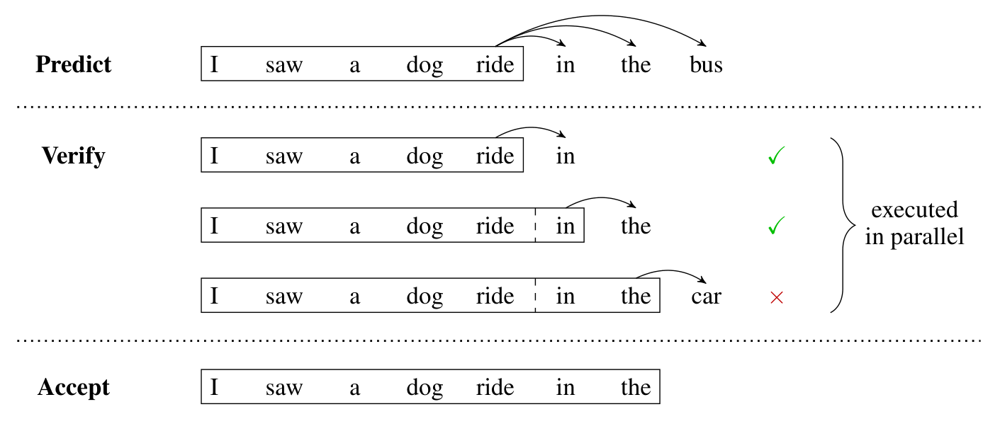</button>
<figcaption><strong>Blockwise：预测 in / the / bus，核验后只提交 in / the</strong><a href="https://arxiv.org/abs/1811.03115v1" target="_blank" rel="noopener">Blockwise Parallel Decoding for Deep Autoregressive Models</a> · Figure 1 · version 1811.03115v1 · PDF p.3 / printed p.3
<button class="original-direct" type="button">Read original size</button>

Original caption &amp; source

Figure 1: The three substeps of blockwise parallel decoding. In the predict substep, the greedy
model and two proposal models independently and in parallel predict “in”, “the”, and “bus”. In
the verify substep, the greedy model scores each of the three independent predictions, conditioning
on the previous independent predictions where applicable. When using a Transformer or con-
volutional sequence-to-sequence model, these three computations can be done in parallel. The
highest-probability prediction for the third position is “car”, which differs from the independently
predicted “bus”. In the accept substep, ˆy is hence extended to include only “in” and “the” before
making the next k independent predictions.
<a class="source-url" href="https://arxiv.org/abs/1811.03115v1">https://arxiv.org/abs/1811.03115v1</a>
</figcaption></figure>

**问题与读法。** 三行分别是 predict、verify、accept；横向是待生成的位置。上行并行提出 “in / the / bus”，中行目标在对应候选前缀下认为第三个位置应是 “car”，下行只延长已经一致的前缀。

**机制与例子。** 即使第四个位置猜得对，第三个位置不同也会让它失去可用上下文。对应公交例子，“车”被拒绝后不能保留它后面的“上”。并行预测提供候选，最终决定仍由 scoring model 作出。

**结论与边界。** 图支持减少串行轮数、保持所用评分模型的贪心规则；训练额外头、微调或近似接受的配置需要另看质量。它没有展示通用的随机分布纠错。

<figure id="fig-blockwise-t1">
<button class="paper-image" type="button" aria-label="Zoom: Blockwise：BLEU 与平均接受块长一起看">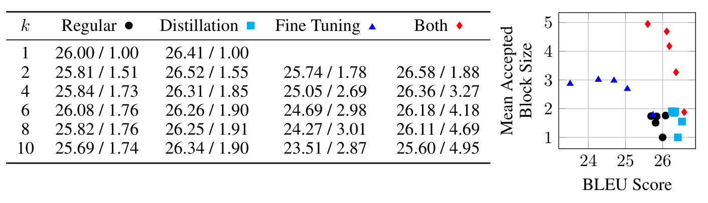</button>
<figcaption><strong>Blockwise：BLEU 与平均接受块长一起看</strong><a href="https://arxiv.org/abs/1811.03115v1" target="_blank" rel="noopener">Blockwise Parallel Decoding for Deep Autoregressive Models</a> · Table 1 · version 1811.03115v1 · PDF p.6 / printed p.6
<button class="original-direct" type="button">Read original size</button>

Original caption &amp; source

Table 1: Results on the newstest2013 development set for English-German translation. Each cell lists
BLEU score and mean accepted block size. Larger BLEU scores indicate higher translation quality,
and larger mean accepted block sizes indicate fewer decoding iterations. The data from the table is
also visually depicted in a scatter plot on the right.
<a class="source-url" href="https://arxiv.org/abs/1811.03115v1">https://arxiv.org/abs/1811.03115v1</a>
</figcaption></figure>

**问题与读法。** 原表用英文到德文 newstest2013 开发集，单元格同时列 BLEU 和平均接受块大小，右侧散点把质量与轮数压缩关系画出来。更大的块不必对应更高 BLEU。

**机制与例子。** 增加预测位置或改变训练，可能让一次提交更多 token，却也改变输出模型。翻译“坐公交车”如果变成另一种表达，质量指标与执行轮数是两条结果轴。

**结论与边界。** 表支持某些设置下的质量与轮数取舍，不支持把所有块压缩当作保持原 checkpoint 的无损加速。原实验使用 8 张 P100 训练；训练资源与线上运行资源不能混为同一账。

<figure id="fig-blockwise-f4">
<button class="paper-image" type="button" aria-label="Zoom: Blockwise：轮数压缩大于最终墙钟收益">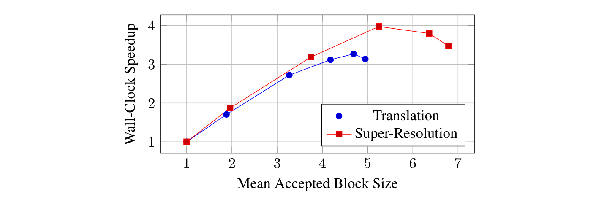</button>
<figcaption><strong>Blockwise：轮数压缩大于最终墙钟收益</strong><a href="https://arxiv.org/abs/1811.03115v1" target="_blank" rel="noopener">Blockwise Parallel Decoding for Deep Autoregressive Models</a> · Figure 4 · version 1811.03115v1 · PDF p.8 / printed p.8
<button class="original-direct" type="button">Read original size</button>

Original caption &amp; source

Figure 4: A plot of the relative wall-clock speedup achieved for various mean accepted block sizes,
where the latter measure a reduction in iterations required for decoding. This data comes from the
final column of Table 1 (translation results using fine tuning and distillation) and the final column of
Table 2 (super-resolution results using fine tuning and approximate decoding).
<a class="source-url" href="https://arxiv.org/abs/1811.03115v1">https://arxiv.org/abs/1811.03115v1</a>
</figcaption></figure>

**问题与读法。** 横轴是平均接受块大小带来的 iteration compression，纵轴是相对 wall-clock speedup；不同点来自翻译、超分辨率及对应配置。重点观察实际速度与理想压缩之间的距离。

**机制与例子。** 核验更多位置和附加头也需要计算。一次接受三词，若循环比原单词步骤贵，就不可能自动获得三倍墙钟速度。

**结论与边界。** 图早已揭示“少轮数”与“更快”不同。部分点来自微调、蒸馏或近似解码，不能抽成所有语言模型、所有采样方法的纯算法加速比。

### 4.2 Leviathan：让任意草稿成为精确采样的提议者

Leviathan 等 <a href="#source-P02">[P02]</a> 把草稿模型与目标模型分开，用第 2 节的接受与残差规则保证目标分布。小模型甚至可以很粗糙；代价是更频繁的拒绝，而不是自动降低最终理论质量。

<figure id="fig-leviathan-a1">
<button class="paper-image" type="button" aria-label="Zoom: Leviathan Algorithm 1：逐位置拒绝与残差补偿">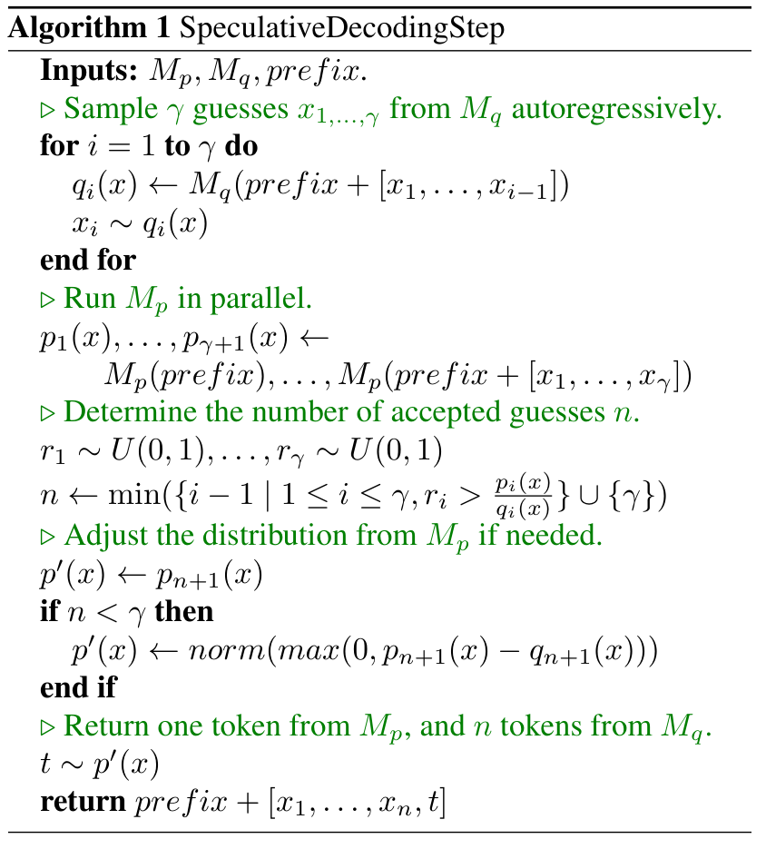</button>
<figcaption><strong>Leviathan Algorithm 1：逐位置拒绝与残差补偿</strong><a href="https://arxiv.org/abs/2211.17192v2" target="_blank" rel="noopener">Fast Inference from Transformers via Speculative Decoding</a> · Algorithm 1 · version 2211.17192v2 · PDF p.3 / printed p.3
<button class="original-direct" type="button">Read original size</button>

Original caption &amp; source

Algorithm 1 SpeculativeDecodingStep
<a class="source-url" href="https://arxiv.org/abs/2211.17192v2">https://arxiv.org/abs/2211.17192v2</a>
</figcaption></figure>

**问题与读法。** 算法先由 $M_q$ 连续生成 $\gamma$ 个候选，再由 $M_p$ 计算对应的多个分布；随机数控制接受前缀，后面的归一化差值负责补偿。

**机制与例子。** 在公交例子第二个位置被拒绝，先提交第一个位置，再从该历史下的残差抽一个替代 token。如果全部接受，则从块末目标分布抽 bonus。

**结论与边界。** 只要分布和条件前缀正确，草稿是否训练于相同任务不影响理想算法的精确性。词表对齐、采样变换、EOS 和数值误差仍是实现条件。

<figure id="fig-leviathan-f5">
<button class="paper-image" type="button" aria-label="Zoom: Leviathan：蓝色草稿串行，紫色目标批量核验">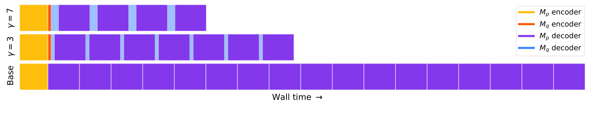</button>
<figcaption><strong>Leviathan：蓝色草稿串行，紫色目标批量核验</strong><a href="https://arxiv.org/abs/2211.17192v2" target="_blank" rel="noopener">Fast Inference from Transformers via Speculative Decoding</a> · Figure 5 · version 2211.17192v2 · PDF p.6 / printed p.6
<button class="original-direct" type="button">Read original size</button>

Original caption &amp; source

Figure 5. A simplified trace diagram for a full encoder-decoder Transformer stack. The top row shows speculative decoding with γ = 7
so each of the calls to Mp (the purple blocks) is preceded by 7 calls to Mq (the blue blocks). The yellow block on the left is the call to the
encoder for Mp and the orange block is the call to the encoder for Mq. Likewise the middle row shows speculative decoding with γ = 3,
and the bottom row shows standard decoding.
<a class="source-url" href="https://arxiv.org/abs/2211.17192v2">https://arxiv.org/abs/2211.17192v2</a>
</figcaption></figure>

**问题与读法。** 上、中、下三行对应 $\gamma=7$、$\gamma=3$ 和普通解码；蓝块是草稿调用，紫块是目标调用，左端黄色和橙色是两个模型的 encoder 工作。

**机制与例子。** 草稿七次便宜调用之后进行一次较贵核验。假如公交相关用词容易预测，较长块能摊薄目标调用；如果很快猜错，就支付了一段无用草稿。

**结论与边界。** 图解释成本比与长度的共同作用。它是 encoder-decoder 栈的简化 trace，不能直接当作 decoder-only 系统的精确逐算子时序，也不能假定紫块宽度永远不变。

<figure id="fig-leviathan-t2">
<button class="paper-image" type="button" aria-label="Zoom: Leviathan：T5-XXL 与 T5-small 的条件化结果">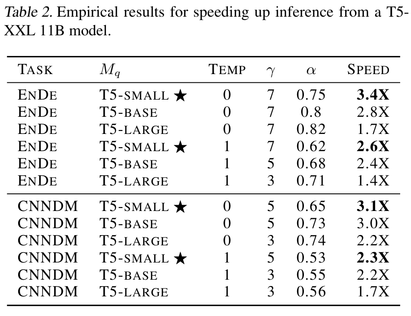</button>
<figcaption><strong>Leviathan：T5-XXL 与 T5-small 的条件化结果</strong><a href="https://arxiv.org/abs/2211.17192v2" target="_blank" rel="noopener">Fast Inference from Transformers via Speculative Decoding</a> · Table 2 · version 2211.17192v2 · PDF p.6 / printed p.6
<button class="original-direct" type="button">Read original size</button>

Original caption &amp; source

Table 2. Empirical results for speeding up inference from a T5-
XXL 11B model.
<a class="source-url" href="https://arxiv.org/abs/2211.17192v2">https://arxiv.org/abs/2211.17192v2</a>
</figcaption></figure>

**问题与读法。** 表按任务、temperature、草稿长度、接受率与速度读。目标为 T5-XXL 11B，草稿为 T5-small 77M，T5X、batch 1、单 TPU v4。

**机制与例子。** 英德翻译在 temperature 0、$\gamma=7$ 时接受率 0.75、报告 3.4 倍；temperature 1 时接受率 0.62、2.6 倍。CNN/DailyMail 的 $\gamma=5$ 配置分别为 3.1 与 2.3 倍。

**结论与边界。** 同一任务的随机性改变收益；更大草稿提高接受率也会变慢。此表未形成可完整复建的精度、输出长度与端到端计时配置，本文保留这些未充分披露项，不外推今天的 GPU 服务速度。

### 4.3 Chen：采样设置、任务与最优长度一起变

Chen 等 <a href="#source-P03">[P03]</a> 独立给出了 speculative sampling 框架，使用 Chinchilla 70B 和专门训练的 4B 草稿。原算法把目标、草稿的 $p/q$ 字母用法与本文相反；读截图时应按角色映射，不应只按字母照搬。

<figure id="fig-chen-a2">
<button class="paper-image" type="button" aria-label="Zoom: Chen Algorithm 2：相同的概率纠错，不同的符号约定">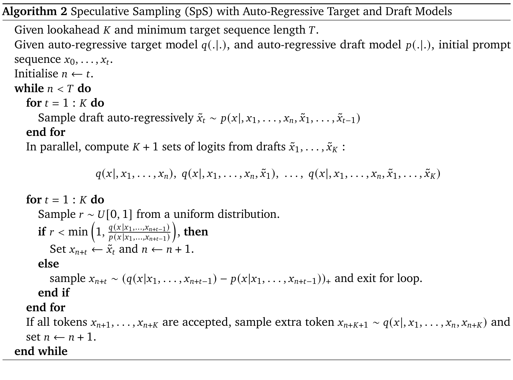</button>
<figcaption><strong>Chen Algorithm 2：相同的概率纠错，不同的符号约定</strong><a href="https://arxiv.org/abs/2302.01318v1" target="_blank" rel="noopener">Accelerating Large Language Model Decoding with Speculative Sampling</a> · Algorithm 2 · version 2302.01318v1 · PDF p.3 / printed p.3
<button class="original-direct" type="button">Read original size</button>

Original caption &amp; source

Algorithm 2 Speculative Sampling (SpS) with Auto-Regressive Target and Draft Models
<a class="source-url" href="https://arxiv.org/abs/2302.01318v1">https://arxiv.org/abs/2302.01318v1</a>
</figcaption></figure>

**问题与读法。** 算法包含 autoregressive draft、一次目标核验、接受测试和 adjusted distribution。请先定位 target 与 draft 的定义；截图字母不是本文固定符号。

**机制与例子。** 接受了“公交”后，第二位置应在“公交”的条件历史下进行测试；拒绝则补回该位置尚缺的质量。后续候选不会越过失败位置继续提交。

**结论与边界。** 算法截图是这篇论文最直接的技术证据，而不是另造一张不存在的架构图。精确性依赖实际概率分布；top-p 截断和 temperature 都须进入对应分布。

<figure id="fig-chen-t1">
<button class="paper-image" type="button" aria-label="Zoom: Chen：XSum 与 HumanEval 的每 token 时间">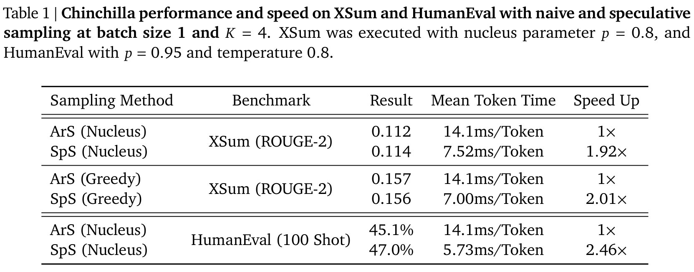</button>
<figcaption><strong>Chen：XSum 与 HumanEval 的每 token 时间</strong><a href="https://arxiv.org/abs/2302.01318v1" target="_blank" rel="noopener">Accelerating Large Language Model Decoding with Speculative Sampling</a> · Table 1 · version 2302.01318v1 · PDF p.6 / printed p.6
<button class="original-direct" type="button">Read original size</button>

Original caption &amp; source

Table 1 | Chinchilla performance and speed on XSum and HumanEval with naive and speculative
sampling at batch size 1 and 𝐾= 4. XSum was executed with nucleus parameter 𝑝= 0.8, and
HumanEval with 𝑝= 0.95 and temperature 0.8.
<a class="source-url" href="https://arxiv.org/abs/2302.01318v1">https://arxiv.org/abs/2302.01318v1</a>
</figcaption></figure>

**问题与读法。** 表同时给普通解码、SpS 时间和论文报告的速度比。16 TPU v4、batch 1、草稿长度 4；XSum 11,305 个序列最多输出 128 token，HumanEval 16,400 个采样最多 512。

**机制与例子。** XSum top-p 0.8 从 14.1 降到 7.52 ms/token，论文报告 1.92 倍；贪心为 7.00 ms、2.01 倍。HumanEval 100-shot、top-p 0.95、temperature 0.8 为 5.73 ms、2.46 倍。

**结论与边界。** 代码任务与摘要接受行为不同；不能抹去提示与采样设置。14.1/7.52 按打印值算约 1.875，和表内报告值不同；本文同时保留原数与报告比值，不编造舍入之外的解释。

<figure id="fig-chen-f1">
<button class="paper-image" type="button" aria-label="Zoom: Chen：草稿长度存在任务相关最优点">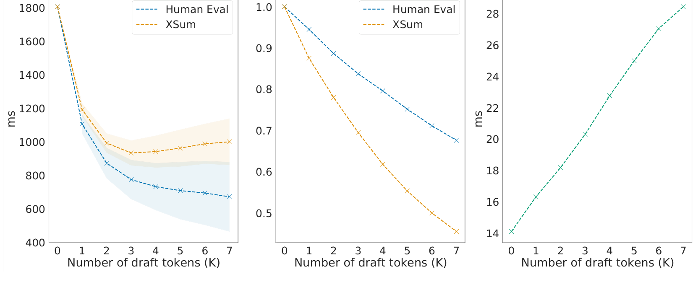</button>
<figcaption><strong>Chen：草稿长度存在任务相关最优点</strong><a href="https://arxiv.org/abs/2302.01318v1" target="_blank" rel="noopener">Accelerating Large Language Model Decoding with Speculative Sampling</a> · Figure 1 · version 2302.01318v1 · PDF p.7 / printed p.7
<button class="original-direct" type="button">Read original size</button>

Original caption &amp; source

Figure 1 | Left: The average time to generate 128 tokens, with standard deviation. Note that as 𝐾
increases, the overall speedup plateaus or even regresses, with XSum being optimal at 𝐾= 3. The
variance consistently increases with 𝐾. Middle: The average number of tokens accepted divided by
𝐾+ 1 – this serves as a measure of the overall efficiency of the modified rejection scheme, which
decreases with the lookahead. Right: Average time per loop increases approximately linearly with 𝐾
due to the increased number of model calls. Note that the gradient is slightly higher than the sampling
speed of the draft model, due to additional overheads in nucleus decoding.
<a class="source-url" href="https://arxiv.org/abs/2302.01318v1">https://arxiv.org/abs/2302.01318v1</a>
</figcaption></figure>

**问题与读法。** 各子图随草稿长度 $K$ 改变，分别观察延迟、接受相关量和归一化工作。中图的 acceptance rate 是平均接受量相对于 $K+1$ 的归一化指标，不是某一 token 的接受概率。

**机制与例子。** 草稿从四词变八词可能只多接受一个词，却增加四次草稿调用。摘要与代码的生存曲线不同，最优 $K$ 因而不同。

**结论与边界。** 图支持长度调优，不支持固定“四个最好”或“越长越好”。归一化指标、每轮提交长度和采样概率必须分别命名。

## 5. 从一条链到候选树：SpecInfer 与 DistillSpec

### 5.1 SpecInfer：多候选共享目标核验，但概率不能随意挑

链式草稿在每个位置只赌一个候选。SpecInfer <a href="#source-P04">[P04]</a> 把多个小模型产生的候选合成 token tree，让共同前缀共享节点，并一次核验整棵候选树。难点不仅是画树，还有因果 mask、缓存和多提议者的采样处理。

<figure id="fig-specinfer-f2">
<button class="paper-image" type="button" aria-label="Zoom: SpecInfer：扩展、合并与共享前缀">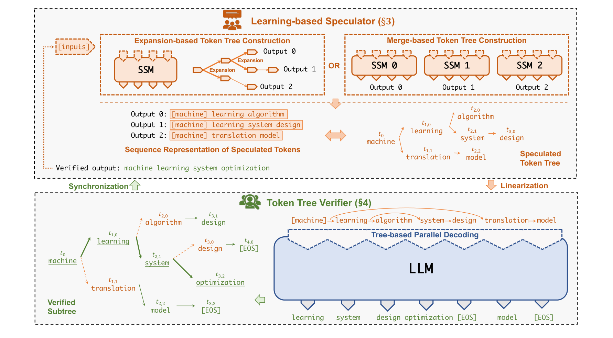</button>
<figcaption><strong>SpecInfer：扩展、合并与共享前缀</strong><a href="https://arxiv.org/abs/2305.09781v4" target="_blank" rel="noopener">SpecInfer: Accelerating Large Language Model Serving with Tree-based Speculative Inference and Verification</a> · Figure 2 · version 2305.09781v4 · PDF p.4 / printed p.4
<button class="original-direct" type="button">Read original size</button>

Original caption &amp; source

Figure 2. An overview of SpecInfer’s tree-based speculative inference and verification mechanism.
<a class="source-url" href="https://arxiv.org/abs/2305.09781v4">https://arxiv.org/abs/2305.09781v4</a>
</figcaption></figure>

**问题与读法。** 图中小型 speculative models 各自提议，随后进行树扩展和合并；从根沿分支走得到一条候选句子，相同前缀可以复用。

**机制与例子。** “公交 / 车”和“公交 / 站”共享“公交”节点，比重复核验两条完整链更节省；下一层的不同选项增加覆盖面。

**结论与边界。** 树利用共享前缀和闲置并行算力。它也增加候选节点数和临时 KV，不保证树更宽就更快，重复候选还需正确处理。

<figure id="fig-specinfer-f4">
<button class="paper-image" type="button" aria-label="Zoom: SpecInfer：拓扑因果 mask 与 KV 核验">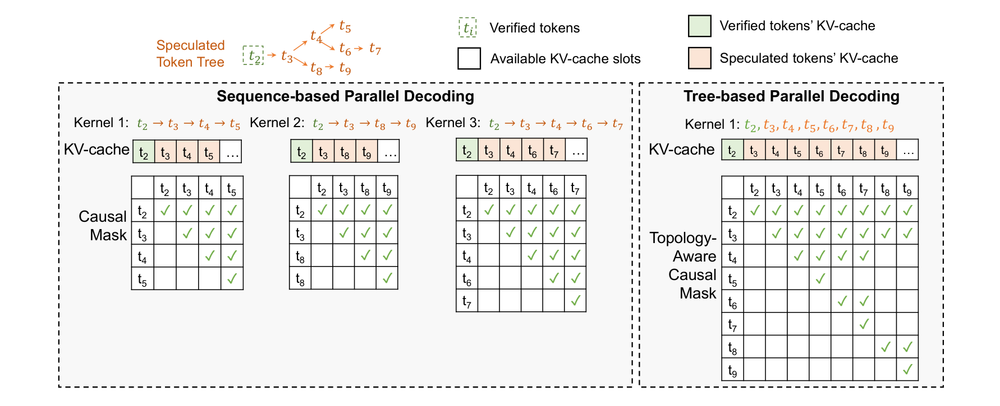</button>
<figcaption><strong>SpecInfer：拓扑因果 mask 与 KV 核验</strong><a href="https://arxiv.org/abs/2305.09781v4" target="_blank" rel="noopener">SpecInfer: Accelerating Large Language Model Serving with Tree-based Speculative Inference and Verification</a> · Figure 4 · version 2305.09781v4 · PDF p.8 / printed p.8
<button class="original-direct" type="button">Read original size</button>

Original caption &amp; source

Figure 4. Comparing SpecInfer’s tree-based parallel decoding with existing sequence-based decoding.
<a class="source-url" href="https://arxiv.org/abs/2305.09781v4">https://arxiv.org/abs/2305.09781v4</a>
</figcaption></figure>

**问题与读法。** 左侧树被排成可计算的位置序列，mask 决定每行可以读哪些祖先；配套 kernel 组织树位置与缓存。非祖先节点即便排在前面，也不能被读到。

**机制与例子。** “公交 / 站”的“站”只能读共享根与“公交”，不能读兄弟“车”。position ID 表示路径深度，不可仅用 flatten 后的数组下标代替。

**结论与边界。** 图支持一个目标前向核验多分支，前提是拓扑 mask 与位置正确。普通下三角 mask 和普通顺序 KV append 不能直接替代树语义。

<figure id="fig-specinfer-f5">
<button class="paper-image" type="button" aria-label="Zoom: SpecInfer：多次提议后更新残差">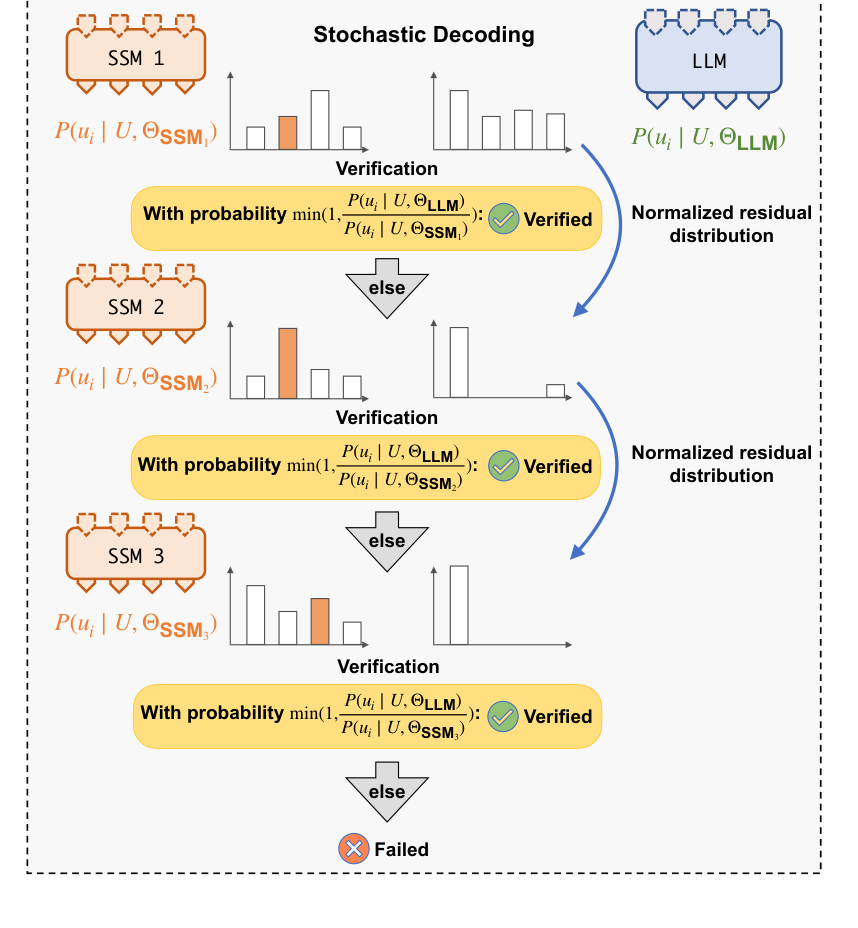</button>
<figcaption><strong>SpecInfer：多次提议后更新残差</strong><a href="https://arxiv.org/abs/2305.09781v4" target="_blank" rel="noopener">SpecInfer: Accelerating Large Language Model Serving with Tree-based Speculative Inference and Verification</a> · Figure 5 · version 2305.09781v4 · PDF p.8 / printed p.8
<button class="original-direct" type="button">Read original size</button>

Original caption &amp; source

Figure 5. Illustrating the multi-step speculative sampling
mechanism for verifying LLMs with stochastic sampling.
<a class="source-url" href="https://arxiv.org/abs/2305.09781v4">https://arxiv.org/abs/2305.09781v4</a>
</figcaption></figure>

**问题与读法。** 图按多个小模型的提议与目标核验读；某个候选被拒绝后，目标剩余概率质量被更新，后续候选在新的残差关系下处理。

**机制与例子。** 第一草稿多给“车”，拒绝它后不能让第二草稿再面对未经修正的同一分布无限试。否则容易把某些词的最终概率累积得过高。

**结论与边界。** 多提议者的精确采样不是“选目标分最高的节点”。树节点组织与随机选择规则是两个层面，忽略重复提议和残差更新会破坏分布保持。

<figure id="fig-specinfer-f7">
<button class="paper-image" type="button" aria-label="Zoom: SpecInfer：分布式环境下的推理延迟">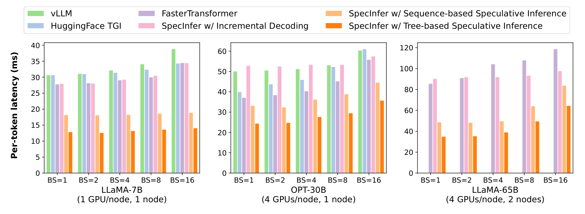</button>
<figcaption><strong>SpecInfer：分布式环境下的推理延迟</strong><a href="https://arxiv.org/abs/2305.09781v4" target="_blank" rel="noopener">SpecInfer: Accelerating Large Language Model Serving with Tree-based Speculative Inference and Verification</a> · Figure 7 · version 2305.09781v4 · PDF p.12 / printed p.12
<button class="original-direct" type="button">Read original size</button>

Original caption &amp; source

Figure 7. Comparing the end-to-end inference latency of SpecInfer with existing systems. Numbers in parenthesis show the
number of GPUs and compute node used to serve each LLM. All systems parallelize LLM inference by combining tensor model
parallelism (within a node) and pipeline parallelism (across nodes).
<a class="source-url" href="https://arxiv.org/abs/2305.09781v4">https://arxiv.org/abs/2305.09781v4</a>
</figcaption></figure>

**问题与读法。** 图按模型与设备配置比较不同 serving 方法的延迟，较低更好；实验使用 A10 24GB，最多生成 128 token，覆盖五类提示数据。

**机制与例子。** 1 GPU Llama 7B、4 GPU OPT 30B，以及跨两节点的 4 GPU Llama 65B，通信与目标计算占比不同。共享核验可能同时摊薄多 GPU 调用开销。

**结论与边界。** 图显示所测引擎、模型与设备配置下的优势，不能将论文汇总的 1.5–2.8 倍视为跨所有引擎的保证。短输出、跨节点和具体基线必须保留。

### 5.2 DistillSpec：为接受率训练，不等于再做一个通用小模型

DistillSpec <a href="#source-P05">[P05]</a> 保持目标模型，用它来训练更贴近自身的草稿。草稿需要在自己实际会访问的上下文中预测得像目标，而不只是在人类标准答案上有高任务分数。

<figure id="fig-distillspec-f1">
<button class="paper-image" type="button" aria-label="Zoom: DistillSpec：目标专属蒸馏改善草稿匹配">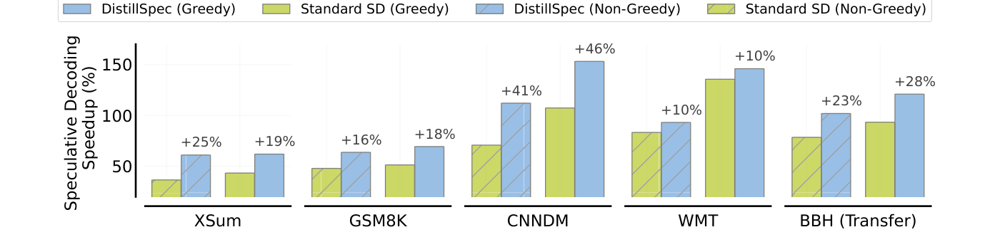</button>
<figcaption><strong>DistillSpec：目标专属蒸馏改善草稿匹配</strong><a href="https://arxiv.org/abs/2310.08461v2" target="_blank" rel="noopener">DistillSpec: Improving Speculative Decoding via Knowledge Distillation</a> · Figure 1 · version 2310.08461v2 · PDF p.2 / printed p.2
<button class="original-direct" type="button">Read original size</button>

Original caption &amp; source

Figure 1: Performance comparison of standard speculative decoding (SD) vs. our proposed DistillSpec, with
small- and XL-sized models from the T5 v1.1 family (Raffel et al., 2020) being utilized as the draft and the
target models, respectively. DistillSpec enhances SD speed by better aligning the draft with the target via
white-box knowledge distillation, resulting in a consistent 10−45% speedup improvement over standard SD
across various datasets. The distilled draft model from GSM8K transfers well to 23 unseen BigBenchHard
tasks (Suzgun et al., 2022), resulting in an average speedup of 26%. See § 5.1 for additional details.
<a class="source-url" href="https://arxiv.org/abs/2310.08461v2">https://arxiv.org/abs/2310.08461v2</a>
</figcaption></figure>

**问题与读法。** 图比较标准 speculative decoding 与经过知识蒸馏的草稿；目标质量责任不变，改进发生在候选分布及被接受的长度上。

**机制与例子。** 目标习惯用“公交车”，一个更偏“公共汽车”的优秀小模型也可能被频繁拒绝。目标生成数据与分布监督让草稿学习目标偏好的表达。

**结论与边界。** 原文主线报告相对已有 SD 再改善 10–45%，不是 10–45 倍。图中个别 +46% 来自具体打印数与设置；另一路 6–10 倍涉及目标蒸馏或有损取舍，本文不归入同目标精确加速。

<figure id="fig-distillspec-f3">
<button class="paper-image" type="button" aria-label="Zoom: DistillSpec：训练墙钟、实例收益与理论对照">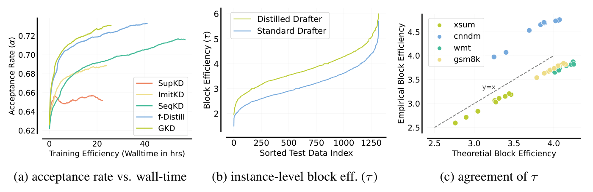</button>
<figcaption><strong>DistillSpec：训练墙钟、实例收益与理论对照</strong><a href="https://arxiv.org/abs/2310.08461v2" target="_blank" rel="noopener">DistillSpec: Improving Speculative Decoding via Knowledge Distillation</a> · Figure 3 · version 2310.08461v2 · PDF p.7 / printed p.7
<button class="original-direct" type="button">Read original size</button>

Original caption &amp; source

Figure 3: (a) White-box KD using teacher logits and model-generated data is crucial. Draft model’s on-policy
data can be as effective as target model data. GKD achieves the best wall-time performance improvement
on XSum. (b) Distillation improves the block efficiency for all examples on GSM8K. (c) Empirical block
efficiency aligns well with its DTVD-based theoretical counterpart.
<a class="source-url" href="https://arxiv.org/abs/2310.08461v2">https://arxiv.org/abs/2310.08461v2</a>
</figcaption></figure>

**问题与读法。** (a) 横轴是训练墙钟小时、纵轴接受率，颜色区分蒸馏方式；(b) 横轴是排序后的 GSM8K 实例、纵轴是 block efficiency，比较标准与蒸馏草稿；(c) 横轴理论、纵轴实测 block efficiency，虚线是两者相等。

**机制与例子。** 学生 rollout 会出现自己偏离目标后访问的上下文，教师只在标准答案上监督可能漏掉这些区域。(a) 的 GKD 更快提升接受率，(b) 检查收益是否只来自少数容易样本，(c) 检查理论估计是否能排序草稿。

**结论与边界。** 白盒 logits 与模型生成数据有效，草稿自己的数据可接近教师生成数据效果；理论曲线仍受位置独立近似限制。测试为 batch 1、temperature 0/1；未获得完整计时硬件配置，亦未核验到作者提供的可运行官方仓库，不能称为已完整复现。

<figure id="fig-distillspec-f4">
<button class="paper-image" type="button" aria-label="Zoom: DistillSpec：最优蒸馏距离与数据配方随任务变化">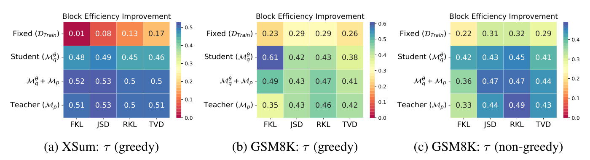</button>
<figcaption><strong>DistillSpec：最优蒸馏距离与数据配方随任务变化</strong><a href="https://arxiv.org/abs/2310.08461v2" target="_blank" rel="noopener">DistillSpec: Improving Speculative Decoding via Knowledge Distillation</a> · Figure 4 · version 2310.08461v2 · PDF p.8 / printed p.8
<button class="original-direct" type="button">Read original size</button>

Original caption &amp; source

Figure 4: DistillSpec recipe. We report improvement in empirical block efficiency post-distillation on (a) XSum with greedy sampling, and GSM8K with (b) greedy and (c) non-greedy sampling. Which divergence function and data construction lead to the largest block efficiency improvements highly depends on the task. They should be treated as a hyperparameters to be tuned on our task of interest.
<a class="source-url" href="https://arxiv.org/abs/2310.08461v2">https://arxiv.org/abs/2310.08461v2</a>
</figcaption></figure>

**问题与读法。** 三个热力图分别是 XSum 贪心、GSM8K 贪心与随机采样；行是固定答案、学生生成、学生与教师混合、教师生成数据，列是 FKL/JSD/RKL/TVD。颜色和格内数字表示经验 block efficiency 的改善，较大更好。

**机制与例子。** 同样学习目标偏好的“公交车”，前向 KL 更强调覆盖目标概率质量，反向 KL 更强调草稿已选择的区域。图中 GSM8K 贪心的学生数据/FKL 为 0.61，而随机采样教师数据/RKL 为 0.49，最优格子会移动。

**结论与边界。** TV 与拒绝率的理论关系不表示直接优化 TVD 总是最好；配方要按任务与采样调节。格子是接受效率改善，不是绝对 tokens/s，也没有把不同任务的训练成本统一成同一尺度。

## 6. 从多头到 EAGLE：减少草稿等待，修正训练失配

### 6.1 Medusa：一次隐藏状态生成多个未来候选

Medusa <a href="#source-P07">[P07]</a> 在目标隐藏状态上增加多个预测头，避免让独立草稿模型逐 token 串行执行。每个头预测更远的 token，再组织成树交给原模型检查。MEDUSA-1 固定目标、训练新增头；MEDUSA-2 联合微调，基准对象随之改变。

<figure id="fig-medusa-f1">
<button class="paper-image" type="button" aria-label="Zoom: Medusa：共享隐藏状态上的多未来预测头">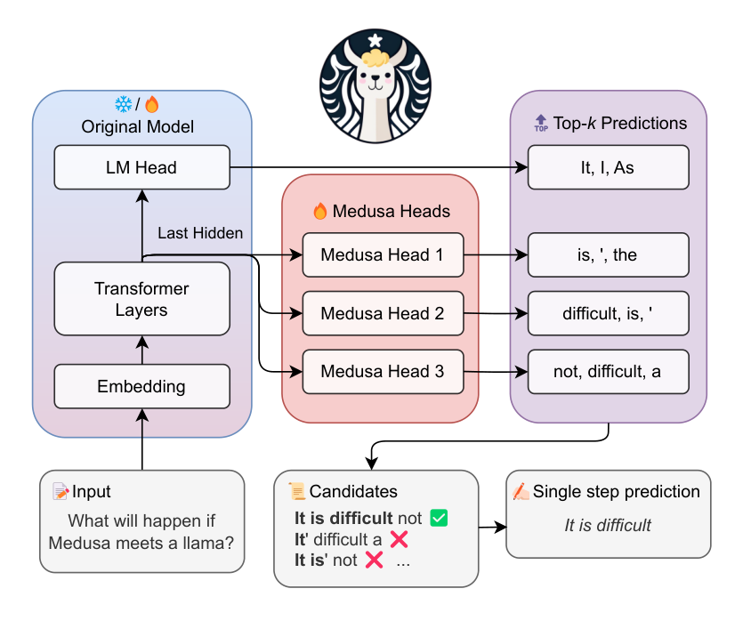</button>
<figcaption><strong>Medusa：共享隐藏状态上的多未来预测头</strong><a href="https://arxiv.org/abs/2401.10774v3" target="_blank" rel="noopener">Medusa: Simple LLM Inference Acceleration Framework with Multiple Decoding Heads</a> · Figure 1 · version 2401.10774v3 · PDF p.2 / printed p.2
<button class="original-direct" type="button">Read original size</button>

Original caption &amp; source

Figure 1. MEDUSA introduces multiple heads on top of the last
hidden states of the LLM, enabling the prediction of several sub-
sequent tokens in parallel (Section 2.1.1). During inference, each
head generates multiple top predictions for its designated posi-
tion. These predictions are assembled into candidates, which are
processed in parallel using a tree-based attention mechanism (Sec-
tion 2.1.2). The final step is to verify the candidates and accept a
continuation. Besides the standard rejection sampling scheme, a
typical acceptance scheme (Section 2.3.1) can also be used here
to select reasonable continuations, and the longest accepted candi-
date prefix will be used for the next decoding phase.
<a class="source-url" href="https://arxiv.org/abs/2401.10774v3">https://arxiv.org/abs/2401.10774v3</a>
</figcaption></figure>

**问题与读法。** 主干给出当前隐藏状态，额外头分别预测不同未来偏移；多个候选被组织成待核验序列或树。头编号表示未来位置，不是多个完整语言模型。

**机制与例子。** 从“坐在”一次提出后面“公交 / 车 / 上”的候选，省去小模型三次循环。但较远头不知道最终前一个 token 究竟选了什么，因此容易产生不连贯组合。

**结论与边界。** 图解释并行低成本提议，不证明未来 token 已失去条件依赖。MEDUSA-2 改动目标权重，不能称为与未微调原模型完全相同的输出分布。

<figure id="fig-medusa-f2">
<button class="paper-image" type="button" aria-label="Zoom: Medusa：tree attention 批量检查头的组合">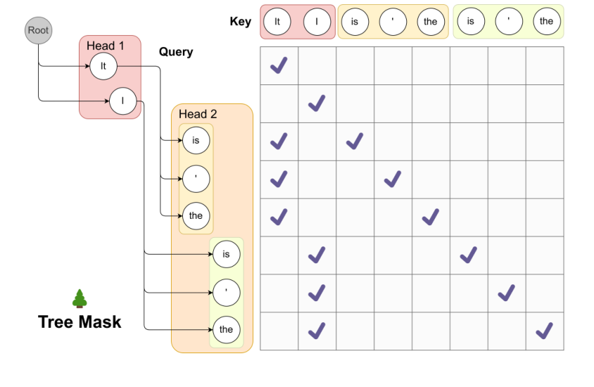</button>
<figcaption><strong>Medusa：tree attention 批量检查头的组合</strong><a href="https://arxiv.org/abs/2401.10774v3" target="_blank" rel="noopener">Medusa: Simple LLM Inference Acceleration Framework with Multiple Decoding Heads</a> · Figure 2 · version 2401.10774v3 · PDF p.4 / printed p.4
<button class="original-direct" type="button">Read original size</button>

Original caption &amp; source

Figure 2. We demonstrates the use of tree attention to process mul-
tiple candidates concurrently. As exemplified, the top-2 predictions
from the first MEDUSA head and the top-3 from the second result
in a total of 2 × 3 = 6 candidates. Each of these candidates
corresponds to a distinct branch within the tree structure. To guar-
antee that each token only accesses its predecessors, we devise
an attention mask that exclusively permits attention flow from the
current token back to its antecedent tokens. The positional indices
for positional encoding are adjusted in line with this structure.
<a class="source-url" href="https://arxiv.org/abs/2401.10774v3">https://arxiv.org/abs/2401.10774v3</a>
</figcaption></figure>

**问题与读法。** 图把不同头的 top candidates 组合为树，再用树因果 mask 一次前向。节点深度决定相对位置，可见连接决定条件上下文。

**机制与例子。** 第一头“公交”和“地铁”各自配第二头候选，目标对这些组合给条件概率；共享前缀只计算一次，最终仍只提交一条合法路径。

**结论与边界。** tree attention 让多头覆盖变得实用；组合数膨胀、固定树预算与 cache 搬运仍存在。多头本身没有给出残差采样证明。

<figure id="fig-medusa-f4">
<button class="paper-image" type="button" aria-label="Zoom: Medusa：候选树变大，tokens/s 不会一直增长">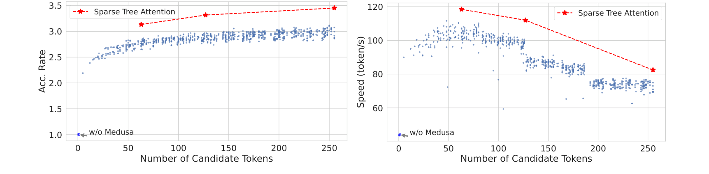</button>
<figcaption><strong>Medusa：候选树变大，tokens/s 不会一直增长</strong><a href="https://arxiv.org/abs/2401.10774v3" target="_blank" rel="noopener">Medusa: Simple LLM Inference Acceleration Framework with Multiple Decoding Heads</a> · Figure 4 · version 2401.10774v3 · PDF p.8 / printed p.8
<button class="original-direct" type="button">Read original size</button>

Original caption &amp; source

Figure 4. Effectiveness of numbers of candidate tokens for decoding introduced by trees (default number of candidate token for decoding
is 1 when using KV cache). Left: The acceleration rate for randomly sampled dense tree settings (blue dots) and optimized sparse tree
settings (red stars). Right: The speed (tokens/s) for both settings. The trend lines indicate that while the acceleration rate remains relatively
stable for sparse trees, there is a notable decrease in speed as the candidate tokens increases.
<a class="source-url" href="https://arxiv.org/abs/2401.10774v3">https://arxiv.org/abs/2401.10774v3</a>
</figcaption></figure>

**问题与读法。** 随树配置改变，图同时展示接受长度与实际生成速度。接受更多候选与墙钟收益必须对应各自坐标或图例。

**机制与例子。** 加入冷门“电车”分支增加核验节点，但若很少成为正式路径，就只消耗目标算力。接受量还增长时，吞吐也可能趋于饱和或下降。

**结论与边界。** 图支持按实际速度选树，而非最大化节点数。图内的单请求方法配置不能直接成为高并发 serving 的最优预算。

<figure id="fig-medusa-t1">
<button class="paper-image" type="button" aria-label="Zoom: Medusa：接受长度、开销与质量是不同指标">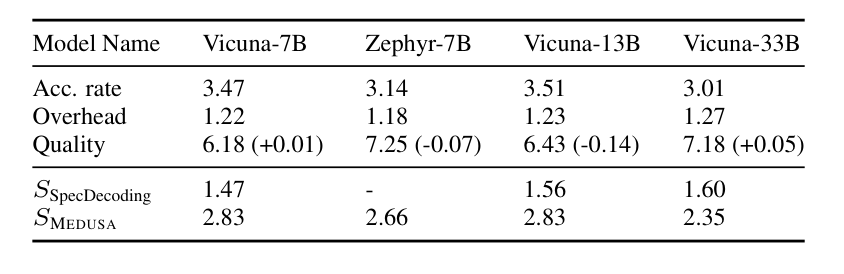</button>
<figcaption><strong>Medusa：接受长度、开销与质量是不同指标</strong><a href="https://arxiv.org/abs/2401.10774v3" target="_blank" rel="noopener">Medusa: Simple LLM Inference Acceleration Framework with Multiple Decoding Heads</a> · Table 1 · version 2401.10774v3 · PDF p.8 / printed p.8
<button class="original-direct" type="button">Read original size</button>

Original caption &amp; source

Table 1. Comparison of various MEDUSA-2 models. The first
section reports the details of MEDUSA-2, including accelerate rate,
overhead, and quality that denoted the average scores on the MT-
Bench compared to the original models. The second section lists
the speedup (S) of SpecDecoding and MEDUSA, respectively.
<a class="source-url" href="https://arxiv.org/abs/2401.10774v3">https://arxiv.org/abs/2401.10774v3</a>
</figcaption></figure>

**问题与读法。** 表列 MEDUSA-2 的 acceptance、overhead、speedup 和 MT-Bench 分数。Vicuna 7B 行为 3.47、1.22 和报告 2.83 倍，质量 6.18、变化约 +0.01。

**机制与例子。** 3.47 的轮数收益除以 1.22 的循环开销，才接近实速；公交句子某次不同，也可能不明显改变总体对话评分。

**结论与边界。** 质量分数接近不是分布保持证明。论文的 typical acceptance 可以有损；必须区分贪心精确核验、严格拒绝采样和 typical 方案。主表没有完整独立列出统一硬件、精度和输出上限，附录中的 A100 roofline 实验不能被移来充当所有主表设置。

### 6.2 EAGLE：特征预测也需要知道真正选中的 token

EAGLE <a href="#source-P08">[P08]</a> 使用目标高层特征作为草稿输入。相比完整小模型，这个自回归 feature drafter 更轻；与纯多头不同，它把已选 token 的 embedding 移位对齐，使下一特征预测明确知道采样结果。

<figure id="fig-eagle-f3">
<button class="paper-image" type="button" aria-label="Zoom: EAGLE：同一个特征不能预知随机选中的下一个词">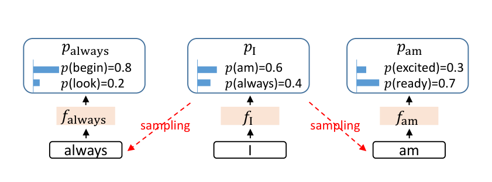</button>
<figcaption><strong>EAGLE：同一个特征不能预知随机选中的下一个词</strong><a href="https://arxiv.org/abs/2401.15077v3" target="_blank" rel="noopener">EAGLE: Speculative Sampling Requires Rethinking Feature Uncertainty</a> · Figure 3 · version 2401.15077v3 · PDF p.2 / printed p.2
<button class="original-direct" type="button">Read original size</button>

Original caption &amp; source

Figure 3: Uncertainty in feature sequences. The next fea-
ture following fI is contingent on the sampling outcome
and cannot be determined solely based on fI, where both
“always” and “am” are possible to follow the token “I” and
lead to two branches.
<a class="source-url" href="https://arxiv.org/abs/2401.15077v3">https://arxiv.org/abs/2401.15077v3</a>
</figcaption></figure>

**问题与读法。** 图把固定历史的隐藏特征与随机分叉的 token、后继特征对应起来。不同颜色或分支代表不同采样后续，不是同一状态可以无条件共享的答案。

**机制与例子。** “坐在”之后可能采到“公交”也可能“地铁”；相同当前特征不能唯一决定两种后继语义。只回归下一特征会面对由 token 随机性造成的不确定性。

**结论与边界。** 图解释补充 token 信息的必要性，不表示特征空间天然比概率空间更“确定”。随机性仍存在，只是条件信息更完整。

<figure id="fig-eagle-f6">
<button class="paper-image" type="button" aria-label="Zoom: EAGLE：移位 embedding 与特征自回归">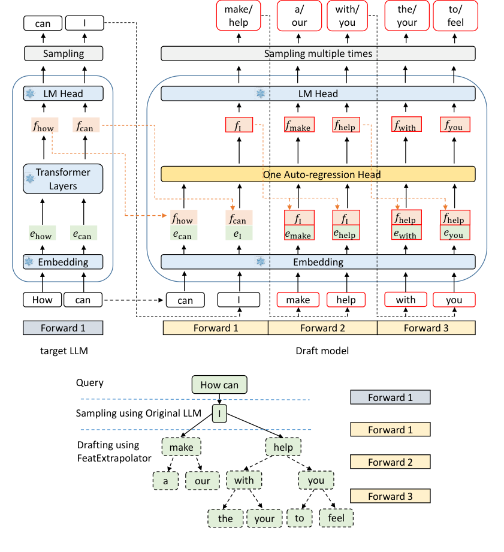</button>
<figcaption><strong>EAGLE：移位 embedding 与特征自回归</strong><a href="https://arxiv.org/abs/2401.15077v3" target="_blank" rel="noopener">EAGLE: Speculative Sampling Requires Rethinking Feature Uncertainty</a> · Figure 6 · version 2401.15077v3 · PDF p.4 / printed p.4
<button class="original-direct" type="button">Read original size</button>

Original caption &amp; source

Figure 6: Pipeline of EAGLE. The upper section illustrates
the computational process, while the lower section displays
the corresponding generation results for each step. In the
upper section, green blocks represent token embeddings, or-
ange blocks represent features, red boxes indicate the predic-
tions of the draft model, and blue modules with snowflake
icons represent the use of target LLM parameters, which are
not subject to training.
<a class="source-url" href="https://arxiv.org/abs/2401.15077v3">https://arxiv.org/abs/2401.15077v3</a>
</figcaption></figure>

**问题与读法。** 图中目标特征与向后移一位的 token embedding 融合，再通过轻量自回归模块预测下一特征，借助词表头获得候选；候选树交由目标核验。

**机制与例子。** 当前特征加上实际采到的“公交”embedding，才预测“公交”条件下的下一表示。token 与 feature 对齐差一位，是机制的关键接口。

**结论与边界。** 原目标及相关 embedding/LM head 固定，训练草稿部分。feature autoregression 仍有串行长度成本，特征回归训练与自由 rollout 的误差会逐步累积。

<figure id="fig-eagle-t1">
<button class="paper-image" type="button" aria-label="Zoom: EAGLE：同一模型下不同任务与采样的速度">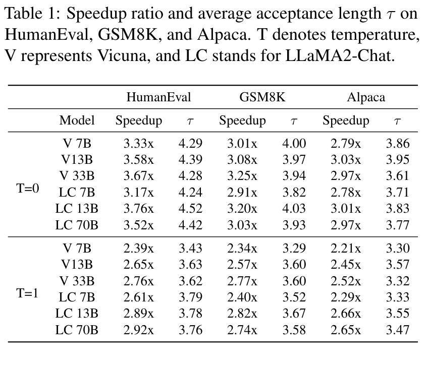</button>
<figcaption><strong>EAGLE：同一模型下不同任务与采样的速度</strong><a href="https://arxiv.org/abs/2401.15077v3" target="_blank" rel="noopener">EAGLE: Speculative Sampling Requires Rethinking Feature Uncertainty</a> · Table 1 · version 2401.15077v3 · PDF p.6 / printed p.6
<button class="original-direct" type="button">Read original size</button>

Original caption &amp; source

Table 1: Speedup ratio and average acceptance length τ on
HumanEval, GSM8K, and Alpaca. T denotes temperature,
V represents Vicuna, and LC stands for LLaMA2-Chat.
<a class="source-url" href="https://arxiv.org/abs/2401.15077v3">https://arxiv.org/abs/2401.15077v3</a>
</figcaption></figure>

**问题与读法。** 原表按目标、任务、temperature 同时列 speedup 与平均提交长度 $\tau$。例如 Vicuna 13B、HumanEval，temperature 0 为 3.58 倍、$\tau=4.38$，temperature 1 为 2.65 倍、$\tau=3.63$。

**机制与例子。** 代码常有确定格式，容易被草稿预测；随机采样增加后续分叉。即使 $\tau$ 相近，目标与草稿调用耗时也可能不同。

**结论与边界。** 这里主要是 batch 1 的测试；A100 40G server 出现在 70B 草稿训练段，不能用作本表测试硬件。原文没有给完整统一的测试硬件、精度与长度矩阵，不能用这一行直接与 EAGLE-2 的跨任务均值比较。

### 6.3 EAGLE-2：动态树把预算给更可能存活的路径

EAGLE-2 <a href="#source-P11">[P11]</a> 保留 EAGLE 的草稿思想，主要改变树生成。静态树在所有上下文都分配相同结构；动态树利用当前候选置信度扩展并筛选，更像“哪里有把握，在哪里多检查”。

<figure id="fig-eagle2-f4">
<button class="paper-image" type="button" aria-label="Zoom: EAGLE-2：相同节点预算下的静态与动态树">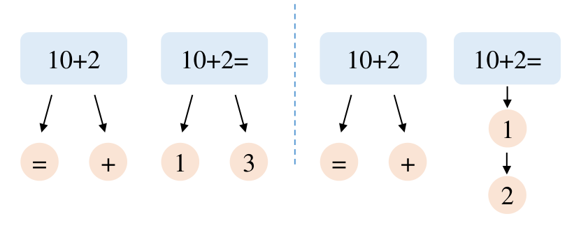</button>
<figcaption><strong>EAGLE-2：相同节点预算下的静态与动态树</strong><a href="https://arxiv.org/abs/2406.16858v2" target="_blank" rel="noopener">EAGLE-2: Faster Inference of Language Models with Dynamic Draft Trees</a> · Figure 4 · version 2406.16858v2 · PDF p.3 / printed p.3
<button class="original-direct" type="button">Read original size</button>

Original caption &amp; source

Figure 4: Differences between EAGLE and EAGLE-2. EA-
GLE always uses a fixed draft shape. When the query is
“10+2=”, the next token is very likely to be correctly pre-
dicted as “1”. However, with a static draft tree, EAGLE
would still add two candidates, even though the probability
of the other candidate “3” being correct is very low. EAGLE-
2, on the other hand, adjusts the shape of draft tree based
on the context. When the query is “10+2”, the next token
is difficult to predict, so EAGLE-2 adds two candidates.
For the simpler query “10+2=”, EAGLE-2 adds only one
candidate “1”.
<a class="source-url" href="https://arxiv.org/abs/2406.16858v2">https://arxiv.org/abs/2406.16858v2</a>
</figcaption></figure>

**问题与读法。** 图以 “10 + 2” 的具体上下文比较候选分布与树形；不同输入的高概率路径不一定落在预设树位置。

**机制与例子。** 算术答案的某条路径很集中，就可以向深处展开；公交例子第一词分歧较大，则可能多分配几条浅分支。结构跟随上下文变化。

**结论与边界。** 动态配置减少固定形状的浪费，但候选概率不是目标接受概率本身。树越集中也可能错过目标偏好的尾部路径。

<figure id="fig-eagle2-f5">
<button class="paper-image" type="button" aria-label="Zoom: EAGLE-2：不同节点与请求的接受行为不同">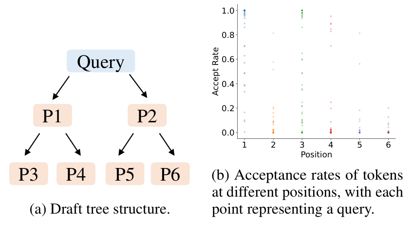</button>
<figcaption><strong>EAGLE-2：不同节点与请求的接受行为不同</strong><a href="https://arxiv.org/abs/2406.16858v2" target="_blank" rel="noopener">EAGLE-2: Faster Inference of Language Models with Dynamic Draft Trees</a> · Figure 5 · version 2406.16858v2 · PDF p.4 / printed p.4
<button class="original-direct" type="button">Read original size</button>

Original caption &amp; source

Figure 5: Acceptance rates of draft tokens at different posi-
tions. In the left figure, P1-P6 indicate positions in the token
tree, corresponding to positions 1-6 on the horizontal axis
in the right figure. The right figure shows the acceptance
rates of draft tokens at positions P1-P6.
<a class="source-url" href="https://arxiv.org/abs/2406.16858v2">https://arxiv.org/abs/2406.16858v2</a>
</figcaption></figure>

**问题与读法。** 原图对比候选节点或样本的接受表现，显示固定层级上也有差异。它是诊断图，不是完整实现流程。

**机制与例子。** 某个公共格式 token 容易接受，另一个专有名词很难；平均接受率把两者合并，会让固定树对后一种请求浪费预算。

**结论与边界。** 图支持上下文感知预算的动机，不支持从局部最高分直接推导全局最优树。祖先能否先被接受仍决定深节点是否有价值。

<figure id="fig-eagle2-f6">
<button class="paper-image" type="button" aria-label="Zoom: EAGLE-2：草稿置信度与接受率的校准关系">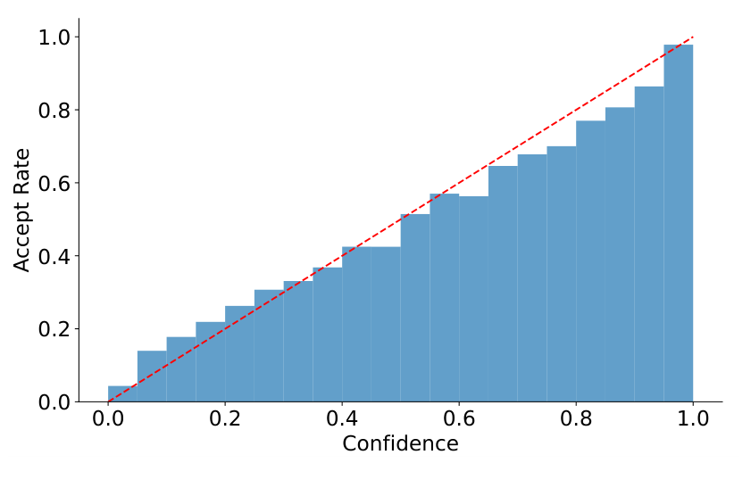</button>
<figcaption><strong>EAGLE-2：草稿置信度与接受率的校准关系</strong><a href="https://arxiv.org/abs/2406.16858v2" target="_blank" rel="noopener">EAGLE-2: Faster Inference of Language Models with Dynamic Draft Trees</a> · Figure 6 · version 2406.16858v2 · PDF p.4 / printed p.4
<button class="original-direct" type="button">Read original size</button>

Original caption &amp; source

Figure 6: Average acceptance rates for different confidence
score intervals of the draft model. The red dashed line
connects (0,0) and (1,1) to aid in visual assessment. The
original LLM is Vicuna 7B.
<a class="source-url" href="https://arxiv.org/abs/2406.16858v2">https://arxiv.org/abs/2406.16858v2</a>
</figcaption></figure>

**问题与读法。** 横轴按草稿置信度分组，纵轴是实测接受情况；观察点或曲线是否随置信度升高而提高。概率区间与实测接受率不是同一个量。

**机制与例子。** 草稿对“车”很有把握，通常意味着它更值得核验；但它仍可能系统性偏离目标。调度只能用统计相关性估计收益。

**结论与边界。** 校准支持排序启发，不等于逐 token 正确性承诺。目标模型、任务和 sampling 变化后应重新检查关系。

<figure id="fig-eagle2-f7">
<button class="paper-image" type="button" aria-label="Zoom: EAGLE-2：扩展候选，再按路径价值重排">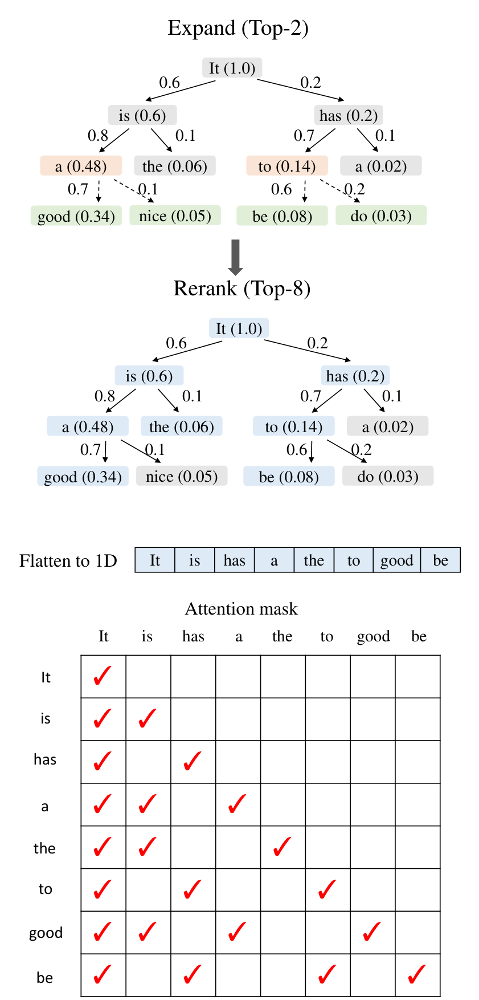</button>
<figcaption><strong>EAGLE-2：扩展候选，再按路径价值重排</strong><a href="https://arxiv.org/abs/2406.16858v2" target="_blank" rel="noopener">EAGLE-2: Faster Inference of Language Models with Dynamic Draft Trees</a> · Figure 7 · version 2406.16858v2 · PDF p.5 / printed p.5
<button class="original-direct" type="button">Read original size</button>

Original caption &amp; source

Figure 7: Illustration of EAGLE-2. The numbers beside the
edges represent the confidence scores of the draft model,
and the numbers in brackets within the blocks represent the
value of the nodes. During the expansion phase, we select
the top 2 nodes with the highest value from the current layer
(orange blocks) as inputs to the draft model and connect
the generated tokens (green blocks) to the draft tree. In
the rerank phase, we select the top 8 nodes with the high-
est value from all nodes (blue blocks), flatten them into a
1-dimensional sequence to form the final draft. We then
construct the attention mask according to the tree structure,
ensuring each token can only see its ancestor nodes.
<a class="source-url" href="https://arxiv.org/abs/2406.16858v2">https://arxiv.org/abs/2406.16858v2</a>
</figcaption></figure>

**问题与读法。** 图分 expansion 与 reranking 两阶段；绿色等标记区分保留节点，连线保留父子关系。扩展时逐轮选择有潜力的节点继续生成。

**机制与例子。** 深处“上”的局部分数再高，也必须乘上“公交”“车”等祖先路径的存活可能。筛选后需要保留祖先闭包，使每个被核验节点都有合法历史。

**结论与边界。** 完整机制是扩展、路径累积评分与重排，不只是 Top-K 单点概率。动态树的规划、索引和 mask 也有时间成本。

可用下式理解路径价值的启发式：

$$
V(n)=\prod_{u\in\mathrm{path}(n)}c_u.
$$

$n$ 是候选节点，$c_u$ 是路径上草稿给对应 token 的置信度。它近似表示沿整条草稿路径前进的可能性；置信度不完全等于目标接受概率，所以 $V$ 是候选排序依据，不是精确收益。

<figure id="fig-eagle2-t1">
<button class="paper-image" type="button" aria-label="Zoom: EAGLE-2：同表比较避免跨实验拼接">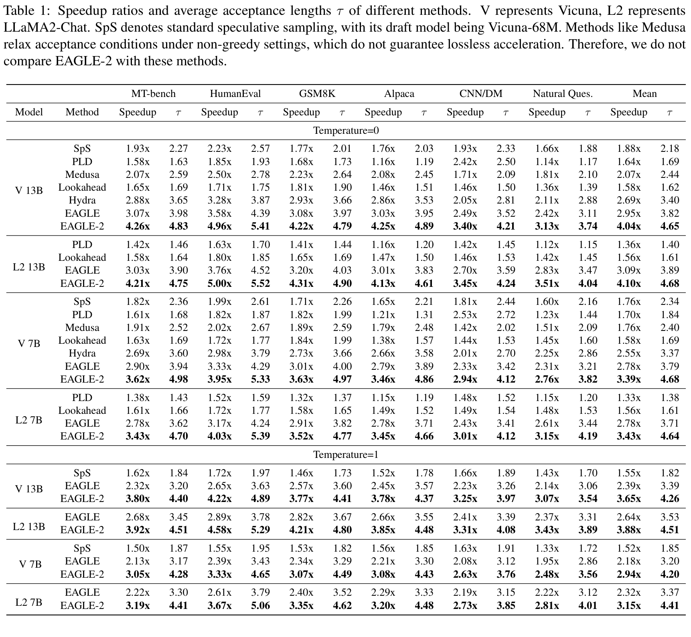</button>
<figcaption><strong>EAGLE-2：同表比较避免跨实验拼接</strong><a href="https://arxiv.org/abs/2406.16858v2" target="_blank" rel="noopener">EAGLE-2: Faster Inference of Language Models with Dynamic Draft Trees</a> · Table 1 · version 2406.16858v2 · PDF p.7 / printed p.7
<button class="original-direct" type="button">Read original size</button>

Original caption &amp; source

Table 1: Speedup ratios and average acceptance lengths τ of different methods. V represents Vicuna, L2 represents
LLaMA2-Chat. SpS denotes standard speculative sampling, with its draft model being Vicuna-68M. Methods like Medusa
relax acceptance conditions under non-greedy settings, which do not guarantee lossless acceleration. Therefore, we do not
compare EAGLE-2 with these methods.
<a class="source-url" href="https://arxiv.org/abs/2406.16858v2">https://arxiv.org/abs/2406.16858v2</a>
</figcaption></figure>

**问题与读法。** 在相同目标、任务组和采样设置下比较 EAGLE 与 EAGLE-2。Vicuna 13B、temperature 0 的跨任务均值从 3.82 到 4.65 倍，temperature 1 的 EAGLE-2 均值为 4.26 倍。

**机制与例子。** 不增加一个全新的目标模型，而是把有限核验位置分给更好的当前路径。公交例子如果格式重复，动态树可集中预算到较深处。

**结论与边界。** 同表差值支持动态树价值；EAGLE 原论文 HumanEval 的 3.58 不是这里 3.82 的基线。硬件、精度、长度没有完整逐行冻结，不宜据此构造跨论文绝对速度榜。

### 6.4 EAGLE-3：训练时就经历自己的草稿错误

EAGLE-3 <a href="#source-P12">[P12]</a> 去掉必须精确回归目标 feature 的限制，融合多层特征，让训练过程包含草稿自 rollout。改进焦点是训练输入与真实推理输入之间的分布差距。

<figure id="fig-eagle3-f3">
<button class="paper-image" type="button" aria-label="Zoom: EAGLE-3：training-time test 与无特征约束的 latent">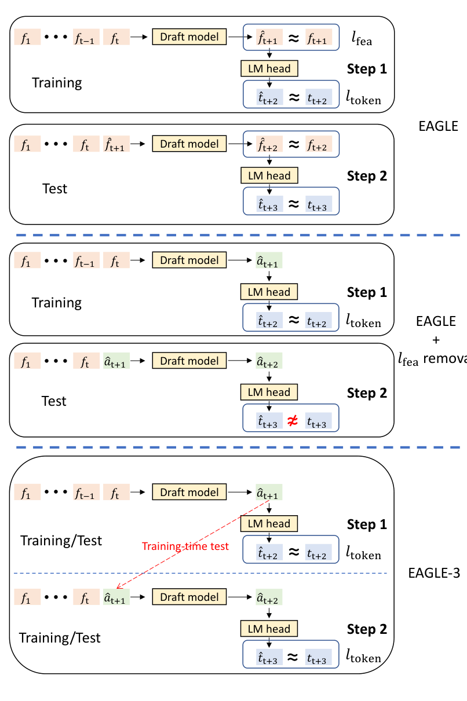</button>
<figcaption><strong>EAGLE-3：training-time test 与无特征约束的 latent</strong><a href="https://arxiv.org/abs/2503.01840v3" target="_blank" rel="noopener">EAGLE-3: Scaling up Inference Acceleration of Large Language Models via Training-Time Test</a> · Figure 3 · version 2503.01840v3 · PDF p.3 / printed p.3
<button class="original-direct" type="button">Read original size</button>

Original caption &amp; source

Figure 3: Illustration of training-time test (the bottom
part) and its comparison with other draft methods (the
upper and middle parts). f denotes the feature, t denotes
the token, and a represents the unconstrained vectors.
We use the hat to denote the predictions from models.
All the methods shown in the figure use the token se-
quence from the previous time step, but for simplicity,
this is not depicted in the figure. The input to EAGLE-3
is not actually f, but it is not shown in this figure. We
will provide a detailed explanation in the following sec-
tion.
<a class="source-url" href="https://arxiv.org/abs/2503.01840v3">https://arxiv.org/abs/2503.01840v3</a>
</figcaption></figure>

**问题与读法。** 图对比传统 teacher feature 监督与训练时多步生成；$a$ 表示可自由学习的中间表示，不必等于某一层目标 feature。

**机制与例子。** 草稿第一步略有偏差后，第二步看到的是自己的状态；训练也经历这种情况，才更可能学会从偏差中保持可接受的词预测。

**结论与边界。** 去掉 feature loss、引入 rollout 改善训练推理一致性。它没有取消目标验证，也没有保证任意長度 rollout 都稳定。

<figure id="fig-eagle3-f5">
<button class="paper-image" type="button" aria-label="Zoom: EAGLE-3：低、中、高层信息融合">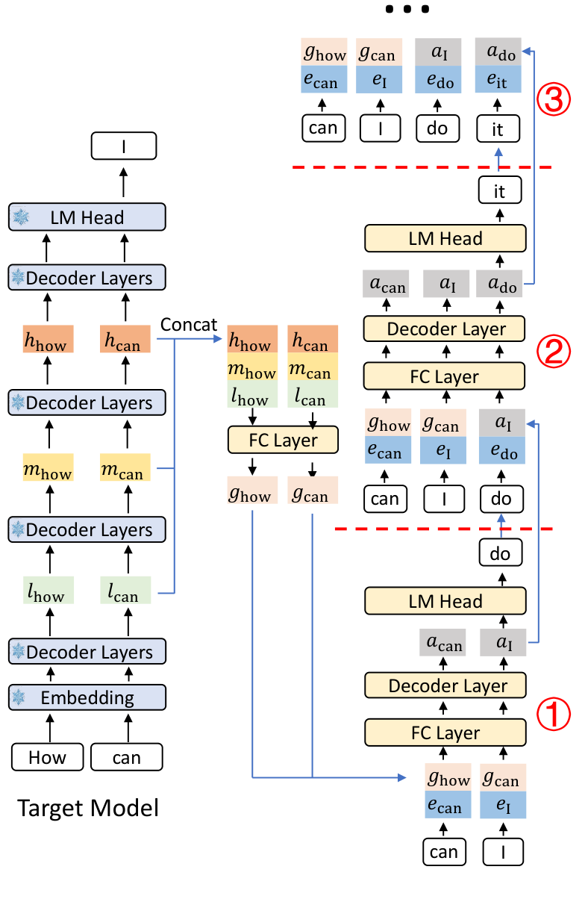</button>
<figcaption><strong>EAGLE-3：低、中、高层信息融合</strong><a href="https://arxiv.org/abs/2503.01840v3" target="_blank" rel="noopener">EAGLE-3: Scaling up Inference Acceleration of Large Language Models via Training-Time Test</a> · Figure 5 · version 2503.01840v3 · PDF p.4 / printed p.4
<button class="original-direct" type="button">Read original size</button>

Original caption &amp; source

Figure 5: Diagram of the EAGLE-3 inference pipeline,
illustrating the three steps of the draft model. l, m, and
h represent the low, middle, and high-level features of
the target model, respectively. e denotes the embedding.
<a class="source-url" href="https://arxiv.org/abs/2503.01840v3">https://arxiv.org/abs/2503.01840v3</a>
</figcaption></figure>

**问题与读法。** 多个目标层特征被融合，再与移位 token embedding 进入草稿网络；不同层提供的表示共同服务下一步 token 预测。

**机制与例子。** 较低层可能保留词法格式，高层包含更抽象语义；公交例子的词形与句法线索都可影响后续。融合是学习得到的，不是手工给每层固定语义职业。

**结论与边界。** 图解释输入信息扩展，不能推导“层数越多越好”。额外取层、投影和数据记录增加训练与推理成本。

<figure id="fig-eagle3-f4">
<button class="paper-image" type="button" aria-label="Zoom: EAGLE-3：数据增长带来的经验曲线">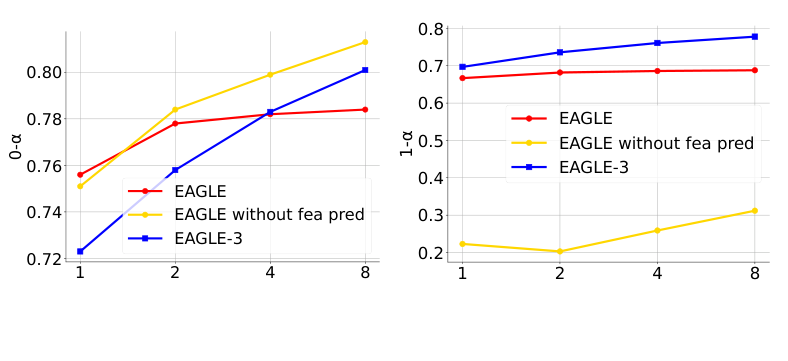</button>
<figcaption><strong>EAGLE-3：数据增长带来的经验曲线</strong><a href="https://arxiv.org/abs/2503.01840v3" target="_blank" rel="noopener">EAGLE-3: Scaling up Inference Acceleration of Large Language Models via Training-Time Test</a> · Figure 4 · version 2503.01840v3 · PDF p.3 / printed p.3
<button class="original-direct" type="button">Read original size</button>

Original caption &amp; source

Figure 4: Comparison of acceptance rates across differ-
ent methods, with the x-axis representing the data scale
relative to ShareGPT.
<a class="source-url" href="https://arxiv.org/abs/2503.01840v3">https://arxiv.org/abs/2503.01840v3</a>
</figcaption></figure>

**问题与读法。** 横轴是训练数据规模的相对倍数 1、2、4、8，纵轴是对应性能；不同曲线区分方法或设置。应观察增益是否持续，而不是直接当成普适幂律。

**机制与例子。** 更多样化上下文让草稿覆盖少见术语和不同任务，接受路径可能变长。但八倍数据也意味着目标生成和草稿训练预算增长。

**结论与边界。** 图支持此训练方法在所测规模区间继续受益；不证明无限数据会无限加速，也不保证换目标模型后保持曲线。

<figure id="fig-eagle3-t1">
<button class="paper-image" type="button" aria-label="Zoom: EAGLE-3：目标与任务决定提升幅度">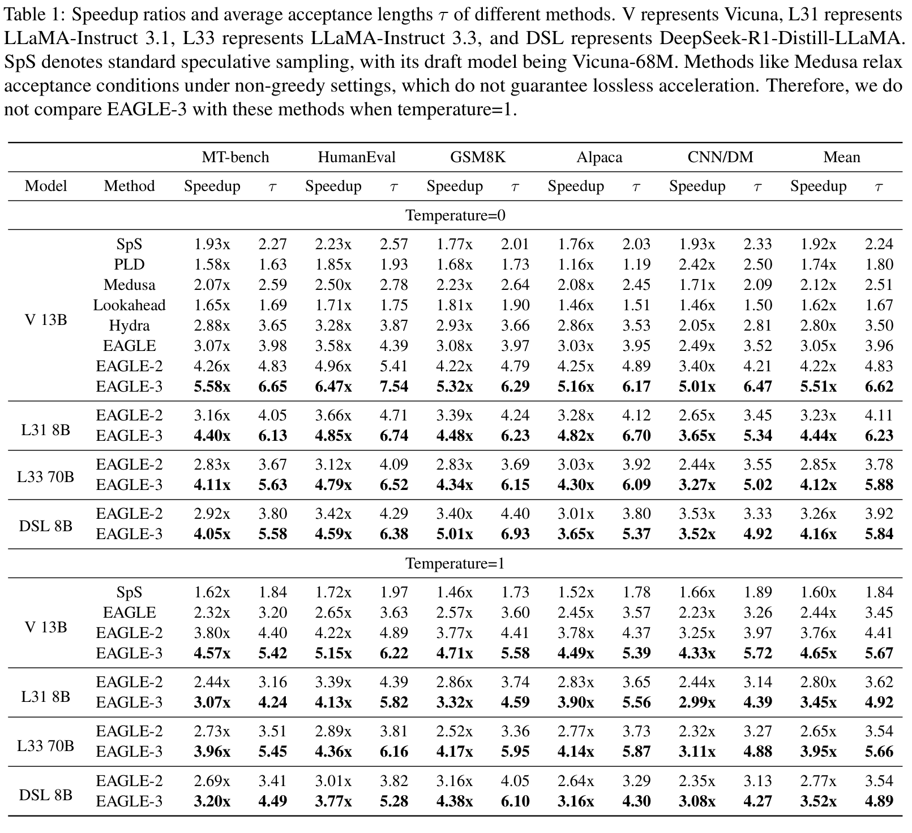</button>
<figcaption><strong>EAGLE-3：目标与任务决定提升幅度</strong><a href="https://arxiv.org/abs/2503.01840v3" target="_blank" rel="noopener">EAGLE-3: Scaling up Inference Acceleration of Large Language Models via Training-Time Test</a> · Table 1 · version 2503.01840v3 · PDF p.7 / printed p.7
<button class="original-direct" type="button">Read original size</button>

Original caption &amp; source

Table 1: Speedup ratios and average acceptance lengths τ of different methods. V represents Vicuna, L31 represents
LLaMA-Instruct 3.1, L33 represents LLaMA-Instruct 3.3, and DSL represents DeepSeek-R1-Distill-LLaMA.
SpS denotes standard speculative sampling, with its draft model being Vicuna-68M. Methods like Medusa relax
acceptance conditions under non-greedy settings, which do not guarantee lossless acceleration. Therefore, we do
not compare EAGLE-3 with these methods when temperature=1.
<a class="source-url" href="https://arxiv.org/abs/2503.01840v3">https://arxiv.org/abs/2503.01840v3</a>
</figcaption></figure>

**问题与读法。** 表按模型、任务、temperature 比较各方法。Llama 3.1 8B 在 temperature 0，EAGLE-2 均值 3.11 到 EAGLE-3 4.11 倍；Vicuna 13B 的 EAGLE-3 为 6.62 倍。

**机制与例子。** 同表 Llama 与 Vicuna 的匹配难度、基线速度不同，因而同一种草稿训练策略产生不同净收益。temperature 1 的 EAGLE-3 均值分别为 3.45、5.67 倍。

**结论与边界。** 这些是作者原表报告，不是本次复测。附加 serving 实验采用另一个 H100/SGLang 条件，不能拿来替换主表计时配置，或把主表倍率用于高并发预测。

## 7. 不另养一个完整小模型：Draft & Verify、Lookahead、LayerSkip

### 7.1 Draft & Verify：跳过部分层，完整模型收回质量责任

Draft & Verify <a href="#source-P06">[P06]</a> 让同一模型在草稿阶段跳过一部分 attention/MLP，再用完整原模型验证。无需重训神经网络，但要做离线跳层搜索与校准；“training-free”不等于没有离线工作。

<figure id="fig-draftverify-f1">
<button class="paper-image" type="button" aria-label="Zoom: Draft &amp; Verify：跳层提议与全层核验">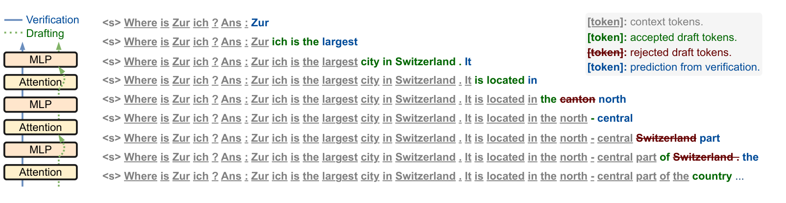</button>
<figcaption><strong>Draft &amp; Verify：跳层提议与全层核验</strong><a href="https://arxiv.org/abs/2309.08168v2" target="_blank" rel="noopener">Draft &amp; Verify: Lossless Large Language Model Acceleration via Self-Speculative Decoding</a> · Figure 1 · version 2309.08168v2 · PDF p.2 / printed p.2
<button class="original-direct" type="button">Read original size</button>

Original caption &amp; source

Figure 1: Visualization of the self-speculative decoding process. The verification stage evaluates all drafted tokens in
a single forward pass, with accepted tokens marked in green and rejected tokens highlighted in red. Each verification
step also predicts one more token, which is denoted in blue.
<a class="source-url" href="https://arxiv.org/abs/2309.08168v2">https://arxiv.org/abs/2309.08168v2</a>
</figcaption></figure>

**问题与读法。** 两种运行路径共享模型权重；草稿路径跳过标记模块，验证路径执行完整层。模块跳过意味着减少真实算子，而非只减小 logits 范围。

**机制与例子。** “公交 / 车 / 上”可能不需要所有层才能大致预测，目标仍在完整网络下逐位置决定是否接受。跳得过多会更早失败。

**结论与边界。** 相对于原完整模型的贪心核验可保持输出；随机分布保持另需匹配 sampler。散落的跳层不能自动复用所有下层结果，因为中间状态已经改变。

<figure id="fig-draftverify-f3">
<button class="paper-image" type="button" aria-label="Zoom: Draft &amp; Verify：用贝叶斯搜索选跳层方案">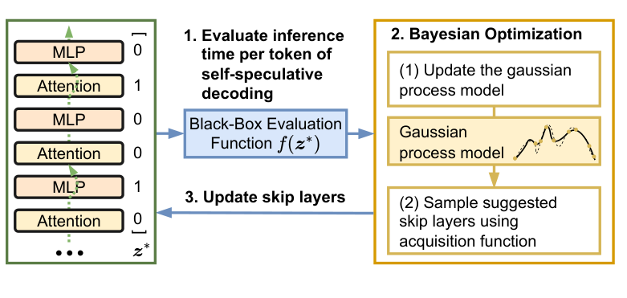</button>
<figcaption><strong>Draft &amp; Verify：用贝叶斯搜索选跳层方案</strong><a href="https://arxiv.org/abs/2309.08168v2" target="_blank" rel="noopener">Draft &amp; Verify: Lossless Large Language Model Acceleration via Self-Speculative Decoding</a> · Figure 3 · version 2309.08168v2 · PDF p.5 / printed p.5
<button class="original-direct" type="button">Read original size</button>

Original caption &amp; source

Figure 3: Illustration of using Bayesian optimization to
search the best combination of skip layers that results
in the lowest average token inference time.
<a class="source-url" href="https://arxiv.org/abs/2309.08168v2">https://arxiv.org/abs/2309.08168v2</a>
</figcaption></figure>

**问题与读法。** 图从候选 skip configuration 到实测评价，再更新选择过程。搜索目标兼顾可接受程度与速度，不是按层号简单砍掉前半或后半。

**机制与例子。** 跳过某层很便宜却使“公交”立即不匹配，可能比保留该层更慢；搜索需用代表性提示测整体循环。

**结论与边界。** 图解释无需网络重训仍需校准。搜索集、任务域和模型改变后方案可能失效，离线搜索成本不能隐藏在“零成本草稿”里。

<figure id="fig-draftverify-t1">
<button class="paper-image" type="button" aria-label="Zoom: Draft &amp; Verify：摘要任务中的同目标加速">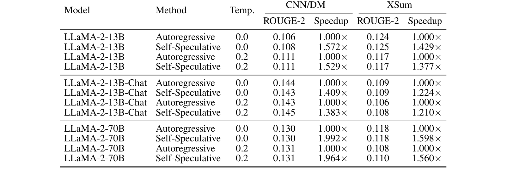</button>
<figcaption><strong>Draft &amp; Verify：摘要任务中的同目标加速</strong><a href="https://arxiv.org/abs/2309.08168v2" target="_blank" rel="noopener">Draft &amp; Verify: Lossless Large Language Model Acceleration via Self-Speculative Decoding</a> · Table 1 · version 2309.08168v2 · PDF p.7 / printed p.7
<button class="original-direct" type="button">Read original size</button>

Original caption &amp; source

Table 1: Evaluation on text generation tasks. ‘Speedup’ represents the acceleration of average inference time per
token compared to the ‘Autoregressive’ baseline on the same setting.
<a class="source-url" href="https://arxiv.org/abs/2309.08168v2">https://arxiv.org/abs/2309.08168v2</a>
</figcaption></figure>

**问题与读法。** 表按模型和数据集报告相对普通贪心解码的速度。Llama 2 13B 的 CNN/DM、XSum 分别为 1.572、1.429 倍；70B 分别 1.992、1.598 倍。

**机制与例子。** 同一跳层方案在摘要任务的接受路径不同。13B 用单 A100 40GB；70B 使用两张 A100 80GB 与 Hugging Face accelerate。

**结论与边界。** CNN/DM、XSum 各随机取 1000 个测试样本、1-shot，最多生成 512 token；主流程使用 Transformers 4.33.1，设备间 CUDA/PyTorch 版本不同。搜索使用 8 个训练样本，13B 的 1000 次离线贝叶斯迭代约 2.5 小时。打印主表未冻结所有精度与计时细项，无法据此保证其他端侧后端收益。

<figure id="fig-draftverify-t5">
<button class="paper-image" type="button" aria-label="Zoom: Draft &amp; Verify：草稿比调节长度本身贵得多">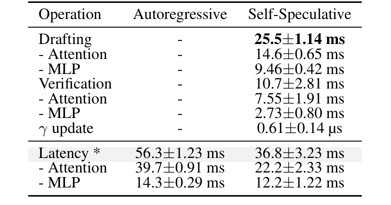</button>
<figcaption><strong>Draft &amp; Verify：草稿比调节长度本身贵得多</strong><a href="https://arxiv.org/abs/2309.08168v2" target="_blank" rel="noopener">Draft &amp; Verify: Lossless Large Language Model Acceleration via Self-Speculative Decoding</a> · Table 5 · version 2309.08168v2 · PDF p.8 / printed p.8
<button class="original-direct" type="button">Read original size</button>

Original caption &amp; source

Table 5: Breakdown of computation. * denotes the
average inference latency per token for 10 instances
sampled from CNN/DM test set on LLaMA-2-13B.
<a class="source-url" href="https://arxiv.org/abs/2309.08168v2">https://arxiv.org/abs/2309.08168v2</a>
</figcaption></figure>

**问题与读法。** 原表分开列 auto-regressive、draft、verify 与 adaptive update 的时间。普通 token 时间 56.3±1.23 ms，整体投机为 36.8±3.23 ms；草稿 25.5、核验 10.7 ms。

**机制与例子。** 若只把长度更新的 0.61 μs 优化一半，对约 37 ms 的循环几乎没有影响；减少跳层草稿的真实算子或失败后重做更值得关注。

**结论与边界。** 成本拆分支持链路级优先级判断，误差项也提醒重复测量。该表是具体配置，草稿与核验之和不要求完全等于端到端时间，剩余采样、缓存和计时边界应保留。

### 7.2 Lookahead：从历史轨迹里找可核验的 n-gram

Lookahead <a href="#source-P09">[P09]</a> 使用目标模型的 Jacobi 式并行更新，在多个未来位置维护猜测，并把历史轨迹中的 n-gram 保存为候选池，再核验可能接上当前前缀的片段。没有单独训练的草稿网络，但目标额外计算并不免费。

<figure id="fig-lookahead-f1">
<button class="paper-image" type="button" aria-label="Zoom: Lookahead：并行更新、n-gram 候选池与验证">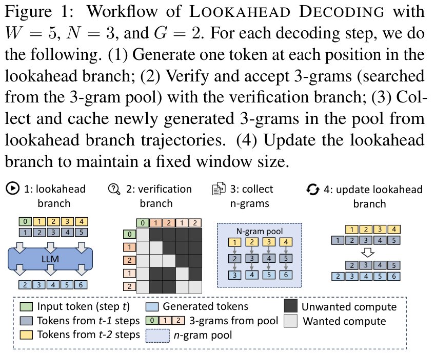</button>
<figcaption><strong>Lookahead：并行更新、n-gram 候选池与验证</strong><a href="https://arxiv.org/abs/2402.02057v1" target="_blank" rel="noopener">Breaking the Sequential Dependency of LLM Inference Using Lookahead Decoding</a> · Figure 1 · version 2402.02057v1 · PDF p.3 / printed p.3
<button class="original-direct" type="button">Read original size</button>

Original caption &amp; source

Figure 1: Workflow of LOOKAHEAD DECODING with
W = 5, N = 3, and G = 2. For each decoding step, we do
the following. (1) Generate one token at each position in the
lookahead branch; (2) Verify and accept 3-grams (searched
from the 3-gram pool) with the verification branch; (3) Col-
lect and cache newly generated 3-grams in the pool from
lookahead branch trajectories. (4) Update the lookahead
branch to maintain a fixed window size.
<a class="source-url" href="https://arxiv.org/abs/2402.02057v1">https://arxiv.org/abs/2402.02057v1</a>
</figcaption></figure>

**问题与读法。** 图把 lookahead branch 与 verification branch 分开，窗口内的多位置猜测逐轮更新，形成候选 n-gram，再把匹配当前 token 的候选交给目标检查。

**机制与例子。** 历史轨迹多次出现“公交车上”，就可能成为当前句子的候选片段；不要求某轮所有未来位置同时猜对，先收集局部可用片段。

**结论与边界。** 核验把不可靠并行迭代转成可提交输出。普通 Jacobi 更新的轮数下降未必兑现延迟；候选池是否有相关片段取决于任务重复性。

<figure id="fig-lookahead-f2">
<button class="paper-image" type="button" aria-label="Zoom: Lookahead：两种分支怎样共享一次前向">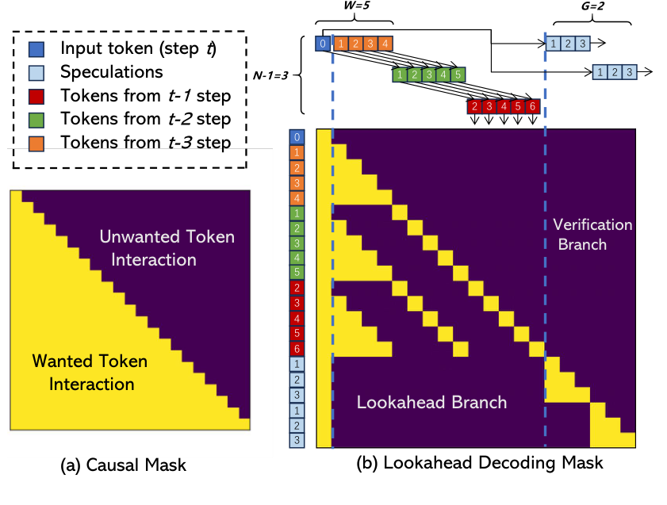</button>
<figcaption><strong>Lookahead：两种分支怎样共享一次前向</strong><a href="https://arxiv.org/abs/2402.02057v1" target="_blank" rel="noopener">Breaking the Sequential Dependency of LLM Inference Using Lookahead Decoding</a> · Figure 2 · version 2402.02057v1 · PDF p.4 / printed p.4
<button class="original-direct" type="button">Read original size</button>

Original caption &amp; source

Figure 2: (a) Causal mask for decoder models. (b) Attention
mask for LOOKAHEAD DECODING with W = 5, N = 4,
and G = 2. Digits on tokens indicate relative positions.
<a class="source-url" href="https://arxiv.org/abs/2402.02057v1">https://arxiv.org/abs/2402.02057v1</a>
</figcaption></figure>

**问题与读法。** mask 为 lookahead 更新和 verification 路径规定不同可见位置。图中的 $W$ 是窗口位置数，$N$ 是轨迹深度，$G$ 是待核验候选数。

**机制与例子。** 未来位置可用已有猜测更新，验证候选则只能看当前正式前缀和本路径祖先。若两种 mask 混用，就可能看到未经接受的信息。

**结论与边界。** 图解释 batching 与 mask 的组织。$W,N,G$ 都影响计算，不是免费容量；实现中的自定义 attention kernel 与模型兼容范围需要检查。

<figure id="fig-lookahead-t3">
<button class="paper-image" type="button" aria-label="Zoom: Lookahead：压缩比与真实速度的差距">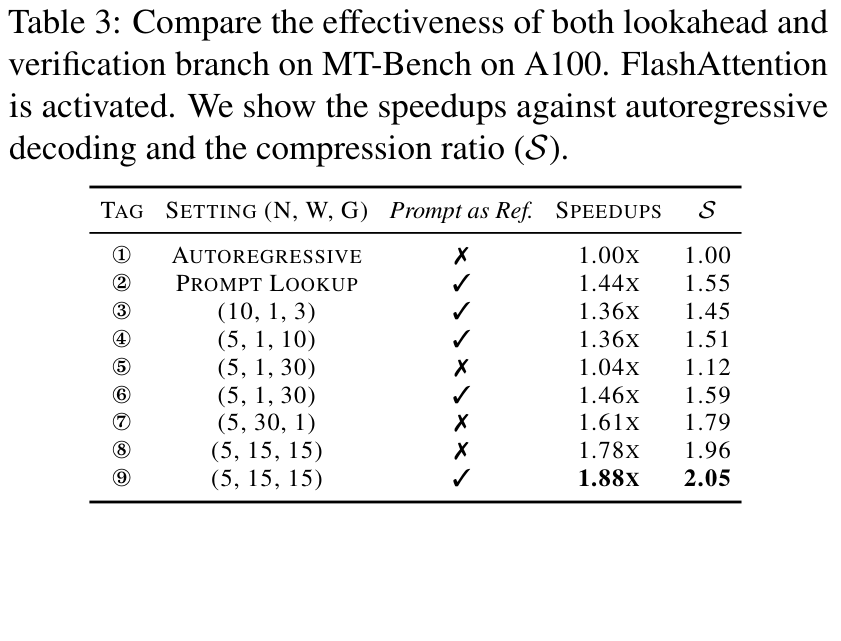</button>
<figcaption><strong>Lookahead：压缩比与真实速度的差距</strong><a href="https://arxiv.org/abs/2402.02057v1" target="_blank" rel="noopener">Breaking the Sequential Dependency of LLM Inference Using Lookahead Decoding</a> · Table 3 · version 2402.02057v1 · PDF p.7 / printed p.7
<button class="original-direct" type="button">Read original size</button>

Original caption &amp; source

Table 3: Compare the effectiveness of both lookahead and
verification branch on MT-Bench on A100. FlashAttention
is activated. We show the speedups against autoregressive
decoding and the compression ratio (S).
<a class="source-url" href="https://arxiv.org/abs/2402.02057v1">https://arxiv.org/abs/2402.02057v1</a>
</figcaption></figure>

**问题与读法。** A100、FlashAttention、MT-Bench 的表比较 prompt lookup 与 Lookahead 配置。prompt lookup 为 1.44 倍；使用 prompt reference 的完整 $N=5,W=15,G=15$ 为 1.88 倍，压缩比 2.05。

**机制与例子。** 直接从提示找到“公交车上”会更便宜，Lookahead 还能从在线轨迹扩展候选，代价是更多目标计算。压缩与速度差来自这部分工作。

**结论与边界。** 贪心 fixed-point 论证与随机采样核验流程必须分开。官方旧实现主要支持 LLaMA、使用定制 FlashAttention 2.3.3，不能假定所有现代后端开箱兼容。

### 7.3 LayerSkip：训练模型愿意早退出，核验重用低层

LayerSkip <a href="#source-P10">[P10]</a> 把模型训练与执行组织一起改动：层 dropout 和 early-exit loss 使较浅层具备输出能力；自投机阶段先跑连续的低层，再在验证时重用这些低层结果。精确性相对于训练后的 LayerSkip 目标模型，而不是训练前的原 checkpoint。

<figure id="fig-layerskip-f1">
<button class="paper-image" type="button" aria-label="Zoom: LayerSkip：训练阶段为早退出创造条件">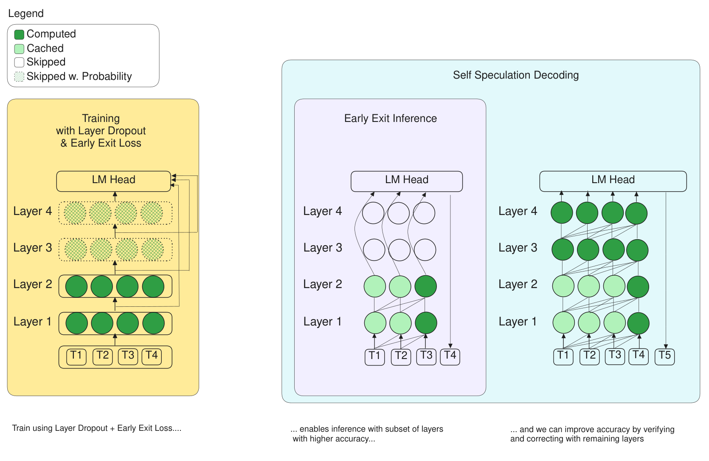</button>
<figcaption><strong>LayerSkip：训练阶段为早退出创造条件</strong><a href="https://arxiv.org/abs/2404.16710v4" target="_blank" rel="noopener">LayerSkip: Enabling Early Exit Inference and Self-Speculative Decoding</a> · Figure 1 · version 2404.16710v4 · PDF p.2 / printed p.2
<button class="original-direct" type="button">Read original size</button>

Original caption &amp; source

Figure 1 Overview of our end-to-end solution, LayerSkip, showing its 3 components.
<a class="source-url" href="https://arxiv.org/abs/2404.16710v4">https://arxiv.org/abs/2404.16710v4</a>
</figcaption></figure>

**问题与读法。** 图并列训练和推理；训练引入层 dropout 与多个退出位置监督，推理使用早退出草稿和完整路径验证。

**机制与例子。** 浅层也被训练成能预测“公交”，而不是临时拿从未训练的中间 feature 直接接最终头。完整模型仍判断接受路径。

**结论与边界。** 图支持模型与推理协同设计，但目标权重已经改变。所谓“lossless self-speculation”描述与 LayerSkip 完整目标的关系，不是保证训练前后模型质量完全相同。

<figure id="fig-layerskip-f5">
<button class="paper-image" type="button" aria-label="Zoom: LayerSkip：连续低层的 KV 与计算复用">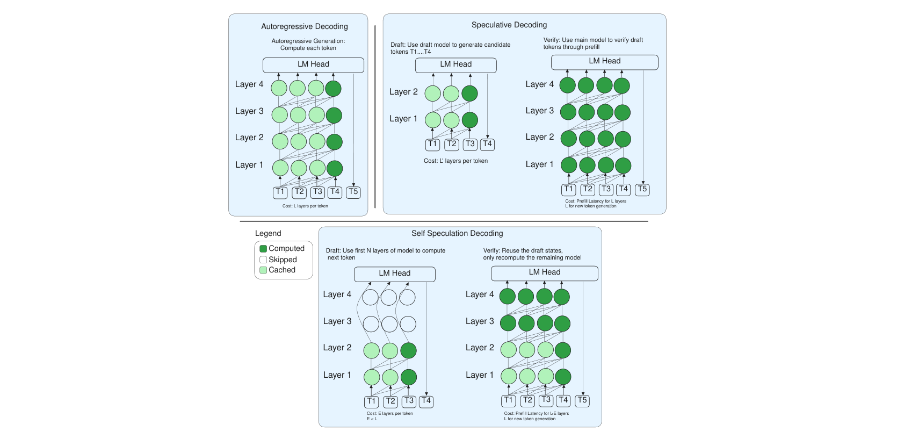</button>
<figcaption><strong>LayerSkip：连续低层的 KV 与计算复用</strong><a href="https://arxiv.org/abs/2404.16710v4" target="_blank" rel="noopener">LayerSkip: Enabling Early Exit Inference and Self-Speculative Decoding</a> · Figure 5 · version 2404.16710v4 · PDF p.8 / printed p.8
<button class="original-direct" type="button">Read original size</button>

Original caption &amp; source

Figure 5 Comparison between autoregressive decoding, speculative decoding, and our proposed self-speculative decoding.
<a class="source-url" href="https://arxiv.org/abs/2404.16710v4">https://arxiv.org/abs/2404.16710v4</a>
</figcaption></figure>

**问题与读法。** 图将共享层结果、KVQ cache 和后续高层核验连接起来。复用发生在相同历史、相同低层计算的部分。

**机制与例子。** 草稿低层已经计算“公交”，高层核验时接着计算而非从第一层重做。拒绝后仍须裁掉错误路径缓存，重建正式后续。

**结论与边界。** 这与 Draft & Verify 的任意跳层不同：连续低层保留了可复用接口。缓存额外容量、accepted path 的搬运及长上下文成本仍需计量。

<figure id="fig-layerskip-t3">
<button class="paper-image" type="button" aria-label="Zoom: LayerSkip：基线模型改变时，倍率怎样解释">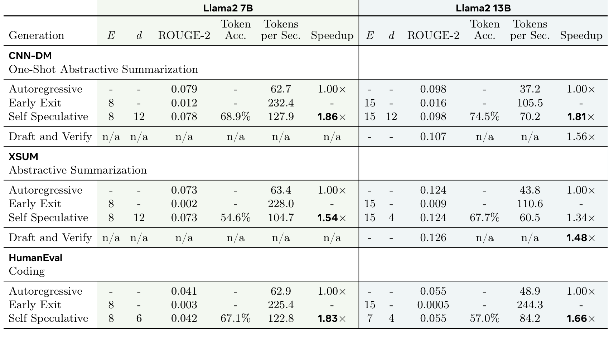</button>
<figcaption><strong>LayerSkip：基线模型改变时，倍率怎样解释</strong><a href="https://arxiv.org/abs/2404.16710v4" target="_blank" rel="noopener">LayerSkip: Enabling Early Exit Inference and Self-Speculative Decoding</a> · Table 3 · version 2404.16710v4 · PDF p.16 / printed p.16
<button class="original-direct" type="button">Read original size</button>

Original caption &amp; source

Table 3 Generation results for Llama2 continually pretrained with and without LayerSkip.
<a class="source-url" href="https://arxiv.org/abs/2404.16710v4">https://arxiv.org/abs/2404.16710v4</a>
</figcaption></figure>

**问题与读法。** 表同时涉及未经 LayerSkip 训练的基线、训练后的模型、不同退出层，以及质量与速度。HumanEval 列在此表使用 ROUGE-2，不能改写成 pass@1。

**机制与例子。** 训练后输出习惯变化，可能同时改变基线生成时间与草稿接受程度。因此某个约 1.86 倍的打印 speedup 不能直接视为只换解码器、原权重不变的收益。

**结论与边界。** 原文明确说明比较目标差异；tokens/s 的商也不总等于 speedup 列。保留报告值和比较定义，不强行统一成一个伪精确排行榜。

<figure id="fig-layerskip-t7">
<button class="paper-image" type="button" aria-label="Zoom: LayerSkip：CPU cache 复用的增量收益"></button>
<figcaption><strong>LayerSkip：CPU cache 复用的增量收益</strong><a href="https://arxiv.org/abs/2404.16710v4" target="_blank" rel="noopener">LayerSkip: Enabling Early Exit Inference and Self-Speculative Decoding</a> · Table 7 · version 2404.16710v4 · PDF p.17 / printed p.17
<button class="original-direct" type="button">Read original size</button>

Original caption &amp; source

Table 7 Ablation on re-use of the KV cache and exit query cache. Results are presented on CPU inference.
<a class="source-url" href="https://arxiv.org/abs/2404.16710v4">https://arxiv.org/abs/2404.16710v4</a>
</figcaption></figure>

**问题与读法。** 表切换 cache reuse 与退出层，报告 CPU 每 token 时间，数值越小越好。TOPv2、E18 从 143 到 134 ms/token；CNN/DM 从 182 到 166。

**机制与例子。** E12 对应 110→104 和 185→165 ms/token，体现避免低层重复计算的局部收益。这个差值发生在已经进行自投机之后。

**结论与边界。** 图证实复用的增量价值，不是 H100 的 TPOT，也不是从原始模型到整套 LayerSkip 的全部提升。端侧还要看线程、量化、缓存驻留与功耗。

## 8. DFlash：把串行草稿变成一次并行块预测

DFlash <a href="#source-P13">[P13]</a> 的目标模型仍然是自回归 LLM，改变的是草稿。轻量 block diffusion drafter 在已确认 anchor 和目标特征条件下，一次预测多个 masked 位置；不需要像 feature autoregression 那样逐 token 运行整个草稿网络。

<figure id="fig-dflash-f2">
<button class="paper-image" type="button" aria-label="Zoom: DFlash：目标多层特征成为草稿条件 KV">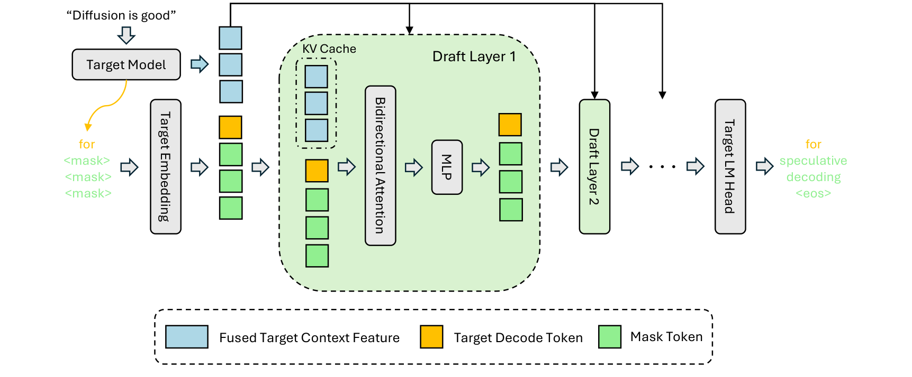</button>
<figcaption><strong>DFlash：目标多层特征成为草稿条件 KV</strong><a href="https://arxiv.org/abs/2602.06036v2" target="_blank" rel="noopener">DFlash: Block Diffusion for Flash Speculative Decoding</a> · Figure 2 · version 2602.06036v2 · PDF p.4 / printed p.4
<button class="original-direct" type="button">Read original size</button>

Original caption &amp; source

Figure 2. DFlash Inference Design. Hidden context features extracted from the target model are fused and injected into each draft layer’s
Key-Value cache to enable conditional speculation.
<a class="source-url" href="https://arxiv.org/abs/2602.06036v2">https://arxiv.org/abs/2602.06036v2</a>
</figcaption></figure>

**问题与读法。** 目标特征经融合与投影，为草稿各层构造条件 key/value；anchor token 与 masked block 进入草稿网络，再并行输出位置概率。

**机制与例子。** 已确定“坐在”，一次为“公交 / 车 / 上”三个 masked 位置生成候选。每个草稿层自己的 KV 来自特征投影，不是直接借用目标 attention 的原始 KV 张量。

**结论与边界。** 图解释跨模型 feature conditioning 与并行草稿。目标特征缓存随上下文增长，草稿 KV、投影、块 logits 和临时 buffer 都有内存开销。

<figure id="fig-dflash-f3">
<button class="paper-image" type="button" aria-label="Zoom: DFlash：串行草稿长度成本与并行块成本">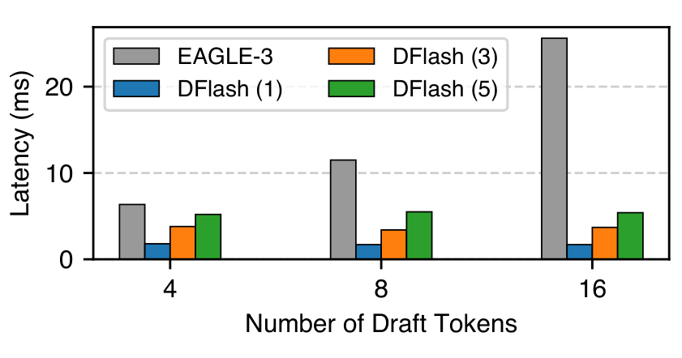</button>
<figcaption><strong>DFlash：串行草稿长度成本与并行块成本</strong><a href="https://arxiv.org/abs/2602.06036v2" target="_blank" rel="noopener">DFlash: Block Diffusion for Flash Speculative Decoding</a> · Figure 3 · version 2602.06036v2 · PDF p.3 / printed p.3
<button class="original-direct" type="button">Read original size</button>

Original caption &amp; source

Figure 3. Draft cost of 1, 3, 5-layer DFlash and 1-layer EAGLE-3.
<a class="source-url" href="https://arxiv.org/abs/2602.06036v2">https://arxiv.org/abs/2602.06036v2</a>
</figcaption></figure>

**问题与读法。** 横轴是草稿长度，纵轴是相应草稿延迟；自回归草稿随长度增加多轮调用，而 block 草稿在所测区间更接近单次前向的成本形状。

**机制与例子。** 从四个位置变十六个，串行草稿要多跑多次；并行模型把位置打包成更大矩阵。但是 matrix 更大仍会增加算子工作。

**结论与边界。** 图支持减少草稿串行等待，不支持长度无限增长而时间严格恒定。不同设备、上下文和 batch 会改变这条曲线。

<figure id="fig-dflash-f4">
<button class="paper-image" type="button" aria-label="Zoom: DFlash：多 anchor 的块训练 mask">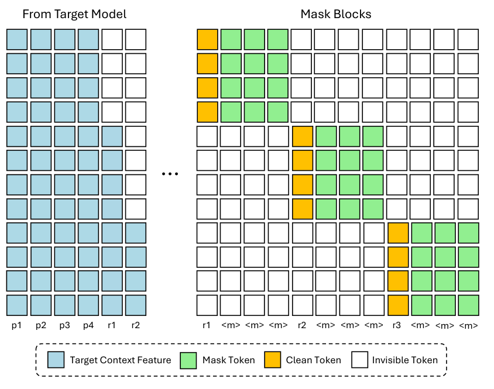</button>
<figcaption><strong>DFlash：多 anchor 的块训练 mask</strong><a href="https://arxiv.org/abs/2602.06036v2" target="_blank" rel="noopener">DFlash: Block Diffusion for Flash Speculative Decoding</a> · Figure 4 · version 2602.06036v2 · PDF p.5 / printed p.5
<button class="original-direct" type="button">Read original size</button>

Original caption &amp; source

Figure 4. DFlash training attention. The target model provides
context features (blue) that condition the draft model. The input
consists of clean prompt tokens p and clean response tokens r.
Within each masked block, a subset of clean response tokens (yel-
low) is randomly sampled as anchors, while mask tokens m (green)
mark positions for parallel prediction. Invisible tokens (white) de-
note the attention mask, which enforces causal consistency and
prevents inter-block information leakage during training.
<a class="source-url" href="https://arxiv.org/abs/2602.06036v2">https://arxiv.org/abs/2602.06036v2</a>
</figcaption></figure>

**问题与读法。** 训练把响应划成多个 anchor 与 masked block，并通过 mask 规定各块能读的目标特征与局部信息。位置结构与推理时的块条件对应。

**机制与例子。** 同一段目标生成文本，可以在多个已知位置训练“之后一块怎样猜”；约 800K 目标生成响应来自 Nemotron PostTraining V2 与 CodeAlpaca。

**结论与边界。** 图解释训练效率和部署条件对齐；并行提议不表示 token 独立于真实目标前缀。当前代码的块提议可以在 anchor 条件下独立采样，目标仍要按采出的整条前缀核验。

<figure id="fig-dflash-t1">
<button class="paper-image" type="button" aria-label="Zoom: DFlash：H200 单请求，块长与接受长度">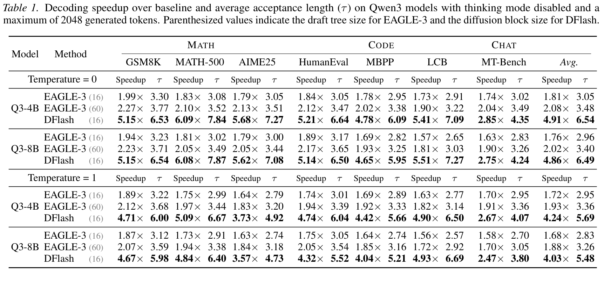</button>
<figcaption><strong>DFlash：H200 单请求，块长与接受长度</strong><a href="https://arxiv.org/abs/2602.06036v2" target="_blank" rel="noopener">DFlash: Block Diffusion for Flash Speculative Decoding</a> · Table 1 · version 2602.06036v2 · PDF p.6 / printed p.6
<button class="original-direct" type="button">Read original size</button>

Original caption &amp; source

Table 1. Decoding speedup over baseline and average acceptance length (τ) on Qwen3 models with thinking mode disabled and a
maximum of 2048 generated tokens. Parenthesized values indicate the draft tree size for EAGLE-3 and the diffusion block size for DFlash.
<a class="source-url" href="https://arxiv.org/abs/2602.06036v2">https://arxiv.org/abs/2602.06036v2</a>
</figcaption></figure>

**问题与读法。** H200、Transformers、think off、最多输出 2048 的主表同时给速度与 $\tau$。Qwen3 8B、temperature 0，DFlash-16 均值 4.86 倍、$\tau=6.49$；EAGLE-3-60 为 2.02、3.40。

**机制与例子。** 名称中的 16 是块草稿预算，EAGLE 的 60 是树预算，不是都提交这么多词。公交例子后半块失败时仍产生弃置工作。

**结论与边界。** temperature 1 的 DFlash 均值 4.03、$\tau=5.48$。这支持所测实现下的单请求优势；精度、完整运行库版本与线程细项没有全部披露，不能冒称完整环境复建。

<figure id="fig-dflash-t4">
<button class="paper-image" type="button" aria-label="Zoom: DFlash：长上下文微调改善接受长度">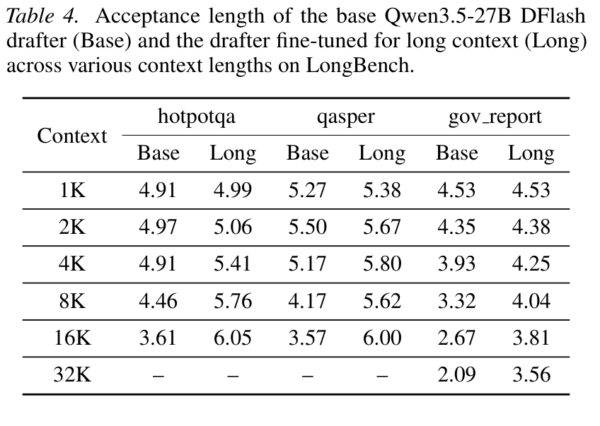</button>
<figcaption><strong>DFlash：长上下文微调改善接受长度</strong><a href="https://arxiv.org/abs/2602.06036v2" target="_blank" rel="noopener">DFlash: Block Diffusion for Flash Speculative Decoding</a> · Table 4 · version 2602.06036v2 · PDF p.8 / printed p.8
<button class="original-direct" type="button">Read original size</button>

Original caption &amp; source

Table 4. Acceptance length of the base Qwen3.5-27B DFlash
drafter (Base) and the drafter fine-tuned for long context (Long)
across various context lengths on LongBench.
<a class="source-url" href="https://arxiv.org/abs/2602.06036v2">https://arxiv.org/abs/2602.06036v2</a>
</figcaption></figure>

**问题与读法。** 表比较基础与 long-context finetune 草稿的接受长度。Qwen3.5 27B、GovReport 32K，$\tau$ 从 2.09 到 3.56。

**机制与例子。** 很长的公交政策报告需要草稿访问远处背景，短上下文训练的草稿容易失配。专门微调改善后续候选生存。

**结论与边界。** 这是接受长度结果，不能改写为延迟 1.7 倍。长上下文增加 attention 与 feature cache 成本，训练也消耗额外预算。

<figure id="fig-dflash-t5">
<button class="paper-image" type="button" aria-label="Zoom: DFlash：不同 serving 实现与并发曲线">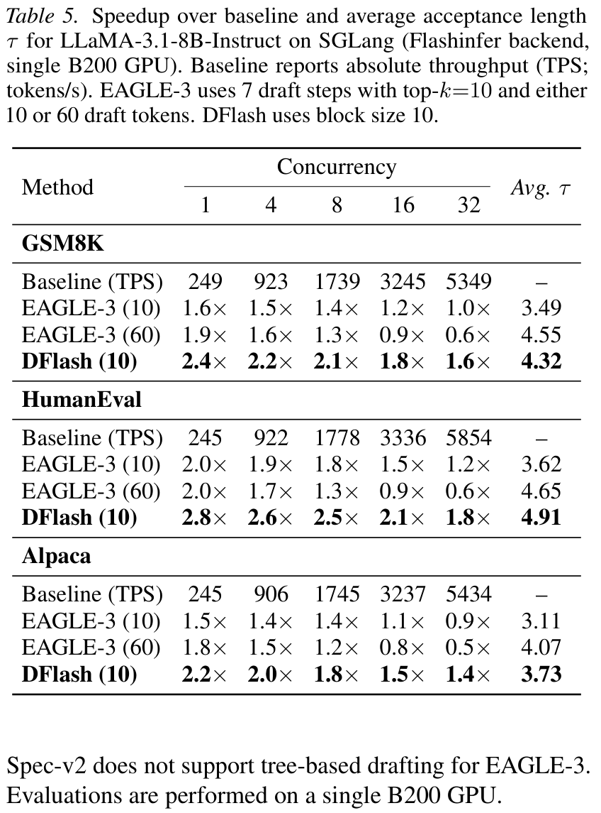</button>
<figcaption><strong>DFlash：不同 serving 实现与并发曲线</strong><a href="https://arxiv.org/abs/2602.06036v2" target="_blank" rel="noopener">DFlash: Block Diffusion for Flash Speculative Decoding</a> · Table 5 · version 2602.06036v2 · PDF p.8 / printed p.8
<button class="original-direct" type="button">Read original size</button>

Original caption &amp; source

Table 5. Speedup over baseline and average acceptance length
τ for LLaMA-3.1-8B-Instruct on SGLang (Flashinfer backend,
single B200 GPU). Baseline reports absolute throughput (TPS;
tokens/s). EAGLE-3 uses 7 draft steps with top-k=10 and either
10 or 60 draft tokens. DFlash uses block size 10.
<a class="source-url" href="https://arxiv.org/abs/2602.06036v2">https://arxiv.org/abs/2602.06036v2</a>
</figcaption></figure>

**问题与读法。** B200、SGLang、FlashInfer，Llama 3.1 8B、DFlash-10 的表随并发 1–32 改变。HumanEval DFlash 约 2.8→1.8 倍，EAGLE-3-60 约 2.0→0.6。

**机制与例子。** 多个请求已使目标矩阵充足，草稿和额外验证开始抢相同资源。减少草稿等待对低并发更显著，但并发增长并不必然让所有方法都变慢。

**结论与边界。** 论文说明此处 Spec-v2 不支持 EAGLE 树核验，因而不是所有最强 tree 实现的公平上限。它也不是 H200 主表的同条件续测。

<figure id="fig-dflash-t6">
<button class="paper-image" type="button" aria-label="Zoom: DFlash：更深草稿不保证更高速度">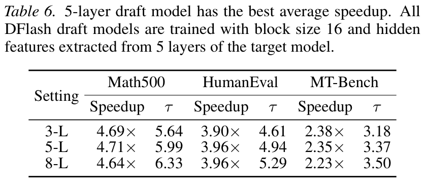</button>
<figcaption><strong>DFlash：更深草稿不保证更高速度</strong><a href="https://arxiv.org/abs/2602.06036v2" target="_blank" rel="noopener">DFlash: Block Diffusion for Flash Speculative Decoding</a> · Table 6 · version 2602.06036v2 · PDF p.8 / printed p.8
<button class="original-direct" type="button">Read original size</button>

Original caption &amp; source

Table 6. 5-layer draft model has the best average speedup. All
DFlash draft models are trained with block size 16 and hidden
features extracted from 5 layers of the target model.
<a class="source-url" href="https://arxiv.org/abs/2602.06036v2">https://arxiv.org/abs/2602.06036v2</a>
</figcaption></figure>

**问题与读法。** 表改变草稿层数，同时记录接受长度与速度。深至八层的模型可获得更高接受程度，但平均速度未必超过更轻配置。

**机制与例子。** 八层更了解“公交车”的语义，却为每轮所有候选多付网络成本。第五层到第八层增加的时间要靠更多正式 token 才能回本。

**结论与边界。** 表支持对草稿能力与成本共同优化，不支持仅按接受率挑模型。当前仓库已包含 DFlash2 的新组件，与论文 v2 的原实验环境不同，不能用今日 HEAD 自动宣布复现旧表。

## 9. 走进真实服务：反证、EAGLE-4 与 ForeSpark

### 9.1 Performance or Illusion：普通基线一旦变强，收益会变化

“Speculative Decoding: Performance or Illusion?” <a href="#source-P14">[P14]</a> 在完整 serving 引擎中测量不同 batch、模型与任务。它提醒我们：如果普通解码本来就能很好利用设备，投机产生的额外工作可能超过少轮数的收益。

<figure id="fig-illusion-f1">
<button class="paper-image" type="button" aria-label="Zoom: 真实服务：非推理任务的负载扫描">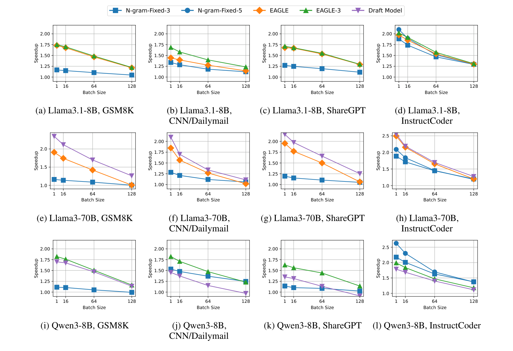</button>
<figcaption><strong>真实服务：非推理任务的负载扫描</strong><a href="https://arxiv.org/abs/2601.11580v2" target="_blank" rel="noopener">Speculative Decoding: Performance or Illusion?</a> · Figure 1 · version 2601.11580v2 · PDF p.5 / printed p.5
<button class="original-direct" type="button">Read original size</button>

Original caption &amp; source

Figure 1. End-to-end performance on non-reasoning workloads. For the n-gram method, we report results for both three-token and
five-token proposals.
<a class="source-url" href="https://arxiv.org/abs/2601.11580v2">https://arxiv.org/abs/2601.11580v2</a>
</figcaption></figure>

**问题与读法。** 子图按模型、任务比较方法随负载变化的性能；先读图例与基线，再看在哪些负载交叉。实验为 vLLM 0.10.1.1、H100 80GB，8B 用 1 GPU，70B/106B 用 4 GPU、TP4。

**机制与例子。** CUDA Graphs、continuous batching、chunked prefill 已启用。更多并发使普通目标批次更有效，而投机草稿仍消耗资源；InstructCoder 的重复模式也让 n-gram 候选更有机会。

**结论与边界。** 图反驳低 batch 结果直接代表服务上限。它测的是特定旧版本配置，不证明 2026 年所有新引擎或并行草稿都会失败。

<figure id="fig-illusion-f4">
<button class="paper-image" type="button" aria-label="Zoom: 真实服务：草稿、核验和其他阶段的占比"></button>
<figcaption><strong>真实服务：草稿、核验和其他阶段的占比</strong><a href="https://arxiv.org/abs/2601.11580v2" target="_blank" rel="noopener">Speculative Decoding: Performance or Illusion?</a> · Figure 4 · version 2601.11580v2 · PDF p.9 / printed p.9
<button class="original-direct" type="button">Read original size</button>

Original caption &amp; source

Figure 4. Execution time breakdown across different models.
<a class="source-url" href="https://arxiv.org/abs/2601.11580v2">https://arxiv.org/abs/2601.11580v2</a>
</figcaption></figure>

**问题与读法。** 时间拆分随模型与 batch 改变，图例把 draft、verification 和其他工作分开。占比要和绝对循环时间共同理解。

**机制与例子。** 草稿占比下降可能只是核验变贵；把一个算子加速也可能让另一个阶段成为主要等待。Qwen3 的某配置在 batch 1，正文明确给 draft 约 47%。

**结论与边界。** 不应复制摘要框“均低于 40%”而覆盖正文反例。图支持逐阶段测量，不支持靠平均占比推断每个请求的尾延迟。

<figure id="fig-illusion-t2">
<button class="paper-image" type="button" aria-label="Zoom: 真实服务：静态权重与每 token cache 的内存账"></button>
<figcaption><strong>真实服务：静态权重与每 token cache 的内存账</strong><a href="https://arxiv.org/abs/2601.11580v2" target="_blank" rel="noopener">Speculative Decoding: Performance or Illusion?</a> · Table 2 · version 2601.11580v2 · PDF p.8 / printed p.8
<button class="original-direct" type="button">Read original size</button>

Original caption &amp; source

Table 2. Static and per-token memory usage of the baseline model
execution and different speculative decoding methods. DM stands
for Draft-Model-based method.
<a class="source-url" href="https://arxiv.org/abs/2601.11580v2">https://arxiv.org/abs/2601.11580v2</a>
</figcaption></figure>

**问题与读法。** 表按 FP16 权重与 KV 结构估算静态和每 token 内存。Llama 3.1 8B，静态约 14.96→15.75 GiB，per-token 128→132 KiB。

**机制与例子。** 草稿新增权重与 cache 减少可驻留请求数，间接影响吞吐；还应单独记核验节点的临时 KV、激活、词表 buffer 和 graph workspace。

**结论与边界。** 原表是结构计算，不是 GPU 或手机实际物理峰值测量。不能把这两个数相加就称总峰值，也不能忽略分配器、碎片与 CPU/加速器之间的双份缓存。

### 9.2 EAGLE-4：优化词表头与预算，而不只追求更长草稿

EAGLE-4 <a href="#source-P15">[P15]</a> 首次官方发布于 2026-10-20；本文 PDF 和代码固定于 11 月 11 日的 GitHub commit。它把大词表 head、候选扩展、核验成本和已有引擎能力一起考虑。官方博客和论文来自同团队，属于相互补充的第一手证据，不能算独立复现。

<figure id="fig-eagle4-f2">
<button class="paper-image" type="button" aria-label="Zoom: EAGLE-4：低秩筛选与精确候选行计算"></button>
<figcaption><strong>EAGLE-4：低秩筛选与精确候选行计算</strong><a href="https://github.com/eagle-hq/EAGLE-4/blob/b88bd4c93a7519664c6df4eba4adc53222dbf8f5/EAGLE4_Paper.pdf" target="_blank" rel="noopener">EAGLE-4</a> · Figure 2 · version b88bd4c93a7519664c6df4eba4adc53222dbf8f5 · PDF p.4 / printed p.4
<button class="original-direct" type="button">Read original size</button>

Original caption &amp; source

Figure 2. Latency breakdown of a single draft forward pass us-
ing the full LM head (Base) and EAGLE Efficient LM HeadTM
with ranks r = 512 and r = 128. Blue and gray denote LM-
head computation and the remaining draft-forward computation,
respectively. Labels above the bars indicate total latency, while
percentages show the fraction attributed to LM-head computation.
<a class="source-url" href="https://github.com/eagle-hq/EAGLE-4/blob/b88bd4c93a7519664c6df4eba4adc53222dbf8f5/EAGLE4_Paper.pdf">https://github.com/eagle-hq/EAGLE-4/blob/b88bd4c93a7519664c6df4eba4adc53222dbf8f5/EAGLE4_Paper.pdf</a>
</figcaption></figure>

**问题与读法。** 柱顶是一次完整草稿前向的时间，蓝色段为 LM head、灰色段为其余计算。Base、r=512、r=128 的总时间为 574、326、255 μs，head 占比分别为 65.4%、37.9%、17.9%。

**机制与例子。** 原文机制先低秩筛候选，再对选中词表行进行完整秩计算。大多数词不适合接在“公交”后，先筛再精算可减少词表阶段成本；草稿预测可以近似，质量最后仍需由目标 sampler 决定。

**结论与边界。** 574→255 μs 是草稿前向变快，不能写成 head 本身时间，更不能直接当作目标模型或整次请求两倍加速。候选召回、回退路径和真正目标概率的计算不能被近似草稿头取代。

<figure id="fig-eagle4-a1">
<button class="paper-image" type="button" aria-label="Zoom: EAGLE-4：按实测成本与收益密度分配候选"></button>
<figcaption><strong>EAGLE-4：按实测成本与收益密度分配候选</strong><a href="https://github.com/eagle-hq/EAGLE-4/blob/b88bd4c93a7519664c6df4eba4adc53222dbf8f5/EAGLE4_Paper.pdf" target="_blank" rel="noopener">EAGLE-4</a> · Algorithm 1 · version b88bd4c93a7519664c6df4eba4adc53222dbf8f5 · PDF p.6 / printed p.6
<button class="original-direct" type="button">Read original size</button>

Original caption &amp; source

Algorithm 1 One decoding round of EAGLE-Harness. A is
<a class="source-url" href="https://github.com/eagle-hq/EAGLE-4/blob/b88bd4c93a7519664c6df4eba4adc53222dbf8f5/EAGLE4_Paper.pdf">https://github.com/eagle-hq/EAGLE-4/blob/b88bd4c93a7519664c6df4eba4adc53222dbf8f5/EAGLE4_Paper.pdf</a>
</figcaption></figure>

**问题与读法。** 算法输入包含成本表与候选状态，在 expansion 和 verification 的预算之间计算收益，选择下一轮动作。它不是固定生成最长可能草稿。

**机制与例子。** 若第三个公交相关词的预计收益很小、再扩展要多跑一次 head，就提前核验；更集中上下文可以继续延长。成本表反映当前设备算子的形状差异。

**结论与边界。** 自适应依赖成本模型、校准和调用链整合。预算误估通常影响速度，目标数值和 sampler 改动则可能影响正确性；两个层面不能混同。

<figure id="fig-eagle4-t2">
<button class="paper-image" type="button" aria-label="Zoom: EAGLE-4：SPEED-Bench，单请求与 C512"></button>
<figcaption><strong>EAGLE-4：SPEED-Bench，单请求与 C512</strong><a href="https://github.com/eagle-hq/EAGLE-4/blob/b88bd4c93a7519664c6df4eba4adc53222dbf8f5/EAGLE4_Paper.pdf" target="_blank" rel="noopener">EAGLE-4</a> · Table 2 · version b88bd4c93a7519664c6df4eba4adc53222dbf8f5 · PDF p.9 / printed p.9
<button class="original-direct" type="button">Read original size</button>

Original caption &amp; source

Table 2. Overall throughput on the qualitative split of SPEED-Bench with Qwen3.8-27B, evaluated on 4× NVIDIA B300 GPUs with
tensor parallelism (TP) of 4. The maximum output length is capped at 4,096 tokens. All methods use the same inference engine, with
MegaKernel disabled.
<a class="source-url" href="https://github.com/eagle-hq/EAGLE-4/blob/b88bd4c93a7519664c6df4eba4adc53222dbf8f5/EAGLE4_Paper.pdf">https://github.com/eagle-hq/EAGLE-4/blob/b88bd4c93a7519664c6df4eba4adc53222dbf8f5/EAGLE4_Paper.pdf</a>
</figcaption></figure>

**问题与读法。** Qwen3.8 27B、4 B300、TP4，SPEED-Bench qualitative、最多输出 4096，MegaKernel 关闭。表分单用户和高并发，不把两种 tokens/s 混在一起。

**机制与例子。** temperature 0，AR 单请求 240.5→EAGLE-4 863.8 token/s，约 3.59 倍；C512 汇总 21,203→28,340，约 1.34 倍。temperature 1、C512 为 20,307→21,005，约 1.03 倍。

**结论与边界。** 表支持同引擎配置下的条件优势，也显示大并发的边际收益很小。对照中的 DFlash2 是新变体，不能把名称简化成第 8 节原始 DFlash 再跨表比较。

<figure id="fig-eagle4-t6">
<button class="paper-image" type="button" aria-label="Zoom: EAGLE-4：Snapdragon 手机 CPU、内存与能耗"></button>
<figcaption><strong>EAGLE-4：Snapdragon 手机 CPU、内存与能耗</strong><a href="https://github.com/eagle-hq/EAGLE-4/blob/b88bd4c93a7519664c6df4eba4adc53222dbf8f5/EAGLE4_Paper.pdf" target="_blank" rel="noopener">EAGLE-4</a> · Table 6 · version b88bd4c93a7519664c6df4eba4adc53222dbf8f5 · PDF p.10 / printed p.10
<button class="original-direct" type="button">Read original size</button>

Original caption &amp; source

Table 6. Decoding throughput on the Motorola Razr 70 Ultra in
tokens per second. Results are measured for a single request at
temperature 0 on a cool device. Higher throughput is better.
<a class="source-url" href="https://github.com/eagle-hq/EAGLE-4/blob/b88bd4c93a7519664c6df4eba4adc53222dbf8f5/EAGLE4_Paper.pdf">https://github.com/eagle-hq/EAGLE-4/blob/b88bd4c93a7519664c6df4eba4adc53222dbf8f5/EAGLE4_Paper.pdf</a>
</figcaption></figure>

**问题与读法。** Razr 70 Ultra、Snapdragon 8 Elite，llama.cpp CPU 6 线程，Gemma4-E2B-it 4bit；HumanEval 22.8→82.6 token/s，长请求 23.3→74.7，约 3.62 与 3.21 倍。

**机制与例子。** 同一手机上还打包了其他 CPU 优化。额外 RSS 约 0.26GB，USB 测能耗 356→166 mJ/token，低温下在约 30–45 秒、42°C 降频之前完成测量。

**结论与边界。** 这是作者手机实测，不是本文真机结果，也不是 HTP/NPU 数据。不能归因全部收益于投机算法，不能用 RSS 代表 dma-buf 物理峰值；持续发热和量化路径还需独立测量。

<figure id="fig-eagle4-t7">
<button class="paper-image" type="button" aria-label="Zoom: EAGLE-4：长上下文首 token 与 decode 分别报告"></button>
<figcaption><strong>EAGLE-4：长上下文首 token 与 decode 分别报告</strong><a href="https://github.com/eagle-hq/EAGLE-4/blob/b88bd4c93a7519664c6df4eba4adc53222dbf8f5/EAGLE4_Paper.pdf" target="_blank" rel="noopener">EAGLE-4</a> · Table 7 · version b88bd4c93a7519664c6df4eba4adc53222dbf8f5 · PDF p.10 / printed p.10
<button class="original-direct" type="button">Read original size</button>

Original caption &amp; source

Table 7. Long-context, single-request performance of EAGLE-4,
measured by the TokenSpeed team. Round latency is reported in
milliseconds and TTFT in seconds.
<a class="source-url" href="https://github.com/eagle-hq/EAGLE-4/blob/b88bd4c93a7519664c6df4eba4adc53222dbf8f5/EAGLE4_Paper.pdf">https://github.com/eagle-hq/EAGLE-4/blob/b88bd4c93a7519664c6df4eba4adc53222dbf8f5/EAGLE4_Paper.pdf</a>
</figcaption></figure>

**问题与读法。** TokenSpeed 团队提供 BF16、Qwen3.8 27B、4 B300、TP4 的 batch 1 条件；表按输入长度列 decode token/s、round latency 毫秒与 TTFT 秒数。

**机制与例子。** 32K 为 759 token/s、0.55 s；128K 为 822、2.1；250K 为 761、5.7。长公交报告先支付越来越大的 prefill，再享受后续 decode。

**结论与边界。** decode 较稳定不表示 TTFT 不增长，更不意味着 250K 的峰值内存无压力。这是报告测量；缺少独立复测、长时间热状态与全量 workspace 峰值。

官方代码架构 <a href="#source-C03">[C03]</a> 特别提示：核验形状改变可能改变目标数值，即使使用 near-tie 防护，也不等于所有实现都保证与 no-spec 严格分布等价。因此要分别审查**理想算法、模型定义、数值路径和工程 sampler**。本综述不把算法证明扩大为每个后端的 bitwise 保证。

### 9.3 ForeSpark：让不同请求竞争同一个有效核验预算

ForeSpark <a href="#source-P16">[P16]</a> 于 2026-11-10 首次公开。其主要对象是并行草稿的服务调度：统一决定本轮哪些请求生成草稿、各生成多少、各核验多少。每个请求单独追求最大接受长度，会让整个 batch 做很多最终丢弃的工作。

<figure id="fig-forespark-f4">
<button class="paper-image" type="button" aria-label="Zoom: ForeSpark：固定全块预算产生的无效工作"></button>
<figcaption><strong>ForeSpark：固定全块预算产生的无效工作</strong><a href="https://arxiv.org/abs/2611.13442v1" target="_blank" rel="noopener">ForeSpark: Joint Draft and Verification Budget Scheduling for Parallel Speculative Decoding</a> · Figure 4 · version 2611.13442v1 · PDF p.4 / printed p.4
<button class="original-direct" type="button">Read original size</button>

Original caption &amp; source

Figure 4. (a) DSpark drafts a full block and drops drafts only at
verification. (b) FORESPARK sizes each draft before drafting. (c)
Overview of FORESPARK.
<a class="source-url" href="https://arxiv.org/abs/2611.13442v1">https://arxiv.org/abs/2611.13442v1</a>
</figcaption></figure>

**问题与读法。** 原图概览不同请求的 draft/verify 流程，将完整块里有用和无用的位置区分开；预算规划位于模型执行之前与之后。

**机制与例子。** 请求甲的公交模板很确定，请求乙包含陌生专名。给两者各 16 个位置，乙可能只接受一个，甲却还有高收益未展开。

**结论与边界。** 图支持跨请求共同规划；它不意味着可以跳过目标验证或借用别的请求 token。请求状态、停止条件和槽位生命周期必须隔离。

<figure id="fig-forespark-f5">
<button class="paper-image" type="button" aria-label="Zoom: ForeSpark：草稿前估计不同长度的生存概率"></button>
<figcaption><strong>ForeSpark：草稿前估计不同长度的生存概率</strong><a href="https://arxiv.org/abs/2611.13442v1" target="_blank" rel="noopener">ForeSpark: Joint Draft and Verification Budget Scheduling for Parallel Speculative Decoding</a> · Figure 5 · version 2611.13442v1 · PDF p.5 / printed p.5
<button class="original-direct" type="button">Read original size</button>

Original caption &amp; source

Figure 5. Pre-draft estimation. The estimator predicts survival
benefits for every candidate length, a triangle of K(K + 1)/2
values, from which the scheduler gathers per-length rewards.
<a class="source-url" href="https://arxiv.org/abs/2611.13442v1">https://arxiv.org/abs/2611.13442v1</a>
</figcaption></figure>

**问题与读法。** 三角形估计结构为不同 draft length、不同未来位置预测被接受可能；横向预算变化与纵向位置生存不是同一个变量。

**机制与例子。** 先估“给甲四个位置能提交多少，给八个又能提交多少”，再决定是否执行那一块。估计可用 CPU 状态与历史校准提前完成。

**结论与边界。** 这是速度规划的统计模型，不是最终正确性判断。陈旧估计可能浪费预算，但只要正式核验正确，不能让它直接变成未经确认的输出。

<figure id="fig-forespark-f6">
<button class="paper-image" type="button" aria-label="Zoom: ForeSpark：跨请求的边际收益与凹包络"></button>
<figcaption><strong>ForeSpark：跨请求的边际收益与凹包络</strong><a href="https://arxiv.org/abs/2611.13442v1" target="_blank" rel="noopener">ForeSpark: Joint Draft and Verification Budget Scheduling for Parallel Speculative Decoding</a> · Figure 6 · version 2611.13442v1 · PDF p.5 / printed p.5
<button class="original-direct" type="button">Read original size</button>

Original caption &amp; source

Figure 6. FORESPARK-Scheduler. Survival scores, differences of
concave envelopes Fi over per-length rewards Ri, are pooled,
sorted, and priced against latency profiles to choose D and B.
<a class="source-url" href="https://arxiv.org/abs/2611.13442v1">https://arxiv.org/abs/2611.13442v1</a>
</figcaption></figure>

**问题与读法。** 图将每个请求的收益曲线转成可排序的边际增量，通过 concave envelope 平滑不规则收益，再共同选择有限预算。

**机制与例子。** 甲增加一个核验位置预计多提交 0.7 个 token，乙预计只多 0.1，预算更倾向甲；但成本不是常数，batch 和 graph bucket 都影响耗时。

**结论与边界。** 图解释全局预算价值，不证明“给最高概率请求全部资源”总是最优。等待公平性、尾延迟和图形桶填充要与吞吐一起处理。

<figure id="fig-forespark-f7">
<button class="paper-image" type="button" aria-label="Zoom: ForeSpark：执行前裁掉 mask，草稿后再精调验证"></button>
<figcaption><strong>ForeSpark：执行前裁掉 mask，草稿后再精调验证</strong><a href="https://arxiv.org/abs/2611.13442v1" target="_blank" rel="noopener">ForeSpark: Joint Draft and Verification Budget Scheduling for Parallel Speculative Decoding</a> · Figure 7 · version 2611.13442v1 · PDF p.6 / printed p.6
<button class="original-direct" type="button">Read original size</button>

Original caption &amp; source

Figure 7. Variable-length drafting and budget distribution. Masks
beyond the scheduled length are skipped, and selector-conditioned
confidence allocates the budget B.
<a class="source-url" href="https://arxiv.org/abs/2611.13442v1">https://arxiv.org/abs/2611.13442v1</a>
</figcaption></figure>

**问题与读法。** 图分 predraft pruning 与 postdraft refinement。第一阶段在草稿运行前移除预计低价值的 masked 位置，第二阶段利用真实草稿信息调整 verification quota。

**机制与例子。** 乙预计只有前两词值得尝试，就不为其生成整块；甲生成后若概率分布比预想分散，则减少目标核验范围。

**结论与边界。** 省掉的是实际草稿与核验算子，不只是丢弃已算好的结果。quota 必须排除已结束请求与新槽位；TP 多卡要由一致规划或 rank0 广播避免 collective 次序不一致。

<figure id="fig-forespark-f8">
<button class="paper-image" type="button" aria-label="Zoom: ForeSpark：总吞吐与每用户交互速度的前沿"></button>
<figcaption><strong>ForeSpark：总吞吐与每用户交互速度的前沿</strong><a href="https://arxiv.org/abs/2611.13442v1" target="_blank" rel="noopener">ForeSpark: Joint Draft and Verification Budget Scheduling for Parallel Speculative Decoding</a> · Figure 8 · version 2611.13442v1 · PDF p.8 / printed p.8
<button class="original-direct" type="button">Read original size</button>

Original caption &amp; source

Figure 8. Total throughput versus user interactivity on (a)
ShareGPT-Decode and (b) ShareGPT-E2E. Arrows mark the
largest gain over the strongest baseline.
<a class="source-url" href="https://arxiv.org/abs/2611.13442v1">https://arxiv.org/abs/2611.13442v1</a>
</figcaption></figure>

**问题与读法。** 横轴 user interactivity 是首 token 之后 median TPOT 的倒数，纵轴 total throughput；多点来自不同负载与预算，原文在测量点之间插值作 matched 比较，且只报告至少达到各自峰值一半的点。

**机制与例子。** 甲的输出更快不能靠饿死乙换得；共同预算要把更多算力变成用户收到的 token。三模型 decode 的图中 matched-baseline 增益为 1.31/1.40/1.34，E2E 为 1.34/1.21/1.18 倍。

**结论与边界。** 摘要“最高 1.77 倍”针对 DSpark 而非最强基线，不能贴到这六个红色比较值上。decode 协议把请求各自 token rate 相加、交互率取 median，不能自动替代 E2E 测量窗口的汇总。长回答选择也带有生存选择偏差。

<figure id="fig-forespark-f9">
<button class="paper-image" type="button" aria-label="Zoom: ForeSpark：SLO 达标率比峰值吞吐更接近服务目标"></button>
<figcaption><strong>ForeSpark：SLO 达标率比峰值吞吐更接近服务目标</strong><a href="https://arxiv.org/abs/2611.13442v1" target="_blank" rel="noopener">ForeSpark: Joint Draft and Verification Budget Scheduling for Parallel Speculative Decoding</a> · Figure 9 · version 2611.13442v1 · PDF p.8 / printed p.8
<button class="original-direct" type="button">Read original size</button>

Original caption &amp; source

Figure 9. SLO attainment on ShareGPT-E2E, following (Zhong
et al., 2024). (a) Versus request rate, where arrows mark capacity
gains at 90% (dashed). (b) At a fixed rate, with both thresholds
scaled.
<a class="source-url" href="https://arxiv.org/abs/2611.13442v1">https://arxiv.org/abs/2611.13442v1</a>
</figcaption></figure>

**问题与读法。** 随请求速率改变观察 SLO attainment，90% 达标率是比较阈值。TTFT 目标 1 秒，三模型 TPOT 门限分别 50/30/40 ms。

**机制与例子。** 测试使用固定 seed 的 Poisson 到达。请求率为 $r$ req/s 时，以 $30r$ 个请求预热、再测 $120r$ 个请求，对应约 30 秒和 120 秒的期望到达时段；超时与未完成都算失败。公交回答总 token/s 高，但迟迟不出首词仍会失败。

**结论与边界。** 图上半部的最强基线容量增益为 1.20/1.13/1.17 倍，对 DSpark 为 1.51/1.13/1.17；下半部在固定到达率缩放两个 SLO 门限。SLO 或到达分布改变，容量也改变，不能用离线 throughput 替代。

<figure id="fig-forespark-f10">
<button class="paper-image" type="button" aria-label="Zoom: ForeSpark：每输出 token 时间与负载"></button>
<figcaption><strong>ForeSpark：每输出 token 时间与负载</strong><a href="https://arxiv.org/abs/2611.13442v1" target="_blank" rel="noopener">ForeSpark: Joint Draft and Verification Budget Scheduling for Parallel Speculative Decoding</a> · Figure 10 · version 2611.13442v1 · PDF p.9 / printed p.9
<button class="original-direct" type="button">Read original size</button>

Original caption &amp; source

Figure 10. Time per output token on ShareGPT-Decode, normal-
ized to AR at each batch size.
<a class="source-url" href="https://arxiv.org/abs/2611.13442v1">https://arxiv.org/abs/2611.13442v1</a>
</figcaption></figure>

**问题与读法。** 横轴是 batch size，纵轴为相对该 batch 的 AR 归一化 time/token，AR虚线为1。按方法、draft/verify/other 分段；数值来自 AR吞吐与方法吞吐的比值，再用采样到的 CUDA-event 时间按比例拆分。

**机制与例子。** 小负载时可给单请求更多草稿，大负载时压缩低收益位置减少竞争。甲与乙的预算随着活跃请求数共同变化。

**结论与边界。** 图说明调度使负载适应成为方法的一部分。这个吞吐归一化指标不是每次用户输出间隔的直接测量，不等于 p99 TPOT，也不能保证抢占、公平性或所有工具调用场景。

<figure id="fig-forespark-t1">
<button class="paper-image" type="button" aria-label="Zoom: ForeSpark：模型、GPU、精度与输出协议"></button>
<figcaption><strong>ForeSpark：模型、GPU、精度与输出协议</strong><a href="https://arxiv.org/abs/2611.13442v1" target="_blank" rel="noopener">ForeSpark: Joint Draft and Verification Budget Scheduling for Parallel Speculative Decoding</a> · Table 1 · version 2611.13442v1 · PDF p.19 / printed p.19
<button class="original-direct" type="button">Read original size</button>

Original caption &amp; source

Table 1. Training and serving configuration, identical for all methods on a model. All drafters train on eight B200 GPUs, and the
GLM5.3-Flash drafters train against its FP8 release. Loads take the values 1, 8, 32, 64, 128, 256, and 512 within each range.
<a class="source-url" href="https://arxiv.org/abs/2611.13442v1">https://arxiv.org/abs/2611.13442v1</a>
</figcaption></figure>

**问题与读法。** 附录表冻结主要模型与系统：vLLM 0.30.0、PyTorch 2.13、CUDA 13；Qwen3 14B BF16 用 8 H100 96GB，GLM5.3 两种 MoE 用 8 B200 180GB、TP8/EP8。

**机制与例子。** GLM 320B/18B active 与 744B/40B active 使用 NVFP4 专家、FP8 KV。数据为 20K ShareGPT 会话；decode-only 先经 prefill barrier，再最多 512 token 或首 end-of-turn 停止，长回答子集由 AR 选择。

**结论与边界。** MoE 通信、精度与设备显著影响预算成本。该实验是作者近期报告，不是独立复现；与 EAGLE-4 的 B300 稠密模型表不属于同硬件、同模型、同协议。

## 10. 数据集、指标和实现：怎样组织一次可比较的评测

### 10.1 数据不是只看任务名字

| 任务或协议 | 核验到的规模／结构 | 应测什么 | 影响接受率与结论的条件 |
| --- | --- | --- | --- |
| Spec-Bench <a href="#source-D01">[D01]</a> | 480 提示；五类各 80，另有 MT-Bench 80 个二轮问题 | 各任务加速、接受长度、长度分布 | 翻译、摘要、QA、数学、RAG 与对话不可只报总均值 |
| SPEED-Bench <a href="#source-D02">[D02]</a> | qualitative 11×80=880；1/2/8/16/32K throughput 各 1536；v1.1 增 100K、384 条 | 内容形态、长上下文、并发与延迟 | 2026-09-17 v1.1 修复翻译提示泄漏及采样问题；固定 revision |
| HumanEval <a href="#source-D03">[D03]</a>、EvalPlus <a href="#source-D04">[D04]</a> | HumanEval 164 题；EvalPlus 增强测试 | pass@1/多样本通过率、代码速度 | 100-shot、completion/chat 包装、执行超时、采样次数 |
| MBPP <a href="#source-D07">[D07]</a> | full test 500 题；sanitized 等版本另有子集 | 代码测试通过率与速度 | 不同 split 不可混称“MBPP 500” |
| GSM8K <a href="#source-D05">[D05]</a>、MATH-500 <a href="#source-D09">[D09]</a> | GSM8K test 1319；MATH-500 500 | 答案准确率、推理长度、接受曲线 | answer parser、CoT、think on/off、输出上限 |
| LiveCodeBench <a href="#source-D10">[D10]</a> | 随 release 与时间窗口更新 | 新代码题的执行通过率 | 冻结 release、日期窗口，不能只记录库名 |
| ShareGPT <a href="#source-D08">[D08]</a> | 会话语料，有版本、清洗与筛选差异 | 服务到达、对话长度与混合负载 | 它不是固定质量基准；长回答筛选会改变分布 |
| LongBench <a href="#source-D06">[D06]</a> | 多种长文本任务 | 任务质量、TTFT、TPOT、接受长度、内存 | 文本 tokenization 后长度、截断方法、模型上下文上限 |

SPEED 的部分 parquet 内容是占位提示，要求用官方 source-fetch 框架取得真实题目，不能拿占位字符串测吞吐。其数据卡页脚曾写 1538，但冻结 metadata 与官方说明一致为 1536；本文按后者统计。提示包裹、源答案意外泄漏、输出长度与数据泄漏都会影响草稿容易程度。

### 10.2 三种“速度平均”不相同

令第 $i$ 个请求输出 $n_i$ 个 token、计时为 $t_i$，共有 $N$ 个请求。下面是两种常见汇总：

$$
R_{\mathrm{request}}=\frac1N\sum_i\frac{n_i}{t_i},
\qquad
R_{\mathrm{pooled}}=\frac{\sum_i n_i}{\sum_i t_i}.
$$

第一个把每个请求等权平均，第二个按所用时间加权。后者这里适用于逐请求时长的汇总；并发服务真正的 aggregate throughput 应使用整个测量窗口墙钟时间，不能把相互重叠的请求时长简单相加。平均 paired speedup 又是第三种统计：对同一个请求的基线与投机时间比值求均值。

核验过的 Spec-Bench `evaluation/speed.py` <a href="#source-D01">[D01]</a> 使用“投机的平均每请求 tokens/time ÷ 基线的平均每请求 tokens/time”，不是 pooled throughput，也不是逐请求速度比均值。基线还对输出文本重新 tokenization 并减一，计数口径必须检查。本文不把不同论文的 mean、overall、$\tau$ 和 aggregate 自动合并。

最小可靠记录包括：目标与草稿 checkpoint/revision、tokenizer、精度和量化粒度、硬件与 TP/EP、引擎 commit、attention kernel、CUDA Graphs、batch/并发/到达率、prompt/output 长度、temperature/top-p/top-k、停止规则、计时是否含 prefill 和排队，以及总 token 计数方法。

还应记录 per-op 与关键路径：草稿 attention/MLP/head、目标核验、采样与 residual、KV crop/gather/scatter、CPU/GPU 同步、TP collective、调度等待。接受率只用于解释这些时间，不能替代时间测量。

### 10.3 固定代码状态，比只附一个 GitHub 名字更可靠

| 路线 | 官方实现与冻结来源 | 已核验内容 | 使用与复现边界 |
| --- | --- | --- | --- |
| EAGLE 1/2/3 | [SafeAILab/EAGLE](https://github.com/SafeAILab/EAGLE) <a href="#source-C01">[C01]</a> | feature/token 对齐、树推理与 family 实现 | checkpoint 与目标/词表必须匹配 |
| Medusa | [FasterDecoding/Medusa](https://github.com/FasterDecoding/Medusa) <a href="#source-C08">[C08]</a> | head、tree attention、posterior 处理 | 区分典型接受与精确 sampler |
| SpecInfer | [FlexFlow Serve](https://github.com/flexflow/flexflow-serve) <a href="#source-C07">[C07]</a> | tree serving、模型与 kernel 入口 | 引擎整体配置是比较条件 |
| Lookahead | [LookaheadDecoding](https://github.com/hao-ai-lab/LookaheadDecoding) <a href="#source-C06">[C06]</a> | n-gram、并行分支、自定义 attention | 旧模型支持范围与依赖版本明确 |
| LayerSkip | [facebookresearch/LayerSkip](https://github.com/facebookresearch/LayerSkip) <a href="#source-C05">[C05]</a> | 连续早退出、缓存复用 | 需要对应训练模型；CC BY-NC 限制 |
| DFlash | [z-lab/dflash](https://github.com/z-lab/dflash) <a href="#source-C02">[C02]</a> | p/q 接受、正残差、拒绝后 cache crop | 当前混合 DFlash2，非论文环境原样 |
| EAGLE-4 | [eagle-hq/EAGLE-4](https://github.com/eagle-hq/EAGLE-4) <a href="#source-C03">[C03]</a> | 成本规划、词表头、架构数值限制 | source available；不是自动等同 OSI 开源 |
| ForeSpark | [facebookresearch/ForeSpark](https://github.com/facebookresearch/ForeSpark) <a href="#source-C04">[C04]</a> | 全局 planner、safe verify quota、runtime 接口 | CC BY-NC；多卡规划同步 |
| 训练／服务基础 | [Speculators](https://github.com/vllm-project/speculators) <a href="#source-C10">[C10]</a>、[vLLM](https://github.com/vllm-project/vllm) <a href="#source-C09">[C09]</a> | 草稿训练框架与 serving 实现入口 | 引擎支持矩阵随版本变化，不是全部算法自动支持 |

全文引用链接在文末展开完整 URL、commit 与选取代码路径，便于审阅和复建。本次做了来源与代码逻辑核验，没有执行 GPU 大模型速度复现。DistillSpec、Draft & Verify 未核验到对应作者提供的可运行官方实现，不用第三方同名仓库替补。

工程正确性验证应覆盖拒绝在第一个、中间、最后候选，全部接受，EOS，停止串，取消/超时，KV 槽位复用和多请求交错。随机模式比较分布，贪心模式比较逐 token；量化目标的标准应是相同量化目标，而不是未经量化的参考模型。模型被量化或重新训练所带来的质量变化，应追到转换、参数与数值路径。

## 11. 本次 CPU 实验：精确性可验证，错误补偿会留下偏差

使用 Python 3.12.2 标准库 `Fraction` 表示概率。本次不是 Monte Carlo 频数估计，而是枚举所有有限状态路径并计算精确有理数。词表为 A/B/C，例子的初始分布为：

$$
p=(1/2,\,3/10,\,1/5),\qquad q=(1/5,\,1/2,\,3/10).
$$

这里 A 可以类比“公交”，B/C 是另外两个候选。接受质量为 $(1/5,3/10,1/5)$，拒绝概率 $3/10$，正确残差全部指向 A。补偿后输出恰好恢复 $p$。

如果拒绝后直接从目标抽一次，会得到：

$$
\tilde p=\min(p,q)+Zp=(7/20,\,39/100,\,13/50).
$$

$\tilde p$ 是错误实现的最终分布，$Z=3/10$。已经接受的 B/C 太多，再从 $p$ 均匀地按其权重补充，不能把多给的份额收回；A 从期望的 0.5 降到 0.35，总变差为 0.15。

| 实际运行项 | 覆盖范围 | 精确结果 | 能说明什么 |
| --- | --- | --- | --- |
| 单步拒绝采样恒等式 | 分母 5 的三元概率 simplex，21×21=441 对 | 所有对输出均等于目标；含零支撑、相等、互斥边界 | 残差规则的有限域验证 |
| 四 token Markov 序列 | 3⁴=81 条序列；候选长度 1、2、3 | 三种长度全部 TV=0 | 条件历史与块提交正确时，序列也保持 |
| 拒绝后直接从目标重采样 | 相同四步模型与长度 2 | 序列 TV=0.18271857 | 局部错误补偿会改变完整分布 |
| 核验使用块开始的陈旧历史 | 相同模型，后续位置不更新条件 | 序列 TV=0.3374 | 目标模型本身正确仍救不了错误调用前缀 |

后两项是**主动注入的错误路径**。它们模拟“sampler 看似合理”和“块里每个位置都调用了目标”却仍错误的情况。所有 81 条序列的目标、正确实现、两种错误实现概率都保存为可下载 JSON，而非只给通过日志。

下载：[运行脚本](assets/rejection_identity.py) · [精确结果](assets/results.json) · [复现说明](assets/README.md)。运行 `python3 rejection_identity.py --output results.json` 可重新生成检查结果。实验不使用模型权重，不测 TTFT、TPOT、GPU/HTP 性能、物理峰值内存或真实任务质量；它验证的是本综述中容易被工程调用链破坏的概率语义。

## 12. 当前前沿、选型与仍未解决的问题

### 12.1 没有统一 SOTA，有条件化的 Pareto 前沿

| 需求 | 当前可核验证据 | 选择重点 | 不能据此推导 |
| --- | --- | --- | --- |
| 同目标的精确采样基础 | Leviathan、Chen 的拒绝与残差 | 条件分布、采样变换、回滚 | 任意近似验证都无损 |
| 高质量目标专属草稿 | EAGLE-3 同表改进 | rollout、训练数据、词表与目标匹配 | 数据增加必然无限加速 |
| 减少串行草稿等待 | DFlash H200 主表、B200 serving 表 | 并行块成本、长上下文匹配 | 扩大块免费，所有 tree 实现不如它 |
| 大词表与设备预算优化 | EAGLE-4 同引擎 B300、手机 CPU 条件 | head、成本表、调用链与数值 | 所有收益来自单一算法，已验证 HTP |
| 有 SLO 的高负载服务 | ForeSpark 多模型曲线 | 跨请求预算、SLO、collective 一致性 | 与 EAGLE-4 可直接横向排名 |
| 不能额外训练草稿 | Lookahead、prompt/n-gram 或跳层路线 | 数据重复性、kernel、离线校准 | training-free 等于 compute-free |
| 可共同训练目标 | LayerSkip | 早退出质量与低层 cache reuse | 原 checkpoint 完全不变 |

这些方法的收益条件不相同，能共同组成更好的系统。例如改进草稿、用更廉价的 head，再让 serving scheduler 动态缩放预算。真正的前沿是质量约束下，延迟、吞吐、内存、功耗和成本的多维边界。想进一步逐步追踪动态树，可阅读已有的 [EAGLE-2 技术解读](../../papers/eagle2/)；本篇把它放在领域演变和评测条件中比较。

### 12.2 后续最值得关注的方向

**接受率估计与成本测量共同进化。** 未来预算器需要同时预测位置生存和真实算子成本。长上下文、MoE 专家分布、quantization、图形桶与并发改变成本面；只拟合平均接受率会漏掉瓶颈。ForeSpark 与 EAGLE-4 已给出这条方向的实例。

**量化后的正确性边界。** 块验证可以更换 kernel 和张量形状，量化 scale、低精度归约与 logits processor 也能改变 $p$。应比较同一目标的普通与投机数值路径，把训练或量化质量损失和 sampler 错误分开。更强的差分核验、近 tie 处理与统计检验值得建立统一协议。

**异步、远程草稿和跨 tokenizer。** 多设备并行可能隐藏草稿时间，但引入 RPC、网络、陈旧前缀、取消与 cache 生命周期。tokenizer 不同则需要把 token 提议映射到文本或公共概率空间，不能直接相除两个词表的概率。工具调用、语法约束和 tokenizer 边界也要求重新定义合法提议。

**训练目标与部署负载更一致。** 面向某个目标、采样温度、长文本与真实对话训练草稿，比只扩大参数可能更有效。仍需控制训练生成成本、模型更新频率、许可证和过拟合，不能只看上线后 tokens/s。

**端侧的热、内存和回退链。** 手机 CPU 论文结果已可核验，HTP/NPU 还需测实际图形支持、草稿与目标调度、KV 放置、量化精度和 fallback。建议同时记录 RSS/VmHWM、dma-buf/ION 峰值、TTFT/TPOT、功耗与温度；长时间运行、graph abort/timeout 与恢复后输出一致性才构成完整链路验证。这里是后续实验方案，本文没有宣称已经执行。

**评测从均值转向有效服务。** 固定代码、数据版本和长度分层，报告原始 token 与时间、p95/p99 间隔、SLO goodput、失败请求和质量变化。ShareGPT 长回答筛选、提示答案泄漏、占位数据与强基线差异，都可能制造看起来很漂亮的倍率。

投机解码的长期价值在于把预测的不确定性转化成可纠正、可计量的额外工作。它既需要概率理论确定哪些输出可以提交，也需要系统工程确保被省掉的昂贵等待大于新增成本。理解这两层，才能解释为什么同一个方法在某个任务快四倍，在另一个服务负载中收益很小。

## 13. 参考来源与可追溯版本

以下是正文实际使用的论文、官方实现和数据协议。每篇论文对应上文原图与实质解读；代码路径和冻结 commit 支持逻辑核验，不代表运行过该仓库的全部基准。

<h3>P01 · Blockwise Parallel Decoding for Deep Autoregressive Models</h3>
paper · version / revision: <code>1811.03115v1</code> · first public Wed, 7 Nov 2018 19:09:40 · accessed 2026-11-16
<a class="source-url" href="https://arxiv.org/abs/1811.03115v1" target="_blank" rel="noopener">https://arxiv.org/abs/1811.03115v1</a>

<h3>P02 · Fast Inference from Transformers via Speculative Decoding</h3>
paper · version / revision: <code>2211.17192v2</code> · first public Wed, 30 Nov 2022 17:33:28 · accessed 2026-11-16
<a class="source-url" href="https://arxiv.org/abs/2211.17192v2" target="_blank" rel="noopener">https://arxiv.org/abs/2211.17192v2</a>

<h3>P03 · Accelerating Large Language Model Decoding with Speculative Sampling</h3>
paper · version / revision: <code>2302.01318v1</code> · first public Thu, 2 Feb 2023 18:44:11 · accessed 2026-11-16
<a class="source-url" href="https://arxiv.org/abs/2302.01318v1" target="_blank" rel="noopener">https://arxiv.org/abs/2302.01318v1</a>

<h3>P04 · SpecInfer: Accelerating Large Language Model Serving with Tree-based Speculative Inference and Verification</h3>
paper · version / revision: <code>2305.09781v4</code> · first public Tue, 16 May 2023 20:12:59 · accessed 2026-11-16
<a class="source-url" href="https://arxiv.org/abs/2305.09781v4" target="_blank" rel="noopener">https://arxiv.org/abs/2305.09781v4</a>

<h3>P05 · DistillSpec: Improving Speculative Decoding via Knowledge Distillation</h3>
paper · version / revision: <code>2310.08461v2</code> · first public Thu, 12 Oct 2023 16:21:04 · accessed 2026-11-16
<a class="source-url" href="https://arxiv.org/abs/2310.08461v2" target="_blank" rel="noopener">https://arxiv.org/abs/2310.08461v2</a>

<h3>P06 · Draft &amp; Verify: Lossless Large Language Model Acceleration via Self-Speculative Decoding</h3>
paper · version / revision: <code>2309.08168v2</code> · first public Fri, 15 Sep 2023 05:34:32 · accessed 2026-11-16
<a class="source-url" href="https://arxiv.org/abs/2309.08168v2" target="_blank" rel="noopener">https://arxiv.org/abs/2309.08168v2</a>

<h3>P07 · Medusa: Simple LLM Inference Acceleration Framework with Multiple Decoding Heads</h3>
paper · version / revision: <code>2401.10774v3</code> · first public Fri, 19 Jan 2024 15:48:40 · accessed 2026-11-16
<a class="source-url" href="https://arxiv.org/abs/2401.10774v3" target="_blank" rel="noopener">https://arxiv.org/abs/2401.10774v3</a>

<h3>P08 · EAGLE: Speculative Sampling Requires Rethinking Feature Uncertainty</h3>
paper · version / revision: <code>2401.15077v3</code> · first public Fri, 26 Jan 2024 18:59:01 · accessed 2026-11-16
<a class="source-url" href="https://arxiv.org/abs/2401.15077v3" target="_blank" rel="noopener">https://arxiv.org/abs/2401.15077v3</a>

<h3>P09 · Breaking the Sequential Dependency of LLM Inference Using Lookahead Decoding</h3>
paper · version / revision: <code>2402.02057v1</code> · first public Sat, 3 Feb 2024 06:37:50 · accessed 2026-11-16
<a class="source-url" href="https://arxiv.org/abs/2402.02057v1" target="_blank" rel="noopener">https://arxiv.org/abs/2402.02057v1</a>

<h3>P10 · LayerSkip: Enabling Early Exit Inference and Self-Speculative Decoding</h3>
paper · version / revision: <code>2404.16710v4</code> · first public Thu, 25 Apr 2024 16:20:23 · accessed 2026-11-16
<a class="source-url" href="https://arxiv.org/abs/2404.16710v4" target="_blank" rel="noopener">https://arxiv.org/abs/2404.16710v4</a>

<h3>P11 · EAGLE-2: Faster Inference of Language Models with Dynamic Draft Trees</h3>
paper · version / revision: <code>2406.16858v2</code> · first public Mon, 24 Jun 2024 17:59:11 · accessed 2026-11-16
<a class="source-url" href="https://arxiv.org/abs/2406.16858v2" target="_blank" rel="noopener">https://arxiv.org/abs/2406.16858v2</a>

<h3>P12 · EAGLE-3: Scaling up Inference Acceleration of Large Language Models via Training-Time Test</h3>
paper · version / revision: <code>2503.01840v3</code> · first public Mon, 3 Mar 2025 18:59:04 · accessed 2026-11-16
<a class="source-url" href="https://arxiv.org/abs/2503.01840v3" target="_blank" rel="noopener">https://arxiv.org/abs/2503.01840v3</a>

<h3>P13 · DFlash: Block Diffusion for Flash Speculative Decoding</h3>
paper · version / revision: <code>2602.06036v2</code> · first public Thu, 5 Feb 2026 18:59:30 · accessed 2026-11-16
<a class="source-url" href="https://arxiv.org/abs/2602.06036v2" target="_blank" rel="noopener">https://arxiv.org/abs/2602.06036v2</a>

<h3>P14 · Speculative Decoding: Performance or Illusion?</h3>
paper · version / revision: <code>2601.11580v2</code> · first public Wed, 31 Dec 2025 20:31:36 · accessed 2026-11-16
<a class="source-url" href="https://arxiv.org/abs/2601.11580v2" target="_blank" rel="noopener">https://arxiv.org/abs/2601.11580v2</a>

<h3>P15 · EAGLE-4</h3>
paper · version / revision: <code>b88bd4c93a7519664c6df4eba4adc53222dbf8f5</code> · first public 2026-10-20 · accessed 2026-11-16
<a class="source-url" href="https://github.com/eagle-hq/EAGLE-4/blob/b88bd4c93a7519664c6df4eba4adc53222dbf8f5/EAGLE4_Paper.pdf" target="_blank" rel="noopener">https://github.com/eagle-hq/EAGLE-4/blob/b88bd4c93a7519664c6df4eba4adc53222dbf8f5/EAGLE4_Paper.pdf</a>

<h3>P16 · ForeSpark: Joint Draft and Verification Budget Scheduling for Parallel Speculative Decoding</h3>
paper · version / revision: <code>2611.13442v1</code> · first public Tue, 10 Nov 2026 01:37:38 · accessed 2026-11-16
<a class="source-url" href="https://arxiv.org/abs/2611.13442v1" target="_blank" rel="noopener">https://arxiv.org/abs/2611.13442v1</a>

<h3>C01 · EAGLE official family</h3>
official_code · version / revision: <code>cb7e0841fe0c206c6ed74a197ad5e2a1f13f5a2b</code> · accessed 2026-11-16
<a class="source-url" href="https://github.com/SafeAILab/EAGLE" target="_blank" rel="noopener">https://github.com/SafeAILab/EAGLE</a>
Verified source: <a class="source-url" href="https://github.com/SafeAILab/EAGLE/blob/cb7e0841fe0c206c6ed74a197ad5e2a1f13f5a2b/README.md">https://github.com/SafeAILab/EAGLE/blob/cb7e0841fe0c206c6ed74a197ad5e2a1f13f5a2b/README.md</a>

Verified source: <a class="source-url" href="https://github.com/SafeAILab/EAGLE/blob/cb7e0841fe0c206c6ed74a197ad5e2a1f13f5a2b/LICENSE">https://github.com/SafeAILab/EAGLE/blob/cb7e0841fe0c206c6ed74a197ad5e2a1f13f5a2b/LICENSE</a>

Verified source: <a class="source-url" href="https://github.com/SafeAILab/EAGLE/blob/cb7e0841fe0c206c6ed74a197ad5e2a1f13f5a2b/eagle/model/ea_model.py">https://github.com/SafeAILab/EAGLE/blob/cb7e0841fe0c206c6ed74a197ad5e2a1f13f5a2b/eagle/model/ea_model.py</a>

Verified source: <a class="source-url" href="https://github.com/SafeAILab/EAGLE/blob/cb7e0841fe0c206c6ed74a197ad5e2a1f13f5a2b/eagle/model/cnets.py">https://github.com/SafeAILab/EAGLE/blob/cb7e0841fe0c206c6ed74a197ad5e2a1f13f5a2b/eagle/model/cnets.py</a>

Verified source: <a class="source-url" href="https://github.com/SafeAILab/EAGLE/blob/cb7e0841fe0c206c6ed74a197ad5e2a1f13f5a2b/eagle/traineagle3/cnets.py">https://github.com/SafeAILab/EAGLE/blob/cb7e0841fe0c206c6ed74a197ad5e2a1f13f5a2b/eagle/traineagle3/cnets.py</a>

<h3>C02 · DFlash official implementation</h3>
official_code · version / revision: <code>07ebd93db9f472af339b644bb70221ad8428328a</code> · accessed 2026-11-16
<a class="source-url" href="https://github.com/z-lab/dflash" target="_blank" rel="noopener">https://github.com/z-lab/dflash</a>
Verified source: <a class="source-url" href="https://github.com/z-lab/dflash/blob/07ebd93db9f472af339b644bb70221ad8428328a/README.md">https://github.com/z-lab/dflash/blob/07ebd93db9f472af339b644bb70221ad8428328a/README.md</a>

Verified source: <a class="source-url" href="https://github.com/z-lab/dflash/blob/07ebd93db9f472af339b644bb70221ad8428328a/LICENSE">https://github.com/z-lab/dflash/blob/07ebd93db9f472af339b644bb70221ad8428328a/LICENSE</a>

Verified source: <a class="source-url" href="https://github.com/z-lab/dflash/blob/07ebd93db9f472af339b644bb70221ad8428328a/dflash/model.py">https://github.com/z-lab/dflash/blob/07ebd93db9f472af339b644bb70221ad8428328a/dflash/model.py</a>

Verified source: <a class="source-url" href="https://github.com/z-lab/dflash/blob/07ebd93db9f472af339b644bb70221ad8428328a/dflash/benchmark.py">https://github.com/z-lab/dflash/blob/07ebd93db9f472af339b644bb70221ad8428328a/dflash/benchmark.py</a>

<h3>C03 · EAGLE-4 official source available repository</h3>
official_code · version / revision: <code>b88bd4c93a7519664c6df4eba4adc53222dbf8f5</code> · accessed 2026-11-16
<a class="source-url" href="https://github.com/eagle-hq/EAGLE-4" target="_blank" rel="noopener">https://github.com/eagle-hq/EAGLE-4</a>
Verified source: <a class="source-url" href="https://github.com/eagle-hq/EAGLE-4/blob/b88bd4c93a7519664c6df4eba4adc53222dbf8f5/README.md">https://github.com/eagle-hq/EAGLE-4/blob/b88bd4c93a7519664c6df4eba4adc53222dbf8f5/README.md</a>

Verified source: <a class="source-url" href="https://github.com/eagle-hq/EAGLE-4/blob/b88bd4c93a7519664c6df4eba4adc53222dbf8f5/LICENSE">https://github.com/eagle-hq/EAGLE-4/blob/b88bd4c93a7519664c6df4eba4adc53222dbf8f5/LICENSE</a>

Verified source: <a class="source-url" href="https://github.com/eagle-hq/EAGLE-4/blob/b88bd4c93a7519664c6df4eba4adc53222dbf8f5/docs/architecture.md">https://github.com/eagle-hq/EAGLE-4/blob/b88bd4c93a7519664c6df4eba4adc53222dbf8f5/docs/architecture.md</a>

Verified source: <a class="source-url" href="https://github.com/eagle-hq/EAGLE-4/blob/b88bd4c93a7519664c6df4eba4adc53222dbf8f5/docs/quickstart-vllm.md">https://github.com/eagle-hq/EAGLE-4/blob/b88bd4c93a7519664c6df4eba4adc53222dbf8f5/docs/quickstart-vllm.md</a>

Verified source: <a class="source-url" href="https://github.com/eagle-hq/EAGLE-4/blob/b88bd4c93a7519664c6df4eba4adc53222dbf8f5/docs/known-limits.md">https://github.com/eagle-hq/EAGLE-4/blob/b88bd4c93a7519664c6df4eba4adc53222dbf8f5/docs/known-limits.md</a>

Verified source: <a class="source-url" href="https://github.com/eagle-hq/EAGLE-4/blob/b88bd4c93a7519664c6df4eba4adc53222dbf8f5/eagle_harness/core/draft_tree.py">https://github.com/eagle-hq/EAGLE-4/blob/b88bd4c93a7519664c6df4eba4adc53222dbf8f5/eagle_harness/core/draft_tree.py</a>

Verified source: <a class="source-url" href="https://github.com/eagle-hq/EAGLE-4/blob/b88bd4c93a7519664c6df4eba4adc53222dbf8f5/eagle_harness/models/low_rank_head.py">https://github.com/eagle-hq/EAGLE-4/blob/b88bd4c93a7519664c6df4eba4adc53222dbf8f5/eagle_harness/models/low_rank_head.py</a>

<h3>C04 · ForeSpark official implementation</h3>
official_code · version / revision: <code>5d457ddab73a76f28db34acc577abfbd9e7c6eee</code> · accessed 2026-11-16
<a class="source-url" href="https://github.com/facebookresearch/ForeSpark" target="_blank" rel="noopener">https://github.com/facebookresearch/ForeSpark</a>
Verified source: <a class="source-url" href="https://github.com/facebookresearch/ForeSpark/blob/5d457ddab73a76f28db34acc577abfbd9e7c6eee/README.md">https://github.com/facebookresearch/ForeSpark/blob/5d457ddab73a76f28db34acc577abfbd9e7c6eee/README.md</a>

Verified source: <a class="source-url" href="https://github.com/facebookresearch/ForeSpark/blob/5d457ddab73a76f28db34acc577abfbd9e7c6eee/LICENSE">https://github.com/facebookresearch/ForeSpark/blob/5d457ddab73a76f28db34acc577abfbd9e7c6eee/LICENSE</a>

Verified source: <a class="source-url" href="https://github.com/facebookresearch/ForeSpark/blob/5d457ddab73a76f28db34acc577abfbd9e7c6eee/forespark/fore_d/scheduler/planner.py">https://github.com/facebookresearch/ForeSpark/blob/5d457ddab73a76f28db34acc577abfbd9e7c6eee/forespark/fore_d/scheduler/planner.py</a>

Verified source: <a class="source-url" href="https://github.com/facebookresearch/ForeSpark/blob/5d457ddab73a76f28db34acc577abfbd9e7c6eee/forespark/fore_d/runtime/verification.py">https://github.com/facebookresearch/ForeSpark/blob/5d457ddab73a76f28db34acc577abfbd9e7c6eee/forespark/fore_d/runtime/verification.py</a>

Verified source: <a class="source-url" href="https://github.com/facebookresearch/ForeSpark/blob/5d457ddab73a76f28db34acc577abfbd9e7c6eee/configs/models.yaml">https://github.com/facebookresearch/ForeSpark/blob/5d457ddab73a76f28db34acc577abfbd9e7c6eee/configs/models.yaml</a>

Verified source: <a class="source-url" href="https://github.com/facebookresearch/ForeSpark/blob/5d457ddab73a76f28db34acc577abfbd9e7c6eee/setup.sh">https://github.com/facebookresearch/ForeSpark/blob/5d457ddab73a76f28db34acc577abfbd9e7c6eee/setup.sh</a>

<h3>C05 · LayerSkip official implementation</h3>
official_code · version / revision: <code>494752e5fbb0a82989f6cb384841684b1c2ef5c3</code> · accessed 2026-11-16
<a class="source-url" href="https://github.com/facebookresearch/LayerSkip" target="_blank" rel="noopener">https://github.com/facebookresearch/LayerSkip</a>
Verified source: <a class="source-url" href="https://github.com/facebookresearch/LayerSkip/blob/494752e5fbb0a82989f6cb384841684b1c2ef5c3/README.md">https://github.com/facebookresearch/LayerSkip/blob/494752e5fbb0a82989f6cb384841684b1c2ef5c3/README.md</a>

Verified source: <a class="source-url" href="https://github.com/facebookresearch/LayerSkip/blob/494752e5fbb0a82989f6cb384841684b1c2ef5c3/LICENSE">https://github.com/facebookresearch/LayerSkip/blob/494752e5fbb0a82989f6cb384841684b1c2ef5c3/LICENSE</a>

Verified source: <a class="source-url" href="https://github.com/facebookresearch/LayerSkip/blob/494752e5fbb0a82989f6cb384841684b1c2ef5c3/self_speculation/self_speculation_generator.py">https://github.com/facebookresearch/LayerSkip/blob/494752e5fbb0a82989f6cb384841684b1c2ef5c3/self_speculation/self_speculation_generator.py</a>

Verified source: <a class="source-url" href="https://github.com/facebookresearch/LayerSkip/blob/494752e5fbb0a82989f6cb384841684b1c2ef5c3/self_speculation/llama_model_utils.py">https://github.com/facebookresearch/LayerSkip/blob/494752e5fbb0a82989f6cb384841684b1c2ef5c3/self_speculation/llama_model_utils.py</a>

<h3>C06 · Lookahead official implementation</h3>
official_code · version / revision: <code>eed010da9c7b1867912675d480feec5629e0c2d0</code> · accessed 2026-11-16
<a class="source-url" href="https://github.com/hao-ai-lab/LookaheadDecoding" target="_blank" rel="noopener">https://github.com/hao-ai-lab/LookaheadDecoding</a>
Verified source: <a class="source-url" href="https://github.com/hao-ai-lab/LookaheadDecoding/blob/eed010da9c7b1867912675d480feec5629e0c2d0/README.md">https://github.com/hao-ai-lab/LookaheadDecoding/blob/eed010da9c7b1867912675d480feec5629e0c2d0/README.md</a>

Verified source: <a class="source-url" href="https://github.com/hao-ai-lab/LookaheadDecoding/blob/eed010da9c7b1867912675d480feec5629e0c2d0/LICENSE">https://github.com/hao-ai-lab/LookaheadDecoding/blob/eed010da9c7b1867912675d480feec5629e0c2d0/LICENSE</a>

Verified source: <a class="source-url" href="https://github.com/hao-ai-lab/LookaheadDecoding/blob/eed010da9c7b1867912675d480feec5629e0c2d0/lade/decoding.py">https://github.com/hao-ai-lab/LookaheadDecoding/blob/eed010da9c7b1867912675d480feec5629e0c2d0/lade/decoding.py</a>

<h3>C07 · SpecInfer / FlexFlow Serve</h3>
official_code · version / revision: <code>dd7bee0e9d6e43b1aaf9355a4d2091fdae2b6942</code> · accessed 2026-11-16
<a class="source-url" href="https://github.com/flexflow/flexflow-serve" target="_blank" rel="noopener">https://github.com/flexflow/flexflow-serve</a>
Verified source: <a class="source-url" href="https://github.com/flexflow/flexflow-serve/blob/dd7bee0e9d6e43b1aaf9355a4d2091fdae2b6942/README.md">https://github.com/flexflow/flexflow-serve/blob/dd7bee0e9d6e43b1aaf9355a4d2091fdae2b6942/README.md</a>

Verified source: <a class="source-url" href="https://github.com/flexflow/flexflow-serve/blob/dd7bee0e9d6e43b1aaf9355a4d2091fdae2b6942/LICENSE">https://github.com/flexflow/flexflow-serve/blob/dd7bee0e9d6e43b1aaf9355a4d2091fdae2b6942/LICENSE</a>

Verified source: <a class="source-url" href="https://github.com/flexflow/flexflow-serve/blob/dd7bee0e9d6e43b1aaf9355a4d2091fdae2b6942/README.md">https://github.com/flexflow/flexflow-serve/blob/dd7bee0e9d6e43b1aaf9355a4d2091fdae2b6942/README.md</a>

<h3>C08 · Medusa official implementation</h3>
official_code · version / revision: <code>e2a5d20c048a9b0a4092e6933c34313687422518</code> · accessed 2026-11-16
<a class="source-url" href="https://github.com/FasterDecoding/Medusa" target="_blank" rel="noopener">https://github.com/FasterDecoding/Medusa</a>
Verified source: <a class="source-url" href="https://github.com/FasterDecoding/Medusa/blob/e2a5d20c048a9b0a4092e6933c34313687422518/README.md">https://github.com/FasterDecoding/Medusa/blob/e2a5d20c048a9b0a4092e6933c34313687422518/README.md</a>

Verified source: <a class="source-url" href="https://github.com/FasterDecoding/Medusa/blob/e2a5d20c048a9b0a4092e6933c34313687422518/LICENSE">https://github.com/FasterDecoding/Medusa/blob/e2a5d20c048a9b0a4092e6933c34313687422518/LICENSE</a>

<h3>C09 · vLLM serving engine</h3>
official_code · version / revision: <code>bb94a485b28a493a7691155be4c23a083b643688</code> · accessed 2026-11-16
<a class="source-url" href="https://github.com/vllm-project/vllm" target="_blank" rel="noopener">https://github.com/vllm-project/vllm</a>
Verified source: <a class="source-url" href="https://github.com/vllm-project/vllm/blob/bb94a485b28a493a7691155be4c23a083b643688/README.md">https://github.com/vllm-project/vllm/blob/bb94a485b28a493a7691155be4c23a083b643688/README.md</a>

Verified source: <a class="source-url" href="https://github.com/vllm-project/vllm/blob/bb94a485b28a493a7691155be4c23a083b643688/LICENSE">https://github.com/vllm-project/vllm/blob/bb94a485b28a493a7691155be4c23a083b643688/LICENSE</a>

Verified source: <a class="source-url" href="https://github.com/vllm-project/vllm/blob/bb94a485b28a493a7691155be4c23a083b643688/vllm/v1/worker/gpu/spec_decode/rejection_sampler.py">https://github.com/vllm-project/vllm/blob/bb94a485b28a493a7691155be4c23a083b643688/vllm/v1/worker/gpu/spec_decode/rejection_sampler.py</a>

<h3>D01 · Spec-Bench official protocol</h3>
dataset_protocol · version / revision: <code>fd2c1cd7d2201ef71db4c5f4e455008f017967bf</code> · accessed 2026-11-16
<a class="source-url" href="https://github.com/hemingkx/Spec-Bench" target="_blank" rel="noopener">https://github.com/hemingkx/Spec-Bench</a>
Verified source: <a class="source-url" href="https://github.com/hemingkx/Spec-Bench/blob/fd2c1cd7d2201ef71db4c5f4e455008f017967bf/Readme.md">https://github.com/hemingkx/Spec-Bench/blob/fd2c1cd7d2201ef71db4c5f4e455008f017967bf/Readme.md</a>

Verified source: <a class="source-url" href="https://github.com/hemingkx/Spec-Bench/blob/fd2c1cd7d2201ef71db4c5f4e455008f017967bf/LICENSE">https://github.com/hemingkx/Spec-Bench/blob/fd2c1cd7d2201ef71db4c5f4e455008f017967bf/LICENSE</a>

Verified source: <a class="source-url" href="https://github.com/hemingkx/Spec-Bench/blob/fd2c1cd7d2201ef71db4c5f4e455008f017967bf/evaluation/speed.py">https://github.com/hemingkx/Spec-Bench/blob/fd2c1cd7d2201ef71db4c5f4e455008f017967bf/evaluation/speed.py</a>

Verified source: <a class="source-url" href="https://github.com/hemingkx/Spec-Bench/blob/fd2c1cd7d2201ef71db4c5f4e455008f017967bf/data/spec_bench/question.jsonl">https://github.com/hemingkx/Spec-Bench/blob/fd2c1cd7d2201ef71db4c5f4e455008f017967bf/data/spec_bench/question.jsonl</a>

<h3>D03 · HumanEval official code and tasks</h3>
dataset_protocol · version / revision: <code>b9453e8f1865df0a0057a1383767caa400acfbcf</code> · accessed 2026-11-16
<a class="source-url" href="https://github.com/openai/human-eval" target="_blank" rel="noopener">https://github.com/openai/human-eval</a>
Verified source: <a class="source-url" href="https://github.com/openai/human-eval/blob/b9453e8f1865df0a0057a1383767caa400acfbcf/README.md">https://github.com/openai/human-eval/blob/b9453e8f1865df0a0057a1383767caa400acfbcf/README.md</a>

Verified source: <a class="source-url" href="https://github.com/openai/human-eval/blob/b9453e8f1865df0a0057a1383767caa400acfbcf/LICENSE">https://github.com/openai/human-eval/blob/b9453e8f1865df0a0057a1383767caa400acfbcf/LICENSE</a>

<h3>D04 · EvalPlus expanded code evaluation</h3>
dataset_protocol · version / revision: <code>26d6d00bb1fd0fa37f39c99d5290da67891d1c5e</code> · accessed 2026-11-16
<a class="source-url" href="https://github.com/evalplus/evalplus" target="_blank" rel="noopener">https://github.com/evalplus/evalplus</a>
Verified source: <a class="source-url" href="https://github.com/evalplus/evalplus/blob/26d6d00bb1fd0fa37f39c99d5290da67891d1c5e/README.md">https://github.com/evalplus/evalplus/blob/26d6d00bb1fd0fa37f39c99d5290da67891d1c5e/README.md</a>

Verified source: <a class="source-url" href="https://github.com/evalplus/evalplus/blob/26d6d00bb1fd0fa37f39c99d5290da67891d1c5e/LICENSE">https://github.com/evalplus/evalplus/blob/26d6d00bb1fd0fa37f39c99d5290da67891d1c5e/LICENSE</a>

<h3>D05 · GSM8K official dataset</h3>
dataset_protocol · version / revision: <code>3101c7d5072418e28b9008a6636bde82a006892c</code> · accessed 2026-11-16
<a class="source-url" href="https://github.com/openai/grade-school-math" target="_blank" rel="noopener">https://github.com/openai/grade-school-math</a>
Verified source: <a class="source-url" href="https://github.com/openai/grade-school-math/blob/3101c7d5072418e28b9008a6636bde82a006892c/README.md">https://github.com/openai/grade-school-math/blob/3101c7d5072418e28b9008a6636bde82a006892c/README.md</a>

Verified source: <a class="source-url" href="https://github.com/openai/grade-school-math/blob/3101c7d5072418e28b9008a6636bde82a006892c/LICENSE">https://github.com/openai/grade-school-math/blob/3101c7d5072418e28b9008a6636bde82a006892c/LICENSE</a>

<h3>D06 · LongBench official dataset and evaluation</h3>
dataset_protocol · version / revision: <code>2e00731f8d0bff23dc4325161044d0ed8af94c1e</code> · accessed 2026-11-16
<a class="source-url" href="https://github.com/THUDM/LongBench" target="_blank" rel="noopener">https://github.com/THUDM/LongBench</a>
Verified source: <a class="source-url" href="https://github.com/THUDM/LongBench/blob/2e00731f8d0bff23dc4325161044d0ed8af94c1e/README.md">https://github.com/THUDM/LongBench/blob/2e00731f8d0bff23dc4325161044d0ed8af94c1e/README.md</a>

Verified source: <a class="source-url" href="https://github.com/THUDM/LongBench/blob/2e00731f8d0bff23dc4325161044d0ed8af94c1e/LICENSE">https://github.com/THUDM/LongBench/blob/2e00731f8d0bff23dc4325161044d0ed8af94c1e/LICENSE</a>

<h3>D07 · MBPP official dataset directory</h3>
dataset_protocol · version / revision: <code>bb18d9b0cb460fee1a080fa2eeb4109fe3805275</code> · accessed 2026-11-16
<a class="source-url" href="https://github.com/google-research/google-research" target="_blank" rel="noopener">https://github.com/google-research/google-research</a>
Verified source: <a class="source-url" href="https://github.com/google-research/google-research/blob/bb18d9b0cb460fee1a080fa2eeb4109fe3805275/README.md">https://github.com/google-research/google-research/blob/bb18d9b0cb460fee1a080fa2eeb4109fe3805275/README.md</a>

Verified source: <a class="source-url" href="https://github.com/google-research/google-research/blob/bb18d9b0cb460fee1a080fa2eeb4109fe3805275/LICENSE">https://github.com/google-research/google-research/blob/bb18d9b0cb460fee1a080fa2eeb4109fe3805275/LICENSE</a>

Verified source: <a class="source-url" href="https://github.com/google-research/google-research/blob/bb18d9b0cb460fee1a080fa2eeb4109fe3805275/mbpp/README.md">https://github.com/google-research/google-research/blob/bb18d9b0cb460fee1a080fa2eeb4109fe3805275/mbpp/README.md</a>

<h3>C10 · Speculators training framework</h3>
official_code · version / revision: <code>05f9ba2324fef505cef8700669f2bdc20f8ae219</code> · accessed 2026-11-16
<a class="source-url" href="https://github.com/vllm-project/speculators" target="_blank" rel="noopener">https://github.com/vllm-project/speculators</a>
Verified source: <a class="source-url" href="https://github.com/vllm-project/speculators/blob/05f9ba2324fef505cef8700669f2bdc20f8ae219/README.md">https://github.com/vllm-project/speculators/blob/05f9ba2324fef505cef8700669f2bdc20f8ae219/README.md</a>

Verified source: <a class="source-url" href="https://github.com/vllm-project/speculators/blob/05f9ba2324fef505cef8700669f2bdc20f8ae219/LICENSE">https://github.com/vllm-project/speculators/blob/05f9ba2324fef505cef8700669f2bdc20f8ae219/LICENSE</a>

<h3>D02 · nvidia/SPEED-Bench dataset card</h3>
dataset_card · version / revision: <code>fa4e669bee2a4393c56aa8ed05a7c667897f9590</code> · accessed 2026-11-16
<a class="source-url" href="https://huggingface.co/datasets/nvidia/SPEED-Bench" target="_blank" rel="noopener">https://huggingface.co/datasets/nvidia/SPEED-Bench</a>

<h3>D08 · anon8231489123/ShareGPT_Vicuna_unfiltered dataset card</h3>
dataset_card · version / revision: <code>192ab2185289094fc556ec8ce5ce1e8e587154ca</code> · accessed 2026-11-16
<a class="source-url" href="https://huggingface.co/datasets/anon8231489123/ShareGPT_Vicuna_unfiltered" target="_blank" rel="noopener">https://huggingface.co/datasets/anon8231489123/ShareGPT_Vicuna_unfiltered</a>

<h3>D09 · HuggingFaceH4/MATH-500 dataset card</h3>
dataset_card · version / revision: <code>6e4ed1a2a79af7d8630a6b768ec859cb5af4d3be</code> · accessed 2026-11-16
<a class="source-url" href="https://huggingface.co/datasets/HuggingFaceH4/MATH-500" target="_blank" rel="noopener">https://huggingface.co/datasets/HuggingFaceH4/MATH-500</a>

<h3>D10 · livecodebench/code_generation_lite dataset card</h3>
dataset_card · version / revision: <code>0fe84c3912ea0c4d4a78037083943e8f0c4dd505</code> · accessed 2026-11-16
<a class="source-url" href="https://huggingface.co/datasets/livecodebench/code_generation_lite" target="_blank" rel="noopener">https://huggingface.co/datasets/livecodebench/code_generation_lite</a>

